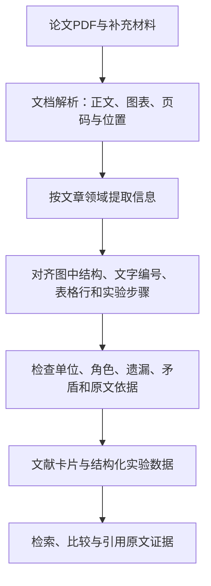

# 从文献到可检索、可追溯知识的 Pipeline

这个目标可以实现。输入应当是完整论文PDF、补充材料，以及已有文献元数据；输出既要供人阅读，也要供程序检索和比较。当前的MinerU全文／化学输出只是初步解析结果，尚未形成经过验证的知识数据库。

## 每篇文献应交付什么

1. **阅读层**：保留原PDF、正文MD、原图、表格，附标题、DOI和文献卡片。卡片说明研究问题、方法、主要发现、适用范围与局限。
2. **事实层**：按实验或表格行保存结构化记录，区分作者报告、模型推断、人工修正。记录缺失值与无法确定的对应关系，不猜测填充。
3. **证据层**：每个重要字段能定位到原文页码、图表编号、文字片段或图像区域；指明来自正文还是补充材料。
4. **使用层**：按底物、条件、性能等查询并比较，回答中引用对应证据；对原文没有报告的内容说明未知。

一个JSON文件可以包含多条实验记录，不应把整篇论文压缩成单个“反应”。每篇论文一个文件夹是归档方式，实验级记录是知识组织方式。

## 共用解析步骤，分别定义数据格式

| 有机合成／联烯反应 | 分子筛制备与性能实验 |
|---|---|
| 反应物、产物、试剂、催化剂及分子编号 | 原料、凝胶配比、模板剂、晶种及样品编号 |
| 当量、用量、溶剂、浓度 | 摩尔配比、pH及加入顺序 |
| 温度、时间、气氛及操作顺序 | 老化、晶化温度与时间及合成方式 |
| 收率、收率测定方法、ee／dr及分离步骤 | 洗涤、干燥、焙烧与离子交换 |
| 底物范围、失败实验、对照和表征 | 晶相、Si/Al比、孔结构、表征和性能测试条件 |

上表是建议的数据格式，不代表当前已经提取了这些字段。截图中“MDA”所指文章类型或数据源尚未确认。

## 最难的环节

- 原文把同一实验拆在反应图、表格、正文和补充材料中；需要可靠关联“化合物2a”“样品S3”等编号。
- R基团和底物范围图需要展开或保留明确的通式语义，不能把不可解析标签当作标准SMILES。
- 多步反应、试剂与反应物角色、表格合并单元格容易错配；单位或字段看似合理也可能属于另一行实验。
- 分子筛材料通常不能用单个小分子SMILES表示；应保留组成、晶相和材料表征等领域信息。
- 原文与补充材料可能含不同实验条件；须保存版本及证据，不能无依据合并。

## 怎样判断合格

先选择少量代表性论文，覆盖简单反应、复杂底物范围、多步实验和表格；另为材料论文准备独立样本。人工标注关键事实和出处，再评价：字段是否准确、是否漏掉实验、是否关联正确、单位转换是否正确、证据是否支持该字段。失败案例进入修复清单。

不能只检查JSON格式、SMILES能否解析或文件是否下载成功，也不能直接用论文中的模型基准准确率替代本项目验证。当前归档已出现条件OCR错误和表格错位，因此质量核查应当是流程的一部分。

## skill 与数据的关系

Skill可规定领域术语、提取格式、证据要求、核查步骤及查询方式。知识数据保存实验事实与证据。将提取信息做成skill时，应把可复用的操作规则写入skill，并由工具按需读取数据库，避免把整批论文都写进一个巨大的提示词。

建议先用现有联烯论文验证完整流程，再加入分子筛领域的数据格式和验证样本。当前仓库首先承担输入、初步输出与修复记录的归档；它还不是已建成的专家知识系统。
