RESEARCH ARTICLE

Published on 18 September 2024

Licence and permissions

Check for updates

Cite this: Org Chem Front , 2025, 12, 2401

# Photoredox copper-catalyzed regioselective syntheses of allenols via HAT-mediated propargyl radical generation†

Wenyao Li,a Hao Yu \*a and Shengming Ma \*a,b

Received 8th July 2024,

Accepted 7th September 2024

DOI: 10.1039/d4qo01245c

rsc.li/frontiers-organic

Selectivity control of the reactions of propargylic and/or allenylic radicals remains particularly elusive. Here, a visible light-mediated Cu-catalyzed protocol for the highly selective syntheses of tri- and tetrasubstituted allenols from alkynol derivatives has been developed. The synthetic potential of the products has been demonstrated. The control experiments, Stern–Volmer quenching, and cyclic voltammetry studies support a reaction pathway involving the generation of allenyl radicals via photo-mediated N–O bond scission, an intramolecular 1,5-HAT process, the resonance to propargylic radicals, and coupling. A non-common intramolecular 1,6-HAT process has also been observed.

## Introduction

Selectivity control is an everlasting topic in organic synthesis, advanced materials, and medicinal chemistry or life science. For example, it is of particular interest to see the chemistry on the propargylic/allenylic species due to the versatile potential of alkynes and allenes. Recently, much attention has been paid to the generation and reactivity of propargylic and/or allenylic radicals afording alkynes2 and/or allenes.3–6 However, the eficient generation of propargylic radicals and the selectivity-controlled trapping still remain particularly elusive (Fig. 1a). 1,5-Hydrogen atom transfer (HAT)7,8 mediated by alkoxyl radicals9,10 has emerged as an important strategy for $\mathrm { C } ( \mathrm { s p } ^ { 3 } ) \mathrm { - H }$ bond functionalization (Fig. 1b). Given the high eficiency of radical formation with this specific method, we wonder whether such an alkoxyl radical-induced HAT of alkynes would eficiently generate propargylic radicals followed by transition metal-catalyzed functionalization, providing an eficient and selective platform for synthesizing multi-substituted alkynes or allenes (Fig. 1c). However, notable challenges for such a concept included (Fig. 1c): firstly, the tautomeric equilibrium of propargylic radicals to allenyl radicals and the resulting control of selectivity for trapping of these two radicals;2–4 secondly, the introduction of the alkyne functional group and the formation of the allene functional group may lead to direct cyclic radical addition reactions;11 and thirdly, the facile HAT of allenyl radicals could produce other nonfunctionalized allene by-products before the transition metalcatalyzed functionalization occurs. In addition, it would be a platform reaction for the study on how far a HAT reaction may go. Here, we report our success on the exclusive synthesis of tri- and tetra-substituted allenes via visible-light photoredox and copper dual catalysis (Fig. 1d).

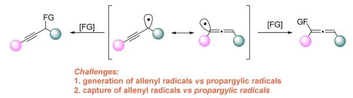

b) Prior art: Photo-catalyzed alkoxy radical-mediated intramolecular HAT for C(sp³)-H bond functionalizatior  
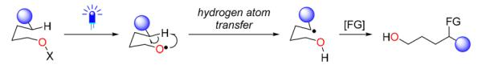  
c) Conceptual approach: Photo-catalyzed alkoxy radical-mediated intramolecular HAT for allene synthesis

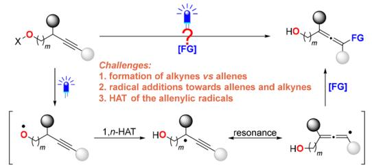

d) This work: Photoredox/copper cocatalysis for allenol syntheses from N-alkynoxyphtalimide  
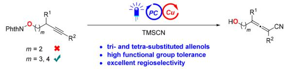  
Fig. 1 Development of a photoredox/copper cocatalysis strategy for allenol syntheses based on 1,5-HAT.

## Results and discussion

Our initial attempt used N-alkynoxyphthalimide 1a, which is easily obtained by the Mitsunobu reaction from the corresponding alkynol. We began investigating the coupling reaction of 1a with trimethylsilyl cyanide by applying a catalytic system consisting of 4CzIPN and CuCl/dmbpy in $\mathrm { C H } _ { 3 } \mathrm { C N }$ under blue LED irradiation, and the desired allene product $\mathbf { 2 } \mathbf { a } ^ { \prime }$ was aforded in 38% yield as determined by 1H NMR spectroscopy (Table 1, entry 1), without the formation of an alkyne product. The photocatalyst $\mathrm { { \bf M e s A c r ^ { + } C l O _ { 4 } } ^ { - } }$ resulted in a largely decreased yield of the allene product 2a′ (Table 1, entry 2). Further exploration of photocatalysts revealed that iridium complexes, such as Ir[(dtbbpy)( ppy)2]PF6 or Ir(ppy)3, were more eficient (Table 1, entries 3 and 4). Other copper catalysts such as CuBr and CuI (Table 1, entries 5 and 6) were also screened and CuCl was still the best. Subsequently, we tested a series of other bipyridine ligands, and identified 1,10-phenanthroline as equally excellent as dmbpy (Table 1, entry 7). We chose 1,10-phen as the ligand of preference finally in consideration of the price. Other alkynoxylamide derivatives, such as 3a and 4a, exhibited a much lower reactivity (Table 1, entries 8 and 9). Control experiments demonstrated that the CuCl/1,10- phen system, photocatalyst and light are indispensable for enabling this transformation to proceed smoothly (entries 10–12).

Table 1 Optimization of the reaction conditionsa
<table><tr><td colspan="2">0 0 1a 0.2 mmol</td><td>C6H13</td><td>PC (1 mol%), [Cu] (10 mol%), L (12 mol%) TMSCN (3.0 equiv) CH3CN (0.2 M), Ar, blue light, 24 h</td><td>YO</td><td>C6H13 CN</td></tr><tr><td>Entry</td><td>[Cu]</td><td></td><td></td><td>Yields of</td><td>RSMb  $2 \mathbf { a } ^ { \prime } / 2 \mathbf { a } ^ { b } \left( \% \right)$  (%)</td></tr><tr><td>1</td><td>CuCl</td><td>4CzIPN</td><td>dmbpy</td><td>38/0</td><td>50</td></tr><tr><td>2</td><td>CuCl</td><td>MesAcr+ClO₄</td><td>dmbpy</td><td>7/0</td><td>78</td></tr><tr><td>3</td><td>CuCl</td><td>Ir[(dtbbpy)(ppy)2]PF₆</td><td>dmbpy</td><td>80/0</td><td>0</td></tr><tr><td>4</td><td>CuCl</td><td>Ir(ppy)3</td><td>dmbpy</td><td>81/0</td><td>0</td></tr><tr><td>5</td><td>CuBr</td><td>Ir(ppy)3</td><td>dmbpy</td><td>79/0</td><td>0</td></tr><tr><td>6</td><td>CuI</td><td>Ir(ppy)3</td><td>dmbpy</td><td>60/0</td><td>0</td></tr><tr><td>7</td><td>CuCl</td><td>Ir(ppy)3</td><td>1,10-phen</td><td>81/0</td><td>0</td></tr><tr><td>8c</td><td>CuCl</td><td>Ir(ppy)3</td><td>1,10-phen</td><td>0/0</td><td>79</td></tr><tr><td>9d</td><td>CuCl</td><td>Ir(ppy)3</td><td>1,10-phen</td><td>24/0</td><td>75</td></tr><tr><td>10</td><td></td><td>Ir(ppy)3</td><td></td><td>12/0</td><td>2</td></tr><tr><td>11</td><td>CuCl</td><td></td><td>1,10-phen</td><td>0/0</td><td>96</td></tr><tr><td>12e</td><td>CuCl</td><td>Ir(ppy)₃3</td><td>1,10-phen</td><td>0/0</td><td>92</td></tr><tr><td>0 Ph N Ph</td><td>C6H13</td><td>O</td><td>C6H13</td><td></td><td></td></tr></table>

a The reaction was conducted with 1a (0.2 mmol), PC (1 mol%), [Cu] (10 mol%), L (12 mol%), and TMSCN (0.6 mmol) in CH CN (1 mL) under an Ar atmosphere, with blue LED (50 W, 460 nm) irradiation for 24 h. b The yield was determined by 1H NMR spectroscopy with CH Br as the internal standard. c 3a instead of 1a. d 4a instead of 1a. e The reaction was conducted without light. dmbpy = 4,4′-dimethyl-2,2′- bipyridine. 1,10-phen = 1,10-phenanthroline.

With the optimized conditions in hand, we conducted further investigations on the substrate scope of this reaction (Fig. 2). We found that a wide range of terminal alkynols are suitable for this transformation, leading to the successful preparation of the corresponding tri-substituted allenols 2a–2t smoothly. In terms of the alkyl groups $\mathbf { R } ^ { 1 }$ at the propargyl position, non-functionalized linear primary alkyl chains of various lengths (2a–2d) as well as alkyl substituents bearing ethers (2e and 2f), chloro (2g), acetal (2h), terminal olefin (2i), and aryls (2j–2m) were all found to be compatible under the standard conditions. $\mathbf { R } ^ { 1 }$ may also be secondary alkyl groups (2n–2p) or even a tertiary alkyl group (2q), resulting in the corresponding allenols in modest to good yields. Furthermore, beyond the alkyl-substituted substrates, the reaction of the substrate with $\mathbf { R } ^ { 1 }$ as phenyl yielded 2r smoothly, achieving a yield of 66%. Furthermore, the synthesis of secondary allenols 2s and 2t was realized with yields of 76% and 60%, respectively. Finally, this protocol also worked for internal alkynols with $\mathbf { R } ^ { 2 }$ being alkyl, phenylalkyl or phenyl groups, afording tetra-substituted allenols (2u–2ae).

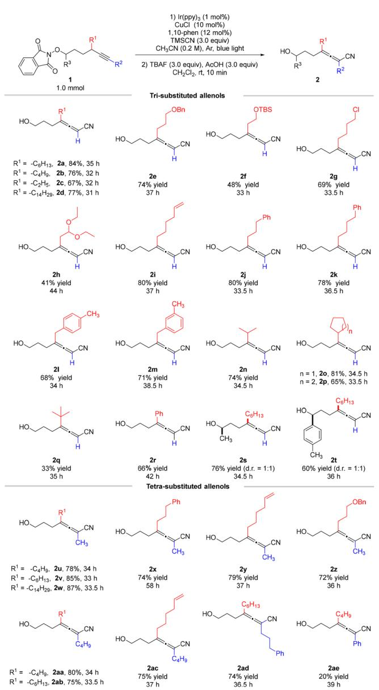  
Fig. 2 Substrate scope for the syntheses of tri- and tetra-substituted allenols.

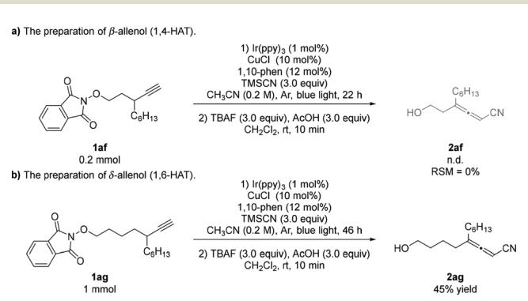  
Fig. 3 Investigation of the 1,4- and 1,6-HAT pathways.

Furthermore, various N-alkynoxyphthalimide precursors with diverse tether sizes were employed to investigate the potential of our protocol for 1,4- or 1,6-HAT (Fig. 3). When subjected to the standard conditions, compound 1af failed to yield the corresponding beta-allenol 2af, with the complete consumption of the starting material observed (Fig. 3a). Conversely, the reaction of substrate 1ag with TMSCN resulted in the formation of delta-allenol 2ag in 45% yield, involving 1,6-HAT. Furthermore, endeavors to synthesize the initial N-alkynoxyphthalimide precursor for alpha-allenols proved unsuccessful (see Fig. S4 in the ESI†).

To demonstrate the synthetic potential of this reaction, a gram-scale reaction was conducted using 7 mmol of 1a, resulting in the formation of allenol 2a with an isolated yield of 73% (1.1 g) (Fig. 4a). These allenols are versatile synthetic building blocks as shown in Fig. 4b. In the presence of $\mathrm { C s } _ { 2 } \mathrm { C O } _ { 3 } ,$ allenol 2a underwent oxycyclization to give the dihydropyran product 5, which may further react with 4-chlorobenzyl bromide12 to produce the dihydropyran product 6 in a one-pot reaction. The

a) Gram-scale reactior

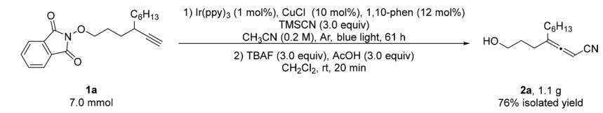

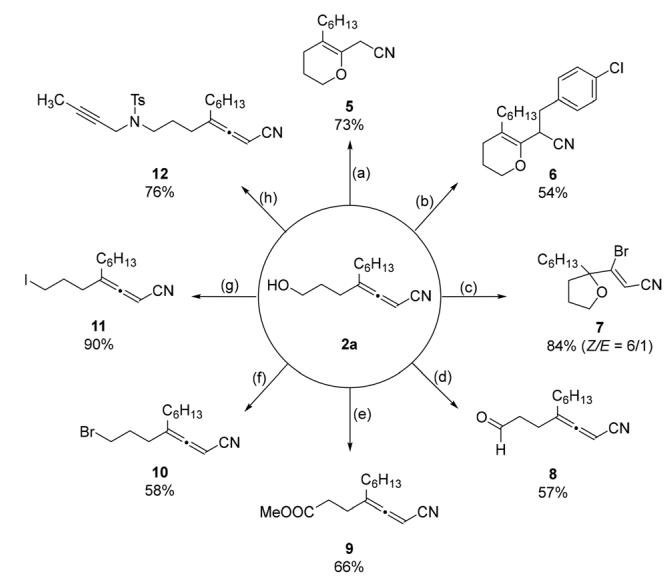  
Fig. 4 Gram-scale reaction and synthetic applications. a Reaction conditions: (a) 2a (0.2 mmol), ${ \mathsf { C s } } _ { 2 } { \mathsf { C O } } _ { 3 }$ (1.0 equiv.), CH CN, rt, 12 h; (b) 2a (0.2 mmol), 4-chlorobenzyl bromide (1.1 equiv.), TBAI (5 mol%), NaH (2.0 equiv.), THF, ${ 0 } ~ ^ { \circ } \mathsf { C }$ to rt, $\mathsf { A r } ,$ 22 h; (c) 2a (0.2 mmol), NBS (1.2 equiv.), DCM/ ${ \sf T H F } = 4 / 1 , { \sf r t } .$ , 12 h; (d) 2a (0.2 mmol), $\mathsf { F e } ( \mathsf { N O } _ { 3 } ) _ { 3 } { \cdot } \mathsf { 9 H } _ { 2 } \mathsf { O }$ (20 mol%), TEMPO (20 mol%), NaCl (20 mol%), DCE (0.05 M), $\mathsf { O } _ { 2 } , \mathsf { r t } ,$ 11 h; (e) (i) 2a (0.2 mmol), Fe(NO ) ·9H O (20 mol%), TEMPO (20 mol%), KCl (20 mol%), DCE $( 0 . 2 \ M ) , \ 0 _ { 2 } , \ \mathsf { r t } , \ 3 0$ h; (ii) TMSCHN (1.5 equiv.), Et O/MeOH = 4/1, 0 °C to rt, 15 h; (f) 2a (0.2 mmol), PPh (1.5 equiv.), $\mathsf { C B r } _ { 4 }$ (1.5 equiv.), DCM, 0 °C to rt, 24 h; (g) 2a (0.2 mmol), $\mid _ { 2 } ( 1 . 2$ equiv.), $\mathsf { P P h } _ { 3 }$ (1.2 equiv.), imidazole (1.2 equiv.), DCM, rt, 0.5 h; (h) 2a (1.15 equiv.), N-(but-2-yn-1-yl)-4-methylbenzenesulfonamide (0.2 mmol), $\mathsf { P P h } _ { 3 }$ (1.35 equiv.), DIAD (1.35 equiv.), THF, ${ 0 } \ ^ { \circ } { \mathsf { C } }$ to rt, $\mathsf { A r } ,$ 23 h.

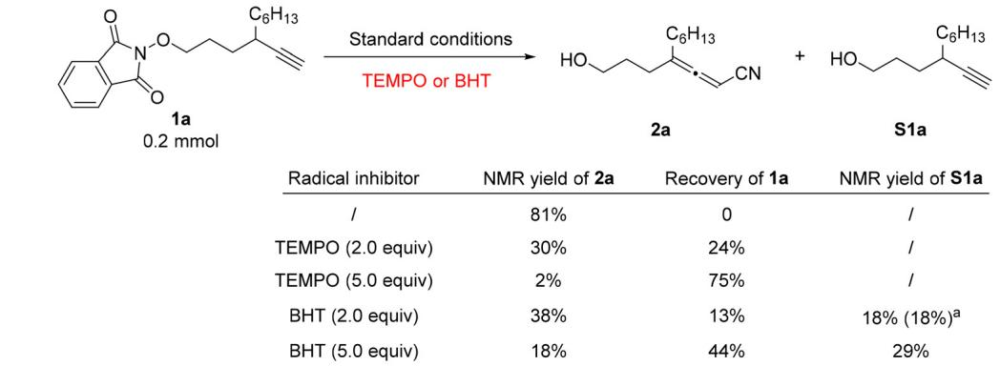

a) Radical inhibiting experiments

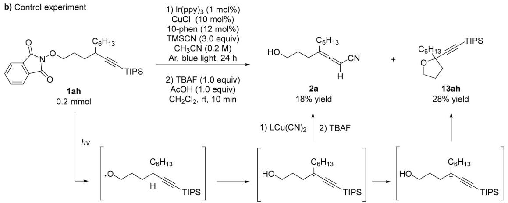

c) Stern-Volmer quenching experiments of Ir(ppy)3 tetrahydrofuran product 7 was obtained through bromocyclization13 with NBS in 84% yield. In addition, aerobic oxidation of 2a aforded allenal 8 under the catalysis of 20 mol% each of Fe $\left( \mathrm { N O } _ { 3 } \right) _ { 3 } { \cdot } 9 \mathrm { H } _ { 2 } \mathrm { O } _ { 3 }$ , TEMPO, and NaCl in $\mathrm { D C E . } ^ { 1 4 }$ Meanwhile, under the catalytic system of $\mathrm { F e } \left( \mathrm { N O } _ { 3 } \right) _ { 3 } { \cdot } 9 \mathrm { H } _ { 2 } \mathrm { O } ,$ TEMPO, and KCl, 2a was converted into carboxylic acid, which was further esterified with TMSCHN in one pot to provide allenoate 9 in 66% yield over two steps.15 Upon treatment with $\mathrm { C B r _ { 4 } }$ and ${ \bf I } _ { 2 } ,$ the allenol product 2a could be easily transformed into the synthetically versatile allenyl bromide 10 and allenyl iodide 11, respectively.16,17 Finally, 2a may readily undergo a Mitsunobu reaction18 to aford allenyne 12 in a decent yield.

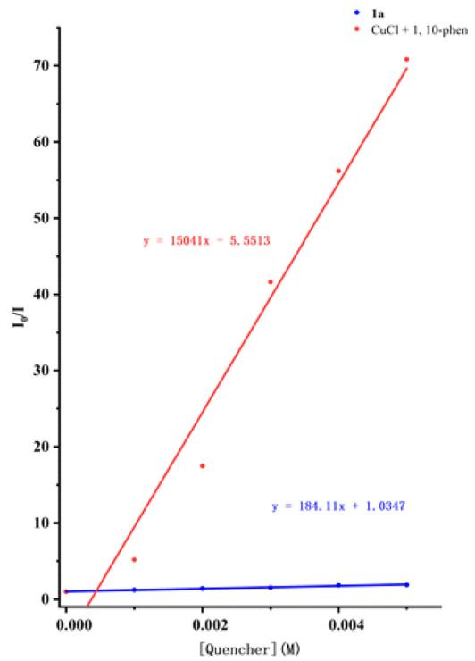  
Fig. 5 Mechanistic studies. a Isolated yield.

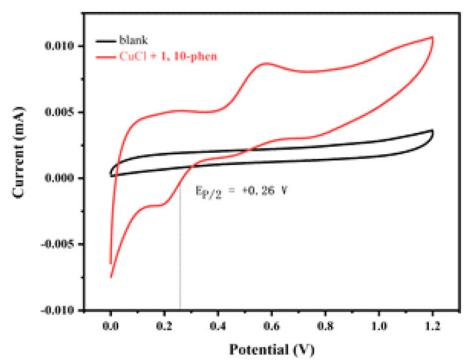

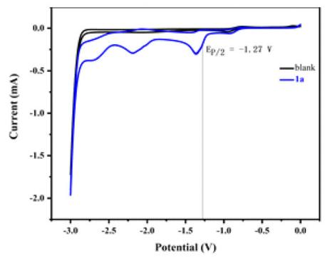

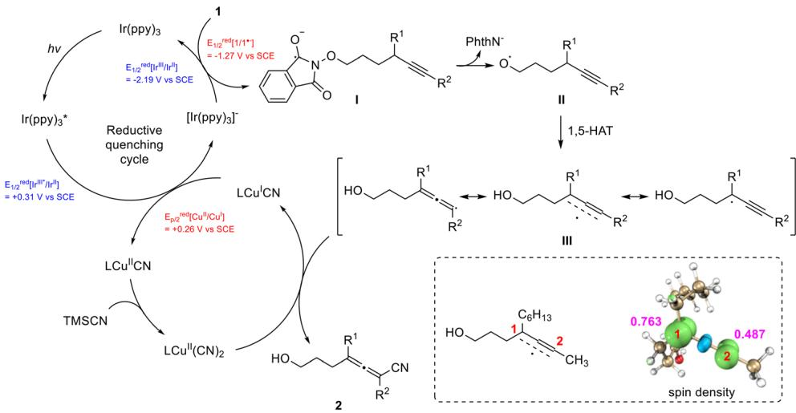  
Fig. 6 Proposed mechanism.  
$\left( E _ { 1 / 2 } ^ { \mathrm { r e d } } \ \left[ \mathrm { I r } ^ { \mathrm { I I I } _ { \ast } } / \mathrm { I r } ^ { \mathrm { I I } } \right] = + 0 . 3 1 \ \mathrm { V } \right.$ vs. SCE in $\mathrm { C H } _ { 3 } \mathrm { C N } ) , ^ { 1 9 }$ which can be $[ \mathrm { C u ^ { I I } / C u ^ { I } } ] = + 0 . 2 6 \mathrm { ~ V ~ }$ vs. SCE in CH CN) to generate $\mathrm { L C u } ^ { \mathrm { I I } } ( \mathrm { C N } )$ and [Ir(ppy) ]− species. $\big [ \mathrm { I r } \big ( \mathrm { p p y } \big ) _ { 3 } \big ] ^ { - } \ \big ( E _ { 1 / 2 } ^ { \mathrm { r e d } } \ \big [ \mathrm { I r } ^ { \mathrm { I I I } } / \mathrm { I r } ^ { \mathrm { I I } } \big ] = - 2 . 1 9 \ \mathrm { V }$ vs. SCE in $\mathrm { C H } _ { 3 } \mathrm { C N } ) ^ { 1 9 }$ would reduce substrate $\mathbf { 1 } \left( E _ { \mathrm { p / 2 } } ^ { \mathrm { r e d } } \left[ \mathbf { 1 } \mathbf { a } / \mathbf { 1 } \mathbf { a } ^ { \bullet - } \right] = - 1 . 2 7 \mathbf { V } \right.$ vs. SCE), producing radical anion intermediate I and regenerating the photocatalyst $\operatorname { I r } ( \mathtt { p p y } ) _ { 3 }$ . Subsequently, alkoxy radical intermediate II would be generated via the cleavage of the N–O bond of intermediate I. The subsequent intramolecular 1,5-HAT would generate radical intermediate III. Mulliken atomic spin density analysis suggests that intermediate III is a delocalized radical, with the spin density distributed across both ends of the system (0.763 at C1 and 0.487 at $\mathbf { C } 2 ,$ with $\mathbf { R } ^ { 1 }$ being n-hexyl and $\mathbf { R } ^ { 2 }$ being methyl). Finally, intermediate III can be trapped by the $\mathrm { L C u } ^ { \mathrm { I I } } ( \mathrm { C N } ) _ { 2 }$ species, leading to the formation of the allene product 2.

To gain mechanistic insights into the reaction, firstly, we conducted the reaction of 1a in the presence of radical trapping agents such as TEMPO and BHT. As shown in Fig. 5a, the yield of the desired allenols dropped dramatically with the increase in the amount of the radical inhibitor. In addition, when BHT was used, the alkynol product S1a, resulting from intermolecular HAT of the initially formed alkoxyl radical, was detected. When the internal alkyne 1ah substituted with the triisopropylsilyl group was subjected to the standard conditions, in addition to the normal allene product 2a, the isolation of the tetrahydrofuranyl triisopropylsilyl acetylene product 13ah indicated the involvement of a propargylic cation, which may be formed via the oxidation of a propargylic radical intermediate (Fig. 5b). Moreover, Stern–Volmer quenching experiments (Fig. 5c) demonstrated that the CuCl/ 1,10-phen catalyst, rather than the substrate 1a, quenched the excited-state photocatalyst $\operatorname { I r } ( { \mathsf { p p y } } ) _ { 3 } ,$ suggesting a reductive quenching pathway. The half peak potential of the catalyst CuCl/1,10-phen $E _ { \mathrm { p / 2 } } ^ { \mathrm { r e d } } \quad [ \mathrm { C u } ^ { \mathrm { I I } } / \mathrm { C u } ^ { \mathrm { I } } ]$ was determined by Cyclic Voltammetry (CV) experiments to be +0.26 V vs. SCE in CH CN and the half peak potential of substrate 1a $E _ { \mathrm { p } / 2 } ^ { \mathrm { r e d } } \ [ 1 \mathbf { a } / 1 \mathbf { a } ^ { * - } ]$ was determined to be −1.27 V vs. SCE in CH CN (Fig. 5d).

On the basis of these experimental results, a plausible reaction mechanism was proposed (Fig. 6). Initially, the excitation of the photocatalyst Ir(ppy)3 leads to its excited state $\operatorname { I r } ^ { * } ( \mathrm { p p y } ) { \mathrm { { z } } }$

## Conclusions

In summary, we have developed a unified platform for the highly selective preparation of tri- and tetra-substituted allenols. This approach leverages dual copper and photoredox catalysis to enable the generation and functionalization of allenyl radicals. This mild reaction demonstrates a broad substrate scope, and the post-reaction transformations of the allenol products highlight the significant synthetic potential of this methodology.

## Author contributions

S. M., H. Y. and W. L. designed the experiments. W. L. performed the experiments. W. $\mathbf { L . , }$ H. Y. and S. M. wrote the manuscript. W. L., H. Y. and S. M. checked the experimental data.

## Data availability

All detailed procedures, characterization data, computational details, and spectra are available in the ESI.†

## Conflicts of interest

The authors declare no competing interests.

## Acknowledgements

Financial support from the National Key R&D Program of China (Grant No. 2022YFA1503200 for S. Ma and H. Yu) and the Shanghai Sailing Program (20YF1402100 for H. Yu) is greatly appreciated. We thank Mr Yaqi Shi in this group for reproducing the results of 2g and 2l in Fig. 2. We thank Mr Dong Huang and Dr Xue Zhang in this group for the Mulliken atomic spin density analysis and their helpful discussion.

## References

1 (a) Z. Huang and G. Dong, Site-selectivity control in organic reactions: A quest to diferentiate reactivity among the same kind of functional groups, Acc. Chem. Res., 2017, 50, 465; (b) L. M. Stateman, K. M. Nakafuku and D. A. Nagib, Remote C–H functionalization via selective hydrogen atom transfer, Synthesis, 2018, 1569.

2 For a recent review on the synthesis of alkynes via propargylic and allenylic radicals, see: (a) F. Wang, P. Chen and G. Liu, Copper-catalysed asymmetric radical cyanation, Nat. Synth., 2022, 1, 107. For selected recent examples, see: (b) F. Lu, D. Liu, L. Zhu, L. Lu, Q. Yang, Q. Zhou, Y. Wei, Y. Lan and W. Xiao, Asymmetric propargylic radical cyanation enabled by dual organophotoredox and copper Catalysis, J. Am. Chem. Soc., 2019, 141, 6167; (c) Y. Deng, R. Lu, P. Chen and G. Liu, Enantioselective cyanation of propargylic C–H bonds via cooperative photoredox and copper catalysis, Chem. Commun., 2023, 59, 4656; (d) J. Xia, X. Zhu and H. Bao, Copper-catalyzed enantioselective radical esterification of propargylic C–H bonds, Synthesis, 2024, 1393; (e) S. Lu, R. Agata, S. Nomura, H. Matsuda, K. Isozaki and M. Nakamura, Regioselective propargylic Suzuki−Miyaura coupling by SciPROP-Iron catalyst, J. Org. Chem., 2024, 89, 8385.

3 For reviews, see: (a) L. Fu, S. Greßies, P. Chen and G. Liu, Recent advances and perspectives in transition metal-catalyzed 1,4-functionalizations of unactivated 1,3-enynes for the synthesis of allenes, Chin. J. Chem., 2020, 38, 91; (b) Y. Li and H. Bao, Radical transformations for allene synthesis, Chem. Sci., 2022, 13, 8491.

4 For a selection of recent reports on the formation of allenyl radicals through radical addition to 1,3-enynes, see: (a) F. Wang, D. Wang, Y. Zhou, L. Liang, H. Lu, P. Chen, Z. Lin and G. Liu, Divergent synthesis of CF -substituted

allenyl nitriles by ligand-controlled radical 1,2- and 1,4- addition to 1,3-enynes, Angew. Chem., Int. Ed., 2018, 57, 7140; (b) X. Zhu, W. Deng, M.-F. Chiou, C. Ye, W. Jian, Y. Zeng, Y. Jiao, L. Ge, Y. Li, X. Zhang and H. Bao, Coppercatalyzed radical 1,4-difunctionalization of 1,3-enynes with alkyl diacyl peroxides and N–fluorobenzenesulfonimide, J. Am. Chem. Soc., 2019, 141, 548; (c) K. Zhang, K. Bian, C. Li, J. Sheng, Y. Li and X. Wang, Nickel-catalyzed carbo fluoroalkylation of 1,3-enynes to access structurally diverse fluoroalkylated allenes, Angew. Chem., Int. Ed., 2019, 58, 5069; (d) C. Ye, Y. Li, X. Zhu, S. Hu, D. Yuan and H. Bao, Copper-catalyzed 1,4-alkylarylation of 1,3-enynes with masked alkyl electrophiles, Chem. Sci., 2019, 10, 3632; (e) Y. Zeng, M.-F. Chiou, X. Zhu, J. Cao, D. Lv, W. Jian, Y. Li, X. Zhang and H. Bao, Copper-catalyzed enantioselective radical 1,4-difunctionalization of 1,3-enynes, J. Am. Chem. Soc., 2020, 142, 18014; (f) X. Dong, T. Zhan, S. Jiang, X. Liu, L. Ye, Z. Li, Q. Gu and X. Liu, Copper-catalyzed asymmetric coupling of allenyl radicals with terminal alkynes to access tetrasubstituted allenes, Angew. Chem., Int. Ed., 2021, 60, 2160; (g) Y. Chen, J. Wang and Y. Lu, Decarboxylative 1,4- carbocyanation of 1,3-enynes to access tetra-substituted allenes via copper/photoredox dual catalysis, Chem. Sci., 2021, 12, 11316; (h) L. Wang, R. Ma, J. Sun, G. Zheng and Q. Zhang, NHC and visible light-mediated photoredox cocatalyzed 1,4-sulfonylacylation of 1,3-enynes for tetrasubstituted allenyl ketones, Chem. Sci., 2022, 13, 3169; (i) H. Chen, C. Zhu, H. Yue and M. Rueping, Group 14 elements hetero-difunctionalizations via nickel-catalyzed electroreductive cross-coupling, Angew. Chem., Int. Ed., 2023, 62, e202306498; (j) C. Kuai, B. Teng and X. Wu, Palladium-catalyzed carbonylative multicomponent fluor oalkylation of 1,3-enynes: Concise construction of diverse cyclic compounds, Angew. Chem., Int. Ed., 2024, 63, e202318257; (k) Q. Shan, Y. Zhao, S. Wang, H. Liu, X. Duan and L. Guo, Nickel-catalyzed modular four-component 1,4- alkylcarbonylation of 1,3-enynes to tetra-substituted CF −allenyl ketones, ACS Catal., 2024, 14, 2144; (l) Y. Pu, S. Ding, H. Zhao, Q. Xue, H. Zhang, X. Xie, Y. Shang and J. Wang, Three-component synthesis of multiple functiona lized allenes via copper/photoredox dual catalyzed 1,4-alkylcyanation of 1,3-enynes, Org. Lett., 2024, 26, 1834; (m) Y. Chen, Q. Wang, K. Peng, L. Cheng, Z. She and G. Deng, Copper/photoredox-catalyzed regioselective 1,4- addition to 1,3-enynes: A convenient access to perfluoroalkylated allenes, Chin. J. Chem., 2024, 42, 2023; (n) J. Zhang, J. Xiong, L. Fei, F. Cui, S. Li, H. Tang, Y. Xie and Y. Pan, Electrochemically mediated synthesis of trifluoromethylallenes, Org. Chem. Front., 2024, 11, 3485; (o) J. H. Jeon, G. H. Kim, H. S. Lee, D. H. Kim, S. Lee, W. Choe, B. Jung, J. Rohde and S. Y. Hong, Chemo- and regioselective nickel-catalyzed reductive 1,4-alkylarylation of 1,3-enynes through an L NiAr intermediate, ACS Catal., 2024, 14, 8996.

5 For a selection of recent reports on the formation of allenyl radicals from alkynes, see: (a) R. Soler-Yanes, I. Arribas-

Álvarez, M. Guisán-Ceinos, E. Buñuel and D. J. Cárdenas, NiI catalyzes the regioselective cross-coupling of alkylzinc halides and propargyl bromides to allenes, Chem. – Eur. J., 2017, 23, 1584; (b) P. Domingo-Legarda, R. Soler-Yanes, M. T. Quirós-López, E. Buñuel and D. J. Cárdenas, Ironcatalyzed coupling of propargyl bromides and alkyl grignard reagents, Eur. J. Org. Chem., 2018, 4900; (c) F. W. Friese and A. Studer, Deoxygenative borylation of secondary and tertiary alcohols, Angew. Chem., Int. Ed., 2019, 58, 9561; (d) R. Lu, T. Yang, X. Chen, W. Fan, P. Chen, Z. Lin and G. Liu, Enantioselective copper-catalyzed radical cyanation of propargylic C−H bonds: easy access to chiral allenyl nitriles, J. Am. Chem. Soc., 2021, 143, 14451; (e) W. Zhang, L. Lu, W. Zhang, Y. Wang, S. D. Ware, J. Mondragon, J. Rein, N. Strotman, D. Lehnherr, K. A. See and S. Lin, Electrochemically driven cross-electrophile coupling of alkyl halides, Nature, 2022, 604, 292; (f) Q. Liu, J. Zheng, X. Zhang and S. Ma, Photo and copper dual catalysis for allene syntheses from propargylic derivatives via one-electron process, Nat. Commun., 2022, 13, 3302; (g) F. Lu, Z. Shu, G. He, J. Bai, L. Lu and W. Xiao, Photoinduced C–O bond cleavage for copper-catalyzed allenyl radical cyanation, Org. Chem. Front., 2022, 9, 5259; (h) D. Zhang, J. Fan, Y. Shi, Y. Huang, C. Fu, X. Wu and S. Ma, Copper-catalyzed propargylic C–H functionalization for allene syntheses, Chem. Sci., 2023, 14, 9191; (i) J. Qin, Z. Xiong, C. Cheng, M. Hu and J. Li, Electroreductive carboxylation of propargylic acetates with $\mathrm { C O } _ { 2 } \colon$ access to tetrasubstituted 2,3-allenoates, Org. Lett., 2023, 25, 9176.

6 For a selection of recent reports on the formation of allenyl radicals from allenes, see: (a) Y. Wei, X. Wu, Y. Chen and C. Zhu, Radical-polar crossover allenylation of alkenes: divergent synthesis of homoallenic alcohols and amides, Chem. Catal., 2023, 3, 100551; (b) Z. Cheng, T. Yang, C. Li, Y. Deng, F. Zhang, P. Chen, Z. Lin, S. Ma and G. Liu, Siteselective sp2 C−H cyanation of allenes via copper-catalyzed radical relay, J. Am. Chem. Soc., 2023, 145, 25995; (c) Y. Wei, Z. Wang, K. Wang, J. Qiu, Z. Wang, H. Li, X. Duan, K. Guo, X. Bao and X. Wu, Copper-catalyzed radical allene C(sp2)−H cyanation, Angew. Chem., Int. Ed., 2024, 63, e202317132.

7 For selected reviews on 1,5-HAT, see: (a) Ž. Čeković, Reactions of carbon radicals generated by 1,5-transposition of reactive centers, J. Serb. Chem. Soc., 2005, 70, 287; (b) S. Chiba and H. Chen, Sp3 C–H oxidation by remote H-radical shift with oxygen- and nitrogen-radicals: a recent update, Org. Biomol. Chem., 2014, 12, 4051; (c) L. M. Stateman, K. M. Nakafuku and D. A. Nagib, Remote C–H functionalization via selective hydrogen atom transfer, Synthesis, 2018, 1569; (d) N. Goswami and D. Maiti, An update on distal C(sp3)-H functionalization involving 1,5-HAT emerging from nitrogen radicals, Isr. J. Chem., 2020, 60, 303; (e) X. Wu and C. Zhu, Radical functionalization of remote C(sp3)–H bonds mediated by unprotected alcohols and amides, CCS Chem., 2020, 2, 813; (f) H. Chen and S. Yu, Remote C–C bond formation via visible light photoredox-catalyzed intramolecular hydrogen atom transfer, Org. Biomol. Chem., 2020, 18, 4519; (g) S. Sarkar, K. P. S. Cheung and V. Gevorgyan, C–H functionalization reactions enabled by hydrogen atom transfer to carbon-centered radicals, Chem. Sci., 2020, 11, 12974; (h) W. Li and C. Zhu, Radically initiated distal C(sp3)–Hfunctionalization, Wiley-VCH, Weinheim, 2021, pp. 315–341; (i) W. Guo, Q. Zhang and J. Zhu, Visible light photoredox-catalysed remote C–H functionalisation enabled by 1,5-hydrogen atom transfer (1,5-HAT), Chem. Soc. Rev., 2021, 50, 7359; (j) H. Liu, Q. Jin and X. Wu, Intramolecular hydrogen atom transfer from unactivated C(sp3)-H bond to alkyl radical, Eur. J. Org. Chem., 2024, e202301280.

8 For some seminal reports on 1,5-HAT, see: (a) A. W. Hofmann, Ueber die Einwirkung des Broms in alkalischer Lösung auf die Amine, Ber. Dtsch. Chem. Ges., 1883, 16, 558; (b) D. H. R. Barton, The use of photochemical reactions in organic sunthesis, Pure Appl. Chem., 1968, 16, 1. For selected recent reports on 1,5-HAT reactions, see: (c) H. Jiang and A. Studer, α-Aminoxy-acid-auxiliaryenabled intermolecular radical γ-C(sp3)-H functionalization of ketones, Angew. Chem., Int. Ed., 2018, 57, 1692; (d) J. Liu, Y. Wei and M. Shi, Direct activation of a remote C(sp3)–H bond enabled by a visible-light photosensitized allene moiety, Angew. Chem., Int. Ed., 2021, 60, 12053; (e) K. M. Nakafuku, Z. Zhang, E. A. Wappes, L. M. Stateman, A. D. Chen and D. A. Nagib, Enantioselective radical C–H amination for the synthesis of β-amino alcohols, Nat. Chem., 2020, 12, 697; (f) L. Zhong, Z. Xiong, X. Ouyang, Y. Li, R. Song, Q. Sun, X. Lu and J. Li, Intermolecular 1,2-difunctionalization of alkenes enabled by fluoroamide-directed remote benzyl C(sp3)−H functionalization, J. Am. Chem. Soc., 2022, 144, 339; (g) Y. Zhou, Y. Qin, Q. Wang, Z. Zhang and G. Zhu, Photocatalytic sulfonylcarbocyclization of alkynes using SEt as a traceless directing group: Access to cyclopentenes and indenes, Angew. Chem., Int. Ed., 2022, 61, e202110864; (h) H. Liu, X. Kong, X. Gong, Y. Li, Z. Niu, X. Gou, X. Li, Y. Wang, W. Shi, Y. Huang, X. Liu and Y. Liang, Site-selective coupling of remote C(sp3)–H/meta-C(sp2)–H bonds enabled by Ru/photoredox dual catalysis and mechanistic studies, Chem. Sci., 2022, 13, 5382; (i) R. Guo, H. Xiao, S. Li, Y. Luo, J. Bai, M. Zhang, Y. Guo, X. Qi and G. Zhang, Photoinduced copper-catalyzed asymmetric C(sp3)-H alky nylation of cyclic amines by intramolecular 1,5-hydrogen atom transfer, Angew. Chem., Int. Ed., 2022, 61, e202208232; (j) S. Chen, B. Yuan, Y. Wang and L. Ackermann, Ruthenium-catalyzed remote difunctionalization of nonactivated alkenes for double meta-C(sp2)–H/C-6(sp3)–H functionalization, Angew. Chem., Int. Ed., 2023, 62, e202301168; (k) W. Li, B. Sun, L. Zhang and F. Mo, Photocarboxylation of remote C–H bonds through nitrogen-centred radical 1,5-hydrogen atom transfer, Green Chem., 2023, 25, 5030; (l) J. Wang, Y. Zhang, L. Zhu, X. Xue and C. Li, Photoinduced remote C(sp3)–H phosphonylation

of amides, Angew. Chem., Int. Ed., 2024, 63, e202400856; (m) Y. Zhou, K. He, W. Zheng, J. Lv, S. He, N. Yu, Y. Yang, L. Liu, K. Jiang and Y. Wei, 1,5-Hydrogen atom transfer of α-iminyl radical cations: A new platform for relay annulation for pyridine derivatives and axially chiral heterobiaryls, Chem. Sci., 2024, 15, 7502.

9 For selected reviews on alkoxyl radicals, see: (a) K. Jia and Y. Chen, Visible-light-induced alkoxyl radical generation for inert chemical bond cleavage/functionalization, Chem. Commun., 2018, 54, 6105; (b) E. Tsui, H. Wang and R. R. Knowles, Catalytic generation of alkoxy radicals from unfunctionalized alcohols, Chem. Sci., 2020, 11, 11124; (c) L. Chang, Q. An, L. Duan, K. Feng and Z. Zuo, Alkoxy radicals see the light: New paradigms of photochemical synthesis, Chem. Rev., 2022, 122, 2429; (d) A. S. Budnikov, I. B. Krylov, A. V. Lastovko, B. Yu and A. O. Terent’ev, Copper/photoredox dual catalyzed syntheses of allenenitriles via 1,5-HAT, Asian J. Org. Chem., 2022, 11, e202200262; (e) J. Liu, J. Jin, K. Zhang and L. Cai, Alkoxy radical induced transformations from N-alkoxyphthalimides under the photoredox catalysis, Asian J. Org. Chem., 2023, 12, e202300160; (f) Y. Zhu, H. Wang, P. Shu, K. Zhang and Q. Wang, Recent advances on alkoxy radicals-mediated C(sp3)–H bond functionalization via 1,5-hydrogen atom transfer, Chin.J. Org. Chem., 2024, 44, 1.

10 For selected recent reports on 1,5-HAT reactions mediated by alkoxyl radicals, see: (a) J. Zhang, Y. Li, F. Zhang, C. Hu and Y. Chen, Generation of alkoxyl radicals by photoredox catalysis enables selective C(sp3)–H functionalization under mild reaction conditions, Angew. Chem., Int. Ed., 2016, 55, 1872; (b) A. Hu, J. Guo, H. Pan, H. Tang, Z. Gao and Z. Zuo, δ–Selective functionalization of alkanols enabled by visible-light-induced ligand-to-metal charge transfer, J. Am. Chem. Soc., 2018, 140, 1612; (c) Y. Zhu, K. Huang, J. Pan, X. Qiu, X. Luo, Q. Qin, J. Wei, X. Wen, L. Zhang and N. Jiao, Silver-catalyzed remote Csp3-H functionalization of aliphatic alcohols, Nat. Commun., 2018, 9, 2625; (d) X. Wu, H. Zhang, N. Tang, Z. Wu, D. Wang, M. Ji, Y. Xu, M. Wang and C. Zhu, Metal-free alcohol-directed regioselective heteroarylation of remote unactivated C(sp3)–H bonds, Nat. Commun., 2018, 9, 3343; (e) H. Guan, S. Sun, Y. Mao, L. Chen, R. Lu, Ji. Huang and L. Liu, Iron(II)-catalyzed site-selective functionalization of unactivated C(sp3)-H Bonds guided by alkoxyl radicals, Angew. Chem., Int. Ed., 2018, 57, 11413; (f) Y. Li, Y. Bi, W. Ke, C. Wang, D. Hu, Y. Li and X. Wang, Copper/photoredox dual catalyzed syntheses of allenenitriles via 1,5-HAT, Asian J. Org. Chem., 2023, 12, e202300234; (g) G. Li, X. Hu, G. He and G. Chen, Photoredox-mediated remote C(sp3)–H heteroarylation of free alcohols, Chem. Sci., 2019, 10, 688; (h) X. Bao, Q. Wang and J. Zhu, Dual photoredox/copper catalysis for the remote C(sp3)-H functionalization of alcohols and alkyl halides by N-alkoxypyridinium salts, Angew. Chem., Int. Ed., 2019, 58, 2139; (i) A. N. Herron, D. Liu, G. Xia and J. Yu, δ–C−H mono- and dihalogenation of alco-

hols, J. Am. Chem. Soc., 2020, 142, 2766; (j) N. Xiong, Y. Li and R. Zeng, Iron-catalyzed photoinduced remote C(sp3)−H amination of free alcohols, Org. Lett., 2021, 23, 8968; (k) Z. Jue, Y. Huang, J. Qian and P. Hu, Visible lightinduced unactivated δ-C(sp3)-H amination of alcohols catalyzed by iron, ChemSusChem, 2022, 15, e202201241; (l) L. Huang, J. Sun, B. Sun, S. Song and J. Li, Regioselective synthesis of isoquinolinonediones through remote unactivated C(sp3)–H bonds, Chem. Commun., 2024, 60, 4818; (m) D. S. Finis and D. A. Nicewicz, Alkoxy radical generation mediated by sulfoxide cation radicals for alcohol-directed aliphatic C−H functionalization, J. Am. Chem. Soc., 2024, 146, 16830.

11 For reviews on radical additions to allenes or alkynes, see: (a) L. Liu, R. M. Ward and J. M. Schomaker, Mechanistic aspects and synthetic applications of radical additions to allenes, Chem. Rev., 2019, 119, 12422; (b) G. Qiu, J. Zhang, K. Zhou and J. Wu, Recent advances in the functionalization of allenes via radical process, Tetrahedron, 2018, 74, 7290; (c) C. Hu, J. Mena and I. V. Alabugin, Design principles of the use of alkynes in radical cascades, Nat. Rev. Chem., 2023, 7, 405; (d) M. Huang, W. Hao, G. Li, S. Tu and B. Jiang, Recent advances in radical transformations of internal alkynes, Chem. Commun., 2018, 54, 10791.

12 C. Li, Z. Yang, L. Wang, Y. Guo, Z. Huang and S. Ma, Cobalt-catalyzed regio- and stereoselective hydroboration of allenes, Angew. Chem., Int. Ed., 2020, 59, 6278.

13 J. Li, C. Fu, G. Chen, G. Chai and S. Ma, Studies on electrophilic interaction of 2,3-allenols with electrophilic halogen reagents: Selective synthesis of 2,5-dihydrofurans, 3-halo-3- alkenals, or 2-halo-2-alkenyl ketones, Adv. Synth. Catal., 2008, 350, 1376.

14 S. Ma, J. Liu, S. Li, B. Chen, J. Cheng, J. Kuang, Y. Liu, B. Wan, Y. Wang, J. Ye, Q. Yu, W. Yuan and S. Yu, Development of a general and practical iron nitrate/ TEMPO-catalyzed aerobic oxidation of alcohols to aldehydes/ketones: Catalysis with table salt, Adv. Synth Catal., 2011, 353, 1005.

15 X. Jiang, J. Zhang and S. Ma, Iron catalysis for room-temperature aerobic oxidation of alcohols to carboxylic acids, J. Am. Chem. Soc., 2016, 138, 8344.

16 N. Xiong, Y. Li and R. Zeng, Iron-catalyzed photoinduced remote C(sp3)−H amination of free alcohols, Org. Lett., 2021, 23, 8968.

17 D. Ma, X. Duan, C. Fu, X. Huang and S. Ma, Dimethylprolinol versus diphenylprolinol in CuBr -catalyzed enantioselective allenylation of terminal alkynols, Synthesis, 2018, 2533.

18 Y. Zhang, W. Xu, T. Gao, M. Guo, C. Yang, H. Xie, X. Kong, Z. Yang and J. Chang, Pd-catalyzed borylsilylative cyclization of 1,6-allenynes, Org. Lett., 2022, 24, 7021.

19 J.-H. Shon, D. Kim, M. D. Rathnayake, S. Sittel, J. Weaver and T. S. Teets, Photoredox catalysis on unactivated substrates with strongly reducing iridium photosensitizers, Chem. Sci., 2021, 12, 4069.