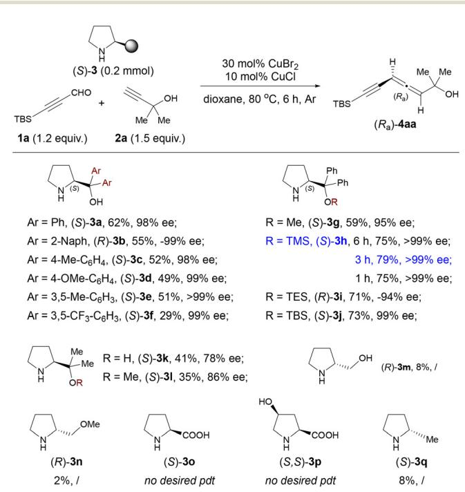
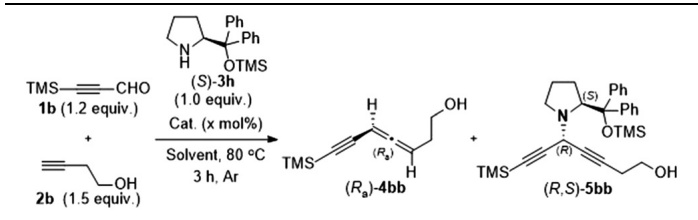
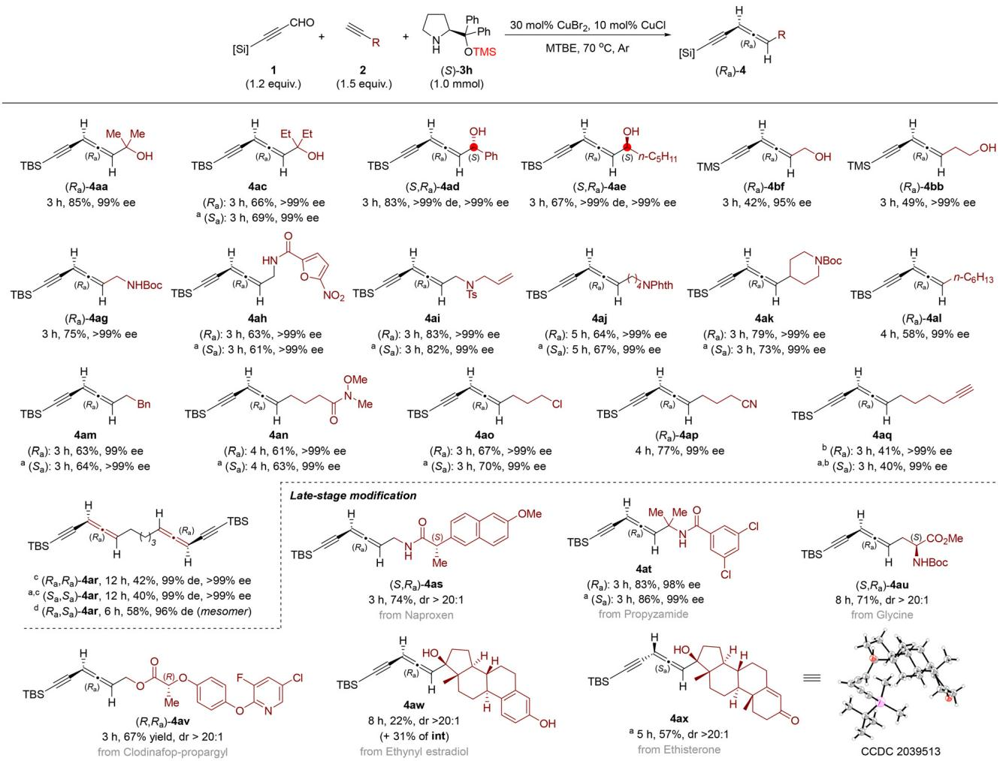
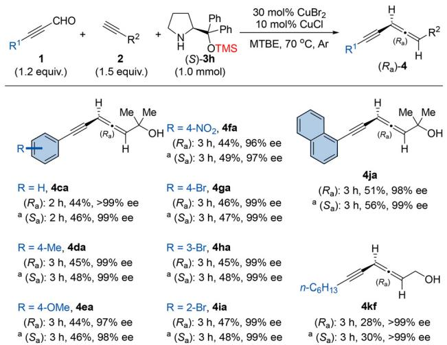
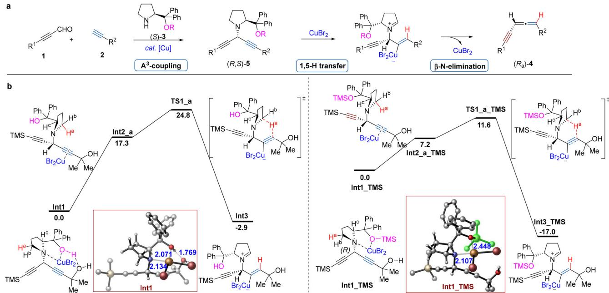

RESEARCH ARTICLE

Published on 28 October 2024

Licence and permissions

Check for updates

Cite this: Org Chem Front , 2025, 12, 243

# Magic efect of diphenylprolinol silyl ether for the enantioselective allenation of 2-alkynals†

Received 1st June 2024,

Accepted 16th October 2024

Guolin Wu,a Zhen Liu,b,c Shiwen Fan,a Wenyao Li,a Xue Zhang, \*b Hui Qian \*a and Shengming Ma \*a,b

DOI: 10.1039/d4qo00984c

rsc.li/frontiers-organic

Diphenylprolinol silyl ethers have been successfully identified as eficient chiral amines in the enantioselective allenation reaction of terminal alkynes and 2-alkynals. This reaction provides a diverse set of chiral allenynes with excellent enantioselectivity and decent yields. Furthermore, the current protocol is also compatible for the late-stage modification of some complex bioactive molecules, highlighting its potential in drug discovery.

Allenynes are among the simplest and the most common structural units in numerous allenic natural products.1,2 In addition, their unique conjugated structure has attracted more and more attention from chemists interested in molecular materials.3,4 One of the most useful protocols for the synthesis of allenynes relies on transition-metal-catalyzed cross coupling of terminal alkynes with propargylic alcohol derivatives5 or allenic halides.6 However, such reactions in an enantioselective manner have remained a challenge. Recently, Liu reported the asymmetric radical coupling of 1,3-enynes with terminal alkynes to aford optically active tetrasubstituted allenynes.7 On the other hand, transition-metal-promoted allenation of terminal alkynes (ATA) with aldehydes or ketones has evolved as one of the most powerful approaches for the synthesis of allenes.8,9 Recently, we have developed the enantioselective allenation of terminal alkynes (EATA) with 2-alkynals in the presence of (S)- or (R)-α,α-diphenylprolinol, afording a series of synthetically challenging chiral 1,3-disubstituted allenynes.10 However, the yields were not satisfactory in many cases. Here we wish to report our recent observation that such an EATA reaction may be greatly improved by applying the magic efect of chiral diphenylprolinol silyl ether,11 which gives access to a wide range of axially chiral allenynes in good yields with excellent enantioselectivity.

Our study began by optimizing the commercially available chiral amine in the reaction of 3-t-butyldimethylsilylpropynal 1a and tertiary propargylic alcohol 2a in 1,4-dioxane at 80 °C (Scheme 1). (S)-α,α-Diphenylprolinol 3a was tested by combining it with CuBr (30 mol%) and CuCl (10 mol%) as catalysts, afording the desired product (R )-4aa in 62% yield with 98%

  
Scheme 1 The efect of chiral amines. The reaction was conducted with 0.24 mmol 1a, 0.3 mmol 2a, 0.2 mmol (S)-3, CuBr (30 mol%) and CuCl (10 mol%) in 1.8 mL of 1,4-dioxane at 80 °C under an argon atmosphere. The yield was determined by 1H NMR analysis using ${ \mathsf { C H } } _ { 2 } { \mathsf { B r } } _ { 2 }$ as an internal standard. The ee value was determined by chiral HPLC analysis of the isolated product.

ee. Attempts to optimize the aryl group at the α-position of prolinol proved unsuccessful (3b–3f). To our delight, silyl-protected diphenylprolinols were efective in this reaction: the yield of $\left( R _ { \mathrm { a } } \right) .$ -4aa was improved to 79% in 3 h when (S)- α,α-diphenylprolinol O-TMS ether 3h was used. Other silyl ether groups (OTES and OTBS) showed similar eficiency. (S)- α,α-Dimethylprolinol 3k and its methyl ether (S)-3l turned out to be detrimental both for eficiency and enantioselectivity. Other chiral amines, such as L-prolinol and L-proline and its derivatives, were virtually inefective. (S)-2-Methylpyrrolidine 3q was also examined and aforded the allenyne only in 8% yield.

The reaction of 3-trimethylsilylpropynal 1b and 3-butyn-1-ol 2b with (S)-α,α-diphenylprolinol 3a delivered the desired product (R )-4aa only in 32% yield (Table 1, entry 1).10 To our delight, the yield was improved to 48% when the reaction was conducted with (S)-3h for 3 h (Table 1, entry 2). We next conducted extensive investigation on other experimental parameters with (S)-3h as the optimal chiral amine. Mono-metallic or other mixed metallic couples showed low eficiency and gave the allenyne (Ra)-4bb together with the 1,4-diyn-3-yl amine intermediate (R,S)-5bb (Table 1, entries 3–10). Solvent screening revealed that MTBE was the optimal, in which the reaction at $7 0 ~ ^ { \circ } \mathrm { C }$ could give the highest yield of 57% (entries 11–15). This EATA reaction could also proceed on a 1.0 mmol scale under the co-catalysis of CuCl and CuBr (Table 1, entry 16).

Table 1 Optimization of the reaction conditions with (S)-3ha
<table><tr><td> $T M S \mathrm { = } \mathrm { = } \mathrm { - } \mathsf { C H O }$ </td><td> $3 \ h , \mathsf { A r }$ </td><td></td><td></td><td></td></tr><tr><td>Entry</td><td>Cat. (x mol%)</td><td>Solvent</td><td>(Ra)-4bb  ${ \mathrm { y i e l d } } , { \mathrm { e e } }$ </td><td>(R,S)-5bb yield</td></tr><tr><td> $1 ^ { b }$ </td><td>CuBr2 (30), CuCl (10)</td><td>Dioxane</td><td>32,98</td><td></td></tr><tr><td>2</td><td>CuBr2 (30), CuCl (10)</td><td>Dioxane</td><td>48,99</td><td>0</td></tr><tr><td>3</td><td>CuBr2 (30)</td><td>Dioxane</td><td>33,98</td><td>6</td></tr><tr><td>4</td><td>CuCl (10)</td><td>Dioxane</td><td> ${ \displaystyle { \bf 1 } , - }$ </td><td>80</td></tr><tr><td>5</td><td>CuCl₂2 (30), CuCl (10)</td><td>Dioxane</td><td>40,99</td><td>9</td></tr><tr><td>6</td><td>Cu(OAc)₂ (30), CuCl (10)</td><td>Dioxane</td><td> ${ \displaystyle { \bf 1 } , - }$ </td><td>63</td></tr><tr><td>7</td><td>CuO (30), CuCl (10)</td><td>Dioxane</td><td> $s , -$ </td><td>77</td></tr><tr><td>8</td><td>ZnBr2 (30), CuCl (10)</td><td>Dioxane</td><td>21,96</td><td>2</td></tr><tr><td>9</td><td>CuBr2 (30), CuBr (10)</td><td>Dioxane</td><td>47,94</td><td>3</td></tr><tr><td>10</td><td>CuBr2 (30), CuI (10)</td><td>Dioxane</td><td>47,90</td><td>4</td></tr><tr><td>11</td><td>CuBr₂ (30), CuCi (10)</td><td>THF</td><td>50, &gt;99</td><td>5</td></tr><tr><td> $1 2 ^ { c }$ </td><td>CuBr2 (30), CuCl (10)</td><td> $\mathrm { E t } _ { 2 } \mathrm { O }$ </td><td>36, &gt;99</td><td>17</td></tr><tr><td> $\mathbf { 1 3 } ^ { d }$ </td><td>CuBr2 (30), CuCl (10)</td><td>MTBE</td><td>57,99</td><td>0</td></tr><tr><td> $^ { 1 4 }$ </td><td>CuBr2 (30), CuCl (10)</td><td>CPME</td><td>50,98</td><td>0</td></tr><tr><td>15</td><td>CuBr2 (30), CuCl (10)</td><td>Toluene</td><td>53,97</td><td>0</td></tr><tr><td> $1 6 ^ { d , e }$ </td><td> $\mathbf { C u B r } _ { 2 }$  (30), CuCl (10)</td><td>MTBE</td><td>50,99</td><td>3</td></tr></table>

a The reaction was conducted with 0.24 mmol 1b, 0.3 mmol 2b, 0.2 mmol (S)-3h, and the indicated amount of catalysts in 1.8 mL of solvent under an argon atmosphere, unless otherwise noted. The yield was determined by 1H NMR analysis using $\mathrm { C H } _ { 2 } \mathrm { B r } _ { 2 }$ as an internal standard. The ee value was determined by chiral HPLC analysis of the isolated product. b The reaction was conducted with (S)-3a (1.0 mmol) for 6 $\mathrm { h . } \ ^ { c } \dot { 5 } 0 \ ^ { \circ } \mathrm { C . } \ ^ { d } 7 0 \ ^ { \circ } \mathrm { C . } \ ^ { e }$ The reaction was conducted with 1.0 mmol (S)-3h in 5.0 mL of MTBE.

With the optimized conditions in hand, we next investigated the generality of the reaction substrates. First, the scope of terminal alkynes 2 was studied (Scheme 2). Reactions of a wide range of propargylic alcohols (2a and 2c–2f) aforded the corresponding allenynes (4aa, 4ac–4ae, and 4bf) in good to moderate yields with excellent ee (up to >99% ee). It should be noted that chiral secondary propargylic alcohols 2d and 2e also worked under the optimized conditions, afording the corresponding allenynes 4ad and 4ae with excellent enantioand diastereoselectivities. Amine-tethered terminal alkynes 2g–2k were also used, furnishing the corresponding products 4ag–4ak in good yields and high ee. Moreover, alkyl-substituted terminal alkynes also aforded the desired products 4al and 4am in decent yields with excellent ee. An attractive range of synthetically useful functional groups such as alkenyl (4ai), Weinreb amide (4an), Cl (4ao), and CN (4ap) were compatible and aforded in good yields with excellent ee. It is worth noting that 1,7-octadiyne 2q was also tolerated, afording mono-allenyne 4aq in decent yield with high ee. Interestingly, when the ratio of 1a : 2q : 3h was adjusted to 2.4 : 1 : 2.4, bisallenyne 4ar could be isolated with good enantio- and diastereoselectivities (see Scheme S1 in the ESI† for the comparison between (S)-3a and (S)-3h in the EATA reaction).

The high functional group compatibility and broad substrate scope of this method encouraged us to examine the latestage modification of a series of biologically relevant molecules containing terminal alkynes (Scheme 2). The nonsteroidal anti-inflammatory drug naproxen may also be incorporated into the terminal alkyne, giving optically active allenyne $( S , R _ { \mathrm { a } } ) \cdot$ -4as in 74% yield. Both enantiomers $\left( R _ { \mathrm { a } } \right) -$ and $( S _ { \mathrm { a } } ) \mathrm { - }$ 4at derived from propyzamide were obtained in high yields with excellent ee when (S)- and (R)-3h were used. Glycine-tethered terminal alkyne (S)-2u aforded the corresponding product $\ ( S , R _ { \mathrm { a } } )$ -4au in 71% yield. More structurally complex biologically active molecules, including clodinafop-propargyl (2v), ethynyl estradiol (2w) and ethisterone (2x), were studied and the corresponding functionalized products were aforded in good yields. The absolute configuration of the allenyne unit was established by X-ray crystallography analysis of 4ax.12

Finally, the scope of 2-alkynal substrates was also assessed under the optimal conditions. In addition to 3-silylpropynals, other aryl substituted 2-alkynal substrates were also suitable for this EATA reaction. An array of 3-phenylpropynal derivatives bearing both electron-donating (1d and 1e) and electron-withdrawing (1f and 1g) groups on the benzene ring delivered the corresponding products with excellent enantioselectivities and decent yields (44%–49%). There is no obvious steric efect since 3-aryl-2-alkynals with a bromine atom at the para, ortho, or meta-position of the benzene ring, all aforded the allenynes 4ga–4ia in similar yields with high ees. 3-(1-Naphthalenyl)propynal 1j was also compatible, afording product 4ja with excellent enantioselectivity. Even the reaction of 3-alkyl substituted 2-alkynal 1k aforded both enantiomers of 4kf in acceptable yields with >99% ee (Scheme 3).

  
Scheme 2 Scope of terminal alkynes and late-stage modification. The reaction was conducted with 1.2 mmol 1. 1.5 mmol 2. 1.0 mmol (S)-3h. 30 mol% of $\mathsf { C u B r } _ { 2 } ,$ and 10 mol% of CuCl in 5.0 mL of MTBE at $7 0 ~ ^ { \circ } \mathsf { C }$ under an argon atmosphere, unless otherwise noted. $^ a ( R ) - 3 h$ was used instead of $( S ) - 3 h . ^ { \ b } 2 . 0$ mmol 2q was used. c The reaction was conducted with 2.4 mmol 1a, 1.0 mmol 2q, 2.4 mmol $( S ) - 3 h ,$ 60 mol% of ${ \mathsf { C u B r } } _ { 2 } ,$ and 20 mol% of CuCl in 10.0 mL of MTBE at $70 \textdegree$ under an argon atmosphere. d The reaction was conducted with 0.6 mmol 1a, 0.75 mmol (R )-4aq, 0.5 mmol (R)-3h, 30 mol% of $\mathsf { C u B r } _ { 2 } ,$ and 10 mol% of CuCl in 2.5 mL of MTBE at $7 0 ~ ^ { \circ } \mathsf { C }$ under an argon atmosphere. See details in the ESI.†

  
Scheme 3 Scope of 2-alkynals. The reaction was conducted with 1.2 mmol 1, 1.5 mmol 2, 1.0 mmol (S)-3h, 30 mol% of ${ \mathsf { C u B r } } _ { 2 } ,$ and 10 mol% of CuCl in 5.0 mL of MTBE at $7 0 ~ ^ { \circ } \mathsf { C }$ under an argon atmosphere. a (R)-3h was used instead of (S)-3h. See details in the ESI.†

A plausible mechanism has been proposed $( \mathrm { F i g . ~ \ 1 a } ) { : } ^ { 1 0 }$ Initially, 2-alkynal 1 reacts with proline (S)-3 and terminal alkyne 2 to aford 1,4-diyn-3-yl amine $^ { ( R , S ) - 5 }$ via an $\mathbf { A } ^ { 3 } \mathrm { - c o u p l i n g }$ reaction. Then intermediate $( R , S ) – 5$ undergoes sequential regio- and stereoselective 1,5-H transfer and trans β-N-elimination to yield the chiral allenyne $\left( R _ { \mathrm { a } } \right) { - } 4$ in the presence of $\operatorname { C u B r } _ { 2 } .$ According to DFT calculations,10 the 1,5-H transfer is the rate-limiting step of the whole process.

To further elucidate the remarkable diferences of the eficiency between diphenylprolinol 3a and 3h, DFT calculations were performed to unveil the influence of the O-TMS protecting group on the reactivity of the reaction (Fig. 1b): for the 1,5-H transfer of the methylene hydrogen (Ha) to the hydroxyalkyl-substituted triple bond, TS1\_a\_TMS exhibits a free energy barrier of only 11.6 kcal $\mathrm { m o l ^ { - 1 } }$ which is 13.2 kcal $\mathrm { m o l } ^ { - 1 }$ lower than that of TS1\_a (24.8 kcal mol−1).

Careful examination of the geometries of Int1 reveals that it is stabilized by the coordination of copper with both the nitrogen atom and the hydroxyl oxygen atom with distances of 2.134 and 2.071 Å, respectively, as well as hydrogen bonding between the prolinol hydroxyl hydrogen and the propargylic hydroxyalkyl oxygen (1.769 Å). The subsequent isomerization of Int1 to Int2\_a involves the dissociation of copper from the nitrogen and oxygen atoms, coupled with its coordination to the carbon–carbon triple bond, resulting in an endergonic process of 17.3 kcal mol−1. The high thermodynamics stability of Int1 results in a low reactivity for the [1,5]-hydride migration. In comparison, no hydrogen bonding exists in Int1\_TMS, and the O-TMS protector weakens the coordination of copper with the oxygen atom with a bond length of 2.448 Å, which is 0.377 Å longer than that in Int1. The transformation of Int1\_TMS to Int2\_a\_TMS requires only 7.2 kcal mol−1, suggesting a relatively lower stability of Int1\_TMS compared to that of Int1. Therefore, the O-TMS unit on diphenylprolinol facilitates the 1,5-H transfer process primarily by destabilizing Int1\_TMS.

  
Fig. 1 (a) The reaction mechanism. (b) DFT calculations on the 1,5-H transfer step from Int1 to Int1\_TMS (ΔG in kcal mol−1 with respect to Int1 or Int1\_TMS. Bond lengths are given in Angstroms).

## Conclusions

In summary, we have developed the enantioselective allenation reaction of 2-alkynals in the presence of (S)- or (R)- α,α-diphenylprolinol silyl ether. This reaction delivers a diverse set of chiral allenynes featuring high eficiency and a broad substrate scope. The current protocol may also be applied to the late-stage modification of some bioactive molecules, highlighting its potential in drug discovery. Further applications of this protocol including the enantioselective total synthesis of natural products containing allenynes are being actively pursued in our laboratory.

## Author contributions

S. M. and H. Q. conceived and directed the project and designed the experiments. G. W. conducted most of the experiments. S. F. and W. L. participated in the substrate scope investigation. X. Z. and Z. L. performed the density functional theory calculations. G. W, X. Z., H. Q. and S. M. checked the experimental data and wrote the manuscript.

## Data availability

All detailed procedures, characterization data, and spectra are available in the ESI.† Crystallographic data for 4ax have been deposited at the Cambridge Crystallographic Data Center under the deposition number CCDC 2039513.†

## Conflicts of interest

There are no conflicts to declare.

## Acknowledgements

Financial support from the National Key R&D Program of China (Grant No. 2022YFA1503200) is greatly appreciated. We thank Dr Haibo Xu in this group for reproducing the results of (R )-4aa and (S )-4ai in Scheme 2 and (R )-4ca in Scheme 3.

## References

1 For reviews, see: (a) A. Hofmann-Roder and N. Krause, Synthesis and properties of allenic natural products and pharmaceuticals, Angew. Chem., Int. Ed., 2004, 43, 1196– 1216; (b) N. Krause and A. S. K. Hashimi, ed. Modern Allene Chemistry, Wiley-VCH, Weinheim, Germany, 2004.

2 For selected examples on the naturally occurring allenynes, see: (a) W. D. Celmer and I. A. Solomons, The structure of the antibiotic mycomycin, J. Am. Chem. Soc., 1952, 74, 1870–1871; (b) G. Bendz, Marasin, an antibiotic polyacetylene, isolated from the culture medium of Mrasmiu ramealis, Ark. Kemi, 1959, 14, 305–321; (c) R. E. Bew, J. R. Chapman, E. R. H. Jones, B. E. Lowe and G. Lowe, Natural acetylenes. Part XVIII. Some allenic polyacetylenes from basidiomycetes, J. Chem. Soc. C, 1966, 129–135; (d) T. Anke, J. Kupka, G. Schramm and W. Steglich, Antibiotics from basidiomycetes. X. Scorodonin, a new antibacterial and antifungal metabolite from Marasmius scorodonius (Fr.) Fr, J. Antibiot., 1980, 33, 463–467; (e) W. L. Parker, M. L. Rathnum, V. Seiner, W. H. Trejo, P. A. Principe and R. B. Sykes, Cepacin A and cepacin B, two new antibiotics produced by Pseudomonas cepacia, J. Antibiot., 1984, 37, 431–440; (f) J. G. Ondeyka, D. L. Zink, K. Young, R. Painter, S. Kodali, A. Galgoci, J. Collado, J. R. Tormo, A. Basilio, F. Vicente, J. Wang and S. B. Singh, Discovery of bacterial fatty acid synthase inhibitors from a phoma species as antimicrobial agents using a new antisense-based strategy,J. Nat. Prod., 2006, 69, 377–380.

3 For reviews, see: (a) F. Diederich and Y. Rubin, Synthetic Approaches toward Molecular and Polymeric Carbon Allotropes, Angew. Chem., Int. Ed. Engl., 1992, 31, 1101– 1123; (b) F. Diederich and M. Kivala, All-carbon scafolds by rational design, Adv. Mater., 2010, 22, 803–812; (c) P. Rivera-Fuentes and F. Diederich, Allenes in molecular materials, Angew. Chem., Int. Ed., 2012, 51, 2818–2828.

4 For selected examples, see: (a) J. L. Alonso-Gomez, P. Schanen, P. Rivera-Fuentes, P. Seiler and F. Diederich, 1,3- Diethynylallenes (DEAs): enantioselective synthesis, absolute configuration, and chiral induction in 1,1,4,4-tetracyanobuta-1,3-dienes (TCBDs), Chem. – Eur. J., 2008, 14, 10564–10568;

(b) P. Rivera-Fuentes, J. L. Alonso-Gomez, A. G. Petrovic, P. Seiler, F. Santoro, N. Harada, N. Berova, H. S. Rzepa and F. Diederich, Enantiomerically pure alleno-acetylenic macrocycles: synthesis, solid-state structures, chiroptical properties, and electron localization function analysis, Chem. – Eur. J., 2010, 16, 9796–9807; (c) P. Rivera-Fuentes, B. Nieto-Ortega, W. B. Schweizer, J. T. Navarrete, J. Casado and F. Diederich, Enantiopure, monodisperse alleno-acetylenic cyclooligomers: efect of symmetry and conformational flexibility on the chiroptical properties of carbon-rich compounds, Chem. – Eur. J., 2011, 17, 3876–3885.

5 (a) T. Mandai, T. Nakata, H. Murayama, H. Yamaoki, M. Ogawa, M. Kawada and J. Tsuji, Palladium-catalyzed reactions of 2-alkynyl carbonates with terminal acetylenes: A new synthetic method for 1,2-dien-4-ynes, Tetrahedron Lett., 1990,

31, 7179–7180; (b) S. Gueugnot and G. Linstrumelle, An eficient palladium-catalysed reaction of propargyl halides tosylates and acetates with terminal alkynes, Tetrahedron Lett., 1993, 34, 3853–3856; (c) S. Condon-Gueugnot and G. Linstrumelle, Palladium-Catalyzed Regioselective Coupling of Propargylic Substrates with Terminal Alkynes. Application to the Synthesis of 1,2-Dien-4-ynes, Tetrahedron, 2000, 56, 1851–1857; (d) M. Yoshida, M. Hayashi and K. Shishido, Palladium-Catalyzed Diastereoselective Coupling of Propargylic Oxiranes with Terminal Alkynes, Org. Lett., 2007, 9, 1643–1646.

6 (a) C. S. L. Baker, P. D. Landor and S. R. Landor, 866. Allenes. Part VIII. A new method for the synthesis of allenynes, J. Chem. Soc., 1965, 4659–4664; (b) K. Ruitenberg, H. Kleijn, C. J. Elsevier, J. Meijer and P. Vermeer, Palladium(0)-promoted synthesis of functionally substituted allenes by means of organozinc compounds, Tetrahedron Lett., 1981, 22, 1451–1452; (c) K. Ruitenberg, H. Kleijn, H. Westmijze, J. Meijer and P. Vermeer, Organometal-mediated synthesis of conjugated allenynes, allenediynes, vinylallenes and diallenes, Recl. Trav. Chim. Pays-Bas, 1982, 101, 405–409; (d) T. Jefery-Luong and G. Linstrumelle, Palladium-Catalyzed Synthesis of Allenynes, Synthesis, 1983, 32–34.

7 X.-Y. Dong, T.-Y. Zhan, S.-P. Jiang, X.-D. Liu, L. Ye, Z.-L. Li, Q.-S. Gu and X.-Y. Liu, Copper-catalyzed asymmetric coupling of allenyl radicals with terminal alkynes to access tetrasubstituted allenes, Angew. Chem., Int. Ed., 2021, 60, 2160–2164.

8 For the review on the ATA reaction, see: X. Huang and S. Ma, Allenation of terminal alkynes with aldehydes and ketones, Acc. Chem. Res., 2019, 52, 1301–1312.

9 For recent examples, see: (a) D. M. Lustosa, S. Clemens, M. Rudolph and A. S. K. Hashmi, Gold-catalyzed one-pot synthesis of 1,3-disubstituted allenes from benzaldehydes and terminal alkynes, Adv. Synth. Catal., 2019, 361, 5050– 5056; (b) L. P. Zorba, E. Egaña, E. Gómez-Bengoa and G. C. Vougioukalakis, Zinc Iodide catalyzed synthesis of trisubstituted allenes from terminal alkynes and ketones, ACS Omega, 2021, 6, 23329–23346; (c) J. Xiao, Y. Cui, C. Li, H. Xu, Y. Zhai, X. Zhang and S. Ma, Room Temperature Allenation of Terminal Alkynes with Aldehydes, Angew. Chem., Int. Ed., 2021, 60, 25708–25713.

10 G. Wu, Y. Yao, G. Li, X. Zhang, H. Qian and S. Ma, Enantioselective Allenation of Terminal Alkynes Catalyzed by Copper Halides of Mixed Oxidation States and Its Application to the Total Synthesis of Scorodonin, Angew. Chem., Int. Ed., 2022, 61, e202112427.

11 For representative examples on the magic efect of amines, see: (a) M. Marigo, T. C. Wabnitz, D. Fielenbach and K. A. Jorgensen, Enantioselective organocatalyzed alpha sulfenylation of aldehydes, Angew. Chem., Int. Ed., 2005, 44, 794–797; (b) Y. Hayashi, H. Gotoh, T. Hayashi and M. Shoji, Diphenylprolinol silyl ethers as eficient organocatalysts for the asymmetric Michael reaction of aldehydes and nitroalkenes, Angew. Chem., Int. Ed., 2005, 44, 4212–4215.

12 CCDC 2039513† (4ax) contains the supplementary crystallographic data for this paper.