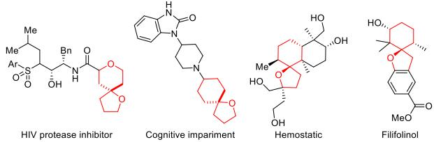
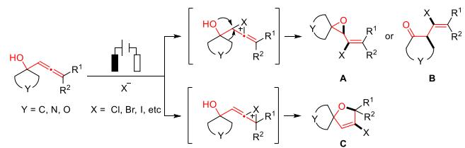
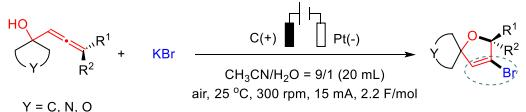
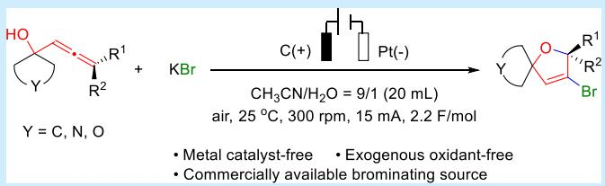
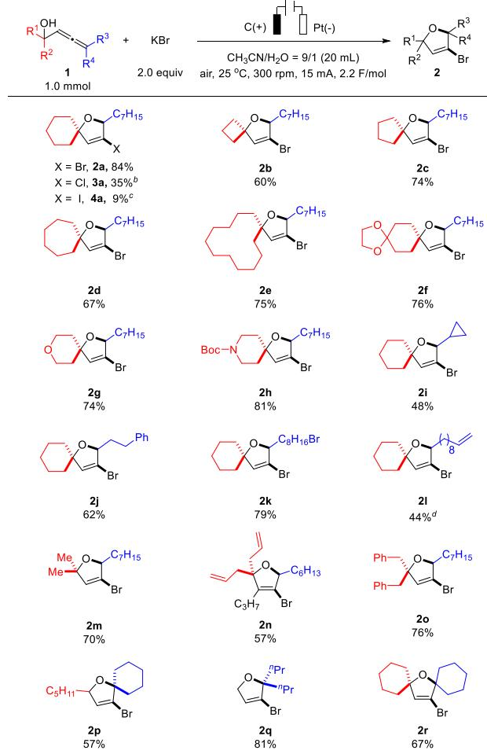
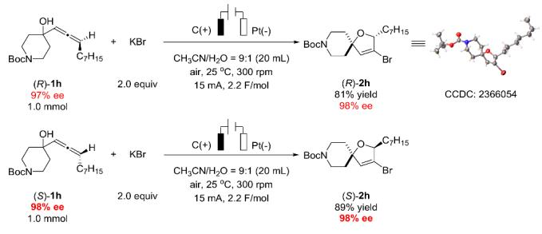
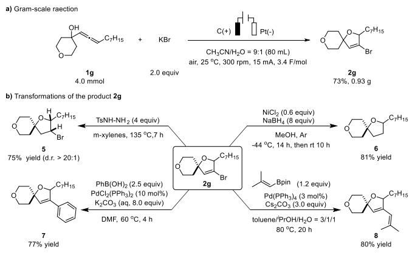
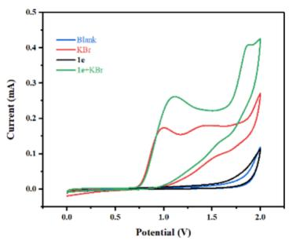
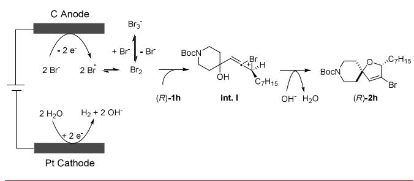

pubs.acs.org/OrgLett

Letter

# Electrochemical Cyclization of 2,3-Allenols

Wenyao Li, Dong Huang, Zhuowei Xu, Zhongshuo Zhang, Ying Wang,\* Hao $\mathrm { Y u } , ^ { \ast }$ and Shengming ${ { \bf { M } } _ { { \bf { a } } } } ^ { * }$

Cite This: Org. Lett. 2025, 27, 3506−3510

Read Online

ACCESS

Metrics & More

Article Recommendations

ABSTRACT: An eficient electrochemical bromocyclization of allenols has been realized for the synthesis of spirocyclic 2,5- dihydrofurans. The reaction used commercially available and nontoxic KBr as the brominating source in a simple setup under open-air conditions. Notably, optically active products can be obtained from optically active 2,3-allenols without any racemization, further enhancing the synthetic utility.

S pirocyclic frameworks are prevalent in natural products or pesticides and frequently recognized as chiral scafolds for synthesizing chiral ligands.1−3 Of particular interest are the oxygen-containing spirocyclic compounds with their enhanced three-dimensional structures, which are significant motifs in various drugs and biologically active molecules, such as hemostatic and filifolinol, due to their interactions with specific protein receptors or enzymes (Scheme 1a).4−6 Thus, the widerange importance of these compounds has driven the advancement of new synthetic strategies to facilitate their production.7

In recent years, electrochemical anodic oxidations have emerged as mild, eficient, and environmentally friendly strategies for the synthesis of complex molecules.8 Notably,

Scheme 1. Electrochemical Halofunctionalization of Allenols

a) Representative bioactive compounds bearing spirocyclic rings

b) Electrochemical halogenation of allenols and challenges  
  
c) This work: Electrochemical halocyclization of allenols

\*sı Supporting Information

the electrochemical halogenation of alkenes or alkynes using commercially available, nontoxic, and atom-eficient MX/HX systems has been developed to avoid the use of hazardous or expensive halogenation reagents (such as dihalogen or Nhalogensuccinimide), transition metal salts (e.g., CuX , FeX , −12 etc.), and stoichiometric strong oxidants.

Based on our previous reports on the easy synthesis of tertiary allenols,13 we investigated whether the electrochemical halocyclization of allenols14,15 could serve as an eficient and convenient method for accessing oxygen-containing spirocyclic products C. However, two challenges remained (Scheme 1b): first, engaging diferent double bonds with similar properties in allenes could yield spirocyclic products $\mathbf { A } ; ^ { 1 6 }$ second, ringexpansion reactions could produce nonspirocyclic products B.12a Herein, we describe our eforts to develop the electrochemical bromocyclization of allenols for the synthesis of spirodihydrofuran with a useful C−Br bond handle for downstream functionalizations as a starting point (Scheme 1c).

To assess the feasibility of this strategy, we commenced our study by reacting allenol 1a with KBr. Gratifyingly, the spirocyclic product 2a was obtained in 87% yield using a graphite plate as the anode and a platinum plate as the cathode, with CH CN/H O (9/1) as the solvent under a constant current of 15 mA in an undivided cell (Table 1, entry 1). Control experiment confirmed that electricity was essential (Table 1, entry 2). Other bromide salts were investigated, with NaBr exhibiting a similar eficiency to KBr, while NiBr demonstrated a lower eficiency (Table 1, entries 3 and 4). Decreasing or increasing the equivalents of KBr resulted in slightly lower yields (Table 1, entries 5 and 6). Screening the solvent ratio of $\mathrm { C H } _ { 3 } \mathrm { C N } / \mathrm { H } _ { 2 } \mathrm { O }$ revealed that a 9:1 ratio was optimal (Table 1, entries 7 and 8 vs entry 1). Further examination showed that the yield of 2a decreased with either a lower or higher current (Table 1, entries 9−12). Scaling up the reaction to 1.0 mmol resulted in a moderate yield of 76% (Table 1, entry 13). Through further eforts, we found that increasing the reaction concentration, decreasing the reaction time could enhance the production of 2a, which was isolated in 84% yield on the 1.0 mmol scale (Table 1, entry 14).

Table 1. Optimization of the Reaction Conditionsa
<table><tr><td colspan="2">OH C7H15 + 1a</td><td rowspan="2">[Br]</td><td colspan="3">h C(+) Pt(-) CH₃CN/H2O = a/b (5 mL)</td><td rowspan="2">C7H15 O Br 2a</td></tr><tr><td></td><td>X equiv</td><td>air, 25 °C, 300 rpm, Y mA, 2.8 F/mol</td><td></td></tr><tr><td>entry</td><td>[Br]</td><td>a/b</td><td>X</td><td>Y</td><td>t/h</td><td> $y \mathrm { i e l d } ^ { b } \ ( \% )$ </td></tr><tr><td>1</td><td>KBr</td><td>9/1</td><td>2.0</td><td>15</td><td>1</td><td>87</td></tr><tr><td> $2 ^ { c }$ </td><td>KBr</td><td>9/1</td><td>2.0</td><td>0</td><td>1</td><td>0</td></tr><tr><td>3</td><td>NaBr</td><td>9/1</td><td>2.0</td><td>15</td><td>1</td><td>86</td></tr><tr><td>4</td><td> $\mathrm { N i B r } _ { 2 }$ </td><td>9/1</td><td>1.0</td><td>15</td><td>1</td><td>74</td></tr><tr><td>5</td><td>KBr</td><td>9/1</td><td>1.5</td><td>15</td><td>1</td><td>75</td></tr><tr><td>6</td><td>KBr</td><td>9/1</td><td>2.5</td><td>15</td><td>1</td><td>73</td></tr><tr><td>7</td><td>KBr</td><td>4/1</td><td>2.0</td><td>15</td><td>1</td><td>64</td></tr><tr><td>8</td><td>KBr</td><td>19/1</td><td>2.0</td><td>15</td><td>1</td><td>62</td></tr><tr><td>9</td><td>KBr</td><td>9/1</td><td>2.0</td><td>3</td><td>5</td><td>69</td></tr><tr><td>10</td><td>KBr</td><td>9/1</td><td>2.0</td><td>5</td><td>3</td><td>83</td></tr><tr><td>11</td><td>KBr</td><td>9/1</td><td>2.0</td><td>8</td><td>2</td><td>85</td></tr><tr><td> $1 2 ^ { d }$ </td><td>KBr</td><td>9/1</td><td>2.0</td><td>30</td><td>0.5</td><td>71</td></tr><tr><td> $1 3 ^ { e }$ </td><td>KBr</td><td>9/1</td><td>2.0</td><td>15</td><td>5</td><td>76</td></tr><tr><td> $1 4 ^ { f }$ </td><td>KBr</td><td>9/1</td><td>2.0</td><td>15</td><td>4</td><td>86  $( 8 4 ) ^ { g }$ </td></tr></table>

aReaction conditions unless specified otherwise: 1a (0.2 mmol), $\mathrm { C H } _ { 3 } \mathrm { C N } / \mathrm { H } _ { 2 } \mathrm { O }$ (5 mL), graphite plate anode $( 1 0 \times 1 0 \times 3$ mm), Pt plate cathode (10 × 10 × 0.1 mm), undivided cell, ${ \mathrm { a i r } } , 2 5 \ { } ^ { \circ } { \mathrm { C } } ,$ 300 rpm, 2.8 F/mol. bThe NMR yield of 2a was determined by 1H NMR analysis using dibromomethane as the internal standard. cNo current. d3.0 F/mol. e1a (1.0 mmol) in the solvent $\mathrm { C H } _ { 3 } \mathrm { C N } / \mathrm { H } _ { 2 } \mathrm { O }$ (22.5/2.5 mL). f1a (1.0 mmol) in the solvent $\mathrm { C H } _ { 3 } \mathrm { C N } / \mathrm { H } _ { 2 } \mathrm { \bar { O } }$ (18.0/2.0 mL), 2.2 F/mol. gIsolated yield.

With the optimized reaction conditions established, we explored the substrate scope of this electrochemical bromocyclization protocol of allenols (Scheme 2). As a comparison, the reaction of 1a with KCl and KI under the standard conditions aforded 3-chloro- and 3-iodo-dihydrofur an products 3a and 4a in 35% and 9% yields, respectively. A wide range of tertiary 2,3-allenols underwent bromocyclization smoothly, yielding 2,5-dihydrofuran derivatives 2 in good to excellent yields. First, we evaluated the ring sizes of cyclic tertiary 2,3-allenols. Various substrates with carbocycles of diferent sizes proved viable in our electrochemical transformation, generating a range of spirocyclic products in yields of 60−84%. Notably, highly strained four-membered allenol 1b and medium-sized 12-membered allenol 1e served as suitable substrates, afording products 2b and 2e in 60% and 75% yields, respectively. An acetal moiety may also survive, yielding 76% of 2f. Moreover, substrates containing heterocycles performed well, providing the corresponding oxa- or azaspirocyclic products 2g and 2h in yields of 74% and 81%, respectively. A variety of synthetically useful groups, including cyclopropyl (2i), phenyl (2j), halide (2k), and allyl (2l) groups were well-tolerated. Beyond cyclic tertiary allenols, this electrochemical strategy may also be extended to acyclic tertiary allenols [dimethyl (1m), diallyl (1n), and dibenzyl (1o)]. Remarkably, a trisubstituted allenol enabled access to a

## Scheme 2. Substrate Scope Studya

  
aReaction conditions unless specified otherwise: 1a (1.0 mmol), KBr (2.0 mmol), $\mathrm { C H } _ { 3 } \mathrm { C N } / \mathrm { H } _ { 2 } \mathrm { O } = 9 / 1$ (20 mL), graphite plate anode (10 $\times 1 0 \times 3$ mm), Pt plate cathode $( 1 0 \times 1 0 \times { \mathrm { { \dot { 0 } } } } . 1$ mm), undivided cell, constant current 15 mA, air, ${ 2 5 ~ ^ { \circ } C } ,$ 300 rpm, 2.2 F/mol. bKCl (2.0 mmol) was used instead of $\mathrm { K B r } \left( 2 . 0 \right.$ mmol). cKI (2.0 mmol) was used instead of KBr (2.0 mmol). $^ { d } 2 . 8$ F/mol (see more details in the Supporting Information).

4-bromide-substituted spirocyclic 2,5-dihydrofuran product 2p in 57% yield. The protocol also proved efective for primary allenol 1q, where both $\mathbb { R } ^ { 3 }$ and $\mathrm { R } ^ { 4 }$ are n-propyl. Finally, bispirocyclic product 2r was smoothly synthesized.

Furthermore, when optically active allenols (R)-1h and (S)- 1h were subjected to the electrochemical bromocyclization protocol under the standard conditions, the corresponding chiral spirocyclic products (S)-2h and (R)-2h were obtained eficiently without any loss of ee. A single-crystal X-ray difraction analysis was conducted to determine the absolute configuration of (R)-2h (Scheme 3).

The reaction was successfully scaled up to a 4.0 mmol scale using a simple and readily made device (see Figure S3 in the Supporting Information), yielding product ${ \bf 2 9 }$ in 73% yield (Scheme 4a). The synthetic utility of the spirocyclic products is demonstrated (Scheme 4b): Product 2g was readily reduced by p-toluenesulfonyl hydrazide at $1 3 5 ~ ^ { \circ } \mathrm { C }$ to aford spirotetrahydrofuranyl bromide 5 in a highly stereoselective manner.17 By comparison, when 2g was subjected to 0.6 equiv of $\mathrm { N i C l } _ { 2 }$ and 8 equiv of $\mathrm { N a B H } _ { 4 } ,$ the debrominated spirotetrahydrofuran 6 was obtained in 81% yield.18 Phenyl19 and alkenyl20 groups were introduced into the spirocyclic 2,5- (vs $S { \mathrm { C E } } ) , ^ { 2 1 }$ corresponding to the anodic oxidation of $\mathrm { B r ^ { - } }$ to the bromine radical, which subsequently dimerized to form molecular $\mathbf { B r } _ { 2 }$ and combined with $\bar { \bf B } { \bf r } ^ { - }$ to produce ${ \mathrm { B r } } _ { 3 } ^ { - }$ . The second oxidative peak corresponded to the oxidation of ${ \mathrm { B r } _ { 3 } } ^ { - }$ to Br . When KBr and allenol 1e were combined, an increase in the oxidative peak current was noted, indicating that the chemical reaction occurs between electrochemically generated molecular $\mathbf { B r } _ { 2 }$ and allenol 1e (Figure 1, green curve).

Scheme 3. Chirality Transfer in Electrochemical Halocyclization of a-Allenols  

Scheme 4. Gram-Scale Reaction and Transformations of the Products  
  
dihydrofuran derivatives via Suzuki-Miyaura coupling, yielding compounds 7 and 8 in 77% and 80% yields, respectively.

The reaction was monitored by cyclic voltammetry (Figure 1). Two oxidation peaks of KBr were observed at 1.0 and 1.4 V  
  
Figure 1. Cyclic voltammograms of background (blue line), KBr (0.08 mmol) (red line), 1e (0.04 mmol) (black line), and KBr (0.08 mmol) and 1e (0.04 mmol) (green line) in $\mathrm { M e C N / H _ { 2 } O }$ (4.5/0.5 mL) with LiClO (0.2 M) under air atmosphere. Scan rate: 100 mV/ s.

Control experiments showed that when substrate 1a was reacted with molecular $\mathtt { B r } _ { 2 } \mathrm { - e i t h e r }$ added directly or dropwise�instead of KBr and electricity, product 2a was obtained, but with significantly reduced yields of 28% and 25%, respectively (Scheme $5 ,$ entries 2 and $3 ) _ { . }$ , indicating the advantage of the electrosynthesis. Interestingly, the addition of

## Scheme 5. Electrosynthesis vs Normal Bromocyclization

OH Conditions O C7H15   
C7H15   
Br   
1a 2a   
1.0 mmol   
Entry Conditions NMR yield of 2a(%)   
1 standard conditions (Table 1, entry 14) 86   
Br2 (2.0 equiv)   
2 28   
CH₃CN (18 mL)/H₂O (2 mL), air, 25 C, 4 h   
Br2 (2.0 equiv)/CH₃CN (4 mL) (dropwise over 1.5 h)   
3 25   
CH₃CN (14 mL)/H₂O (2 mL), air, 25 C, 2 h   
Br2(2.0 equiv)/CH₃CN (4 mL) (dropwise over 1.5 h)   
4 47   
KBr (2.0 equiv), CH₃CN (14 mL)/H2O (2 mL), air, 25 °C, 2 h

KBr increased the yield of 2a to $4 7 \%$ (Scheme $^ { 5 , }$ entry 4). We reasoned that the slow releasing of the $\mathbf { B r } _ { 2 }$ is responsible for the higher yield observed in the current study.

A plausible reaction mechanism is proposed in Scheme 6. At the anode, a bromide anion is oxidized to a bromine radical,

Scheme 6. Proposed Mechanism  

subsequently combining to form molecular $\operatorname { B r } _ { 2 } ,$ which would interact with $\mathrm { B r ^ { - } }$ to produce ${ \mathrm { B r } _ { 3 } } ^ { - }$ . This $\mathbf { B r } _ { 2 }$ electrophilically interacted with (R)-1h to generate the bromonium ion intermediate int. I. Intramolecular anti-nucleophilic attack by the hydroxy group from the opposite side followed by deprotonation, yielded the final product (R)-2h. Concurrently, at the cathode, water is continuously reduced to generate OH and gaseous $\mathrm { H } _ { 2 } .$

In summary, we have described a highly eficient electrochemical synthetic method for spirocyclic 2,5-dihydrofuran derivatives from allenols. This approach operates under metal catalyst-free and exogenous oxidant-free conditions, utilizing commercially available and nontoxic KBr as the brominating source. The method enjoys ease of handling and mild reaction conditions preventing racemization with the optically active substrates. Further studies in this area including control of the cyclization mode are currently ongoing in our laboratory.

## ■ ASSOCIATED CONTENT

## Data Availability Statement

The data underlying this study are available in the published article and its Supporting Information.

## \*sı Supporting Information

The Supporting Information is available free of charge at https://pubs.acs.org/doi/10.1021/acs.orglett.5c00193.

Experimental procedures, characterization data for obtained compounds, crystal data for (R)-2h, and NMR spectra (PDF)

## Accession Codes

Deposition Number 2366054 contains the supplementary crystallographic data for this paper. These data can be obtained free of charge via the joint Cambridge Crystallographic Data Centre (CCDC) and Fachinformationszentrum Karlsruhe Access Structures service.

## ■ AUTHOR INFORMATION

## Corresponding Authors

Hao Yu − Research Center for Molecular Recognition and Synthesis, Department of Chemistry, Fudan University, Shanghai 200433, P. R. China; Email: hao\_yu@ fudan.edu.cn

Ying Wang − Department of Chemistry, Chinese University of Hong Kong, Shatin 999077 N.T. Hong Kong SAR, P. R. China; orcid.org/0000-0002-6240-5535; Email: ying.b.wang@cuhk.edu.hk

Shengming Ma − Research Center for Molecular Recognition and Synthesis, Department of Chemistry, Fudan University, Shanghai 200433, P. R. China; State Key Laboratory of Organometallic Chemistry, Shanghai Institute of Organic Chemistry, Chinese Academy of Sciences, Shanghai 200032, P. R. China; orcid.org/0000-0002-2866-2431;

Email: masm@sioc.ac.cn

## Authors

Wenyao Li − Research Center for Molecular Recognition and Synthesis, Department of Chemistry, Fudan University, Shanghai 200433, P. R. China

Dong Huang − Research Center for Molecular Recognition and Synthesis, Department of Chemistry, Fudan University, Shanghai 200433, P. R. China

Zhuowei Xu − Research Center for Molecular Recognition and Synthesis, Department of Chemistry, Fudan University, Shanghai 200433, P. R. China

Zhongshuo Zhang − Department of Chemistry, Chinese University of Hong Kong, Shatin 999077 N.T. Hong Kong SAR, P. R. China

Complete contact information is available at: https://pubs.acs.org/10.1021/acs.orglett.5c00193

## Notes

The authors declare no competing financial interest.

## ■ ACKNOWLEDGMENTS

Financial support from the National Natural Science Foundation of China (Grant No. 2022YFA1503200 for S.M. and H.Y.) and the Shanghai Sailing Program (Grant No. 20YF1402100 for H.Y.) are greatly appreciated. We thank Mr. Biao Wang in this group for reproducing the results of 2n, 2h, and (R)-2h in Scheme

## ■ REFERENCES

(1) (a) Chupakhin, E.; Babich, O.; Prosekov, A.; Asyakina, L.; Krasavin, M. Spirocyclic Motifs in Natural Products. Molecules 2019, 24, 4165. (b) Acosta-Quiroga, K.; Rojas-Peña, C.; Nerio, L. S.; Gutiérrez, M.; Polo-Cuadrado, E. Spirocyclic Derivatives as Antioxidants: A Review. RSC Adv. 2021, 11, 21926.

(2) Yu, L.; Dai, A.; Zhang, W.; Liao, A.; Guo, S.; Wu, J. Spiro Derivatives in the Discovery of New Pesticides: A Research Review. J. Agric. Food Chem. 2022, 70, 10693.

(3) Wang, X.; Han, Z.; Wang, Z.; Ding, K. A Type of Structurally Adaptable Aromatic Spiroketal Based Chiral Diphosphine Ligands in Asymmetric Catalysis. Acc. Chem. Res. 2021, 54, 668.

(4) (a) Lovering, F.; Bikker, J.; Humblet, C. Escape from Flatland: Increasing Saturation as an Approach to Improving Clinical Success. J. Med. Chem. 2009, 52, 6752. (b) Lovering, F. Escape from Flatland 2: Complexity and Promiscuity. Med. Chem. Commun. 2013, 4, 515. (c) Trauner, D. The Chemist and the Architect. Angew. Chem., Int. Ed. 2018, 57, 4177.

(5) (a) Zheng, Y.; Tice, C. M.; Singh, S. B. The Use of Spirocyclic Scaffolds in Drug Discovery. Bioorg. Med. Chem. Lett. 2014, 24, 3673. (b) Hiesinger, K.; Dar’in, D.; Proschak, E.; Krasavin, M. Spirocyclic Scaffolds in Medicinal Chemistry. J. Med. Chem. 2021, 64, 150.

(6) (a) Mousseau, G.; Clementz, M. A.; Bakeman, W. N.; Nagarsheth, N.; Cameron, M.; Shi, J.; Baran, P.; Fromentin, R.; Chomont, N.; Valente, S. T. An Analog of the Natural Steroidal Alkaloid Cortistatin A Potently Suppresses Tat-Dependent HIV Transcription. Cell Host Microbe 2012, 12, 97. (b) Perry, M. A.; Hill, R. R.; Rychnovsky, S. D. Trianion Synthon Approach to Spirocyclic Heterocycles. Org. Lett. 2013, 15, 2226. (c) Akramov, D. K.; Bacher, M.; Bohmdorfer, S.; Rosenau, T.; Zengin, G.; Potthast, A.; Nahar, L.; Sarker, S. D.; Mamadalieva, N. Z. Phytochemical Analysis and Biological Evaluation of Lagochilus Species from Uzbekistan. Ind. Crop. Prod. 2020, 154, 112715.

(7) (a) Kummari, V. B.; Yadav, J. S.; Kankaraju, M. B.; Reddy, V. S. Tandem Prins Spirocyclization for the Synthesis of 1,8- Dioxaspiro[4.5]decane and 1,9-Dioxaspiro[5.5]undecane Scaffolds. ChemistrySelect 2017, 2, 10908. (b) Griggs, S. D.; Tape, D. T.; Clarke, P. A. Strategies for the Synthesis of Spiropiperidines - A Review of the Last 10 Years. Org. Biomol. Chem. 2018, 16, 6620. (c) Melnykov, K. P.; Artemenko, A. N.; Ivanenko, B. O.; Sokolenko, Y. M.; Nosik, P. S.; Ostapchuk, E. N.; Grygorenko, O. O.; Volochnyuk, D. M.; Ryabukhin, S. V. Scalable Synthesis of Biologically Relevant Spirocyclic Pyrrolidines. ACS Omega 2019, 4, 7498.

(8) For reviews, see: (a) Yan, M.; Kawamata, Y.; Baran, P. S. Synthetic Organic Electrochemical Methods Since 2000: On the Verge of a Renaissance. Chem. Rev. 2017, 117, 13230. (b) Yuan, Y.; Lei, A. Electrochemical Oxidative Cross-Coupling with Hydrogen Evolution Reactions. Acc. Chem. Res. 2019, 52, 3309. (c) Kingston, C.; Palkowitz, M. D.; Takahira, Y.; Vantourout, J. C.; Peters, B. K.; Kawamata, Y.; Baran, P. S. A Survival Guide for the “Electro-curious”. Acc. Chem. Res. 2020, 53, 72. (d) Meyer, T. H.; Choi, I.; Tian, C.; Ackermann, L. Powering the Future: How Can Electrochemistry Make a Difference in Organic Synthesis? Chem. 2020, 6, 2484. (e) Wang, F.; Stahl, S. S. Electrochemical Oxidation of Organic Molecules at Lower Overpotential: Accessing Broader Functional Group Compatibility with Electron-Proton Transfer Mediators. Acc. Chem. Res. 2020, 53, 561. (f) Pollok, D.; Waldvogel, S. R. Electro-Organic Synthesis - a 21st Century Technique. Chem. Sci. 2020, 11, 12386. (g) Little, R. D. A Perspective on Organic Electrochemistry. J. Org. Chem. 2020, 85, 13375. (h) Novaes, L. F. T.; Liu, J.; Shen, Y.; Lu, L.; Meinhardt, J. M.; Lin, S. Electrocatalysis as an Enabling Technology for Organic Synthesis. Chem. Soc. Rev. 2021, 50, 7941. (9) For reviews, see: (a) Lyalin, B. V.; Petrosyan, V. A. Electrochemical Halogenation of Organic Compounds. Russ. J. Electrochem. 2013, 49, 497. (b) Scheide, M. R.; Nicoleti, C. R.; Martins, G. M.; Braga, A. L. Electrohalogenation of Organic Compounds. Org. Biomol. Chem. 2021, 19, 2578. (c) Zheng, Y.; Lu, W.; Chen, C.; Lu, Y.; Huang, S. Recent Advances in Electrochemical Difunctionalization of Alkenes and Alkynes for the Synthesis of Organohalides. Org. Chem. Front. 2024, 11, 5306. (d) Li, B.; Xu, M.; Feng, P.; Xu, S. Electrochemical Construction of C-F Bonds: Recent Advances and Future Perspectives. Eur. J. Org. Chem. 2024, 27, e202400605. (e) Cui, H. Recent Advances in Oxidative Chlorination. Org. Biomol. Chem. 2024, 22, 1580.

(10) For selected recent reports on electrochemical dihalogenation of alkenes and alkynes, see: (a) Yuan, Y.; Yao, A.; Zheng, Y.; Gao, M.; Zhou, Z.; Qiao, J.; Hu, J.; Ye, B.; Zhao, J.; Wen, H.; Lei, A. Electrochemical Oxidative Clean Halogenation Using HX/NaX with Hydrogen Evolution. iScience 2019, 12, 293. (b) Strehl, J.; Abraham, M. L.; Hilt, G. Linear Paired Electrolysis�Realising 200% Current Efficiency for Stoichiometric Transformations�The Electrochemical Bromination of Alkenes. Angew. Chem., Int. Ed. 2021, 60, 9996.

(11) For selected recent reports on electrochemical intermolecular halofunctionalization of alkenes, see: (a) Yan, W.; Lin, M.; Little, R. D.; Zeng, C. Electrochemical Regioselective Azidoiodination of Alkenes. Tetrahedron 2017, 73, 764. (b) Sun, X.; Ma, H.; Mei, T.; Fang, P.; Hu, Y. Electrochemical Radical Formyloxylation-Bromination, -Chlorination, and -Trifluoromethylation of Alkenes. Org. Lett. 2019, 21, 3167. (c) Bityukov, O. V.; Vil’, V. A.; Nikishin, G. I.; Terent’ev, A. O. Alkene, Bromide, and ROH - How to Achieve Selectivity? Electrochemical Synthesis of Bromohydrins and Their Ethers. Adv. Synth. Catal. 2021, 363, 3070. (d) Tan, Y.; Zhao, Y.; Yang, D.; Lv, J.; Guan, Z.; He, Y. Electrochemical Synthesis of β- Iodoesters by 1,2-Iodoesterization of Unactivated Alkenes with Carboxylic Acids and Tetrabutylammonium Iodide. J. Org. Chem. 2023, 88, 5161. (e) Sun, X.; Xia, C.; Ren, Y.; Li, Y.; Cao, Z.; Meng, L. Electrode-Switchable: Exploring This New Strategy to Achieve Regiodivergent Azidoiodination of Alkenes. Org. Chem. Front. 2024, 11, 2189.

(12) For selected recent reports on electrochemical intramolecular halocyclization, see: (a) Röse, P.; Emge, S.; Yoshida, J.-i.; Hilt, G. Electrochemical Selenium- and Iodonium-initiated Cyclisation of Hydroxy-Functionalised 1,4-Dienes. Beilstein J. Org. Chem. 2015, 11, 174. (b) Li, D.; Seavill, P. W.; Wilden, J. D. Application of Electrochemical Processes to Classical Iodocyclisation: Utility for Selectivity and Mechanistic Insight. ChemElectroChem. 2019, 6, 5829. (c) Chen, C.; Kang, J.; Mao, C.; Dong, J.; Xie, Y.; Ding, T.; Tu, Y.; Chen, Z.; Zhang, S. Electrochemical Halogenation/Semi-pinacol Rearrangement of Allylic Alcohols Using Inorganic Halide Salt: An Eco-Friendly Route to the Synthesis of β-Halocarbonyls. Green Chem. 2019, 21, 4014. (d) Zuo, H.; Hao, W.; Zhu, C.; Guo, C.; Tu, S.; Jiang, B. Electrochemical Annulation-Iodosulfonylation of 1,5-Enyne-containing para-Quinone Methides (p-QMs) to Access (E)-Spiroindenes. Org. Lett. 2020, 22, 4471. (e) Wu, J.; Abou-Hamdan, H.; Guillot, R.; Kouklovsky, C.; Vincent, G. Electrochemical Synthesis of 3a-Bromofuranoindolines and 3a-Bromopyrroloindolines Mediated by MgBr . Chem. Commun. 2020, 56, 1713. (f) Liu, K.; Deng, Y.; Song, W.; Song, C.; Lei, A. Electrochemical Dearomative Halocyclization of Tryptamine and Tryptophol Derivatives. Chin. J. Chem. 2020, 38, 1070. (g) Zhang, J.; Shi, S.; Hao, W.; Dong, G.; Tu, S.; Jiang, B. Tunable Electrocatalytic Annulations of o-Arylalkynylanilines: Green and Switchable Syntheses of Skeletally Diverse Indoles. J. Org. Chem. 2021, 86, 15886. (h) Xu, H.; Meng, X.; Zheng, Y.; Luo, J.; Huang, S. Electrochemical Annulations of o-Alkynylanilines for Synthesis of 3- Iodoindoles. Chin. J. Org. Chem. 2021, 41, 4696. (i) Yu, K.; Kong, X.; Yang, J.; Li, G.; Xu, B.; Chen, Q. Electrochemical Oxidative Halogenation of N-Aryl Alkynamides for the Synthesis of Spiro[4.5]- trienones. J. Org. Chem. 2021, 86, 917. (j) Bhargava Reddy, M.; Peri, R.; Bhagavathiachari, M.; Anandhan, R. Electrochemical Synthesis of Isobenzofuran-1-imines using Oxidative Halocyclization of o-Alkynylbenzamides. Org. Biomol. Chem. 2021, 19, 6792. (k) Wu, Y.; Wang, R.; Jiang, S.; Jiang, T.; Song, J.; Shi, J.; Wu, W.; Pan, W.; Ren, H. Water Enables the Tunable Electrochemical Synthesis of Heterocyclic 3a- or 5a-bromoindolines. Green Chem. 2022, 24, 6720. (l) Ren, H.; Wang, R.; Shi, J.; Song, J.; Wu, W.; Chi, Q.; Zhang, N. Electrochemical Bromocyclization Enables 3,5-Diversification of Heterocyclic Indolines. Org. Biomol. Chem. 2023, 21, 7290. (m) Tan, X.; Wang, Q.; Sun, J. Electricity-Driven Asymmetric Bromocyclization Enabled by Chiral Phosphate Anion Phase-transfer Catalysis. Nat. Commun. 2023, 14, 357. (n) Huang, B.; Chen, G.; Zhang, H.; Tang, X.; Yuan, J.; Lu, C.; Wang, J. Divergent Electrosynthesis of 3- Iodoindoles and Indoles from 2-Ethynylanilines Under Ambient and Aqueous Conditions. Org. Chem. Front. 2023, 10, 3515.

(13) (a) Huang, X.; Cao, T.; Han, Y.; Jiang, X.; Lin, W.; Zhang, J.; Ma, S. General CuBr -Catalyzed Highly Enantioselective Approach for Optically Active Allenols from Terminal Alkynols. Chem. Commun. 2015, 51, 6956. (b) Huang, X.; Ma, S. Allenation of Terminal Alkynes with Aldehydes and Ketones. Acc. Chem. Res. 2019, 52, 1301.

(14) For examples on cyclization of 2,3-allenols with NBS, see: (a) Marshall, J. A.; Wang, X. [2,3] Wittig Rearrangement of Nonracemic Propargyloxyacetic Acids and Esters. Synthesis of Optically Active 2,5-Dihydrofurans. J. Org. Chem. 1990, 55, 2995.

(d) Zhang, F.; Guo, X.; Zeng, X.; Wang, Z. Asymmetric 1,4- Functionalization of 1,3 Enynes via Dual Photoredox and Chromium Catalysis. Nat. Commun. 2022, 13, 5036. (e) Zhang, F.; Guo, X.; Zeng, X.; Wang, Z. Catalytic Enantioconvergent Allenylation of Aldehydes with Propargyl Halides. Angew. Chem., Int. Ed. 2022, 61, e202117114.

(15) Naapuri, J.; Rolfes, J. D.; Keil, J.; Manzuna Sapu, C.; Deska, J. Enzymatic Halocyclization of Allenic Alcohols and Carboxylates: A Biocatalytic Entry to Functionalized O-heterocycles. Green Chem. 2017, 19, 447.

(16) Alonso, J. M.; Almendros, P. Deciphering the Chameleonic Chemistry of Allenols: Breaking the Taboo of a Onetime Esoteric Functionality. Chem. Rev. 2021, 121, 4193.

(17) Kim, H.; Lee, H.; Lee, D.; Kim, S.; Kim, D. Asymmetric Total Syntheses of (+)-3-(Z)-Laureatin and (+)-3-(Z)-Isolaureatin by “Lone Pair-Lone Pair Interaction-Controlled” Isomerization. J. Am. Chem. Soc. 2007, 129, 2269.

(18) Wang, Y.; Zhu, L.; Zhang, Y.; Hong, R. Bioinspired and Concise Synthesis of (±)-Stemoamide. Angew. Chem., Int. Ed. 2011, 50, 2787.

(19) Moriyama, K.; Hamada, T.; Nakamura, Y.; Togo, H. Catalytic Dehydrogenative Dual Functionalization of Ethers: Dealkylation-Oxidation-Bromination Accompanied by C-O Bond Cleavage via Aerobic Oxidation of Bromide. Chem. Commun. 2017, 53, 6565.

(20) Korkis, S. E.; Burns, D. J.; Lam, H. W. Rhodium-Catalyzed Oxidative C-H Allylation of Benzamides with 1,3-Dienes by Allyl-to-Allyl 1,4-Rh (III) Migration. J. Am. Chem. Soc. 2016, 138, 12252.

(21) (a) Allen, G. D.; Buzzeo, M. C.; Villagrán, C.; Hardacre, C.; Compton, R. G. A Mechanistic Study of The Electro-Oxidation of Bromide in Acetonitrile and the Room Temperature Ionic Liquid, 1- Butyl-3-Methylimidazolium Bis(trifluoromethylsulfonyl)imide at Platinum Electrodes. J. Electroanal. Chem. 2005, 575, 311. (b) Yang, Q.; Wang, X.; Wang, T.; Yang, X.; Liu, D.; Tong, X.; Wu, X.; Mei, T. Palladium-Catalyzed Electrochemical C-H Bromination Using NH Br as the Brominating Reagent. Org. Lett. 2019, 21, 2645.