pubs.acs.org/acscatalysis

# Rh-Catalyzed Aerobic E‑Selective Linear Coupling of Terminal Alkynes with 2,3-Allenols

Yaqi Shi,§ Xiaoyan Wu,§ Chunling Fu, and Shengming Ma\*

Cite This: ACS Catal. 2025, 15, 9555−9562

Read Online

ACCESS

Metrics & More

Article Recommendations

ABSTRACT: Herein, a rhodium-catalyzed highly chemo-, regio-, and stereo-selective linear cross coupling reaction of terminal alkynes with readily available 2,3-allenols aforded the synthetically and biologically versatile 3-alkyn-2(E)-enones/enals. The reaction exhibits a perfect match of the reactivities for these two classes of compounds since the well-known self-reacting products of both reactants were not formed. The reaction enjoys a wide substrate scope under ambient conditions. Furthermore, the synthetic potentials have been demonstrated by utilizing this reaction as a pivotal step: a very concise two-step total synthesis of naturally occurring isotaxifolial D has been achieved; an eficient synthesis of dehydroacitretin by applying this reaction two times has also been executed. Through mechanistic studies including Dlabeling experiments, it is proposed that the reaction proceeded via

\*sı Supporting Information

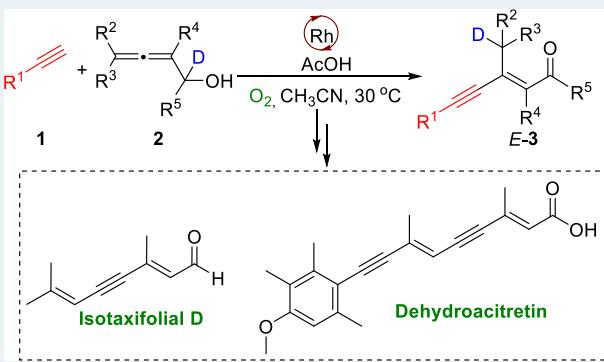

terminal alkynylmetalation, stereodefined insertion providing a 2-alkynyl π-allylic intermediate, which would undergo C−C single bond rotation, intramolecular ligand exchange, β−H elimination, and reductive elimination resulting in 1,4-H delivery to aford the final enynes. The reaction circumvents the use of a stoichiometric amount of base under the catalysis of a single Rh catalyst since terminal alkynylmetalation is base free, and the catalyst is regenerated by aerobic oxidation in the presence of proton.

KEYWORDS: rhodium catalysis, 1,4-H delivery, enynes synthesis, allenes, alkynes, E-selectivity

## ■ INTRODUCTION

Transition metal-catalyzed reactions have constantly been providing highly eficient methodologies for the eficient formation of covalent bonds. With the fine-tuning of the ligand structure and metal, the regio-, chemo-, and stereoselectivity may be precisely controlled. Terminal alkynes make up an important class of compounds for such reactions in organic synthesis. For example, the well-known Sonogashira coupling of terminal alkynes with 1-alkenyl halides utilizes the highly reactive C−X bond to form the sp $\mathrm { \dot { C } } { \cdot } { \mathsf { s p } } ^ { 2 } \mathrm { C }$ bonds under the co-catalysis of Pd and $\operatorname { C u } ( \operatorname { I } ) .$ 1 On the other hand, allenes have also been becoming one of the most important classes of organic compounds.2 Nowadays, the allenation of terminal alkynes (ATA reaction) has made mono-, di-, and trisubstituted allenes readily available.2d The reactions of terminal alkynes with allenes have merely been sporadically studied. Of our interest is the formation of 1-alkynyl π-allylic metallic species A, which may be converted to enynes A′ and/ or the regioisomeric enynes $\dot { \mathbf { A } } ^ { \prime \prime }$ upon further trapping, although the formations of non-conjugated alken-4-yn-2-yl metallic species B and C were also observed (Figure 1a).3 Beyond terminal alkynes, decarboxylative alkynylation of allenes with alkynyl carboxylic acids4 and transition metal-catalyzed reactions of haloalkynes with allenes5 had also been developed. In 2005, Alcaide and Almendros reported the reaction of terminal alkynes with 2,3-allenols formed π-allylic metallic species A1, which readily underwent cyclic etherification to aford D-type 3-alkynyl-2,5-dihydrofurnans due to the presence of the nucleophilic OH group (Figure 1b).6 We report herein the observation of the Rh-catalyzed highly regio- and stereoselective aerobic cross-coupling of terminal alkynes with 2,3- allenols afording the stereo-defined 1,3-enynals or enyl ketones with an exclusive E selectivity (Figure 1c), which are a type of common unit in natural or bioactive products (Figure 1d).7

## ■ METHODS

We chose the challenging terminal alkyne but-3-yn-1-ol 1a with 1-(p-tolyl)-2,3-allenol 2a to optimize the reaction conditions. After tedious screening of the reaction parameters, it was observed that in the presence of 5 mol % [Cp\*RhCl ] and 2.5 equiv of $\mathrm { C u } ( \mathrm { O A c } ) _ { 2 } { \cdot } \mathrm { H } _ { 2 } \mathrm { O }$ in acetonitrile and methanol at 50 ${ } ^ { \circ } \mathrm { C } ,$ the reaction did aford an enyne product, which is diferent from either $\mathbf { A ^ { \prime } }$ or $\mathbf { A ^ { \prime \prime } } _ { }$ , as shown in Figure 1a. It has been characterized as 3-alkynyl-(2E)-enone (E)-3aa. The reaction aforded (E)-3aa in 25% nuclear magnetic resonance (NMR) yield with a 10% NMR yield of allenol decomposition product of p-methylbenzaldehyde $\mathbf { 2 a ^ { \prime } }$ . It is interesting to observe that the bimolecular regioisomeric enyne products E1 and $\mathbf { F 1 } , ^ { 8 }$ Glaser coupling product conjugated diyne ${ \bf G 1 } , { \bf \Phi ^ { 9 } }$ cycloisomerization product H1,10 bi-2,5-dihydrofuran product I1,11 2,5-dihydrofuryl enone product $\mathbf { J 1 } , \mathbf { \Phi } ^ { 1 2 } \mathbf { \Phi } ^ { 2 } 4 - ( 1 , 3 \mathbf { - d i e n y l } ) { \cdot } 2 , 5 -$ dihydrofuran product ${ \bf K 1 } , ^ { 1 3 }$ and 3-alkynyl-2,5-dihydrofuran product $\mathbf { D 1 } ^ { 6 }$ were all not detected (Figure 2a). However, control experiments showed that the Glaser coupling product G1 was formed in 24% NMR yield, and the bimolecular regioisomeric enyne products E1 and F1 were not formed when but-3-yn-1-ol 1a was treated alone under the same conditions (Figure 2b); when 1-(p-tolyl)-2,3-allenol 2a alone was stirred under the same conditions, 32% of $^ { 2 , 5 \cdot }$ -dihydrofuryl enone J1 was detected with 5% NMR yield of $p \mathrm { - }$ methylbenzaldehyde ${ \bf 2 a ^ { \prime } ; ^ { 1 2 } }$ the formation of cycloisomerization product H1, bi $^ { - 2 , 5 }$ -dihydro furan product I1, and 4-(1,3- dienyl)-2,5-dihydrofuran product K1 were not observed (Figure 2c). These two sets of results indicated the perfect match for the reactivities of the terminal alkyne and 2,3-allenol.

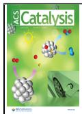

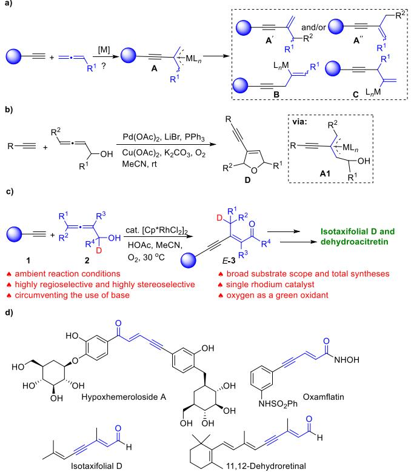  
Figure 1. Selected examples of naturally occurring and bioactive enynes and terminal alkyne-based approaches to enynes. (a) Possible reactions of terminal alkynes with allenes: the selectivity issues. (b) Known cyclization of terminal alkynes with 2,3-allenols. (c) Rh(III)- catalyzed linear cross-coupling of terminal alkynes with allenols for enynyl aldehyde or ketone syntheses. (d) Natural products and bioactive molecules bearing 1,3-enynyl carbonyl units.

Further optimization led to the observation that the same reaction may be conducted in the absence of $\mathrm { C u } ( \mathrm { O A c } ) _ { 2 } { \cdot } \mathrm { H } _ { 2 } \mathrm { O }$ in MeCN to aford 3-alkynyl-(2E)-enone (E)-3aa in 34% NMR yield stereoselectively together with 2% NMR yield of $p \mathrm { - }$ methylbenzaldehyde ${ \bf 2 a ^ { \prime } }$ with just 2 mol % $[ \mathrm { C p } ^ { * } \mathrm { R h C l } _ { 2 } ^ { } ] _ { 2 }$ (Table 1, entry 1). The ligand exchange of $\bar { \mathrm { C p } ^ { \ast } \mathrm { R h } ^ { \mathrm { I I I } } }$ with

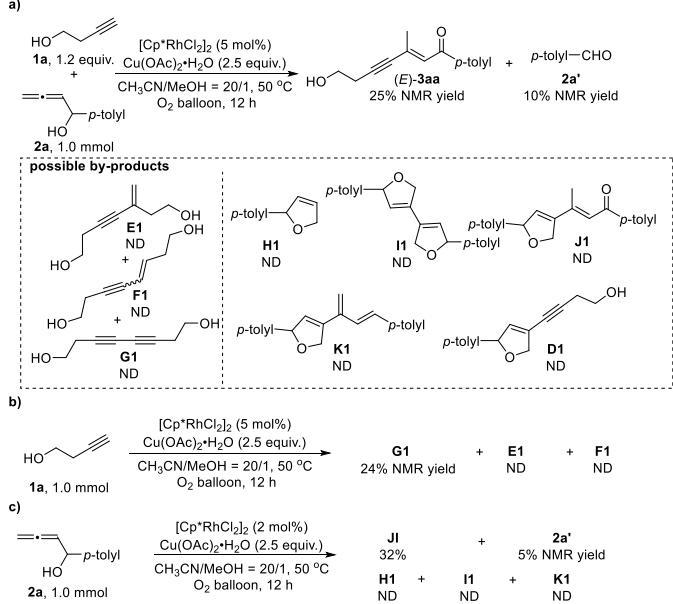  
Figure 2. Rh-catalyzed reactions of terminal alkyne 1a with 2,3-allenol 2a, terminal alkyne 1a, or 2,3-allenol 2a. (a) Rh(III)-catalyzed crosscoupling of terminal alkyne 1a with allenol 2a. (b) Rh(III)-catalyzed reaction of terminal alkyne 1a. (c) Rh(III)-catalyzed reaction of allenol 2a.

2,3-allenol 2a would generate intermediate Int ${ \bf I } ,$ which would undergo subsequent $\beta \mathrm { \cdot }$ carbon elimination to aford tolylbenzaldehyde $2 \hat { \mathbf { a } } ^ { \prime }$ . Interestingly, the reaction in the presence of HOAc (1 equiv) improved the yield of (E)-3aa to 41% NMR yield (Table 1, entry 2). The yield of (E)-3aa dropped with 2 equiv of HOAc (Table 1, entry 3). The reaction at the ambient temperature of 30 °C aforded (E)-3aa in 51% NMR yield with 9% recovery of 2a (Table 1, compare entry 5 with entries 2 and 4). When $\mathrm { P d } ( \mathrm { O A c } ) _ { 2 } ,$ ${ \mathrm { N i } } ( \mathrm { O A c } ) _ { 2 } { \cdot } 4 { \mathrm { H } } _ { 2 } \mathrm { O } ,$ or $[ \mathrm { C p } ^ { * } \mathrm { I r } \mathrm { C l } _ { 2 } ] _ { 2 }$ was applied as the catalyst, the reaction did not work (Table 1, entries $6 { \sim } 8 )$ . Running the reaction at a concentration of 0.25 M for 16 h further improved the yield of (E)-3aa to 66% with a complete conversion (Table 1, compare entry 9 with entries 5 and 10). Subsequent solvent screening (Table 1, entries 11∼17) indicated that acetonitrile is still the best. The yield of (E)-3aa dropped in the presence of 10 mol % of silver salts $( \mathrm { A g O A c } , \mathrm { A g N O } _ { 3 } ,$ or $\mathrm { A g } _ { 2 } \hat { \mathrm { C O } } _ { 3 } )$ or 10 mol % of $\mathrm { C u } { \left( \mathrm { O A c } \right) } _ { 2 } { \cdot } \mathrm { H } _ { 2 } \mathrm { O }$ (Table 1, compare entry 9 with entries 18∼21). Thus, the reaction conditions of entry 9 in Table 1 have been defined as the standard conditions for further scope study, as shown in Figure 3. The reaction enjoys single rhodium catalysis and the use of a base for the terminal alkynylmetalation is not necessary.

## ■ RESULTS AND DISCUSSION

As shown in Figure 3, terminal alkynols with diferent lengths of carbon chain between the C−C triple bond and the hydroxy group aforded the corresponding products (E)-3aa∼(E)-3ca in decent yields, and the reaction is robust since no protection is required for the free OH group. Diferent alkyl-substituted terminal alkynes without the hydroxy group also worked to aford (E)-3da and (E)-3ea. Even the highly strained cyclopropyl group survived, afording (E)-3fa. Terminal alkynes bearing various highly synthetically versatile functional groups, such as chloro (1g), cyano (1h), and ester (1i), may also be applied, afording (E)-3ga∼(E)-3ia. Even the reaction of p-formyl phenylacetylene furnished the corresponding product (E)-3la with the formyl group untouched, whose structure was further confirmed by X-ray crystallographic study.14 Diferent aryl- and heteroaryl-substituted terminal alkynes 1m∼1o also worked to aford the corresponding 3- alkyn-2(E)-enones (E)-3ma∼(E)-3oa. However, heteroarylsubstituted terminal alkyne 2-pyridinylacetylene 2p aforded trace (E)-3pa, with 88% recovery of 2a. When hepta-1,6-diyne was applied, the selectivity is remarkable: the mono-crosscoupling product (E)-3qa was obtained in 41% yield, together with the double-cross-coupling product (E)-3qaa in only 5% yield. With regard to 2,3-allenols, R5 may be alkyl groups ((E)- 3db, (E)-3rb, (E)-3be) or electron-rich and electron-deficient aryl groups ((E)-3aa∼(E)-3qa, (E)-3dc, (E)-3sd, (E)-3bf, and (E)-3bg). Heteroaryl-substituted 2,3-allenol 2h also delivered the product (E)-3bh. It is worthy to mention that even the aldehydes (E)-3bi and (E)-3si∼(E)-3ui with a very high E/Z selectivity were available from the reaction of terminal alkynes 1b and 1s∼1u with 2,3-butadienol $2 \mathbf { i } . ^ { 1 5 }$ To our delight, the reaction of even di-substituted 2,3-allenols 2j and 2k with terminal alkyne 1a also aforded the desired products (E)-3aj and (E)-3ak in 39% and 34% yields, respectively. However, when the 4-position-substituted $^ { 2 , 3 \cdot }$ -allenols 2l and 2m were treated under the standard conditions with terminal alkyne 1a, the target products were aforded in low yields. Unfortunately, when tri- and tetra-substituted 2,3-allenols ${ \bf 2 n } { \bf \sim } { \bf 2 p }$ were treated with 1a under the standard conditions, (E)-3an∼(E)-3ap were not formed; the reaction of tri-substituted 2,3-allenol 2n with 1a aforded 12% of the cycloisomerization product $2 \mathbf { n } ^ { \prime \prime }$ with 81% recovery of 2n. To demonstrate the synthetic potential of the protocol, we applied the strategy to derivatize several bioactive molecules, as shown in Figure 3; (S)-naproxen, a nonselective cyclooxygenase inhibitor, was transformed to the corresponding allenol (2S)-2q via reduction, aerobic oxidation, 1,2-addition, and ATA reaction,2d which reacted with terminal alkyne, hept-1-yne 1d, to aford (S,E)-3dq in 47% yield. The esterification of pent-4-ynoic acid with L-menthol aforded terminal alkynoate (1R,2S,5R)-1v, which was treated with allenol 2a to aford enynone (1R,2S,5R,E)-3va in 52% yield. A similar operation was also conducted with (S)-ibuprofen, a nonsteroidal anti-inflammatory drug, afording the product (S,E)-3wa in a 47% yield. Terminal propargylic alcohol (5S)- 1x was synthesized from (−)-citronellal. Subsequent ATA reaction2d aforded allenol (6S)-2r, which was easily transformed to (S,E)-3dr under the standard conditions by its treatment with terminal alkyne of hept-1-yne 1d. The reaction of optically active propargylic alcohol (3R,5S)-1x, which was readily available from enzymatic separation catalyzed by Novozym $4 3 5 , ^ { 1 6 }$ with allenol 2a aforded $( 6 R , 8 S , \dot { E } )$ -3xa in

Table 1. Optimization of Reaction Conditions  
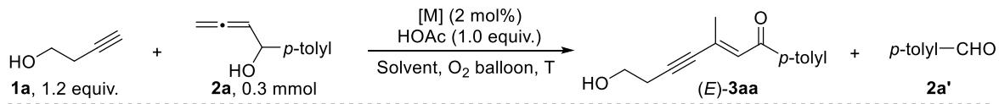

The mechanistic path for the formation of 2a':  
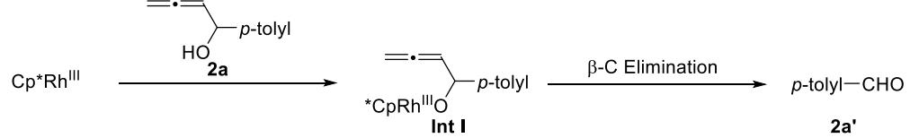

<table><tr><td colspan="7"></td><td colspan="3">NMR yield/recovery  ${ \bigl ( } \% { \bigr ) } ^ { b }$ </td></tr><tr><td>entry</td><td>[M]</td><td>solvent</td><td>T (C)</td><td>time (h)</td><td>conc. (M)</td><td>(E)-3aa</td><td></td><td>2a′</td><td>2a</td></tr><tr><td>1</td><td> $[ \mathrm { C p } ^ { * } \mathrm { R h } \mathrm { C l } _ { 2 } ] _ { 2 } ^ { \textit { c } }$ </td><td>MeCN</td><td>50</td><td>15</td><td>0.5</td><td>34</td><td></td><td>2</td><td>0</td></tr><tr><td>2</td><td> $[ \mathrm { C p } ^ { * } \mathrm { R h } \mathrm { C l } _ { 2 } ] _ { 2 }$ </td><td>MeCN</td><td>50</td><td>12</td><td>0.5</td><td>41</td><td></td><td>2</td><td>0</td></tr><tr><td>3</td><td> $[ \mathbf { C p } ^ { * } \mathbf { R h } \mathbf { C l } _ { 2 } ] _ { 2 } ^ { \ d }$ </td><td>MeCN</td><td>50</td><td>12</td><td>0.5</td><td>31</td><td></td><td>2</td><td>0</td></tr><tr><td>4</td><td> $[ \mathrm { C p } ^ { * } \mathrm { R h } \mathrm { C l } _ { 2 } ] _ { 2 }$ </td><td>MeCN</td><td>40</td><td>11</td><td>0.5</td><td></td><td>38</td><td>1</td><td>8</td></tr><tr><td>5</td><td> $[ \mathrm { C p } ^ { * } \mathrm { R h } \mathrm { C l } _ { 2 } ] _ { 2 }$ </td><td>MeCN</td><td>30</td><td>11</td><td>0.5</td><td></td><td>51</td><td>1</td><td>9</td></tr><tr><td>6</td><td> $\mathrm { P d } ( \mathrm { O A c } ) _ { 2 }$ </td><td>MeCN</td><td>30</td><td>12</td><td>0.5</td><td></td><td>0</td><td>0</td><td>58</td></tr><tr><td>7</td><td> $\mathrm { N i } ( \mathrm { O A c } ) _ { 2 } { \cdot } 4 \mathrm { H } _ { 2 } \mathrm { O }$ </td><td>MeCN</td><td>30</td><td>12</td><td>0.5</td><td></td><td>0</td><td>0</td><td>100</td></tr><tr><td>8</td><td> $[ \mathrm { C p } ^ { * } \mathrm { I r } \mathrm { C l } _ { 2 } ] _ { 2 }$ </td><td>MeCN</td><td>30</td><td>10</td><td>0.5</td><td></td><td>0</td><td>2</td><td>20</td></tr><tr><td>9</td><td> $[ \mathbf { C } \mathbf { p } ^ { * } \mathbf { R h } \mathbf { C l } _ { 2 } ] _ { 2 }$ </td><td>MeCN</td><td>30</td><td>16</td><td>0.25</td><td></td><td>66</td><td>2</td><td>0</td></tr><tr><td>10</td><td> $[ \mathrm { C p } ^ { * } \mathrm { R h } \mathrm { C l } _ { 2 } ] _ { 2 }$ </td><td>MeCN</td><td>30</td><td>24</td><td>0.2</td><td></td><td>56</td><td>1</td><td>14</td></tr><tr><td>11</td><td> $[ \mathrm { C p } ^ { * } \mathrm { R h } \mathrm { C l } _ { 2 } ] _ { 2 }$ </td><td>dioxane</td><td>30</td><td>24</td><td>0.25</td><td></td><td>5</td><td>0</td><td>44</td></tr><tr><td>12</td><td> $[ \mathrm { C p } ^ { * } \mathrm { R h } \mathrm { C l } _ { 2 } ] _ { 2 }$ </td><td>THF</td><td>30</td><td>24</td><td>0.25</td><td></td><td>13</td><td>0</td><td>19</td></tr><tr><td>13</td><td> $[ \mathrm { C p } ^ { * } \mathrm { R h } \mathrm { C l } _ { 2 } ] _ { 2 }$ </td><td>toluene</td><td>30</td><td>18</td><td>0.25</td><td></td><td>16</td><td>2</td><td>0</td></tr><tr><td>14</td><td> $[ \mathrm { C p } ^ { * } \mathrm { R h } \mathrm { C l } _ { 2 } ] _ { 2 }$ </td><td>MeOH</td><td>30</td><td>13</td><td>0.25</td><td></td><td>4</td><td>0</td><td>0</td></tr><tr><td>15</td><td> $[ \mathrm { C p } ^ { * } \mathrm { R h } \mathrm { C l } _ { 2 } ] _ { 2 }$ </td><td>DCM</td><td>30</td><td>13</td><td>0.25</td><td></td><td>37</td><td>2</td><td>0</td></tr><tr><td>16</td><td> $[ \mathrm { C p } ^ { * } \mathrm { R h } \mathrm { C l } _ { 2 } ] _ { 2 }$ </td><td> $\mathbf { M e C N / D C M } ^ { e }$ </td><td>30</td><td>29</td><td>0.25</td><td></td><td>38</td><td>1</td><td>0</td></tr><tr><td>17</td><td> $[ \mathrm { C p } ^ { * } \mathrm { R h } \mathrm { C l } _ { 2 } ] _ { 2 }$ </td><td> $\boldsymbol { \mathrm { M e C N / t o l u e n e } } ^ { f }$ </td><td>30</td><td>29</td><td>0.25</td><td></td><td>58</td><td>1</td><td>1</td></tr><tr><td>18</td><td> $[ \mathbf { C p } ^ { * } \mathbf { R h } \mathbf { C l } _ { 2 } ] _ { 2 } ^ { g }$ </td><td>MeCN</td><td>30</td><td>16</td><td>0.25</td><td></td><td>34</td><td>0</td><td>27</td></tr><tr><td>19</td><td> $[ \mathbf { C p } ^ { * } \mathbf { R h } \mathbf { C l } _ { 2 } ] _ { 2 } ^ { \ h }$ </td><td>MeCN</td><td>30</td><td>16</td><td>0.25</td><td></td><td>25</td><td>1</td><td>33</td></tr><tr><td>20</td><td> $[ \mathbf { C p } ^ { * } \mathbf { R h C l } _ { 2 } ] _ { 2 } ^ { \ i }$ </td><td>MeCN</td><td>30</td><td>16</td><td>0.25</td><td></td><td>&lt;5</td><td>0</td><td>82</td></tr><tr><td>21</td><td> $[ \mathbf { C p } ^ { * } \mathbf { R h C l } _ { 2 } ] _ { 2 } ^ { j }$ </td><td>MeCN</td><td>30</td><td>16</td><td>0.25</td><td></td><td>49</td><td>10</td><td>0</td></tr></table>

aReaction conditions: terminal alkyne 1a (0.36 mmol), allenol 2a (0.3 mmol), $[ \mathrm { C p } ^ { * } \mathrm { R h } \mathrm { C l } _ { 2 } ] _ { 2 }$ (0.006 mmol), and HOAc (0.3 mmol) in CH CN (0.6 mL) under an $\mathrm { O } _ { 2 }$ atmosphere (balloon) unless otherwise noted. bDetermined by NMR. cThe reaction was conducted in the absence of HOAc. $^ { d } 2 . 0$ equiv of HOAc was used. eThe solvent of $\mathrm { M e C N / D C M } = 3 / 1$ was used.fThe solvent of MeCN/toluene = 3/1 was used. $^ { g } 1 0$ mol % ofAgOAc was added. ${ } ^ { h } 1 0$ mol % of $\mathrm { \bf A g N O } _ { 3 }$ was applied. iThe reaction was conducted with 10 mol % of $\mathbf { A g } _ { 2 } \mathbf { C O } _ { 3 } . \mathbf { \mu } ^ { j } 1 0$ mol % of $\mathrm { C u } ( \mathrm { O A c } ) _ { 2 } { \cdot } \mathrm { H } _ { 2 } \mathrm { O }$ was added.

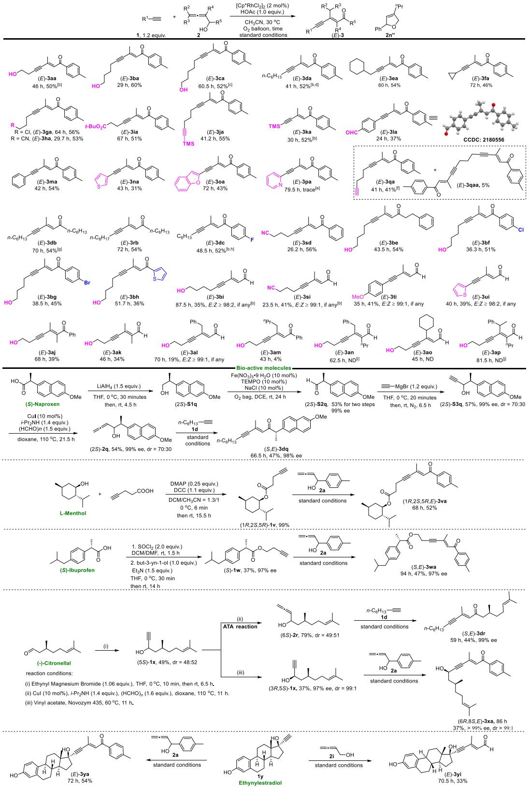  
Figure 3. Substrate scope. (a) Reaction conditions: terminal alkyne 1 (0.6 mmol), allenol 2 (0.5 mmol), $[ \mathrm { C p } ^ { * } \mathrm { R h C l } _ { 2 } ] _ { 2 }$ (0.01 mmol), and HOAc (0.5 mmol) in $\mathrm { C H } _ { 3 } \mathrm { C N } \mathbf { \bar { \Psi } } ( 2 \mathbf { m } \mathbf { L } )$ at $3 0 ~ ^ { \circ } \mathrm { C }$ under an $\mathrm { O } _ { 2 }$ atmosphere (balloon) unless otherwise noted. (b) 1.0 mmol scale. (c) 4% recovery of 2a was detected by NMR. (d) 5% recovery of 2a was detected by NMR. (e) 88% recovery of 2a was detected by NMR. (f) 2.8 equiv of 1q was used. $( \mathbf { g } )$ 6% recovery of 2b was detected by NMR. (h) 9% recovery of 2c was detected by NMR. (i) 12% of $2 \mathbf { n } ^ { \prime \prime }$ was obtained by isolation; 81% recovery of 2n was detected by NMR. (j) 83% recovery of ${ \bf 2 9 }$ was detected by NMR.

37% yield. Commercially available ethinylestradiol 1y may be converted to product (E)-3ya in 54% yield by its reaction with secondary 2,3-allenol 2a under the optimized reaction conditions. Even the reaction of 2,3-butadienol 2i with ethinylestradiol 1y aforded the aldehyde product (E)-3yi in 33% yield.

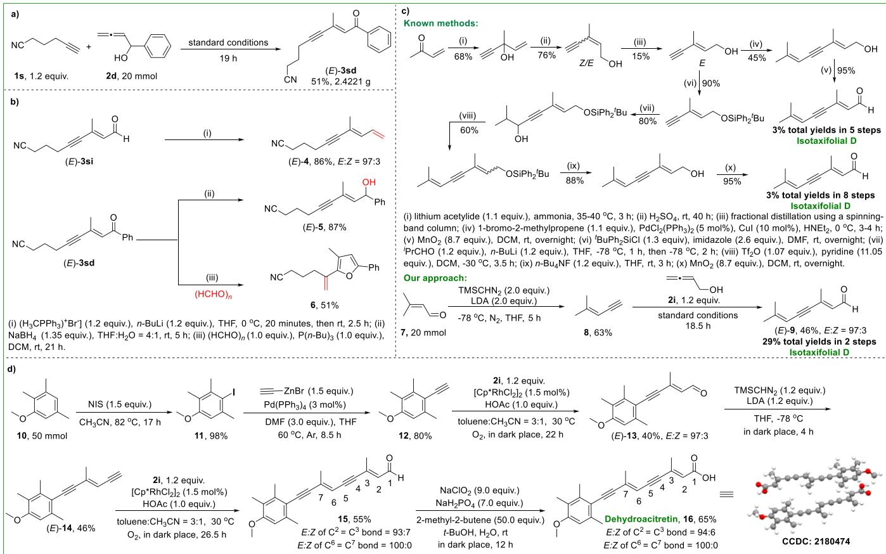  
Figure 4. Gram-scale reaction and synthetic applications. (a) Gram-scale reaction. (b) Synthetic applications. (c) Total synthesis of isotaxifolial D. (d) Synthesis of dehydroacitretin.

To further explore the synthetic potentials of this transformation, a gram-scale synthesis of (E)-3sd was executed under the standard reaction conditions (Figure 4a); treatment of alkynenal (E)-3si with a Wittig reagent aforded conjugated alka-1,3-dien-5-yne (E)-4 in 86% yield;17 controlled reduction of the ketone functionality without touching the cyano functionality in (E)-3sd with NaBH resulted in secondary alcohol (E)-5 in 87% yield; phosphine initiated cyclization of (E)-3sd to furnish α-vinylfuran bearing a cyano group 6 in the presence of paraformaldehyde (Figure 4b).18 This methodology has been applied to deliver a highly eficient stereoselective entry to the natural product isotaxifolial D (Figure 4c): commercially available 3-methylbut-2-enal 7 reacted with TMSCHN2 to aford 4-methylbut-3-en-1-yne 8 in 63% yield,19 which underwent this rhodium-catalyzed coupling reaction with 2,3-butadienol 2i to aford isotaxifolial D (E)-9 eficiently in 46% yield and an E/Z selectivity of 97:3. We obtained isotaxifolial D with a total yield of 29% in 2 steps. As a comparison, the known methods required 5 or 8 steps to obtain isotaxifolial D in 3% total yields from commercially available methyl vinyl ketone via the problematic separation of the E and Z isomers of 3-methylpent-4-yn-2-enol as the third step.7b,20,21 Commercially available 2,3,5-trimethylanisole 10 was treated with NIS to aford aryl iodide 11 in 98% yield,22 which underwent the Negishi coupling to yield terminal aryl acetylene 12.23 Aldehyde (E)-13 was formed in 40% yield with 97:3 E/Z selectivity by this rhodium-catalyzed coupling reaction with 2,3-butadienol 2i. (E)-13 reacted with

TMSCHN in the presence of LDA to aford terminal alkyne (E)-14 in 46% yield.19 This Rh(III)-catalyzed coupling reaction of (E)-14 with 2,3-butadienol 2i was applied for the second time to aford aldehyde 15 in 55% yield with a decent stereoselectivity of 93:7 for the C3−C2 double bond. By following Lindgren−Kraus−Pinick oxidation,24 the stereoselective synthesis of dehydroacitretin $1 6 ^ { 2 5 }$ has been realized in 65% yield with an E/Z ratio of 94:6. The structure of product $\stackrel { \prime } { 1 } 6 ^ { 2 6 }$ was confirmed by single-crystal X-ray difraction analysis.

To gain insight into the nature of the cross-coupling reaction, some control experiments were conducted (Figure 5a,b): firstly, the same reaction was conducted under nitrogen, pure oxygen, and air atmosphere, and the results indicated that oxygen was critical for this transformation; when deuterated terminal alkyne [D]-1r was applied for its reaction with allenol 2b under the standard conditions, no deuterium incorporation in the product (E)-3rb was observed; interestingly, the reaction of 1-decyne 1r with deuterated allenol [D]-2b aforded [D]-(E)-3rb with the deuterium incorporation of 99% in the methyl group connected to the C−C bond. Based on these experimental data, a possible mechanism has been proposed, as shown below using 1r and [D]-2b as the model substrates (Figure 5c): firstly, alkynyl rhodium intermediate IN-1 was readily generated from the deprotometalation of the terminal alkyne 1r, which underwent the regio- and hydroxy group-dictated stereo-selective insertion with 2,3-allenol eficiently due to the high reactivity of allene to generate 2- alkynyl π-allylic rhodium intermediate IN-2.27 It would undergo C−C bond rotation, intramolecular ligand exchange, and subsequent β−D elimination forming the C−O bond

a)

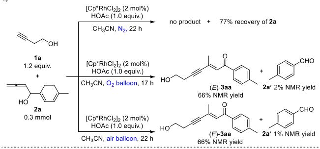

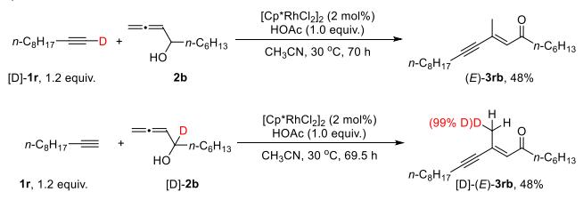

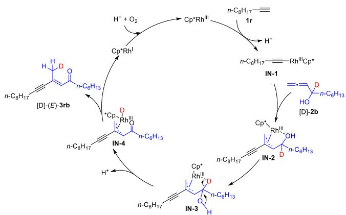  
Figure 5. Mechanistic exploration and the proposed mechanism. (a) Control experiments. (b) Deuterium labeling experiments. (c) Proposed mechanism.

resulting in the stereodefined π-allylic rhodium hydride IN-4 via the intermediacy of IN-3. This formal 1,4-D delivery was achieved via subsequent reductive elimination to yield the final product [D]-(E)-3rb and Rh(I) species. Under the oxygen atmosphere and proton, Rh(III) was regenerated to finish the catalytic circle.

## ■ CONCLUSIONS

In summary, we have developed a conceptually new approach for the enyne synthesis via a single rhodium-catalyzed crosscoupling reaction of terminal alkynes with 2,3-allenols. This protocol enables an eficient and highly selective preparation of (E)-3-alkynyl enones/enals under a set of ambient conditions, which could serve as platform molecules for the synthesis of many other useful molecules due to the accommodation of a wide array of highly reactive functional groups. The synthetic potential of this methodology has been demonstrated via derivatization of bio-active molecules, the eficient total syntheses of isotaxifolial D, and the synthesis of dehydroaci tretin. A mechanism has been proposed for the observed highly selective formation of (E)-3-alkynyl enones/enals. The use of a base is not required since the terminal alkynylmetalation proceeds readily under base-free conditions, and the catalytically active rhodium catalyst has been regenerated via aerobic oxidation with the help of HOAc. The development of many other types of such reactions with both types of readily available terminal alkynes and allenes as the reactants for enyne syntheses is highly expected and is being actively pursued in our laboratory.

## ■ ASSOCIATED CONTENT

## \*sı Supporting Information

The Supporting Information is available free of charge at https://pubs.acs.org/doi/10.1021/acscatal.5c01327.

General information; synthesis of starting materials; Rhcatalyzed reactions of terminal alkyne 1a with 2,3-allenol 2a, terminal alkyne 1a, or 2,3-allenol 2a; Rh-catalyzed aerobic E-selective linear coupling of terminal alkynes with 2,3-allenols; gram-scale reaction and synthetic applications; mechanistic studies; and NMR and HPLC spectra of the compounds prepared (PDF) Crystallographic data for product (E)-3la (CIF) Crystallographic data for product 16 (CIF)

## ■ AUTHOR INFORMATION

## Corresponding Author

Shengming Ma − Research Center for Molecular Recognition and Synthesis, Department of Chemistry, Fudan University, Shanghai 200433, People’s Republic of China; orcid.org/ 0000-0002-2866-2431; Email: masm@sioc.ac.cn

## Authors

Yaqi Shi − Laboratory of Molecular Recognition and Synthesis, Department of Chemistry, Zhejiang University, Hangzhou, Zhejiang 310058, People’s Republic of China

Xiaoyan Wu − Laboratory of Molecular Recognition and Synthesis, Department of Chemistry, Zhejiang University, Hangzhou, Zhejiang 310058, People’s Republic of China

Chunling Fu − Laboratory of Molecular Recognition and Synthesis, Department of Chemistry, Zhejiang University, Hangzhou, Zhejiang 310058, People’s Republic of China

Complete contact information is available at: https://pubs.acs.org/10.1021/acscatal.5c01327

## Author Contributions

§Y.S. and X.W. contributed equally to this work.

## Notes

The authors declare no competing financial interest.

## ■ ACKNOWLEDGMENTS

Financial support from the National Natural Science Foundation of China (22588201) is greatly appreciated. We also thank Wenyao Li in our group for reproducing the results of (E)-3dc, (E)-3bi, and (S,E)-3dr.

## ■ REFERENCES

(1) (a) Doucet, H.; Hierso, J.-C. Palladium-Based Catalytic Systems for the Synthesis of Conjugated Enynes by Sonogashira Reactions and Related Alkynylations. Angew. Chem., Int. Ed. 2007, 46, 834−871. (b) Chinchilla, R.; Nájera, C. Recent Advances in Sonogashira Reactions. Chem. Soc. Rev. 2011, 40, 5084−5121.

(2) (a) Ma, S. Transition Metal-Catalyzed/Mediated Reaction of Allenes with a Nucleophilic Functionality Connected to the α-Carbon Atom. Acc. Chem. Res. 2003, 36, 701−712. (b) Ma, S. Electrophilic Addition and Cyclization Reactions of Allenes. Acc. Chem. Res. 2009, 42, 1679−1688. (c) Ye, J.; Ma, S. Palladium-Catalyzed Cyclization Reactions of Allenes in the Presence of Unsaturated Carbon−Carbon Bonds. Acc. Chem. Res. 2014, 47, 989−1000. (d) Huang, X.; Ma, S.

Allenation of Terminal Alkynes with Aldehydes and Ketones. Acc. Chem. Res. 2019, 52, 1301−1312. (e) Ma, S. Some Typical Advances in the Synthetic Applications of Allenes. Chem. Rev. 2005, 105, 2829− 2871. (f) Yang, B.; Qiu, Y.; Bäckvall, J. E. Control of Selectivity in Palladium(II)-Catalyzed Oxidative Transformations of Allenes. Acc. Chem. Res. 2018, 51, 1520−1531. (g) Mascareñas, J. L.; Varela, I.; López, F. Allenes and Derivatives in Gold(I)- and Platinum(II)- Catalyzed Formal Cycloadditions. Acc. Chem. Res. 2019, 52, 465−479. (h) Lledó, A.; Pla-Quintana, A.; Roglans, A. Allenes, Versatile Unsaturated Motifs in Transitionmetal-Catalysed [2+2+2] Cycloaddition Reactions. Chem. Soc. Rev. 2016, 45, 2010−2023. (i) Wang, Z.; Xu, X.; Kwon, O. Phosphine Catalysis of Allenes with Electrophiles. Chem. Soc. Rev. 2014, 43, 2927−2040. (j) Adams, C. S.; Weatherly, C. D.; Burke, E. G.; Schomaker, J. M. The Conversion of Allenes to Strained Three-Membered Heterocycles. Chem. Soc. Rev. 2014, 43, 3136−3163. (k) Kitagaki, S.; Inagaki, F.; Mukai, C. [2+2+1] Cyclization of Allenes. Chem. Soc. Rev. 2014, 43, 2956− 2978. (l) Blieck, R.; Taillefer, M.; Monnier, F. Metal-Catalyzed Intermolecular Hydrofunctionalization of Allenes: Easy Access to Allylic Structures via the Selective Formation of C−N, C−C, and C− O Bonds. Chem. Rev. 2020, 120, 13545−13598. (m) Bates, R. W.; Satcharoen, V. Nucleophilic Transition Metal Based Cyclization of Allenes. Chem. Soc. Rev. 2002, 31, 12−21. (n) Zimmer, R.; Dinesh, C. U.; Nandanan, E.; Khan, F. A. Palladium-Catalyzed Reactions of Allenes. Chem. Rev. 2000, 100, 3067−3125. (o) Alonso, J. M.; Almendros, P. Deciphering the Chameleonic Chemistry of Allenols: Breaking the Taboo of a Onetime Esoteric Functionality. Chem. Rev. 2021, 121, 4193−4252.

(3) (a) Rubin, M.; Markov, J.; Chuprakov, S.; Wink, D. J.; Gevorgyan, V. Highly Regiocontrolled Pd-Catalyzed Cross-Coupling Reaction of Terminal Alkynes and Allenylphosphine Oxides. J. Org. Chem. 2003, 68, 6251−6256. (b) Sawano, T.; Ou, K.; Nishimura, T.; Hayashi, T. Cobalt-Catalyzed Asymmetric Addition of Silylacetylenes to 1,1-Disubstituted Allenes. J. Org. Chem. 2013, 78, 8986−8993. (c) Bruyere, D.; Grigg, R.; Hinsley, J.; Hussain, R. K.; Korn, S.; Orgaz De La Cierva, C.; Sridharan, V.; Wang, J. Highly Regioselective Palladium/Copper-Catalysed Cross-Coupling Reactions of Terminal Alkynes and Allenes. Tetrahedron Lett. 2003, 44, 8669−8672. (d) Pradhan, T. R.; Kim, H. W.; Park, J. K. Regiodivergent Synthesis of 1,3- and 1,4-Enynes through Kinetically Favored Hydropalladation and Ligand-Enforced Carbopalladation. Angew. Chem., Int. Ed. 2018, 57, 9930−9935. (e) Yamaguchi, M.; Kido, Y.; Omata, K.; Hirama, M. Synthesis of Exo-Enynes by Ruthenium-Catalyzed Cross Coupling Reaction of Hydroxy Allenes and 1-Alkynes. Synlett 1995, 1995, 1181−1182. (f) Trost, B. M.; Kottirsch, G. Novel Allene-Acetylene Cross-Condensation Catalyzed by Palladium Complexes. J. Am. Chem. Soc. 1990, 112, 2816−2818. (g) Jeanne-Julien, L.; Masson, G.; Kouoi, R.; Regazzetti, A.; Genta-Jouve, G.; Gandon, V.; Roulland, E. Stereoselective Access to (E)-1,3-Enynes through Pd/Cu-Catalyzed Alkyne Hydrocarbation of Allenes. Org. Lett. 2019, 21, 3136−3141. (h) Liu, Z.-K.; Yang, Y.; Zhan, Z.-P. Preparation of (E)-1,3-Enyne Derivatives through Palladium Catalyzed Hydroalkynylation of Allenes. J. Org. Chem. 2022, 87, 1589−1597.

(4) (a) Grugel, C. P.; Breit, B. Rhodium-Catalyzed Enantioselective Decarboxylative Alkynylation of Allenes with Arylpropiolic Acids. Org. Lett. 2018, 20, 1066−1069. (b) Hédouin, J.; Carpentier, V.; Renard, B. M. $\mathrm { Q . ; }$ Schneider, C.; Gillaizeau, I.; Hoarau, C. Regioselective Pd-Catalyzed Carbopalladation/Decarboxylative Allylic Alkynylation of ortho-Iodoallenamides with Alkynyl Carboxylic Acids. J. Org. Chem. 2019, 84, 10535−10545. (c) Yabuta, A.; Oonishi, Y.; Doi, R.; Morisaki, K.; Sato, Y. Palladium-Catalyzed Decarboxylative Cyclization of α-Acyloxyketones Having an Allene Moiety in the Tether. New J. Chem. 2023, 47, 539−544.

(5) (a) Chen, D.; Chen, X.; Lu, Z.; Cai, H.; Shen, J.; Zhu, G. Palladium-Catalyzed Dienylation of Haloalkynes using 2,3-Butadienyl Acetates: A Facile Access to (1Z)-1,2-Dihalo-3-Vinyl-1,3-Dienes. Adv. Synth. Catal. 2011, 353, 1474−1478. (b) Li, Y.; Brand, J. P.; Waser, J. Gold-Catalyzed Regioselective Synthesis of 2- and 3-Alkynyl Furans. Angew. Chem., Int. Ed. 2013, 52, 6743−6747. (c) Yang, Y.; Schießl, J.;

Zallouz, S.; Göker, V.; Gross, J.; Rudolph, M.; Rominger, F.; Hashmi, A. S. K. Gold-Catalyzed C(sp2)-C(sp) Coupling by Alkynylation through Oxidative Addition of Bromoalkynes. Chem.�Eur. J. 2019, 25, 9624−9628. (d) Banerjee, S.; Senthilkumar, B.; Patil, N. T. Gold-Catalyzed 1,2-Oxyalkynylation of N-Allenamides with Ethylnylbenziodoxolones. Org. Lett. 2019, 21, 180−184. (e) Yang, C.; Dai, D.-T.; Lu, H.-X.; Zhang, F.-L.; Fu, Y.; Xu, Y.-H. Controllable Regio- and Stereo-Selective Coupling Reactions of Homoallenylboronates. Org. Chem. Front. 2021, 8, 2480−2486.

(6) Alcaide, B.; Almendros, P.; Rodríguez-Acebes, R. Pd-Cu Bimetallic Catalyzed Domino Cyclization of α-Allenols Followed by a Coupling Reaction: New Sequence Leading to Functionalized Spirolactams. Chem.�Eur. J. 2005, 11, 5708.

(7) (a) Bütikofer, P.-A.; Eugster, C. H. Synthese von Carotinoiden mit Hydroxylierter Methylgruppe an der Polyenkette mit Hilfe von Vinyl-Anionen (Shupiro-Reaktion). Helv. Chim. Acta 1983, 66, 1148− 1174. (b) Fécourt, F.; Carlier, C.; Pale, P. Rapid Synthesis of Taxifolione and Taxifolial D, Two Metabolites from the Marine Alga Caulerpa taxifolia. Lett. Org. Chem. 2009, 6, 65−70. (c) Zulfiqar, F.; Khan, S. I.; Ali, Z.; Wang, Y.-H.; Ross, S. A.; Viljoen, A. M.; Khan, I. A. Norlignan Glucosides from Hypoxis Gemerocallidea and Their Potential in Vitro anti-Inflammatory Activity via Inhibition of iNOS and NF-κB. Phytochemistry 2020, 172, 112273−112281. (d) Marson, C. M.; Serradji, N.; Rioja, A. S.; Gastaud, S. P.; Alao, J. P.; Coombes, R. C.; Vigushin, D. M. Stereodefined and Polyunsaturated Inhibitors of Histone Deacetylase Based on (2E,4E)-5-Arylpenta-2,4-Dienoic Acid Hydroxyamides. Bioorg. Med. Chem. Lett. 2004, 14, 2477−2481.

(8) (a) Trost, B. M.; Masters, J. T. Transition Metal-Catalyzed Couplings of Alkynes to 1,3-Enynes: Modern Methods and Synthetic Applications. Chem. Soc. Rev. 2016, 45, 2212−2238. (b) Liang, Q.; Hayashi, K.; Song, D. Catalytic Alkyne Dimerization without Noble Metals. ACS Catal. 2020, 10, 4895−4905. (c) Zhou, Y.; Zhang, Y.; Wang, J. Recent Advances in Transition-Metal-Catalyzed Synthesis of Conjugated Enynes. Org. Biomol. Chem. 2016, 14, 6638−6650.

(9) Sindhu, K. S.; Anilkumar, G. Recent Advances and Applications of Glaser Coupling Employing Greener Protocols. RSC Adv. 2014, 4, 27867−27887.

(10) (a) Qiu, Y.; Ma, D.; Fu, C.; Ma, S. General Approach to Benzo[b]thiophenes, Benzo[b]furans, and Dibenzofurans via Gold-Catalyzed Cyclization of 1-Heteroarylalka-2,3-Dienyl Acetates. Tetrahedron 2013, 69, 6305−6312. (b) Christov, V. C.; Ismailov, I. E.; Ivanov, I. K. Bifunctionalized Allenes. Part XVI. Synthesis of 3- Phosphoryl-2,5-dihydrofurans by Coinage Metal-Catalyzed Cyclo-Isomerization of Phosphorylated α-Hydroxyallenes. Molecules 2015, 20, 7263−7275.

(11) Hashmi, A. S. K.; Blanco, M. C.; Fischer, D.; Bats, J. W. Gold Catalysis: Evidence for the in-situ Reduction of Gold(III) during the Cyclization of Allenyl Carbinols. Eur. J. Org Chem. 2006, 2006, 1387.

(12) Wu, X.; Fan, J.; Huang, X.; Ma, S. Rh-Catalyzed Oxidative Homo-Coupling Cyclization of 2,3-Allenols to Conjugated Furylenones. Org. Chem. Front. 2021, 8, 4432−4437.

(13) Deng, Y.; Yu, Y.; Ma, S. PdCl2/NaI-Catalyzed Homodimeric Coupling-Cyclization Reaction of 2,3-Allenols: An Efficient Synthesis of 4-(1′,3′-Dien-2′-yl)-2,5-dihydrofuran Derivatives. J. Org. Chem. 2008, 73, 585−589.

(14) Crystal data for (E)-3la: C H O , MW = 288.33, monoclinic, space group P2 /c, final R indices [I ≥ 2σ (I)], R = 0.0402, wR = 0.1069; R indices (all data), R = 0.0516, wR = 0.1166; a = 17.6646(7) Å, b = 13.8053(5) Å, c = 6.2544(2) Å, α = 90°, $\beta =$ 97.817(2)°, γ = 90°, V = 1511.06(9) Å3, T = 170.0 K, $Z \ = \ 4 ,$ reflections collected/unique 21981/3321 $\left( R _ { \mathrm { i n t } } = 0 . 0 3 7 7 \right)$ , number of observations [>2σ(I)] 2732, parameters: 201. Supplementary crystallographic data have been deposited at the Cambridge Crystallographic Data Centre, CCDC 2180556.

(15) Luo, H.; Ma, D.; Ma, S. Buta-2,3-dien-1-ol. Org. Synth. 2017, 94, 153−166.

(16) Xu, D.; Li, Z.; Ma, S. Novozym-435-Catalyzed Enzymatic Separation of Racemic Propargylic Alcohols. A Facile Route to

Optically Active Terminal Aryl Propargylic Alcohols. Tetrahedron Lett. 2003, 44, 6343−6346.

(17) Preuß, T.; Saak, W.; Doye, S. Titanium-Catalyzed Intermolecular Hydroaminoalkylation of Conjugated Dienes. Chem.�Eur. J. 2013, 19, 3833−3837.

(18) Kuroda, H.; Hanaki, E.; Izawa, H.; Kano, M.; Itahashi, H. A Convenient Method for the Preparation of α-Vinylfurans by Phosphine-Initiated Reactions of Various Substituted Enynes Bearing a Carbonyl Group with Aldehydes. Tetrahedron 2004, 60, 1913− 1920.

(19) Miwa, K.; Aoyama, T.; Shioiri, T. Extension of the Colvin Rearrangement Using Trimethylsilyldiazomethane. A New Synthesis of Alkynes. Synlett 1994, 1994, 107−108.

(20) Oroshnik, W.; Mebane, A. D. The Nef Reaction with α,β- Unsaturated Ketones. J. Am. Chem. Soc. 1949, 71, 2062−2065.

(21) Mori, K.; Ohki, M.; Sato, A.; Matsui, M. Synthesis of Compounds with Juvenile Hormone Activity←XI: New Routes for the Stereo-Controlled Construction of the Trisubstituted cis Double-Bond Portion of the Cecropia Juvenile Hormones. Tetrahedron 1972, 28, 3739−3745.

(22) Mphahlele, M. J.; Paumo, H. K.; Rhyman, L.; Ramasami, P. Synthesis and Photophysical Properties of Polycarbo-Substituted Quinazolines Derived from the 2-Aryl-4-chloro-6-iodoquinazolines. Molecules 2015, 20, 14656−14683.

(23) Negishi, E.-I.; Kotora, M.; Xu, C. Direct Synthesis of Terminal Alkynes via Pd-Catalyzed Cross Coupling of Aryl and Alkenyl Halides with Ethynylmetals Containing Zn, Mg, and Sn. Critical Comparison of Countercations. J. Org. Chem. 1997, 62, 8957−8960.

(24) Bal, B. S.; Childers, W. E.; Pinnick, H. W. Oxidation of α,β-un Saturated Aldehydes. Tetrahedron 1981, 37, 2091−2096.

(25) Samokhvalov, G. I.; Zakharova, N. I.; Sokolova, N. N.; Filippova, T. M.; Raigorodskaya, O. I.; Murav’ev, V. V.; Tuguzova, A. M.; Khristoforov, V. L. Synthetic Investigations on the Chemistry of Polyene Compounds. LVI. Synthesis of (all-E)-9-(4-Methoxy-2,3,6- Trimethylphenyl)-3,7-Dimethylnona-2,4,6,8-Tetraenoic acid. Pharm. Chem. J. 1994, 28, 343−348.

(26) Crystal data for 16: C H O , MW = 322.38, triclinic, space group P1̅, final R indices [I ≥ 2σ (I)], R = 0.0616, wR = 0.1511; R indices (all data), R = 0.1086, wR = 0.1797; a = 8.9155(6) Å, b = 11.9207(8) Å, c = 17.9674(13) Å, α = 77.910(2)°, β = 87.631(3)°, γ = 71.194(3)°, V = 1766.8(2) Å3, T = 170.0 K, Z = 4, reflections collected/unique 31171/9197 (R = 0.0655), number of observations [>2σ(I)] 5663, parameters: 447. Supplementary crystallographic data have been deposited at the Cambridge Crystallographic Data Centre, CCDC 2180474.

(27) (a) Oh, C. H.; Jung, S. H.; Bang, S. Y.; Park, D. I. Decarbopalladation of π-Allylpalladium Intermediates Formed from Palladium-Catalyzed Arylations of 3-Allen-1-ols. Org. Lett. 2002, 4, 3325−3327. (b) Yoshida, M.; Gotou, T.; Ihara, M. Palladium-Catalysed Coupling Reaction of Allenic Alcohols with Aryl- and Alkenylboronic Acids. Chem. Commun. 2004, 2004, 1124−1125. (c) Ma, S.; Gu, Z. PdCl -Catalyzed Two-Component Cross-Coupling Cyclization of 2,3-Allenoic Acids with 2,3-Allenols. an Efficient Synthesis of 4-(1’,3’-dien-2’-yl)-2(5H)-Furanone Derivatives. J. Am. Chem. Soc. 2005, 127, 6182−6183. (d) Miura, T.; Shimizu, H.; Igarashi, T.; Murakami, M. Stereoselective Synthesis of Vinyl-Substituted (Z)-Stilbenes by Rhodium-Catalysed Addition of Arylboronic Acids to Allenic Alcohols. Org. Biomol. Chem. 2010, 8, 4074−4076.

CAS INSIGHTS™

## EXPLORE THE INNOVATIONS SHAPING TOMORROW

Discover the latest scientific research and trends with CAS Insights. Subscribe for email updates on new articles, reports, and webinars at the intersection of science and innovation.

Subscribe today