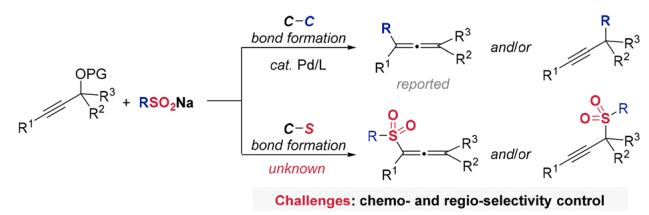
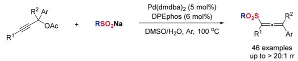
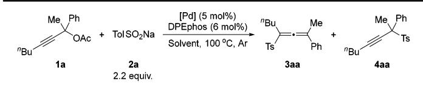
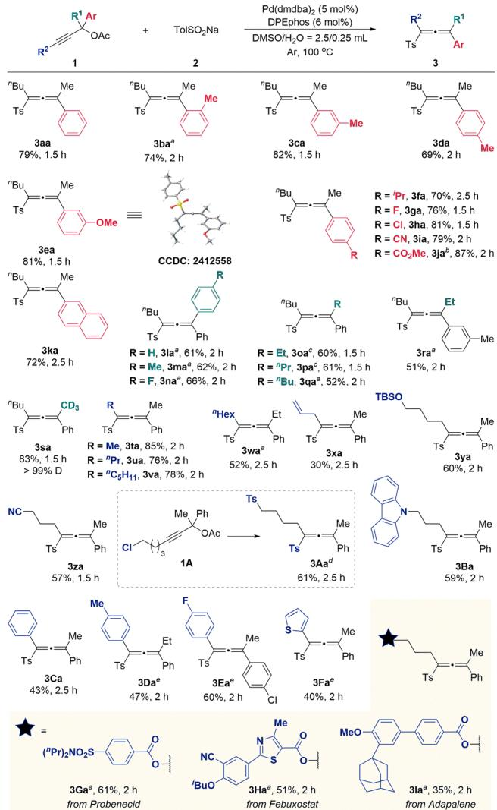
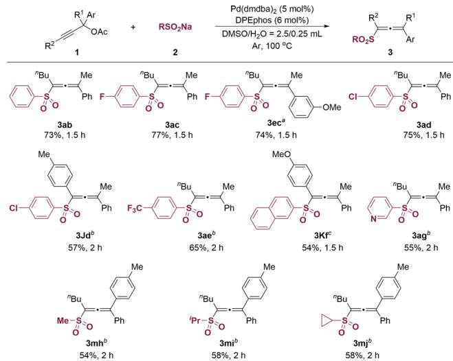
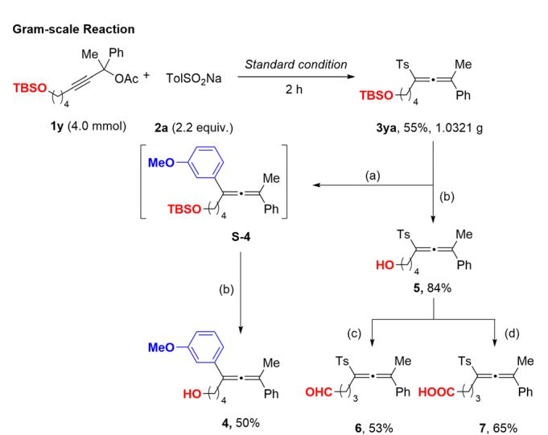
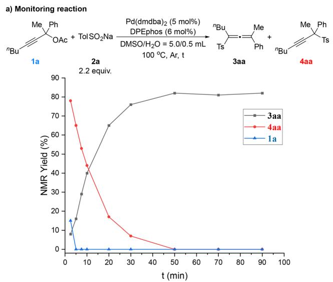
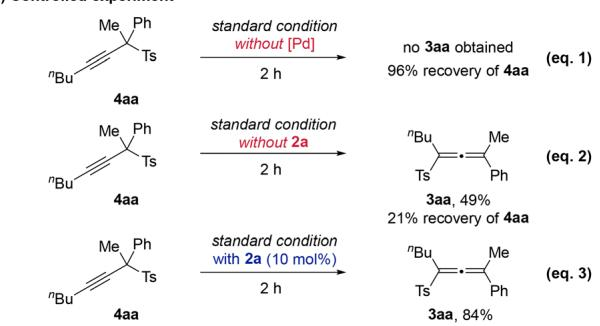
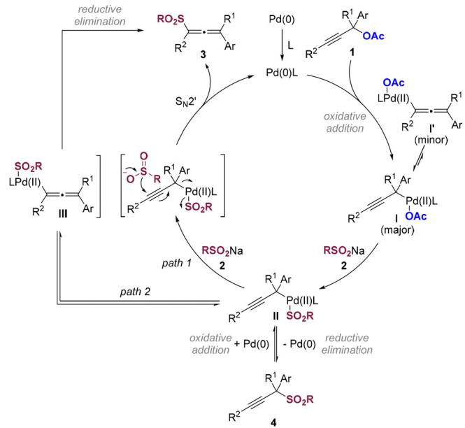

Licence and permissions

Check for updates

# Pd-catalyzed regioselective synthesis of allenyl sulfones via sulfinate-enabled isomerization

Cite this: Chem. Commun., 2026, 62, 13305

Shiwen Fan,a Zhaoqiang Chen,a Wenya Li,a Hui Qian \*a and Shengming Ma \*ab

Received 21st April 2026, Accepted 30th May 2026

DOI: 10.1039/d6cc02404a

rsc.li/chemcomm

An eficient Pd-catalyzed C–S coupling strategy for the synthesis of tetrasubstituted allenyl sulfones has been developed. Excess sulfinate uniquely acts as both coupling partner and isomerization promoter, driving the in situ generated propargyl sulfone to allenyl sulfone conversion with a high regioselectivity and a broad substrate scope.

Organosulfone compounds, valued for their unique physicochemical properties, are prevalent in natural products and bioactive molecules.1 Their stability, synthetic accessibility,2 and diverse reactivity enable participation in key transformations such as Julia–Kocienski olefination,3 Claisen rearrangement,4 and Truce– Smiles rearrangement.5 Furthermore, they undergo desulfonylative conversions via transition metal catalysis, organocatalysis, photocatalysis, or electrocatalysis.6 Consequently, the synthesis of sulfone compounds has attracted significant interest, driving the development of numerous methods.7 Allenyl sulfones, a distinct subclass that retains sulfonyl functionality while incorporating allene groups, are versatile building blocks in organic synthesis.8 Therefore, the development of efficient synthetic methods to access allenyl sulfones has attracted considerable scientific interest.9

In prior work, our group established a methodology for the synthesis of allenes via SO extrusion in the transition-metalcatalyzed reaction of propargylic alcohol derivatives with sodium sulfinates (Scheme 1a).10 Nevertheless, the synthesis of allenyl sulfones poses significant challenges in both chemoselectivity and regioselectivity. In this context, we report a Pd-catalyzed C–S coupling between propargylic acetates and sodium sulfinates. This reaction affords tetrasubstituted allenyl sulfones with an excellent regioselectivity and a broad functional group tolerance under mild conditions.

Our study initiated with the reaction of propargylic acetate 1a and sodium p-toluenesulfinate 2a. Employing Pd2(dba)3- CHCl as catalyst in a DMF/H O mixed solvent at 100 1C for

16 h, the reaction aforded the product 3aa in 76% yield (Table 1, entry 1. For detailed ligand screening, see supplementary information (SI) Table S1). Systematic optimization of the reaction conditions was focused on solvent, reaction time, and palladium source. The reactions in other mixed solvents of DMA or dioxane with water led to reduced yields (Table 1, entries 2 and 3). However, the reaction in DMSO/H O aforded the 3aa in an improved yield of 79% (Table 1, entry 4). Reducing the reaction time to 1 h achieved a complete conversion with an 81% yield (Table 1, entry 5). While other Pd sources aforded comparable results (Table 1, entries 6 and 7), utilizing Pd (dba) significantly enhanced the yield to 91% (Table 1, entry 8). Control experiments confirmed the essential role of palladium, as no reaction occurred in its absence (Table 1, entry 9). Omission of the ligand or water resulted in diminished yields (64% and 53%, respectively) and the detection of by-product propargylic sulfone 4aa (Table 1, entries 10 and 11). Upon running the reaction on 1 mmol, an 80% yield of 3aa was obtained (Table 1, entry 12). Notably, replacement of $\mathrm { P d } _ { 2 } ( \mathrm { d b a } ) _ { 3 }$ with Pd(dmdba) under the otherwise same conditions further improved the yield to 87% (Table 1, entry 13). Consequently, the optimized conditions for further study were defined as follows: 1a (1.0 mmol), 2a (2.2 equiv.),

a) Transition metal-catalyzed coupling of propargylic alcohol derivatives with sodium sulfinates  

b) Pd-catalyzed coupling of propargylic acetates with sodium sulfinates (this work)  
  
Scheme 1 Previous work and our strategy for the synthesis of allenyl sulfones.

Table 1 Optimization of the reaction conditionsa  

<table><tr><td>Entry [Pd]</td><td></td><td></td><td>Solvent</td><td>Yield</td><td></td></tr><tr><td></td><td></td><td>t</td><td></td><td>3aa</td><td>4aa</td></tr><tr><td>1</td><td> $\mathrm { P d } _ { 2 } ( \mathrm { d } \mathrm { b a } ) _ { 3 } { \cdot } \mathrm { C H C l } _ { 3 }$ </td><td>16 h</td><td> $\mathrm { D M F / H _ { 2 } O } = 1 . 0 / 0 . 1 \ \mathrm { m L }$ </td><td>76%</td><td>一</td></tr><tr><td>2</td><td> $\mathbf { P d } _ { 2 } ( \mathbf { d b a } ) _ { 3 } { \cdot } \mathbf { C H C l } _ { 3 }$ </td><td>16 h</td><td> $\mathrm { { D M A } / \mathrm { { H _ { 2 } O } = 1 . 0 / 0 . 1 \ \mathrm { { m L } } } }$ </td><td>63%</td><td>Trace</td></tr><tr><td>3</td><td> $\mathbf { P d } _ { 2 } ( \mathbf { d b a } ) _ { 3 } { \cdot } \mathbf { C H C l } _ { 3 }$ </td><td>16 h</td><td> $\mathrm { D i o x a n e / H _ { 2 } O } = 1 . 0 / 0 . 1 \ \mathrm { m L }$ </td><td>47%</td><td>14%</td></tr><tr><td>4</td><td> $\mathbf { P d } _ { 2 } ( \mathbf { d b a } ) _ { 3 } { \cdot } \mathbf { C H C l } _ { 3 }$ </td><td>16 h</td><td> $\mathrm { { D M S O / H _ { 2 } O } = 1 . 0 / 0 . 1 \ m L }$ </td><td>79%</td><td></td></tr><tr><td>5</td><td> $\mathbf { P d } _ { 2 } ( \mathbf { d b a } ) _ { 3 } { \cdot } \mathbf { C H C l } _ { 3 }$ </td><td>1 h</td><td> $\mathrm { { D M S O / H _ { 2 } O } = 1 . 0 / 0 . 1 \ m L }$ </td><td>81%</td><td></td></tr><tr><td>6</td><td> ${ \mathrm { P d } } ( \mathrm { O A c } ) _ { 2 }$ </td><td>1 h</td><td> $\mathrm { { D M S O / H _ { 2 } O } = 1 . 0 / 0 . 1 \ m L }$ </td><td>82%</td><td></td></tr><tr><td>7</td><td> $\mathbf { P d } ( \mathbf { d m d b a } ) _ { 2 }$ </td><td>1 h</td><td> $\mathrm { { D M S O / H _ { 2 } O } = 1 . 0 / 0 . 1 \ m L }$ </td><td>84%</td><td></td></tr><tr><td>8</td><td> $\mathrm { P d } _ { 2 } ( \mathrm { d b } \mathbf { a } ) _ { 3 }$ </td><td>1 h</td><td> $\mathrm { { D M S O / H _ { 2 } O } = 1 . 0 / 0 . 1 \ m L }$ </td><td>91%</td><td></td></tr><tr><td> $9 ^ { b }$ </td><td></td><td>1 h</td><td> $\mathrm { { D M S O / H _ { 2 } O } = 1 . 0 / 0 . 1 \ m L }$ </td><td></td><td></td></tr><tr><td> ${ 1 0 } ^ { b }$ </td><td> $\mathrm { P d } _ { 2 } ( \mathrm { d b } \mathbf { a } ) _ { 3 }$ </td><td>1 h</td><td> $\mathrm { { D M S O / H _ { 2 } O } = 1 . 0 / 0 . 1 \ m L }$ </td><td>64%</td><td>8%</td></tr><tr><td> $^ { 1 1 }$ </td><td> $\mathrm { P d } _ { 2 } ( \mathrm { d b } \mathrm { a } ) _ { 3 }$ </td><td>1 h 2 h</td><td> $\mathrm { D M S O } = 1 . 0 \mathrm { \ m L }$ </td><td>53%</td><td>22%</td></tr><tr><td> $1 2 ^ { c }$ </td><td> $\mathrm { P d } _ { 2 } ( \mathrm { d b } \mathbf { a } ) _ { 3 }$ </td><td></td><td> $\mathrm { { D M S O / H _ { 2 } O } } = 2 . 5 / 0 . 2 5 \ \mathrm { { m L } }$ </td><td>80%</td><td></td></tr><tr><td> $1 3 ^ { c }$ </td><td> $\mathbf { P d } ( \mathbf { d m d b a } ) _ { 2 }$ </td><td>2 h</td><td> $\mathrm { { D M S O / H _ { 2 } O } } = 2 . 5 / 0 . 2 5$  mL</td><td>87%</td><td>1</td></tr></table>

a Reaction conditions: 1a (0.2 mmol), 2a (2.2 equiv.), [Pd] (5 mol%), DPEphos (6 mol%) in solvent/H O (1.0/0.1 mL) at $\bar { 1 } 0 0 ~ ^ { \circ } \mathrm { C }$ under Ar atmosphere. The yield of 3aa and 4aa was determined by 1H NMR analysis using $\bar { \mathrm { C H } } _ { 2 } \mathbf { B r } _ { 2 }$ as the internal standard. b Without DPEphos. c Reaction was conducted using 1a (1.0 mmol) in DMSO/H O (2.5/0.25 mL) at 100 1C under Ar atmosphere. DPEphos is bis(diphenylphosphanylphenyl)ether; dba is dibenzylideneacetone; dmdba is ${ } _ { 3 , 5 , 3 ^ { \prime } , 5 ^ { \prime } }$ -dimethoxydibenzylideneacetone.

Pd(dmdba) (5 mol%), DPEphos (6 mol%), DMSO/H O (2.5 mL/ 0.25 mL), $1 0 0 \ { } ^ { \circ } \mathrm { C } ,$ Ar atmosphere, 2 h (Table 1, entry 13).

With the optimized reaction conditions, we evaluated the substrate scope using diverse propargylic acetates and sodium sulfinates (Scheme 2). The substrates with either electron-donating (1b–1f) or electron-withdrawing (1g–1j) groups on the aryl rings (Ar) reacted smoothly with p-toluenesulfinate 2a, affording the corresponding allenyl sulfones 3ba–3ja smoothly. Single-crystal X-ray diffraction of 3ea unambiguously confirmed the product structures. Notably, steric effects exerted minimal influence: orthomethyl (1b), meta-methyl (1c), and para-methyl (1d) substrates all delivered products 3ba–3da with comparable yields. Similarly, 2-(naphth-2-yl)oct-3-yn-2-yl acetate (1k) provided 3ka in 72% yield. Substitution patterns at $\mathbf { R } ^ { 1 }$ were also explored: aryl-substituted substrates 1l–1n generated allenyl sulfones 3la-3n in moderate yields, while the substrates with alkyl chains of varying lengths (1o–1r) consistently produced the corresponding allenes 3oa-3ra. The deuteromethylated analogue 1s furnished deuterated product 3sa in an excellent yield. Then, we examined the ${ \bf R } ^ { 2 }$ substituent: a series of substrates containing reactive functional groups and varying carbon chain lengths reacted smoothly, yielding moderate to good results (3ta-3Ba). When propargylic acetate 1A bearing a terminal chloro group was employed, the disulfone product 3Aa was obtained via Pd-catalyzed sulfonylation and nucleophilic substitution. Aryl $\mathbf { R } ^ { 2 }$ groups (1C–1F) were also tolerated (3Ca– 3Fa). Finally, pharmaceutically relevant fragments from probenecid, febuxostat, adapalene (1G–1I) were successfully incorporated, delivering allenes 3Ga–3Ia in moderate yields. The present reaction conditions show limitations in preparation of di- and trisubstituted allenyl sulfones (see Scheme S1 in SI for details).

  
Scheme 2 Substrate scope of propargylic acetates. Reaction conditions: 1 (1.0 mmol), 2 (2.2 equiv.), Pd(dmdba) (5 mol%), DPEphos (6 mol%) in DMSO/ H O (2.5/0.25 mL) at 100 1C under Ar atmosphere. aPd(dmdba) (7.5 mol%), DPEphos (9 mol%) was used. b1 (2.0 mmol) was used. cPd(dmdba) (7.5 mol%), DPEphos (9 mol%), DMSO/H O (2.5/0.5 mL) was used. d2 (4.4 equiv.), Pd(dmdba) (7.5 mol%), DPEphos (9 mol%) was used. e1 (2.0 mmol), Pd(dmdba) (7.5 mol%), DPEphos (9 mol%) was used.

We next examined the scope of sodium sulfinates (Scheme 3). Aryl sodium sulfinates reacted smoothly with propargylic acetates, afording allenyl sulfones 3ab–3ae in moderate to good yields. Critically, all substrates delivered comparable results as compared to p-toluenesulfinate 2a, indicating minimal electronic influence. 2-Naphthalenesulfonyl and pyridine-3-sulfonyl variants also participated efficiently, yielding 3Kf and 3ag in moderate yields. The alkyl sodium sulfinates, including methyl, isopropyl and cyclopropyl, also demonstrate decent reactivity (3mh–3mj).

To highlight the synthetic utility, a gram-scale reaction delivered 1.0321 g of 3ya (55% yield, Scheme 4). Under the Cu catalysis, 3ya underwent C–S bond functionalization with Grignard reagents to construct a C–C bond.11 Subsequent desilylation with TBAF afforded allenol 4 in 50% yield over two steps. Alternatively, direct desilylation of 3ya efficiently provided allenol 5 with a yield of

  
Scheme 3 Substrate scope of sodium sulfinates. Reaction conditions: 1 (1.0 mmol), 2 (2.2 equiv.), Pd(dmdba) (5 mol%), DPEphos (6 mol%) in DMSO/ $H _ { 2 } O$ (2.5/0.25 mL) at 100 1C under Ar atmosphere. a1 (2.0 mmol) was used. bPd(dmdba) (7.5 mol%), DPEphos (9 mol%) was used. c1 (2.0 mmol), Pd(dmdba) (7.5 mol%), DPEphos (9 mol%) was used.

84%. Selective oxidation of allenol 5 using $\mathrm { F e } ( \mathrm { N O } _ { 3 } ) { \mathrm { } } _ { 3 }$ -9H O/TEMPO with NaCl or KCl enabled divergent synthesis of aldehyde 6 in 53% yield and carboxylic acid 7 in 65% yield.12

Mechanistic investigation commenced with the monitoring of the reaction of propargylic acetate 1a and sodium p-toluenesulfinate 2a under the standard conditions (Scheme 5a). Within 2.5 minutes, 1a underwent 85% conversion, yielding propargylic sulfone 4aa as the primary intermediate (78%) alongside minimal allenyl sulfone 3aa (8%). Complete substrate depletion at 5 minutes aforded alkyne 4aa (65%) and allene 3aa (16%), confirming concurrent isomerization of alkyne 4aa to allene 3aa. This transformation progressed continuously until exclusive formation of 3aa at 50 minutes with 82% yield. Control experiments established the essential role of palladium: 4aa remained inert without the Pd catalyst (eqn (1) in Scheme 5b). Omission of 2a permitted only partial isomerization to 3aa (Scheme 5b, eqn (2)), whereas inclusion of Pd and 2a drove complete conversion to 3aa even with 10 mol% of sulfinate 2a (Scheme 5b, eqn (3)), demonstrating its dual function as a reactant and an isomerization promoter.

  
Scheme 4 Gram-scale reaction and synthetic applications. Reaction conditions for synthetic applications: a3ya (0.2 mmol), Cu(acac) (10 mol%), 3-OMe-C H MgBr (1.8 equiv.), THF (0.4 mL), rt, $2 4 \ h . \ ^ { b } 3 y \textmd a$ or S-4 (0.2 mmol), TBAF (5.0 equiv.), THF (4.0 mL), rt, 2 h. c5 (0.2 mmol), $\mathsf { F e } ( \mathsf { N O } _ { 3 } ) _ { 3 } { \cdot } 9 \mathsf { H } _ { 2 } \mathsf { O }$ (15 mol%), TEMPO (15 mol%), NaCl (15 mol%), DCE (2.0 mL), rt, 2 h. d5 (0.2 mmol), $F e ( N O _ { 3 } ) _ { 3 } . 9 H _ { 2 } O$ (25 mol%), TEMPO (25 mol%), KCl (25 mol%), DCE (2.0 mL), rt, 25 h. TEMPO is 2,2,6,6-tetramethylpiperidinooxy; DCE is 1,2-dichloroethane.

Based on mechanistic studies, we have proposed a catalytic cycle (Scheme 6): propargylic acetate 1 undergoes oxidative addition with Pd(0), predominantly forming propargyl-palladium(II) complex I alongside a minor amount of allenyl-palladium(II) isomer $\mathbf { I ^ { \prime } } . ^ { 1 3 }$ In the dominant pathway, subsequent ligand exchanging with sodium sulfinate 2 afords intermediate II, which undergoes reductive elimination to deliver propargylic sulfone 4 while regenerating Pd(0). Intermediate alkyne product 4 then reenters the catalytic cycle via oxidative addition to regenerate propargylic palladium complex II, and there are two possible pathways for the conversion of intermediate II to allenyl sulfone 3: Path 1 involves concerted $\mathrm { S } _ { \mathrm { N } } 2 ^ { \prime }$ displacement by sulfinate 2, directly yielding 3 and releasing Pd(0); Path 2 proceeds via direct isomerization of II to allenyl-palladium(II) complex III, followed by reductive elimination to furnish 3 and Pd(0), thereby completing the catalytic cycle. Direct conversion via I0 cannot be excluded as supported by the fact that a trace amount of 3 was formed at 2.5 minutes (Scheme 5a).

  
Scheme 5 Mechanistic studies.

  
Scheme 6 The proposed mechanism.

In summary, we have established an eficient Pd-catalyzed C–S bond formation strategy for synthesizing tetrasubstituted allenyl sulfones. Critical to this methodology is the use of excess sodium sulfinate, which drives the isomerization of propargyl sulfone intermediates to the target allenyl sulfones. This approach delivers an exceptional regioselectivity and a broad substrate scope, encompassing diverse functional groups and pharmaceutical motifs. Our laboratory is currently conducting further research on this topic.

## Conflicts of interest

There are no conflicts to declare.

## Data availability

The data supporting this article have been included as part of the supplementary information (SI). Supplementary information is available. See DOI: https://doi.org/10.1039/d6cc02404a.

CCDC 2412558 (3ea) contains the supplementary crystallographic data for this paper.14

## Acknowledgements

Financial support of National Natural Science Foundation of China (22588201 for S.M. and 22171048 for H.Q.) are greatly appreciated. We thank Mr Zihao Li in this group for reproducing the results of 3pa, 3Ca, and 3mh presented in this study.

## References

1 (a) J. D. Buynak, V. R. Doppalapudi, A. S. Rao, S. D. Nidamarthy and G. Adam, Bioorg. Med. Chem. Lett., 2000, 10, 847–851; (b) F. Reck, F. Zhou, M. Girardot, G. Kern, C. J. Eyermann, N. J. Hales, R. R. Ramsay and M. B. Gravestock, J. Med. Chem., 2005, 48, 499–506; (c) K. A. Scott and J. T. Njardarson, Top. Curr. Chem. (Z), 2018, 376, 5; (d) D. B. Tiz, O. Rosati and L. Sancineto, Phosphorus Sulfur Silicon Relat. Elem., 2025, 1–39.

2 (a) S. Patai, Z. Rappoport and C. Stirling, The Chemistry ofSulphones and Sulphoxides, John Wiley &Sons, 1988; (b) N. Liu, S. Liang and G. Manolikakes, Chem. Eur. J., 2019, 25, 11193–11213.

3 (a) J. B. Baudin, G. Hareau, O. Ruel and S. A. Julia, Tetrahedron Lett., 1991, 32, 1175–1178; (b) P. R. Blakemore, S. M. Sephton and E. Ciganek, Org. React., 2018, 1–422.

4 (a) S. Denmark and M. A. Harmata, Tetrahedron Lett., 1984, 25, 1543–1546; (b) S. E. Denmark, M. A. Harmata and K. S. White,J. Org. Chem., 1987, 52, 4031–4042.

5 A. Kimbaris, J. Cobb, G. Tsakonasa and G. Varvounis, Tetrahedron, 2004, 60, 8807–8815.

6 (a) X. Chu, D. Ge, Y. Cui, Z. Shen and C. Li, Chem. Rev., 2021, 121, 12548–12680; (b) M. Nambo, Y. Maekawa and C. M. Crudden, ACS Catal., 2022, 12, 3013–3032.

7 (a) Y. Fang, Z. Luo and X. Xu, RSC Adv., 2016, 6, 59661–59676; (b) M. A. Guerrero-Robles, M. A. Vilchis-Reyes, E. M. Ramos-Rivera and C. Alvarado, ChemistrySelect, 2019, 4, 13698–13708; (c) Y. Huang, J. Li, H. Chen, Z. He and Q. Zeng, Chem. Rec., 2021, 21, 1216–1239; (d) C. Zhang, Org. Biomol. Chem., 2025, 23, 6242–6255.

8 (a) S. Ma, Chem. Rev., 2005, 105, 2829–2871; (b) S. Ma, Acc. Chem. Res., 2009, 42, 1679–1688; (c) S. Yu and S. Ma, Angew. Chem., Int. Ed., 2012, 51, 3074–3112.

9 (a) C. J. M. Stirling,J. Chem. Soc., 1964, 5856–5862; (b) C. J. M. Stirling, Chem. Commun., 1967, 131; (c) S. Braverman and H. Mechoulam, Isr. J. Chem., 1967, 5, 71–74; (d) S. Braverman and Y. Stabinsky, Isr.J. Chem., 1967, 5, 125–126; (e) S. Braverman and H. Mechoulam, Tetrahedron, 1974, 30, 3883–3890; (f) M. Hanack and F. W. Massa, Tetrahedron Lett., 1981, 22, 557–558; (g) H. Fillion, A. Hseine, M. H. Pe´ra, V. Dufaud and B. Refouvelet, Synthesis, 1987, 708–709; (h) H. Fillion, B. Refouvelet,

(l) K. Hiroi and F. Kato, Tetrahedron, 2001, 57, 1543–1550; (m) C. Mukai, T. Hirose, S. Teramoto and S. Kitagaki, Tetrahedron, 2005, 61, 10983–10994; (n) M. Harmataa and C. Huang, Adv. Synth. Catal., 2008, 350, 972–974; (o) C. S. Hampton and M. Harmata, Tetrahedron Lett., 2015, 56, 3243–3245; (p) C. S. Hampton and M. Harmata, Adv. Synth. Catal., 2015, 357, 549–552; (q) Z. Yang, W. Hao, S. Wang, J. Zhang, B. Jiang, G. Li and S. Tu, J. Org. Chem., 2015, 80, 9224–9230; (r) R. R. Tata, C. S. Hampton and M. Harmata, Adv. Synth. Catal., 2017, 359, 1232–1241; (s) D. Zhu, T. Ding, H. Luo, H. Ke and Z. Chen, Org. Lett., 2020, 22, 7699–7703; (t) D. Zhu, H. Luo and Z. Chen, Org. Lett., 2021, 23, 1044–1048; (u) W. Li and L. Zhou, Org. Lett., 2022, 24, 3976–3981; (v) F. Zou, Z. Luo, Y. Yang, X. Zhuang, C. Hong, Z. Liu, W. Li, Q. Li and T. Liu, J. Org. Chem., 2022, 87, 15061–15070; (w) S. Jiang, S. Du, R. Yang, F. Jin, Z. Zhou, W. Tian, X. Song and Q. Xiao, Eur. J. Org. Chem., 2023, e202201377.

10 A. Qin, G. Zhu, Q. Chen, H. Qian and S. Ma, Adv. Synth. Catal., 2019, 361, 4656–4660.

11 M. Julia, A. Righini-Tapie and J. N. Verpeaux, Tetrahedron, 1983, 39, 3283–3287.

12 (a) J. Liu and S. Ma, Org. Lett., 2013, 15, 5150–5153; (b) X. Jiang, J. Zhang and S. Ma, J. Am. Chem. Soc., 2016, 138, 8344–8347.

13 (a) J. Tsuji and T. Mandai, Angew. Chem., Int. Ed. Engl., 1995, 34, 2589–2612; (b) L. Guo, X. Duan and Y. Liang, Acc. Chem. Res., 2011, 44, 111–122; (c) R. Roya and S. Saha, RSC Adv., 2018, 8, 31129–31193; (d) S. Akkarasamiyo, S. Ruchirawat, P. Ploypradith and J. S. M. Samec, Synthesis, 2020, 645–659.

14 CCDC 2412558: Experimental Crystal Structure Determination, 2026, DOI: 10.5517/ccdc.csd.cc2lzggj.