Supramolecular Chemistry Hot Paper

How to cite: Angew. Chem. Int. Ed. 2025, 64, e202421310

doi.org/10.1002/anie.202421310

# Coaxial Helices in Chiral Supramolecular Aggregates from Highly Hindered Chiral Allenes

María Lago-Silva+, Manuel Fernández-Míguez+, Zulema Fernández, María Magdalena Cid, Emilio Quiñoá, Rafael Rodríguez,\* and Félix Freire\*

Abstract: Chiral allenes self-assembly following a cooperative mechanism into a supramolecular chiral aggregate consisting of two coaxial helices: the internal helix described by the allene stack and the external helix which consist in a 4-helix described by the four allene substituents. More precisely, this supramolecular aggregate possesses six axially chiral elements within its structure—the allene, the allene stack (internal helix) and the stacks of the four allene substituents (external 4- helix)—. Interestingly, slight variations in the magnitude of the tilting degree while keeping its P- or Morientation (internal helix) can vary the orientation of the 4-axial motifs at the external helix. Thus, while (P)-1 produces a supramolecular helix with a Θ ca. 15° $( P _ { \mathrm { i n t } } )$ and a $M _ { I } / P _ { 2 } / M _ { I } / P _ { 2 }$ orientation of the four axial motifs at the periphery, (P)-2 produces a supramolecular helix with a Θ ca. $2 3 ^ { \circ } \ ( P _ { \mathrm { i n t } } )$ and a $P _ { I } / P _ { 2 } / P _ { I } / P _ { 2 } ,$ orientation of the four axial motifs at the external helix. As a result, the ECD spectra and the AFM images of the (P)-1 and (P)-2 supramolecular aggregates dominated by the 1 and 1’ substituents of the chiral allene indicate opposite handedness although the chirality of the building block and the orientation of the allene stack are the same

## Introduction

Inspired by nature, scientists have developed new types of artificial self-assembling systems that gave rise to the socalled supramolecular polymers. These macromolecular structures, which are held together through a delicate balance of non-covalent interactions (e.g., hydrogen bonds, π-stacking, metal coordination or metal-metal interactions), have attracted the attention of the scientific community not only for their self-assembly processes, but also for the different tridimensional structures that can be obtained.[1–8] The use of building blocks with different tridimensional structures can lead to a large variety of supramolecular scaffolds with different interesting properties. Thus, planar building blocks that usually consist of flat aromatic cores such as benzene tricarboxamides (BTAs),[9–16] perileneimides,[17–25] boron dipyrromethenes (BODIPYs),[26–32] porphyrins[33–37] or oligophenyleneethynylenes (OPEs),[38–42] among others,[43–50] have been extensively employed in the field of supramolecular helical polymers. In general, these planar and π-extended units are endowed with either paraffinic or glycolated side chains, ensuring the solubility of the supramolecular polymer in the desired aggregating media. Moreover, the introduction of chirality in the above-mentioned side chains generally promotes the adoption of supramolecular helical scaffolds whose handed ness depends on the absolute configuration of the chiral centre.[51–58] However, the use of intrinsically non-planar chiral building blocks—like cyclophanes,[59–62] biaryls,[58,63] helicenes[64–68] or subphtalocyanines[69–70]—has emerged as a more ambitious strategy to develop different chiral supramolecular architectures compared to those obtained by using planar systems.[71] Surprisingly, in between the abovementioned manifold of chiral building blocks, axially chiral allenes have not been studied so far,[72] even though they have been successfully applied for the construction of functional chiral materials such as polymers,[73–76] cyclophanes,[77–79] supramolecular capsules[80] and catenanes.[81] Allenes place the four substituents in two perpendicular planes, a fact that a priori can be considered a problem for obtaining a supramolecular structure trough a self-assembly process (Scheme 1a). However, by modelling we found that a helical supramolecular allene array can be generated by introducing a tilting degree (Θ) between consecutive building blocks, necessary to surpass the steric hindrance of the substituents placed at the perpendicular planes (Scheme 1). Interestingly, in this supramolecular aggregate the axial chirality of the allene determines the tilting degree of the supramolecular stack, leading to the formation of a supramolecular helix made by two coaxial helices, internal and external helices with either a $P \left( \Theta > 0 \right)$ or a M helix (Θ < 0) (Scheme 1b and 1c, respectively).[75,76] Thus, while the internal helix is described by the stack of the two consecutive double bonds of the allene, the substituents at the different perpendicular planes of the allene describe a quadruple helix (4-helix, external helix) whose crests are $4 5 ^ { \circ }$ deviated from one plane to the other to alleviate the steric demand (Scheme 1b–c). The potential self-assembling properties of chiral allenes, in combination with the structural features of their corresponding supramolecular helical aggregates, led us to investigate their self-assembly and decipher their 3D helical aggregates.

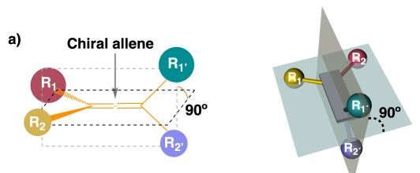  
b) Chiral supramolecular allene array [(Pint) helix, Θ > 0°; (Pext) 4-helix ]

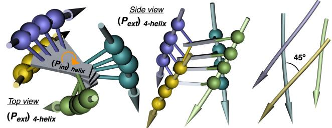  
c) Chiral supramolecular allene array [(Mnt) helix; Θ < 0°, (Mext) 4-helix]

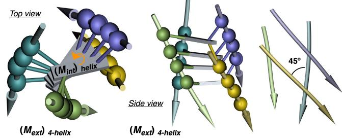  
Scheme 1. (a) Graphical illustration of a chiral allene bearing two different substituents. Possible helical array of a chiral allene into (b) a $P _ { i n t } / P _ { e x t }$ helix or a (c) ${ M _ { i n t } } / { M _ { e x t } }$ helix).

## Results and Discussion

To corroborate our hypothesis and explore the supramolecular self-assembly of chiral allenes, compounds (P)-1 and (P)-2 (Figure 1a), bearing two tert-butyl groups in two perpendicular planes and either a phenylacetylene $[ ( P ) -$ 1] or an ethylene-β-cyanostilbene [(P)-2] functionalized with dendritic moieties in the other two perpendicular planes, were designed (Figure 1a). The two enantiomeric forms of the designed chiral allenes [(P)-1, (M)-1, (P)-2, (M)-2] were synthesized following the synthetic protocol described in the Supporting Information (see S3).[75,76] Next, their self-assembly ability was investigated by a set of spectroscopic techniques in “good” (chloroform, CHCl ) and “bad” (methylcyclohexane, MCH) solvents to stabilize the molecularly dissolved and aggregated states, respectively.

ECD and UV/Vis aggregation studies. ECD studies for (P)-1 $( \mathsf { c } _ { \mathrm { T } } { = } 1 0 ~ \mu \mathbf { M } )$ in MCH and $\mathrm { C H C l } _ { 3 }$ show the formation of a chiral aggregate in the former solvent (Figure 1b). Thus, while in $\mathrm { C H C l } _ { 3 }$ a classical ECD trace for a (P) allene is found—two positive maxima at 330 and 304 nm followed by a zero-crossing point at λ=287 nm and a negative band centered at $\lambda { = } 2 7 3$ nm—, in MCH an increase in magnitude of the overall ECD spectrum accompanied with an inversion of the first Cotton band, now centered at $\lambda = 3 2 3$ nm, is observed. UV/Vis experiments corroborate these results. In CHCl $( { \bf c } _ { \mathrm { T } } { = } 1 0 \ \mathrm { m M } )$ (P)-1 is found in the molecularly dissolved state—a small shoulder at 350 nm followed by three consecutive maxima of similar intensity centered at 318, 301 and 275 nm (Figure 1c)—, while in MCH $( \mathrm { c _ { T } = }$ $1 0 \mu \mathbf { M } )$ the UV/Vis spectrum supports the aggregation, where a two-fold increase of the initial shoulder $( \lambda =$ 350 nm) is followed by a hypochromic effect in the band centered at 318 nm and a blue shift accompanied by an hyperchromic effect at the second band, now centered at 298 nm. Moreover, an overall increase in the remaining absorption spectra is also observed when compared to the spectra in CHCl (Figure 1c). These changes in the UV/Vis studies of (P)-1 in CHCl and MCH agree with the formation of an aggregate in MCH.

Similar experiments were carried out for (P)-2. In this case, ECD experiments for (P)-2 dissolved in $\mathrm { { C H C l } _ { 3 } \left( c _ { \mathrm { T } } = \right. }$ $1 0 \mu \mathbf { M } )$ show the ECD spectra of an allene with (P) axial chirality—i.e., a broad maximum at 382 nm followed by a zero-crossing point at λ=355 nm and a minimum at 344 nm (Figure 1d)—. The bathochromic shift of the ECD bands of (P)-2 when compared to (P)-1 in $\mathrm { C H C l } _ { 3 }$ is attributed to the presence of a cyanostilbene, used as a rigid spacer between the chiral allene and the flexible dendritic moiety (Figure 1a). The ECD spectra of (P)-2 in MCH shows a two-fold increase in the overall trace when compared to the one obtained in the molecularly dissolved state, indicative of the formation of a supramolecular chiral aggregate. Moreover, the couplet assigned to the supramolecular helical structure shows a 23 nm red shift respect to the macromolecularly dissolved spectrum obtained in $\mathrm { C H C l } _ { 3 } { - } \mathrm { t w o }$ maxima at $\lambda =$ 405 and 392 nm followed by a zero-crossing point at $\lambda =$ 374 nm and a minimum at λ=353 nm—. Surprisingly, the ECD trace of the (P)-2 chiral aggregate is opposite to the chiral aggregate obtained for (P)-1 in MCH, although the axial chirality of the allene is the same, i.e. P orientation (Figures 1b and 1d). At this point this result is completely unexpected, because the ECD indicates the presence of aggregates with opposite chirality although the screw sense of the supramolecular assembly must be dictated by the chirality of the allene, which is in this case is the same (P) for both building blocks. Furthermore, allenes are both axially chiral and conformationally locked molecules that cannot modulate their 3D structure to be accommodated in supramolecular helices with opposite handedness. This unexpected result will be addressed later in the manuscript during the elucidation of the secondary structure adopted by the supramolecular aggregates of (P)-1 and (P)-2. Again, as happened for (P)-1, UV/Vis experiments for (P)-2 in CHCl3 show the spectrum of the molecularly dissolved state, with an intense and broad maximum at 369 nm attributed to the AIE unit conjugated with the allene (Figure 1e).

a)  
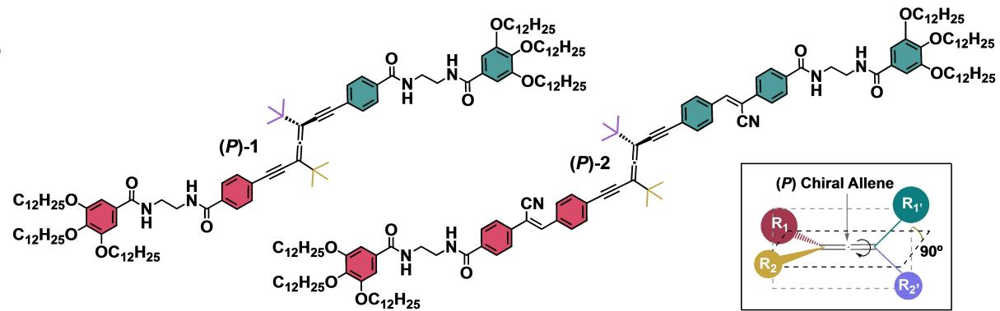

b)  
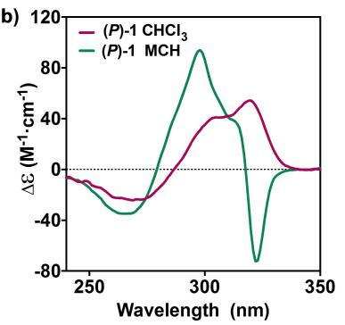

c)  
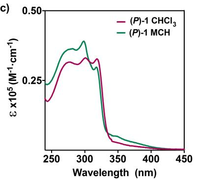

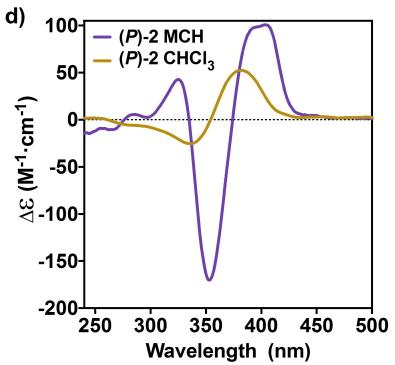

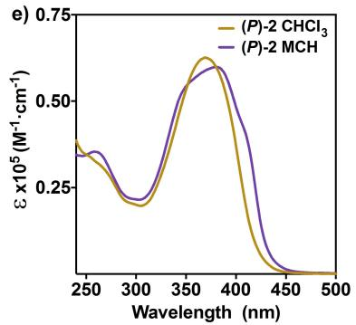

f  
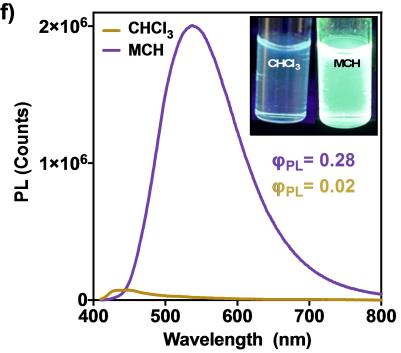  
g)

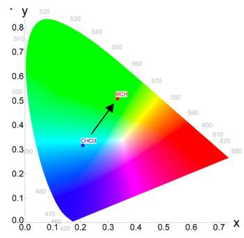  
Figure 1. a) Chemical structures of chiral allenes (P)-1 and (P)-2. b) ECD and c) UV/Vis spectra of (P)-1 in CHCl and MCH $( \mathsf { c } _ { \mathsf { T } } = 7 0 \mu \mathsf { M } ) . \mathsf { d } )$ ECD and e) UV/Vis spectra of (P)-2 in $C H C l _ { 3 }$ and MCH $( \mathsf { c } _ { \mathsf { T } } { = } 7 0 \mu \mathsf { M } )$ . f) Emission spectra of (P)-2 in CHCl and MCH $( mathsf { c } _ { \mathsf { T } } = 1 0 \mu \mathsf { M } , \lambda _ { \mathsf { e x c } } = 3 6 5$ nm) and inset picture showing the variation in the emission upon aggregation. g) CIE diagram of the emission in CHCl and MCH $( \mathsf { c } _ { \top } { = } 7 0 \mu \mathsf { M }$ $\lambda _ { \mathrm { e x c } } { = } 3 6 5 ~ \mathsf { n m } )$

In MCH, the UV/Vis spectrum shows an overall red shift of 20 nm compared to the one observed in the molecularly dissolved state, indicative of the formation of an aggregate (Figure 1e). The presence of an aggregation induced emission (AIE) moiety (i.e., cyanostilbene) within the chemical structure of (P)-2 will allow us to also follow the aggregation process by emission experiments. More precisely for this type of AIE molecule, the photoluminescence (PL) must increase dramatically upon supramolecular polymerization through an AIE process. Thus, while in CHCl (P)-2 shows a weak blue emission with a maximum centered at λ=484 nm and a quantum yield $( \Phi _ { \mathrm { P L } } )$ of $\Phi _ { \mathrm { P L } } = 0 . 0 2$ , in MCH a strong green emission (15-fold increase) is observed, characteristic of an aggregated cyanostilbene unit, displaying a maximum centered at λ=543 nm and a $\Phi _ { \mathrm { P L } } = 0 . 2 8$ (Figures 1f, S8b and S8c). Similar results were obtained for (M)-1 and (M)-2 in CHCl and MCH, the enantiomeric forms of (P)-1 and (P)-2. In this case opposite signs of the ECD bands were obtained due to its mirror image relationship (Figures S6a, b).

IR and 1H NMR aggregation studies. IR and variable temperature (VT)-1H NMR experiments were done to explore the conformational composition of (P)-1 and (P)-2 in CHCl3 and MCH and to elucidate how the supramolecular polymerization is triggered. In CHCl the amide C=O and NH stretching bands for (P)-1 appear centered at $1 6 4 9 \ \mathrm { c m } ^ { - 1 } \ ( \mathrm { C = O } ) , \ \overline { { { 3 4 5 2 \ \mathrm { c m } ^ { - 1 } } } } \ ( \mathrm { N H }$ , free) and $3 3 3 9 \mathrm { c m } ^ { - 1 }$ (NH, intramolecular H-bonds) (Figures 2e, f).

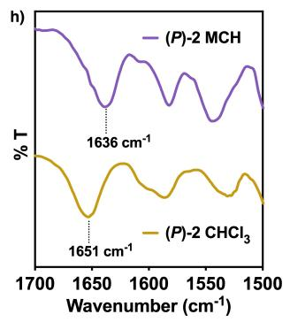

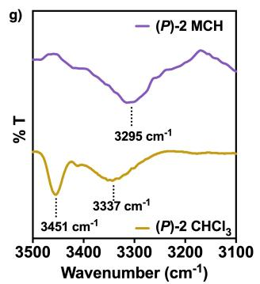

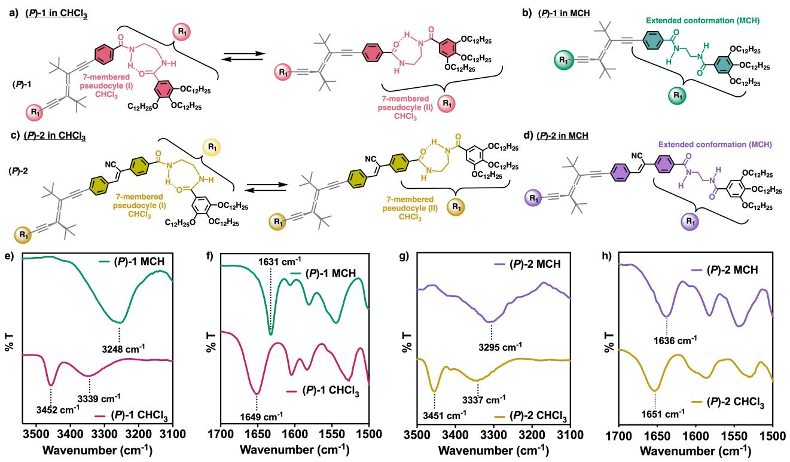  
Figure 2. Chemical structures of (P)-1 and (P)-2 with the ethylenediamide bridge forming (a, c) the two possible 7-membered pseudocycles or (b, d) the extended conformation that promotes effective aggregation. IR spectra of (e, f) (P)-1 and (g, h) (P)-2 in CHCl3 and MCH (cT = 1 mM) confirming the presence of the abovementioned structures.

This is indicative of the formation of intramolecular 7- membered hydrogen bonded pseudocycles (Figure 2a), that prevent the establishment of an extended network of intermolecular H-bonds. For MCH these bands are shifted towards lower frequencies, with an amide carbonyl band at 1631 cm $^ { - 1 } _ { \textrm { } } ( \Delta \mathfrak { v } _ { \mathrm { C = O } } = 1 8 \mathrm { c m } ^ { - 1 } )$ and the NH stretching vibrations merged into one single band centered at 3248 cm 1 $( \Delta { \mathrm { u } } _ { \mathrm { N H } } = 2 0 4 $ and 91 cm 1) (Figures 2e, f). This shifting of the IR bands suggests that the substituents at the allene adopt an extended conformation, allowing the formation of a 4- fold array of hydrogen bonds in MCH, which triggers the growth of the supramolecular aggregate (Figure 2b).[20,82]

Similar results were obtained for (P)-2 in CHCl , where the amide carbonyl $( \mathfrak { v } _ { \mathrm { C = 0 } } = 1 6 5 1 \mathrm { c m } ^ { - 1 } )$ and NH stretching bands $( \mathsf { u } _ { \mathrm { N H } } = 3 4 5 1$ and $3 3 3 7 \mathrm { c m } ^ { - 1 } )$ (Figures 2g, h) indicate the presence of 7-membered hydrogen bonded pseudocycles (Figure 2c). As observed for (P)-1, these bands were shifted towards lower frequencies in MCH— $\cdot \mathsf { u } _ { \mathrm { C = O } } { = } 1 6 3 6 \mathrm { c m } ^ { - 1 }$ and $\mathfrak { v } _ { \mathrm { N H } } { = } 3 2 9 5 \mathrm { c m } ^ { - 1 }$ (Figures 2g, h)—, suggesting the formation of a 4-fold array of hydrogen bonds that promote the supramolecular polymerization process (Figures 2d). VT-1H NMR experiments were carried out for (P)-1 and (P)-2 in $\mathrm { C D C l } _ { 3 } .$ These studies support the formation of 7- membered pseudocyles stabilized by intramolecular hydrogen bonds due to a concomitant deshielding of the amide protons with decreasing temperature, while the other signals of the molecule remain virtually unaltered (Figures S4, S5).

Supramolecular polymerization mechanism. To decipher the supramolecular polymerization mechanism of (P)-1 and (P)-2, VT-ECD experiments were conducted. Heating-cooling cycles of a solution of (P)-1 in MCH at different concentrations $( \mathsf { c } _ { \mathrm { T } } { = } 8 . 2 0 \mu \mathrm { M } .$ , 10.9 μM and $1 3 . 6 \mu \mathrm { M } , )$ were carried out at 0.1 K ·min 1 (λ=323 nm) (Figure 3a) showing, in all cases, non-sigmoidal curves indicative of a cooperative supramolecular polymerization process.[7] Moreover, negligible thermal hysteresis was found (Figure 3b), which denotes that the supramolecular polymerization process occurs under thermodynamic control. Following the one component model developed by Eikelder, Meijer and coworkers,[83,84] the full set of thermodynamic parameters, as well as the cooperativity value $( \sigma = 3 . 4 2 \cdot 1 0 ^ { - 2 } )$ were obtained, confirming the cooperative nature of the supramolecular polymerization process (Table 1).

Table 1: Thermodynamic parameters of the supramolecular polymerization process of (P)-1 obtained by VT-ECD experiments.
<table><tr><td>∆He  $( \boldsymbol { \mathrm { k } } | m \circ \boldsymbol { \mathrm { l } } ^ { - 1 } )$ </td><td>∆S  $( | \boldsymbol { \mathsf { k } } | \mathsf { m o l } ^ { - 1 } \mathsf { K } ^ { - 1 } )$ </td><td> $\Delta H _ { \mathfrak { n p } }$   $( | \boldsymbol { \mathsf { k } } | \mathsf { m o l } ^ { - 1 } )$ </td><td>Te (K)[a]</td><td> $\sigma ^ { [ \ b ] }$ </td></tr><tr><td> $- 1 . 5 0 \cdot 1 0 ^ { 2 }$ </td><td> $- 3 . 7 0 \cdot 1 0 ^ { - 2 }$ </td><td>-1.42·10²</td><td>334,336,338</td><td>3.42·10-2</td></tr></table>

[a] Derived at c = 8.20, 10.9 and 13.6 μM. [b] Calculated at 298 K.

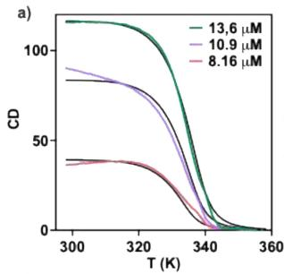

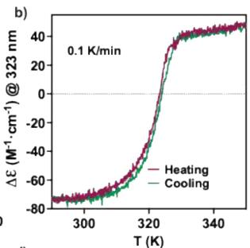

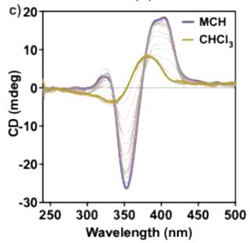

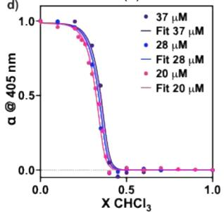  
Figure 3. a) Aggregation plots and cooperative fit curves (black lines) at different concentrations to obtain the thermodynamic parameters of (P)-1 depicted in Table 1 (λ = 323 nm, 0.1 K · min 1, MCH). b) Heatingcooling cycle showing negligible hysteresis $a = 3 2 3$ nm, 0.1 K · min 1, MCH). c) Solvent denaturation of (P)-2 followed by ECD $( \mathsf { c } _ { \mathsf { T } } { = } 2 0 \mu \mathsf { M } )$ d) Denaturation curves of $\begin{array} { r } { ( P ) { \cdot } 2 \ ( \mathsf { c } _ { \top } { = } 3 7 , } \end{array}$ , 28 and 20 μM) and the corresponding fits to the SD model.

In the case of (P)-2, VT-ECD experiments show a nonfully disassembly of the supramolecular aggregate in MCH at 363 K (see Figure S6c), precluding the application of onecomponent model applied for the above studied counterpart. Hence, we decided to apply the solvent denaturation (SD) method developed by Meijer and co-workers to obtain the complete set of thermodynamic parameters associated with the supramolecular polymerization of $( P ) – 2 . ^ { [ 8 5 ] }$ The model identifies the supramolecular aggregation process as a balance between the effect of mixing a good and a bad solvent, favoring the solvation or the aggregation of the monomeric species, respectively. In this case the Gibbs free energy increases upon monomer addition in a mixture of solvents $( \Delta G ^ { 0 \prime } )$ and the Gibbs free energy in a pure solvent $( \Delta G ^ { 0 } )$ is linearly correlated with the volume fraction of good solvent f and the m parameter (indicates the ability of the good solvent to interact with the monomer), as depicted in (Eq. 1).

$$
\Delta \mathbf { G } ^ { 0 \prime } = \Delta \mathbf { G } ^ { 0 } + \mathbf { m } \cdot \mathbf { f }\tag{1}
$$

Gradual addition of monomeric (P)-2 $\mathrm { ( C H C l _ { 3 } , }$ good solvent) to a solution of the supramolecular aggregate (MCH, bad solvent), while keeping the concentration constant $\left( c _ { \mathrm { T } } { = } 3 7 \right.$ , 28 and $2 0 \mu \mathrm { M } )$ , revealed a non-sigmoidal curve indicative of a cooperative supramolecular polymerization $( \sigma = 7 . 0 6 \cdot 1 0 ^ { - 2 } )$ (Figures 3c–d, S7 and Table 2).[85]

Structural studies. Atomic force microscopy (AFM) studies were carried out to analyze the morphology of the aggregates. Thus, 3 μL of a 10 μM MCH solution of (P)-1 and (P)-2 were spin coated onto highly oriented pyrolytic graphite (HOPG) substrates. High-resolution AFM images revealed the presence of (M) and (P) oriented fibers for (P)-1 and (P)-2 chiral allenes (Figure 4). Thus, (P)-1 generates (M) oriented single molecule fiber-like aggregates —helical pitch of ca. 5 nm—(Figure 4a, c) that bundle together through interdigitation of the long alkyl chains, yielding longer and thicker fibers with lengths up to 2 μm (Figure 4a, and Figures S9–S13). In the case of (P)-2, (P) oriented fiber-like aggregates are formed—helical pitch of ca. 12 nm—(Figure 4b, 4e and Figures S14–S15). Surprisingly, these results indicate that opposite helical sense chiral aggregates are formed from the self-assembly of (P)-1 and (P)-2 despite presenting the same axial chirality. This agrees with the spectra previously recorded by ECD, where the opposite signs of the traces obtained for the chiral aggregates of (P)-1 and (P)-2 indicate the formation of helical fibers with opposite chirality (Figure 1b, d). To shed light on the reason behind this phenomena, theoretical calculations were carried out. The Grimme’s extended semiempirical tight-binding method (GFN2-xTB)[18,86] was chosen to optimize the geometry of (P)-1 and (P)-2 monomers and different oligomeric aggregates $( n { = } 2 – 8 )$ . To perform these calculations the dodecyloxy side chains were replaced by methoxyl groups to reduce the computational time. These studies revealed that the most stable aggregate has an extended ethylene diamide conformation (Figures 2b, d), which generates an effective 4-fold hydrogen bond supramolecular array within the upper and lower units of the stack (Figures S16–S22 for (P)-1 and 5a and S29–S31 for (P)-2 and 6a). Alternative conformations, presenting a 7- membered pseudocycle on the ethylene diamide bridge (Figure 2a, b), produce the formation of stable dimeric/ trimeric structures, which cannot effectively grow into larger aggregates due to the formation of structural defects, hindering an effective one-dimensional supramolecular polymerization process (Figures S20–S21).

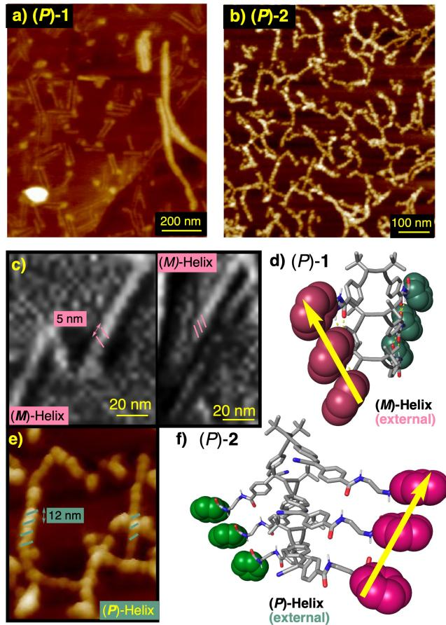  
Figure 4. AFM images of (a) (P)-1 and (b) (P)-2 deposited onto HOPG showing fiber-like aggregates. c) High resolution AFM image showing a (M)-oriented fiber for (P)-1. d) Side view of a (P)-1 trimer model optimized by DFT (B3LYP/6-31G\*\*). e) High resolution AFM image showing a (P)-oriented fiber for (P)-2. f) Side view of a (P)-2 trimer model optimized by DFT (B3LYP/6-31G\*\*).

Table 2: Thermodynamic parameters of the supramolecular polymerization process of (P)-2 obtained by solvent denaturation followed by ECD spectroscopy $( c _ { \mathsf { T } } = 3 7 ,$ , 28 and 20 mM, 298 K).
<table><tr><td>∆C0 (k)/mol)</td><td>m</td><td>σ</td></tr><tr><td> $- 4 . 6 0 \cdot 1 0 ^ { 1 }$ </td><td>5.52·10</td><td> $7 . 0 6 \cdot 1 0 ^ { - 2 }$ </td></tr></table>

Next, the cooperativity of the supramolecular aggregation processes was studied following the methodology reported by Ortí and Sánchez.[18] To this end, 16-mers for $( P ) – \mathbf { 1 }$ and (P)-2 were built and optimized using GFN2-xTB, followed by extraction of upper and lower terminal building blocks to obtain oligomers with decreasing size (n = 12, 10, $8 , 6 , 4 , 2 )$ avoiding terminal effects.[71,87] The energy values for these oligomers were further extracted by single-point energy calculations.[19,86,88–89] The binding energy per increasing pair of molecules $( \Delta \mathbf { E } _ { \mathrm { b i n d , n - 1 } } )$ was estimated from the single-point energy calculations of the oligomers, revealing an exponential decay in the energy binding in both cases, which indicates a cooperative supramolecular polymerization process (Figures 5c and S16–S22 for (P)-1 and Figures 6c and S29–S31 for (P)-2), fully consistent with the experimental data (Figure 3b and Table 1 for (P)-1 and Figure 3d and Table 2 for (P)-2). Furthermore, Density Functional Theory (DFT) calculations employing the B3LYP method, and the $6 { - } 3 1 \mathrm { G } ^ { \ast \ast }$ basis set were performed on monomers, dimers, trimers and tetramers—due to computational limitations for (P)-2 the tetramer was not calculated—of the extended ethylene diamide conformation to validate and refine their geometry. These studies revealed that (P)-1 self-assembles with a tilting degree between the allene double bonds of different building blocks of $\Theta = + 1 5 ^ { \circ }$ $[ ( P _ { i n t }$ ), Figure 5a, 4d], generating a 4-helix supramolecular aggregate composed of six different axially chiral motifs— the allene (the chirality defines the helical sense of the internal helix), the allene stack (internal helix) and the stacks of the four different substituents (external 4-helix)—.

Interestingly, while the allene stacks are twisted describing a $( P _ { i n t } )$ helix, the 4-helix (described by the allene substituents) rotate in different directions, being (P) ori ented for the tert-butyl groups and (M) oriented for the ethylene phenylene derivatives (Figure 5a) $[ M _ { 1 } / P _ { 2 } / M _ { 1 } / P _ { 2 } ;  ;$ where 1 and 2 denotes the substituent priority of the two substituents at the carbons of the chiral allene following the

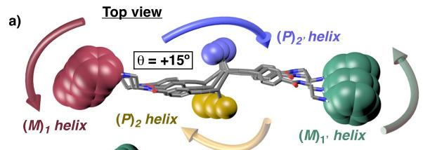

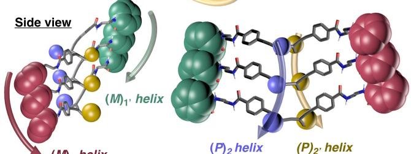  
c)

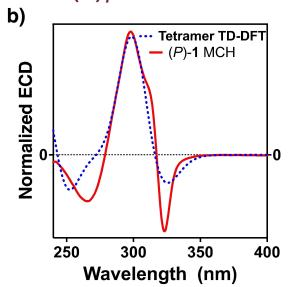

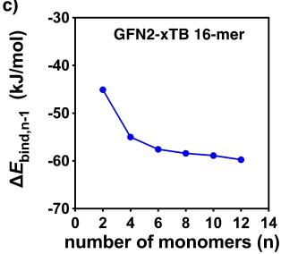  
Figure 5. a) Top and side views of a (P)-1 trimer stack optimized by DFT (B3LYP/6-31G\*\*) highlighting the $M _ { \mathrm { 1 } } / P _ { \mathrm { 2 } } / M _ { \mathrm { 1 } } / P _ { \mathrm { 2 } }$ 4-helix array. b) Comparison of the ECD obtained for (P)-1 experimentally in MCH and the calculated ECD spectra for a (P)-1 tetramer optimized by DFT (B3LYP/6-31G\*\*. c) Energy binding calculated with single points of oligomers from an optimized 16-mer in GFN2-xTB.

Cahn-Ingold-Prelog (CIP) priority rules].Theoretical ECD calculations and time-dependent density functional theory (TD-DFT), using the CAM-B3LYP density functional and $6 { \cdot } 3 1 \mathrm { G } ^ { \ast \ast }$ basis set, were performed on the structures previously optimized by DFT (B3LYP/6-31G\*\*) for the monomer and oligomers (n =2–4) of (P)-1 (Figures S14– $1 7 ) . ^ { [ 9 0 ] }$ The simulated ECD spectrum for the oligomer n =4 is in good agreement with the experimental one, describing both a (/ +/) ECD pattern (Figures 5b). In this case, the first negative Cotton band is attributed to the M helical orientation of the ethylene phenylene side chains (M1/M1’) at the external 4-helix (Figures 5b and Figures S23–S27), that also describe the M orientation of the external helix observed by AFM (Figures 4c, d). Shorter oligomers (n =2, 3) did not reproduce the ECD spectrum of the aggregate (Figure S23–S25). Likewise, (P)-2 self-assembles into a 4- helix supramolecular aggregate, like the one observed for (P)-1. However, for (P)-2 the tilting degree between building blocks is higher, $\Theta = + 2 3 ^ { \circ } \ [ ( P _ { i n t } )$ , Figures 6a, 4f]. Similarly to the chiral aggregate observed for (P)-1, (P)-2 aggregates into a supramolecular helix with six different axially chiral motifs. However, in this case, the five axial motifs of the helix rotate in the same direction $[ ( P _ { i n t } ) .$ , 4- helix $_ \mathrm { e x t e r n a l } P _ { 1 } / P _ { 2 } / P _ { 1 } { , } / P _ { 2 } { , } ;$ Figure 6a].

TD-DFT (CAM-B3LYP/6-31G\*\*) calculations were performed for the monomer and oligomers (n =2–3) of (P)-2. From these studies it was found that the trimer does not reproduce the ECD spectrum of the aggregate (Figure S32– S33). Thus, to obtain the theoretical ECD spectrum for (P)- 2 aggregate, a larger oligomer (hexamer, n=6) maintaining the structural parameters of the trimer was built and optimized by GFN2-xTB. Then, sTDA-xTB computational studies provide us the calculated ECD trace, showing a (+ / ) bisignate that matches the one observed experimentally (Figure 6b). In this case, the first positive Cotton band is attributed to the (P) helical orientation of the side chains containing the ethylene-β-cyanostilbene derivatives (Figures 6b and S32–S35), which also dictate the (P) orientation of the external 4-helix as observed by AFM (Figures 4e, f).

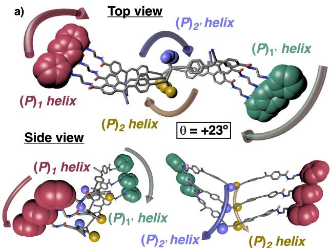

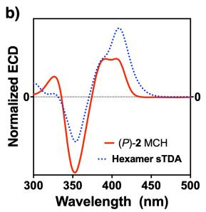

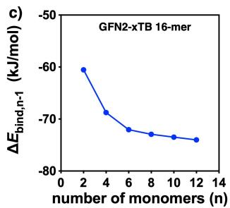  
Figure 6. a) Top view and side views of a (P)-2 trimer stack optimized by DFT (B3LYP/6-31 g\*\*) highlighting the $P _ { \mathrm { 1 } } / P _ { \mathrm { 2 } } / P _ { \mathrm { 1 } } / P _ { \mathrm { 2 } }$ 4-helix array. b) Comparison of the ECD spectrum obtained for (P)-2 experimentally in MCH and the calculated ECD spectra for a (P)-2 hexamer optimized by sTDA-xTB. c) Energy binding calculated with single points of oligomers from an optimized 16-mer in GFN2-xTB.

## Conclusion

In conclusion, we have demonstrated that chiral allenes, possessing axial chirality, are suitable building blocks for the development of supramolecular helical polymers containing six axially chiral motifs—the allene, the allene stack (internal helix) and the stacks of the four different allene substituents (external 4-helix)—. Moreover, by using two different chiral allenes, (P)-1 and (P)-2, which differ in the length of two planar and π-extended substituents, is possible to create macroscopically chiral helical aggregates with opposite helical senses, although the internal helix described by the chiral allene stack is twisted in the same direction $( P _ { \mathrm { i n t } } )$ . A slight variation in the tilting degree between staked chiral allenes is enough to macroscopically change a $M _ { I } / P _ { 2 } /$ $M _ { I } { \bf \Psi } ^ { \prime } / P _ { 2 } { \bf \Psi } ,$ external 4-helix into a $P _ { I } / P _ { 2 } / P _ { I } / P _ { 2 }$ one, that in the case of (P)-1 and (P)-2 results in ECD spectra and AFM images with opposite handedness (outer helix) despite the internal allene core rotating in the same direction (inner helix). Thus, supramolecular helices with opposite chirality can be obtained from building blocks that self-assemble in the same orientation but with different tilting degrees. This work deals with an interesting axial-to-axial supramolecular helix induction mechanism through self-assembly, which allows a better understanding of how different chiral information transmission pathways emerged in supramolecular chemistry.

## Supporting Information

Experimental procedures, synthesis and characterization, AFM studies and theoretical calculations.

The Supporting Information is available free of charge on the ACS Publications website.

## Abbreviations

MCH, Methylcyclohexane; UV/Vis, Ultraviolet Visible; ECD, Electronic Circular Dichroism; IR, Infrared; NMR, Nuclear Magnetic Resonance; AFM, Atomic Force Microscopy; BTA, Benzene Tricarboxamide; BODIPY, Boron Dipyrromethene; OPE, Oligophenyleneethynylene; SaS, Sergeants and Soldiers; MR, Majority Rules, CP, Circularly Polarized; PPA, Poly(phenylacetylene); VT, Variable Temperature; HOPG, Highly Oriented Pyrolytic Graphite; DFT, Density Functional Theory, TD, Time Dependent; (P), Plus; (M), Minus; SD, Solvent Denaturation; AIE, Aggregation Induced Emission.

## Acknowledgements

Financial support from AEI (PID2022-136848NB-I00) and PID2021-128057NB-I00), Xunta de Galicia (ED431C 2022/21, Centro Singular de Investigación de Galicia acreditación 2019–2022, ED431G 2019/03) and the European Regional Development Fund (ERDF) are gratefully acknowledged. R. R and M. F. M. thanks AEI for a Ramón y Cajal contract (RYC2022-035587-I), and a FPI contract, respectively. M. L. S. and Z. F. thank Xunta de Galicia for a predoctoral fellowship. We also thank Centro de Supercomputación de Galicia (CESGA) for computational resources. Funding for open access charge: Universidade de Vigo/CISUG.

## Conflict of Interest

The authors declare no conflict of interest.

## Data Availability Statement

The data that support the findings of this study are available in the supplementary material of this article.

Keywords: Helix · Allenes · Supramolecular Polymers · Axial Chirality · Chiral Aggregates

[1] L. Brunsveld, B. J. B. Folmer, E. W. Meijer, R. P. Sijbesma, Chem. Rev. 2001, 101, 4071–4098.

[2] F. Huang, O. A. Scherman, Chem. Soc. Rev. 2012, 41, 5879– 5880.

[3] T. Aida, E. W. Meijer, Isr. J. Chem. 2020, 60, 33–47.

[4] P. K. Hashim, J. Bergueiro, E. W. Meijer, T. Aida, Prog. Polym. Sci. 2020, 105, 101250.

[5] M. Wehner, F. Würthner, Nat. Chem. Rev. 2020, 4, 38–53.

[6] T. Aida, E. W. Meijer, S. I. Stupp, Science 2012, 335, 813–817.

[7] M. Hartlieb, E. D. H. Mansfield, S. Perrier, Polym. Chem. 2020, 11, 1083–1110.

[8] C. Rest, R. Kandanelli, G. Fernández, Chem. Soc. Rev. 2015, 44, 2543–2572.

[9] L. DN. J. de Windt, Z. Fernández, M. Fernández-Míguez, F. Freire, A. R. A. Palmans, Chem. Eur. J. 2022, 28, e202103691.

[10] C. Kulkarni, E. W. Meijer, A. R. A. Palmans, Acc. Chem. Res. 2017, 50, 1928–1936.

[11] S. Cantekin, T. F. A. de Greef, A. R. A. Palmans, Chem. Soc. Rev. 2012, 41, 6125–6137.

[12] S. Cantekin, H. M. M. ten Eikelder, A. J. Markvoort, M. A. J. Veld, P. A. Korevaar, M. M. Green, A. R. A. Palmans, E. W. Meijer, Angew. Chem. Int. Ed. 2012, 51, 6426–6431.

[13] P. J. M. Stals, J. F. Haveman, R. Martín-Rapún, C. F. C. Fitié, A. R. A. Palmans, E. W. Meijer, J. Mater. Chem. 2009, 19, 124– 130.

[14] R. van Hameren, A. M. van Buul, M. A. Castriciano, V. Villari, N. Micali, P. Schön, S. Speller, L. Monsú Scolaro, A. E. Rowan, J. A. A. W. Elemans, R. J. M. Nolte, Nano Lett. 2008, 8, 253–259.

[15] T.-Q. Nguyen, R. Martel, P. Avouris, M. L. Bushey, L. Brus, C. Nuckolls, J. Am. Chem. Soc. 2004, 126, 5234–5242.

[16] M. L. Bushey, A. Hwang, P. W. Stephens, C. Nuckolls, Angew. Chem. Int. Ed. 2002, 41, 2828–2831.

[17] M. L. Bushey, A. Hwang, P. W. Stephens, C. Nuckolls, J. Am. Chem. Soc. 2001, 123, 8157–8158.

[18] C. Naranjo, A. Doncel-Giménez, R. Gómez, J. Aragó, E. Ortí, L. Sánchez, Chem. Sci. 2023, 14, 9900–9909.

[19] M. A. Martínez, A. Doncel-Giménez, J. Cerdá, J. Calbo, R. Rodríguez, J. Aragó, J. Crassous, E. Ortí, L Sánchez, J. Am. Chem. Soc. 2021, 143, 13281–13291.

[20] M. Wehner, M. I. S. Röhr, M. Bühler, V. Stepanenko, W. Wagner, F. Würthner, J. Am. Chem. Soc. 2019, 141, 6092–6107.

[21] C. Roche, H. J. Sun, P. Leowanawat, F. Araoka, B. E. Partridge, M. Peterca, D. A. Wilson, M. E. Prendergast, P. A. Heiney, R. Graf, H. W. Spiess, X. Zeng, G. Ungar, V. Percec, Nat. Chem. 2016, 8, 80–89.

[22] F. Würthner, C. R. Saha-Möller, B. Fimmel, S. Ogi, P. Leowanawat, D. Schmidt, Chem. Rev. 2016, 116, 962–1052.

[23] L. Wang, B. E. Partridge, N. Huang, J. T. Olsen, D. Sahoo, X. Zeng, G. Ungar, R. Graf, H. W. Spiess, V. Percec, J. Am. Chem. Soc. 2020, 142, 9525–9536.

[24] B. E. Partridge, L. Wang, D. Sahoo, J. T. Olsen, P. Leowanawat, C. Roche, H. Ferreira, K. J. Reilly, X. Zeng, G. Ungar, P. A. Heiney, R. Graf, H. W. Spiess, V. Percec, J. Am. Chem. Soc. 2019, 141, 15761–15766.

[25] B. E. Partridge, P. Leowanawat, E. Aqad, M. R. Imam, H.-J. Sun, M. Peterca, P. A. Heiney, R. Graf, H. W. Spiess, X. Zeng, G. Ungar, V. Percec, J. Am. Chem. Soc. 2015, 137, 5210–5224.

[26] R. M. Veedu, N. Niemeyer, N. Bäumer, K. K. Kalathil, J. Neugebauer, G. Fernández, Angew. Chem. Int. Ed. 2023, e202314211.

[27] N. Bäumer, S. Ogi, L. Borsdorf, S. Yamaguchi, G. Fernández, Chem. Commun. 2023, 59, 8937–8940.

[28] B. Matarranz, S. Díaz-Cabrera, G. Ghosh, I. Carreira-Barral, B. Soberats, M. García-Valverde, R. Quesada, G. Fernandez, Angew. Chem. Int. Ed. 2023, e202218555.

[29] I. Helmers, M. Saddam Hossain, N. Bäumer, P. Wesarg, B. Soberats, L. S. Shimizu, G. Fernández, Angew. Chem. Int. Ed. 2022, 61, e202200390.

[30] B. Matarranz, G. Fernandez, Chem. Phys. Rev. 2021, 2, 041304.

[31] H. Wang, Y. Zhang, Y. Chen, H. Pan, X. Ren, Z. Chen, Angew. Chem. Int. Ed. 2020, 59, 5185–5192.

[32] H. Lee, H. Park, D. Y. Ryu, W. D. Jang, Chem. Soc. Rev. 2023, 52, 1947–1974.

[33] K. V. Rao, M. F. J. Mabesoone, D. Miyajima, A. Nihonyanagi, E. W. Meijer, T. Aida, J. Am. Chem. Soc. 2020, 142, 598–605.

[34] N. Sasaki, M. F. J. Mabesoone, J. Kikkawa, T. Fukui, N. Shioya, T. Shimoaka, T. Hasegawa, H. Takagi, R. Haruki, N. Shimizu, S.-I. Adachi, E. W. Meijer, M. Takeuchi, K. Sugiyasu, Nat. Commun. 2020, 11, 3578.

[35] M. F. J. Mabesoone, A. J. Markvoort, M. Banno, T. Yamaguchi, F. Helmich, Y. Naito, E. Yashima, A. R. A. Palmans, E. W. Meijer, J. Am. Chem. Soc. 2018, 140, 7810–7819.

[36] K. V. Rao, D. Miyajima, A. Nihonyanagi, T. Aida, Nat. Chem. 2017, 9, 1133–1139.

[37] S. Ogi, K. Sugiyasu, S. Manna, S. Samitsu, M. Takeuchi, Nat. Chem. 2014, 6, 188–195.

[38] Z. Fernández, B. Fernández, E. Quiñoá, F. Freire, Angew. Chem. Int. Ed. 2021, 133, 10007–10012.

[39] B. Matarranz, G. Ghosh, R. Kandanelli, A. Sampedro, K. K. Kartha, G. Fernández, Chem. Commun. 2021, 57, 4890–4893.

[40] G. Das, R. Thirumalai, B. Vedhanarayanan, V. K. Praveen, A. Ajayaghosh, Adv. Opt. Mater. 2020, 8, 1–8.

[41] S. K. Albert, H. V. P. Thelu, M. Golla, N. Krishnan, S. Chaudhary, R. Varghese, Angew. Chem. Int. Ed. 2014, 53, 8352–8357.

[42] F. García, L. Sánchez, J. Am. Chem. Soc. 2012, 134, 734–742.

[43] N. Bäumer, E. Castellanos, B. Soberats, G. Fernández, Nat. Commun. 2023, 14, 1084.

[44] K. K. Kalathil, G. Fernández, Supramolecular Coordination Complexes: Design, Synthesis, and Applications, Edited, Elsevier Ltd. 2023.

[45] J. Matern, Z. Fernandez, G. Fernandez, Chem. Commun. 2022, 58, 12309–12312.

[46] J. Matern, I. Maisuls, C. A. Strassert, G. Fernandez, Angew. Chem. Int. Ed. 2022, e202208436.

[47] M. H. Y. Chan, V. W. W. Yam, J. Am. Chem. Soc. 2022, 144, 22805–22825.

[48] N. Bäumer, J. Matern, G. Fernandez, Chem. Sci. 2021, 12, 12248–12265.

[49] M. Y. Leung, S. Y. L. Leung, K. C. Yim, A. K. W. Chan, M. Ng, V. W. W. Yam, J. Am. Chem. Soc. 2019, 141, 19466–19478.

[50] M. H. Y. Chan, M. Ng, S. Y. L. Leung, W. H. Lam, V. W. W. Yam, J. Am. Chem. Soc. 2017, 139, 8639–8645.

[51] S. Huang, H. Yu, Q. Li, Adv. Sci. 2021, 8, 1–20.

[52] F. García, R. Gómez, L. Sánchez, Chem. Soc. Rev. 2023, 52, 7524–7548.

[53] Y. Dorca, E. E. Greciano, J. S. Valera, R. Gómez, L. Sánchez, Chem. A Eur. J. 2019, 25, 5848–5864.

[54] E. Yashima, N. Ousaka, D. Taura, K. Shimomura, T. Ikai, K. Maeda, Chem. Rev. 2016, 116, 13752–13990.

Accepted manuscript online: December 10, 2024

Manuscript received: November 2, 2024

[55] L. Zhang, H.-X. Wang, S. Li, M. Liu, Chem. Soc. Rev. 2020, 49, 9095–9120.

[56] M. Lago-Silva, M. Fernández-Míguez, R. Rodríguez, E. Quiñoá, F. Freire, Chem. Soc. Rev. 2024, 53, 793–852.

[57] S. Ghosh, X.-Q. Li, V. Stepanenko, F. Würthner, Chem. Eur. J. 2008, 14, 11343–11357.

[58] J. Buendía, E. E. Greciano, L. Sánchez, J. Org. Chem. 2015, 80, 12444–12452.

[59] D. E. Fagnani, M. J. Meese, K. A. Abboud, R. K. Castellano, Angew. Chem. Int. Ed. 2016, 55, 10726–10731.

[60] W. R. Henderson, Y. D. E. Zhu, L. G. Fagnani, K. A. Abboud, R. K. Castellano, J. Org. Chem. 2020, 85, 1158–1167.

[61] W. R. Henderson, D. E. Fagnani, J. Grolms, K. A. Abboud, R. K. Castellano, Helv. Chim. Acta 2019, 102, e1900047.

[62] D. B. Korlepara, W. R. Henderson, R. K. Castellano, S. Balasubramanian, Chem. Commun. 2019, 55, 3773–3776.

[63] Z. Xie, V. Stepanenko, K. Radacki, F. Würthner, Chem. A Eur. J. 2012, 18, 7060–7070.

[64] R. Rodríguez, C. Naranjo, A. Kumar, K. Dhbaibi, P. Matozzo, F. Camerel, N. Vanthuyne, R. Gómez, R. Naaman, L. Sánchez, J. Crassous, Chem. A Eur. J. 2023, 29, e2023022.

[65] R. Rodríguez, C. Naranjo, A. Kumar, P. Matozzo, T. K. Das, Q. Zhu, N. Vanthuyne, R. Gómez, R. Naaman, L. Sánchez, J. Crassous, J. Am. Chem. Soc. 2022, 144, 7709–7719.

[66] K. E. S. Phillips, T. J. Katz, S. Jockusch, A. J. Lovinger, N. J. Turro, J. Am. Chem. Soc. 2001, 123, 11899–11907.

[67] T. Kaseyama, S. Furumi, X. Zhang, K. Tanaka, M. Takeuchi, Angew. Chem. Int. Ed. 2011, 50, 3684–3687.

[68] J. S. Valera, R. Gómez, L. Sánchez, Org. Lett. 2018, 20, 2020– 2023.

[69] J. Guilleme, M. J. Mayoral, J. Calbo, J. Aragó, P. M. Viruela, E. Ortí, T. Torres, D. González-Rodríguez, Angew. Chem. Int. Ed. 2015, 54, 2543–2547.

[70] M. J. Mayoral, J. Guilleme, J. Calbo, J. Aragó, F. Aparicio, E. Ortí, T. Torres, D. González-Rodríguez, J. Am. Chem. Soc. 2020, 142, 21017–21031.

[71] W. R. Henderson, R. K. Castellano, Polym. Int. 2020, 70, 897– 910.

[72] P. Rivera-Fuentes, F. Diederich, Angew. Chem. Int. Ed. 2012, 51, 2818–2828.

[73] P. Rivera-Fuentes, J. L. Alonso-Gómez, A. G. Petrovic, F. Santoro, N. Harada, N. Berova, F. Diederich, Angew. Chem. Int. Ed. 2010, 49, 2247–2250.

[74] R. E. Martin, F. Diederich, Angew. Chem. Int. Ed. 1999, 38, 1350–1377.

[75] M. Lago-Silva, M. M. Cid, E. Quiñoá, F. Freire, Angew. Chem. Int. Ed. 2023, 62, e2023033329.

[76] M. Lago-Silva, M. M. Cid, E. Quiñoá, F. Freire, J. Am. Chem. Soc. 2024, 146 (1), 752–759.

[77] M. D. Tzirakis, M. N. Alberti, H. Weissman, B. Rybtchinski, F. Diederich, Chem. A Eur. J. 2014, 20, 16070–16073.

[78] I. Lahoz, A. Navarro-Vázquez, A. L. Llamas-Saiz, J. L. Alonso-Gõmez, M. M. Cid, Chem. A Eur. J. 2012, 18, 13836– 13843.

[79] S. Míguez-Lago, B. D. Gliemann, M. Kivala, M. M. Cid, Chem. A Eur. J. 2021, 27, 13352–13357.

[80] O. Gidron, M. O. Ebert, N. Trapp, F. Diederich, Angew. Chem. Int. Ed. 2014, 53, 13614–13618.

[81] O. Gidron, M. Jirásek, N. Trapp, M. O. Ebert, X. Zhang, F. Diederich, J. Am. Chem. Soc. 2015, 137, 12502–12505.

[82] E. E. Greciano, S. Alsina, G. Ghosh, G. Fernández, L. Sánchez, Small Methods 2020, 4, 1900715.

[83] H. M. M. ten Eikelder, A. J. Markvoort, T. F. A. de Greef, P. A. J. Hilbers, J. Phys. Chem. B 2012, 116, 5291–5301.

[84] A. J. Markvoort, H. M. M. ten Eikelder, P. A. J. Hilbers, T. F. A. de Greef, E. W. Meijer, Nat. Commun. 2011, 2, 509.

[85] P. A. Korevaar, C. Schaefer, T. F. A. De Greef, E. W. Meijer, J. Am. Chem. Soc. 2012, 134, 13482–13491.

[86] Y. Dorca, C. Naranjo, G. Ghosh, B. Soberats, J. Calbo, E. Ortí, G. Fernández, L. Sánchez, Chem. Sci. 2022, 13, 81–89.

[87] S. Bujosa, A. Doncel-Giménez, N. Bäumer, G. Fernández, E. Ortí, A. Costa, C. Rotger, J. Aragó, B. Soberats, Angew. Chem. Int. Ed. 2022, 61, e2022133.

[88] F. García, P. M. Viruela, E. Matesanz, E. Ortí, L. Sánchez, Chem. A Eur. J. 2011, 17, 7755–7759.

[89] E. E. Greciano, J. Calbo, E. Ortí, L. Sánchez, Angew. Chem. Int. Ed. 2020, 59, 17517–17524.

[90] R. Manha Veedu, N. Niemeyer, N. Bäumer, K. Kartha Kalathil, J. Neugebauer, G. Fernández, Angew. Chem. Int. Ed. 2023, 62, e202314211.