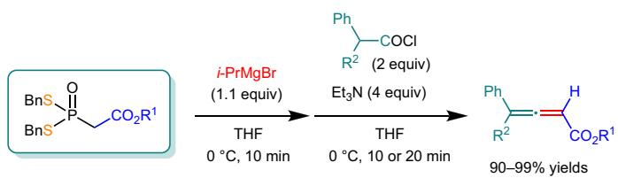
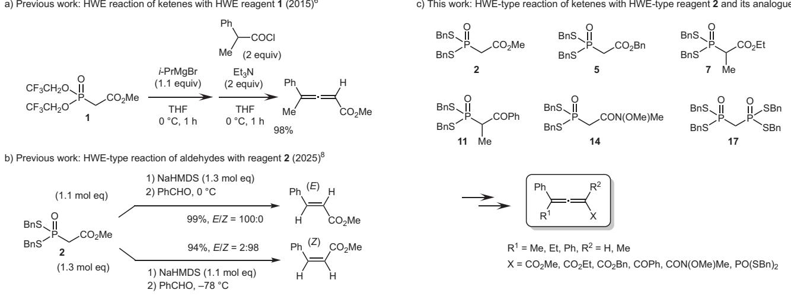
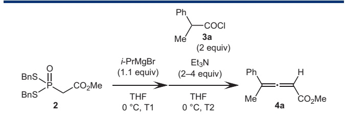
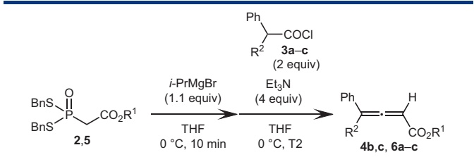
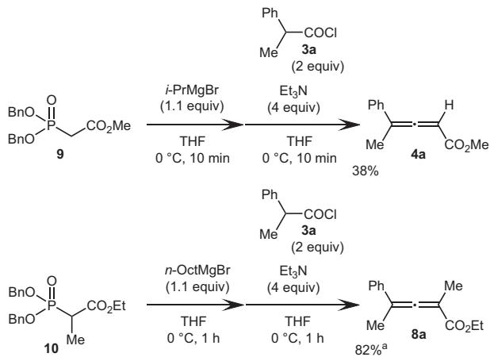
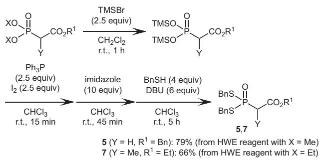
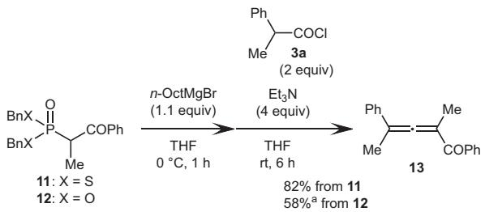
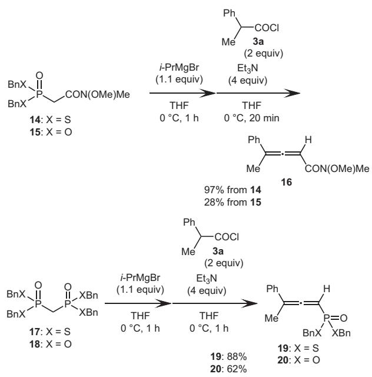

Letter

# Synthesis of Allenyl Esters by Horner–Wadsworth–Emmons-Type Reactions of Methyl 2-[Bis(benzylthio)phosphoryl]acetate and Ketenes Using Grignard Reagents

Michiyasu Nakao, Masakazu Tabaru, Ayato Imai, Syuji Kitaike, Shigeki Sano Affiliation addresses are listed at the end of the article.

GRAPHICAL ABSTRACT

CO R1/R2 = CO Me/Me, CO Me/Et, CO Me/Ph, CO Bn/Me, CO Bn/Et, CO Bn/Ph

## ABSTRACT

Methyl 2-[bis(benzylthio)phosphoryl]acetate and its analogues have proven to be efficient Horner–Wadsworth–Emmons (HWE)-type reagents for synthesizing conjugated allenyl esters and their analogues through reactions with disubstituted ketenes using Grignard reagents. A series of HWE-type reagents containing the bis(benzylthio)phosphoryl group showed better reactivity than the corresponding HWE reagents, where two phosphorus–sulfur bonds were substituted with phosphorus– oxygen bonds.

Keywords Horner–Wadsworth–Emmons reagents, Phosphorus–sulfur bond, Conjugated allenyl esters, Ketenes, Allenes, Grignard reagents, Olefination

received May 20, 2025 | accepted after revision August 08, 2025 | article published online September 03, 2025

Bibliography Synlett 2025; 36: 3237–3240 DOI 10.1055/a-2681-2944 Art ID ST-2025-05-0219-L

© 2025. The Author(s). Georg Thieme Verlag KG, Oswald-Hesse-Straße 50, 70469 Stuttgart, Germany.

Correspondence Prof. Shigeki Sano, Graduate School of Pharmaceutical Sciences, Tokushima University, Sho-machi, Tokushima 770-8505, Japan, Email: ssano@tokushima-u.ac.jp

The synthesis of α,β-unsaturated esters from stabilized phosphonate carbanions with aldehydes or with ketones is widely known as the Horner–Wadsworth–Emmons (HWE) reaction,1 one of the most commonly used C=C double bond–forming reactions in synthetic organic chemistry. The reaction is particularly valuable because it enables highly E- or Z-selective synthesis of α,β- unsaturated esters under appropriate reaction conditions. Replacing the aldehyde or ketone in the HWE reaction with a ketene, where the C=O and C=C double bonds form a cumulative structure, yields a conjugated allenyl ester with two adjacent cumulative double bonds. Thus, while the HWE reaction provides a useful method for synthesizing conjugated allenyl esters, there are fewer reports on this application compared to those involving aldehydes and ketones.2 Unlike α,β-unsaturated esters, conjugated allenyl esters do not display diastereomeric distinctions as defined by E/Z notation.3

We have already reported a facile two-step synthesis of methyl bis(2,2,2-trifluoroethyl)phosphonoacetate (Still–Gennari reagent, 1), which is useful as a Z-selective HWE reagent.4,5 We have also developed a one-pot method for synthesizing conjugated allenyl esters through HWE reactions of ketenes with the HWE reagent 1 in the presence of i-PrMgBr (Scheme 1a).6 In this reaction, ketenes were prepared in situ from the corresponding acid chlorides using triethylamine.7 On the other hand, we recently synthesized a novel a) Previous work: HWE reaction of ketenes with HWE reagent 1 (2015)6

  
Scheme 1 HWE-type reagent 2 and its analogues 5, 7, 11, 14, and 17 for the preparation of conjugated allenyl esters and their analogues.

HWE-type reagent, methyl 2-[bis(benzylthio)phosphoryl]acetate (2), in which two phosphorus–oxygen single bonds of the ordinary HWE reagent were replaced with phosphorus–sulfur single bonds (Scheme 1b).8 The advantage of HWE-type reagent 2 lies in its capability to synthesize α,β-unsaturated esters with either E- or Zstereochemistry in a highly stereoselective manner merely by changing the equivalent ratio of reagent 2 to the base. Here we report the first investigation into the synthesis of conjugated allenyl esters and their analogues using the HWE-type reagent 2 and its analogues, as shown in Scheme 1c.

The HWE-type reaction of the HWE-type reagent 2 with 2-phenylprop-1-en-1-one, a disubstituted ketene prepared from acid chloride 3a in situ, was investigated under i-PrMgBr conditions as shown in Table 1. First, under the same conditions as depicted in Scheme 1a,6 allenyl ester 4a was obtained in 85% yield from HWE-type reagent 2 (entry 1). When the reaction times (T1 and T2) were shortened, 4a was obtained without any decrease in yield (entries 2–5). However, allenyl ester 4a was contaminated with a small amount of 2-phenylpropanoic anhydride resulting from acid chloride 3a, and it was difficult to remove that acid anhydride (entries 3–5). Therefore, we examined the equivalent amount of acid chloride 3a and triethylamine, revealing that using twice the equivalent of triethylamine to acid chloride 3a suppressed the contamination of 2-phenylpropanoic anhydride. As a result, the yield of 4a improved to 99% (entry 7).9,10 When the reaction was performed by changing only i-PrMgBr in entry 4 to lithium hexamethyldisilazide (LHMDS), 4a was obtained in 82% yield. However, the reaction proceeded poorly in the presence of sodium hexamethyldisilazide (NaHMDS) or potassium hexamethyldisilazide (KHMDS), and more than half of reagent 2 was recovered.

Since the reaction time for the allenyl ester synthesis was reduced, the reactions of HWE-type reagents 2 and 5 with ketenes prepared in situ from acid chlorides 3a–c were examined using the reaction conditions for entry 7 in Table 1. As a result, allenyl esters 4b,c and 6a–c were obtained in over 90% yield in all cases (Table 2). The reaction of HWE-type reagent 5 with

Table 1 HWE-type reactions of HWE-type reagent 2 with 2-phenylprop-1-en-1-one prepared in situ from 2-phenylpropionly chloride (3a).
<table><tr><td rowspan="2"></td><td rowspan="2"></td><td></td><td></td></tr><tr><td></td><td></td></tr><tr><td>Entry</td><td>T2</td><td>Et3N (equiv)</td><td>Yield of 4a (%)ª</td></tr><tr><td>1</td><td>1h 1h 1h</td><td>2</td><td>85</td></tr><tr><td>2</td><td>30 min</td><td>2</td><td>86</td></tr><tr><td>3</td><td>10 min</td><td>2</td><td>ca.96b</td></tr><tr><td>4</td><td>30 min 10 min</td><td>2</td><td>ca.96b</td></tr><tr><td>5</td><td>10 min 10 min 10 min</td><td>2</td><td>ca.96b</td></tr><tr><td>6</td><td>10 min 10 min</td><td>3</td><td>ca.96b</td></tr><tr><td>7</td><td>10 min</td><td>4</td><td>99</td></tr></table>

aIsolated yield.  
bA small amount of 2-phenylpropanoic anhydride was observed.

2,2-diphenylethen-1-one prepared in situ from acid chloride 3c produced a small amount of isopropyl 2-phenylpropanoate, which was difficult to separate from the allenyl ester 6c.11 This problem was solved by changing the Grignard reagent from i-PrMgBr to n-OctMgBr as shown in entry 5 in Table 2.

The HWE-type reaction of α-monomethylated HWE-type reagent 7 with ketenes prepared in situ from acid chlorides 3a–c took slightly longer than the similar reaction of 2 or 5, but furnished allenyl esters 8a–c in good yields of 82–95% (Table 3).

As a comparison, conjugated allenyl esters were prepared under optimized reaction conditions using 2-phenylprop-1- en-1-one prepared in situ from acid chloride 3a using HWE reagents 9 and 10,12 where the two benzylthio groups on the phosphorus atom of HWE-type reagents 2 and 7 were replaced with two benzyloxy groups. As a result, the corresponding allenyl esters 4a and 8a were produced in 38% and 82% yields, which were lower than the results obtained using HWE-type reagents 2 and 7 (Scheme 2). In other words, the reactivity of HWE-type reagents 9 and 10, in which the phosphorus–oxygen bonds of HWE reagents 2 and 7 were replaced by phosphorus–sulfur bonds, was significantly improved.

Table 2 HWE-type reactions of HWE-type reagents 2 and 5 with ketenes prepared in situ from acid chlorides 3a–c.
<table><tr><td rowspan="2"></td><td rowspan="2"></td><td></td><td></td><td rowspan="2"></td><td rowspan="2"></td></tr><tr><td></td><td></td></tr><tr><td>Entry</td><td>HWE-type reagent</td><td>Acid chloride</td><td>R²</td><td>T2 (min)</td><td>Yield of 4 and 6 (%)ª</td></tr><tr><td>1</td><td>2</td><td>3b</td><td>Me</td><td>Et 20</td><td>95 (4b)</td></tr><tr><td>2</td><td>2</td><td>3c</td><td>Me</td><td>Ph 10</td><td>97 (4c)</td></tr><tr><td>3</td><td>5</td><td>3a</td><td>Bn Me</td><td>10</td><td>93 (6a)</td></tr><tr><td>4</td><td>5</td><td>3b</td><td>Bn Et</td><td>20</td><td>96 (6b)</td></tr><tr><td>5b</td><td>5</td><td>3c</td><td>Bn Ph</td><td>10</td><td>90 (6c)</td></tr></table>

aIsolated yield.  
bn-OctMgBr was used instead of i-PrMgBr.

Table 3 HWE-type reactions of HWE-type reagent 7 with ketenes prepared in situ from acid chlorides 3a–c.
<table><tr><td rowspan="3">O=P BnS. CO2Et BnS 7 Me</td><td>n-OctMgBr</td><td>Ph -COCl R2 3a-c (2 equiv) Et3}N Ph</td><td rowspan="3">Me CO2Et 8a-c</td></tr><tr><td>(1.1 equiv) THF</td><td>(4 equiv) THF</td></tr><tr><td>0 ℃, 1 h</td><td>R² 0 C, T2</td></tr></table>

<table><tr><td>Entry</td><td>Acid chloride</td><td>R²</td><td>T2 (h)</td><td>Yield of 8 (%)ª</td></tr><tr><td>1</td><td>3a</td><td>Me</td><td>1</td><td>95 (8a)</td></tr><tr><td>2</td><td>3b</td><td>Et</td><td>3</td><td>82 (8b)</td></tr><tr><td>3</td><td>3c</td><td>Ph</td><td>1</td><td>89 (8c)</td></tr></table>

aIsolated yield.

We previously synthesized HWE-type reagent 2 in a 95% yield8a through a two-step conversion of methyl 2-(dimethoxyphosphoryl) acetate via methyl 2-{bis[(trimethylsilyl)oxy]phosphoryl}acetate as an intermediate. HWE-type reagents 5 and 7, described above, were also synthesized from the corresponding HWE reagents using a synthetic method similar to that used for HWE-type reagent 2, as shown in Scheme 3.

  
a A small amount of n-octyl 2-phenylpropanoate was included.

Scheme 2 HWE reactions of HWE reagents 9 and 10 with ketene prepared in situ from 2-phenylpropionyl chloride (3a).  
  
Scheme 3 Synthesis of HWE-type reagents 5 and 7.

Furthermore, the preparation of conjugated allenyl ester analogues13–15 was also investigated using HWE-type reagents 11, 14, and 17 under Grignard reagent conditions. HWE-type reagents 11 and 14 with a bis(benzylthio)phosphoryl group were synthesized from the corresponding HWE reagents with a diethoxyphosphoryl group. HWE-type reagent 17 was obtained by the reaction of commercially available methylenebis(phosphonic dichloride) and benzyl mercaptan. As a result, HWE-type reagents 11, 14, and 17 yielded the corresponding new compounds: allenyl ketone 13, allenyl amide 16, and allenylphosphonodithioate 19 in 82%, 97%, and 88% yields through the HWE-type reaction with 2-phenylprop-1- en-1-one prepared in situ from acid chloride 3a (Scheme 4). When HWE reagents 12, 15, and 18, in which phosphorus–sulfur bonds of HWE-type reagents 11, 14, and 17 were converted to phosphorus–oxygen bonds, were reacted with 2-phenylprop-1- en-1-one prepared in situ from acid chloride 3a under the same reaction conditions, the yields of allenyl ester derivatives 13 and 16 decreased to 58% and 28%, respectively. The yield of allenlyphosphonate 20 obtained from HWE reagent 18 was 62%, again not as high as the yield of 19 obtained from HWE-type reagent 17.

In conclusion, we have presented the facile one-pot preparation of conjugated allenyl esters 4a–c, 6a–c, and 8a–c by HWEtype reactions of HWE-type reagents 2, 5, and 7 with ketenes prepared in situ from acid chlorides 3a–c. It also appeared that this synthetic method was applicable to the synthesis of allenyl ketone 13, allenyl amide 16, and allenylphosphonodithioate 19 using the corresponding HWE-type reagents 11, 14, and 17. A series of HWE-type reagents 2, 7, 11, 14, and 17 showed better reactivity than HWE reagents 9, 10, 12, 15, and 18, where two phosphorus–sulfur bonds were replaced by phosphorus–oxygen bonds. Further studies on expanding the substrates are currently underway in our laboratory.

  
a A small amount of n-octyl 2-phenylpropanoate was included.

  
Scheme 4 Synthesis of allenyl ester analogues 13, 16, 19, and 20 from HWE-type reagents 11, 14, and 17 and HWE reagents 12, 15, and 18.

## Author affiliations

Graduate School of Pharmaceutical Sciences, Tokushima University, Sho-machi, Tokushima, Japan.

## Statements and additional information

Conflict of Interest The authors declare that they have no conflict of interest. Funding Information This work was supported by JSPS KAKENHI Grant Numbers JP20K06966 and JP23K06026.

© 2025. The Author(s). This is an open access article published by Thieme under the terms of the Creative Commons Attribution License, permitting unrestricted use, distribution, and reproduction so long as the original work is properly cited. (https:// creativecommons.org/licenses/by/4.0/).

Supplementary Material is available online at https://doi.org/10.1055/a-2681- 2944

## References

1 (a) Bisceglia JÁ, Orelli LR. Curr Org Chem 2012; 16: 2206 (b) Jasem YA, El-Esawi R, Thiemann T. J Chem Res 2014; 38: 453 (c) Bisceglia JÁ, Orelli LR. Curr Org Chem 2015; 19: 744 (d) Kobayashi K, Tanaka K III, Kogen H. Tetrahedron Lett 2018; 59: 568 (e) Roman D, Sauer M, Beemelmanns C. Synthesis 2021; 53: 2713 (f) Bilska-Markowska M, Kaźmierczak M. Org Biomol Chem 2023; 21: 1095 (g) Babar J, Ahmad S. Paryeen B et al. Top Curr Chem 2025: 383: 20

2 (a) Runge W, Kresze G. Liebigs Ann Chem 1975: 1361 (b) Tanaka K, Otsubo K, Fuji K. Tetrahedron Lett 1996; 37: 3735 (c) Yamazaki J, Watanabe T, Tanaka K. Tetrahedron-Asymmetry 2001; 12: 669 (d) Nagaoka Y, Inoue H, Tomioka K. Phosphorus Sulfur Silicon Relat Elem 1843; 2002: 177 (e) Inoue H, Tsubouchi H, Nagaoka Y, Tomioka K. Tetrahedron 2002; 58: 83 (f) Huang X, Xiong Z-C. Chem Commun 2003: 1714 (g) Plunkett S, Dahms K, Senge MO. Eur J Org Chem 2013: 1566

3 For some syntheses of conjugated allenyl esters, see: (a) Nagao Y, Kim K, Sano S et al. Tetrahedron Lett 1996; 37: 861 (b) Lepore SD, He Y, Damisse P. J Org Chem 2004; 69: 9171 (c) Sano S, Shimizu H, Nagao Y. Tetrahedron Lett 2005; 46: 2883 (d) Sano S, Shimizu H, Kim K, Lee WS, Shiro M, Nagao Y. Chem Pharm Bull 2006; 54: 196 (e) Maity P, Lepore SD. J Org Chem 2009; 74: 158 (f) Neff RK, Frantz DE. ACS Catal 2014; 4: 519

4 Sano S, Matsumoto T, Toguchi M, Nakao M. Synlett 2018; 29: 1461

5 (a) Still WC, Gennari C. Tetrahedron Lett 1983; 24: 4405 (b) Messik F, Oberthür M. Synthesis 2013; 45: 167 (c) Molnár K, Takács L, Kádár M, Kardos Z, Faigl F. Synthesis 2015; 47: 1085 (d) Janicki I, Kiełbasiński P. Adv Synth Catal 2020; 362: 2552 (e) Janicki I, Kiełbasiński P. Synthesis 2022; 54: 378 (f) Janicki I, Kiełbasiński P. Molecules 2022; 27: 7138 (g) Janicki I. J Org Chem 2025; 90: 5725

6 Sano S, Matsumoto T, Yano T, Toguchi M, Nakao M. Synlett 2015; 26: 2135

7 (a) Pinho e Melo TMVD, Cardoso AL, d’A. Rocha Gonsalves AM, Costa Pessoa J, Paixão JA, Beja AM. Eur J Org Chem 2004: 4830 (b) Li C-Y, Zhu B-H, Ye L-W et al. Tetrahedron 2007; 63: 8046 (c) Allen AD, Tidwell TT. Chem Rev 2013; 113: 7287 (d) Radhoff N, Studer A. Nat Commun 2022; 13: 3083

8 (a) Sano S, Yamada S, Ihara T, Seki K, Kitaike S, Nakao M. Synlett 2025; 36: 546 (b) Nakao M, Okamoto M, Isetani S, Imai A, Kitaike S, Sano S. SynOpen 2025; 9: 131

9 Preparation of Methyl 4-Phenylpenta-2,3-dienoate (4a): To a solution of methyl 2-[bis(benzylthio)phosphoryl]acetate (2) (65.7 mg, 0.179mmol) in anhydrous THF (1.5 mL) was added i-PrMgBr (0.67 mol/L in THF, 294 μL, 0.197 mmol), and the solution was stirred at 0 °C for 10 min under argon. After adding triethylamine (100 μL, 0.717mmol) and 2-phenylpropionyl chloride (3a) (53.1 μL, 0.359mmol), the mixture was stirred at 0 °C for 10 min under argon. The reaction mixture was quenched with sat. aq NH Cl (4 mL) and then extracted with CHCl (20 mL x 3). The extract was dried over anhydrous MgSO , filtered, and concentrated in vacuo. The oily residue was purified by flash column chromatography [Silica Gel PSQ 60B (Fuji Silysia Chemical): n-hexane–EtOAc (20: 1)] to afford 4a (33.5 mg, 99%) as a yellow oil. IR (neat): 2951, 1948, 1721, 1495, 1437, 1392, 1263, 1210, 1152, 1028 cm-1. 1H NMR (500 MHz, CDCl ): δ = 7.41–7.33 (m, 4 H), 7.29–7.25 (m, 1 H), 5.90 (q, J = 2.9 Hz, 1 H), 3.75 (s, 3 H), 2.21 (d, J = 2.9 Hz, 3 H). 13C NMR (125 MHz, CDCl ): δ = 214.0, 166.1, 134.2, 128.6, 127.9, 126.2, 105.4, 89.5, 52.0, 16.2. HRMS (ESI): m/z [M + Na]+ calcd for C H O Na: 211.0735; found: 211.0736

10 Ao Y-F, Wang D-X, Zhao L, Wang M-X. J Org Chem 2014; 79: 3103

11 Isopropyl 2-phenylpropanoate was prepared from acid chloride 3a and isopropanol in the presence of triethylamine, and the chemical structure of the by-product was confirmed to have the same chemical structure through comparison of the 1H NMR spectrum.

12 Mitchell AG, Nicholls D, Walker I, Irwin WJ, Freeman S. J Chem Soc Perkin Trans 2 1991: 1297

13 For allenyl ketones, see: (a) Chen L, Wang J, Lin C, Zhu Y, Du D. Org Lett 2022; 24: 7047 (b) Xia J, Ma R, Wang L, Sun J, Zheng G, Zhang Q. Org Chem Front 2024; 11: 3089 (c) Teng B-H, Kuai C-S, Zhao Y, Wu X-F. Tetrahedron 2024; 157: 133965

14 For allenyl amides, see: Wang J, Zheng W-F, Li Y, Guo Y-L, Quian H, Ma S. Org Chem Front 2024; 11: 2477

15 For allenylphosphonates, see: (a) Kalek M, Stawinski J. Adv Synth Catal 2011; 353: 1741 (b) Guo L, Zhao W, Li M, Dong S, Gong J, Chen S. Appl Organomet Chem 2019; 33: e5003