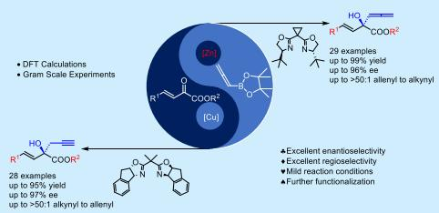
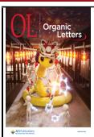
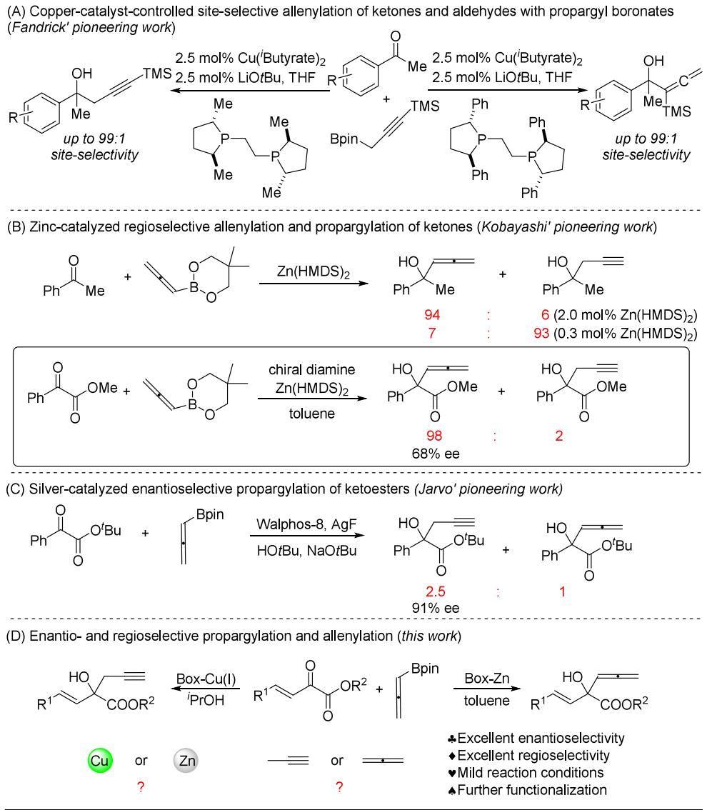
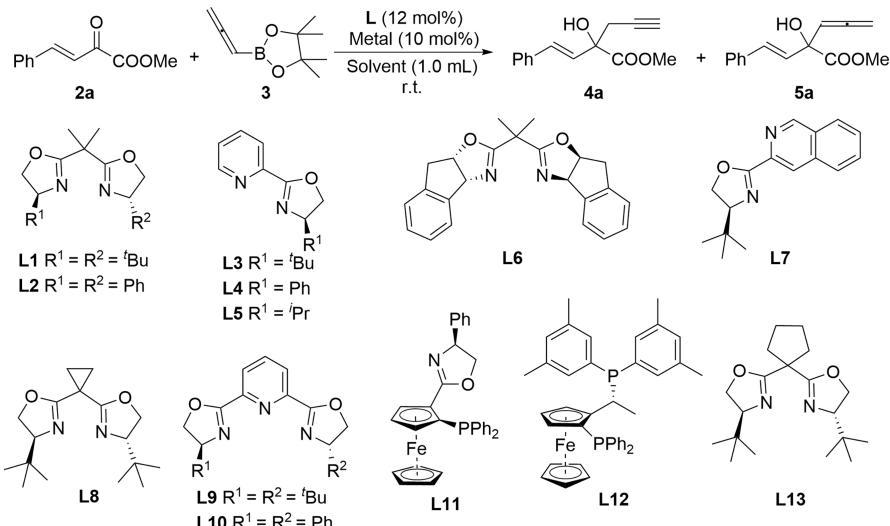
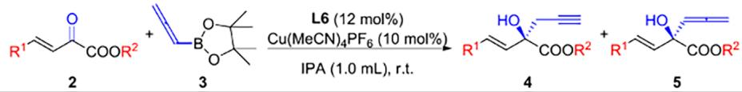
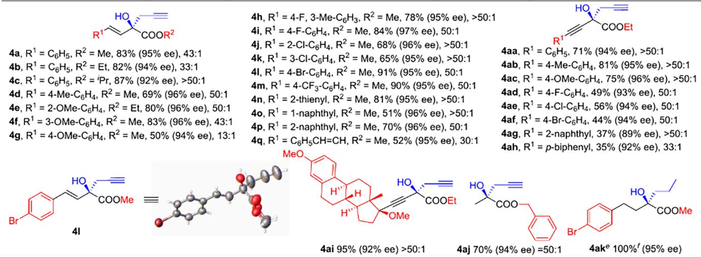
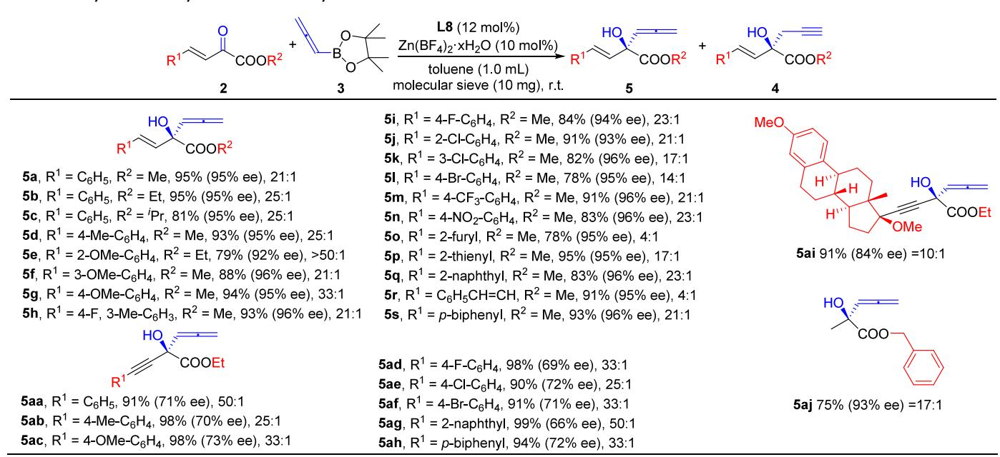
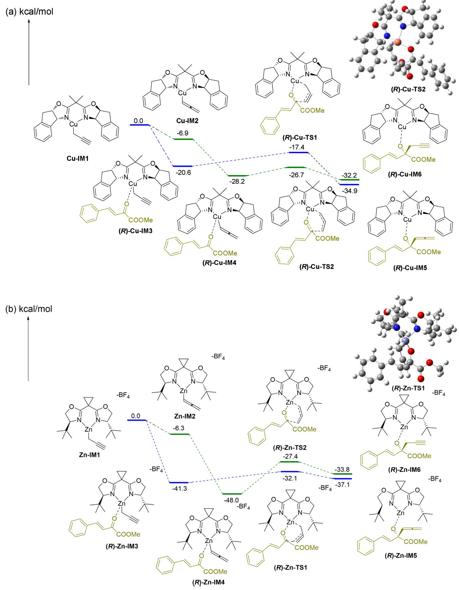
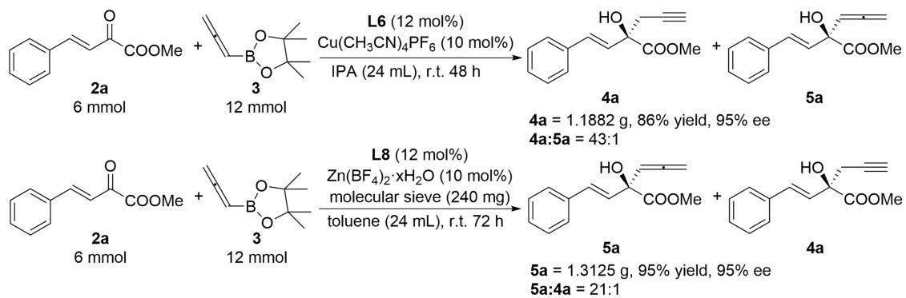
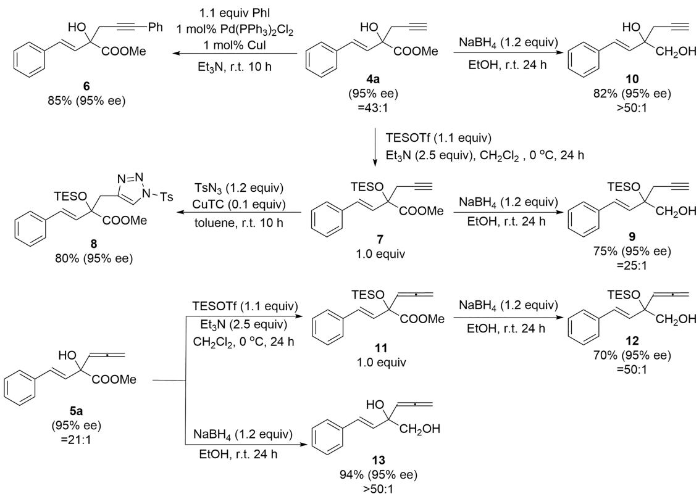

pubs.acs.org/OrgLett

Letter

# Enantio- and Regioselective Propargylation and Allenylation of $\beta , \gamma -$ Unsaturated α‑Ketoesters with Allenyl Boronate Regulated by Chiral Copper/Zinc

Shuai-Ru Cheng, Ni Zhao, Wei Ma, Guo-Rong Ma, and Pei Wang\*

Cite This: Org. Lett. 2025, 27, 1327−1334

Read Online

## ACCESS

Metrics & More

Article Recommendations

ABSTRACT: A method for asymmetric propargylation and allenylation of $\beta , \gamma \mathrm { . }$ unsaturated α-ketoesters catalyzed by Box-Cu/Box-Zn using a commercial organoboron reagent is reported. The reaction was demonstrated to be broadly tolerant of functional groups, resulting in a series of propargyl and allenyl tertiary alcohols in excellent yields with high enantio- and regioselectivities. Furthermore, the proposed mechanism was supported by density functional theory calculations. Gram-scale experiments as well as the synthesis of various chiral tertiary alcohols and glycol derivatives demonstrated the practicality of this synthetic strategy.

\*sı Supporting Information

H omopropargyl and allenyl alcohols are common motifsin biologically active natural products and pharmaceutnumerous methodologies for synthesizing these alcohols exist, the most straightforward and efective method remains the addition of propargyl or allenyl reagents to carbonyl compounds. Chiral secondary homopropargyl and allenyl alcohols have been successfully synthesized through the addition of various propargyl and allenyl metal species (Sn-, Zn-, B-, Si-, or In-based) to aldehydes, respectively.2 However, the synthesis of chiral tertiary homopropargyl and allenyl alcohols has received less attention due to the inferior activity and selectivity of ketones compared to aldehydes. This study mainly focuses on highly active ketones, such as fluorosubstituted ketones,3 isatins,4 and methyl ketones.5

Allenylboronic acid pinacol ester is commercially available and relatively stable, which has been widely used for enantioselective propargylation and allenylation of ketones to synthesize homopropargyl tertiary alcohols in recent years.3a,b,4a−d,5a,b However, allenylmetals can undergo a metallotropic rearrangement resulting in either homopropargyl alcohol or allenyl alcohol when reacting with a carbonyl compound in a metal-catalyzed system,6 as a metal−boron exchange reaction occurs between allenylboronic acid pinacol ester and the metal catalyst. Nevertheless, selectively synthesizing chiral homopropargyl or allenyl alcohols by controlling metallotropic rearrangement remains challenging.

The Fandrick group obtained racemic allenyl alcohols with high selectivity (93:7 to 99:1 allenyl:alkynyl) by zinc-catalyzed allenylations of aldehydes and ketones.7 Subsequently, a practical and highly site-selective allenylation with propargyl boronates was developed. Site selectivity can be guided by BPE ligands and boronate substituents, with high selectivity (≤99:1) obtained with either propargyl or allenyl adducts (Scheme $\mathrm { 1 A ) . } ^ { 8 }$ However, the enantioselectivities of the propargyl and allenyl adducts were not studied. In 2015, the Kobayashi group synthesized racemic tertiary allenyl and homopropargyl alcohols with high selectivities from the same starting materials simply by altering the zinc reagent loading. In addition, a catalytic asymmetric variant of the allenylation of ketoesters was conducted, but only tertiary allenyl alcohol with 68% ee was obtained through allenylation of ketoesters (Scheme 1B).9 Jarvo et al. developed silver-catalyzed addition reactions of allenylboronic acid pinacol esters to ketoesters to provide homopropargyl alcohols with excellent enantioselectivity, but accompanied by poor regioselectivity (2.5:1 homopropargyl:allenyl) (Scheme 1C).10 Therefore, using readily available allenylboronic acid pinacol ester and ketoesters to highly selectively synthesize optically active tertiary homopropargyl and allenyl alcohols by controlling the metallotropic rearrangement remains a challenge.

Herein, we carried out the reaction between allenylboronic acid pinacol ester and $\beta , \gamma \cdot$ -unsaturated α-ketoesters under mild conditions and obtained tertiary homopropargyl and allenyl alcohols with high enantioselectivity and regioselectivity by adjusting the metal reagent and solvent, respectively (Scheme 1D).

To assess the feasibility of the reaction, we initiated the identification of the reaction parameters using 2a with 3 as prototype substrates with copper catalysts. In the presence of 12 mol % ligand and 10 mol % $\mathrm { { C u } ( M e C N ) _ { 4 } B F _ { 4 } }$ in isopropanol

## Scheme 1. Catalytic Propargylation and Allenylation of Ketoesters and Ketones

at room temperature, bisoxazoline ligand L1 mainly aforded racemic homopropargyl alcohol with high yield (Table 1, entry 1). Ligand L2 obtained a poor ee value (entry 2). When ligand L3 was employed, a good yield and moderate enantioselectivity were achieved (entry 3). However, the large tert-butyl substituent on the oxazoline ring was replaced with phenyl, and the ee value decreased dramatically, although the yield remained high (entry 4). Ligand L7 and ferrocene ligand L11 provided unsatisfactory results (entries 6 and $^ { 8 , }$ respectively). Subsequently, we again focused on other bisoxazoline ligands (entries 5 and 7). L6 gave the most favorable outcomes, afording product 4a in 66% yield, with high enantioselectivity and good selectivity for propargylation over allenylation. Then, we evaluated the efect of copper salts, solvent, and temperature on the reaction system (as detailed in the Supporting Information). According to the literature,5b,10 NaOtBu can efectively promote the reaction. Nevertheless, NaOtBu was inefective for this reaction, and the selectivity decreased significantly (as detailed in the Supporting Information). Surprisingly, allenyl alcohol was obtained as the major product when zinc salt was used. Subsequently, we optimized the conditions for the zinc-catalyzed allenylation, as detailed in Table 1 and the Supporting Information.

With the optimal reaction conditions in hand, various $\beta , \gamma \mathrm { . }$ unsaturated α-ketoesters were investigated to study the application scope of the developed methodology (Table 2). In these examples, all reactions aforded chiral homopropargyl tertiary alcohols (4a−4q) with high enantioselectivity and good regioselectivity for propargylation over allenylation. A range of functional groups and substitution patterns were tolerated. The substitution of $\mathrm { R } ^ { 2 }$ by ethyl and isopropyl groups with large steric hindrance generated homopropargyl products (4b and $^ { 4 \mathrm { c } ) }$ with correspondingly good yields, high enantioselectivities, and excellent regioselectivities, suggesting that ester groups with large groups were also well tolerated in this reaction system. Except for 4g, 4o, and $\scriptstyle 4 \mathbf { q } ,$ homopropargyl alcohols 4d−4p had good yields, which might be due to the generation of byproducts caused by the alcohol transesterification of unsaturated ketoesters and isopropanol. Then, we expanded the tolerance of alkynyl ketoesters with various substituents in this reaction system. The results indicated that 4aa−4ah exhibited high enantioselectivity and excellent regioselectivity. Notably, although moderate yields were observed in the case of para-electron-withdrawing substituents (4ad−4af), β-naphthyl (4ag) and p-biphenyl groups (4ah), they all achieved high enantioselectivity and good regioselectivity. Here, we have also applied coppercatalyzed homopropylation to the multistep synthesis of aliphatic product 4ai from the corresponding ethynyl estradiol, with good yields, high enantioselectivities, and excellent regioselectivities. Aryl-substituted glyoxylate fails to produce the corresponding homopropargyl alcohol, whereas the alkylsubstituted glyoxylate gave 4aj with high enantioselectivity and excellent regioselectivity. In the process, the absolute configuration of 4l was determined to be R by X-ray.

Table 1. Optimization of the Reaction Conditionsa  

<table><tr><td>entry</td><td>metal salts, L</td><td>time (h)</td><td> $\mathbf { 4 a } { : } \mathsf { S } \mathbf { a } ^ { b }$ </td><td>yield (%)c</td><td>ee (%)</td></tr><tr><td>1</td><td> $\mathrm { C u } ( \mathrm { M e C N } ) _ { 4 } \mathrm { B F } _ { 4 } , \mathrm { L } 1$ </td><td>20</td><td>12:1</td><td>99</td><td>&lt;1</td></tr><tr><td>2</td><td> $\mathrm { C u } ( \mathrm { M e C N } ) _ { 4 } \mathrm { B F } _ { 4 } , \mathrm { L } 2$ </td><td>144</td><td>&gt;20:1</td><td>59</td><td>20</td></tr><tr><td>3</td><td> $\mathrm { C u } ( \mathrm { M e C N } ) _ { 4 } \mathrm { B F } _ { 4 } , \mathrm { L } 3$ </td><td>20</td><td>11:1</td><td>97</td><td>68</td></tr><tr><td>4</td><td> $\mathrm { C u } ( \mathrm { M e C N } ) _ { 4 } \mathrm { B F } _ { 4 } , \mathrm { L } 4$ </td><td>35</td><td>8:1</td><td>99</td><td>6</td></tr><tr><td>5</td><td> $\mathrm { C u } ( \mathrm { M e C N } ) _ { 4 } \mathrm { B F } _ { 4 } , \mathrm { L } 6$ </td><td>48</td><td>&gt;20:1</td><td>66</td><td>95</td></tr><tr><td>6</td><td> $\mathrm { C u ( M e C N ) _ { 4 } B F _ { 4 } , L 7 }$ </td><td>10</td><td>14:1</td><td>97</td><td>56</td></tr><tr><td>7</td><td> $\mathrm { C u } ( \mathrm { M e C N } ) _ { 4 } \mathrm { B F } _ { 4 } , \mathrm { L } 8$ </td><td>72</td><td>15:1</td><td>50</td><td>7</td></tr><tr><td>8</td><td> $\mathrm { C u ( M e C N ) _ { 4 } B F _ { 4 } , L I 1 }$ </td><td>72</td><td>5:1</td><td>63</td><td>3</td></tr><tr><td>9</td><td> $\mathrm { Z n } ( \mathrm { C F } _ { 3 } \mathrm { S O } _ { 3 } ) _ { 2 } , \mathrm { L } \mathbf { 1 }$ </td><td>12</td><td>1:6</td><td>92</td><td>86</td></tr><tr><td>10</td><td> $\mathrm { Z n } ( \mathrm { C F } _ { 3 } \mathrm { S O } _ { 3 } ) _ { 2 } , \mathrm { L } 2$ </td><td>120</td><td>1:5</td><td>47</td><td>22</td></tr><tr><td>11</td><td> $\mathrm { Z n } ( \mathrm { C F } _ { 3 } \mathrm { S O } _ { 3 } ) _ { 2 } , \mathrm { L } \bar { \mathbf { 5 } }$ </td><td>9</td><td>1:5</td><td>63</td><td>&lt;1</td></tr><tr><td>12</td><td> $\mathrm { Z n } ( \mathrm { C F } _ { 3 } \mathrm { S O } _ { 3 } ) _ { 2 } , \mathrm { L } 6$ </td><td>120</td><td>1:7</td><td>52</td><td>52</td></tr><tr><td>13</td><td> $\mathrm { Z n } ( \mathrm { C F } _ { 3 } \mathrm { S O } _ { 3 } ) _ { 2 } , \mathrm { L } 8$ </td><td>0.5</td><td>1:6</td><td>93</td><td>93</td></tr><tr><td>14</td><td> $\mathrm { Z n } ( \mathrm { C F } _ { 3 } \mathrm { S O } _ { 3 } ) _ { 2 } , \mathrm { L } 9$ </td><td>9</td><td>1:7</td><td>66</td><td>10</td></tr><tr><td>15</td><td> $\mathrm { Z n } ( \mathrm { C F } _ { 3 } \mathrm { S O } _ { 3 } ) _ { 2 } , \mathrm { L } 1 \mathbf { 0 }$ </td><td>48</td><td>1:16</td><td>69</td><td>&lt;1</td></tr><tr><td>16</td><td> $\mathrm { Z n } ( \mathrm { C F } _ { 3 } \mathrm { S O } _ { 3 } ) _ { 2 } , \mathrm { L } 1 1$ </td><td>9</td><td>1:24</td><td>70</td><td>10</td></tr><tr><td>17</td><td> $\mathrm { Z n } ( \mathrm { C F } _ { 3 } \mathrm { S O } _ { 3 } ) _ { 2 } , \mathrm { L } 1 2$ </td><td>120</td><td>1:9</td><td>64</td><td>&lt;1</td></tr><tr><td>18</td><td> $\mathrm { Z n } ( \mathrm { C F } _ { 3 } \mathrm { S O } _ { 3 } ) _ { 2 } , \mathrm { L } 1 3$ </td><td>0.5</td><td>1:6</td><td>91</td><td>86</td></tr></table>

aUnless noted otherwise, reactions were performed with 2a (0.25 mmol), 3 (0.5 mmol), L (0.03 mmol, 12 mol %), and metal salts (0.025 mmol, 10 mol %) in isopropanol (1.0 mL) under an argon atmosphere at rt. bFor reactions of 4a and 5a catalyzed by copper salts and zinc salts, the 4a:5a ratios were measured by chiral HPLC analysis after column chromatography purification. cThe resulting yield was the isolated yield.

We subsequently expanded the substrates for the asymmetric synthesis of tertiary allenyl alcohols with zinc catalysts (Table 3). A wide range of substrates bearing strong steric hindrance (5b and $\pmb { 5 c } ) _ { i }$ , both electron-donating groups (5d− 5g, 5ab, and 5ac), halogenated (5h−5l and 5ad−5af), heteroaryl (5o and 5p), β-naphthyl (5q and 5ag), styryl (5r), 4-biphenyl (5s and 5ah), and aliphatic groups (5ai), can participate in the reaction. The desired tertiary allenyl alcohols were constructed in 78−99% yields with 66−96% ee. Good regioselectivity was obtained for all products, except 5o, 5r, and 5ai. Aryl-substituted glyoxylate cannot produce allenyl alcohol, while alkyl-substituted glyoxylate can aford 5aj with high enantioselectivity and good regioselectivity. 4l was reduced to give highly enantioselective 4ak, and 5l was reduced by the same method; its reduction product was determined by HPLC to be highly enantioselective, and the times of the major and minor peaks are consistent with 4ak. Therefore, the configuration of 5l was determined to be R.

To elucidate the reaction mechanism, possible transitionstate models were proposed. For Cu-catalyzed homopropargylation, (R)-Cu-IM4 passes through (R)-Cu-TS2, crossing an energy barrier of 1.5 kcal mol−1 to generate the R-configuration product. For the blue pathway, 2a was added to form complex (R)-Cu-IM3 with Cu-IM1, and (R)-Cu-IM3 passes through (R)-Cu-TS1, crossing an energy barrier of 3.2 kcal $\mathrm { m o l ^ { - 1 } }$ to generate the R-configuration product (Scheme 2a). Compared to the blue pathway, the highest energy barrier for the green pathway is lower, indicating that green pathway is more favorable in terms of kinetics. For Zn-catalyzed allenylation, an energy barrier of 9.2 kcal mol−1 was crossed to form the Rconfiguration allenyl alcohol $[ ( R ) \mathbf { - } \mathbf { Z n } \mathbf { - } \mathbf { I M } 3$ to $\mathbf { \left( R \right) - Z n - T S 1 } ]$ and (R)-Zn-IM4 crosses the energy barrier of 20.6 kcal mol−1 through (R)-Zn-TS2 to form (R)-Zn-IM6. Compared with that of the green pathway, the maximum energy barrier of the blue pathway is lower, so the blue pathway is better kinetically. Because the isomerization between Cu-IM1 and Cu-IM2 is present (see Figure S1), propargyl alcohols are obtained, and the transformation adheres to the Curtin−Hammett principle.

Table 2. Asymmetric Synthesis of Homopropargyl Alcoholsa−d  

aUnless noted otherwise, the resulting homopropargyl alcohols were produced under the corresponding optimal conditions. bThe resulting yield was the isolated yield. cThe ratios were measured according to the 1H NMR spectrum after column chromatography purification. dThe enantioselectivity of homopropargyl alcohols was measured by chiral HPLC analysis after column chromatography purification. e4ak was obtained from 4l by reduction of Pd/C and hydrogen. fConversion is reported, which was directly measured by HPLC and 1H NMR without column chromatography separation.  
Table 3. Asymmetric Synthesis of Allenyl Alcoholsa−d  
  
aUnless noted otherwise, the resulting allenyl alcohols were produced under the corresponding optimal conditions. bThe resulting yield was the isolated yield. cThe ratios were measured according to the 1H NMR spectrum after column chromatography purification. dThe enantioselectivity of allenyl alcohols was measured by chiral HPLC analysis after column chromatography purification.

In contrast, Zn-IM1 is hard to isomerize to Zn-IM2 (see Figure S2), so Zn-IM1 reacts to form the allenyl alcohols. The three-dimensional structures of transition states (R)-Cu-TS2 and (R)-Zn-TS1 are also demonstrated in Scheme 2.

To further demonstrate the potential of this homopropargylation and allenylation reactions, Cu-catalyzed homopropargylation and Zn-catalyzed allenylation were both conducted on a gram scale, leading to homopropargyl alcohol 4a (86% yield,

Scheme 2. Gibbs Free Energy Profiles for the Copper- and Zinc-Catalyzed Enantioselective Propargylation and Allenylation of 2a with 3

  
aThe ratios were measured according to the $^ 1 \mathrm { H }$ NMR spectrum after column chromatography purification. bThe enantioselectivity was measured by chiral HPLC analysis after column chromatography purification.

  
aThe ratios were measured according to the 1H NMR spectrum after column chromatography purification. $^ { b } \mathrm { T h e }$ enantioselectivity was measured by chiral HPLC analysis after column chromatography purification.

95% ee, 43:1 4a:5a) and allenyl alcohol 5a (95% yield, 95% $\mathbf { e e } ,$ 1:21 4a:5a) without erasing the yield, enantioselectivity, or regioselectivity (Scheme 3).

Homopropargyl and allenyl alcohols are significant synthons that can be converted into various chiral tertiary alcohols and glycol derivatives (Scheme 4). Sonogashira coupling of 4a in the presence of 1.0 mol % $\mathrm { P d C l } _ { 2 } ( \mathrm { P P h } _ { 3 } ) ;$ and 1.0 mol % CuI afords coupling product $\mathbf { 6 , }$ enabling introduction of highly diversified substituent at the alkyne. 4a with TESOTf generated $^ { 7 , }$ and then click reaction promoted by CuTc provided $^ { 1 , 2 , 3 }$ -triazole 8. 7 was reduced by ${ \mathrm { N a B H } } _ { 4 }$ to produce alcohol 9. Transformation of 4a through ${ \mathrm { N a B H } } _ { 4 }$ led to the ester compounds being reduced to glycol 10. The reaction of allenyl alcohol 5a with TESOTf in ethanol furnished 11, and then its reduction by NaBH produced 12. 5a was directly reduced to 13 by $\mathrm { N a B H } _ { 4 } .$

In summary, an asymmetric propargylation and allenylation of β,γ-unsaturated α-ketoesters with a commercial organoboron reagent was developed under Box-Cu/Box-Zn catalysis. A series of unsaturated allenylation and allenyl tertiary alcohols were aforded in excellent yields with high enantio- and regioselectivities. The proposed mechanism was supported by a density functional theory (DFT) calculation. The synthetic utility of this strategy was demonstrated by gram-scale experiments and the synthesis of various chiral tertiary alcohol and glycol derivatives.

## ■ ASSOCIATED CONTENT

## Data Availability Statement

The data underlying this study are available in the published article and its Supporting Information.

## \*sı Supporting Information

The Supporting Information is available free of charge at https://pubs.acs.org/doi/10.1021/acs.orglett.4c03845.

FAIR data, including the primary NMR FID files, for compounds 2a−2t, 2aa−2aj, and 2ai-1 (ZIP)

FAIR data, including the primary NMR FID files, for compounds 4a−4i (ZIP)

FAIR data, including the primary NMR FID files, for compounds 4j−4q (ZIP)

FAIR data, including the primary NMR FID files, for compounds 4aa−4ak (ZIP)

FAIR data, including the primary NMR FID files, for compounds 5a−5i (ZIP)

FAIR data, including the primary NMR FID files, for compounds 5j−5s (ZIP)

FAIR data, including the primary NMR FID files, for compounds 5aa−5aj (ZIP)

FAIR data, including the primary NMR FID files, for compounds 6, 8, 9, 10, 12, and 13 (ZIP)

Procedures, spectroscopic data, DFT computational details, and crystallographic data for all compounds (PDF)

## Accession Codes

Deposition Number 2361745 contains the supplementary crystallographic data for this paper. These data can be obtained free of charge via the joint Cambridge Crystallographic Data Centre (CCDC) and Fachinformationszentrum Karlsruhe Access Structures service.

## ■ AUTHOR INFORMATION

## Corresponding Author

Pei Wang − Department of Pharmacy and School of Basic Medical Sciences, Ningxia Medical University, Yinchuan 750004, China; orcid.org/0009-0000-5075-3869; Email: wangp17@nxmu.edu.cn

## Authors

Shuai-Ru Cheng − Department of Pharmacy, Ningxia Medical University, Yinchuan 750004, China

Ni Zhao − School of Basic Medical Sciences, Ningxia Medical University, Yinchuan 750004, China

Wei Ma − School of Basic Medical Sciences, Ningxia Medical University, Yinchuan 750004, China

Guo-Rong Ma − School of Basic Medical Sciences, Ningxia Medical University, Yinchuan 750004, China

Complete contact information is available at: https://pubs.acs.org/10.1021/acs.orglett.4c03845

## Notes

The authors declare no competing financial interest.

## ■ ACKNOWLEDGMENTS

This work was supported by the Higher Education Scientific Research Project of Ningxia (Grant NYG2024121), the Natural Science Foundation of Ningxia (Grant 2024AAC03245), and The Special Talents Launched in 2019 of Ningxia Medical University (Grant XT2019005). The authors thank Dr. Pengjuan Zhou from Ningxia Academy of Agriculture and Forestry Sciences for his generous support in the NMR structure analysis and SuanChou (suan-chou.com) for the DFT study.

## ■ REFERENCES

(1) (a) $\mathrm { A n } , \mathrm { J } . ;$ Intano, J.; Richard, A.; Kim, T.; Gascón, J. A.; Howell, A. R. Easily accessible non-aromatic heterocycles with handles: 4- bromo-2,3-dihydrofurans from 1,2-dibromohomoallylic alcohols. Chem. Sci. 2021, 12, 10347−10353. (b) Sahani, R. L.; Liu, R.-S. Gold-Catalyzed Oxidative Arylations of 3-Butyn-1-ols and 2-Propyn-1-ols with Nitrones to Yield Distinct Fused Indoles Bearing a Heterocyclic Ring. ACS Catal. 2019, 9, 5890−5896. (c) Shu, C.; Liu, M.-Q.; Sun, Y.-Z.; Ye, L.-W. Efficient Synthesis of γ-Lactones via Gold-Catalyzed Tandem Cycloisomerization/Oxidation. Org. Lett. 2012, 14, 4958−4961. (d) Smith, M. W.; Zhou, $\mathrm { Z . j }$ Gao, A. X.; Shimbayashi, $\mathrm { T } . \mathrm { } _ { \mathrm { \cdot } } ^ { }$ Snyder, S. A. A 7-Step Formal Asymmetric Total Synthesis of Strictamine via an Asymmetric Propargylation and Metal-Mediated Cyclization. Org. Lett. 2017, 19, 1004−1007. (e) Zhao, J.; Jonker, S. J. T.; Meyer, D. N.; Schulz, G.; Tran, C. D.; Eriksson, L.; Szabo, K. J. Copper-catalyzed synthesis of allenylboronic acids. Access to sterically encumbered homopropargylic alcohols and amines by propargylboration. Chem. Sci. 2018, 9, 3305−3312. (f) Alcaide, B.; Almendros, $\mathrm { P . } \mathrm { , }$ Carrascosa, R.; Martínez del Campo, T. Metal-Catalyzed Cycloetherification Reactions of $\beta , \gamma \mathrm { \mathrm { - } }$ and $\gamma ,$ δ-Allendiols: Chemo-, Regio-, and Stereocontrol in the Synthesis of Oxacycles. Chem. - Eur. J. 2010, 16, 13243−13252.

(2) (a) Brawn, R. A.; Panek, J. S. Preparation and Use of Enantioenriched Allenylsilanes for the Stereoselective Synthesis of Homopropargylic Ethers. Org. Lett. 2007, 9, 2689−2692. (b) Chen, J.; Captain, B.; Takenaka, N. Helical Chiral 2,2′-Bipyridine N-Monoxides as Catalysts in the Enantioselective Propargylation of Aldehydes with Allenyltrichlorosilane. Org. Lett. 2011, 13, 1654− 1657. (c) Chen, M.; Roush, W. R. Enantioselective Synthesis of antiand syn-Homopropargyl Alcohols via Chiral Brønsted Acid Catalyzed Asymmetric Allenylboration Reactions. J. Am. Chem. Soc. 2012, 134, 10947−10952. (d) Corey, E. J.; Yu, C. M.; Lee, D. H. A practical and general enantioselective synthesis of chiral propa-1,2-dienyl and propargyl carbinols. J. Am. Chem. Soc. 1990, 112, 878−879. (e) Denmark, S. E.; Wynn, T. Lewis Base Activation of Lewis Acids: Catalytic Enantioselective Allylation and Propargylation of Aldehydes. J. Am. Chem. Soc. 2001, 123, 6199−6200. (f) Fandrick, D. R.; Fandrick, K. R.; Reeves, J. T.; Tan, Z.; Tang, W.; Capacci, A. G.; Rodriguez, S.; Song, J. J.; Lee, H.; Yee, N. K.; Senanayake, C. H. Copper Catalyzed Asymmetric Propargylation of Aldehydes. J. Am. Chem. Soc. 2010, 132, 7600−7601. (g) Haddad, T. D.; Hirayama, L. C.; Buckley, J. J.; Singaram, B. Indium-Mediated Asymmetric Barbier-Type Propargylations: Additions to Aldehydes and Ketones and Mechanistic Investigation of the Organoindium Reagents. J. Org. Chem. 2012, 77, 889−898. (h) Hernandez, E.; Burgos, C. H.; Alicea, E.; Soderquist, J. A. B-Allenyl- and B-(γ-Trimethylsilylpropargyl)- 10- phenyl-9-borabicyclo[3.3.2]decanes: Asymmetric Synthesis of Prop argyl and α-Allenyl 3°-Carbinols from Ketones. Org. Lett. 2006, 8, 4089−4091. (i) Hernandez, E.; Soderquist, J. A. Nonracemic α- Allenyl Carbinols from Asymmetric Propargylation with the 10- Trimethylsilyl-9-borabicyclo[3.3.2]decanes†. Org. Lett. 2005, 7, 5397−5400. (j) Hirayama, L. C.; Dunham, K. K.; Singaram, B. Asymmetric indium-mediated synthesis of homopropargylic alcohols. Tetrahedron Lett. 2006, 47, 5173−5176. (k) Hirayama, L. C.; Haddad, T. D.; Oliver, A. G.; Singaram, B. Direct Synthesis of B-Allyl and B-Allenyldiisopinocampheylborane Reagents Using Allyl or Propargyl Halides and Indium Metal Under Barbier-Type Conditions. J. Org. Chem. 2012, 77, 4342−4353. (l) Jain, P.; Wang, H.; Houk, K. N.; Antilla, J. C. Brønsted Acid Catalyzed Asymmetric Propargylation of Aldehydes†. Angew. Chem., Int. Ed. 2012, 51, 1391−1394. (m) Lai, C.; Soderquist, J. A. Nonracemic Homopropargylic Alcohols via Asymmetric Allenylboration with the Robust and Versatile 10-TMS-9-

borabicyclo[3.3.2]decanes†. Org. Lett. 2005, 7, 799−802. (n) Loh, T.- P.; Lin, M.-J.; Tan, K.-L. Indium-mediated propargylation of aldehydes: regioselectivity and enantioselectivity studies. Tetrahedron. Lett. 2003, 44, 507−509. (o) Marshall, J. A. Chiral Allylic and Allenic Stannanes as Reagents for Asymmetric Synthesis. Chem. Rev. 1996, 96, 31−48. (p) Marshall, J. A. Chiral Allylic and Allenic Metal Reagents for Organic Synthesis‡. J. Org. Chem. 2007, 72, 8153−8166. (q) Marshall, J. A.; Adams, N. D. Synthesis of Chiral Enantioenriched Homopropargylic Alcohols from Propargylic Mesylates via Chiral Allenylzinc Intermediates. J. Org. Chem. 1998, 63, 3812−3813. (r) Reddy, L. R. Chiral Brønsted Acid Catalyzed Enantioselective Propargylation of Aldehydes with Allenylboronate. Org. Lett. 2012, 14, 1142−1145. (s) Rodríguez, E.; Grayson, M. N.; Asensio, A.; Barrio, P.; Houk, K. N.; Fustero, S. Chiral Brønsted Acid-Catalyzed Asymmetric Allyl(propargyl)boration Reaction of ortho-Alkynyl Benzaldehydes: Synthetic Applications and Factors Governing the Enantioselectivity. ACS Catal. 2016, 6, 2506−2514. (t) Wang, M.; Khan, S.; Miliordos, E.; Chen, M. Enantioselective Syntheses of Homopropargylic Alcohols via Asymmetric Allenylboration. Org. Lett. 2018, 20, 3810−3814. (u) Hamashima, Y.; Ota, Y.; Kawato, Y.; Egami, H. Enantioselective Allyl-, and Allenylboration of Aldehydes Catalyzed by Chiral Hydroxyl Carboxylic Acid. Synlett. 2017, 28, 976−980. (v) Keck, G. E.; Krishnamurthy, D.; Chen, X. Asymmetric synthesis of homopropargylic alcohols from aldehydes and allenyltrin-butylstannane. Tetrahedron. Lett. 1994, 35, 8323−8324. (w) Wei, X. F.; Shimizu, Y.; Kanai, M. An Expeditious Synthesis of Sialic Acid Derivatives by Copper(I)-Catalyzed Stereodivergent Propargylation of Unprotected Aldoses. ACS. Cent. Sci. 2016, 2, 21−26. (x) Yuan, J.; Jain, P.; Antilla, J. C. Bi(cyclopentyl)diol-Derived Boronates in Highly Enantioselective Chiral Phosphoric Acid-Catalyzed Allylation, Propargylation, and Crotylation of Aldehydes. J. Org. Chem. 2020, 85, 12988−13003. (y) Zamani, F.; Pyne, S. G.; Hyland, C. J. T. Oxazolidinones and 2,5-Dihydrofurans via Zinc-Catalyzed Regioselective Allenylation Reactions of l-α-Amino Aldehydes. J. Org. Chem. 2017, 82, 6819−6830.

(3) (a) Fandrick, D. R.; Reeves, J. T.; Bakonyi, J. M.; Nyalapatla, P. R.; Tan, Z.; Niemeier, O.; Akalay, D.; Fandrick, K. R.; Wohlleben, W.; Ollenberger, S.; Song, J. J.; Sun, X.; Qu, B.; Haddad, N.; Sanyal, S.; Shen, S.; Ma, S.; Byrne, D.; Chitroda, A.; Fuchs, V.; Narayanan, B. A.; Grinberg, N.; Lee, H.; Yee, N.; Brenner, M.; Senanayake, C. H. Zinc Catalyzed and Mediated Asymmetric Propargylation of Trifluoromethyl Ketones with a Propargyl Boronate. J. Org. Chem. 2013, 78, 3592−3615. (b) Guo, P.; Zhang, R.; Wang, X.; Wang, Z.; Ding, K. Synthesis of Chiral Tertiary α,α-Difluoromethyl Carbinols by Cu-Catalyzed Asymmetric Propargylation. Chem. - Eur. J. 2019, 25, 16425−16434. (c) Lee, K.; Silverio, D. L.; Torker, S.; Robbins, D. W.; Haeffner, F.; van der Mei, F. W.; Hoveyda, A. H. Catalytic enantioselective addition of organoboron reagents to fluoroketones controlled by electrostatic interactions. Nat. Chem. 2016, 8, 768−777.

(4) (a) Gupta, N.; Tak, R.; Nazish, M.; Jakhar, A.; Khan, N.-u. H.; Kureshy, R. I. Copper(II) Triflate Catalyzed Regioselective and Enantioselective Propargylation of Isatin Derivatives by Using Allenylboronic Acid Pinacol Ester. Eur. J. Org. Chem. 2018, 2018, 1384−1392. (b) Li, K.; Sun, X.; Zhao, S.; Li, T.; Zha, Z.; Wang, Z. Zn-Catalyzed enantioselective allylation and allenylation of isatins by virtue of a proline-derived chiral ligand. Chem. Commun. 2022, 58, 2156−2159. (c) Silverio, D. L.; Torker, S.; Pilyugina, T.; Vieira, E. M.; Snapper, M. L.; Haeffner, F.; Hoveyda, A. H. Simple organic molecules as catalysts for enantioselective synthesis of amines and alcohols. Nature. 2013, 494, 216−221. (d) Oyamada, Y.; Yamasaki, S.; Tsuzuki, M.; Kitagawa, T.; Kondo, M.; Sasamori, T.; Nakamura, S. Enantioselective Allenylation of Ketimines Derived from Isatins Using Chiral Bis(imidazoline)-Palladium Catalysts. Adv. Synth. Catal. 2022, 364, 4255−4259.

(5) (a) Barnett, D. S.; Schaus, S. E. Asymmetric Propargylation of Ketones Using Allenylboronates Catalyzed by Chiral Biphenols. Org. Lett. 2011, 13, 4020−4023. (b) Shi, S. L.; Xu, L. W.; Oisaki, K.; Kanai, M.; Shibasaki, M. Identification of Modular Chiral Bisphosphines Effective for Cu(I)-Catalyzed Asymmetric Allylation

and Propargylation of Ketones. J. Am. Chem. Soc. 2010, 132, 6638− 6639. (c) Fandrick, K. R.; Fandrick, D. R.; Reeves, J. T.; Gao, J.; Ma, S.; Li, W.; Lee, H.; Grinberg, N.; Lu, B.; Senanayake, C. H. A General Copper-BINAP-Catalyzed Asymmetric Propargylation of Ketones with Propargyl Boronates. J. Am. Chem. Soc. 2011, 133, 10332− 10335. (d) Harper, K. C.; Vilardi, S. C.; Sigman, M. S. Prediction of Catalyst and Substrate Performance in the Enantioselective Propargylation of Aliphatic Ketones by a Multidimensional Model of Steric Effects. J. Am. Chem. Soc. 2013, 135, 2482−2485. (e) Harper, K. C.; Sigman, M. S. Three-Dimensional Correlation of Steric and Electronic Free Energy Relationships Guides Asymmetric Propargylation. Science. 2011, 333, 1875−1878.

(6) Wisniewska, H. M.; Jarvo, E. R. Enantioselective Propargylation and Allenylation Reactions of Ketones and Imines. J. Org. Chem. 2013, 78, 11629−11636.

(7) Fandrick, D. R.; Saha, J.; Fandrick, K. R.; Sanyal, S.; Ogikubo, J.; Lee, H.; Roschangar, F.; Song, J. J.; Senanayake, C. H. Zinc-catalyzed allenylations of aldehydes and ketones. Org. Lett. 2011, 13, 5616− 5619.

(8) Fandrick, K. R.; Ogikubo, J.; Fandrick, D. R.; Patel, N. D.; Saha, J.; Lee, H.; Ma, S.; Grinberg, N.; Busacca, C. A.; Senanayake, C. H. Copper-catalyst-controlled site-selective allenylation of ketones and aldehydes with propargyl boronates. Org. Lett. 2013, 15, 1214−1217.

(9) Yamashita, Y.; Cui, Y.; Xie, P.; Kobayashi, S. Zinc Amide Catalyzed Regioselective Allenylation and Propargylation of Ketones with Allenyl Boronate. Org. Lett. 2015, 17, 6042−6045.

(10) Kohn, B. L.; Ichiishi, N.; Jarvo, E. R. Silver-Catalyzed Allenylation and Enantioselective Propargylation Reactions of Ketones. Angew. Chem., Int. Ed. 2013, 52, 4414−4417.