(+)-4-epi-Isolaurallene (2a) (proposed)

pubs.acs.org/OrgLett

# Formal Total Synthesis of (−)-Isolaurallene and Structure Determination of (+)-4-epi-Isolaurallene via Stereodivergent Intramolecular Amide Enolate Alkylation

Youngjik Park,∇ Hongjun Jang,∇ Soo Yeon Kwak, Seongju Lim, Dongjoo Lee,\* Hyoungsu Kim,\* and Deukjoon Kim

Cite This: Org. Lett. 2025, 27, 3199−3203

Read Online

## ACCESS

Metrics & More

ABSTRACT: Described herein are the formal total syntheses of (−)-isolaurallene (1) and structure determination of newly isolated (+)-4-epi-isolaurallene (2) via a highly stereodivergent intramolecular amide enolate alkylation (IAEA) strategy. Highly stereoselective constructions of $\alpha , \alpha ^ { \prime }$ -trans-THF 3 and α,α′-cis-THF 4 were accomplished by subjecting common intermediate 5 to non-chelate-controlled and chelate-controlled IAEA, respectively. The former protocol greatly improves the moderate stereoselectivity previously observed in constructing α,α′-trans-THF rings via intramolecular nitrile anion alkylation (INAA).

T he Laurencia genus of red algae has yielded a plethora of oxacyclic halogenated $\mathrm { C } _ { 1 5 }$ acetogenins, some of which feature a stereoisomeric dioxabicyclic bromoallene skeleton comprising the 2,10-dioxabicyclo[7.3.0]dodecene moiety.1 Among these, the first natural product with this structure was (−)-isolaurallene (1), which was isolated from the red alga Laurencia nipponica by Kurata and co-workers in 1982.2 As shown in Figure 1, spectroscopic and single-crystal X-ray crystallographic studies revealed that (−)-isolaurallene (1) is

(+)-4-epi-Isolaurallene (2b) (proposed)  
(—)-Isolaurallene (1)  
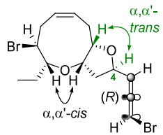

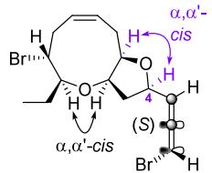

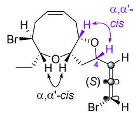  
Figure 1. (−)-Isolaurallene (1) and two proposed structures of (+)-4- epi-isolaurallene (2).

Article Recommendations

\*sı Supporting Information

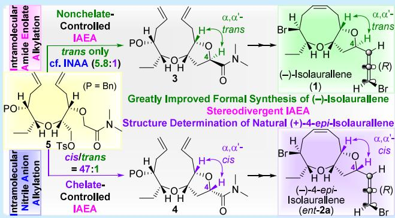

composed of an $\alpha , \alpha ^ { \prime } .$ -cis-oxonene unit fused with an $\alpha , \alpha ^ { \prime }$ -trans-THF ring, which is substituted with an (R)-bromoallene appendage at C(4). The first total synthesis of this natural product was accomplished by the Crimmins group, who employed an Evans asymmetric allylation and nine-membered ether ring-closing metathesis (RCM) to the $\alpha , \alpha ^ { \prime }$ -cis-oxonene as key steps.3 The $\alpha , \alpha ^ { \prime }$ -trans-THF ring in 1 was then constructed by an asymmetric epoxidation/internal Williamson etherification sequence. Subsequently, our group achieved a total synthesis of 1 utilizing a stereoselective intermolecular amide enolate alkylation/RCM strategy for the $\alpha , \alpha ^ { \prime }$ -cis-oxonene and intramolecular nitrile anion alkylation (INAA) for the $\alpha , \alpha ^ { \prime } .$ trans-THF ring.4

Meanwhile, (+)-4-epi-isolaurallene (2), another closely related $\mathrm { C } _ { 1 5 }$ acetogenin with a 2,10-dioxabicyclo[7.3.0]- dodecene unit, was recently isolated from a population of marine red alga Laurencia nangii Masuda by Vairappan and coworkers in 2020.5 The structure of (+)-4-epi-isolaurallene was elucidated from extensive spectroscopic studies. A comparison of its 1H NMR spectrum with those of related natural and u n n a t u r a l c o m p o u n d s r eve a l e d t h a t t h e 2 , 1 0 - dioxabicyclo[7.3.0]dodecene unit comprises an $\alpha , \alpha ^ { \prime }$ -cis-oxonene unit and an $\alpha , \alpha ^ { \prime } - c i s  – \mathrm { T H F }$ ring. Judging from the strongly positive rotation of (+)-4-epi-isolaurallene $( [ \alpha ] _ { \mathrm { ~ \textrm ~ { ~ D ~ } ~ } } ^ { 2 5 } + 5 6 . 1$ (c 0.46, CHCl )), the absolute stereochemistry of the bromoallene moiety was assigned as S on the basis of Lowe’s rule.6 However, since the relative stereochemistry between the dioxabicyclic core and the bromoallene moiety could not be determined using spectroscopic methods, the structure of (+)-4-epi-isolaurallene was proposed to be either 2a or 2b (Figure 1). No total synthesis of this natural product has been reported to date, and thus, its structure has remained unconfirmed.

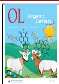

As stated above, we recently reported the stereoselective substrate-controlled total synthesis of (−)-isolaurallene (1), which involved the construction of the α,α′-trans-THF moiety via INAA with a trans:cis selectivity of 5.8:1. In an efort to improve this modest stereoselectivity, and based on the insights acquired during our recent total syntheses of other tetrahydrofuranoid natural products, we envisioned that the use of KHMDS as the base in the presence of a crown ether might produce an $\alpha , \alpha ^ { \prime }$ -trans-THF in a highly stereoselective manner, thereby enabling a stereodivergent intramolecular amide enolate alkylation (IAEA) strategy for the selective construction of both $\alpha , \alpha ^ { \prime } { - } c i s$ and $\alpha , \alpha ^ { \prime }$ -trans THF moieties from a common substrate.7a

Herein, we describe the formal total synthesis of (−)-isolaurallene (1) and consequent structure determination of (+)-4-epi-isolaurallene (2) via the highly stereoselective total syntheses of ent-2a and 2b employing our highly stereodivergent IAEA strategy in a substrate-controlled manner.

As shown in our retrosynthetic plan (Scheme 1), we were confident that $\alpha , \alpha ^ { \prime } .$ -trans-THF amide 3 and its C(4) epimer, α,α′-cis-THF amide $^ { 4 , }$ could lead to (−)-isolaurallene (1) and 4-epi-isolaurallenes (ent-2a and 2b), respectively, via the RCM and Overman protocol. It is worth mentioning at this point that we opted to synthesize ent-2a and 2b instead of the originally proposed structures 2a and 2b for the sake of simplicity in our approach to determine the relative stereochemistry between the dioxabicyclic core and the bromoallene appendage of (+)-4-epi-isolaurallene (2). Moreover, with the knowledge accrued during the aforementioned recent total syntheses of natural products containing a THF ${ \mathrm { r i n g } } ^ { 7 }$ we envisaged that pivotal intermediates $\alpha , \dot { \alpha } ^ { \prime }$ -trans-THF 3 and $\alpha , \alpha ^ { \prime }$ -cis-THF 4 could be constructed via non-chelatecontrolled and chelate-controlled IAEA, respectively, in a stereodivergent fashion from common substrate ω-tosyl α- alkoxyamide 5, which could be obtained from known compound ${ \bf 6 . ^ { 4 } }$

Our synthesis commenced with the preparation of stereodivergent IAEA substrate 5 as described in Scheme 2. Known compound 6 was converted into IAEA substrate ω-tosyl α- alkoxyamide 5 in a good overall yield (66%) via a straightforward four-step sequence. Thus, chemoselective deprotection of the MOM group in the presence of the TIPS group in 6 by treatment with trifluoroacetic acid and subsequent Williamson etherification of the resulting secondary alcohol 7 with N,N-dimethyl chloroacetamide furnished α-alkoxyamide 8. Removal of the TIPS protecting group in 8 with TBAF followed by tosylation of the resultant primary alcohol with p-toluenesulfonic anhydride delivered the desired internal alkylation substrate 5.

With ω-tosyl α-alkoxyamide 5 in hand, we proceeded to implement the pivotal stereodivergent IAEA reaction in the construction of both $\alpha , \alpha ^ { \prime }$ -trans-THF 3 and $\alpha , \alpha ^ { \prime }$ -cis-THF 4, as

Scheme 1. Retrosynthetic Plan for (−)-Isolaurallene (1) and ent-2a and 2b

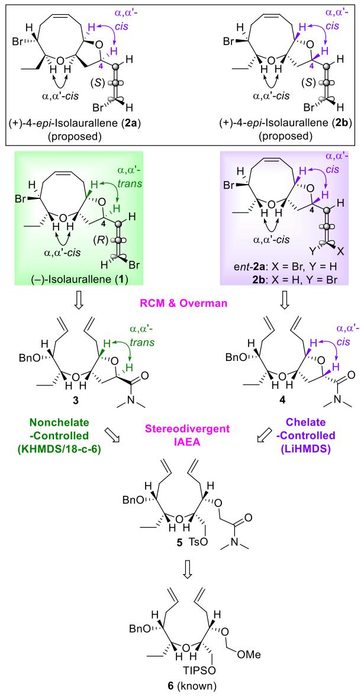

Scheme 2. Preparation of Stereodivergent Intramolecular Amide Enolate Alkylation Substrate 5

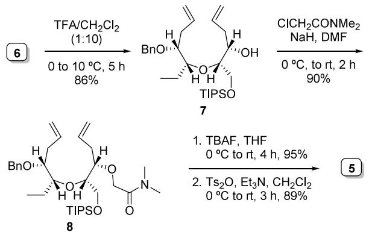

depicted in Scheme 3. As anticipated, treatment of 5 with LiHMDS in toluene $\mathrm { a t } - 7 8 \mathrm { t o } - \bar { 5 } 0 \mathrm { ~ } ^ { \circ } \mathrm { C }$ for 3 h furnished the desired $\alpha , \alpha ^ { \prime } { \mathrm { - } } c i s { \mathrm { - } }$ THF amide 4 in excellent yield (93%) and diastereoselectivity (47:1 cis:trans, by 1H NMR analysis),

## Scheme 3. Stereodivergent Intramolecular Amide Enolate Alkylation of 5

a. Intramolecular Amide Enolate Alkylation (IAEA)

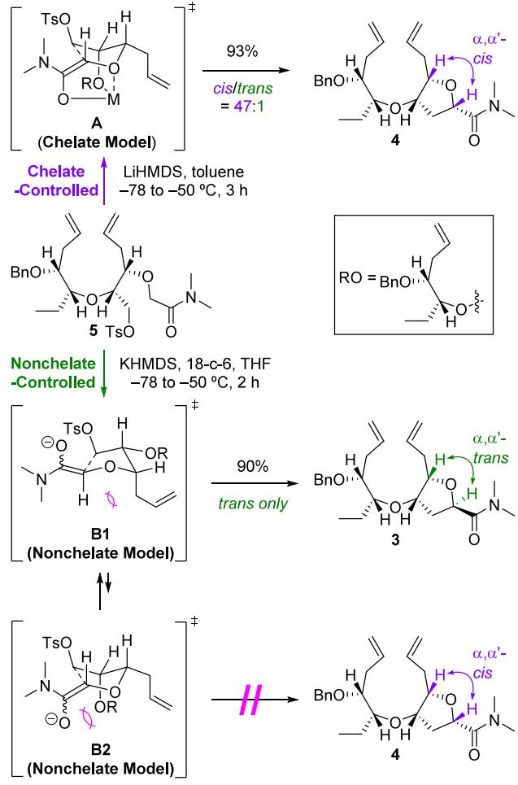

b. Intramolecular Nitrile Anion Alkylation (INAA)  
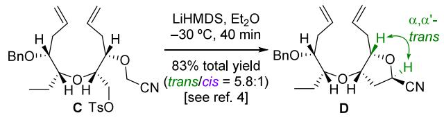

presumably through chelate-controlled transition state geometry A. On the other hand, we were delighted to find that subjecting 5 to KHMDS in THF $\mathrm { a t } - 7 8 \mathrm { t o } - 5 0 ^ { \circ } \mathrm { C }$ for 2 h in the presence of 18-crown-6 delivered $\alpha , \alpha ^ { \prime }$ -trans-THF 3 in 90% yield as a single stereoisomer (by 1H NMR analysis). The stereoselectivity observed in this case could be rationalized by invoking a nonchelated transition state geometry (B1), which would minimize the steric repulsions between the bulky alkoxy group (OR) and the amide enolate moiety that would exist in the alternative nonchelated transition state geometry (B2), as depicted in the scheme. It is noteworthy that our non-chelatecontrolled IAEA protocol markedly improved the moderate stereoselectivity previously observed in the construction of α,α′-trans-THF D via INAA of C (trans only for IAEA vs 5.8:1 trans:cis for INAA).4

Having accomplished the highly stereoselective construction of the key intermediates $\alpha , \alpha ^ { \prime }$ -trans-THF amide 3 and $\alpha , \alpha ^ { \prime }$ -cis-THF amide 4 in a stereodivergent manner, we first turned our attention to the synthesis of $( \breve { - } )$ -isolaurallene (1) (Scheme 4). Thus, RCM of diene 3 using the Grubbs second-generation

## Scheme 4. Formal Total Synthesis of (−)-Isolaurallene (1)

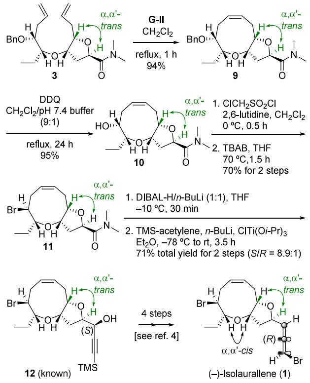

catalyst [G-II, $\left( \mathrm { H } _ { 2 } \mathrm { I M e s } \right) \left( \mathrm { C y } _ { 3 } \mathrm { P } \right) \mathrm { C l } _ { 2 } \mathrm { R u } { = } \mathrm { C H P h } ]$ produced bicyclic oxonene 9 in an excellent yield (94%). Removal of the benzyl group in 9 under the reaction conditions reported by Yonemitsu and co-workers8 and subsequent bromination of the resulting secondary alcohol 10 with inversion of configuration using Nakata’s two-step chloromesylate-mediated $\mathsf { \bar { S } } _ { \mathrm { N } } 2$ displacement furnished bromide 11 (67% for three steps).9 Finally, reduction of tetrahydrofuranyl α-alkoxyamide 11 using the ate complex10 derived from DIBAL-H and n-BuLi followed by addition of titanium TMS-acetylide to the corresponding aldehyde under the conditions developed by Overman and co-workers11 gave rise to known (S)-TMSpropargylic alcohol 12 (8.9:1 S:R, 71% total yield for two steps), which was previously transformed into (−)-isolaurallene (1) in four steps,4 thus completing the formal total synthesis of 1.

Next, we focused on the synthesis and structure determination of newly isolated (+)-4-epi-isolaurallene (2) (Scheme 5). Thus, oxonene 13, which was obtained from $\alpha , \alpha ^ { \prime }$ -cis-THF 4 via RCM in excellent yield (92%), was converted into bromide 14 (71% for three steps; debenzylation, chloromesylation, and bromination in that order) under conditions analogous to those used for 12-bromo $\alpha , \alpha ^ { \prime }$ -trans-amide 11 in the synthesis of (−)-isolaurallene (1) (see Scheme 4).

With the C12 bromide functionality installed, the remaining task to complete the synthesis of ent-2a and 2b was the elaboration of the (R)- and (S)-bromoallene units at C(4), which required propargylic alcohols 16a and 16b, respectively. By making use of the analogous approach employed in the preparation of TMS-propargylic alcohol 12 from $\alpha , \alpha ^ { \prime }$ -trans-THF amide 3 (Scheme 4), partial reduction of $\alpha , \alpha ^ { \prime }$ -cis-THF amide 14 with the DIBAL-H/n-BuLi ate complex followed by addition of titanium TMS-acetylide to the corresponding aldehyde gave rise to (R)- and (S)-TMS-propargylic alcohols 15a and 15b, respectively (58% total yield, 6.4:1 15a:15b ratio determined by 1H NMR analysis), which were desilylated by being treated with ${ \mathrm { K } } _ { 2 } { \mathrm { C O } } _ { 3 }$ in MeOH to aford 16a and 16b in 95% and 99% yields, respectively.12,13 The structure of 16a was confirmed by means of an X-ray crystallographic analysis (Scheme 5).

Scheme 5. Structure Determination of (+)-4-epi-Isolaurallene (2a) via the Total Synthesis of ent-2a and 2b  
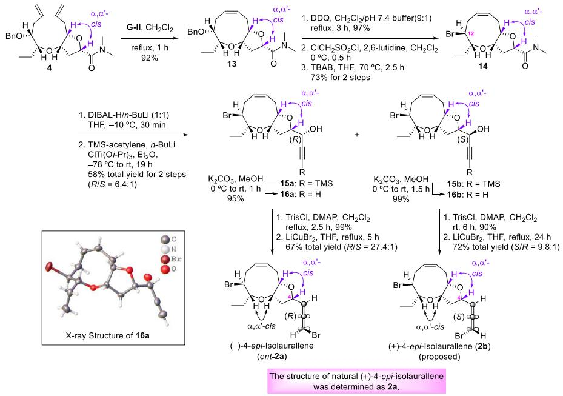

With propargylic alcohols 16a and 16b in hand, we proceeded to complete the total synthesis of ent-2a and 2b, respectively. Thus, trisylation of propargylic alcohols 16a and 16b gave the corresponding trisylates (99% and 90% yields, respectively), which were subjected to a Cu-mediated $a n t i - S _ { \mathrm { N } } 2 ^ { \prime }$ bromination by exposure to $\operatorname { L i C u B r } _ { 2 }$ to deliver ent-2a and 2b [67% (27.4:1 R:S) and 72% (9.8:1 S:R) total yields, respectively]. The 1H and $^ { 1 3 } \mathrm { C }$ NMR spectra of our synthetic material 2b difered from those of natural (+)-4-epiisolaurallene. Conversely, the spectral characteristics and optical rotation of ent-2a were in good agreement with those reported for the natural product with the exception of the sign for the optical rotation, thereby confirming the structure of natural (+)-4-epi-isolaurallene as 2a $( [ \alpha ] _ { \mathrm { D } } ^ { \ 2 5 } \ - 3 6 . 4$ (c 0.87, $\mathrm { C H C l } _ { 3 } ) _ { 4 }$ ; natural form lit.5 $\big [ \alpha \big ] _ { \mathrm { D } } { } ^ { 2 5 }$ +56.1 (c 0.46, CHCl )).

In conclusion, we accomplished the highly stereoselective construction of α,α′-trans-THF 3 and α,α′-cis-THF 4 from a common cyclization substrate 5 using a highly stereodivergent IAEA reaction in a non-chelate-controlled and chelatecontrolled manner, respectively. Our non-chelate-controlled IAEA protocol markedly improved upon the moderate stereoselectivity previously observed in the construction of the $\alpha , \alpha ^ { \prime } .$ -trans-THF ring via INAA (trans only via IAEA vs 5.8:1 trans:cis via INAA). By applying this methodology, the formal total synthesis of (−)-isolaurallene (1) was achieved and the structure of (+)-4-epi-isolaurallene (2) was confirmed unambiguously to be 2a via the total synthesis of its enantiomer (ent-2a). Furthermore, our stereodivergent IAEA protocol could be applicable to stereoselective syntheses of $2 , 5 \mathrm { - }$ cis- and 2,5-trans-3-hydroxy tetrahydrofuranoid natural products, in particular, dioxabicyclic bromoallene Laurencia marine natural products with a 2,10-dioxabicyclo[7.3.0]dodecane.

## ■ ASSOCIATED CONTENT

## Data Availability Statement

The data underlying this study are available in the published article and its Supporting Information.

## \*sı Supporting Information

The Supporting Information is available free of charge at https://pubs.acs.org/doi/10.1021/acs.orglett.5c00480.

Experimental procedures, characterization data, and copies of NMR spectra (PDF)

## Accession Codes

Deposition Number 2395537 contains the supplementary crystallographic data for this paper. These data can be obtained free of charge via the joint Cambridge Crystallographic Data Centre (CCDC) and Fachinformationszentrum Karlsruhe Access Structures service.

## ■ AUTHOR INFORMATION

## Corresponding Authors

Dongjoo Lee − College of Pharmacy and Research Institute of Pharmaceutical Science and Technology (RIPST), Ajou University, Suwon 16499, Korea; orcid.org/0000-0002- 6337-2229; Email: dongjoo@ajou.ac.kr

Hyoungsu Kim − College of Pharmacy and Research Institute of Pharmaceutical Science and Technology (RIPST), Ajou University, Suwon 16499, Korea; orcid.org/0000-0002- 2774-8727; Email: hkimajou@ajou.ac.kr

## Authors

Youngjik Park − College of Pharmacy and Research Institute of Pharmaceutical Science and Technology (RIPST), Ajou University, Suwon 16499, Korea; orcid.org/0000-0002- 7051-5419

Hongjun Jang − College of Pharmacy and Research Institute of Pharmaceutical Science and Technology (RIPST), Ajou University, Suwon 16499, Korea; orcid.org/0000-0003- 2996-9870

Soo Yeon Kwak − College of Pharmacy and Research Institute of Pharmaceutical Science and Technology (RIPST), Ajou University, Suwon 16499, Korea; orcid.org/0000-0003- 4518-6550

Seongju Lim − College of Pharmacy and Research Institute of Pharmaceutical Science and Technology (RIPST), Ajou University, Suwon 16499, Korea; orcid.org/0009-0001- 2482-5520

Deukjoon Kim − College of Pharmacy, Seoul National University, Seoul 08826, Korea; orcid.org/0000-0003- 4079-8734

Complete contact information is available at: https://pubs.acs.org/10.1021/acs.orglett.5c00480

## Author Contributions

∇Y.P. and H.J. contributed equally to this work. Notes

The authors declare no competing financial interest.

## ■ ACKNOWLEDGMENTS

This work was supported by a National Research Foundation of Korea (NRF) grant funded by the Korean government (MSIT) (IRIS-RS-2024-00346748) and the Ajou University research fund.

## ■ REFERENCES

(1) (a) Wang, B.-G.; Gloer, J. B.; Ji, N.-Y.; Zhao, J.-C. Halogenated organic molecules of Rhodomelaceae origin: chemistry and biology. Chem. Rev. 2013, 113, 3632−3685. (b) Wanke, T.; Philippus, A. C.; Zatelli, G. A.; Vieira, L. F. O.; Lhullier, C.; Falkenberg, M. C Acetogenins from the Laurencia Complex: 50 Years of Research-An Overview. Rev. Bras. Farmacogn. 2015, 25, 569−587. (c) Harizani, M.; Ioannou, E.; Roussis, V. The Laurencia Paradox: An Endless Source of Chemodiversity. In Progress in the Chemistry of Organic Natural Products, Vol. 102; Kinghorn, A. D., Galk, H., Gibbons, S., Kobayashi, J., Eds.; Springer: Berlin, 2016; pp 91−252. (d) Yamagishi, Y.; Kamada, T.; Ishii, T.; Matsuura, H.; Kikuchi, N.; Abe, T.; Suzuki, M. Morphological and Chemical Diversity within Japanese Laurencia Complex (Rhodomelaceae, Ceramiales, Rhodophyta). Chem. Biodiversity 2024, 21, No. e202400833.

(2) Kurata, K.; Furusaki, A.; Suehiro, K.; Katayama, C.; Suzuki, T. Isolaurallene, a New Nonterpenoid C -Bromoallene, from the Red Alga Laurencia nipponica Yamada. Chem. Lett. 1982, 11, 1031−1034.

(3) (a) Crimmins, M. T.; Emmitte, K. A. J. Asymmetric Total Synthesis of (−)-Isolaurallene. J. Am. Chem. Soc. 2001, 123, 1533− 1534. (b) Crimmins, M. T.; Emmitte, K. A.; Choy, A. L. Ring closing metathesis for the formation of medium ring ethers: the total synthesis of (−)-isolaurallene. Tetrahedron 2002, 58, 1817−1834.

(4) (a) Kim, M. J.; Sohn, T.-i.; Kim, D.; Paton, R. S. Concise Substrate-Controlled Asymmetric Total Syntheses of Dioxabicyclic Marine Natural Products with 2,10-Dioxabicyclo[7.3.0]dodecane and 2,9-Dioxabicyclo[6.3.0]undecane Skeletons. J. Am. Chem. Soc. 2012, 134, 20178−20188. For reviews of intramolecular enolate alkylations, see: (b) Kim, D. Intramolecular Enolate Alkylation: From Steroids through Cladiellins to Isolaurallene. Synlett 2013, 25, 33−57.

(5) Phan, C.-S.; Kamada, T.; Vairappan, C. S. Two new epimers of C -acetogenin, 4-epi-isolaurallene and 4-epi-itomanallene A as diastereomeric model. Nat. Prod. Res. 2020, 34, 1008−1013.

(6) Lowe, G. J. The Absolute Configuration of Allenes. Chem. Commun. 1965, 411−413.

(7) (a) Shin, I.; Jang, H.; Kwak, S. Y.; Park, Y.; Lee, D.; Kim, H.; Kim, D. Highly Stereodivergent Construction of C -Symmetric cis,cisand trans,trans-2,6-dioxabicyclo[3.3.0]octane Framework by Double Intramolecular Amide Enolate Alkylation: Total Synthesis of (+)-Laurenidificin and (+)-Aplysiallene. Org. Lett. 2022, 24, 8780−

8785. For our stereodivergent construction of α,α′-trans- and α,α′- cis-THFs by protecting group-dependent intramolecular amide enolate alkylation, see: (b) Jang, H.; Shin, I.; Lee, D.; Kim, H.; Kim, D. Stereoselective Substrate-Controlled Asymmetric Syntheses of both 2,5-cis- and 2,5-trans-Tetrahydrofuranoid Oxylipids: Stereodivergent Intramolecular Amide Enolate Alkylation. Angew. Chem., Int. Ed. 2016, 55, 6497−6501. (c) Shin, I.; Lee, D.; Kim, H. Substrate-Controlled Asymmetric Total Synthesis and Structure Revision of (−)-Bisezakyne A. Org. Lett. 2016, 18, 4420−4423. (d) Kwak, S. Y.; Shin, I.; Jang, H.; Park, Y.; Lim, S.; Lee, D.; Kim, H.; Kim, D. Stereoselective total synthesis of (3Z)- and (3E)-elatenynes. RSC Adv. 2023, 13, 35920−35925.

(8) Oikawa, Y.; Yoshioka, T.; Yonemitsu, O. Specific removal of omethoxybenzyl protection by DDQoxidation. Tetrahedron Lett. 1982, 23, 885−888.

(9) (a) Shimizu, T.; Hiranuma, S.; Nakata, T. Efficient Method for Inversion of Secondary Alcohols by Reaction of Chloromethanesulfonates with Cesium Acetate. Tetrahedron Lett. 1996, 37, 6145−6148.

(b) Dyson, B. S.; Burton, J. W.; Sohn, T.; Kim, B.; Bae, H.; Kim, D. Total Synthesis and Structure Confirmation of Elatenyne: Success of Computational Methods for NMR Prediction with Highly Flexible Diastereomers. J. Am. Chem. Soc. 2012, 134, 11781−11790.

(10) Kim, S.; Ahn, K. H. Ate complex from diisobutylaluminum hydride and n-butyllithium as a powerful and selective reducing agent for the reduction of selected organic compounds containing various functional groups. J. Org. Chem. 1984, 49, 1717−1724.

(11) Grese, T. A.; Hutchinson, K. D.; Overman, L. E. General Approach to Halogenated Tetrahydrofuran Natural Products from Red Algae of the Genus Laurencia. Total Synthesis of (±)-Kumausallene and (±)-1-epi-Kumausallene. J. Org. Chem. 1993, 58, 2468− 2477.

(12) (R)-TMS-propargylic alcohol 15a could be converted into (S)- propargylic alcohol 16b by a two-step sequence: Mitsunobu inversion (58%) and saponification/desilylation (94%). See the Supporting Information for details.

(13) Application of the direct ketone synthesis protocol to α-alkoxy amide 14 with lithium TIPS-acetylide in the presence of BF ·OEt (THF, −78 °C to rt, 2.5 h, 78%) followed by L-Selectride reduction (THF, −78 °C, 1.5 h) of the corresponding TIPS-ynone aforded (R)-TIPS-propargylic alcohol as the major isomer (73% total yield, 3:1 R:S determined by 1H NMR analysis) predicted by an anti-Felkin−Ahn selectivity (see the Supporting Information for details).