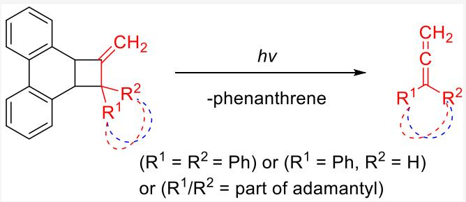
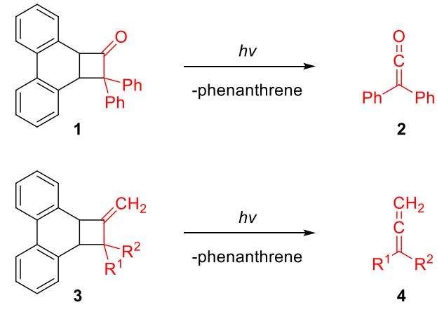
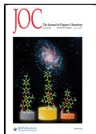
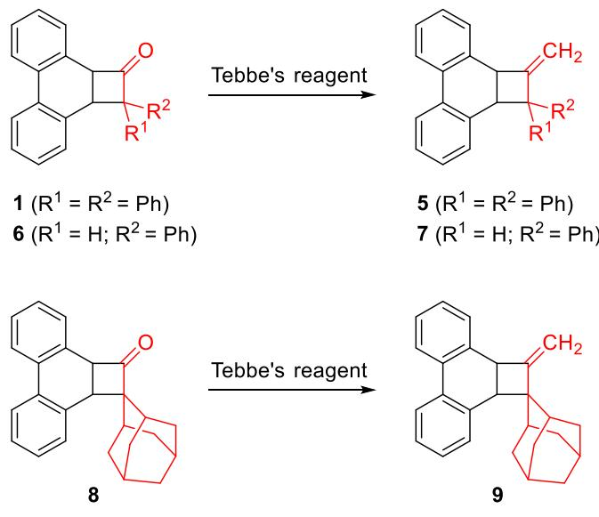
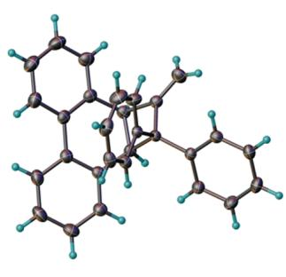
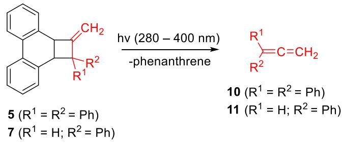
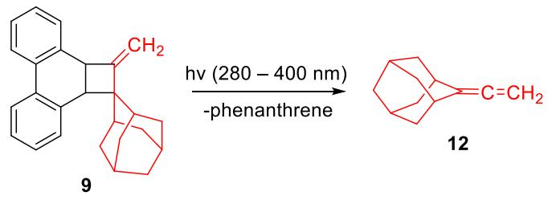
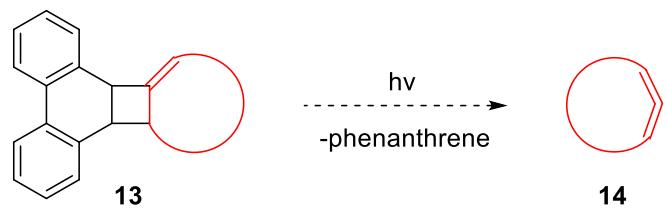
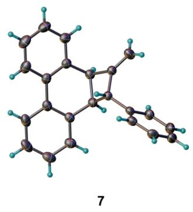
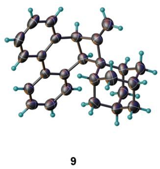

pubs.acs.org/joc

# Photochemical Generation of Allenes from Phenanthrene-Based Methylenecyclobutanes

Published as part of The Journal of Organic Chemistry special issue “Physical Organic Chemistry: Never Out of Style”.

Zhazira Koldasbay, Alexander D. Roth, and Dasan M. Thamattoor\*

Cite This: J. Org. Chem. 2025, 90, 8429−8433

## ACCESS

Metrics & More

ABSTRACT: Photofragmentation of substituted 1-methylene-1,2,2a,10b-tetrahydrocyclobuta[l]phenanthrenes, under ambient conditions in solution, produces the corresponding allenes with the concomitant formation of phenanthrene. These phenanthrenebased precursors ofer a new and general photochemical route to allenes including, potentially, strained cyclic allenes.

Allenes, characterized by their linear arrangement of two orthogonal π bonds connected via a common sphybridized central carbon atom, represent an important class of compounds in organic chemistry.1,2 Their unique structure and reactivity, and an architecture that is capable of conferring axial chirality, make them valuable synthons for the construction of chiral molecules,3 complex natural products,4,5 and advanced functional materials like shape-persistent macrocycles, foldamers, and chiral chromophores.6 It is estimated that there are over 150 natural products and pharmaceuticals that feature the allene moiety.7 Consequently, the development of eficient and versatile methods for synthesizing allenes is of considerable interest to the broader chemistry community.

Although several synthetic routes to allenes have been developed over the years,1,8−15 metal-free photochemical methods are sparse and limited to a few isolated examples.1,16 In this regard, it is of relevance to note a study by Tippmann and Curtis who reported that cyclobutanone 1 undergoes photofragmentation into phenanthrene and diphenylketene (2) upon laser flash photolysis at 266 nm (Scheme 1a).17 Our laboratory has recently disclosed that the steady state photolysis of 1 and related cyclobutanones, using a Xe(Hg) lamp, can be a viable and generally applicable photochemical approach to ketenes.18 Building on our previous work, we herein describe the conversion of 1 and two related cyclobutanones into the corresponding methylenecyclobutanes 3, and their subsequent photolysis to give allenes 4 by an analogous fragmentation ofthe four-membered ring (Scheme 1b). This approach holds promise as a broadly applicable photochemical route to a variety of acyclic allenes and could potentially be deployed to prepare strained cyclic allenes as well.

Article Recommendations

## \*sı Supporting Information

## Scheme 1. Photochemical Generation of (a) Ketene and (b) Allene from Phenanthrene-Based Cyclobutanes

(a)  
  
(b)

## ■ SYNTHESIS OF PHENANTHRENE-BASEDMETHYLENECYCLOBUTANE PRECURSORS TOALLENES

The cyclobutanones 1, 6, and 8, all of which were synthesized by our recently published procedures,18 were converted in a single

Received: April 1, 2025   
Revised: May 25, 2025   
Accepted: May 30, 2025   
Published: June 9, 2025

step to the corresponding allene precursors $s , \ 7 ,$ and 9 respectively by use of the Tebbe reagent (Scheme 2). The crystal structures of 5, 7, and 9 are shown in Figure 1.

Scheme 2. Synthesis of5, 7, and 9, Photochemical Precursors to Allenes by Tebbe Olefination

## ■ PHOTOCHEMICAL EXPERIMENTS

Precursors 5, 7, and 9 were dissolved in $\mathrm { C } _ { 6 } \mathrm { D } _ { 6 }$ and photolyzed at ambient temperature with a Xe−Hg lamp at 280−400 nm in a quartz NMR tube. The progress ofthe photolysis was monitored by 1H NMR spectroscopy. Photolysis was complete within an hour and the corresponding allenes 10, 11, and 12 were formed in yields of 56, 74, and 80% respectively as measured using mxylene as an internal standard (Scheme 3). The identities of the allenes were confirmed by comparison to authentic samples that were synthesized independently.

In conclusion, we report herein a new photochemical route to the generation of allenes from the fragmentation of phenanthrene-based methylenecyclobutanes. As a further extension of this method, one could envision the generation of chiral allenes from appropriately substituted precursors. In addition, precursors such as 13 could potentially serve as sources to strained cyclic allenes 14 (Scheme 4). Availability of precursors such as those described herein will also permit the investigation of allenes by methods such as laser flash photolysis and matrix isolation spectroscopy. Research along these lines is currently underway in our laboratory.

Scheme 3. Photochemical Generation of Allenes 10, 11, and 12 from Precursors 5, 7, and 9, Respectively

Scheme 4. Potential Formation of Cyclic Allenes from Phenanthrene-Based Precursors  

## ■ EXPERIMENTAL SECTION

General Information. Tetrahydrofuran was degassed by purging with nitrogen and dried by passage through two activated alumina columns (2 ft × 4 in). All other solvents and reagents were used as obtained from commercial sources. Synthetic reactions were carried out under an argon atmosphere in oven-dried glassware. Cyclobutanones $^ { 1 , }$ $\mathbf { 6 , }$ and 8 were prepared according to literature procedures.18 Literature procedures were also used to synthesize authentic samples of diphenylallene (10),19 phenylallene (11),20,21 and adamantylideneallene (12).22,23

Medium pressure flash chromatography was performed on an automated system on prepacked silica gel columns (70−230 mesh) using hexanes as eluent. NMR spectra were recorded at 500 MHz for proton (1H) and 126 MHz for proton-decoupled carbon $^ { 1 3 } \mathrm { C } \{ ^ { 1 } \mathrm { H } \}$ using CDCl . The chemical shifts are reported in δ ppm with reference to the signal oftetramethylsilane set to 0 ppm. Infrared spectra (resolution 0.4 cm−1) were acquired with an Fourier transform infrared (FTIR) instrument equipped with an attenuated total reflectance (ATR)

  
Figure 1. Single-crystal X-ray structures of 5, 7, and 9. Thermal ellipsoids are shown at the 50% probability level.

accessory and were processed with $\mathrm { S p e c t r a G r y p h . } ^ { 2 4 }$ Gas chromatography−mass spectrometry (GC/MS) data were obtained with a capillary gas chromatograph interfaced with a quadrupole, triple-axis mass selective detector operating in the electron impact (EI) mode. High resolution mass spectra were obtained by electrospray ionization (ESI) on a time-of-flight mass spectrometer (TOF-MS). Melting points are uncorrected. UV/vis absorption spectra were recorded at room temperature on an Agilent Cary 60 UV/vis spectrophotometer (200− 800 nm scan range with automated baseline correction) in a 1 cm quartz cuvette in acetonitrile.

Photolysis experiments were conducted with a Newport 200 W Xe(Hg) arc lamp (model # 6290; horizontal intensity 600 cd) with a Newport 280−400 dichroic mirror (model # 66245) fitted in a Newport 67005 Housing with a Newport 69907 Universal Arc Lamp Power Supply. All photolysis reactions were conducted at ambient temperature in benzene-d6 in 5 mm quartz NMR tubes positioned 30 cm away from the light source.

A Bruker D8 Quest Eco difractometer equipped with a graphite monochromated Mo Kα radiation $\left( \lambda = 0 . 7 1 0 \bar { 7 } 3 \bar { \mathrm { \AA } } \right)$ and PHOTON 50 CMOS (complementary metal-oxide semiconductor) detector was used to collect X-ray difraction data at 173 K with the Bruker Apex 4 suite of programs.25 F rames were integrated with a narrow-frame algorithm using the Bruker data reduction software package $\mathrm { S A I N T } ^ { 2 6 }$ and absorption efects were corrected with the multiscan method $( \mathrm { S A D A B S } ) . ^ { 2 7 }$ The Olex2 suite of programs28 was used to process data along with the Bruker SHELXTL software package29,30 that was used to perform structure solution by direct methods, and refinement by fullmatrix least-squares on $\mathrm { F } ^ { 2 } .$ All nonhydrogen atoms were refined anisotropically with suggested weighting factors and the hydrogens were calculated on a riding model. All cif files were validated with the checkCIF/Platon facility of IUCr that was implemented through Olex2.28 Crystals suitable for $_ { \mathrm { X - r a y } }$ difraction were grown by slow difusion of pentane into a solution of the compound in dichloromethane.

2-Methylene-1,1-diphenyl-1,2,2a,10b-tetrahydrocyclobuta[l]- phenanthrene (5). To a solution of 1 (200 mg, 0.537 mmol) in THF (15.0 mL) was added Tebbe’s reagent (2.16 mL, 0.500 M in toluene, 1.08 mmol). After stirring at room temperature for 2 h, the reaction was then quenched with aqueous solution of NaOH (10.8 mL, 0.100 M), the aqueous layer was extracted with $\mathrm { C H } _ { 2 } \mathrm { C l } _ { 2 } \left( 3 \times 1 0 . 0 ~ \mathrm { m L } \right) ,$ and the organic layer was then washed with $\mathrm { H } _ { 2 } \mathrm { O } \left( 2 \times 1 0 . 0 \mathrm { m L } \right)$ , brine $( 3 \times 1 0 . 0 $ mL), and the solid obtained after rotary evaporation was isolated as a white crystalline solid using flash-column chromatography with hexanes as eluent. The final yield was 136 mg (69%); mp: $\mathrm { i } 1 0 . 8 \mathrm { - } 1 1 3 . 1 ^ { \circ } \mathrm { C } .$ 1H NMR (500 MHz, CDCl ) δ 7.70 (dd, J = 8.1, 1.2 Hz, 1H), 7.64 (dd, J = 7.8, 1.3 Hz, 1H), 7.58−7.53 (m, 2H), 7.45−7.39 (m, 2H), 7.33 (d, J = 1.4 Hz, 2H), 7.25−7.17 (m, 2H), 7.12 (td,J = 7.6, 1.5 Hz, 1H), 6.97 (td, J = 7.4, 1.2 Hz, 1H), 6.86 (ddd, J = 7.8, 6.3, 1.7 Hz, 2H), 6.81−6.75 (m, 2H), 6.63−6.57 (m, 2H), 5.31 (dd, J = 2.1, 1.0 Hz, 1H), 5.07 (dd, J = 2.6, 0.9 Hz, 1H), 4.85 (d, J = 9.8 Hz, 1H), 4.41 $\left( \mathrm { d t } , J = 9 . 8 , 2 . 4 \mathrm { H z } , \right.$ 1H). 13C{1H} NMR (126 MHz, CDCl ) δ 159.1, 145.8, 141.4, 133.2, 132.9, 131.9, 130.9, 129.6, 128.6, 128.3, 127.9, 127.8, 127.2, 126.9, 126.9, 126.5, 126.4, 125.6, 122.9, 122.8, 108.7, 45.3, 42.5. FTIR: ν=3055, 2918, 2851, 1671, 1596, 1489, 1444 $\mathrm { c m } ^ { - 1 }$ . HRMS (ESI-TOF) m/z [M]+ calcd. for $\mathrm { C } _ { 2 9 } \mathrm { H } _ { 2 2 } 3 7 0 . 1 7 2 2$ , found 370.1709. UV/vis (acetonitrile, $c = 3 . 0 0 \times 1 0 ^ { - 5 } \mathrm { M } ,$ 1 cm path length): $\lambda _ { \operatorname* { m a x } } = 2 7 5$ nm $\left( \varepsilon = 8 . 8 0 \times 1 0 ^ { 3 } \mathrm { L } \right.$ $\mathrm { m o l ^ { - 1 } c m ^ { - 1 } } )$

Methylene-2-phenyl-1,2,2a,10b-tetrahydrocyclobuta[l]- phenanthrene (7). To a stirred solution of compound 6 (50.0 mg, 0.169 mmol) in THF (10.0 mL) under argon was added Tebbe’s reagent (0.680 mL, 0.500 M in toluene, 0.340 mmol). The mixture was stirred at room temperature for 2 h, then quenched with aqueous solution of NaOH (3.40 mL, 0.100 M). The aqueous phase was extracted with CH Cl (3 × 10.0 mL), the combined organic layers were washed with brine (10.0 mL), dried over Na ${ } _ { \Sigma \mathrm { O } _ { 4 } , }$ filtered, and concentrated under reduced pressure. Purification by silica-gel flash chromatography (hexanes) aforded the target product as a white crystalline solid (16.0 mg, 32%); mp: $8 7 - 9 1 \ { } ^ { \circ } \mathrm { C } .$ 1H NMR (500 MHz, CDCl ) δ: 7.97−7.91 (m, 2H), 7.39−7.26 (m, 9H), 7.17 (td, J = 7.4, 1.2 Hz, 1H), 7.00−6.96 (m, 1H), 5.23 (ddd, J = 2.6, 1.8, 0.7 Hz, 1H), 4.80 (td, J = 2.4, 0.7 Hz, 1H), 4.42 (dd, J = 9.3, 2.5 Hz, 1H), 4.22 $\left( \mathrm { d } \mathbf { q } , J = 8 . 2 , \right.$ 2.8 Hz, 1H), 3.82−3.75 (m, 1H). 13C{1H} NMR (126 MHz, CDCl3) δ: 155.7, 140.7, 135.4, 135.0, 131.4, 131.3, 129.4, 128.7, 128.6, 128.1, 127.9, 127.7, 127.3, 127.1, 126.7, 123.4, 123.2, 105.7, 58.8, 43.3, 42.9. FTIR (ATR): 3056, 3024, 2925, 2865, 1673, 1600, 1485, 1448, 1401 $\mathrm { c m } ^ { - 1 }$ . HRMS (ESI-TOF) m/z [M]+ calcd. for ${ \mathrm { C } } _ { 2 3 } { \mathrm { H } } _ { 1 8 }$ 294.1409, found 294.1426. UV/vis (acetonitrile, $c = 3 . 5 0 \times 1 0 ^ { - 5 } \mathrm { M } ,$ 1 cm path length): $\lambda _ { \mathrm { m a x } } = 2 7 5 \mathrm { n m } \left( \varepsilon = 8 . 5 7 \times 1 0 ^ { 3 } \mathrm { L } \mathrm { m o l } ^ { - 1 } \mathrm { c m } ^ { - 1 } \right)$

2′-Methylene-2a′,10b′-dihydro-2′H-spiro[adamantane- $- 2 , 1 ^ { \prime } -$ cyclobuta[l]phenanthrene] (9). To a stirred solution of compound 8 (200 mg, 0.588 mmol) in THF (25.0 mL) under argon was added Tebbe’s reagent (2.30 mL, 0.500 M in toluene, 1.15 mmol), where it was allowed to stir for 1.5 h at room temperature. The reaction was quenched by addition of 0.100 M NaOH (12.0 mL), the aqueous layer was extracted with $\mathrm { C H } _ { 2 } \mathrm { C l } _ { 2 } \left( 3 \times 2 0 . 0 \ \mathrm { m L } \right)$ and the organic layer was washed with brine $\left( 1 \times 2 0 . 0 \mathrm { m L } \right)$ and dried with $\mathrm { N a } _ { 2 } S \mathrm { O } _ { 4 } .$ Compound 9 was purified and isolated using silica-gel flash column chromatography (hexanes) as a white crystalline solid (80.0 mg, 40%); mp: $9 0 { - } 9 3 \ ^ { \circ } \mathrm { C } .$ 1H NMR (500 MHz, CDCl ) δ: 7.87−7.76 (m, 2H), 7.38 (dd, J = 7.7, 1.5 Hz, 1H), 7.35−7.26 (m, 2H), 7.24−7.17 (m, 3H), 5.23 (d, J = 1.7 Hz, 1H), 5.22 (d,J = 2.1 Hz, 1H), 4.19 (dd,J = 9.4, 2.3 Hz, 1H), 3.62 (d, J = 9.5 Hz, 1H), 2.28−2.18 (m, 2H), 2.12−2.04 (m, 1H), 1.86 (dp, J = 12.8, 2.8 Hz, 1H), 1.75 (p, J = 3.1 Hz, 1H), 1.68−1.58 (m, 5H), 1.53 (dt, J = 3.7, 1.8 Hz, 1H), 1.28 $\left( \mathrm { d } \mathbf { q } , J = 1 2 . 9 , 2 . 9 \mathrm { H z } \right.$ , 1H), 1.14 (dp, J = 12.8, 2.8 Hz, 1H), 1.06 (dq, J = 12.8, 2.6 Hz, 1H). 13C{1H} NMR (126 MHz, CDCl ) δ: 162.2, 137.3, 134.2, 133.4, 132.3, 131.7, 128.6, 127.9, 127.4, 127.2, 126.5, 123.6, 122.5, 107.1, 62.9, 47.1, 41.4, 40.6, 38.3, 34.8, 33.8, 33.7, 33.5, 33.1, 27.3, 27.1. FTIR: ν 2889, 2848, 1650, 1447 cm−1. HRMS (ESI-TOF) m/z [M]+ calcd. for $\mathrm { C } _ { 2 6 } \mathrm { H } _ { 2 6 }$ 338.2035, found 338.2017. UV/vis (acetonitrile, $c = 3 . 5 0 \times 1 0 ^ { - 5 }$ M, 1 cm path length): $\lambda _ { \operatorname* { m a x } } = 2 2 0$ nm $\left( \varepsilon = 2 . 5 8 \times 1 0 ^ { 4 } \mathrm { L } \mathrm { m o l } ^ { - 1 } \mathrm { c m } ^ { - 1 } \right)$ , 275 nm $\left( \varepsilon = 9 . 7 4 \times \mathrm { \bar { 1 0 } } ^ { 3 } \mathrm { L } \right.$ $\mathrm { m o l ^ { - 1 } c m ^ { - 1 } } )$

Photolysis of 5. Precursor 5 (8.3 mg, 0.03 mmol) was dissolved in 0.75 mL of $\mathrm { C } _ { 6 } \mathrm { D } _ { 6 }$ in a quartz NMR tube, and m-xylene (5 μL, 4.3 mg, 0.04 mmol) was added as an internal standard. Progress of the photolysis was monitored every 15 min by 1H NMR until 5 had fully reacted (1 h). The yields of diphenylallene (10) and phenanthrene in the photolysate were determined to be 57% and 74% respectively. The identity of 10 was further confirmed by comparison to an authentic sample synthesized independently.19 Subsequently, the photolysate was analyzed by GC-MS, and the retention time and fragmentation pattern of the product 10 was found to be identical to that of the authentic sample. Attempts to isolate product 10 from precursor 5 using silica-gel flash column chromatography with hexanes as eluent were unsuccessful, as the compounds coeluted.

Photolysis of 7. Precursor 7 (3.8 mg, 0.013 mmol) was dissolved in 0.75 mL of $\mathrm { C } _ { 6 } \mathrm { D } _ { 6 }$ in a quartz NMR tube, and m-xylene (2.5 μL, 2.2 mg, 0.020 mmol) was added as an internal standard. Progress of the photolysis was monitored every 15 min by 1H NMR until 7 had fully reacted (45 min). The yields of phenylallene (11) and phenanthrene in the photolysate were determined to be 74% and 95% respectively. The identity of 11 was further confirmed by comparison to an authentic sample synthesized independently.20,21 Subsequently, the photolysate was analyzed by GC-MS, and the retention time and fragmentation pattern of the product 11 was found to be identical to that of the authentic sample. Allene 11 was isolated from the photolysis of20 mg of precursor 7 (0.068 mmol) using silica-gel flash column chromatography with hexanes as eluent, afording 11 (2.3 mg, 29%) and phenanthrene (5.6 mg, 46%).

Photolysis of 9. Precursor 9 (3.4 mg, 0.01 mmol) was dissolved in 0.75 mL of $\mathrm { C } _ { 6 } \mathrm { D } _ { 6 }$ in a quartz NMR tube, and m-xylene (5 μL, 4.3 mg, 0.04 mmol) was added as an internal standard. Progress of the photolysis was monitored every 15 min by 1H NMR until 9 had fully reacted (45 min). The yields of adamantylideneallene (12) and phenanthrene in the photolysate were determined to be 80% and 96% respectively. The identity of 12 was further confirmed by comparison to an authentic sample synthesized independently.22,23 Subsequently, the photolysate was analyzed by GC-MS, and the retention time and fragmentation pattern of the product 12 was found to be identical to that of the authentic sample. After flash chromatography (silica gel/ hexanes), allene 12 was isolated from the photolysis of 50 mg of precursor 9 (0.148 mmol), afording adamantylideneallene (5 mg, 21%) and phenanthrene (22 mg, 84%).

## ■ ASSOCIATED CONTENT

## Data Availability Statement

The data underlying this study are available in the published article and its Supporting Information.

## \*sı Supporting Information

The Supporting Information is available free of charge at https://pubs.acs.org/doi/10.1021/acs.joc.5c00781.

Experimental procedures and spectral data (PDF)

## Accession Codes

Deposition Numbers 2305847, 2328907, and 2430114 contain the supplementary crystallographic data for this paper. These data can be obtained free of charge via the joint Cambridge Crystallographic Data Centre (CCDC) and Fachinformationszentrum Karlsruhe Access Structures service.

## ■ AUTHOR INFORMATION

## Corresponding Author

Dasan M. Thamattoor − Department of Chemistry, Colby College, Waterville, Maine 04901, United States; orcid.org/0000-0002-6619-4392; Email: dmthamat@ colby.edu

## Authors

Zhazira Koldasbay − Department of Chemistry, Colby College, Waterville, Maine 04901, United States; orcid.org/0009- 0009-8844-1751

Alexander D. Roth − Department of Chemistry, Colby College, Waterville, Maine 04901, United States; orcid.org/0009- 0005-0738-8524

Complete contact information is available at:

https://pubs.acs.org/10.1021/acs.joc.5c00781

## Author Contributions

Z.K. and A.D.R. synthesized the precursors, acquired and solved X-ray difraction data, performed photolysis experiments, and assisted with the writing of the initial manuscript draft and Supporting Information. D.M.T. designed and supervised the projects, produced the final drafts of the manuscript and Supporting Information, and secured funding for the work. All authors have given approval to the final version of the manuscript.

## Notes

The authors declare no competing financial interest.

## ■ ACKNOWLEDGMENTS

We thank the National Science Foundation for supporting this work through grant number CHE-2400007. We are also grateful to Drs. Ashley Schmidt and Michael Ruf of Bruker AXS, Inc. for assistance with the crystal structure of 9.

## ■ REFERENCES

(1) Modern Allene Chemistry; Krause, N.; Hashmi, A. S. K., Eds.; Wiley-VCH: Weinheim, 2004; Vol. 1, p 592.

(2) Modern Allene Chemistry; Krause, N.; Hashmi, A. S. K., Eds.; Wiley-VCH: Weinheim, 2004; Vol. 2, p 548.

(3) Ma, S. Some Typical Advances in the Synthetic Applications of Allenes. Chem. Rev. 2005, 105 (7), 2829−2872.

(4) Gu, C.-C.; Long, X.-E.; Chen, X.; Liu, J.; Li, C.-C. Recent Natural Product Total Syntheses Involving Cycloadditions of Allenes. Chin. J. Chem. 2025, 43 (9), 1059−1077.

(5) Yu, S.; Ma, S. Allenes in Catalytic Asymmetric Synthesis and Natural Product Syntheses. Angew. Chem., Int. Ed. 2012, 51 (13), 3074−3112.

(6) Rivera-Fuentes, P.; Diederich, F. Allenes in Molecular Materials. Angew. Chem., Int. Ed. 2012, 51 (12), 2818−2828.

(7) Huang, X.; Ma, S. Allenation of Terminal Alkynes with Aldehydes and Ketones. Acc. Chem. Res. 2019, 52 (5), 1301−1312.

(8) Singh, J.; Saxena, B.; Sharma, A. Visible light promoted synthesis of allenes. Catal. Sci. Technol. 2024, 14 (18), 5143−5160.

(9) Li, S.; Yuan, K.; Zhang, G.; Guo, R. Recent Advances in the Synthesis of Chiral Allenes via Asymmetric 1,4-Difunctionalization of 1,3-Enynes. Eur. J. Org. Chem. 2024, 27 (30), No. e202301316.

(10) Liu, X.; Jiao, C.; Cui, S.; Liu, Q.; Zhang, X.; Zhang, G. Recent Advances in Nickel-Catalyzed Synthesis of Allenes: New Insights and Perspectives. ChemCatChem 2023, 15 (19), No. e202300601.

(11) On, I. K. W.; Zhu, Y. Modular assembly of highly functionalized allenes through radical allenylation of alkene. Chem. Catal. 2023, 3 (4), No. 100604.

(12) Li, Y.; Bao, H. Radical transformations for allene synthesis. Chem. Sci. 2022, 13 (29), 8491−8506.

(13) Neff, R. K.; Frantz, D. E. Recent Advances in the Catalytic Syntheses of Allenes: A Critical Assessment. ACS Catal. 2014, 4 (2), 519−528.

(14) Yu, S.; Ma, S. How easy are the syntheses of allenes? Chem. Commun. 2011, 47 (19), 5384−5418.

(15) Brummond, K. M.; DeForrest, J. E. Synthesizing allenes today (1982−2006). Synthesis 2007, 2007 (06), 795−818.

(16) Breda, S.; Reva, I.; Fausto, R. UV-Induced Unimolecular Photochemistry of Diketene Isolated in Cryogenic Inert Matrices. J. Phys. Chem. A 2012, 116 (9), 2131−2140.

(17) Tippmann, E. M.; Curtis, R. Synthesis and time resolved infrared analysis of photochemical oxiranyl carbene and diphenyl ketene precursors. Tetrahedron Lett. 2016, 57 (43), 4785−4787.

(18) Roth, A. D.; Koldasbay, Z.; Ford, B. H.; Kairbek, K.; Ahn, H.; Hardikar, T. S.; Lane, K. M.; Haynes, S. M.; Thamattoor, D. M. Photochemical generation of ketenes from phenanthrene-based cyclobutanones. Tetrahedron 2024, 168, No. 134344.

(19) Bera, M.; Tambe, S. D.; Hwang, H. S.; Kim, S.; Cho, E. J. Basefree NiH-catalyzed regio- and stereo-selective hydroacylation ofallenes: A new route to synthesis of tetra-substituted olefins. Chem. Catal. 2023, 3 (5), No. 100606.

(20) Matsubara, T.; Takahashi, K.; Ishihara, J.; Hatakeyama, S. Total Synthesis of (−)-Ophiodilactone A and (−)-Ophiodilactone B. Angew. Chem., Int. Ed. 2014, 53 (3), 757−760.

(21) Nagae, H.; Kundu, A.; Tsurugi, H.; Mashima, K. Propargylic C(sp3)−H Bond Activation for Preparing η3-Propargyl/Allenyl Complexes of Yttrium. Organometallics 2017, 36 (16), 3061−3067.

(22) Feng, Q.; Wang, Q.; Zhu, J. Oxidative rearrangement of 1,1- disubstituted alkenes to ketones. Science 2023, 379 (6639), 1363− 1368.

(23) Sasaki, T.; Eguchi, S.; Hirako, Y. Synthesis and some reactions of vinylideneadamantane. Tetrahedron Lett. 1976, 17 (7), 541−544.

(24) Spectragryph - Optical Spectroscopy Software 2020 http://www. efemm2.de/spectragryph/.

(25) Apex4; Bruker AXS, Inc.: Madison, Wisconsin, USA, 2022.

(26) SAINT; Bruker AXS, Inc.: Madison, Wisconsin, USA, 2022.

(27) Krause, L.; Herbst-Irmer, R.; Sheldrick, G. M.; Stalke, D. Comparison of silver and molybdenum microfocus X-ray sources for single-crystal structure determination. J. Appl. Crystallogr. 2015, 48 (1), 3−10.

(28) Dolomanov, O. V.; Bourhis, L. J.; Gildea, R. J.; Howard, J. A. K.; Puschmann, H. OLEX2: a complete structure solution, refinement and analysis program. J. Appl. Crystallogr. 2009, 42 (2), 339−341.

(29) Sheldrick, G. M. Crystal structure refinement with SHELXL. Acta Crystallogr., Sect. C:Struct. Chem. 2015, 71 (1), 3−8.

(30) Sheldrick, G. M. SHELXT - Integrated space-group and crystalstructure determination. Acta Crystallogr., Sect. A:Found. Adv. 2015, 71 (1), 3−8.