pubs.acs.org/jmc

Article

# Synthesis and Biological Evaluation of Nipecotic Acid Derivatives with Terminally Double-Substituted Allenic Spacers as mGAT4 Inhibitors

Maren Jung, Kinga Sałat, Georg Höfner, Jörg Pabel, Elzbieta ̇ Wyska, Marek Sierzę̇ ga, Anna Furgała-Wojas, Christoph G. W. Gertzen, Holger Gohlke, and Klaus T. Wanner\*

Cite This: J. Med. Chem. 2025, 68, 19984−20010

Read Online

ACCESS

Metrics & More

ABSTRACT: Within a series of nipecotic acid derivatives with a four- and five-carbon atom allenic spacer, respectively, connecting the nitrogen of nipecotic acid with up to two aromatic residues, a highly potent mGAT4 inhibitor has been identified. Its (S)- enantiomer, (S)-1-[4,4-bis(4-chlorophenyl)buta-2,3-dien-1-yl]- piperidine-3-carboxylic acid [(S)-8d, DDPM-3960], displays potencies in the higher nanomolar range at mGAT4 (pIC50 = 6.59 ± 0.01) and its human equivalent hGAT-3 $( \mathrm { p I C } _ { 5 0 } = 6 . 4 9 \pm$ 0.10). It is thus significantly more potent than the well-known mGAT4 inhibitor (S)-SNAP-5114. Molecular docking rationalizes the enantioselectivity of the inhibitory potency. DDPM-3960 is highly bound to serum proteins (>99%), has good brain penetration and stability. It revealed significant anticonvulsant

Article Recommendations

\*sı Supporting Information

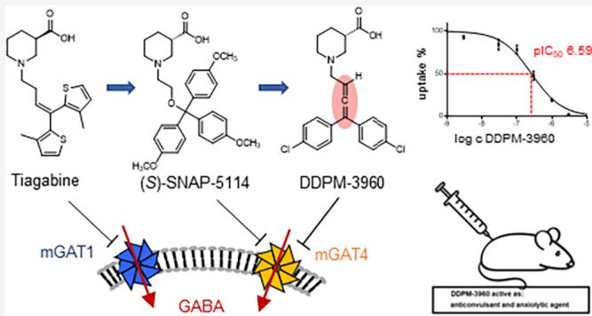

activity in several mouse models of chemically- and electrically induced seizures. Additionally, anxiolytic-like properties of DDPM-3960 were found. These beneficial biological efects observed in mice were accompanied by sedation but not motor impairments, making DDPM-3960 an interesting lead structure for further development.

## ■ INTRODUCTION

γ-Aminobutyric acid (GABA) (1, Figure 1), the major inhibitory neurotransmitter in the mammalian central nervous system (CNS), plays a central role in normal brain function. The uptake of GABA into neurons and glial cells mediated by GABA transporters (GATs) is an important part of the GABAergic system. Targeting the individual stages of GABA signaling to overcome a dysregulation of GABA neurotransmission has become a valuable strategy for the potential therapy of related diseases such as epilepsy, Parkinson’s disease, Huntington’s disease, schizophrenia, and Alzheimer’s disease.1 By inhibition of the enzymatic degradation of GABA, inhibition of the GABA transport proteins, or allosteric modulation of the GABA receptors, an increased GABAergic activity might be achieved.2−4 The antiepileptic drug vigabatrin, for instance, improves the GABA level by acting as a suicide inhibitor of GABA transaminase, an enzyme responsible for the metabolic degradation of GABA.5 The enhancement of GABA neurotransmission through allosteric modulation of GABA receptors can be achieved by the use ofbenzodiazepines, which are among the most commonly used GABAergic drugs today.5

GABA transporters (GATs) mediate the transport of synaptically released GABA from the extracellular to the intracellular side of glial and neuronal cells. Inhibition of these transporters leads to enhanced GABA signaling as a consequence of increased extracellular GABA levels. This has been shown to be efective in the treatment of seizures in epileptic disorders and is further considered a promising approach for the treatment of diseases such as depression, anxiety, pain, Alzheimer′s disease, and sleep disorders.6 There are four diferent GABA transporter subtypes belonging to the solute carrier 6 family (SLC6), which use the cotransport of sodium ions as a driving force for the translocation of their substrates against chemical gradients.7 The subtypes cloned from the mouse brain are termed as mGAT1, mGAT2, mGAT3, and mGAT4,8 whereas the corresponding human-derived GABA transporters are named as hGAT-1, hBGT-1, hGAT-2, and hGAT-3, respectively. This nomenclature is also adopted by the Human Genome Organization (HUGO).9 mGAT1 and mGAT4 are almost exclusively expressed around the synaptic cleft, whereat mGAT1 is primarily located in presynaptic neuronal membranes, and mGAT4 is mainly located in astrocytes.

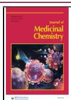

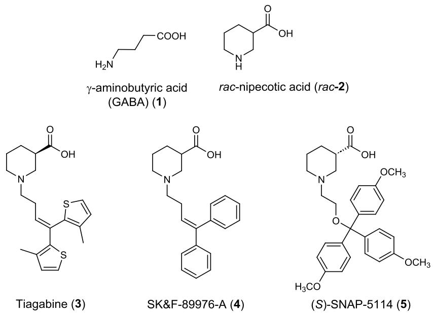  
Figure 1. Structures ofGABA (1) and selected GAT inhibitors (2−5). Inhibitory potencies ofrac-2−5 at the four GAT subtypes and binding afinities at mGAT1 are listed in entries 15−18 of Table 1.

In this context, it deserves mentioning, that a high-resolution structure of hGAT1 became available in 2022, which can be expected to strongly support the development of further and even more potent and selective inhibitors of this target in the future. This structure determined by cryo-electron microscopy, disclosed by the Gati group, shows the GABA transporter hGAT1 in complex with the nipecotic acid (rac-2, Figure 1) derivative tiagabine (3, Figure 1) in the inward-open conformation.10 In addition, in the same year also the cryo-EM structure of rGAT1 with bound GABA was published,11 which was followed by further cryo-EM structures of hGAT1 in 2023.12 Moreover, most recently also the cryo-EM structure of hGAT3 in its apo form and in complex with (S)-SNAP-5114 has been disclosed.13 In addition, a manuscript, that also deals with high-resolution structures of hGAT3, has been deposited on a preprint server.14 The enormous gain in detailed knowledge of the hGAT3 structure will certainly be a valuable basis for a more rational design of new hGAT3 inhibitors and intensify research aiming at the development ofnew hGAT3 inhibitors with higher potencies and subtype selectivities.

mGAT1 is the distinctly prevailing GABA transporter in the brain mediating about 80% of GABA uptake.6 Hence, it is considered the most important GABA transporter subtype and as an interesting drug target. Nipecotic acid (rac-2, Figure 1), a cyclic GABA analogue, has served as a lead structure in the eforts to synthesize potent inhibitors of the four GAT subtypes.15 Most importantly, upon addition of lipophilic Nsubstituents to rac-2 a significant increase of the permeability to the brain but also of the inhibitory potency at mGAT1 could be achieved. SK&F-89976-A (4, Figure 1) represents a typical example of these mGAT1 inhibitors. Another is tiagabine (3, Figure 1), which also addresses mGAT1 with high afinity and subtype selectivity. This compound is currently the only mGAT1 inhibitor, that is marketed as a drug. It was originally approved for the adjunctive treatment of partial seizures.16 As according to clinical studies tiagabine is also efective in the treatment of anxiety, panic disorders, neuropathic pain, cocaine dependence and rage, it was of-label also prescribed for these diseases.17−21 Altogether, this demonstrates the great potential of mGAT1 as a drug target.

Tiagabine (3, Figure 1) has the disadvantage of occasionally observed adverse efects such as the initiation of seizures, in particular absence seizures, which seem to be inherently coupled with the function of mGAT1. Upon inhibition of mGAT1 predominantly located on neuronal cells the reuptake of GABA is thought to be shifted toward mGAT4. Since mGAT4 is mainly present on glial cells, the neurotransmitter is largely directed toward the latter. In the glial cells GABA undergoes a metabolic degradation, whereas in the neurons it is reused for synaptic release. Upon mGAT1 inhibition the latter pathway of GABA, its transport in neurons, is partially or even fully reduced. This is thought to diminish the amount of neurotransmitter for GABA signaling and, thus to increase the susceptibility to epileptic seizures.6

As mentioned above, inhibition of mGAT1 is thought to increase susceptibility to epileptic seizures, as it reduces the amount of GABA taken up by mGAT1 into neurons and supplied to the neurotransmitter pool. Therefore, inhibition of mGAT4, which mediates GABA uptake in glial cells where the neurotransmitter is degraded, is considered a worthwhile alternative, as GABA uptake in neurons via mGAT1 remains unafected.2 As a result, mGAT4 in particular, but also other GAT subtypes, have gained increasing research interest.22−24

Although plenty of highly potent and subtype-selective inhibitors are available for mGAT1, the lack of similar potent inhibitors for mGAT4 still retards its pharmacological elucidation. The first prototypic mGAT4 inhibitor with moderate potency and selectivity is represented by (S)-SNAP 5114 (5, Figure 1).25 However, the application of (S)-SNAP-5114 (5) in vivo is limited due to its low brain uptake and modest chemical stability.26,27 In addition, its selectivity is not suficiently pronounced to exclude efects on other GABA transporter subtypes. Still, it could be demonstrated that (S)- SNAP-5114 (5) is able to exert anticonvulsant efects in the Frings audiogenic seizure-susceptible mouse model.28 The potential of mGAT4 inhibitors has become further evident from a recent report on a pharmacological study of a mGAT4 knockout mouse model. Based on their results, the authors concluded that mGAT4 represents a promising target for the treatment of pain and several psychiatric disorders such as depression, anxiety, schizophrenia, and autism.29 Hence, the development ofnew mGAT4 inhibitors with higher potency and subtype selectivity appears to be of great interest.

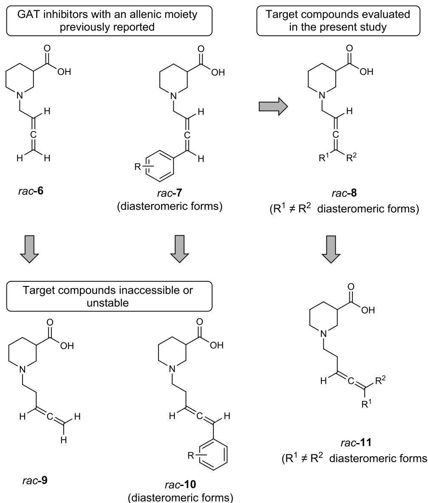  
Figure 2. Structures of nipecotic acid derivatives with an allenic spacer reported previously, rac-6−rac-7, and target compounds of the present study, rac-8−rac-11, of which rac-9−rac-10 were found to be either too unstable for biological evaluation or inaccessible.

Owing to the unique structural features related to the presence of two in perpendicular planes located π bonds, allenes are important and useful building blocks in organic synthesis.30 Many natural products with interesting biological activity, containing an allene moiety, have been identified.31,32 The interest in this scafold is constantly growing, due to its intrinsic three-carbon axial chirality, less-hindered linear structure, and high substituent-loading ability. Recently, a compound class characterized by a four-carbon atom allenic unit attached to the nitrogen ofnipecotic acid has been synthesized in our group and investigated regarding its biological activities at mGAT1- mGAT4. This class of nipecotic acid derivatives comprises rac-6 (Figure 2) with a pure four-carbon atom allenic N-substituent and compounds rac-7 (Figure 2), which, in addition, carry a single terminal aryl residue. Among these nipecotic acid derivatives with an allenic subunit, rac-6 and rac-7 (Figure 2), new mGAT1 inhibitors with good inhibitory potencies and subtype selectivities have been identified $( e . g . , r a c . 7 , \mathrm { R } = 2 . \mathrm { C l } { : }$ mGAT1 $\mathrm { p I C } _ { 5 0 } 5 . 7 1 \pm 0 . 0 7 ,$ , mGAT4 $\mathsf { p I C } _ { 5 0 } = 3 . 0 5 )$ 33

## ■ TARGET COMPOUNDS

In continuation of the aforementioned study, we now aimed at the synthesis and biological characterization of related compounds. A first set should comprise compounds, in which the allenic spacer in rac-7 has been extended by one carbon to an allenic five-carbon subunit with one terminal aryl substituent as represented by formula rac-10 (Figure 2). This set should also include the terminally unsubstituted nipecotic acid derivative rac-9 as a homologue of rac-6. Alike, rac-6 had served as a reference compound for derivatives rac-7 in biological studies, rac-9 exhibiting a penta-3,4-dien-1-yl residue should fulfill the same purpose for compounds rac-10. Overall, a comparison of the data to be obtained from compounds rac-9 and rac-10 with those from rac-6 and rac-7 (Figure 2), which had already been determined previously, should provide information on how the

Scheme 1. Synthesis of Nipecotic Acid Derivatives with Terminally Double-Substituted Allenic Spacer via ${ \bf C u ^ { I } - }$ Catalyzed Cross-Coupling of Diaryldiazomethanes 13a−f and Terminal Alkynes (rac-12) and (rac-15)

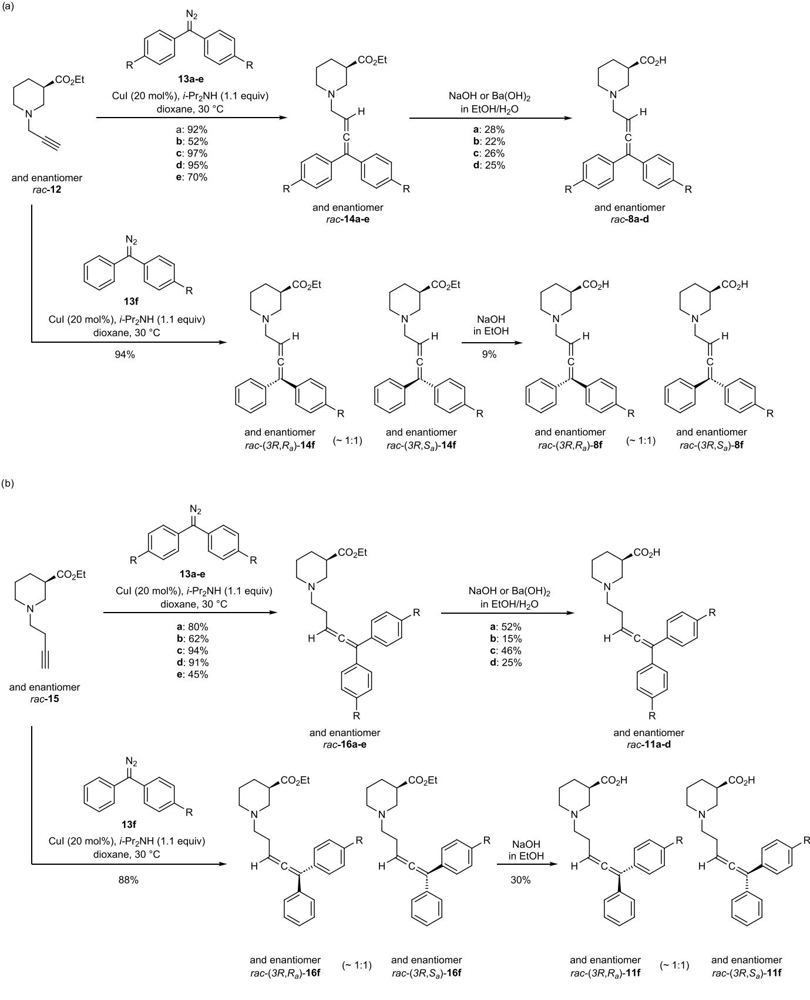

length of the allenic spacer�with either four or five carbon atoms�afects the biological activities.

Furthermore, we aimed at nipecotic acid derivatives rac-8 and rac-11 with an allenic four- and five-carbon atom spacer exhibiting an additional terminal substituent, as compared to rac-7 and rac-10 (see Figure 2). Such a structural motif is common for many potent mGAT1 inhibitors, e.g., SK&F-89976- A (4) and tiagabine (3) possessing a butenyl spacer. Moreover, derivatives with two lipophilic aryl residues were of interest, as this is known to be particularly favorable for enhanced potency at and selectivity for mGAT1, as exemplified by SK&F-89976-A (4, Figure 1).

When the synthesis of $_ { r a c - 9 }$ has been attempted in close analogy to that of rac-6, already reported before,33,34 this compound, rac-9, turned out to undergo side reactions when conditions required for the final carboxylic acid ester hydrolysis and subsequent workup were employed (see SI). As this instability had not been observed for rac-6, it appears likely to be due to the extended length of the allenic N-substituent in rac-9. Still, the chemical stability of compound rac-9 was too low for rac-9 to be used in biological studies.

Furthermore, the synthesis ofnipecotic acid derivatives rac-10 with an allenic five-carbon atom spacer and a terminal phenyl (R = H) and biphenyl group (R = ortho-phenyl) has been attempted. To this end, a method published by Wang et al. has been used, which allows the direct transformation of terminal alkynes into the respective allene derivatives upon reaction with appropriate N-tosylhydrazones under $\mathrm { \hat { C } } \mathrm { u } ^ { \mathrm { I } }$ catalysis.35,36

Though the preparation of the carboxylic acid ethyl esters of the target compounds rac-10 (R = H, R = ortho-phenyl) could be accomplished this way, attempts to transform these carboxylic acid esters into the free carboxylic acid derivatives rac-10 $\left( \mathbb { R } = \mathrm { H } , \right.$ R = ortho-phenyl) by acidic or basic hydrolysis despite variations of the reaction conditions failed, the reactions yielding only decomposition products (see SI).

Taking the results observed for parent compound rac-9 and rac-10 (R = H, R = ortho-phenyl, Figure 2) together, nipecotic acid derivatives with a five-carbon atom allenic spacer appear to be less stable than their analogues with a four-carbon atom allenic unit.

Due to these disappointing results, the synthesis of nipecotic acid derivatives with an allenic five-carbon residue and a single terminal substituent, as represented by formula rac-10, was not further pursued, instead the syntheses of compounds rac-8 and rac-11 with two terminal residues attached to the buta-2,3-dien 1-yl and the penta-3,4-dien-1-yl spacer, respectively, were taken into focus.

## RESULTS AND DISCUSSION

Chemistry. For the synthesis of the desired nipecotic acid derivatives with terminally double substituted four- and fivecarbon allenic spacers [rac-8a-d, rac-(3R,R )-8f/rac-(3R,S )-8f, rac-11a-d and ra $c { - } \big ( 3 R , R _ { a } \big ) { - } { \bf 1 1 f } \big / r a c { - } \big ( 3 R , S _ { a } \big ) { - } { \bf 1 1 f } \big ]$ we intended to follow a synthetic approach related to the ATA reaction (allenylation of terminal alkynes), that we had used before with great success for the preparation of the terminally un- and monosubstituted allenic derivatives rac-6 and rac-7 (Figure 2).33,34

To this end, envisaging a stepwise process, first, propargylic amines derived from rac-12 and rac-15 were required. These were thought to be synthesized via the ketone-alkyne-amine coupling reaction $( \mathrm { K } \dot { \mathsf { A } } ^ { 2 }$ coupling), which is accomplished by

treating a mixture consisting of a terminal alkyne, a ketone and an amine with an appropriate metal catalyst. In this reaction, the product, the propargylic amine, is formed by the addition of the employed alkyne to the imine or iminium ion, the in situ condensation product of the amine with the ketone. Treatment ofthe $\mathrm { K A } ^ { 2 }$ coupling product, the propargylic amine, with a Lewis acid may finally initiate a rearrangement reaction with a $[ 1 , 5 ]$ hydride transfer, leading to the corresponding allene. Thereby, the carbonyl carbon of the ketone with its two substituents becomes the terminus of the allene moiety (a related reaction with $\mathrm { C H } _ { 2 } \mathrm { O }$ instead of a ketone leading to rac-9 is given in the SI).37

According to literature harsher reaction conditions, i.e., higher temperatures are required,37 for the coupling ofterminal alkynes $( \mathrm { K A } ^ { \mathbf { \hat { 2 } } }$ coupling) with ketones as compared to aldehydes [aldehyde-alkyne-amine (A3) coupling reaction]. Unfortunately, in our case all attempts to generate ketone-derived propargylic amine intermediates for the allenylation of terminal alkynes such as rac-12 failed. Therefore, an alternative synthesis route had to be found for the preparation of the target compounds. The copper-catalyzed coupling of terminal alkynes with diaryldiazomethanes via a ${ \mathrm { C u } } ^ { \mathrm { I } }$ carbene migratory insertion mechanism appeared as a promising method, since it should rapidly lead to substituted allenes from simple and readily available starting materials.38

Hence, this method was used in the attempts to synthesize the carboxylic acid esters rac-14a-e, $r a c { - } \big ( 3 R , \bar { R _ { a } } \big ) { - } { \bf 1 4 f } \big / r a c { - } \big ( 3 R , S _ { a } \big ) .$ 14f, rac-16a-e and rac- $\cdot ( 3 R , R _ { a } ) – 1 6 \mathbf { f } / r a c \cdot ( 3 R , S _ { a } ) – 1 6 \mathbf { f }$ as direct precursors for the preparation of the desired nipecotic acid derivatives with a terminally double-substituted allenic four- and five-carbon atom spacer [rac-8a-d, rac- $( 3 R , R _ { a } ) – 8 \mathbf { f } / r a c \mathbf { - } ( 3 R , S _ { a } ) .$ 8f, rac-11a-d and rac-(3R,R )-11f/rac-(3R,S )-11f, Scheme 1]. The required diaryldiazomethanes 13a-f were synthesized in a general procedure from the corresponding ketones, which were transformed into their hydrazones and subsequently oxidized by MnO (see Experimental Section). CuI-catalyzed coupling of diaryldiazomethanes 13a-e with terminal alkynes rac-12 and rac $^ { 1 5 , }$ respectively, in the presence of i-Pr NH finally provided the desired $^ { 1 , 3 , 3 \cdot }$ -trisubstituted allenes rac-14a-e and rac-16a-e in yields of up to 97%. When diazomethane 13f exhibiting two diferent aryl residues was employed with rac-12 and rac-15 in this reaction, accordingly, rac- $\hat { ( 3 R , R _ { a } ) }$ -14f/rac-(3R,S )-14f and rac-(3R,R )-16f/rac-(3R,S )-16f as ∼1:1 mixture of racemic diastereomers were obtained [yield: rac-(3R,R )-14f/rac-$( 3 R , S _ { a } ) \cdot 1 4 \mathbf { f } , \ 9 4 9 6 ; \ r a c { - ( 3 R , R _ { a } ) } { - \mathbf { 1 6 f } / r a c { - ( 3 R , S _ { a } ) } } { - \mathbf { 1 6 f } , \ 8 8 \% } ]$ . No attempts were made to separate these mixtures ofdiastereomers, neither on this stage nor after their hydrolysis to the free carboxylic acids. Accordingly, also for the determination of the biological activity, the respective diastereomeric mixtures of carboxylic acids were used [rac-(3R,R )-8f/rac-(3R,S )-8f; rac-(3R,R )-11f/rac-(3R,S )-11f].

Subsequent hydrolysis under basic conditions delivered the corresponding free amino acids rac-8a-d. rac-(3R.R.)-8f/rac-$( 3 R , S _ { a } ) – 8 \mathbf { f } ,$ rac-11a−d and rac-(3R,R )-11f/rac-(3R,S )-11f in yields up to 52% (Scheme 1). The nipecotic acid esters rac-14e and rac-16e were found to undergo rapid decomposition, wherefore no attempts for the synthesis of the corresponding free nipecotic acid derivatives rac-8e and rac-11e were undertaken. Furthermore, the enantiomers (R)-8d and (S)-8d have been synthesized analogously via (R)-14d and (S)-14d applying terminal alkynes (R)-12 and (S)-12, respectively, as starting material [yields: (R)-8d, 51%; (S)-8d, 68%]. The enantiopurity of(S)-8d and (R)-8d determined by chiral HPLC was found to amount to 92.3% ee and 77.2% ee, respectively (see SI).

Scheme 2. Proposed Reversible 6-Endo Cyclization of Nipecotic Acid Derivative rac-11d to Side Product 17  
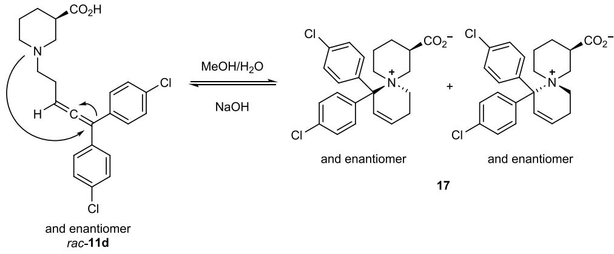

Scheme 3. Synthesis of Nipecotic Acid Derivatives rac- $\left( 3 R , R _ { a } \right)$ -8g and rac- $\mathbf { \Gamma } _ { \left( 3 R , S _ { a } \right) }$ -8g with Terminally Double-Substituted Four-Carbon Atom Allenic Spacer as ∼1:1 Mixture of Racemic Diastereomers by CuI-Catalyzed Reaction of rac-12 with N-Tosylhydrazone 18 and Subsequent Ester Hydrolysis  
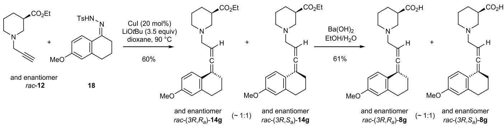

Nipecotic acid derivatives rac-11a−d and rac-(3R,R )-11f/ rac-(3R,S )-11f with an allenic five-carbon atom spacer were found to be prone to side reactions during RP-MPLC purification and subsequent freeze-drying. Without recognizable diferences in reaction performance, the decomposition tendency varies within this series of nipecotic acid derivatives, whereby these compounds distinguish from their more stable analogues [rac-8a-d, rac-(3R,R )-8f/rac-(3R,S )-8f] only by the length of the allenic spacer. The substituents on the two phenyl residues were observed to influence the decomposition tendency.

For compound rac-11d for example, complete decomposition was observed, when the standard workup procedure was followed (RP-MPLC purification, subsequent freeze-drying). By means of 1H NMR of the isolated side product 17 (see Supporting Information), the most prominent side reaction appears to be a reversible cyclization reaction (Scheme 2). As side product 17 exists as a mixture of racemic diastereomers, NMR signals could not be clearly assigned. wherefore the proposed structure is not completely confirmed. In literature, related allenes involved in 6-endo-trig cyclization reactions have already been described.39 In contrast to rac-11d, exhibiting a pchloro substituent at both phenyl groups, which had completely decomposed to putatively 17 after RP-MPLC purification in a MeOH/H O solvent mixture and subsequent lyophilization, nipecotic acid derivative rac-11c bearing p-fluoro substituents could be isolated without decomposition using the standard workup. Fortunately, when repeating the synthesis of rac-11d under identical reaction conditions, except that the final RP

MPLC purification step of the standard workup was omitted, compound rac-11d could be isolated in pure form after aqueous workup, as well. Hence, the RP-MPLC purification step is likely responsible for the decomposition, which had been observed before for rac-11d.

With compound rac-11d in hand, further experiments have been performed to investigate its tendency to decompose during the required incubation time in the applied incubation bufers for uptake (Tris-NaCl bufer) and binding assays (Krebs bufer). For this purpose, a 100 μM solution of rac-11d in bufer solution, containing 1% DMSO, was stirred for 40 min, respectively 35 min, at $3 7 ~ ^ { \circ } \mathrm { C }$ and was quenched by ether extraction. 1H NMR analysis of the extracted residue revealed that no decomposition had occurred, and therefore, results of the following biological studies can be assumed to result from the allenic compound rac-11d. As nipecotic acid derivative rac-11d displayed the highest tendency for decomposition in this study, it is reasonable to assume that also the nipecotic acid derivatives rac-11a-c and $r a c { - \big ( } 3 R , R _ { a } { \big ) } { - } { \bf 1 1 f } / r a c { - \big ( } 3 \bar { R } , S _ { a } { \big ) } { - } { \bf 1 1 f } ,$ as the apparently more stable analogues, did not undergo decomposition during the biological testing.

When applying ketones other than diaryl-ketones, the coupling procedure via N-tosylhydrazones reported by Wang et al. for this type of substrates, i.e., of aryl-alkyl ketones and aldehydes was used (Scheme 3).35,36 Reaction of the Ntosylhydrazone of 6-methoxy-1-tetralone 18 with terminal alkyne rac-12 under copper catalysis delivered the correspond ing mixture of nipecotic acid ester derivatives rac-(3R,R )-14g and rac-(3R,S )-14g (ratio ∼1:1) in 60% yield. Basic hydrolysis provided the desired target compounds, the free carboxylic acid derivatives (3R,R )-8g and rac-(3R,S )-8g in 61% yield as a mixture of diastereomers (ratio ∼1:1), which was used for the biological studies.

Table 1. Nipecotic Acid-Derived GAT Inhibitors Containing Terminally Double-Substituted Allenic Spacers and Their Inhibitory Potencies at mGAT1-mGAT4 (hGAT-3) and Binding Afinities for mGAT1  
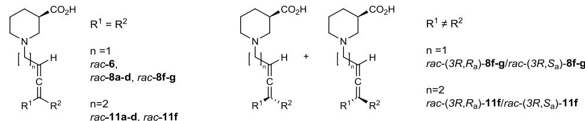

<table><tr><td rowspan="2">Entry</td><td rowspan="2">Compd</td><td rowspan="2"> $R^1$ </td><td rowspan="2"> $R^2$ </td><td rowspan="2">n</td><td> $pK_i^{e}$ </td><td colspan="4"> $pIC_{50}^{e}$ </td></tr><tr><td> $mGAT1^f$ </td><td> $mGAT1^f$ </td><td> $mGAT2^f$ </td><td> $mGAT3^f$ </td><td> $mGAT4^f (hGAT-3)^g$ </td></tr><tr><td>1</td><td> $rac-6^a$ </td><td>H</td><td>-</td><td>1</td><td>3.58 ± 0.03</td><td>3.89</td><td>3.32</td><td>88%</td><td>94%</td></tr><tr><td>2</td><td> $rac-8a^a$ </td><td rowspan="2">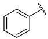</td><td rowspan="2">-</td><td>1</td><td>5.93 ± 0.06</td><td>5.13 ± 0.11</td><td>80%</td><td>78%</td><td>82%</td></tr><tr><td>3</td><td> $rac-11a^a$ </td><td>2</td><td>5.26 ± 0.03</td><td>4.61 ± 0.00</td><td>3.75</td><td>3.89</td><td>64%</td></tr><tr><td>4</td><td> $rac-8b^a$ </td><td rowspan="2">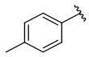</td><td rowspan="2">-</td><td>1</td><td>5.86 ± 0.05</td><td>5.19 ± 0.02</td><td>4.56</td><td>4.98 ± 0.05</td><td>4.94 ± 0.07</td></tr><tr><td>5</td><td> $rac-11b^a$ </td><td>2</td><td>5.80 ± 0.08</td><td>4.85 ± 0.05</td><td>4.09</td><td>4.23</td><td>4.08</td></tr><tr><td>6</td><td> $rac-8c^a$ </td><td rowspan="2">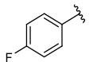</td><td rowspan="2">-</td><td>1</td><td>6.25±0.04</td><td>5.97 ± 0.10</td><td>4.10</td><td>4.16</td><td>4.52</td></tr><tr><td>7</td><td> $rac-11c^a$ </td><td>2</td><td>5.49 ± 0.06</td><td>4.89 ± 0.09</td><td>63%</td><td>50%</td><td>63%</td></tr><tr><td>8</td><td> $rac-8d^a$ </td><td rowspan="4">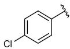</td><td rowspan="4">-</td><td rowspan="3">1</td><td>6.81 ± 0.05</td><td>6.43 ± 0.07</td><td>5.12 ± 0.06</td><td>5.53 ± 0.08</td><td>6.08 ± 0.05(6.35 ± 0.02) $^g$ </td></tr><tr><td>9</td><td>(R)-8db</td><td>6.99 ± 0.06</td><td>6.81 ± 0.03</td><td>4.80 ± 0.10</td><td>5.38 ± 0.08</td><td>5.70 ± 0.11(5.62 ± 0.06) $^g$ </td></tr><tr><td>10</td><td>(S)-8dcDDPM-3960</td><td>5.60 ± 0.10</td><td>5.87 ± 0.11</td><td>5.39 ± 0.03</td><td>5.96 ± 0.04</td><td>6.59 ± 0.01(6.49 ± 0.10) $^g$ </td></tr><tr><td>11</td><td> $rac-11d^a$ </td><td>2</td><td>6.20 ± 0.10</td><td>5.72 ± 0.10</td><td>4.92</td><td>4.55 ± 0.07</td><td>4.77 ± 0.13</td></tr><tr><td>12</td><td> $rac-(3R,R_a)-8f/rac-(3R,S_a)-8f^d$ </td><td rowspan="2">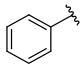</td><td rowspan="2">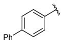</td><td>1</td><td>5.91 ± 0.05</td><td>5.30 ± 0.12</td><td>5.19 ± 0.08</td><td>5.08 ± 0.12</td><td>5.35 ± 0.12(5.78 ± 0.11) $^g$ </td></tr><tr><td>13</td><td> $rac-(3R,R_a)-11f/rac-(3R,S_a)-11f^d$ </td><td>2</td><td>6.05 ± 0.09</td><td>5.33 ± 0.07</td><td>4.91 ± 0.12</td><td>4.99 ± 0.04</td><td>4.90 ± 0.08(5.21 ± 0.08) $^g$ </td></tr><tr><td>14</td><td> $rac-(3R,R_a)-8g/rac-(3R,S_a)-8g^d$ </td><td colspan="2">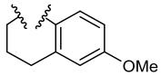</td><td>1</td><td>4.23</td><td>4.87</td><td>81%</td><td>75%</td><td>70%</td></tr><tr><td>15</td><td colspan="4">rac-Nipecotic acid (rac-2)</td><td>4.24 ± 0.10</td><td>4.88 ± 0.07</td><td>3.10 ± 0.09</td><td>4.64 ± 0.07</td><td>4.70 ± 0.07</td></tr><tr><td>16</td><td colspan="4">SK&amp;F-89976-A (4)</td><td>6.73 ± 0.02 $^h$ </td><td>6.16 ± 0.05 $^i$ </td><td>3.43 ± 0.07 $^i$ </td><td>3.71 ± 0.04 $^i$ </td><td>3.56 ± 0.06 $^i (3.00 ± 0.06)^{i,g}$ </td></tr><tr><td>17</td><td colspan="4">Tiagabine (3)</td><td>7.43 ± 0.11 $^h$ </td><td>6.88 ± 0.12 $^i$ </td><td>52%/100 μMi</td><td>64%/100 μMi</td><td>73%/100 μMi $^i (78%/250 μM)^{i,g}$ </td></tr><tr><td>18</td><td colspan="4">(S)-SNAP-5114 (5)</td><td>4.56 ± 0.02 $^j$ </td><td>4.07 ± 0.09 $^k$ </td><td>63%/100 μM $^k$ </td><td>5.29 ± 0.04 $^k$ </td><td>5.65 ± 0.02 $^k$ 6.09 ± 0.09 $^l (5.48 ± 0.10)^{k,g}$ </td></tr></table>

aCompounds were tested as racemates. $^ { b } \% \mathrm { e e } = 7 7 . 2 . \ ^ { c } \% \mathrm { e e } = 9 2 . 3 .$ dInvestigated as ∼1:1 mixture of diastereomeric compounds in racemic form. eData are the mean ± SEM of three or more independent experiments, each performed in triplicate. In case of low inhibitory potencies in uptake assays percentages are given that represent remaining GABA uptake in the presence of 100 μM test compound (except for tiagabine (3) at hGAT-3, which was applied in a concentration of 250 μM). fResults of MS Binding Assays performed with mGAT1 membrane preparations obtained from a stable HEK293 cell line and NO711 as unlabeled marker and of [3H]GABA uptake assays performed with HEK293 cells stably expressing mGAT1- mGAT4 in our laboratory. gResults of MS Transport Assays performed with COS-7 cells stably expressing hGAT-3 in our laboratory. hValues from reference 50. iValues from reference 41 (mGAT1-mGAT4) and reference 43 (hGAT-3). jValue from reference 51. kValues from reference 52. lValue determined during the present study.

## ■ BIOLOGICAL EVALUATIONS

Inhibitory Potencies at GABA Transporter Subtypes and Binding Afinities. For synthesized nipecotic acid derivatives rac-8a−d, rac- $. ( 3 R , R _ { a } )$ -8f-g/rac-(3R,S )-8f-g, rac-11a-d and $r a c { - } \big ( 3 R , R _ { a } \big ) { \bf - 1 1 f } / r a c { - } \big ( 3 R , S _ { a } \big ) { \bf - 1 1 f }$ binding afinities for mGAT1 (pK values) were determined in MS Binding Assays with NO711 as native MS marker.40 In addition, their functional activity was characterized as $\mathrm { p I C } _ { 5 0 }$ values in [3H]GABA-Uptake-Assays with HEK293 cells stably expressing the individual mouse GABA transporters mGAT1-mGAT4.41 Compounds $r a c { - } \big ( 3 R , R _ { a } \big ) { \ - { \bf 8 f - g } } / r a c { - } \big ( 3 R , S _ { a } \big ) { \ - { \bf 8 f - g } }$ and rac-(3R,R )-11f/rac-(3R,S )-11f have been tested as ∼1:1 mixtures of racemic diastereomers as which they had been formed. The biological results for each of the stereoisomers, $i . e . ,$ enantiomers and diastereomers, will most likely difer from the results of the mixture. Hence, the derived structure−activity relationships for these compounds should be regarded as estimates. The data of the biological tests are listed in Table 1, supplemented with those of parent compound rac-6 bearing an allenic four-carbon atom residue attached to the nitrogen of the nipecotic acid serving as spacer in the more elaborate compounds, which had been determined in a former study.33

As compared to rac-nipecotic acid (rac-2: $\mathrm { p I C } _ { 5 0 } = 4 . 8 8 \pm$ 0.07) the inhibitory potency of parent compound rac-6 is one log unit lower at mGAT1 (rac-6 $: \mathrm { p I C } _ { 5 0 } = 3 . 8 9 _ { \mathrm { \ell } }$ , Table 1, entry 1). Furthermore, compound rac-6 exhibits some but low subtype selectivity for mGAT1. Introducing phenyl groups at the terminal position of the allenic four-carbon atom residue resulted in nipecotic acid-derived rac-8a as a close analogue to the known mGAT1 inhibitor SK&F-89976-A (4) from which it difers only by an additional double bond transforming the mono- into a diunsaturated allenic spacer. Due to this substitution, the inhibitory potency at mGAT1 increased to $\mathrm { p I C } _ { 5 0 } = 5 . 1 3 \pm 0 . 1 1$ (rac-8a, Table 1, entry 2), which is now in the range ofthat ofrac-nipecotic acid $( \mathrm { p I C } _ { 5 0 } = 4 . 8 8 \pm 0 . 0 7 )$ . The mGAT1 inhibitory potency ofcompound rac-8a, equipped with an allenic spacer, is, however, about one log unit lower than that of $\mathrm { S K } \& \mathrm { F } { - } 8 9 9 7 6 { - } \mathrm { A } ,$ possessing an alkenyl spacer $( 4 { : } \mathrm { p I C } _ { 5 0 } = 6 . 1 6$ $\pm \ 0 . 0 5 ,$ , Table 1, entry 16), which might be explained by the diferent flexibility and geometry of both spacer types. Since the nature ofthe spacer seems to influence the inhibitory potency, in addition to rac-8a with a four-carbon atom allenic spacer compound rac-11a with an extended five-carbon atom allenic spacer has also been studied. This spacer extension, however, leads to a decrease in mGAT1 inhibition by 0.52 log units (rac-11a: $\mathrm { p I C } _ { 5 0 } = 4 . 6 1 \pm 0 . 0 0 $ Table 1, entry 3). The introduction of methyl groups in para-position ofboth phenyl residues in rac-8a and rac-11a led to a slight increase ofabout 0.24 log units for the derivative with a five-carbon atom allenic spacer (rac-11b: $\mathrm { p I C } _ { 5 0 }$ $= 4 . 8 5 \pm 0 . 0 5 ,$ , Table 1, entry 5), whereas the mGAT1 inhibition potency of the derivative with a four-carbon atom allenic spacer remained unchanged compared to rac-8a (rac-8b: $\mathrm { p I C } _ { 5 0 } = 5 . 1 9$ $\pm \ 0 . 0 2 ,$ , Table 1, entry 4). An increase in inhibitory potency at mGAT1 was observed when in $r a c { \mathbf { - 8 b } } ,$ with the four-carbon atom allenic spacer, the methyl groups were replaced by fluorine substituents, resulting in compound rac-8c with a $\mathrm { p I C } _ { 5 0 }$ of 5.97 ± 0.10 (Table 1, entry 6). In contrast, the inhibitory potency of the related compound rac-11c with an extended five-carbon atom allenic spacer did not increase with fluorine instead of the methyl substituents; it remained more or less unchanged (rac $8 \mathbf { c } \colon \mathrm { p I C } _ { 5 0 } = 4 . 8 9 \pm 0 . 0 9$ , Table 1, entry 7). The so far described nipecotic acid derivatives with a terminally double-substituted allenic four- and five-carbon atom spacer rac-8a-c and rac-11a-c displayed a subtype preference for mGAT1. This is least distinct for compound rac-8b for which the inhibitory potency at mGAT3 and mGAT4 is only slightly lower than at mGAT1 and further slowly declines for mGAT2. A reasonable inhibitory potency was also found for rac-8c carrying fluorine substituents at the terminal phenyl groups, with the $\mathrm { p I C } _ { 5 0 }$ at mGAT4 amounting to 4.52. In all other cases $\mathrm { p I C } _ { 5 0 }$ values of the aforementioned compounds at mGAT2−mGAT4 were around 4 or distinctly below (percentage values of remaining GABA uptake of 50% and above correspond to $\mathrm { p I C } _ { 5 0 }$ values of 4 and below).

An additional gain in mGAT1 inhibition ofabout 0.5 log units was observed when p-chlorine instead ofp-fluorine is present in the terminal phenyl rings ofrac-8c, resulting in rac-8d with $\mathrm { p I C } _ { 5 0 }$ $= 6 . 4 3 \pm 0 . 0 7$ (Table 1, entry 8). Surprisingly, for this compound not only the inhibitory potency at mGAT1 increased but also at m $\mathrm { G A T 4 ; }$ the latter increase was even distinctly higher (∼1.5 log units for mGAT4 as compared to 0.5 log units for mGAT1 for rac-8d as compared to rac-8c), leading to a notable $\mathrm { p I C } _ { 5 0 }$ value of $6 . 0 8 \pm 0 . 0 5$ (Table 1, entry 8). The $\mathrm { p I C } _ { 5 0 }$ values of mGAT4 benchmark inhibitor (S)-SNAP-5114 (5) displayed in Table 1 are based on repetitive testing over several years of (S)-SNAP-5114 as a reference mGAT4 inhibitor in our laboratory, leading to continuously updated mean values $( \mathrm { p I C } _ { 5 0 } = 5 . 6 5 \pm 0 . 0 2$ at mGAT4, Table $^ { 1 , }$ entry 18). Accordingly, when rac-8d was characterized in [3H]GABA-uptake assays on HEK293 cells stably expressing mGAT4 in parallel also (S)-SNAP-5114 (5) as a reference was studied, which allows a direct comparison of the inhibitory potency of rac-8d with that of (S)-SNAP-5114 (5). The obtained $\mathrm { p I C } _ { 5 0 }$ value of (S)-SNAP-5114 (5) in this experiment was found to be $6 . 0 9 \pm 0 . 0 9 ,$ , and thus relatively high. Hence, considering the SEM, the $\mathrm { p I C } _ { 5 0 }$ value of rac-8d at this transporter subtype (rac-8d: $\mathrm { p I C } _ { 5 0 } = 6 . 0 8 \pm 0 . 0 5$ at mGAT4, Table 1, entry 8) is identical with that of (S)-SNAP-5114 (5). However, compound rac-8d possesses no distinct subtype selectivity for mGAT4, its inhibitory potency at mGAT1 being even higher than that at mGAT4.

For mGAT1 inhibitors delineated from nipecotic acid, it is well-known that the biological activity resides mainly in the R enantiomer, whereas for mGAT4 inhibitors, the S enantiomer is more active. Hence, the enantioenriched R and S isomers of rac-8d had been synthesized and characterized, anticipating a further increase ofmGAT1 and mGAT4 inhibitory potency and subtype selectivity for the individual enantiomers of rac-8d. Indeed, as compared to the racemate, the R isomer (R)-8d possesses an increased mGAT1 activity [(R)- $\mathbf { \delta } \cdot \mathbf { { \bf { 8 } } d } \mathbf { \cdot { \bf { p I C } } } _ { 5 0 } = 6 . 8 1 \pm$ 0.03, Table 1, entry 9], which is in the range of the known inhibitor tiagabine $\left( 3 \colon \mathrm { p I C } _ { 5 0 } = 6 . 8 8 \pm 0 . 1 2 \right.$ , Table 1, entry 17), whereas mGAT4 inhibition is reduced [(R)-8d: $\mathrm { p I C } _ { 5 0 } = 5 . 7 0 \pm$ 0.11, Table 1, entry 9]. The opposite is true for isomer (S)-8d, for which the inhibitory potency at mGAT1 is lower [(S)-8d: $\mathrm { p I C } _ { 5 0 } = 5 . 8 7 \pm 0 . 1 1$ , Table 1, entry 10] than that ofthe racemate rac-8d. In contrast, the inhibitory potency of (S)-8d at mGAT4 is distinctly higher than that ofthe racemic form, the $\mathrm { p I C } _ { 5 0 }$ value reaching $6 . 5 9 \pm 0 . 0 1$ (Table 1, entry 10). This is significantly higher than that of (S)-SNAP-5114 $( 5 , \mathrm { p I C } _ { 5 0 } = 6 . 0 \bar { 9 } \pm 0 . 0 9 )$ and, to the best of our knowledge, the highest $\mathrm { p I C } _ { 5 0 }$ described for mGAT4 inhibitors so far. The lipophilic domain of (S)-8d consists of two aryl moieties. This structural motif is well-known as the lipophilic domain of mGAT1 inhibitors, where these residues are, however, appended to a double bond at the end ofa four-carbon atom spacer [see, $e . g . , \mathrm { { } }$ SK&F-89976-A (4) and tiagabine (3)]. In contrast, for mGAT4 inhibitors, this structura motifis, to the best ofour knowledge, unprecedented. Regarding the subtype selectivity of (S)-8d for mGAT4 over mGAT1 and mGAT3. the difference of the $\mathrm { p I C } _ { 5 0 }$ values is about $0 . 6 { - } 0 . 7$ log units, whereas for mGAT2 it reaches 1.2 log units. This indicates that in in vivo studies, a mixed pharmacological profile particularly influenced by the former two GABA transporter subtypes, cannot be excluded. The poor subtype selectivity for mGAT4 over mGAT3 is, however, a problem frequently 27,41−43 Isomer (R)-8d is at least 1 order of magnitude more potent toward mGAT1 than toward mGAT2, mGAT3, and mGAT4, respectively, indicating a reasonable subtype selectivity over the other subtypes. In order to confirm potencies and to establish $\mathrm { p I C } _ { 5 0 }$ values, also at the human equivalent of mGAT4, compounds rac-8d, (R)-8d, and (S)-8d were additionally characterized at hGAT-3 in competitive MS-based GABA transport experiments (MS Transport $\mathbf { \dot { A } s s a y s } ) ^ { 4 3 , 4 4 }$ utilizing COS cells stably expressing hGAT-3. The results obtained in these experiments at hGAT-3 reassured the high inhibitory potencies of rac-8d and (S)-8d initially found at mGAT4 $[ \mathrm { p I C } _ { 5 0 }$ values at hGAT-3: rac-8d $6 . 3 5 \pm 0 . 0 2 ,$ , Table 1, entry $8 ; ( S ) - 8 \mathrm { d } 6 . 4 9 \pm 0 . 1 0 $ , Table 1. entry 10]. whereby (S)-8d possessed this time only a slightly higher $\mathrm { p I C } _ { 5 0 }$ value than rac 8d. Accordingly, also the inhibitory potency of(R)-8d at hGAT-$3 \left[ \left( R \right) \right.$ -8d: $\mathrm { p I C } _ { 5 0 } = 5 . 6 2 \pm 0 . 0 6 ,$ Table 1, entry 9] is lower than that ofthe racemic compound rac-8d and even more than that of its enantiomer (S)-8d, similar to the results observed for (R)-8d at mGAT4. In nipecotic acid derivative rac-11d (Table 1, entry 11), the extension ofthe allenic spacer to five carbons resulted in a loss of activity at all four transporter subtypes compared to compound rac-8d. equipped with the four-carbon atom allenic spacer.

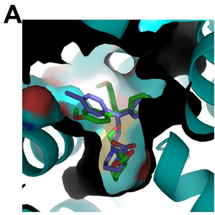

B  
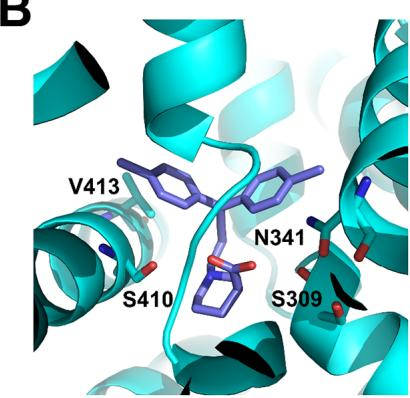  
Figure 3. Predicted binding mode of (S)-8d. The binding mode of (S)-8d (navy sticks) in the cryo-EM structure of hGAT3 (blue cartoon, A+B) was obtained by molecular docking. (A) (S)-8d binds to hGAT3 similarly oriented as the co-crystallized ligand (S)-SNAP-5114 (5) (green sticks). (B) The carboxylic acid moiety of(S)-8d forms hydrogen bonds with S410, S309, and, potentially with a distance of3.9 Å, N341. V413 mediates hydrophobic interactions with a phenyl moiety of (S)-8d.

To further explore the influence ofstructural characteristics of these compounds on their potency as GABA uptake inhibitors, two diferent diaryl residues, a phenyl and a 4′-biphenyl moiety, were introduced as lipophilic domains at the termini of the allenic spacer of the nipecotic acid derivatives. The respective compounds had been obtained as ∼1:1 mixture of racemic diastereomers, i.e., of $\cdot a c { - } \big ( 3 R , R _ { a } \big ) { - } { 8 \mathbf { f } } / r a c { - } \big ( 3 R , S _ { a } \big ) { - } { 8 \mathbf { f } }$ and rac-$\left( 3 R , R _ { a } \right) - 1 1 \mathbf { f } / r a c - \left( 3 R , S _ { a } \right)$ -11f exhibiting a four-carbon and a five carbon atom allenic spacer, respectively, and were tested as these mixtures with regard to their biological activity as GABA uptake inhibitors. At the subtypes $\mathrm { m G A T 1 - m G A T 3 }$ both compound mixtures displayed $\mathrm { p I C } _ { 5 0 }$ values ofaround 5, though for mGAT4 inhibition, the derivative mixture possessing the shorter allenyl spacer is about 0.45 log units more active than the derivative mixture with extended spacer $[ r a c - ( 3 R , R _ { a } ) - 8 { \bf f } / r a c - ( 3 R , S _ { a } ) - 8 { \bf f } ;$ $\mathsf { p I C } _ { 5 0 } = 5 . 3 5 \pm 0 . 1 2$ , Table 1, entry 12; rac-(3R,R )-11f/rac-$\left( 3 R , S _ { a } \right)$ -11f: $\mathrm { p I C } _ { 5 0 } = 4 . 9 0 \pm 0 . 0 8$ , Table 1, entry 13]. Thereby, the mixture of racemic diastereomers rac- $\left( 3 R , R _ { a } \right)$ -8f/rac-$\left( 3 R , S _ { a } \right)$ -8f with a four-carbon atom allenic spacer has almost equal potencies at all four GABA transporter subtypes, whereas $r a c { - } \big ( 3 R , R _ { a } \big ) { \mathbf { - 1 1 f } } / r a c { - } \big ( 3 R , S _ { a } \big )$ -11f with a five-carbon atom allenic spacer is slightly more potent toward mGAT1 than toward mGAT2-mGAT4. The moderate to good potencies at mGAT4 were in good accord with those at hGAT-3, at which even higher $\mathrm { p I C } _ { 5 0 }$ values for both compound mixtures have been obtained [rac-(3R,R )-8f/rac-(3R,S )-8f: p $\mathrm { \Delta } \eta C _ { 5 0 } = 5 . 7 8 \pm 0 . 1 1$ , Table 1, entry 12; rac-(3R,R )-11f/rac-(3R,S )-11f: $\mathrm { p I C } _ { 5 0 } = 5 . 2 1 \pm 0 . 0 8 ,$ Table 1, entry 13].

Finally, to mimic one of the anisole groups present in (S)- SNAP-5114 (5), the nipecotic acid derived ∼1:1 mixture of racemic diastereomers $\bar { r } a c { - } \big ( 3 R , R _ { a } \big ) { - } { \bf 8 } { \bf g } / r a c { - } \big ( 3 R , S _ { a } \big ) { - } { \bf 8 } { \bf g }$ with a four-carbon atom allenic spacer of which the terminal allene carbon is part of a methoxy substituted tetrahydronaphthalene ring system has been synthesized. With the $\mathrm { p I C } _ { 5 0 }$ values being below 4.87 at all four GABA transporter subtypes (mGAT1- mGAT4), this compound mixture is among the least potent inhibitors in this study (Table 1, entry 14).

Overall, the length of the allenic spacer of the studied compounds has a distinct influence on their potencies as GABA uptake inhibitors. The nipecotic acid derivatives with the shorter four-carbon atom allenic spacer give, in general, rise to the higher inhibitory potencies, with one exception, the terminally unsymmetrically substituted compound mixtures $ r a c \mathbf { - } \left( 3 R , R _ { a } \right)$ ${ \bf 8 f } / \dot { r } a c { - } \big ( 3 R , S _ { a } \big ) { - } \dot { { \bf 8 } } { \bf f }$ and $r a c { - } \big ( 3 R , R _ { a } \big ) { \bf - 1 1 f } / r a c { - } \big ( 3 R , S _ { a } \big ) { \bf - 1 1 f } .$ Here, the inhibitory potency at mGAT1−3 is only marginally influenced by the spacer length. Furthermore, as often observed for GAT inhibitors derived from nipecotic acid, also here the most potent mGAT1 and mGAT4 inhibitor, 8d, showed a pronounced enantioselectivity in its inhibitory potency. Thus, the S enantiomer of 8d, (S)-8d, is distinctly more potent at mGAT4 than the enantiomer (R)-8d, whereas (R)-8d shows a higher inhibitory potency at mGAT1 than (S)-8d.

In addition to the inhibitory potencies of the test compounds at mGAT1 $\left( \mathrm { p I C } _ { 5 0 } \right)$ , their binding afinities $\left( \mathsf { p } K _ { \mathrm { i } } \right)$ for this transporter subtype have also been determined. For most of the studied compounds the inhibitory potencies at mGAT1 were about a half to one log unit lower than the corresponding $\mathsf { p } K _ { \mathrm { i } }$ values. Such a diference between $\mathrm { p I C } _ { 5 0 }$ and $\mathsf { p } K _ { \mathrm { i } }$ values is a common phenomenon constantly observed for mGAT1 inhibitors when characterized in this test system.45−49

Hence, the conclusions drawn for the above-discussed $\mathrm { p I C } _ { 5 0 }$ values at mGAT1 are equally well supported by the observed pK values.

Docking Studies. To investigate the subtype-specific enantioselectivity of the inhibitory potency of (S)-8d and (R)- 8d, docking studies in cryo-electron microscopy structures of hGAT1 (PDB-ID: $7 \mathrm { Y } 7 \mathrm { Z } ^ { \mathrm { i } 2 } )$ and hGAT3 (PDB-ID: $9 \mathrm { C P 4 } ^ { 1 3 } )$ were performed. In hGAT1 (mGAT1), both enantiomers of 8d can bind similarly to the co-crystallized tiagabine (3). Their carboxylic acid moieties are generally oriented as in tiagabine, which forms a hydrogen bond with a backbone NH group, although the deviation is larger for (S)-8d (Supporting Information Figure S2A+B). Accordingly, the docking energy of (R)-8d is more favorable by 0.23 kcal $\mathrm { \dot { m } o l ^ { - 1 } }$ than that of (S)- 8d, which is qualitatively in line with the observed potency diference. In hGAT3 (mGAT4), both enantiomers can bind to the binding pocket, but only (S)-8d adopts an orientation in which the carboxylic acid moiety is placed similarly to that ofthe co-crystallized ligand (S)-SNAP-5114 (5); this orientation is identical to that in hGAT1 (Supporting Information Figure S2C +D, Figure 3A). Here, (S)-8d, similar to (S)-SNAP-5114, forms hydrogen bonds with S410, S309, and, potentially with a distance of 3.9 Å, N341 (Figure 3B). From this structural perspective, binding of (S)-8d to hGAT3 appears more favorable than that of (R)-8d, in line with the observed potency diference.

Efect of DDPM-3960 on the Central Nervous System Function in Mice. Considering the results described in the preceding in vitro part of this present research, (S)-8d also termed DDPM-3960 was further selected for in vivo studies which aimed to assess its impact on the central nervous system function in mice. For this purpose, intraperitoneally administered DDPM-3960 at doses 1.25−60 mg/kg was first tested in mouse models of seizures that were induced electrically (maximal electroshock test, 6-Hz test, and electroconvulsive threshold test) and chemically (pentylenetetrazole (PTZ) test, pilocarpine test). We also assessed its efect on motor functions (rotarod test, grip strength test, locomotor activity test). Since the anticonvulsant active hGAT-1 inhibitor, tiagabine (3) shows anxiolytic properties both in humans and experimental animals and it has a potential antidepressant-like activity in mice,53 anxiolytic-like and antidepressant-like activities of DDPM-3960 were also assessed in the four-plate, elevated plus maze tests, and in the forced swim test. The efect of DDPM-3960 on pain threshold was additionally assessed in the acute, thermally induced (hot plate test) or acute, chemically induced (capsaicin test), and tonic, chemically induced (formalin test) pain models, as antiepileptic drugs are widely used as analgesics in some pain vivo research, selected pharmacokinetic parameters were established for DDPM-3960 and stability studies were carried out for this compound.

Anticonvulsant Activity. PTZ Seizure Test. In the PTZ test, an overall efect of treatment on latency to seizure onset was observed $\left( \operatorname { F } [ 4 , 3 8 ] = 2 4 . 0 2 , p < 0 . 0 0 0 1 \right)$ . DDPM-3960 at doses 10, 30, and 60 mg/kg significantly $\left( p < 0 . 0 0 0 1 \right.$ 1 vs control group) delayed the onset ofPTZ seizures. The dose of5 mg/kg was not efective (Figure 4A).

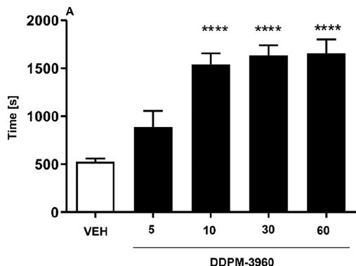

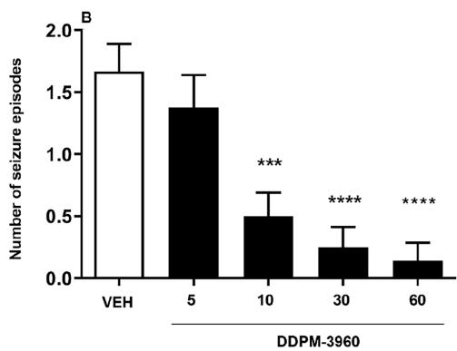  
Figure 4. Influence ofDDPM-3960 used at doses $5 , 1 0 , 3 0 ,$ and 60 mg/ kg on latency to first clonus (A) and the number ofseizure episodes (B) induced by PTZ. Results are shown for $n = 7 { - } 1 2$ . Statistical analysis: one-way ANOVA followed by Dunnett’s post hoc test. Significance vs vehicle-treated mice: \*\*\* $p < 0 . 0 0 1$ , \*\*\*\* p < 0.0001.

DDPM-3960 also influenced the number of PTZ-induced seizure episodes $\left( \operatorname { F } [ 4 , 3 8 ] = 1 1 . 1 7 , p < 0 . 0 0 0 1 \right)$ . Post hoc analysis revealed that DDPM-3960 (doses: 10, 30, and 60 mg/kg) significantly $\left( p \textless 0 . 0 0 1 \right)$ and dose-dependently reduced the number of seizure episodes caused by PTZ (Figure 4B).

Mortality rate in PTZ-treated mice was also assessed. It has been revealed that 16% of control mice died after seizure episodes caused by PTZ administration. In the DDPM-3960 (5 mg/kg)-treated group, 13% of mice died after a seizure episode caused by PTZ administration, while in all other groups treated with DDPM-3960 no mortality was noted.

Maximal Electroshock Seizure Test. In the MES test the compound DDPM-3960 (10, 30, and 60 mg/kg) dosedependently reduced the number of mice with tonic hind limb extension. The dose of 60 mg/kg prevented seizures in all mice tested (Table 2).

In this test, the $\mathrm { E D } _ { 5 0 }$ defined as the dose that protected 50% of mice from seizures was established (18.7 mg/kg).

Electroconvulsive Threshold Test. The efect of DDPM 3960 on the electroconvulsive threshold was assessed for 2 doses of the test compound, $i . e . ,$ 30 and 60 mg/kg. The $\mathrm { C S } _ { 5 0 }$ (median current strength, $i . e . ,$ current intensity that induced tonic hind limb extension in 50% of the mice challenged) for the vehicletreated group was 8.6 mA. The $\mathrm { C S } _ { 5 0 }$ value for DDPM-3960 used at 30 mg/kg was 27.1 mA. For the dose 60 mg/kg of DDPM 3960, $\mathrm { C S } _ { 5 0 }$ could not be established as this dose protected all animals tested from seizures in the range of current intensities tested (max. current intensity ofered by the rodent shocker was 34 mA). 6-Hz test.

Table 2. Anticonvulsant Activity of Compound DDPM-3960 in the MES Test

<table><tr><td>compound</td><td>dose [mg/kg]</td><td> $\mathrm{X}/\mathrm{Y}^{a}$  (% of mice protected)</td></tr><tr><td>vehicle</td><td></td><td>0/6 (0)</td></tr><tr><td rowspan="3">(S)-8d</td><td>10</td><td>1/6 (17)</td></tr><tr><td>30</td><td>4/6 (67)</td></tr><tr><td>60</td><td>6/6 (100)</td></tr></table>

aResults are shown as the number of mice protected (X) per the number of mice tested (Y).

In this mouse model of psychomotor seizures, the compound DDPM-3960 was less efective than in the PTZ or MES tests. The dose of60 mg/kg reduced seizures in 50% ofanimals tested (Table 3).

Table 3. Anticonvulsant Activity ofDDPM-3960 Measured in the 6-Hz Test

<table><tr><td>compound</td><td>dose (mg/kg)</td><td> $\mathrm{X}/\mathrm{Y}^{a}$ (% of mice protected)</td></tr><tr><td>Vehicle</td><td></td><td>0/6 (0)</td></tr><tr><td>(S)-32d</td><td>30</td><td>2/6 (33)</td></tr><tr><td></td><td>60</td><td>3/6 (50)</td></tr></table>

aResults are shown as the number of mice protected (X) per the number of mice tested (Y).

Pilocarpine-Induced Seizures. The pilocarpine seizure test is used to model human temporal lobe epilepsy.56 This assay is also regarded as a rodent model of status epilepticus.56 In this test, an overall efect of treatment on latency to status epilepticus was observed $\left( \mathrm { F } [ 2 , 2 0 ] = 8 . 7 5 9 , p < 0 . 0 1 \right)$ ). Post hoc analysis revealed that both doses ofDDPM-3960 (30 and 60 mg/kg) significantly $\left( p \ < \ 0 . 0 1 \right)$ prolonged latency to pilocarpine-induced status epilepticus but the dose 30 mg/kg was slightly more efective (Figure 5A).

One-way ANOVA also revealed a significant efect of treatment on the latency to death $( \mathrm { F } [ 2 , 2 0 ] ) ^ { - } = 4 . 0 7 7 , p < 0 . 0 5 )$ Compared to the vehicle-treated group, only the dose 30 mg/kg of DDPM-3960 significantly (p < 0.05) prolonged latency to death in experimental animals (Figure 5B).

In the in vivo research five distinct mouse models of seizures were implemented. Two ofthem, i.e., MES test and PTZ test, are regarded as simple screening seizure models that allow testing large numbers of compounds for their potential anticonvulsant activity in a relatively short time.57 These “gold standard” screening assays are not only used to identify novel antiepileptic drugs (AEDs), but they also enable the prediction ofthe eficacy of AEDs against diferent types of seizures in humans.57 The PTZ model of clonic seizures generally refers to nonconvulsive (absence or myoclonic) seizures in humans, whereas the MES test is predictive of generalized tonic-clonic seizures.57 The eficacy ofthe compound DDPM-3960 in the PTZ model and its anticonvulsant activity demonstrated in the MES test suggest that this compound might be potentially efective in absence seizures and in grand mal epilepsy in humans.

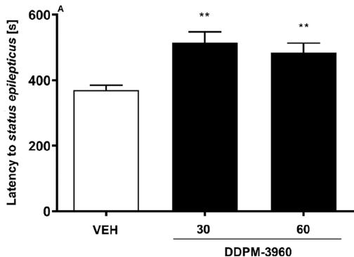

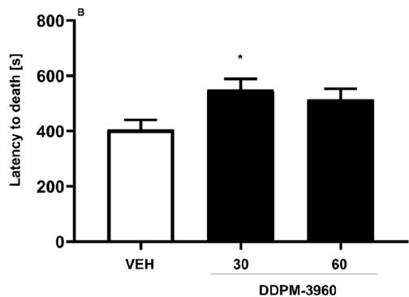  
Figure 5. Influence ofthe compound DDPM-3960 used at the doses of 30 and 60 mg/kg on latency to pilocarpine-induced status epilepticus (A), and latency to death (B). Results are shown as mean latency (±SEM) for n = 7−8. Statistical analysis: one-way ANOVA followed by Dunnett’s post hoc comparison. Significance vs vehicle-treated mice: \* $p < 0 . 0 5 , \bar { * * } _ { p } < 0 . 0 1$

Since in the 6-Hz test (a model of psychomotor seizures) DDPM-3960 was less active, it seems that in human psychomotor seizures this compound would have limited protective eficacy.

In contrast to the 6-Hz test, both doses of DDPM-3960 had a strong influence on the electroconvulsive threshold assessed in the electroconvulsive threshold test. This test is very sensitive to GAT1 inhibitors53,58 and it indicates that GAT inhibition due to DDPM-3960 administration might underlie its in vivo efect.

The observed eficacy of the compound DDPM-3960 in the PTZ test and MES test might also suggest a potential mechanism ofits action. Drugs acting as antagonists ofvoltage-gated sodium and to a lesser degree calcium channels (with the exception of ethosuximide) are efective in the MES test, and they show no anticonvulsant protection in the PTZ model, whereas numerous GABAergic AEDs, including GAT inhibitors53,59 and the T-type calcium channel blocker ethosuximide are efective in the PTZ model. Mixed AEDs are active in both tests and this efect is thought to be due to their multitarget profile of anticonvulsant activity.57,60 Considering this, such a mixed profile of DDPM-3960 should be potentially taken into consideration, and the mechanism ofDDPM-3960 action seems to be broader (hGAT 1, hGAT-3, and possibly other, non-GAT targets) than that of tiagabine (3), as in the previous studies, tiagabine, a selective hGAT-1 inhibitor, was not efective in the MES test53,58 but was efective in PTZ test.53,61

Similarly to the PTZ model, the pilocarpine-induced seizure test was the second animal model that used a chemoconvulsant drug to induce seizures. In contrast to the PTZ model, pilocarpine evokes M1 muscarinic receptor-dependent spontaneous recurrent seizures,56 that mimic status epilepticus in humans, and pilocarpine is regarded as a very useful tool to study drug-resistant epilepsy.56,62 In this model of human temporal lobe epilepsy,56 the compound DDPM-3960 was also efective. Based on the available evidence from diferent laboratories, it appears that the pilocarpine model may represent a suitable tool for investigating the mechanisms of temporal lobe epilepsy.56 Experiments in cultured hippocampal neurons have demon strated that pilocarpine causes an imbalance between excitatory and inhibitory transmission, resulting in the generation of status epilepticus, and in vivo microdialysis studies have revealed that pilocarpine induces an elevation in glutamate levels in the hippocampus, resulting in the appearance of seizures, which are maintained by NMDA receptor activation.56 Considering this, it seems plausible that hGAT-1, hGAT-3 inhibition due to DDPM-3960 administration might attenuate seizures caused by the hyperactivation of the excitatory amino acid system.

Motor Coordination. Rotarod Test. In the rotarod test no motor deficit was observed in DDPM-3960-treated mice, either for 10 or 30 mg/kg. Motor impairments, defined as the inability to remain on the rotating rod for 1 min, were noted in mice that received DDPM-3960 at the dose of 60 mg/kg $\left( p < 0 . 0 1 \right.$ vs vehicle-treated mice).

Grip Strength Test. The test compound DDPM-3960 used at doses of 10, 30, 60 mg/kg did not afect animals’ muscular strength measured in the grip strength test $( \mathrm { F } [ 3 , 2 0 ] = 1 . 5 2 2 , p >$ 0.05).

To sum up, motor coordination deficits are one of the most frequent adverse efects of AEDs, and this efect might be a serious limitation of antiepileptic pharmacotherapy. We demonstrated that the test compound DDPM-3960 induced some motor deficits in the rotarod test only at the highest dose tested, but it did not negatively influence muscular strength of experimental animals.

Efect on Locomotor Activity. The locomotor activity test was used to assess the efect of DDPM-3960 on animals’ general activity. Drug-induced decrease of locomotor activity $( i . e . ,$ sedation) or hyperlocomotion might give false positive results in some in vivo tests. To exclude this obstacle, we measured locomotor activity of mice at selected time points at which further assays were conducted: 1 min (important for the assessment ofthe results obtained in the four-plate and hot plate tests), 5 min (important for the assessment of the results obtained in the elevated plus maze test, capsaicin test and the first phase of the formalin test), 6 min (important for the assessment of the results obtained in the forced swim test) and 30 min (important for the assessment of the results obtained in the second phase of the formalin test).

Locomotor activity was significantly afected by treatment $\left( \mathrm { F } \big [ 3 , 1 1 2 \big ] = 1 2 8 . 1 , \dot { p ^ { \circ } } < 0 . 0 0 0 \dot { 1 } \right)$ . Time also afected the results significantly $\left( \operatorname { F } [ 3 , 1 1 2 ] = 1 5 9 . 5 , \ p < 0 . 0 0 0 1 \right)$ and drug × time interaction was also significant $\left( \operatorname { F } [ 9 , 1 1 2 ] = 4 9 . 6 7 , p < 0 0 0 1 \right)$ Post hoc analysis revealed that in the first min ofthe test, DDPM-3960 did not afect animals’ locomotor activity. In the fifth and sixth mins ofthe locomotor activity test the doses 30 and 60 mg/ kg significantly $\left( p < 0 . 0 5 \right.$ and $p < 0 . 0 1$ vs control mice, for both time points, respectively) reduced locomotor activity ofmice. In the 30th min ofthe test, all doses ofDDPM-3960 significantly (p $< 0 . 0 0 0 1 )$ afected the locomotor activity of mice. At this time point, the dose 2.5 mg/kg increased, while doses 30 and 60 mg/ kg decreased the number of light-beam crossings (Figure 6).

Anxiolytic-like Activity. Four-Plate Test. In the four-plate test, an overall efect of treatment with DDPM-3960 was observed $( \operatorname { F } [ 5 , 5 0 ] ~ = ~ 6 . 7 4 3 , ~ p ~ < ~ 0 . 0 0 0 1 )$ . Post hoc analysis revealed that the dose of 2.5 mg/kg significantly $\left( p < 0 . 0 0 0 1 \right)$ increased the number of punished crossings. This suggests that DDPM-3960 at this dose displayed anxiolytic-like properties (Figure 7).

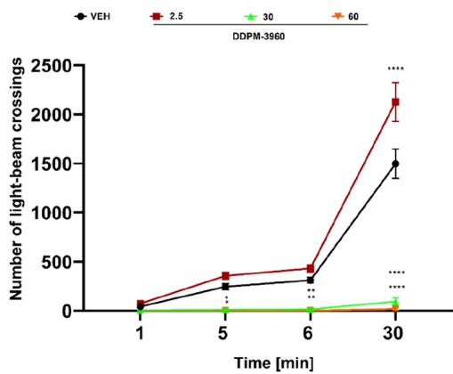  
Figure 6. Influence of the test compound DDPM-3960 on the locomotor activity of mice measured during the 30 min observation period. Results are shown as mean number of light-beam crossings (±SEM) measured at selected time points: $1 , 5 , 6 ,$ and 30 min for $n = { \overset { \cdot } { 8 } }$ Statistical analysis of the results was conducted using repeated measures ANOVA followed by Dunnett’s post hoc comparison. Significance vs vehicle-treated mice at the respective time point: $^ { * } p$ < 0.05, \*\* $p < 0 . 0 1$ \*\*\*\* $p < 0 . 0 0 0 1$

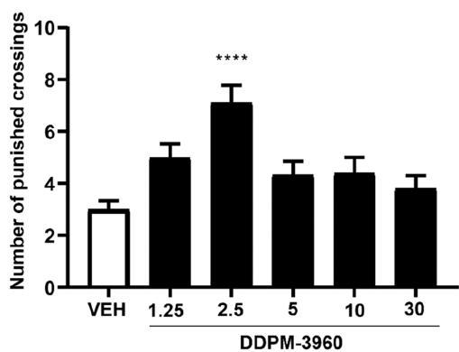  
Figure 7. Anxiolytic-like activity of the compound DDPM-3960 in the mouse four-plate test. Results are shown as the mean number of punished crossings (±SEM) for $n = 8 { - } 1 0 .$ . Statistical analysis: one-way ANOVA followed by Dunnett’s post hoc comparison. Significance vs vehicle-treated group: \*\*\*\* $p < 0 . 0 0 0 1$

Elevated Plus Maze Test. In the elevated plus maze test, the dose 2.5 mg/kg of DDPM-3960 was assessed to further confirm whether this dose displayed anxiolytic-like properties. Compared to the vehicle-treated group, DDPM-3960 increased both time spent in open arms (significant at $p < 0 . 0 0 0 1$ 1, Figure 8A) and % time spent in open arms (significant at $p < 0 . 0 0 0 1$ , Figure 8B). Compared to control, it also significantly $\left( p \textless 0 . 0 0 1 \right)$ increased the number ofopen arm entries (Figure 8C). The % of open arm entries was, however, similar in both control and DDPM-3960 groups (Figure 8D).

Considering the results from the locomotor activity test (no sedation or hyperlocomotion 1 min after the locomotor activity test started; see Figure 6) and those obtained for DDPM-3960 used at the dose of2.5 mg/kg in the four-plate test, it seems that DDPM-3960 at the dose of 2.5 mg/kg has anxiolytic-like properties in mice. This efect might be due to its efect on GAT, in particular, $\mathrm { n G A T 4 } . ^ { 2 9 }$

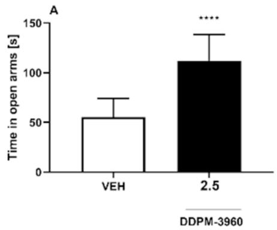

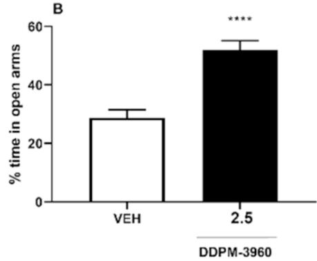

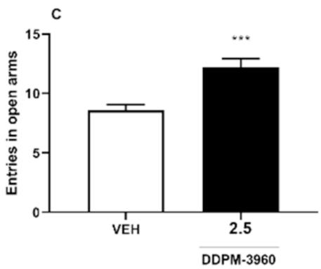

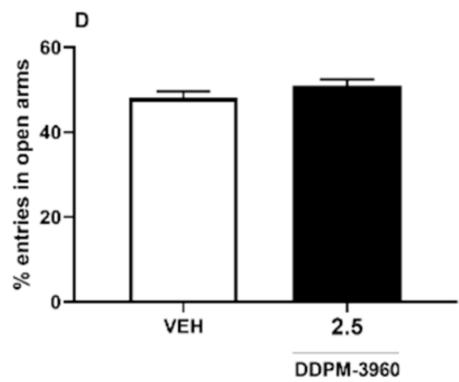  
Figure 8. Anxiolytic-like activity ofDDPM-3960 (2.5 mg/kg) in the elevated plus maze test. Results are shown as mean time spent in open arms (A), % time spent in open arms (B), entries in open arms (C), and % entries in open arms (D) for n = 10. Statistical analysis: Student’s t test. Significance vs vehicle-treated group: $\ast \ast \ast \} _ { p } < 0 . 0 0 1 , \ast \ast \ast \ast \} _ { p } < 0 . 0 0 0 1$

This anxiolytic-like efect was also confirmed in the elevated plus maze test, which is a complementary assay for the four-plate test. The elevated plus maze test lasts for 5 min, and it should be noted here that for the dose of2.5 mg/kg no unwanted efects of DDPM-3960 on animals’ locomotor activity were observed at this time point. Hence, potential false positive results of the elevated plus maze test should be excluded. Taken together, both the four-plate test and the elevated plus maze test demonstrated statistically significant anxiolytic-like properties of DDPM-3960 used at the dose of 2.5 mg/kg in mice.

Antidepressant-like Activity. Forced Swim Test. In the forced swim test, an overall efect of treatment with DDPM-3960 was not observed $\left( \operatorname { F } [ 3 , 2 8 ] = 0 . 9 8 0 0 , p > 0 . 0 5 \right)$ . The test compound did not show antidepressant-like properties at any dose tested (Figure 9).

Although previous studies reported the involvement of $\mathrm { m G A T 4 } ^ { 2 \forall }$ and $\mathrm { m G A T 1 } ^ { 6 3 , 6 4 }$ in depression-like behavior in mice, the forced swim test did not reveal antidepressant-like properties of DDPM-3960 used at doses $2 . 5 , 5 ,$ and 10 mg/kg.

Analgesic Activity. Acute, Thermally Induced Pain (Hot Plate Test). In the hot plate test, repeated-measures ANOVA did not reveal a statistically significant efect of treatment on the latency to pain reaction $( \mathrm { F } [ 2 , 5 0 ] = 1 . 6 2 9 , p > 0 . 0 5 )$ ). Time efect and drug × time interaction were not significant, either (F[1,50] $= \ 0 . 4 4 4 3 , \ p \ > \ 0 . 0 5$ and $\begin{array} { l } { { \displaystyle \cal F } \big [ 2 , 5 0 \big ] = 0 . 0 1 6 8 6 , p > 0 . 0 5 , } \end{array}$ respectively). Post hoc analysis showed that DDPM-3960 (10, 30 mg/kg) was not efective in this assay (Figure 10).

Neurogenic Pain Model (Capsaicin Test). In the capsaicin test, one-way ANOVA revealed an overall efect of treatment on the duration ofpain reaction $\left( \mathrm { F } \left[ 2 , 1 9 \right] = 1 5 . 4 0 , p < 0 . 0 0 0 1 \right)$ ). Post hoc analysis showed that DDPM-3960 at the dose of 30 mg/kg significantly $\left( p < 0 . 0 0 0 1 \right)$ reduced the duration of the licking response in capsaicin-treated mice (Figure 11).

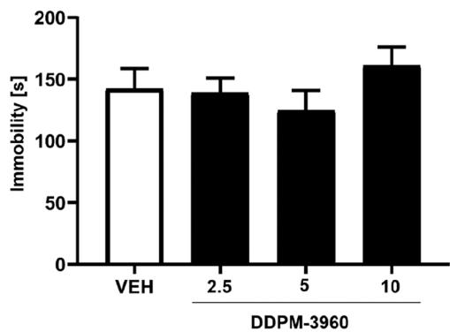  
Figure 9. Antidepressant-like activity of the compound DDPM-3960 used at doses $2 . 5 , 5 ,$ and 10 mg/kg in the mouse forced swim test. Results are shown as the mean duration of immobility (±SEM) for n = 8. Statistical analysis: one-way ANOVA followed by Dunnett’s post hoc comparison. Significance vs vehicle-treated group: $p > 0 . 0 5$

Tonic Pain Model (Formalin Test). In the formalin test antinociceptive properties of DDPM-3960 at doses 10 and 30 mg/kg were tested. Its influence on neurogenic and inflammatory pain was assessed in the early phase (phase I) and in the late phase (phase II) of this test, respectively.

In the neurogenic phase, an overall efect of treatment on the duration of pain reaction was observed $\left( \operatorname { F } [ 2 , 2 1 ] \right) = 1 2 . 3 5 , p <$ 0.001). In this phase, the dose 30 mg/kg of DDPM-3960 significantly $\left( p \textless 0 . 0 1 \right)$ reduced the nocifensive response of formalin-treated mice (Figure 12A). One-way ANOVA also revealed a significant efect of treatment in the second phase of the formalin test $\left( \mathrm { F } [ 2 , 1 6 ] = 4 8 . 6 3 , p < 0 . 0 0 0 1 \right)$ . Post hoc analysis showed that in this phase, DDPM-3960 at the dose of30 mg/kg reduced the duration of licking/biting response (significant at p < 0.0001, Figure 12B).

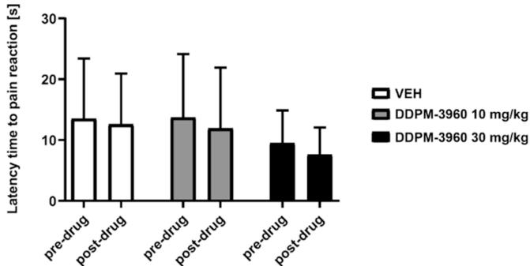  
Figure 10. Antinociceptive activity of the compound DDPM-3960 at doses 10 and 30 mg/kg in the hot plate test. Results are shown as mean latency to pain reaction (±SEM) in response to thermal stimulus (55 $^ { \circ } \mathrm { C } )$ for $n = 9 { - } 1 0 .$ . Statistical analysis: repeated-measures ANOVA followed by Dunnett’s post hoc comparison. Significance vs vehicletreated group at the respective time point: $p > 0 . 0 5$

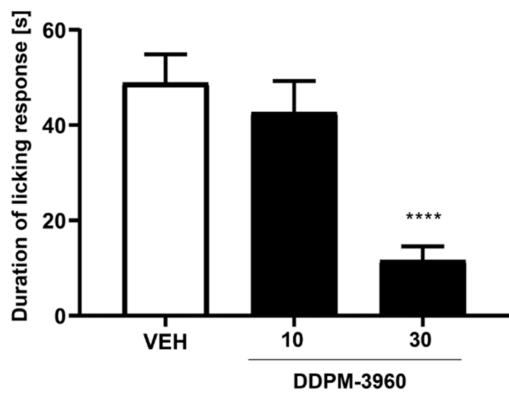  
Figure 11. Antinociceptive activity of the compound DDPM-3960 used at doses 10 and 30 mg/kg measured in the mouse capsaicin test. Results are shown as the mean duration ofthe licking/biting response (±SEM) for $n \ = \ 6 { - } 8 .$ . Statistical analysis: one-way ANOVA followed by Dunnett’s post hoc comparison. Significance vs vehicle-treated group: \*\*\*\* $p < 0 . 0 0 0 1$

In order to assess the efect ofDDPM-3960 on pain threshold in mice, we carried out three behavioral tests in which pain was induced by thermal (hot plate test) or chemical (capsaicin test, formalin test) stimuli. In the hot plate test, which is a model of acute pain, analgesic efects of DDPM-3960 were not shown. In the hot plate test, centrally acting analgesics can be detected. In contrast to this, DDPM-3960 showed analgesic properties in neurogenic pain (capsaicin test, the first phase of the formalin test). It should be however noted that (1) this efect was shown only for the dose 30 mg/kg (and not for 10 mg/kg), and (2) this efect of DDPM-3960 in pain tests was assessed 5 min after the test started. Comparing the results obtained in pain tests for the dose 30 mg/kg of DDPM-3960 with those from the locomotor activity test (time point: 5 min), it can be concluded that results obtained in both pain tests (capsaicin test, early phase of the formalin test) are rather false positive ones (in the locomotor activity test a significant decrease of locomotor activity of mice was noted for the dose 30 mg/kg 5 min after the test started). Similar conclusions can be drawn for DDPM-3960 at the dose of 30 mg/kg, referring to the locomotor activity results obtained for the time point 30 min and results obtained in the second phase of the formalin test. Although in the late phase of the formalin test, the dose 30 mg/kg significantly reduced pain behavior in mice, these results seem to be false positives as the observed decrease in licking/biting behavior should rather be attributed to the strong sedative properties of DDPM-3960 30 mg/kg.

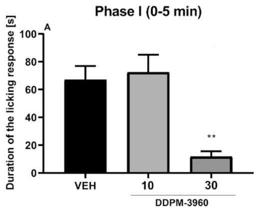

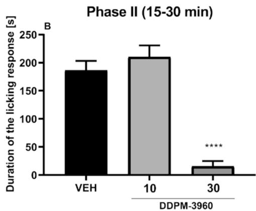  
Figure 12. Antinociceptive activity of the compound DDPM-3960 in the mouse formalin test. Results are shown as the mean duration of the licking/biting response (±SEM) in the formalin-injected paw during the early phase (0−5 min) and the late phase (15−30 min) of the test for $\ n \ = \ 6 { - } 8$ . Statistical analysis: one-way ANOVA followed by Dunnett’s post hoc comparison. Significance vs vehicle-treated group in the respective phase: $^ { * \bar { * } } p < 0 . 0 1 , ^ { \ * * * * } p < 0 . 0 0 0 1$

Pharmacokinetic Study. For the pharmacokinetic study, the dose 30 mg/kg of DDPM-3960 was selected. This dose was pharmacologically active in most of the behavioral assays. Concentration versus time profiles ofDDPM-3960 in serum and brain tissue following administration ofa dose of30 mg/kg i.p. to mice are presented in Figure 13.

Pharmacokinetic parameters calculated using the non compartmental analysis are listed in Table 4.

The data presented in Figure 13 and Table 4 indicate that DDPM-3960 is rapidly absorbed from the intraperitoneal cavity of mice. The time to reach maximum concentration $\left( { t _ { \operatorname* { m a x } } } \right)$ was attained at the first sampling time, i.e., 15 min in serum and 30 min in brain tissue. The elimination half-lives were similar in serum and brain and they were relatively long (over 100 min). The concentrations were measurable up to 12 h, and they were still above the limit of quantification of the analytical method. The apparent volume of distribution $\left( \mathrm { V } _ { z } / \mathrm { F } \right)$ was larger than the mouse body water indicating an extensive distribution of the tested compound to mouse organs and tissues. The brain-toserum AUC ratio was 2.31, indicating a high blood-brain barrier penetration of DDPM-3960. Similarly, the observed maximum concentration in the brain was almost 2-fold higher than in serum.

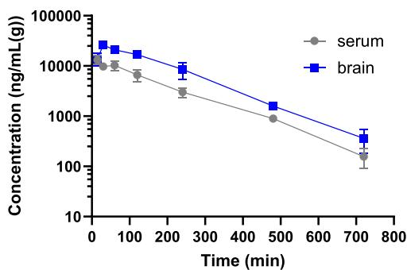  
Figure 13. Mean (±SD) serum and brain concentrations of DDPM-3960 after i.p. administration of this compound at a dose of 30 mg/kg to mice.

Table 4. Pharmacokinetic Parameters of DDPM-3960 in Serum and Brain Following i.p. Administration of 30 mg/kg of This Compound to Micea

<table><tr><td rowspan="2">pharmacokinetic parameter (unit)</td><td colspan="2">estimate</td></tr><tr><td>serum</td><td>brain</td></tr><tr><td> $t_{\text{max}}$  (min)</td><td>15</td><td>30</td></tr><tr><td> $C_{\text{max}}$  (ng/mL(g))</td><td>13,175</td><td>26,000</td></tr><tr><td> $\lambda_z$  [1/min]</td><td>0.0061</td><td>0.0065</td></tr><tr><td> $t_{0.5\lambda z}$  [min]</td><td>113.51</td><td>106.84</td></tr><tr><td> $AUC_{0-t}$  [ng·min/mL(g)]</td><td>2,250,885.0</td><td>5,210,385.0</td></tr><tr><td> $AUC_{0-\infty}$  [ng·min/mL(g)]</td><td>2,279,155.8</td><td>5,264,919.1</td></tr><tr><td> $V_z/F$  [L/kg]</td><td>2.16</td><td></td></tr><tr><td>CL/F [L/min/kg]</td><td>0.013</td><td></td></tr><tr><td>MRT [min]</td><td>167.02</td><td>169.07</td></tr></table>

aAbbreviations: $C _ { \mathrm { m a x } } { - } \mathrm { m a }$ ximum concentration, $t _ { \mathrm { m a x } } { - } \mathrm { t i m e }$ to reach maximum concentration, $\lambda _ { z } { \mathrm { - } } \mathrm { t e r m i n a l }$ elimination rate constant, $t _ { 0 . 5 \lambda \mathrm { z } } \mathrm { - t e r m i n a l }$ half-life, ${ \tt A U C } _ { 0 - t } \mathrm { - a r e a }$ under the serum concentration−time curve from the time of dosing to the last measured point, ${ \mathrm { A U C } } _ { 0 - \infty } { \mathrm { - } } { \mathrm { a r e a } }$ under the serum concentration−time curve extrapolated to infinity, $\mathrm { C L } / \mathrm { F } -$ �apparent serum clearance after extravascular administration, $\mathrm { V } _ { z } / \mathrm { F }$ �volume of distribution based on the terminal phase, MRT�mean residence time.

Stability Studies. Figure 14 shows the results of stability studies on the tested compound in murine serum and brain homogenate. Procaine was used as the positive control in this experiment.

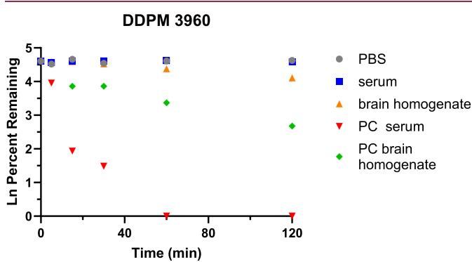  
Figure 14. Stability of DDPM-3960 in murine serum and brain homogenate evaluated over 120 min (PBS�phosphate-bufered saline, $\mathrm { p H } = \mathrm { 7 } . 4 ,$ , PC�positive control: procaine).

As shown in Figure $^ { 1 4 , }$ the tested compound was stable in mouse serum, whereas in brain homogenate, the percentage remaining slightly decreased with time. The calculated half-life of DDPM-3960 in this matrix was 165 min. Procaine - the positive control disappeared from the mouse serum and brain homogenate very fast. In serum, no measurable concentrations were observed as fast as 60 min from the start ofthe experiment. The degradation of DDPM-3960 was a result of enzymatic processes, as no changes in compound concentrations with time were observed in the phosphate-bufered saline (PBS), $\mathrm { p H } = 7 . 4 .$

Serum Protein Binding Studies. Next, we assessed serum protein binding of DDPM-3960. Two independent methods demonstrated that DDPM-3960 is highly bound to serum proteins (>99%). The mean unbound concentration (±SD) of this compound in murine serum was $1 6 . 6 5 \pm 0 . 3 5 ~ \mathrm { n g / m L } ,$ whereas the free fraction calculated according to $\mathsf { e q } \ 1$ (see Materials and Methods section) was only $0 . 3 6 \pm 0 . 0 7 ^ { \circ }$ % in in vivo experiment and $0 . 2 7 \pm 0 . 0 3 \%$ in in vitro conditions. These low values indicate that, similarly to highly protein-bound drugs, such as, $e . g . , \mathrm { { } }$ , tiagabine, warfarin, or diazepam, DDPM-3960 may tend to have a delayed onset of action and/or prolonged duration of pharmacological efect compared to drugs that are bound to plasma proteins to a lesser extent. However, these results should be taken with caution as DDPM-3960 revealed a high nonspecific binding (approximately 50%) to the ultrafiltration device that may have led to an overestimation of protein binding of this compound.

This high protein binding observed in the case of DDPM 3960 might explain its above-mentioned relatively long half-lives in plasma and brain tissue. This might also be the explanation for the observed measurable concentrations of this compound noted even up to 12 h.

Taken together, pharmacokinetic evaluation of DDPM-3960 confirmed that the observed in vivo activity of DDPM-3960 can be explained in terms of the free drug hypothesis. According to this theory, only the unbound (free) fraction of a drug in the body is available to interact with its target and produce a pharmacological efect.65 In line with this, we noted the pharmacological activity of DDPM-3960 1 h after its administration but it should also be emphasized that due to its high protein binding the concentrations above the limit of quantification of the analytical method were still measurable up to 12 h later. The unbound portion of DDPM-3960 was pharmacologically active, and it remained in dynamic equili brium with the bound drug. When the free portion of DDPM 3960 was eliminated, more of the bound compound dissociated from plasma proteins to replenish the free drug concentration. This free drug concentration at the target site was responsible for DDPM-3960s pharmacological activity. High plasma protein binding afected drug distribution and elimination, but the free drug was the fraction that determined DDPM-3960s efect in mice.

## ■ CONCLUSIONS

In summary, a new series of nipecotic acid-derived GABA uptake inhibitors, characterized by an allenic four- and fivecarbon atom spacer, bearing lipophilic aryl residues at the spacer terminus, has been synthesized and biologically characterized. Compounds equipped with the shorter four-carbon atom allenic spacer have been identified to possess higher biological activity than those with an allenic five-carbon atom spacer. The synthesis of nipecotic acid derivatives with terminally double-substituted allenic spacers was accomplished by two eficient cross-coupling reactions, whereby diaryl ketones as starting material have been implemented in ${ \dot { \mathrm { C u } } } ^ { \mathrm { I } }$ -catalyzed cross-couplings ofrelated ketone derived diaryldiazomethanes with nipecotic acid-derived termi nal alkynes, and substrate 6-methoxy-1-tetralone has been transformed in an analogue cross-coupling reaction via the corresponding N-tosylhydrazone. Among the biologically investigated compounds, derivative DDPM-3960 [(S)-8d], exhibiting two 4-chlorophenyl residues connected via the fourcarbon atom allenic spacer with the amino nitrogen of the polar nipecotic acid head, was identified as a highly potent mGAT1 and mGAT4 inhibitor. The R enantiomer (R)-8d displays an inhibitory potency at mGAT1 that is in the range of the known inhibitor tiagabine (3). For the enantioenriched S isomer DDPM-3960 [(S)-8d], ee 92.3%, $\mathrm { p I C } _ { 5 0 }$ values of $\phantom { 0 } { 6 . 5 9 \pm 0 . 0 1 }$ at mGAT4 and 6.49 ± 0.10 for the human equivalent hGAT-3 have been determined, which are significantly higher than that of the benchmark mGAT4 inhibitor (S)-SNAP-5114 (5). Molecular docking rationalized the subtype-specific enantioselectivity of the inhibitory potency of (S)-8d and (R)-8d, particularly concerning the placement of and interactions formed by the carboxylic moiety. The combination ofa rigid allenyl spacer with a diaryl residue as a lipophilic domain in compound DDPM 3960 possesses a novel structural scafold for this kind of bioactive compounds. Unfortunately, the subtype selectivity of DDPM-3960 for mGAT4 over the other three GAT subtypes is not very pronounced.

In vivo, DDPM-3960 revealed a favorable pharmacokinetic profile in mice with a relatively long elimination half-life and a very good brain permeability. DDPM-3960 is highly bound to serum proteins (>99%) and has good stability in murine serum and brain homogenate.

It was more efective as an anticonvulsant compound as compared to previously tested tiagabine (4). In our earlier $\mathrm { s t u d } ^ { \star }$ tiagabine demonstrated anticonvulsant properties in chemically induced seizures (PTZ and pilocarpine seizures). At the dose of 100 mg/kg, tiagabine also elevated the seizure threshold for electrically induced seizures by 31.6%, but it had no activity in the MES test. Similarly to tiagabine, DDPM-3960 showed anxiolytic-like properties in mice but in contrast to tiagabine, it did not display antidepressant-like efects. Although it apparently reduced animals’ nociceptive responses in some pain tests, these activities should rather be regarded as false positive outcomes resulting from its sedative properties shown in the locomotor activity test.

The observed in vivo diferences between DDPM-3960 and tiagabine are likely to be due to their distinct profile of GAT afinity. A broader (compared to tiagabine) anticonvulsant profile in mouse tests can be attributed to DDPM-3960s synergistic efect on mGAT4 and mGAT1. Other (GATindependent) mechanisms should also be considered.

Overall, the herein described compounds represent a new structural motif for mGAT4 inhibitors, which could serve as useful starting points for the further expansion of structure− activity relationships of mGAT4 inhibitors, facilitate the design of new ligands with higher potencies and better selectivities at this molecular target and even higher eficacy in animal models.

## EXPERIMENTAL SECTION

Chemistry. All commercially available reagents were used without further purification. Unless otherwise noted, all reactions were performed in oven-dried glassware under moisture-free conditions and argon- or nitrogen atmosphere. Toluene and 1,4-dioxane were dried over sodium and distilled under nitrogen. Chlorobenzene was dried over $\mathrm { C a C l } _ { 2 } ,$ distilled under nitrogen atmosphere and stored over molecular sieves (4 Å) under nitrogen atmosphere prior to use. For chromatographic purposes only distilled solvents were used (EtOAc, PE $4 2 { - } 6 \bar { 2 } \ ^ { \circ } \bar { \mathrm { C } } ,$ DCM, MeOH, n-pentane, $\mathrm { E t } _ { 2 } \mathrm { O } , \mathrm { H } _ { 2 } \mathrm { O } )$ . Flash column chromatography was performed using silica gel (grading 0.035−0.070 mm). Thin layer chromatography (TLC) was carried out on precoated silica gel $\mathrm { F } _ { 2 5 4 }$ glass plates. Preparative MPLC was performed using a Büchi instrument (C-605 binary pump system, C-630 UV detector at 254 nm and C-660 fraction collector) and a Sepacore glass column B 685 $\left( 2 6 \times 2 3 0 \mathrm { m m } ^ { 2 } \right)$ equipped with YMC Gel SIL-HG $\left( 1 2 \mathrm { n m } , 5 { - } 2 0 \right.$ μm) for straight phase and YMC Gel Triart Prep C18−S (12 nm, S-20 μm) for reverse phase. NMR spectra were recorded on a JNMR-GX (JEOL) at room temperature (unless otherwise noted) on 400 MHz (1H NMR: 400 $\mathbf { M H z } ^ { \mathbf { \hat { \mu } _ { 1 3 } } } \mathbf { C }$ NMR: 101 MHz) and 500 MHz (1H NMR: 500 MHz, $^ { 1 3 } \mathrm { C }$ NMR: 126 MHz) spectrometers. These NMR spectrometers were also used for DEPT, HMQC, HMBC and COSY experiments. 1H and $^ { 1 3 } \mathrm { C }$ NMR chemical shifts were referenced to the deuterated solvent signals and the coupling constants were stated with an accuracy of 0.5 Hz. MestreNova software was used for further analysis of the NMR data. Broadened signals in 1H NMR spectra were supplemented by the index “br” $( \mathbf { s } _ { \mathrm { b r } } , \mathbf { d } _ { \mathrm { b r } } , \mathbf { t } _ { \mathrm { b r } } )$ and signals from mixtures ofdiastereomeric compounds in racemic form were labeled as “dia1” or “dia2”. IR spectra were recorded with a Fourier-transform infrared (FT IR) spectrometer and Spectrum v2.00 software was used for analysis. Samples were measured either as KBr pellets or as films on NaCl plates. High resolution mass spectrometry was carried out with a LTQ FT Ultra mass spectrometer (ThermoFinnigan). Optical rotations were determined by a 241 MC Polarimeter ADP440+ at $\lambda = 5 8 9 ~ \mathrm { c m ^ { - 1 } }$ . All biologically tested compounds are ≥ 95% pure according to HPLC analysis or qHNMR. Purity testing of biologically tested compounds rac-11a and rac-11d was done by Quantitative 1H NMR $\left( { \bf q } { \bf H } { \bf N } { \bf M } { \bf R } \right) ^ { 6 6 , 6 7 }$ and purity was determined as $\ge 9 5 \%$ . QHNMR data based on peak area ratios are determined under conditions that ensure complete relaxation. For qHNMR the internal standard maleic acid (TraceCERT, Sigma-Aldrich, Lot#BCBM8127 V: purity 99.94%) was dissolved in MeOD. The purity was calculated using the purity calculator of MestreNova NMR software (MestreLab Research S.L.). For compounds rac-8a−d, (R)-8d, (S)-8d, rac-(3R,R )-8f/rac-(3R,S )- 8f, rac-11b-c, rac-(3R.R.)-11f/rac-(3R.S.)-11f and rac-(3R.R.)-8g/rac $( 3 R , S _ { a } )$ -8g purity testing was done by means of analytical HPLC on an Agilent 1100 instrument (G1329A ALS autosampler, G1316A column compartment, G1314A VWD detector, G1312A binary pump, G1379A degasser), equipped with a Lichrospher 100 RP-18 (5 um) in a LiChroCART 250−4 column, with elution at 0.5 mL/min with ammonium formate bufer (10 mM, pH 6.8) to MeOH 20:80 and purity was determined as ≥ 95%. The enantiopurity of (S)-8d and (R)- 8d was determined by means of chiral HPLC with a Chiralpak ZWIX(−) column. For (S)-8d a solvent mixture of 40% MeOH, 60% ACN, 50 mM formic acid and 25 mM diethylamine as eluent at a flow rate of 0.5 mL/min and for (R)-8d a solvent mixture of 40% MeOH, 60% ACN, 50 mM formic acid and 25 mM triethylamine as eluent at a flow rate of0.2 mL/min was used. The enantiopurity of(S)-8d and (R)- 8d amounted to 92.3% ee and 77.2% ee, respectively (for HPLC traces see SI).

General Procedure for the N-Alkylation (GP1). N-alkylation was performed employing a synthesis route similar to a procedure described in literature. Alkyne (1.00 equiv) and amine (1.20 equiv) were dissolved in acetone (2 mL/mmol) and ${ \bf N a } _ { 2 } { \bf C O } _ { 3 }$ (2.50 equiv) and NaI (0.50 equiv) were added. The reaction mixture was refluxed for 72 h and the reaction was monitored by TLC. For quenching, DCM (5 mL/ mmol) and water (5 mL/mmol) were added and the product was extracted with DCM. The combined organic phases were then dried over ${ \mathrm { N a } } _ { 2 } { \mathrm { S O } } _ { 4 }$ and concentrated under vacuum. The crude product was purified by flash column chromatography to aford the desired alkyne.

General Procedure for the Preparation of Diaryldiazomethanes 13a−f by Literature Procedure38 (GP2). Hydrazine monohydrate (80% purity) was added to a solution of diarylmethanone in ethanol. Then, aqueous HCl (37%, 0.50 mL/20 mmol ketone) was added and the mixture was heated to reflux overnight. After cooling to room temperature, the diarylmethanone hydrazone was precipitated as needle shaped crystals. Filtration of the crude mixture gave pure diarylmethanone hydrazones. A mixture ofdiarylmethanone hydrazone (10.0 mmol, 1.0 equiv), anhydrous $\mathrm { M g } \mathrm { S O } _ { 4 }$ (1.00 g) and 30.0 mL DCM was cooled to $0 { } ^ { \circ } \bar { \mathrm { C } } .$ To this rapidly stirred mixture activated $\mathbf { M } \mathbf { n } \mathbf { O } _ { 2 } ^ { 6 9 }$ (3.04 g, 35.0 mmol, 3.5 equiv) was added in one portion. The reaction mixture was warmed to room temperature and kept stirring for 8 h and then the solid was filtered of with a Celite pad and washed with DCM. After removal of the solvent under reduced pressure, the residual was purified by column chromatography (pretreated with $\mathrm { P E } / \mathrm { E t } _ { 3 } \mathrm { N }$ 10:1) with PE/Et N 20:1 as the eluent to aford diaryldiazomethanes 13a-f as purple solid or oil. The structures of the hydrazone intermediates have been verified by 1H NMR and $^ { 1 3 } \mathrm { C }$ NMR spectroscopy. For the diaryldiazomethane derivatives $\mathbf { 1 } 3 \mathbf { a } \mathrm { - } \mathbf { f } ,$ no analytical characterization has been carried out.

General Procedure for the $C u ^ { I } - C a t a I y z e d$ Cross-Coupling of Diaryldiazomethanes and Terminal Alkynes $( G P 3 ) .$ 38 Under nitrogen atmosphere, diaryldiazomethane (1.0 equiv) was added to a mixture of CuI (0.2 equiv), i-Pr NH (1.1 equiv) and terminal alkyne (1.0 equiv) in 1,4-dioxane (1.0 mL). The solution was stirred at $3 0 { } ^ { \circ } \mathrm { C }$ for 1 h and the progress of the reaction was monitored by TLC. Upon completion of the reaction, indicated by a color change from purple to yellow/brown, the reaction mixture was cooled down to room temperature and filtered through a short pad of aluminum oxide by using EtOAc as the eluent. The solvent was removed in vacuum to leave a crude mixture, which was purified by column chromatography to aford the desired allenic product.

General Procedure for the Ester Hydrolysis with NaOH $( G P 4 ) .$ The ester was dissolved in EtOH (5.0 mL/mmol) and 2 M NaOH (1.5 mL/mmol, 3 equiv) was added. The mixture was stirred at rt and the reaction progress monitored by TLC (EtOAc). The solvent was then completely removed under reduced pressure. Phosphate bufer $\mathrm { ( p H 7 ) }$ was then added to the solid residue until the $\mathrm { p H }$ was adjusted to 7 (indicator paper). After freeze-drying, $\mathrm { E t } _ { 2 } \mathrm { O }$ was added to the solid residue and the resulting suspension was filtrated. Subsequently, the filter cake was washed several times with $\mathrm { E t } _ { 2 } \mathrm { O }$ . The solvent was then completely removed under reduced pressure and the remaining oil was dissolved in water and freeze-dried, to obtain the free amino acid as white to yellow amorphous powder.

General Procedure for the Ester Hydrolysis with $B a ( O H ) _ { 2 } ( G P 5 ) . ^ { 7 1 }$ The ester (1 equiv) was dissolved in $\mathrm { E t O H } / \mathrm { H } _ { 2 } \mathrm { O }$ (2:1) and $\mathrm { B a } ( \mathrm { O H } ) _ { 2 } .$ ${ \mathrm { 8 H } } _ { 2 } \mathrm { O }$ (2 equiv) was added. The suspension was then stirred at rt overnight. After completion of the reaction $\mathrm { C O } _ { 2 }$ was bubbled through the suspension until no further Ba $\mathrm { \Sigma { T O } } _ { 3 }$ precipitated. The suspension was then filtered through a syringe filter (25 mm) and the filtrate was purified by RP-MPLC. After freeze-drying the corresponding free amino acid could be obtained as white to yellow amorphous powder.

rac-[1-(4,4-Diphenylbuta-2,3-dien-1-yl)piperidine-3-carboxylic Acid] (rac-8a). GP5 was followed using nipecotic acid ester rac-14a (171 mg, 0.472 mmol) and Ba(OH) ·8H O (298 mg, 0.944 mmol) in 3.4 mL EtOH/H,O (2:1) overnight. After purification bv RP-MPLC $\left( \mathrm { M e O H } / \mathrm { H } _ { 2 } \mathrm { O } 7 { : } 3 \right)$ the desired amino acid rac-8a was aforded as pale ( ) 1 ( NaOD): δ = 1.24 (qd, J = 12.5/3.1 Hz, 1H), 1.39−1.53 (m, 1H), 1.53− 1.63 (m, 1H), 1.80−1.95 (m, 2H), 2.08 (t, J = 11.1 Hz, 1H), 2.30 (t , J = 7.3 Hz, 1H), 2.82 (d,J = 11.2 Hz, 1H), 3.01−3.18 (m, 3H), 5.65 $\left( \mathrm { t } , J = \right.$ 7.3 Hz, 1H), 7.19 (m, 10H, ArH); 13C NMR (126 MHz, MeOD, NaOD): δ = 26.0 (1C), 29.3 (1C), 46.6 (1C), 54.4 (1C), 58.1 (1C), ( ) ( ) ( ) ( ) ( ) − 129.6 (m, 8C), 137.9 (1C), 138.0 (1C), 182.6 (1C), 207.6 (1C); IR (KBr): ν̃ = 3418, 3057, 3027, 2937, 2858, 2804, 1945, 1560, 1492, 1466, 1451, 1442, 1407, 1333, 1155, 1093, 1074, 1030, 1000, 961, 922, 903, 769, 695, 630, 611 $\mathrm { c m } ^ { - 1 } ;$ HRMS-ESI m/z $[ \mathbf { M } + \mathbf { H } ] ^ { + }$ calcd for ${ \mathrm { C } } _ { 2 2 } { \mathrm { H } } _ { 2 3 } { \mathrm { N O } } _ { 2 }$ : 334.1807, found: 334.1801.

rac-[1-(4,4-Di-p-tolylbuta-2,3-dien-1-yl)piperidine-3-carboxylic Acid] (rac-8b). GP5 was followed using nipecotic acid ester rac-14b (92.3 mg, 0.237 mmol) and $\mathrm { B a } \left( \mathrm { O H } \right) _ { 2 } { \cdot } 8 \mathrm { \bar { H } } _ { 2 } \mathrm { O }$ (150 mg, 0.474 mmol) in 1.5 mL $\mathrm { \bar { E } t O H / H _ { 2 } O }$ (2:1) for 6 h. After purification by RP-MPLC $\left( \mathrm { M e O H / H } _ { 2 } \mathrm { O } 7 { : } 3 \right)$ the desired amino acid rac-8b was aforded as white amorphous solid (19.2 mg, 22%): mp: 101 ${ } ^ { \circ } \mathrm { C } ;$ 1H NMR (400 MHz, MeOD): $\delta = 1 . 3 6 \left( \mathrm { q d } , J = 1 2 . 7 / 4 . 4 \mathrm { H z } , 1 \mathrm { H } \right)$ , 1.51−1.65 (m, 1H), 1.65−

1.75 (m, 1H), 1.91−2.05 (m, 2H), 2.19 $\left( \mathrm { t } , J = 1 1 . 2 \right)$ Hz, 1H), 2.33 (s, 3H), 2.34 (s, 3H), 2.42 (tt, J = 11.6/3.8 Hz, 1H), $2 . 9 3 \left( \mathrm { d } _ { \mathrm { b r } } , J = 1 1 . 4 \right.$ Hz, 1H), 3.13−3.30 (m, 3H), 5.71 $\left( \mathrm { t } , J = 7 . 3 \right.$ Hz, 1H), 6.99−7.31 (m, 8H); $^ { 1 3 } \mathrm { C }$ NMR (126 MHz, MeOD): δ = 21.2 (2C), 26.0 (1C), 29.3 (1C), 46.6 (1C), 54.4 (1C), 58.1 (1C), 59.3 (1C), 90.8 (1C), 111.1 (1C), 129.4 (2C), 129.4 (2C), 130.1 (2C), 130.1 (2C), 135.0 (1C), 135.1 (1C), 138.2 (1C), 138.3 (1C), 182.7 (1C), 207.4 (1C); IR (KBr): ν̃ = 3387, 3026, 2922, 1932, 1603, 1508, 1447, 1374, 1362, 1336, 1309, 1279, 1258, 1210, 1178, 1149, 1108, 1059, 1017, 959, 938, 912, 872, 855, 829, 820, 783, 725, 668, 647, 610, 591, 526 cm−1; HRMS-ESI m/z $[ \mathbf { M } + \mathbf { H } ] ^ { + }$ calcd for $\mathrm { C } _ { 2 4 } \mathrm { H } _ { 2 7 } \mathrm { N O } _ { 2 } \colon 3 6 2 . 2 1 2 0 ,$ , found: 362.2112.

rac-{1-[4,4-Bis(4-fluorophenyl)buta-2,3-dien-1-yl]piperidine-3- carboxylic Acid} (rac-8c). GP4 was followed using nipecotic acid ester rac-14c (0.425 mmol, 169 mg), EtOH (2.1 mL) and 2 M NaOH (0.64 mL) for 40 min. The desired amino acid rac-8c was obtained as pale yellow amorphous solid (40.4 mg, 26%): mp: $7 7 ^ { \circ } \mathrm { C } ;$ 1H NMR (400 MHz, MeOD, NaOD): $\delta = 1 . 1 1 \left( { \mathrm q } { \mathrm d } , J = 1 2 . 7 / 4 . 1 \right.$ Hz, 1H), 1.33 (qt, J = 13.1/4.0 Hz, 1H), 1.40−1.52 (m, 1H), 1.67−1.81 (m, 2H), 1.92 $\left( \mathrm { t } , J = \right.$ 11.3 Hz, 1H), 2.16 (tt, J = 11.8/3.8 Hz, 1H), 2.66 $\left( \mathrm { d } _ { \mathrm { b r } } , J = 1 1 . 2 \mathrm { H z } , 1 \mathrm { H } \right)$ $2 . 9 0 \mathrm { - } 2 . 9 7$ (m, 1H), 2.99 $\left( \mathrm { d d } , J = 7 . 3 / 2 . 0 \right.$ Hz, 2H), 5.53 (t, J = 7.3 Hz, 1H), 6.76−6.92 (m, 4H), 6.98−7.12 (m, 4H); 13C NMR (101 MHz, MeOD, NaOD): δ = 26.0 (1C), 29.3 (1C), 46.6 (1C), 54.5 (1C), 58.0 (1C), 59.0 (1C), 91.6 (1C), 109.6 (1C), 116.36 ${ \bigl ( } { \mathrm { d } } _ { C F } , \mathrm { \nabla } ^ { 2 } { \mathrm { J } } _ { C F } = 2 2 . 2 \ { \mathrm { H z } } ,$ 2C), 116.38 $\big ( \mathrm { d } _ { C F } , \mathsf { \Pi } ^ { 2 } \mathrm { J } _ { C F } = 2 2 . 2 \mathrm { H z } , 2 \mathrm { C } \big )$ , 131.20 $\big ( \mathrm { d } _ { C F } , \mathrm { } ^ { 3 } J _ { C F } = 8 . 1 \mathrm { H z } , 2 \mathrm { C } \big )$ 131.23 $\big ( \mathrm { d } _ { C F } , \mathrm { } ^ { 3 } J _ { C F } = 9 . 1 \mathrm { H z } , 2 \mathrm { C } \big ) .$ , 133.96 $\big ( \mathrm { d } _ { C F } , { } ^ { 4 } J _ { \mathrm { C F } } = 4 . 0$ Hz, 1C), 134.0 $\big ( \mathrm { d } _ { C F } , { } ^ { 4 } J _ { \mathrm { C F } } = 4 . 0 \mathrm { H z } , \mathrm { 1 C }$ ), 163.7 $\big ( \mathrm { d } _ { C F } , \mathrm { } ^ { 1 } J _ { C F } = 2 4 5 . 5 \mathrm { H z } , 2 \mathrm { C } \big )$ , 182.7 (1C), 207.4 ${ \mathrm { ( 1 C ) ; ~ ^ { 1 9 } F } }$ NMR (376 MHz, MeOD, NaOD): $\delta \ : = \ : - 1 1 6 . 9 .$ $- 1 1 7 . 0 ;$ ; IR (KBr): ν̃ = 3447, 3048, 2940, 2863, 2802, 1944, 1715, 1601, 1505, 1467, 1451, 1400, 1338, 1298, 1282, 1224, 1156, 1095, 1013, 911, 838, 800, 724, 606, ${ 5 8 4 } ~ \mathrm { c m ^ { - 1 } } ;$ HRMS-ESI $m / z ~ [ \mathbf { M } + \mathbf { H } ] ^ { + }$ calcd for $\mathrm { C } _ { 2 2 } \mathrm { H } _ { 2 1 } \mathrm { F } _ { 2 } \mathrm { N O } _ { 2 } \colon 3 7 0 . 1 6 1 9 ,$ , found: 370.1610.

rac-{1-[4,4-Bis(4-chlorophenyl)penta-3,4-dien-1-yl]piperidine-3- carboxylic Acid} (rac-8d). GP4 was followed using nipecotic acid ester rac-14d (0.470 mmol, 202 mg), EtOH (2.35 mL) and 2 M NaOH (0.71 mL) for 1.5 h. The desired amino acid rac-8d was obtained as pale yellow amorphous solid (46.8 mg, 25%): mp: $9 1 ~ ^ { \circ } \mathrm { C } ;$ 1H NMR (500 $\mathbf { M H z } , \mathbf { M e O D } ,$ , NaOD): δ = 1.36 (qd, J = 12.7/4.1 Hz, 1H), 1.58 (qt, J = $1 3 . 0 / 3 . 8 \mathrm { H z } ,$ 1H), 1.67−1.76 (m, 1H), 1.94−2.06 (m, 2H), 2.18 (t, J = $1 1 . 3 \mathrm { H z } , \mathrm { 1 H } )$ , 2.41 (tt,J = 11.7/3.8 Hz, 1H), 2.90 $\left( \mathrm { d } _ { \mathrm { b r } } , J = 1 1 . 2 \mathrm { H z } , 1 \mathrm { H } \right) _ { \mathrm { \ell } }$ 3.14−3.22 (m, 1H), 3.26 (dd, J = 7.3/2.0 Hz, 2H), $5 . 8 3 \ : \mathrm { ( t , } \ : J = 7 . 3 \ : \mathrm { H z , }$ 1H), 7.21−7.32 (m, 4H), 7.32−7.42 (m, 4H); 13C NMR (126 MHz, MeOD, NaOD): δ = 26.0 (1C), 29.3 (1C), 46.5 (1C), 54.5 (1C), 58.0 (1C), 58.7 (1C), 92.1 (1C), 109.7 (1C), 129.8 (2C), 129.8 (2C), 130.9 (2C), 130.9 (2C), 134.4 (1C), 134.4 (1C), 136.3 (1C), 136.3 (1C), 182.7 (1C), 207.5 (1C); IR (KBr): ν̃ = 3433, 3030, 2938, 2860, 2796, 2522, 1942, 1712, 1589, 1489, 1451, 1396, 1334, 1300, 1222, 1191, 1153, 1090, 1044, 1013, 959, 909, 868, 831, 783, 747, 722, 702, 638, 612, 535, 509, $4 6 0 ~ \mathrm { c m } ^ { - 1 } ;$ HRMS-ESI $m / z \ [ \textbf { M } + \textbf { H } ] ^ { + }$ calcd for $\mathrm { C } _ { 2 2 } \mathrm { H } _ { 2 1 } \mathrm { C l } _ { 2 } \mathrm { N O } _ { 2 } \colon 4 0 2 . 1 0 2 8 ,$ , found: 402.1020.

1-[4,4-Bis(4-chlorophenyl)penta-3,4-dien-1-yl]-(R)-piperidine-3- carboxylic Acid [(R)-8d]. (A) Synthesis of starting material (R)-14d: GP3 was followed using alkyne $\left( \mathbf { \dot { \boldsymbol { R } } } \right) \mathbf { - } \mathbf { 1 } \boldsymbol { 2 } ^ { 3 3 }$ (98 mg, 0.50 mmol), CuI (19 mg, 0.10 mmol), $i { \cdot } \mathrm { \bar { P } r } _ { 2 } \mathrm { N H }$ (0.08 mL, 0.55 mmol) and $4 , 4 ^ { \prime } -$ (diazomethylene)bis(chlorobenzene) (132 mg, 0.50 mmol) in 1,4- dioxane $( 2 . { \dot { 5 } }$ mL). After purification by column chromatography (PE/ EtOAc 8:2) pure (R)-14d was aforded as yellow viscous oil (208 mg, 97%): $R _ { \mathrm { f } } = 0 . 2 1$ (PE/EtOAc 8:2). (B) Synthesis of (R)-8d: GP4 was followed using nipecotic acid ester (R)-14d (0.480 mmol, 207 mg), EtOH (2.4 mL) and 2 M NaOH (0.72 mL) for 1.5 h. The desired amino acid (R)-8d was obtained as pale yellow amorphous solid (99.0 mg, 51%): mp: $8 5 ^ { \circ } \mathrm { C ; } [ \alpha ] _ { \mathrm { D } } ^ { \ 2 2 } \mathrm { = } \dot { + } 1 5 . \dot { 2 }$ (c = 0.90 g/100 mL in chloroform); 1H NMR (500 MHz, MeOD, NaOD): δ = 1.36 (qd, J = 12.7/3.9 Hz), 1.53−1.64 (m, 1H), 1.66−1.75 (m, 1H), 1.94−2.06 (m, 2H), 2.18 (t, J = 11.3 Hz, 1H), 2.41 (tt, J = 11.7/3.3 Hz, 1H), 2.90 $\left( \mathrm { d } _ { \mathrm { b r } } , J = 1 1 . 2 \mathrm { H z } \right.$ , 1H), 3.19 (d , J = 11.7 Hz, 1H), 3.25 $\left( \mathrm { d d } , J = 7 . 3 / 1 . 3 \right.$ Hz, 2H), 5.83 (t, J = 7.3 Hz, 1H), 7.24−7.31 (m, 4H), 7.32−7.41 (m, $4 \mathrm { H } ) ; { } ^ { 1 3 } \mathrm { C }$ NMR (126 MHz, MeOD, NaOD): δ = 26.0 (1C), 29.3 (1C), 46.6 (1C), 54.5 (1C), 58.0 (1C), 58.7 (1C), 92.1 (1C), 109.7 (1C), 129.8 (2C), 129.8 (2C), 130.9 (2C), 130.9 (2C), 134.4 (1C), 134.4 (1C), 136.3 (1C), 136.3 (1C), 182.6 (1C), 207.5 (1C); IR (KBr): ν̃ =

3426, 3030, 2938, 2862, 2797, 2531, 1942, 1711, 1589, 1489, 1451, 1396, 1333, 1300, 1222, 1192, 1152, 1090, 1044, 1013, 959, 909, 868, 831, 769, 747, 722, 702, 638, 612, 534, 508, 460 cm−1; HRMS-ESI m/z $[ \mathbf { M } + \mathbf { H } ] ^ { + }$ calcd for $\mathrm { C } _ { 2 2 } \mathrm { H } _ { 2 1 } \mathrm { C l } _ { 2 } \mathrm { N O } _ { 2 } \mathrm { : }$ 402.1028, found: 402.1021.

1-[4,4-Bis(4-chlorophenyl)penta-3,4-dien-1-yl]-(S)-piperidine-3- carboxylic Acid [(S)-8d]. (A) Synthesis of starting material (S)-14d: GP3 was followed using alkyne (S)-12 (98 mg, 0.50 mmol), CuI (19 mg, 0.10 mmol), $i \mathrm { - P r } _ { 2 } \mathrm { N H }$ (0.08 mL, 0.55 mmol) and $4 , 4 ^ { \prime } -$ (diazomethylene)bis(chlorobenzene) (132 mg, 0.50 mmol) in 1,4- dioxane (2.5 mL). After purification by column chromatography (PE/ EtOAc 8:2) pure (S)-14d was aforded as yellow viscous oil (207 mg, 96%): $R _ { \mathrm { f } } = 0 . 1 7$ (PE/EtOAc 8:2). (B) Synthesis of (S)-8d: GP4 was followed using nipecotic acid ester (S)-14d (0.480 mmol, 207 mg), EtOH (2.4 mL) and 2 M NaOH (0.72 mL) for 1.5 h. The desired amino acid (S)-8d was obtained as pale yellow amorphous solid (130 mg, 68%): mp: 86 °C; $[ \alpha ] _ { \mathrm { D } } { } ^ { 2 2 } \ = \ - 1 8 . 4$ (c = 0.90 g/100 mL in chloroform); 1H NMR (400 MHz, MeOD, NaOD): δ = 1.36 (qd, J = 12.6/4.2 Hz, 1H), 1.58 (qt, J = 12.8/4.0 Hz, 1H), 1.66−1.76 (m, 1H), 1.93−2.06 (m, 2H), 2.18 (t, J = 11.2 Hz, 1H), 2.41 $\left( \mathrm { t t } , J = 1 1 . 6 / 3 . 7 \right.$ Hz, 1H), 2.90 $\left( \mathrm { d } _ { \mathrm { b r } } J = 1 1 . 2 \right.$ Hz, 1H), 3.18 (dd , J = 11.1/3.5 Hz, 1H), 3.25 (dd, J = 7.3/1.3 Hz, 2H), 5.83 (t, J = 7.3 Hz, 1H), 7.24−7.31 (m, 4H, ArH), 7.31−7.40 (m, 4H); 13C NMR (126 MHz, MeOD, NaOD): δ = 26.0 (1C), 29.3 (1C), 46.5 (1C), 54.5 (1C), 57.9 (1C), 58.7 (1C), 92.1 (1C), 109.7 (1C), 129.8 (2C), 129.8 (2C), 130.9 (2C), 130.9 (2C), 134.4 (1C), 134.4 (1C), 136.3 (1C), 136.3 (1C), 182.7 (1C), 207.5 (1C); IR (KBr): ν̃ = 3428, 3030, 2936, 2858, 2797, 2528, 1943, 1708, 1589, 1489, 1450, 1396, 1333, 1300, 1276, 1222, 1192, 1152, 1090, 1044, 1013, 959, 909, 867, 831, 770, 746, 722, 702, 670, 638, 612, 535, $5 0 9 , 4 6 2 ~ \mathrm { c m } ^ { - 1 } .$ ; HRMS-ESI $m / z \ [ \mathbf { M } + \mathbf { H } ] ^ { \dagger }$ calcd for $\mathrm { C } _ { 2 2 } \mathrm { H } _ { 2 1 } \mathrm { C l } _ { 2 } \mathrm { N O } _ { 2 } \mathrm { : }$ 402.1028, found: 402.1022.

rac-{(R )-1-[4-(1,1′-Biphenyl-4-yl)-4-phenylbuta-2,3-dien-1-yl]- (3R)-piperidine-3-carboxylic Acid} [rac-(3R,R )-8f] and rac- $\cdot \{ ( S _ { \alpha } ) - 1 -$ [4-(1,1′-Biphenyl-4-yl)-4-phenylbuta-2,3-dien-1-yl]-(3R)-piperidine-3-carboxylic Acid} [rac-(3R,S )-8f]. GP4 was followed using nipecotic acid esters rac- $\left( 3 R , R _ { a } \right)$ -14fand rac-(3R,S )-14f(0.423 mmol, 185 mg), EtOH (2.1 mL) and 2 M NaOH (0.63 mL) for 2 h. The desired amino acids rac-(3R,R )-8f and rac-(3R,S )-8f were obtained as ∼1:1 mixture of racemic diastereomers as pale yellow amorphous solid (16.2 mg, 9%): mp: 109 ${ } ^ { \circ } \mathrm { C } ;$ 1H NMR (400 MHz, MeOD, NaOD): δ = 1.37 (qd, J $= 1 2 . 7 / 4 . 2$ Hz, 1H), 1.51−1.67 (m, 1H), 1.67−1.79 (m, 1H), 1.93− 2.10 (m, 2H), 2.21 $\left( \mathrm { t } , J = 1 1 . 3 \right.$ Hz, 0.5H, dia1 or dia2), 2.23 (t, J = 11.3 $\mathrm { H z } , 0 . 5 \mathrm { H } _ { \cdot }$ , dia1 or dia2), 2.43 (tt, J = 11.6/3.8 Hz, 1H), 2.96 ${ \left( \mathrm { d } _ { \mathrm { b r } } J = 1 1 . 3 \right. }$ Hz, 1H), 3.17−3.30 (m, 3H), 5.80 (t, J = 7.3 Hz, 0.5H, dia1 or dia2), 5.81 (t, J = 7.3 Hz, 0.5H, dia1 or dia2), 7.22−7.47 (m, 10H), 7.53−7.70 (m, 4H); $^ { 1 3 } \mathrm { C }$ NMR (126 MHz, MeOD, NaOD): δ = 26.0 (1C), 29.3 (1C), 46.6 (0.5C, dia1 or dia2), 46.6 (0.5C, dia1 or dia2), 54.4 (0.5C, dia1 or dia2), 54.5 (0.5C, dia1 or dia2), 58.0 (0.5C, dia1 or dia2), 58.1 (0.5C, dia1 or dia2), 59.1 (0.5C, dia1 or dia2), 59.2 (0.5C, dia1 or dia2), 91.2 (0.5C, dia1 or dia2), 91.3 (0.5C, dia1 or dia2), 111.1 (1C), 127.9 (2C), 128.0 (1C), 128.0 (1C), 128.4 (0.5C, dia1 or dia2), 128.4 (0.5C, dia1 or dia2), 128.5 (0.5C, dia1 or dia2), 128.5 (0.5C, dia1 or dia2), 129.6 (1C), 129.6 (1C), 129.6 (1C), 129.6 (1C), 129.9 (1C), 129.9 (2C), 129.9 (1C), 136.9 (0.5C, dia1 or dia2), 136.9 (0.5C, dia1 or dia2). 137.9 (0.5C. dia1 or dia2). 137.9 (0.5C. dia1 or dia2). 141.5 (0.5C. dia1 or dia2). 141.5 (0.5C. dia1 or dia2). 141.9 (1C). 182.7 (1C), 207.7 (0.5C, dia1 or dia2), 207.7 (0.5C, dia1 or dia2); IR (KBr): ν̃ = 3423, 3055, 3027, 2936, 2857, 2800, 1942, 1708, 1597, 1578, 1486, 1466, 1447, 1405, 1334, 1309, 1224, 1191, 1155, 1133, 1094, 1074, 1040. 1007, 963. 907, 841, 767. 729. 697. 630 cm−1: HRMS-ESI m/z $[ \mathbf { M } + \mathbf { H } ] ^ { + }$ calcd for $\mathrm { C } _ { 2 8 } \mathrm { H } _ { 2 7 } \mathrm { N O } _ { 2 } \mathrm { ; }$ 410.2120, found: 410.2110.

rac-[(R )-1-{3-[6-Methoxy-3,4-dihydronaphthalen-1(2H)- ylidene]allyl}-(3R)-piperidine-3-carboxylic Acid] [rac-(3R,R )-8g] and rac-[(S )-1-{3-[6-Methoxy-3,4-dihydronaphthalen-1(2H)- ylidene]allyl}-(3R)-piperidine-3-carboxylic Acid] [rac-(3R,S )-8g]. GP5 was followed using nipecotic acid esters rac-(3R,R )-14g and rac-(3R,S )-14g (107 mg, 0.300 mmol) and Ba $\mathrm { ( O H ) } _ { 2 } { \cdot } 8 \mathrm { H } _ { 2 } \mathrm { O }$ (189 mg, 0.600 mmol) in 2.1 mL EtOH/H O (2:1) for 24 h. After purification by RP-MPLC $\mathrm { \left( M e O H / H _ { 2 } O \right. }$ 6:4) the amino acids rac- $\left( 3 R , R _ { a } \right)$ -8g and rac-$( 3 R , S _ { a } )$ -8g were obtained as ∼1:1 mixture of racemic diastereomers as pale yellow amorphous solid (59.6 mg, 61%): mp: $1 1 5 . 2 \ ^ { \circ } \mathrm { C } ;$ 1H NMR (400 MHz, MeOD): δ = 1.37 (qd, J = 12.7/4.0 Hz, 1H), 1.54−1.69 (m, 1H), 1.70−1.80 (m, 1H), 1.85 (p, J = 6.1 Hz, 2H), 1.95−2.07 (m, 2H), 2.13 (t, J = 11.4 Hz, 0.5H), 2.16 (t, J = 11.4 Hz, 0.5H, dia1 or dia2), 2.35−2.48 (m, 1H), 2.48−2.61 (m, 2H), 2.76 (t, J = 6.1 Hz, 2H), 2.92− 3.05 (m, 1H), 3.05−3.18 (m, 2H), 3.18−3.28 (m, 1H), 3.75 (s, 3H), 5.40−5.56 (m, 1H), 6.63 (d, J = 2.6 Hz, 0.5H, dia1 or dia2), 6.63 (d, J = 2.4 Hz, 0.5H, dia1 or dia2), 6.69 (dd, J = 8.6/2.6 Hz, 0.5H, dia1 or dia2), 6.71 (dd, J = 8.6/2.6 Hz, 0.5H, dia1 or dia2), 7.29 (d, J = 8.6 Hz, 0.5H, dia1 or dia2), 7.32 (d, J = 8.6 Hz, 0.5H, dia1 or dia2); 13C NMR (101 MHz, MeOD): δ = 24.2 (1C), 26.0 (0.5C, dia1 or dia2), 26.0 (0.5C, dia1 or dia2), 29.4 (1C), 30.2 (1C), 31.4 (1C), 46.5 (0.5C, dia1 or dia2), 46.6 (0.5C, dia1 or dia2), 54.3 (0.5C, dia1 or dia2), 54.5 (0.5C, dia1 or dia2), 55.6 (1C), 57.8 (0.5C, dia1 or dia2), 57.9 (0.5C, dia1 or dia2), 59.6 (0.5C, dia1 or dia2), 59.7 (0.5C, dia1 or dia2), 90.6 (0.5C, dia1 or dia2), 90.6 (0.5C, dia1 or dia2), 103.0 (1C), 113.8 (0.5C, dia1 or dia2), 113.8 (0.5C, dia1 or dia2), 114.4 (0.5C, dia1 or dia2), 114.4 (0.5C, dia1 or dia2), 124.7 (0.5C, dia1 or dia2), 124.7 (0.5C, dia1 or dia2), 129.2 (0.5C, dia1 or dia2), 129.3 (0.5C, dia1 or dia2), 139.0 (0.5C, dia1 or dia2), 139.1 (0.5C, dia1 or dia2), 160.0 (1C), 182.7 (1C), 203.8 (0.5C, dia1 or dia2), 203.8 (0.5C, dia1 or dia2); IR (KBr): ν̃ = 3433, 2935, 2860, 2835, 2525, 1946, 1715, 1606, 1571, 1498, 1465, 1452, 1394, 1320, 1271, 1246, 1195, 1154, 1125, 1067, 1035, 953, 884, 837, 820, 766, 718, 668, 565 cm−1; HRMS-ESI m/z [M + H]+ calcd for $\mathrm { C } _ { 2 0 } \mathrm { H } _ { 2 5 } \mathrm { N O } _ { 3 } \colon 3 2 8 . 1 9 1 3 ,$ , found: 328.1907.

rac-[1-(5,5-Diphenylpenta-3,4-dien-1-yl)piperidine-3-carboxylic Acid] (rac-11a). GP5 was followed using nipecotic acid ester rac-16a (93.9 mg, 0.250 mmol) and Ba(OH) ·8H O (158 mg, 0.500 mmol) in 1.8 mL EtOH/H O (2:1) for 25 h. After purification by RP-MPLC $\left( \mathrm { M e O H / H _ { 2 } O } \right.$ 7:3) amino acid rac-11a was afforded as white amorphous solid (45.3 mg, 52%): mp: 41 $^ \circ \mathrm { C } ;$ 1H NMR (500 MHz, MeOD, NaOD): δ = 1.13 (qd, J = 13.5/4.4 Hz, 1H), 1.36 (qt, J = 12.9/ 3.8 Hz, 1H), 1.43−1.55 (m, 1H), 1.67−1.82 (m, 2H), 1.86 (t, J = 11.4 Hz, 1H), 2.11−2.30 (m, 3H), 2.32−2.43 (m, 2H), 2.71 $\left( \mathrm { d } _ { \mathrm { b r } } , J = 1 1 . 4 \right.$ Hz, 1H), 2.95 $\left( \mathrm { d } _ { \mathrm { b r } } , J = 1 1 . 0 \mathrm { H z } , 1 \mathrm { H } \right)$ , 5.55 (t, J = 6.7 Hz, 1H), 7.00−7.19 (m, 10H); 13C NMR (101 MHz, MeOD, NaOD): δ = 26.0 (1C), 27.2 (1C), 29.5 (1C), 46.3 (1C, NCH CH CH CH), 54.9 (1C), 58.2 (1C), 59.4 (1C), 92.9 (1C), 111.5 (1C), 128.2 (2C), 129.4 (4C), 129.4 (4C), 138.3 (2C), 182.7 (1C), 206.7 (1C); IR (KBr): ν̃ = 3433, 3056, 3026, 2938, 2857, 2805, 2525, 2368, 2345, 1944, 1708, 1597, 1491, 1451, 1442, 1389, 1310, 1278, 1218, 1188, 1155, 1101, 1074, 1030, 921, 902, 770, 696, 630 cm−1; HRMS-ESI $m / z \left[ \mathbf { M } + \mathbf { H } \right] ^ { + }$ calcd for ${ \mathrm { C } } _ { 2 3 } { \mathrm { H } } _ { 2 5 } { \mathrm { N O } } _ { 2 } { \mathrm { : } }$ 348.1964, found: 348.1958; average purity by qHNMR (interna calibrant: maleic acid Lot#BCBM8127 V): 99%.

rac-[1-(5,5-Di-p-tolylpenta-3,4-dien-1-yl)piperidine-3-carboxylic Acid] (rac-11b). GP5 was followed using nipecotic acid ester rac-16b (109 mg, 0.269 mmol) and Ba(OH) ·8H O (170 mg, 0.538 mmol) in 1.5 mL EtOH/H O (2:1) for 5 h. After purification by RP-MPLC (MeOH/H,O 7:3) amino acid rac-11b was afforded as white amorphous solid (14.6 mg, 15%): mp: $5 4 ~ ^ { \circ } \mathrm { C } ;$ 1H NMR (500 MHz, MeOD): δ = 1.33 (qd, J = 13.0/4.4 Hz, 1H), 1.51−1.63 (m, 1H), 1.64− 1.74 (m, 1H), 1.93 (td, J = 11.8/2.9 Hz, 1H), 1.97−2.03 (m, 1H), 2.05 ( ) ( ) − ( ) − ( 2H), 2.90 (d , J = 11.3 Hz, 1H), 3.16 (d , J = 11.5 Hz, 1H), 5.69 $\left( \mathrm { t } , J = \right.$ 6.6 Hz, 1H), 7.11−7.23 (m, 8H); $^ { 1 3 } \mathrm { C }$ NMR (126 MHz, MeOD): δ = 21.2 (2C), 26.0 (1C), 27.3 (1C), 29.5 (1C), 46.3 (1C), 54.9 (1C), 58.2 (1C), 59.5 (1C), 92.5 (1C), 111.2 (1C), 129.3 (4C), 130.0 (4C), 135.5 (2C), 138.0 (2C), 182.7 (1C), 206.4 (1C); IR (KBr): ν̃ = 3432, 3021, 2922, 2858, 1942, 1702, 1593, 1509, 1449, 1386, 1308, 1181, 1153, 1108, 1020, 910, 822, 796, 783, 720, 668, 611, 584, 514, 462 $\mathrm { c m } ^ { - 1 } ;$ [ ]+ $\mathrm { C } _ { 2 5 } \mathrm { H } _ { 2 9 } \mathrm { N O } _ { 2 } \mathrm { ; }$ 376.2277, found: 376.2266.

rac-{1-[5,5-Bis(4-fluorophenyl)penta-3,4-dien-1-yl]piperidine-3- carboxylic Acid} (rac-11c). GP5 was followed using nipecotic acid ester rac-16c (194 mg, 0.472 mmol) and Ba(OH) ·8H O (298 mg, 0.944 mmol) in 3.0 mL EtOH/H,O (2:1) overnight. After purification by RP. MPLC (gradient elution with MeOH/H O 6:4 to MeOH/H O 7:3) amino acid rac-11c was aforded as white amorphous solid (82.4 mg, 46%): mp: $6 2 ^ { \circ } \mathrm { C } ;$ 1H NMR (400 MHz, MeOD, NaOD): δ = 1.33 (qd, J = 12.8/4.2 Hz, 1H), 1.55 (qt,J = 12.8/3.9 Hz, 1H), 1.63−1.76 (m, 1H), 1.86−2.01 (m, 2H), 2.05 (t, J = 11.3 Hz, 1H), 2.32−2.47 (m, 3H),

2.50−2.61 (m, 2H), 2.90 $\left( \mathrm { d } _ { \mathrm { b r } } , J = 1 1 . 3 \right.$ Hz, 1H), 3.08−3.19 (m, 1H), 5.77 (t, J = 6.6 Hz, 1H), 7.01−7.14 (m, 4H), 7.22−7.37 (m, 4H); 13C NMR (101 MHz, MeOD, NaOD): δ = 26.0 (1C), 27.2 (1C), 29.5 (1C), 46.3 (1C), 54.9 (1C), 58.2 (1C), 59.3 (1C), 93.5 (1C), 109.7 (1C), 116.3 ${ { \left( { { \bf { d } } _ { C F } } , { { ^ 2 J } } _ { C F } \right.} = 2 1  }$ .8 Hz, 2C), 11 $6 . 3 \left( \mathrm { d } _ { C F } , \mathrm { } ^ { 2 } J _ { C F } = 2 1 . 8 \mathrm { H z } , 2 \mathrm { C } \right)$ 131.1 $\big ( \mathrm { d } _ { C F } , { } ^ { 3 } J _ { C F } = 8 . 0$ Hz, 4C), 134.4 $\big ( \mathrm { d } _ { C F } , { } ^ { 4 } J _ { C F } = 3 . 4$ Hz, 2C), 163.5 $\big ( \mathrm { d } _ { C F } , \ : ^ { 1 } J _ { C F } = 2 4 5 . 3$ Hz, 2C), 182.8 (1C), 206.5 (1C); 19F NMR (376 MHz, MeOD, NaOD): $\delta \mathrm { = } \mathrm { - } 1 1 6 . 5 , - 1 1 6 . 6 ;$ IR (KBr): ν̃ = 3422, 3044, 2942, 2861, 2804, 2494, 2027, 1944, 1896, 1711, 1600, 1505, 1468, 1450, 1390, 1298, 1281, 1222, 1156, 1096, 1013, 911, 838, 799, 767, 724, 606, 582, 550, 519, 490 cm−1; HRMS-ESI $m / z \left[ \mathbf { M } + \mathbf { H } \right] ^ { + }$ calcd for ${ \mathrm { C } } _ { 2 3 } { \mathrm { H } } _ { 2 3 } { \mathrm { F } } _ { 2 } { \mathrm { N O } } _ { 2 } { \mathrm { : } }$ 384.1775, found: 384.1766.

rac-{1-[5,5-Bis(4-chlorophenyl)penta-3,4-dien-1-yl]piperidine-3- carboxylic Acid} (rac-11d). GP4 was followed using nipecotic acid ester rac-16d (0.510 mmol, 227 mg), EtOH (2.55 mL) and 2 M NaOH (0.77 mL) for 45 min. The amino acid rac-11d was obtained as colorless amorphous solid (53.2 mg, 25%): mp: $7 9 \ ^ { \circ } \mathrm { C } ;$ 1H NMR (500 MHz, MeOD, NaOD): δ = 1.01 (qd, J = 12.7/3.9 Hz, 1H), 1.15−1.30 (m, 1H), 1.30−1.42 (m, 1H), 1.55−1.69 (m, 2H), 1.72 (t, J = 11.3 Hz, 1H), 1.99−2.16 (m, 3H), 2.23 (t, J = 7.7 Hz, 2H), 2.57 (d , J = 11.3 Hz, 1H), 2.82 (d , J = 11.2 Hz, 1H), 5.49 (t, J = 6.6 Hz, 1H), 6.95 (d, J = 8.1 Hz, 4H), 7.02 (d, J = 8.1 Hz, 4H); 13C NMR (126 MHz, MeOD, NaOD): δ = 26.0 (1C), 27.0 (1C), 29.5 (1C), 46.3 (1C), 54.9 (1C), 58.2 (1C), 59.3 (1C), 94.0 (1C), 109.6 (1C), 129.7 (2C), 129.7 (2C), 130.8 (4C), 134.2 (2C), 136.7 (2C), 182.8 (1C), 206.8 (1C); IR (KBr): ν̃ = 3435, 2936, 2855, 2803, 1941, 1711, 1590, 1488, 1450, 1396, 1299, 1218, 1154, 1090, 1013, 909, 832, 745, 722, 701, 639, 613, 595, 532, 511, 461 $\mathrm { c m } ^ { - 1 } \mathrm { ; }$ ; HRMS-ESI $m / z \left[ \mathbf { M } + \mathbf { H } \right] ^ { + }$ calcd for ${ \mathrm { C } } _ { 2 3 } { \mathrm { H } } _ { 2 3 } { \mathrm { C l } } _ { 2 } { \mathrm { N O } } _ { 2 } { \mathrm { : } }$ 416.1184, found: 416.1178; average purity by qHNMR (internal calibrant: maleic acid Lot#BCBM8127 V): 98%.

rac-{(R )-1-[5-(1,1′-Biphenyl-4-yl)-5-phenylpenta-3,4-dien-1-yl]- (3R)-piperidine-3-carboxylic Acid} [rac-(3R,R )-11f] and $r a c - \{ ( S _ { a } ) - 1 -$ $[ 5 - ( 1 , \dot { 7 } ^ { \prime }$ -Biphenyl-4-yl)-5-phenylpenta-3,4-dien-1-yl]-(3R)-piperidine-3-carboxylic Acid} [rac-(3R,S )-11f]. GP4 was followed using nipecotic acid esters rac-(3R,R )-16f and rac-(3R,S )-16f (0.202 mmol, 91.2 mg), EtOH (1.0 mL) and 2 M NaOH (0.30 mL) for 2.5 h. The amino acids rac- $. ( 3 R , R _ { a } )$ -11fand rac- $( 3 R , S _ { a } )$ -11fwere obtained as ∼1:1 mixture of racemic diastereomers as yellow amorphous solid (25.6 mg, 30%): mp: ${ 8 6 } ^ { \circ } C ;$ 1H NMR (500 MHz, MeOD, NaOD): δ = 1.34 (qd, J $= 1 2 . 8 / 4 . 2 \mathrm { H z } ,$ 1H), 1.57 (qt,J = 13.0/4.0 Hz, 1H), 1.65−1.73 (m, 1H), 1.91−2.02 (m, 2H), 2.07 (t, J = 11.4 Hz, 1H), 2.33−2.51 (m, 3H), 2.54−2.64 (m, 2H), 2.92 (d , J = 11.3 Hz, 1H), 3.16 (dd , J = 10.5/3.5 Hz, 1H), 5.79 (t, J = 6.6 Hz, 1H), 7.24−7.47 (m, 10H), 7.57−7.66 (m, 4H); 13C NMR (126 MHz, MeOD, NaOD): δ = 26.0 (1C), 27.2 (1C), 29.5 (1C), 46.3 (1C), 54.9 (1C), 58.3 (1C), 59.5 (1C), 93.1 (1C), 111.2 (1C), 127.9 (2C), 128.0 (2C), 128.3 (1C), 128.4 (1C,), 129.5 (2C), 129.5 (2C), 129.8 (2C), 129.9 (2C), 137.3 (1C), 138.3 (1C), 141.3 (1C), 142.0 (1C), 182.8 (1C), 206.9 (1C); IR (KBr): ν̃ = 3422, 3054, 3027, 2931, 2855, 2802, 1943, 1711, 1655, 1598, 1485, 1446, 1390, 1312, 1279, 1183, 1154, 1101, 1074, 1029, 1007, 907, 842, 768, 729, 697, 629 cm−1; HRMS-ESI $m / z \left[ \mathbf { M } + \mathbf { H } \right] ^ { + }$ calcd for $\mathrm { C } _ { 2 9 } \mathrm { H } _ { 2 9 } \mathrm { N O } _ { 2 } \mathrm { : }$ 424.2277, found: 424.2269.

Ethyl 1-(Prop-2-yn-1-yl)-(3S)-piperidine-3-carboxylate [(S)-12]. GP1 was followed applying propargyl bromide solution (80 wt % in xylene, 0.56 mL, 5.0 mmol), ethyl (S)-piperidine-3-carboxylate (943 mg, 6.0 mmol), acetone (10 mL), ${ \bf N a } _ { 2 } { \bf C O } _ { 3 }$ (1.33 g, 12.5 mmol) and NaI (375 mg, 2.50 mmol). The crude product was purified by column chromatography (PE/EtOAc 8:2) to aford the desired alkyne (S)-9 as pale yellow oil (973 mg, >99%): $R _ { \mathrm { f } } = 0 . 1 8$ (PE/EtOAc 8:2); $[ \alpha ] _ { \mathrm { D } } ^ { 2 2 } =$ −7.2 (c = 1.76 g/100 mL in chloroform); 1H NMR (400 MHz, $\mathrm { C D } _ { 2 } \mathrm { C l } _ { 2 } )$ : δ = 1.23 (t, J = 7.1 Hz, 3H), 1.41 (qd, J = 11.7/3.9 Hz, 1H), 1.49−1.62 (m, 1H), 1.69−1.78 (m, 1H), 1.83−1.94 (m, 1H), 2.20 (td,J = 10.9/3.1 Hz, 1H), 2.27 (t, J = 2.4 Hz, 1H), 2.34 (t, J = 10.5 Hz, 1H), 2.53 (tt, J = 10.4/3.9 Hz, 1H), 2.71 (dt, J = 11.2/4.2 Hz, 1H), 2.94 $\left( \mathrm { d d } _ { \mathrm { b r } } , J = 1 0 . 9 / 4 . 0 \mathrm { H z } , 1 \mathrm { H } \right)$ , 3.29 (d,J = 2.4 Hz, 2H), 4.09 (q, J = 7.1 Hz, 2H); 13C NMR (101 MHz, CD Cl ): δ = 14.6, 25.1, 27.0, 42.4, 47.7, 52.8, 54.8, 60.8, 73.2, 79.6, 174.4; IR (film): ν̃ = 3291, 2980, 2941, 2860, 2807, 1731, 1468, 1450, 1393, 1368, 1348, 1311, 1262, 1223, 1183, 1153, 1134, 1095, 1047, 1031, 1003, 979, 956, 936, 900, 864, 792, 625 $\mathrm { c m } ^ { - 1 } ;$ HRMS-ESI $m / z \ [ \mathbf { M } + \mathbf { H } ] ^ { + }$ calcd for $\mathrm { C _ { 1 1 } H _ { 1 7 } N O _ { 2 } } \mathrm { : }$ 196.1338, found: 196.1331.

rac-[Ethyl 1-(4,4-Diphenylbuta-2,3-dien-1-yl)piperidine-3-carboxylate] (rac-14a). GP3 was followed using alkyne rac- $\cdot { 1 2 } ^ { 3 4 }$ (98 mg, 0.50 mmol), CuI (19 mg, 0.10 mmol), i-Pr NH (0.08 mL, 0.55 mmol) and (diazomethylene)dibenzene (97 mg, 0.50 mmol) in 1,4- dioxane (2.5 mL). After purification by column chromatography (PE/ EtOAc 8:2) pure rac-14a was aforded as yellow viscous oil (167 mg, 92%): R = 0.18 (PE/EtOAc 8:2); 1H NMR (400 MHz, CD Cl ): δ = 1.21 (t, J = 7.1 Hz, 3H), 1.42 (qd, J = 11.5/4.1 Hz, 1H), 1.47−1.62 (m, 1H), 1.65−1.75 (m, 1H), 1.83−1.94 (m, 1H), 2.10 (td,J = 10.9/3.0 Hz, 1H), 2.25 (t,J = 10.5 Hz, 1H), 2.52 (tt,J = 10.4/3.9 Hz, 1H), 2.73−2.85 (m, 1H), 3.02 (dd , J = 11.2/3.6 Hz, 1H), 3.23 $\left( \mathrm { d } , J = 7 . 0 \mathrm { H z } , 2 \mathrm { H } \right)$ , 4.07 (q, J = 7.1 Hz, 2H), 5.72 (t, J = 7.0 Hz, 1H), 7.24−7.31 (m, 2H), 7.33 (d, J = 4.5 Hz, 8H); 13C NMR (101 MHz, CD Cl ): δ = 14.6 (1C), 25.2 (1C), 27.4 (1C), 42.6 (1C), 53.8 (1C), 55.8 (1C), 58.4 (1C), 60.7 (1C), 91.8 (1C), 110.4 (1C), 127.7 (2C), 128.9 (4C), 129.0 (2C), 129.0 (2C), 137.4 (1C), 137.4 (1C), 174.5 (1C), 206.7 (1C); IR (film): ν̃ = 3057, 3026, 2939, 2866, 2807, 1943, 1731, 1597, 1492, 1466, 1451, 1442, 1367, 1310, 1223, 1180, 1151, 1133, 1095, 1074, 1030, 998, 921, 902, 863, 768, $6 9 5 ~ \mathrm { c m } ^ { - 1 } ;$ HRMS-ESI m/z $[ \mathbf { M } + \mathbf { H } ] ^ { + }$ calcd for $\mathrm { C } _ { 2 4 } \mathrm { H } _ { 2 7 } \mathrm { N O } _ { 2 }$ : 362.2120, found: 362.2113.

rac-[Ethyl 1-(4,4-Di-p-tolylbuta-2,3-dien-1-yl)piperidine-3-carboxylate] (rac-14b). GP3 was followed using alkyne $r a c \mathbf { - } 1 2 ^ { 3 4 }$ (98 mg, 0.50 mmol), CuI (19 mg, 0.10 mmol), $i { \mathrm { - } } { \check { \mathrm { P r } } } _ { 2 } { \mathrm { N } } { \dot { \mathrm { H } } }$ (0.08 mL, 0.55 mmol) and 4,4′-(diazomethylene)bis(methylbenzene) (111 mg, 0.50 mmol) in 1,4-dioxane (2.5 mL) for 30 min. After purification by column chromatography (PE/EtOAc 8:2) pure rac-14b was aforded as yellow viscous oil (103 mg, 52%): $R _ { \mathrm { f } } = 0 . 2 7 \ \mathrm { \left( P E / E t O A c \ 8 { : } 2 \right) }$ ; 1H NMR (400 MHz, C D Cl ): δ = 1.15 (t, J = 7.1 Hz, 3H), 1.33 (qd, J = 11.8/3.8 Hz, 1H), 1.41−1.55 (m, 1H), 1.58−1.71 (m, 1H), 1.76−1.93 (m, 1H), 2.02 $\left( \mathrm { \sf t _ { b r } } , J = 1 0 . 9 \right.$ Hz, 1H), 2.16 (t, J = 10.6 Hz, 1H), 2.28 (s, 6H, CH ), 2.39−2.62 (m, 1H), 2.76 $\left( \mathrm { d } _ { \mathrm { b r } } J = 7 . 8 \right.$ Hz, 1H), 2.99 $\left( \mathrm { d } _ { \mathrm { b r } } \right) J = 1 0 . 0$ Hz, 1H), 3.16 (d, J = 7.1 Hz, 2H), 4.02 (q, J = 7.1 Hz, 2H), 5.62 $\left( \mathrm { t } , J = 7 . 1 \right.$ Hz, 1H), 7.07 (d, J = 8.2 Hz, 4H), 7.15 (d, J = 8.2 Hz, 4H); $^ { 1 3 } \mathrm { C }$ NMR (101 MHz, C D Cl ): δ = 14.6 (1C), 21.6 (2C), 24.9 (1C), 27.1 (1C), 42.1 (1C), 53.4 (1C), 55.2 (1C), 58.2 (1C), 60.7 (1C), 91.0 (1C), 109.8 (1C), 128.7 (2C), 128.7 (2C), 129.4 (4C), 134.0 (2C), 137.2 (2C), 174.5 (1C), 206.2 (1C); IR (film): ν̃ = 3023, 2940, 2866, 2804, 2237, 1941, 1731, 1509, 1466, 1451, 1368, 1310, 1278, 1223, 1181, 1151, 1133, 1095, 1031, 1005, 949, 911, 887, 863, 822, 781, 745, 720, 702 cm−1; HRMS-ESI $m / z \left[ \mathbf { M } + \mathbf { H } \right] ^ { + }$ calcd for ${ \mathrm { C } } _ { 2 6 } { \mathrm { H } } _ { 3 1 } { \mathrm { N O } } _ { 2 } { \mathrm { : } }$ 390.2433, found: 390.2424.

rac-{Ethyl 1-[4,4-Bis(4-fluorophenyl)buta-2,3-dien-1-yl]- piperidine-3-carboxylate} (rac-14c). GP3 was followed using alkyne $\dot { r a c } \cdot 1 2 ^ { 3 4 }$ (98 mg, 0.50 mmol), CuI (19 mg, 0.10 mmol), i-Pr,NH (0.08 mL, 0.55 mmol) and 4,4′-(diazomethylene)bis(fluorobenzene) (115 mg, 0.500 mmol) in 1,4-dioxane (2.5 mL). After purification by column chromatography (PE/EtOAc 8:2) pure rac-14c was aforded as pale yellow oil (192 mg, 97%): R = 0.43 (PE/EtOAc 7:3); 1H NMR (400 MHz, C D Cl ): δ = 1.14 (t, J = 7.1 Hz, 3H), 1.32 $( { \mathrm { q d } } , J = 1 1 . 9 / 3 . 9$ Hz, 1H), 1.40−1.54 (m, 1H), 1.55−1.70 (m, 1H), 1.78−1.90 (m, 1H), 2.00 (td,J = 11.1/3.1 Hz, 1H), 2.14 (t,J = 10.6 Hz, 1H), 2.45 $\mathrm { ( t t , } J = 1 0 . 6 / 3 . 8$ Hz, 1H), 2.70 (d , J = 11.2 Hz, 1H), 2.93 (dd , J = 11.1/3.4 Hz, 1H), 3.15 (d, J = 7.1 Hz, 2H), 4.01 (q, J = 7.1 Hz, 2H), 5.65 (t, J = 7.1 Hz, ) − ( ) − ( ) 13 ( C D Cl ): δ = 14.6 (1C), 24.9 (1C), 27.1 (1C), 42.1 (1C), 53.4 (1C), 55.2 (1C), 58.0 (1C), 60.7 (1C), 91.6 (1C), 108.4 (1C), 115.7 (d , $^ { 2 } J _ { C F } = 2 1 . 5 \mathrm { H z } , 4 \mathrm { C } )$ , 130.25 $( \mathrm { d } _ { C F } , { } ^ { 3 } J _ { C F } = 8 . 1$ Hz, 2C), 130.29 ${ ( \mathrm { d } _ { C F } , ^ { 3 } J _ { C F } = }$ 8.1 Hz, 2C), 132.85 (d , 4J = 3.0 Hz, 1C), 132.87 $\big ( \mathrm { d } _ { C F } , { } ^ { 4 } J _ { C F } = 3 . 0 \big )$ Hz, 1C), 162.27 $\big ( \mathrm { d } _ { C F } , \mathrm { \Delta } ^ { 1 } J _ { C F } = 2 4 6 . 5 \ \mathrm { H z } , 2 \mathrm { C } \big )$ , 174.4 (1C), 206.2 (1C); $^ { 1 9 } \mathrm { { \dot { F } } }$ NMR (376 MHz, C D Cl ): δ = −114.59 to −114.33 (m); IR (film): ν̃ = 2940, 2803, 1941, 1731, 1601, 1505, 1469, 1455, 1372, 1298, 1281, 1223, 1180, 1155, 1133, 1094, 1030, 911, 838, 800, 723 $\mathrm { c m } ^ { - 1 } ;$ HRMS-ESI m/z [M + H]+ calcd for ${ \mathrm { C } } _ { 2 4 } { \mathrm { H } } _ { 2 5 } { \mathrm { F } } _ { 2 } { \mathrm { N O } } _ { 2 } ;$ : 398.1932, found: 398.1919. rac-{Ethyl 1-[4,4-Bis(4-chlorophenyl)buta-2,3-dien-1-yl]- piperidine-3-carboxylate} (rac-14d). GP3 was followed using alkyne $r a c \mathbf { - } 1 2 ^ { 3 4 }$ (98 mg, 0.50 mmol), CuI (19 mg, 0.10 mmol), $i { \mathrm { - P r } } _ { 2 } \mathrm { N } \mathbf { \check { H } }$ (0.08 mL, 0.55 mmol) and 4,4′-(diazomethylene)bis(chlorobenzene) (203 mg, crude compound) in 1,4-dioxane (2.5 mL). After purification by column chromatography (PE/EtOAc 8:2) pure rac-14d was aforded as yellow viscous oil (204 mg, 95%): R = 0.57 (PE/EtOAc 6:4); 1H NMR (400 MHz, CD Cl ): δ = 1.21 (t, J = 7.1 Hz, 3H), 1.41 (qd, J = 11.3/3.7 Hz, 1H), 1.47−1.60 (m, 1H), 1.65−1.75 (m, 1H), 1.84−1.94 (m, 1H), 2.09 (td, J = 10.8/3.0 Hz, 1H), 2.23 (t, J = 10.5 Hz, 1H), 2.50 (tt, J = 10.3/3.9 Hz, 1H), 2.71−2.80 (m, 1H), 2.98 (dd ,J = 11.2/3.6 Hz, 1H), 3.22 (dd, J = 7.0/1.6 Hz, 2H), 4.08 $\left( \mathbf { q } , J = 7 . 1 \right.$ Hz, 2H), 5.75 (t, J = 7.0 Hz, 1H), 7.23−7.29 (m, 4H), 7.29−7.35 (m, 4H); 13C NMR (101 MHz, CD Cl ): δ = 14.6 (1C), 25.2 (1C), 27.4 (1C), 42.5 (1C), 53.8 (1C), 55.7 (1C), 58.1 (1C), 60.7 (1C), 92.6 (1C), 108.8 (1C), 129.1 (4C), 130.2 (2C), 130.3 (2C), 133.5 (1C), 133.6 (1C), 135.6 (1C), 135.7 (1C), 174.4 (1C), 206.6 (1C); IR (film): ν̃ = 2941, 2867, 2801, 2238, 1941, 1728, 1590, 1489, 1467, 1452, 1415, 1396, 1368, 1309, 1274, 1223, 1182, 1152, 1134, 1091, 1047, 1030, 1014, 949, 909, 887, 832, 746, 702 $\mathrm { c m } ^ { - 1 } ;$ ; HRMS-ESI m/z [M + H]+ calcd for $\mathrm { C } _ { 2 4 } \mathrm { H } _ { 2 5 } \mathrm { C l } _ { 2 } \mathrm { N O } _ { 2 }$ : 430.1341, found: 430.1338.

rac-{Ethyl 1-[4,4-Bis(4-methoxyphenyl)buta-2,3-dien-1-yl]- piperidine-3-carboxylate} (rac-14e). GP3 was followed using alkyne rac-1234 (98 mg, 0.50 mmol), CuI (19 mg, 0.10 mmol), i-Pr NH (0.080 mL, 0.55 mmol) and 4,4′-(diazomethylene)bis(methoxybenzene) (650 mg, crude compound) in 1,4-dioxane (2.5 mL). After purification by column chromatography (PE/EtOAc 7:3) pure rac-14e was aforded as yellow viscous oil (148 mg, 70%): R = 0.34 (PE/EtOAc 6:4); 1H NMR (400 MHz, C D Cl ): δ = 1.22 (t,J = 7.1 Hz, 3H), 1.40 (qd,J = 12.1/3.9 Hz, 1H), 1.49−1.63 (m, 1H), 1.66−1.78 (m, 1H), 1.87−1.98 (m, 1H), 2.02−2.15 (m, 1H), 2.24 (t, J = 10.7 Hz, 1H), 2.47−2.66 (m, 1H), 2.82 $\left( \mathrm { d } _ { \mathrm { b r } } J = 1 1 . 2 \right.$ Hz, 1H), 3.06 $\left( \mathrm { d } _ { \mathrm { b r } } J = 1 0 . 9 \right.$ Hz, 1H), 3.23 (d, J = 7.0 Hz, 2H), 3.81 (s, 6H), 4.09 (q, J = 7.1 Hz, 2H), 5.69 (t, J = 7.0 Hz, 1H), 6.80−6.96 (m, 4H), 7.17−7.35 (m, 4H); 13C NMR (101 MHz, C D Cl ): δ = 14.2 (1C), 24.4 (1C), 26.7 (1C), 41.7 (1C), 52.9 (1C), 54.8 (1C), 55.3 (2C), 57.9 (1C), 60.3 (1C), 90.4 (1C), 108.8 (1C), 113.7 (4C), 128.9 (2C), 129.4 (2C), 129.4 (2C), 158.6 (2C), 174.0 (1C), 205.6 (1C); IR (film): ν̃ = 2938, 2835, 1729, 1606, 1578, 1508, 1464, 1442, 1368, 1295, 1248, 1175, 1151, 1134, 1095, 1034, 833 cm−1; HRMS-ESI m/z [M + H]+ calcd for $\mathrm { C } _ { 2 6 } \mathrm { H } _ { 3 1 } \mathrm { N O } _ { 4 } \mathrm { : }$ 422.2331, found: 422.2328.

rac-{Ethyl (R )-1-[4-(1,1′-biphenyl-4-yl)-4-phenylbuta-2,3-dien-1- yl]-(3R)-piperidine-3-carboxylate} [rac-(3R,R )-14f] and rac-{ethyl (S )-1-[4-(1,1′-biphenyl-4-yl)-4-phenylbuta-2,3-dien-1-yl]-(3R)-piperidine-3-carboxylate} [rac-(3R,S )-14f]. GP3 was followed using alkyne rac-1234 (98 mg, 0.50 mmol), CuI (19 mg, 0.10 mmol), i-Pr NH (0.08 mL, 0.55 mmol) and 4-[diazo(phenyl)methyl]-1,1′-biphenyl (135 mg, 0.50 mmol) in 1,4-dioxane (2.5 mL) for 40 min. After purification by column chromatography (gradient elution PE/EtOAc 9:1 to PE/EtOAc 7:3) pure rac-(3R,R )-14f and rac-(3R,S )-14f were obtained as ∼1:1 mixture ofracemic diastereomers as yellow viscous oil (205 mg, 94%): $R _ { \mathrm { f } } = 0 . 1 9$ (PE/EtOAc 8:2); 1H NMR (400 MHz, C D Cl ): δ = 1.14 (t, J = 7.1 Hz, 1.5H, dia1 or dia2), 1.14 (t, J = 7.1 Hz, 1.5H, dia1 or dia2), 1.34 (qd,J = 12.0/3.5 Hz, 1H), 1.43−1.53 (m, 1H), 1.60−1.71 (m, 1H), 1.78−1.91 (m, 1H), 2.04 $\left( \mathrm { t _ { b r } } \right) J = 1 1 . 1 \ \mathrm { H z } ,$ 1H), 2.19 (t, J = 10.6 Hz, 1H), 2.40−2.55 (m, 1H), 2.76 (d ,J = 9.1 Hz, 1H), 2.99 (d , J = 11.0 Hz, 1H), 3.21 (d, J = 7.0 Hz, 2H), 4.01 (q, J = 7.1 Hz, 1H, dia1 or dia2), 4.01 (g, J = 7.1 Hz, 1H, dia1 or dia2), 5.71 (t. J = 7.0 Hz, 1H), 7.26−7.41 (m, 10H), 7.48−7.59 (m, 4H); $^ { 1 3 } \mathrm { C }$ NMR (101 ) δ ( ) ( ) ( ) ( ) (0.5C, dia1 or dia2), 53.4 (0.5C, dia1 or dia2), 55.2 (1C), 58.1 (0.5C, dia1 or dia2). 58.1 (0.5C. dia1 or dia2). 60.7 (1C). 91.3 (0.5C. dia1 or dia2), 91.4 (0.5C, dia1 or dia2), 109.9 (1C), 127.2 (2C), 127.3 (2C), ( ) ( ) ( ) ( ) ( ) (1C), 129.1 (1C), 129.2 (2C), 135.9 (1C), 136.8 (1C), 140.0 (1C), 140.7 (1C). 174.4 (1C), 206.6 (1C); IR (film); ν = 3424, 3057, 3028 2939, 2803, 1943, 1730, 1598, 1486, 1466, 1447, 1367, 1310, 1222, 1180, 1151, 1133, 1094, 1030, 1007, 906, 841, 767, 729, 697 cm−1; HRMS-ESI m/z [M + H]+ calcd for $\mathrm { C } _ { 3 0 } \mathrm { H } _ { 3 1 } \mathrm { N O } _ { 2 } \mathrm { : }$ 438.2433, found: 438.2421.

rac-[Ethyl (R )-1-{3-[6-Methoxy-3,4-dihydronaphthalen-1(2H)- ylidene]allyl}-(3R)-piperidine-3-carboxylate] [rac-(3R,R )-14g] and rac-[Ethyl (S )-1-{3-[6-Methoxy-3,4-dihydronaphthalen-1(2H)- ylidene]allyl}-(3R)-piperidine-3-carboxylate] $l r a { \dot { c } } { - } ( 3 R , S _ { a } ) { - } 1 4 g ] .$ In analogy to a literature procedure36 alkyne rac-1234 (98 mg, 0.50 mmol) was added to a mixture of CuI (19 mg, 0.10 mmol), LitOBu (140 mg, 1.75 mmol), and N′-[6-methoxy-3,4-dihydronaphthalen-1(2H)-ylidene]-4-methylbenzenesulfonohydrazide (18, 379 mg, 1.10 mmol) in 1,4-dioxane (5.0 mL)under an argon atmosphere. The solution was stirred at 90 °C for 1 h. Then the mixture was cooled to rt and filtered through a short silica gel column eluting with EtOAc. The solvent was removed in vacuo to leave a crude product mixture. After purification by column chromatography (PE/EtOAc 7:3) rac-(3R,R )- 14g and rac-(3R,S )-14g were obtained as ∼ 1:1 mixture of racemic diastereomers as yellow oil (107 mg, 60%): $R _ { \mathrm { f } } = 0 . 3 5$ (PE/EtOAc 6:4); 1H NMR (500 MHz, CD Cl ): δ = 1.23 (t, J = 7.1 Hz, 1.5H, dia2), 1.24 (t, J = 7.1 Hz, 1.5H, dia1), 1.43 (qd, J = 11.8/4.0 Hz, 1H), 1.50−1.66 (m, 1H), 1.68−1.77 (m, 1H), 1.86 (p, J = 6.2 Hz, 2H), 1.89−1.95 (m, 1H), 2.10 (td, J = 11.0/2.4 Hz, 1H), 2.23 (t, J = 10.6 Hz, 1H), 2.46− 2.59 (m, 3H), 2.77 (t, J = 6.2 Hz, 2H), 2.78−2.87 (m, 1H), 2.98−3.08 (m, 1H), 3.09 (d, J = 6.9 Hz, 1H, dia2), 3.10 (d, J = 6.9 Hz, 1H, dia1), 3.76 (s, 3H), 4.10 (q, J = 7.1 Hz, 1H, dia2), 4.10 (q, J = 7.1 Hz, 1H, dia1), 5.45 (tt, J = 6.9/3.0 Hz, 1H), 6.62 (d, J = 2.8 Hz, 1H), 6.68 (dt, J = 8.6/2.8 Hz, 1H), 7.33 (d, J = 8.6 Hz, 1H); 13C NMR (126 MHz, CD Cl ): δ = 14.6 (0.5C, dia2), 14.6 (0.5C, dia1), 23.6 (1C), 25.2 ( ) ( ) ( ) ( ) ( ) (0.5C, dia1 or dia2), 42.6 (0.5C, dia1 or dia2), 53.7 (0.5C, dia1 or dia2), 53.8 (0.5C, dia1 or dia2), 55.6 (0.5C, dia1 or dia2), 55.7 (0.5C, dia1 or dia2), 55.7 (1C), 58.9 (0.5C, dia1), 58.9 (0.5C, dia2), 60.7 (1C), 91.2 (0.5C, dia1), 91.2 (0.5C, dia2), 101.9 (0.5C, dia2), 101.9 (0.5C, dia1), 113.2 (1C), 113.8 (1C), 124.5 (0.5C, dia1 or dia2), 124.5 (0.5C, dia1 or dia2), 128.6 (1C), 138.5 (1C), 158.9 (1C), 174.6 (0.5C, dia1 or dia2), 174.6 (0.5C, dia1 or dia2), 202.6 (0.5C, dia1 or dia2), 202.6 (0.5C, dia1 or dia2); IR (film): ν̃ = 2937, 2862, 2834, 2796, 1946, 1730, 1607, 1571, 1498, 1466, 1441, 1366, 1319, 1261, 1245, 1180, 1152, 1132, 1111, 1094, 1068, 1033, 884, 836, 809 cm−1; HRMS-ESI $m / z \left[ \mathbf { M } + \mathbf { H } \right] ^ { + }$ calcd for $\mathrm { C } _ { 2 2 } \mathrm { H } _ { 2 9 } \mathrm { N O } _ { 3 } \mathrm { ; }$ 356.2226, found: 356.2221.

rac-[Ethyl 1-(5,5-Diphenylpenta-3,4-dien-1-yl)piperidine-3-car boxylate] (rac-16a). GP3 was followed using alkyne rac-15 (105 mg, 0.500 mmol), CuI (19 mg, 0.10 mmol), i-Pr NH (0.08 mL, 0.55 mmol) and (diazomethylene)dibenzene (97 mg, 0.50 mmol) in 1,4-dioxane (2.5 mL). After purification by column chromatography (PE/EtOAc 8:2) pure rac-16a was aforded as yellow viscous oil (151 mg, 80%): R = 0.28 (PE/EtOAc 7:3); 1H NMR (400 MHz, CD Cl ): δ = 1.22 (t, J = 7.1 Hz, 3H), 1.33−1.44 (m, 1H), 1.45−1.56 (m, 1H), 1.61−1.72 (m, 1H), 1.82−1.92 (m, 1H), 1.99 (td, J = 10.9/2.9 Hz, 1H), 2.15 (t, J = 10.6 Hz, 1H), 2.36 (q, J = 6.8 Hz, 2H), 2.41−2.59 (m, 3H), 2.68−2.81 (m, 1H), 2.96 (d ,J = 11.1 Hz, 1H), 4.07 (q,J = 7.1 Hz, 2H), 5.72 (t,J = 6.8 Hz, 1H), 7.15−7.27 (m, 2H), 7.27−7.41 (m, 8H); 13C NMR (101 MHz, CD Cl ): δ = 14.4 (1C), 25.1 (1C), 27.1 (1C), 27.4 (1C), 42.3 (1C), 54.1 (1C), 56.0 (1C), 58.4 (1C), 60.5 (1C), 92.9 (1C), 110.1 (1C), 127.4 (2C), 128.7 (4C), 128.8 (4C), 137.5 (2C), 174.4 (1C), 205.9 (1C); IR (film): ν̃ = 3057, 3025, 2940, 2854, 2806, 1943, 1731, 1597, 1492, 1467, 1452, 1442, 1370, 1310, 1273, 1210, 1178, 1151, 1100, 1031, 768, 695 cm−1; HRMS-ESI m/z [M + H]+ calcd for $\mathrm { C } _ { 2 5 } \mathrm { H } _ { 2 9 } \mathrm { N O } _ { 2 }$ : 376.2277, found: 376.2272.

rac-[Ethyl 1-(5,5-di-p-tolylpenta-3,4-dien-1-yl)piperidine-3-car boxylate] (rac-16b). GP3 was followed using alkyne rac-15 (105 mg, 0.500 mmol), CuI (19 mg, 0.10 mmol), i-Pr NH (0.08 mL, 0.55 mmol) and 4,4′-(diazomethylene)bis(methylbenzene) (111 mg, 0.500 mmol) in 1,4-dioxane (2.5 mL) for 30 min. After purification by column chromatography (PE/EtOAc 8:2) pure rac-16b was aforded as yellow viscous oil (124 mg, 62%): R = 0.20 (PE/EtOAc 8:2); 1H NMR (400 MHz, C D Cl ): δ = 1.16 (t, J = 7.1 Hz, 3H), 1.32 (qd, J = 11.9/3.8 Hz, ) − ( ) − ( ) − ( ) $\left( \mathbf { t } _ { \mathrm { b r } } , J = 1 0 . 4 \mathrm { H z } \right.$ , 1H), 2.07 (t, J = 10.6 Hz, 1H), 2.28 (s, 8H), 2.35−2.55 (m, 3H), 2.69 (d ,J = 11.0 Hz, 1H), 2.90 (d ,J = 11.0 Hz, 1H), 4.02 (q, J = 7.1 Hz, 2H), 5.60 (t, J = 6.6 Hz, 1H), 7.07 (d, J = 8.0 Hz, 4H), 7.17 (d, J = 8.0 Hz, 4H); 13C NMR (101 MHz, C D Cl ): δ = 14.6 (1C), 21.6 (2C), 24.9 (1C), 26.9 (1C), 27.3 (1C), 42.1 (1C), 53.8 (1C), 55.6 (1C), 58.3 (1C), 60.7 (1C), 92.5 (1C), 109.7 (1C), 128.6 (2C), 128.6 (2C), 129.4 (4C), 134.3 (2C), 137.0 (2C), 174.6 (1C), 205.5 (1C); IR (film): ν̃ = 3022, 2939, 2857, 2805, 1940, 1731, 1508, 1468, 1445, 1370, 1308, 1275, 1210, 1179, 1151, 1133, 1100, 1033, 910, 862, 822, 720 $\mathrm { c m } ^ { - 1 } ;$ HRMS-ESI $m / z \ [ \mathbf { M } + \mathbf { H } ] ^ { + }$ calcd for $\mathrm { C } _ { 2 7 } \mathrm { H } _ { 3 3 } \mathrm { N O } _ { 2 } \colon$ 404.2590, found: 404.2579.

rac-{Ethyl 1-[5,5-Bis(4-fluorophenyl)penta-3,4-dien-1-yl]- piperidine-3-carboxylate} (rac-16c). GP3 was followed using alkyne rac-15 (105 mg, 0.500 mmol), CuI (19 mg, 0.10 mmol), i-Pr NH (0.08 mL, 0.55 mmol) and 4,4′-(diazomethylene)bis(fluorobenzene) (115 mg, 0.500 mmol) in 1,4-dioxane (2.5 mL). After purification by column chromatography $\left( \mathrm { P E } / \mathrm { E t O A c } \ 8 { : } 2 \right)$ pure rac-16c was aforded as pale yellow oil (194 mg, 94%): R = 0.21 (PE/EtOAc 7:3); 1H NMR (400 MHz, $\mathrm { C _ { 2 } D _ { 2 } C l _ { 4 } } ) \colon \delta = 1 . 1 5 \ \mathrm { ( t } , J = 7 . 1 \mathrm { H z } , 3 \mathrm { H ) } , 1 . 2 3 - 1 . 4 9 \ \mathrm { ( m , 2 H ) } ,$ , 1.54− 1.68 (m, 1H), 1.76−1.86 (m, 1H), 1.91 (td, J = 10.6/2.3 Hz, 1H), 2.07 $\left( \mathrm { t } , J = 1 0 . 6 \mathrm { H z } , \right.$ , 1H), 2.29 (q, J = 7.0 Hz, 2H), 2.34−2.52 (m, 3H), 2.67 $\left( \mathrm { d } _ { \mathrm { b r } } J = 1 0 . 9 \right.$ Hz, 1H), 2.88 $\left( \mathrm { d } _ { \mathrm { b r } } J = 1 0 . 3 \right.$ Hz, 1H), 4.01 (q, J = 7.1 Hz, 2H), 5.64 (t, J = 6.6 Hz, 1H), 6.91−7.01 (m, 4H), 7.16−7.29 (m, 4H); $^ { 1 3 } \mathrm { C } \mathrm { N M R }$ (101 MHz, C D Cl ): δ = 14.4 (1C), 24.7 (1C), 26.6 (1C), 27.1 (1C), 41.9 (1C), 53.6 (1C), 55.4 (1C), 57.9 (1C), 60.5 (1C), 93.0 (1C), 108.1 (1C), 115.4 $\big ( \mathrm { d } _ { C F } , { } ^ { 2 } J _ { C F } = 2 1 . 4$ 4 Hz, 4C), 130.0 $\big ( \mathrm { d } _ { C F } , { } ^ { 3 } J _ { C F } = 8 . 0$ Hz, 2C), 130.3 $\big ( \mathrm { d } _ { C F } , { } ^ { 3 } J _ { C F } = 8 . 0$ Hz, 2C), 133.0 (d , 4J = 2.8 Hz, 2C), 162.0 $\bigl ( \mathrm { d } _ { C F } , \ ^ { 1 } J _ { C F } = 2 4 5 . 9$ Hz, 2C), 174.4 (1C), 205.3 (1C); 19F {1H} NMR (376 MHz, C D Cl ): δ = −114.8; IR (film): ν̃ = 2941, 2855, 2806, 1942, 1893, 1731, 1601, 1505, 1468, 1446, 1370, 1299, 1279, 1222, 1179, 1156, 1134, 1096, 1032, 1014, 911, 838, 800, 723 cm−1; HRMS-ESI $m / z \left[ \mathbf { M } + \mathbf { H } \right] ^ { + }$ calcd for $\mathrm { C } _ { 2 5 } \mathrm { H } _ { 2 7 } \mathrm { F } _ { 2 } \mathrm { N O } _ { 2 } \mathrm { : }$ 412.2088, found: 412.2078.

rac-{Ethyl 1-[5,5-Bis(4-chlorophenyl)penta-3,4-dien-1-yl]- piperidine-3-carboxylate} (rac-16d). GP3 was followed using alkyne rac-15 (105 mg, 0.500 mmol), CuI (19 mg, 0.10 mmol), i-Pr NH (0.08 mL, 0.55 mmol) and 4,4′-(diazomethylene)bis(chlorobenzene) (303 mg, crude compound) in 1,4-dioxane (2.5 mL). After purification by column chromatography (PE/EtOAc 8:2) pure rac-16d was aforded as yellow viscous oil (203 mg, 91%): R = 0.50 (PE/EtOAc 6:4); 1H NMR (400 MHz, CD Cl ): δ = 1.22 (t, J = 7.1 Hz, 3H), 1.32−1.55 (m, 2H), 1.63−1.72 (m, 1H), 1.83−1.92 (m, 1H), 1.99 (td,J = 10.9/3.0 Hz, 1H), 2.14 (t, J = 10.6 Hz, 1H), 2.29−2.39 (m, 2H), 2.39−2.54 (m, 3H), 2.67−2.79 (m. 1H). 2.94 ${ \left( \mathrm { d } _ { \mathrm { b r } } \right) } J = 1 1 . 6$ Hz, 1H), 4.08 (q, I = 7.1 Hz, 2H). 5.76 (t, J = 6.7 Hz, 1H), 7.24−7.30 (m, 4H), 7.30−7.35 (m, 4H); 13C NMR (101 MHz, CD Cl ): δ = 14.6 (1C), 25.2 (1C), 27.1 (1C), 27.6 (1C), 42.5 (1C), 53.5 (1C), 56.1 (1C), 58.3 (1C), 60.7 (1C), 93.9 (1C), 108.6 (1C), 129.0 (4C), 130.2 (2C), 130.2 (2C), 133.3 (2C), 136.0 (1C), 136.0 (1C), 174.5 (1C), 206.1 (1C); IR (film): ν̃ = 2941, 2855, 2807, 2361, 2230, 1941, 1727, 1590, 1489, 1467, 1444, 1396, 1370, 1303, 1274, 1181, 1152, 1133, 1090, 1032, 1014, 949, 909, 887, 832, 795, 746, 721, 702 cm−1; HRMS-ESI m/z [M + H]+ calcd for $\mathrm { C } _ { 2 5 } \mathrm { H } _ { 2 7 } \mathrm { C l } _ { 2 } \mathrm { N O } _ { 2 } \mathrm { : }$ 444.1497, found: 444.1495.

rac-{Ethyl 1-[5,5-Bis(4-methoxyphenyl)penta-3,4-dien-1-yl]- piperidine-3-carboxylate} (rac-16e). GP3 was followed using alkyne rac-15 (105 mg, 0.500 mmol), CuI (19 mg, 0.10 mmol), i-Pr NH (0.08 mL, 0.55 mmol) and $^ { 4 , 4 ^ { \prime } . }$ -(diazomethylene)bis(4-methoxybenzene) (520 mg, crude compound) in 1,4-dioxane (2.5 mL). After purification by column chromatography (PE/EtOAc 8:2) pure rac-16e was aforded as yellow viscous oil (97.7 mg, 45%): R = 0.24 (PE/EtOAc 7:3); 1H NMR (400 MHz, CDCl ): δ = 1.24 (t, J = 7.1 Hz, 3H), 1.41 $( \mathrm { q d } , J =$ 12.0/4.0 Hz, 1H), 1.47−1.63 (m, 1H), 1.64−1.76 (m, 1H), 1.87−2.08 (m, 2H), 2.17 (t, J = 10.7 Hz, 1H), 2.36 (q, J = 7.2 Hz, 2H), 2.45−2.66 (m, 3H), 2.80 (d ,J = 11.3 Hz, 1H), 3.02 $\left( \mathrm { d } _ { \mathrm { b r } } , J = 1 1 . 2 \mathrm { H z } , \right.$ 1H), 3.82 (s, 6H), 4.12 (q, J = 7.1 Hz, 2H), 5.65 (t, J = 6.6 Hz, 1H), 6.78−6.94 (m, 4H), 7.17−7.35 (m, 4H); 13C NMR (101 MHz, CDCl ): δ = 14.2 (1C), 24.6 (1C), 26.8 (1C), 27.0 (1C), 41.9 (1C), 53.7 (1C), 55.3 (2C), 55.4 (1C), 58.1 (1C), 60.3 (1C), 91.8 (1C), 109.0 (1C), 113.7 (4C), 129.5 (4C), 129.6 (2C), 158.7 (2C), 174.2 (1C), 204.9 (1C); IR (film): ν̃ = 2938, 2835, 2805, 1940, 1730, 1606, 1578, 1508, 1464, 1442, 1370, 1296, 1247, 1174, 1152, 1106, 1034, 963, 935, 910, 833, 807, 779, 730 cm−1; HRMS-ESI m/z $[ \mathbf { M } + \mathbf { H } ] ^ { + }$ calcd for $\mathrm { C } _ { 2 7 } \mathrm { H } _ { 3 3 } \mathrm { N O } _ { 4 } \mathrm { : }$ 436.2488, found: 436.2486.

rac-{Ethyl (R )-1-[5-(1,1′-Biphenyl-4-yl)-5-phenylpenta-3,4-dien-1-yl]-(3R)-piperidine-3-carboxylate} [rac-(3R,R )-16f] and rac-{ethyl $( \dot { S _ { a } } ) - 1 - [ 5 - ( \dot { 1 } , \dot { 1 } ^ { \prime }$ ′-biphenyl-4-yl)-5-phenylpenta-3,4-dien-1-yl]-(3R)-piperidine-3-carboxylate} [rac-(3R,S )-16f]. GP3 was followed using alkyne rac-15 (105 mg, 0.500 mmol), CuI (19 mg, 0.10 mmol), i-$\mathrm { P r } _ { 2 } \mathrm { N H }$ (0.08 mL, 0.55 mmol) and 4-[diazo(phenyl)methyl]-1,1′- biphenyl (135 mg, 0.50 mmol) in 1,4-dioxane (2.5 mL) for 1 h. After purification by column chromatography (gradient elution PE/EtOAc 9:1 to $\mathrm { P E } / \mathrm { E t O A c } 7 { : } 3 )$ pure rac- $( \bar { 3 } R , R _ { a } )$ -16f and rac- $( 3 R , S _ { a } )$ -16f were obtained as ∼1:1 mixture ofracemic diastereomers as yellow viscous oil (198 mg, 88%): $R _ { \mathrm { f } } = 0 . 1 4$ (PE/EtOAc 8:2); 1H NMR (400 MHz, $\mathrm { C } _ { 2 } \mathrm { D } _ { 2 } \mathrm { C l } _ { 4 } ^ { \mathrm { - } } )$ : δ = 1.15 (t, J = 7.1 Hz, 1.5H, dia1 or dia2), 1.16 (t, J = 7.1 Hz, 1.5H, dia1 or dia2), 1.32 (qd,J = 11.7/3.7 Hz, 1H), 1.38−1.52 (m, 1H), $1 . 5 3 \substack { - 1 . 6 7 }$ (m, 1H), 1.76−1.88 (m, 1H), 1.93 $\left( \mathrm { t _ { b r } } , J = 1 0 . 8 ~ \mathrm { H z } , 1 \mathrm { H } \right)$ 2.09 (t, J = 10.6 Hz, 1H), 2.33 $\left( \mathbf { q } , J = 7 . 1 \right.$ Hz, 2H), 2.38−2.56 (m, 3H), 2.71 (d , J = 11.1 Hz, 1H), 2.92 $\left( \mathrm { d } _ { \mathrm { b r } } J = 1 1 . 0 \right.$ Hz, 1H), 4.01 $\left( \mathbf { q } , J = 7 . 1 \right.$ Hz, 1H, dia1 or dia2), 4.02 (q, J = 7.1 Hz, 1H, dia1 or dia2), 5.69 (t, J = 7.1 Hz, 1H), 7.18−7.45 (m, 10H), 7.45−7.63 (m, 4H); 13C NMR (101 MHz, $\mathrm { C } _ { 2 } \mathrm { D } _ { 2 } \mathrm { C l } _ { 4 } )$ : δ = 14.6 (1C), 24.9 (1C), 26.8 (1C), 27.3 (1C), 42.1 (1C), 53.8 (1C), 55.6 (1C), 58.2 (1C), 60.7 (1C), 92.9 (1C), 109.8 (1C), 127.3 (2C), 127.3 (2C), 127.5 (1C), 127.7 (1C), 128.7 (2C), 128.9 (1C), 128.9 (1C), 129.1 (1C), 129.1 (1C), 129.2 (2C), 136.3 (1C), 137.1 (1C), 139.8 (1C), 140.8 (1C), 174.6 (1C), 206.0 (1C); IR (film): ν̃ = 3057, 3028, 2940, 2854, 2804, 1940, 1730, 1598, 1519, 1486, 1468, 1446, 1370, 1310, 1273, 1210, 1178, 1151, 1133, 1100, 1074, 1030, 1007, 964, 906, 842, 799, 767, 728, 697 cm−1; HRMS-ESI m/z $[ \mathbf { M } + \mathbf { H } ] ^ { + }$ calcd for ${ \mathrm { C } } _ { 3 1 } { \mathrm { H } } _ { 3 3 } { \mathrm { N O } } _ { 2 } { \mathrm { : } }$ 452.2590, found: 452.2578.

N′-[6-Methoxy-3,4-dihydronaphthalen-1(2H)-ylidene]-4-methyl benzenesulfonohydrazide (18). In analogy to a literature procedure72 a solution of pure TsNHNH (1.00 equiv, 1.86 g, 10.0 mmol) in methanol (1 mL/mmol, 10.0 mL) was stirred and heated to $6 0 ^ { \circ } \mathrm { C }$ until the TsNHNH dissolved. The mixture was cooled to rt. Then the corresponding aldehyde 6-methoxy-1-tetralone (1.00 equiv, 1.76 g, 10.0 mmol) was dropped to the mixture slowly. The crude product could be obtained as crystals after 1 h. To complete the crystallization, the mixture was left at room temperature overnight. The crystals were collected by filtration and washed with PE and were then dried under vacuum to aford the desired product as pale orange crystals (3.30, 96%): mp: $1 9 9 . 4 ^ { \circ } \mathrm { C } ;$ 1H NMR (400 MHz, CDCl ) δ 1.87 $\left( \mathtt { p } , J = 6 . 4 \right.$ Hz, 2 H), 2.41 (s, 3 H), 2.44 (t, J = 6.6 Hz, 2 H), 2.68 (t, J = 6.1 Hz, 2 H), 3.80 (s, 3 H), 6.58 (d, J = 2.6 Hz, 1 H), 6.75 (dd, J = 8.8/2.6 Hz, 1 H), 7.28−7.38 (m, 2 H), 7.56 (s, 1 H), 7.85−7.99 (m, 3 H); 13C NMR (101 MHz, CDCl ) δ 21.60 (1 C), 21.74 (1 C), 25.45 (1 C), 29.71 (1 C), 55.39 (1 C), 112.57 (1 C), 113.24 (1 C), 124.61 (1 C), 127.00 (1 C), 128.31 (2C), 129.67 (2C), 135.65 (1C), 141.70 (1C), 144.15 (1C), 153.05 (1C), 160.81 (1C); IR (film) ν̃ = 3211, 2937, 1615, 1595, 1498, 1401, 1330, 1309, 1276, 1253, 1238, 1185, 1164, 1080, 1051, 1002, 917, 814, 728, 707 cm−1; HRMS (ESI) m/z calcd for $\mathrm { C _ { 1 8 } H _ { 2 1 } N _ { 2 } O _ { 3 } } S ^ { + } \left[ \mathbf { M } + \mathbf { \Lambda } \right.$ ]+

Biological Evaluations. Inhibitory Potencies at GABA Transporter Subtypes and Binding Afinities. MS Binding Assays. MS Binding Assays were performed with mGAT1 membrane preparations obtained from a stable HEK293 cell line and NO711 as unlabeled marker in competitive binding experiments as described previously.40

[3H]GABA Uptake Assays. The [3H]GABA uptake assays were performed in a 96-well plate format with intact HEK293 cells stably expressing mGAT1, mGAT2, mGAT3, mGAT4 as described earlier.41

Efect of DDPM-3960 on the Central Nervous System Function in Mice. Materials and Methods. Animals and Housing Conditions. For in vivo tests that assessed the pharmacological activity ofthe compound (S)-8d (DDPM-3960) adult male Albino Swiss (CD-1) mice weighing 18−22 g were used. The animals were housed in groups of 10 mice per cage at room temperature of $2 2 \pm 2 { \mathrm { ~ } } ^ { \circ } { \mathrm { C } } ,$ under light/dark (12:12) cycle. The animals had free access to food and tap water before the experiments. The ambient temperature of the experimental room and humidity $( 5 0 \pm 1 0 \% )$ were kept consistent throughout all the tests. For behavioral experiments the animals were selected randomly. Each experimental group consisted of 6−12 animals/dose, and each mouse was used only once. The experiments were performed between 9 AM and 2 PM. Immediately after the in vivo assay the animals were euthanized by cervical dislocation. All procedures were approved by the Local Ethics Committee of the Jagiellonian University in Krakow (337/2019, release date: 30.10.2019) and the treatment of animals was in full accordance with ethical standards laid down in respective Polish and EU regulations (Directive No. 86/609/EEC).

Chemicals Used in Pharmacological Tests. For in vivo tests the compound DDPM-3960 [(S)-8d] was prepared in 1% Tween 80 solution (Polskie Odczynniki Chemiczne, Poland) and was administered by the intraperitoneal route 60 min before behavioral tests. Control mice received 1% Tween 80. PTZ, pilocarpine hydrochloride, scopolamine butyl bromide and capsaicin were provided by Sigma Aldrich (Poland). For the tests they were prepared in 0.9% saline (Polfa Kutno, Poland). Formalin (5% solution in distilled water, Polskie Odczynniki Chemiczne, Poland), PTZ and pilocarpine were administered 60 min after the test compound or vehicle.

To assess anticonvulsant properties of the test compound five assays were used: PTZ, maximal electroshock seizure (MES), electroconvulsive threshold, 6-Hz and pilocarpine tests. In these assays the dose of 60 mg/kg was chosen as a starting dose. If it turned out to be efective, lower doses were also tested.

The dose of 30 mg/kg was the highest dose tested in assays assessing potential anxiolytic-like, antidepressant-like and antinociceptive properties of DDPM-3960.

PTZ Seizure Test. The test was performed according to a method previously described.53 Clonic convulsions were induced by the subcutaneous administration of PTZ at a dose of 100 mg/kg. After PTZ injection, each mouse was immediately placed in a transparent Plexiglas cage (30 cm × 20 cm × 15 cm) and was observed during the next 30 min for the occurrence of clonic seizures. Clonic seizures were defined as clonus of the whole body lasting more than 3 s, with an accompanying loss of righting reflex. Latency time to first clonus, the number of seizure episodes and mortality rate were noted and compared between vehicle-treated and DDPM-3960-treated groups.

Maximal Electroshock Seizure Test. MES test was performed according to a method previously described.53 In this test vehicletreated mice and drug-treated mice received a stimulus of 25 mA delivered by an electroshock generator (Hugo Sachs rodent shocker, Germany) to induce maximal seizures (tonic extension) of hind limbs. Electroconvulsions were produced with the use of auricular electrodes and the stimulus duration was 0.2 s. Tonic extension of the hind limbs was regarded as the end point for this procedure.

Electroconvulsive Threshold Test. The electroconvulsive threshold test was performed using the method recently described.53 In this assay, the estimated parameter was the $\mathrm { C S } _ { 5 0 }$ value, defined as median current strength, i.e., current intensity that caused tonic hind limb extension in 50% of the mice challenged. To evaluate this parameter, at least four groups of animals were used. The mice were subjected to electroshocks of various intensities to yield 10−30, 30−50, 50−70, and 70−90% of animals with convulsions. $\mathrm { C S } _ { 5 0 }$ value was determined using the log probit method.73

This test was performed according to a method described by Barton and colleagues.74 It is an alternative electroshock paradigm that involves low-frequency (6 Hz), long-duration (3 s) electrical stimulation. Corneal stimulation (0.2 ms-duration monopolar rectangular pulses at 6 Hz for 3 s) was delivered by a constant-current device. During electrical stimulation mice were manually restrained and released into the observation cage immediately after current application. At the time of drug administration, a drop of 0.5% tetracaine (Altacaine sterile solution, Altaire Pharmaceuticals Inc., USA) was applied into the eyes of all animals. Prior to the placement of corneal electrodes, a drop of 0.9% saline was applied on the eyes. In this model, seizures manifest in ‘stunned’ posture associated with rearing, forelimb automatic movements and clonus, twitching of the vibrissae and Straub-tail. At the end of the seizure episode the animals resume their normal exploratory behavior. In this test protection against a seizure episode is considered as the end point and animals are considered to be protected if they resume their normal exploratory behavior within 10 s after electrical stimulation.

Pilocarpine-Induced Seizures. In this test the mice were pretreated with the investigated compound or vehicle and 60 min later they received pilocarpine (400 mg/kg, ip). To avoid cholinergic side efects: peripheral toxicity and diarrhea, masticatory and stereotyped movements, animals treated with pilocarpine also received scopolamine butyl bromide (1 mg/kg, ip) which was injected 45 min before pilocarpine. After the administration of the convulsant, the mice were observed during the next 60 min for behavioral changes. Latency to the onset of status epilepticus was considered as the end point in this test.75

Rotarod Test. The test was performed according to the method recently described.53 The mice were trained daily for 3 consecutive days on the rotarod apparatus (Rotarod apparatus, May Commat RR0711, Turkey; rod diameter: 2 cm) rotating at a constant speed of 18 and rotations per minute (rpm). During each training session, the animals were placed on a rotating rod for 3 min with an unlimited number of trials. The proper experimentation was conducted 24 h after the final training trial. Briefly, 60 min before the rotarod test the mice were ip pretreated with the test compound (10, 30, and 60 mg/kg) and then, they were tested on the rotarod apparatus revolving at 6, 18, and 24 rpm. Motor impairments, defined as the inability to remain on the rotating rod for 1 min were measured and mean time spent on the rod was counted in each experimental group.

Grip Strength Test. The test enables to assess the efect of a drug on muscular strength. The grip-strength apparatus (TSE Systems, Germany) consists of a wire grid (8 × 8 cm2) connected to an isometric force transducer (dynamometer). The mice were lifted by the tails so that their forepaws could grasp the grid. The mice were then gently pulled backward by the tail until the grid was released. The maximal force exerted by the mouse before losing grip was recorded. The mean of 3 measurements for each animal were averaged and subsequently the mean maximal force in each experimental group was determined.76

Efect on Locomotor Activity. The locomotor activity test was performed using activity cages (40 cm × 40 cm × 30 cm, supplied with I.R. beam emitters), (Activity Cage 7441, Ugo Basile, Italy) connected to a counter for the recording of light-beam interrupts. Sixty minutes before the experiment, the mice were pretreated with the test compound or vehicle, then being individually placed in the activity cages in a sound-attenuated room. The animals’ movements (i.e., the number of light-beam crossings) were counted during the next 30 min of the test.53

Four-Plate Test. The four-plate apparatus (Bioseb, France) consists ofa cage (25 cm × 18 cm × 16 cm) that is floored with four rectangular metal plates (11 cm × 8 cm). The plates are separated from one another by a gap of 4 mm, and they are connected to an electroshock generator. In this test, after the habituation period (15 s), each mouse was subjected to an electric shock (intensity: 0.8 mA, duration: 0.5 s) when crossing from one plate to another (two limbs on one plate and two on another). The number of punished crossings was counted during 60 s. Agents with anxiolytic-like properties increase the number of punished passages in this assay.77

Elevated Plus Maze. The elevated plus maze for mice consists oftwo opposing open (30 cm × 5 cm) and two enclosed arms (30 cm × 5 cm × 25 cm) connected by a central platform forming the shape ofa plus sign. The dimensions ofthe central field which connects the open and closed arms are 5 cm × 5 cm.

In this test, each mouse was individually placed at the central field of the apparatus with the head turned toward one of the closed arms. Animals’ behavior during 5 min was observed and recorded. In this test, the following parameters were measured in DDPM-3960-treated and control animals: number of entries in open arms, % entries in open arms, time spent in open arms, % time spent in open arms. To exclude the impact of excrements or smell left by a previous mouse on behavior of the next one, the device was cautiously cleaned after each testing session. 78

Forced Swim Test. The experiment was carried out according to the method originally described by Porsolt et al.79 The mice were dropped individually into glass cylinders (height: 25 cm, diameter: 10 cm) filled with water to a height of10 cm (maintained at 23−25 °C). In this assay, after an initial 2 min period ofvigorous activity, each mouse assumes an immobile posture. The duration of immobility in experimental groups was recorded during the final 4 min of the total 6 min testing period. Mice were judged to be immobile when they remained floating passively in the water, making only small movements to keep their heads above the water surface.

Acute, Thermally Induced Pain (Hot Plate Test). The hot plate apparatus (Hot/cold plate, Bioseb, France) consists of electrically heated surface and is equipped with a temperature-controller that keeps the temperature constant at $5 5 - 5 6 ~ ^ { \circ } \mathrm { C } ,$ . In the hot plate test, the latency to pain reaction (hind paw licking or jumping) was measured as the indicative of nociception.80 In order to avoid paw tissue damage, a cutof time of 60 s was established, and animals that did not respond within 60 s were removed from the hot plate apparatus and assigned a score of 60 s.

Neurogenic Pain Model (Capsaicin Test). After an adaptation period (15 min), the mice received 1.6 μg of capsaicin dissolved in 20 μL ofphysiological saline and ethanol $\left( 5 { : } 1 , \mathbf { v } / \mathbf { v } \right)$ . Capsaicin was injected into the dorsal surface ofthe right hind paw ofa mouse. In this assay, the animals were observed individually for 5 min following capsaicin injection. Pain-related behavior, i.e., the amount of time spent on licking, biting, flinching, or lifting the injected paw was measured using a chronometer.81

Tonic Pain Model (Formalin Test). In rodents, the injection of diluted formalin solution evokes a biphasic nocifensive behavioral response (licking or biting the injected paw) of experimental animals. The first (acute) nociceptive phase of the test lasts for 5 min, while the second (late) one occurs between 15 and 30 min after formalin injection. In this assay 20 μL of 5% formalin solution was injected into the dorsal surface ofthe right hind paw ofeach mouse.53 Then, the mice were put separately into glass beakers and were observed for the next 30 min. The total time spent on licking or biting the formalin-injected paw was measured during the first 5 min ofthe test, and then between 15 and 30 min of the test in DDPM-3960-treated and vehicle-treated mice.

Data Analysis. Data analysis of the results obtained in behavioral tests was provided by GraphPad Prism Software $( \mathrm { v e r . } 8 , \mathrm { C A , U S A } )$ . The results were statistically evaluated using one-way analysis of variance (ANOVA), or repeated-measures ANOVA followed by Dunnett’s post hoc comparison and Student’s t test. P < 0.05 was considered significant.

Pharmacokinetic and Stability Studies. Pharmacokinetic Study Design. Male CD-1 mice weighting 22−25 g housed in conditions of the constant temperature with the 12:12 h light-dark cycle with free access to food and water were used in this study. The investigated compound was suspended in 1% Tween in water for injection (Polpharma, Poland) and administered intraperitoneally (i.p.) at a dose of 30 mg/kg. The mice were sacrificed by decapitation under isoflurane (Isotek, Vet-Agro Trading, Poland) anesthesia. Blood samples were collected at 15, 30, 60, 120, 240, 480, and 720 min after dosing and brains were harvested at the same time points. Blood was allowed to clot at room temperature for 20 min and serum was separated by centrifugation at 8000g (Eppendorf MiniSpin centrifuge, Germany) for 10 min. The samples were stored $\mathrm { a t } - 8 0 { } ^ { \circ } \bar { \mathrm { C } }$ until analysis. All animal procedures were approved by the first Local Ethics Committee.

Analytical Method. The levels of DDPM-3960 in mouse serum and brain tissue were analyzed using a liquid chromatography-tandem mass spectrometry (LC-MS/MS) technique. Mouse brains were homogen ized in distilled water at a 1:4 weight-to-volume ratio using a ULTRA-TURRAX T10 basic homogenizer (IKA, Germany). For sample preparation, 50 μL ofeither brain homogenate or serum was mixed with 150 μL of 0.1% formic acid in acetonitrile containing valsartan as an internal standard (IS). The mixture was agitated for 10 min on a shaker (IKA Vibrax VXR, Germany), followed by centrifugation at 8000g for 5 min (Eppendorf miniSpin centrifuge, Germany). The resulting supernatants were transferred to autosampler vials and aliquots of 1 $\mu \mathrm { L }$ were injected into the LC-MS/MS system. The autosampler temperature was maintained at $1 5 ^ { \circ } \mathrm { C }$ . Chromatographic separation was carried out on an Exion LC AC HPLC system (Sciex, USA) equipped with a Hypersil Gold C18 column $( 3 \times 5 0 ~ \mathrm { m m } ^ { 2 } , ~ 5 $ μm; Thermo Scientific, USA) at $3 0 ~ ^ { \circ } \mathrm { C } .$ A gradient elution was employed using mobile phase A (0.1% formic acid in acetonitrile) and mobile phase B (0.1% formic acid in water). The gradient started with 95% B and 5% A for the first 2 min, transitioned linearly to 5% B over the next 2 min, held isocratically for $2 \ \mathrm { m i n } ,$ then rapidly returned to 95% B in 0.1 min, and remained at that composition for the remainder of the 10 min run. The flow rate was maintained at 0.4 mL/min. Detection was performed using a QTRAP 4500 mass spectrometer (Sciex, USA) with an electrospray ionization (ESI) source. Instrument parameters were optimized for sensitivity at unit resolution. The ion source temperature was set at $5 0 0 ^ { \circ } \mathrm { C } ,$ the spray voltage was 5500 V, the curtain gas (CUR) was maintained at 40 psi, and the collision gas (CAD) was set to medium. Multiple reaction monitoring (MRM) was conducted in positive ion mode, tracking transitions from m/z 403.017 to 203 (CE = 99 eV) and $m / z ~ 4 0 3 . 0 1 7$ to 204 $\mathrm { ( C E = 6 5 ~ e V ) }$ for DDPM-3960 and from m/z 436 to 235 (CE = 42 eV) for IS. Optimized MS parameters for MRM transitions were as follows: the declustering potential was 161 V, the collision energy was ${ 9 9 \mathrm { V } } ,$ the entrance potential was 10 V, and the collision cell exit potential was 18 V.

The stock solution ofthe studied compound was prepared in DMSO at a concentration of 1 mg/mL. Working solutions were prepared by dilution of the stock solution in acetonitrile. Calibration samples were prepared by spiking 45 μL ofmatrix (serum or brain homogenate) with 5 μL of standard solutions at concentrations ranging from 0.1 to 150 $\mu \mathrm { g / m L }$ . Calibration curves were constructed by plotting the analyte-to-IS peak area ratio against analyte concentration, using weighted (1/x) linear regression. Quantification ranges were 0.01−15 μg/mL for serum and $0 . 0 \dot { 1 } { - } 6 \mu \mathrm { g / m L }$ for brain tissue. The developed method met FDA criteria for accuracy and precision. No significant matrix efects or stability issues were observed during routine analysis. Data were processed using Analyst software version 1.7.

Pharmacokinetic Data Analysis. Pharmacokinetic parameters were estimated using the noncompartmental approach. The maximum concentration $\left( \breve { C } _ { \mathrm { m a x } } \right)$ and the time to reach maximum concentration $\left( { t _ { \operatorname* { m a x } } } \right)$ in serum and brain were obtained directly from the concentration versus time data. The terminal elimination rate constant $\left( \lambda _ { z } \right)$ was estimated by log−linear regression and the terminal half-life $\left( \mathfrak { t } _ { 0 . 5 \lambda z } \right)$ was calculated as $\ln { \bar { 2 } } / \lambda _ { z }$ . The area under concentration versus time curve from the time of dosing to the last measured point $\left( \mathrm { { A U C } } _ { 0 - t } \right)$ and to infinity $\left( \mathrm { { A U C } } _ { 0 - \infty } \right)$ were calculated by the linear trapezoidal rule. The apparent serum clearance after extravascular administration (CL/F) was estimated as $\mathrm { D o s e / A U C } _ { 0 - \infty }$ and the volume of distribution based on the terminal phase $\left( \mathrm { V } _ { z } / \mathrm { F } \right)$ was calculated according to the equation: $\mathrm { D } / ( \lambda _ { z } { \cdot } \mathrm { A U C } _ { 0 - \infty } ) ,$ , where F is fraction absorbed. The mean residence time (MRT) was calculated as $\mathrm { A U C } _ { 0 - \infty } / \mathrm { A U M C } _ { 0 - \infty } ,$ , where $\mathrm { A M U C } _ { 0 - \infty }$ is the area under the first moment curve from the time of dosing to infinity.

Stability Studies. Stability studies were performed in murine serum and brain homogenate. Serum and brains were collected from multiple donors. The tested compound or procaine hydrochloride (compound known to be metabolized by plasma esterases) used as positive control were dissolved in DMSO and added to serum, brain homogenate, or phosphate bufered saline (pH 7.4) to achieve final incubation concentration of $1 0 ~ \mu \mathbf { M }$ (DMSO concentration did not exceed 1% in each sample). In order to confirm that degradation is caused by enzymatic processes, the compound was also screened using relevant bufer matrix (phosphate-bufered saline, $\mathrm { p H } = 7 . 4 ,$ Gibco). The samples $( 5 0 \mu \mathrm { L } )$ were incubated at $3 7 ^ { \circ } \mathrm { C }$ at six diferent time points (0, 5, 15, 30, 60, and 120 min) in duplicate in Eppendorf tubes using a heating shaker (VWR Thermal Shake lite). The reaction was terminated by 0.1% formic acid in acetonitrile (150 μL). Subsequently, the samples were shaken for 10 min and centrifugated at 8000g for 5 min (Eppendorf miniSpin centrifuge, Germany). The disappearance of tested compound or positive control was monitored by LC-MS/MS. For evaluation ofprocaine stability, the analytical method developed by Dhananjeyan et al. was used with slight modifications.82 The percentage oftest compound remaining at the individual time points relative to the 0 min sample was calculated and the half-life was derived from the slope estimated using linear regression according to the equation: ln2/slope.

Serum Protein Binding. 3960 in murine serum. compound-spiked blank mouse serum and serum samples obtained from DDPM-3960-administered mice were used. The mice $\left( n = 2 \right)$ received DDPM-3960 suspended in 1% Tween solution in water for injection (Polpharma, Poland) at a dose of30 mg/ kg $( \mathrm { i . p . } )$ ). After 30 min, the animals were exsanguinated from the carotid artery under deep anesthesia. Additionally, two mice that did not receive any treatment were sacrificed to obtain compound-free serum for in vitro studies. The blood samples harvested from animals receiving the tested compound were centrifuged at 8000g for 10 min (Eppendorf

MiniSpin centrifuge, Germany) and obtained serum was divided into two parts: the first part (50 μL) was frozen $\mathrm { a t } - 8 0 ~ ^ { \circ } \mathrm { C }$ until analysis, while the second part (approximately 200 μL) was transferred to the sample reservoir in the ultrafiltration device and centrifuged for 15 min at a rotor speed of 1000g (Hettich EBA III, Kirchlengern, Germany). The separation procedure was performed using the Centrifree centrifugal filters (Merck Millipore Ltd., Carrigtwohill, County Cork, IRL) with Ultracel PL regenerated cellulose membrane (MWCO 30 kDa). In the in vitro experiment, 250 μL ofserum or phosphate-bufered saline, pH = 7.4 (Gibco, Thermo Fisher Scientific, U.K.) samples were spiked with DDPM-3960 dissolved in DMSO to obtain the final concentration of 1 μg/mL (the value close to $C _ { \mathrm { m a x } }$ observed in vivo). The PBS solution was used to assess the extent of nonspecific binding (NSB) of the tested compound to ultrafiltration device. Before ultrafiltration, 200 μL of both types of samples were incubated in Eppendorf tubes at $3 7 ^ { \circ } \mathrm { C }$ with agitation for 30 min in a heating shaker (VWR Thermal Shake lite) in duplicate and then, they were treated in a similar manner as described above. The obtained ultrafiltrates were transferred to Eppendorf tubes and frozen $\mathrm { a t } - 8 0 ~ ^ { \circ } \mathrm { C }$ until analysis. Total and free DDPM-3960 concentrations were analyzed by LC-MS/ MS. Based on the results obtained, the free fraction $\left( f _ { \mathrm { u } } \right)$ of DDPM 3960 expressed as a percentage was calculated according to the eq 1

$$
f _ {\mathrm{u}} (\%) = \frac {C _ {\mathrm{u}}}{C _ {\mathrm{s}} (1 - \mathrm{NSB})} \cdot 1 0 0\tag{1}
$$

where $C _ { \mathrm { u } }$ is DDPM-3960 concentration in ultrafiltrate, $C _ { s }$ is total compound concentration in serum, and NSB denotes nonspecific binding that was assessed as

$$
\mathrm{NSB} = 1 - \frac {C _ {\mathrm{PBSu}}}{C _ {\mathrm{PBSt}}}\tag{2}
$$

where $C _ { \mathrm { P B S t } }$ and $C _ { \mathrm { P B S u } }$ are DDPM-3960 concentrations in PBS before and after ultrafiltration, respectively.

Binding Mode Prediction. For the molecular docking, the deprotonated forms of (S)-8d and (R)-8d were drawn and converted into a 3D structure with Maestro and protonated with LigPrep at a pH of 7.4, resulting in a protonation of the nitrogen and deprotonation of the carboxylic acid.83 The cryo-EM structures of hGAT1 (PDB-ID: 7Y7Z12) and hGAT3 (PDB-ID: 9CP413) were liberated of their cocrystallized ions, ligands, and, in the case of 9CP4, antibodies and prepared with the protein preparation wizard ofMaestro at pH 7.4. The ligands were subsequently docked to the respective proteins using the combination of AutoDock as a docking engine and the DrugScore2018 distance-dependent pair-potentials as an objective function.84−86 The ligands were allowed to explore the entirety of their target structures and were not confined to the binding pockets. A clustering RMSD cutof of 3 Å was used, and the cluster with the most favorable docking energy comprising at least 20% of all docking poses was considered valid.

## ASSOCIATED CONTENT

## \*sı Supporting Information

The Supporting Information is available free of charge at https://pubs.acs.org/doi/10.1021/acs.jmedchem.5c00520.

Molecular formula strings with biological data (CSV)

Synthesis of rac-9; synthesis of ethyl esters of nipecotic acid derivatives of compound class rac-10; analytical data of decomposition product 17; determination of chemical purity of (S)-8d and of enantiopurity of (S)-8d and (R)- 8d; binding mode prediction for enantioselectivity (PDF)

## AUTHOR INFORMATION

## Corresponding Author

Klaus T. Wanner − Department of Pharmacy�Center for Drug Research, Ludwig-Maximilians-Universität München, D-

81377 Munich, Germany; orcid.org/0000-0003-4399- 1425; Email: klaus.wanner@cup.uni-muenchen.de

## Authors

Maren Jung − Department of Pharmacy�Center for Drug Research, Ludwig-Maximilians-Universität München, D-81377 Munich, Germany

Kinga Sałat − Department of Pharmacodynamics, Chair of Pharmacodynamics, Faculty of Pharmacy, Jagiellonian University Medical College, 30-688 Kraków, Poland

Georg Höfner − Department of Pharmacy�Centerfor Drug Research, Ludwig-Maximilians-Universität München, D 81377 Munich, Germany

Jörg Pabel − Department of Pharmacy�Centerfor Drug Research, Ludwig-Maximilians-Universität München, D 81377 Munich, Germany; orcid.org/0000-0002-0174- 9772

Elzbietȧ Wyska − Department of Pharmacokinetics and Physical Pharmacy, Jagiellonian University Medical College, 30-688 Kraków, Poland

Marek Sierzęgȧ − First Department of Surgery, Jagiellonian University Medical College 2, 30-688 Kraków, Poland

Anna Furgała-Wojas − Department of Pharmacodynamics, Chair of Pharmacodynamics, Faculty of Pharmacy, Jagiellonian University Medical College, 30-688 Kraków, Poland

Christoph G. W. Gertzen − Institute for Pharmaceutical and Medicinal Chemistry and Center for Structural Studies, Heinrich-Heine-Universität Düsseldorf, D-40225 Düsseldorf, Germany

Holger Gohlke − Institute for Pharmaceutical and Medicinal Chemistry, Heinrich-Heine-Universität Düsseldorf, D-40225 Düsseldorf, Germany; Institute of Bio- and Geosciences (IBG 4: Bioinformatics), Forschungszentrum Jülich, D-52425 Jülich, Germany; orcid.org/0000-0001-8613-1447

Complete contact information is available at: https://pubs.acs.org/10.1021/acs.jmedchem.5c00520

## Notes

The authors declare no competing financial interest.

## ■ ACKNOWLEDGMENTS

Generous support ofthis study by Prof. Dr. D. Merk is gratefully acknowledged. The Center for Structural Studies is funded by the DFG (Grant number 417919780).

## ■ ABBREVIATIONS USED

[α], specific rotation [expressed without units; the units, (deg mL)/(g·dm), are understood]; $\delta ,$ chemical shift in parts per million downfield from tetramethylsilane; $\mu ,$ micro; ${ \hat { \mathrm { A } } } ,$ angstrom(s); °C, degrees Celsius; Ac, acetyl; Ar, aryl; Bu, n-Bu normal (primary) butyl; calcd, calculated; cm, centimeter(s); $\mathrm { c m } ^ { - 1 } ;$ , wavenumber(s); cryo-EM, cryogenic electron micros copy; d, day(s); doublet (spectral), deci; DCM, dichloromethane; DEPT, distortionless enhancement by polarization transfer; DMSO, dimethyl sulfoxide; $e . g . , \mathrm { \Omega }$ , for example (exempli gratia); ee, enantiomeric excess; equiv, equivalent; Et, ethyl; et al., and others; FT, Fourier transform; g, gram(s); GABA, γ- aminobutyric acid; h, human; HEK, human embryonic kidney; HMBC, heteronuclear multiple bond correlation; HMQC, heteronuclear multiple quantum correlation; HPLC, high performance liquid chromatography; HRMS, high-resolution mass spectrometry; Hz, hertz; i-Pr, isopropyl; $\mathrm { I C } _ { 5 0 } ,$ halfmaximum inhibitory concentration; ip, intraperitoneally; IR, infrared; J, coupling constant (in NMR spectroscopy); k, kilo; $\mathrm { K } _ { \mathrm { i } } ,$ inhibition constant; L, liter(s); LC-MS, liquid chromatography−mass spectrometry; M, molar (moles per liter); m, multiplet (NMR spectroscopy); m/z, mass-to-charge ratio; M+, parent molecular ion; max, maximum; Me, methyl; MHz, megahertz; min, minute(s), minimum; mL, milliliter; mM, millimolar (millimoles per liter); mol, mole(s); mp, melting point; MS, mass spectrometry; nm, nanometer(s); NMR, nuclear magnetic resonance; PBS, phosphate bufered saline; Pr, propyl; rpm, revolutions per minute; q, quartet (spectral); rt, room temperature; s, singlet (spectral), second(s); SAR, structure−activity relationship; t, triplet (spectral); TLC, thinlayer chromatography; Tris, tris(hydroxymethyl)- aminomethane; Ts, para-toluenesulfonyl (tosyl); UV, ultraviolet; v/v, volume per unit volume (volume-to-volume ratio); wt, weight

## ■ REFERENCES

(1) Gajcy, K.; Lochynski, ́ S.; Librowski, T. A Role of GABA Analogues in the Treatment of Neurological Diseases. Curr. Med. Chem. 2010, 17, 2338−2347.

(2) Madsen, K. K.; White, H. S.; Schousboe, A. Neuronal and Nonneuronal GABA Transporters as Targets for Antiepileptic Drugs. Pharmacol. Ther. 2010, 125, 394−401.

(3) Bialer, M.; White, H. S. Key Factors in the Discovery and Development of New Antiepileptic Drugs. Nat. Rev. Drug Discovery 2010, 9, 68−82.

(4) Krogsgaard-Larsen, P. GABA Synaptic Mechanisms: Stereochemical and Conformational Requirements. Med. Res. Rev. 1988, 8, 27−56.

(5) Abd-Allah, W. H.; Abd El-Mohsen Anwar, M.; Mohammed, E. R.; El Moghazy, S. M. Anticonvulsant Classes and Possible Mechanism of Actions. ACS Chem. Neurosci. 2023, 14, 4076−4092.

(6) Łątka, K.;Jonczyk,J.; Bajda, M. γ-Aminobutyric Acid Transporters as Relevant Biological Target: Their Function, Structure, Inhibitors and Role in the Therapy of Different Diseases. Int. J. Biol. Macromol. 2020, 158, 750−772.

(7) Borden, L. A. GABA Transporter Heterogeneity: Pharmacology and Cellular Localization. Neurochem. Int. 1996, 29, 335−356.

(8) Liu, Q. R.; López-Corcuera, B.; Mandiyan, S.; Nelson, H.; Nelson, N. Molecular Characterization of Four Pharmacologically Distinct gamma-Aminobutyric Acid Transporters in Mouse Brain. J. Biol. Chem. 1993, 268, 2106−2112.

(9) Madsen, K. K.; Clausen, R. P.; Larsson, O. M.; Krogsgaard-Larsen, P.; Schousboe, A.; White, H. S. Synaptic and Extrasynaptic GABA Transporters as Targets for Anti-epileptic Drugs. J. Neurochem. 2009, 109, 139−144.

(10) Motiwala, Z.; Aduri, N. G.; Shaye, H.; Han, G. W.; Lam, J. H.; Katritch, V.; Cherezov, V.; Gati, C. Structural Basis of GABA Reuptake Inhibition. Nature 2022, 606, 820−826.

(11) Nayak, S. R.; Joseph, D.; Höfner, G.; Dakua, A.; Athreya, A.; Wanner, K. T.; Kanner, B. I.; Penmatsa, A. Cryo-EM Structure of GABA Transporter 1 Reveals Substrate Recognition and Transport Mechanism. Nat. Struct. Mol. Biol. 2023, 30, 1023−1032.

(12) Zhu, A.; Huang, J.; Kong, F.; Tan, J.; Lei, J.; Yuan, Y.; Yan, C. Molecular basis for substrate recognition and transport of human GABA transporter GAT1. Nat. Struct. Mol. Biol. 2023, 30, 1012−1022.

(13) Yadav, R.; Han, G. W.; Gati, C. Molecular basis of human GABA transporter 3 inhibition. Nat. Commun. 2025, 16, No. 3830.

(14) Mortensen, J. S.; Bavo, F.; Pedersen, A. P. S.; Storm, J. P.; Pape, T.; Frølund, B.; Wellendorph, P.; Shahsavar, A. Structural basis for selective inhibition of human GABA transporter GAT3 bioRxiv 2025 DOI: 10.1101/2025.03.27.645797.

(15) Sarup, A.; Larsson, O. M.; Schousboe, A. GABA Transporters and GABA-Transaminase as Drug Targets. Curr. Drug Targets CNS Neurol. Disord. 2003, 2, 269−277.

(16) Andersen, K. E.; Braestrup, C.; Gronwald, F. C.; Jorgensen, A. S.; Nielsen, E. B.; Sonnewald, U.; Sorensen, P. O.; Suzdak, P. D.; Knutsen, L. J. S. The Synthesis of Novel GABA Uptake Inhibitors. 1. Elucidation of the Structure-Acitivity Studies Leading to the Choice of (R)-1-[4,4- Bis(3-methyl-2-thienyll)-3-butenyl]-3-piperidinecarboxylic Acid (Tia gabine) as an Anticonvulsant Drug Candidate. J. Med. Chem. 1993, 36, 1716−1726.

(17) Schaller, J. L.; Thomas, J.; Rawlings, D. Low-dose tiagabine effectiveness in anxiety disorders. Med. Gen. Med. 2004, 6, No. 8.

(18) Hoffman, D. A. Tiagabine for rage, aggression and anxiety. J. Neuropsychiatry Clin. Neurosci. 2005, 17, No. 252.

(19) Winhusen, T. M.; Somoza, E. C.; Harrer, J. M.; Mezinskis, J. P.; Montgomery, M. A.; Goldsmith, R. J.; Coleman, F. S.; Bloch, D. A.; Leiderman, D. B.; Singal, B. M.; Berger, P.; Elkashef, A. A placebo controlled screening trial of tiagabine, sertraline and donepezil as cocaine dependence treatments. Addiction 2005, 100, 68−77.

(20) Novak, V.; Kanard, R.; Kissel, J. T.; Mendell, J. R. Treatment of painful sensory neuropathy with tiagabine: a pilot study. Clin. Auton. Res. 2001, 11, 357−361.

(21) Sheehan, D. V.; Sheehan, K. H.; Raj, B. A.; Janavs, J. An openlabel study of tiagabine in panic disorder. Psychopharmacol. Bull. 2007, 40, 32−40.

(22) Dalby, N. O. Inhibition of gamma-Aminobutyric Acid Uptake: Anatomy, Physiology and Effects Against Epileptic Seizures. Eur. J. Pharmacol. 2003, 479, 127−137.

(23) Chiu, C.-S.; Brickley, S.; Jensen, K.; Southwell, A.; Mckinney, S.; Cull-Candy, S.; Mody, I.; Lester, H. A. GABA Transporter Deficiency Causes Tremor, Ataxia, Nervousness, and Increased GABA-Induced Tonic Conductance in Cerebellum. J. Neurosci. 2005, 25, 3234−3245.

(24) Sałat, K.; Kulig, K. GABA Transporters as Targets for new drugs. Future Med. Chem. 2011, 3, 211−222.

(25) Dhar, T. G. M.; Borden, L. A.; Tyagarajan, S.; Smith, K. E.; Brancheck, T. A.; Weinshank, R. L.; Gluchowski, C. Design, Synthesis and Evaluation of Substituted Triarylnipecotic Acid Derivatives as GABA Uptake Inhibitors: Identification of a Ligand with Moderate Affinity and Selectivity for the Cloned Human GABA Transporter GAT-3. J. Med. Chem. 1994, 37, 2334−2342.

(26) Dalby, N. O. GABA-Level Increasing and Anticonvulsant Effects of Three Different GABA Uptake Inhibitors. Neuropharmacology 2000, 39, 2399−2407.

(27) Pabel, J.; Faust, M.; Prehn, C.; Wörlein, B.; Allmendinger, L.; Höfner, G.; Wanner, K. T. Development of an (S)-1-{2-[Tris(4- methoxyphenyl)-methoxy]ethyl}piperidine-3-carboxylic acid [(S)- SNAP-5114] Carba Analogue Inhibitor for Murine γ-Aminobutyric Acid Transporter Type 4. ChemMedChem 2012, 7, 1245−1255.

(28) Madsen, K. M.; Clausen, R.; Larsson, O.; Krogsgaard-Larsen, P.; Schousboe, A. White, St. Synaptic and Extrasynaptic GABA Transporters as Targets for Anti-epileptic Drugs. J. Neurochem. 2009, 109, 139−144.

(29) Ying, Y.; Liu, W.; Wang, H.; Shi, J.; Wang, Z.; Fei, J. GABA Transporter mGat4 is Involved in Multiple Neural Functions in Mice. Biochim. Biophys. Acta, Mol. Cell Res. 2024, 1871, No. 119740.

(30) Zhang, X.; Ma, S. Allenation of Terminal Alkynes for Allene Synthesis. In Homologation Reactions; Pace, V., Ed.; WILEY-VCH GmbH: Weinheim, Germany, 2023; Vol. 2, pp 785−811.

(31) Hoffmann-Röder, A.; Krause, N. Synthesis and Properties of Allenic Natural Products and Pharmaceuticals. Angew. Chem., Int. Ed. 2004, 43, 1196−1216.

(32) Kim, H.; Williams, L. J. Recent Developments in Allene-Based Synthetic Methods. Curr. Opin. Drug Discovery Dev. 2008, 11, 870−894.

(33) Schaarschmidt, M.; Höfner, G.; Wanner, K. T. Synthesis and Biological Evaluation of Nipecotic Acid and Guvacine Derived 1,3- Disubstituted Allenes as Inhibitors of Murine GABA Transporter mGAT1. ChemMedChem 2019, 14, 1135−1151.

(34) Schaarschmidt, M.; Wanner, K. T. Synthesis of Allene Substituted Nipecotic Acids by Allenylation of Terminal Alkynes. J. Org. Chem. 2017, 82, 8371−8388.

(35) Xiao, Q.; Xia, Y.; Li, H.; Zhang, Y.; Wang, J. Coupling of N-Tosylhydrazones with Terminal Alkynes Catalyzed by Copper(I):

Synthesis of Trisubstituted Allenes. Angew. Chem., Int. Ed. 2011, 50, 1114−1117.

(36) Hossain, M. L.; Ye, F.; Zhang, Y.; Wang, J. CuI-Catalyzed Cross-Coupling of N-Tosylhydrazones with Terminal Alkynes: Synthesis of 1,3-Disubstituted Allenes. J. Org. Chem. 2013, 78, 1236−1241.

(37) Palchak, Z. L.; Lussier, D. J.; Pierce, C. J.; Larsen, C. H. Synthesis of Tetrasubstituted Propargylamines from Cyclohexanone by Solvent free Copper(II) Catalysis. Green Chem. 2015, 17, 1802−1810.

(38) Wu, C.; Hu, F.; Liu, Z.; Deng, G.; Ye, F.; Zhang, Y.; Wang, J. Cu(I)-Catalyzed Coupling of Diaryldiazomethanes with Terminal Alkynes: An Efficient Synthesis of Tri-aryl-substituted Allenes. Tetrahedron 2015, 71, 9196−9201.

(39) Liu, Z.; Liao, P.; Bi, X. Lewis and Brønsted Acid Cocatalyzed Reductive Deoxyallenylation of Propargylic Alcohols with 2-Nitrobenzenesulfonylhydrazide. Chem. - Eur. J. 2014, 20, 17277−17281.

(40) Zepperitz, C.; Höfner, G.; Wanner, K. T. MS-Binding Assays: Kinetic, Saturation, and Competitive Experiments Based on Quanti tation of Bound Marker as Exemplified by the GABA Transporter mGAT1. ChemMedChem 2006, 1, 208−217.

(41) Kragler, A.; Höfner, G.; Wanner, K. T. Synthesis and Biological Evaluation of Aminomethylphenol Derivatives as Inhibitors of the Murine GABA Transporters mGAT1-mGAT4. Eur. J. Med. Chem. 2008, 43, 2404−2411.

(42) Steffan, T.; Renukappa-Gutke, T.; Höfner, G.; Wanner, K. T. Design, Synthesis and SAR Studies ofGABA Uptake Inhibitors Derived from 2-Substituted Pyrrolidine-2-yl-Acetic Acids. Bioorg. Med. Chem. 2015, 23, 1284−1306.

(43) Schmitt, S.; Höfner, G.; Wanner, K. T. Application of MS Transport Assays to the Four Human γ-Aminobutyric Acid Trans porters. ChemMedChem 2015, 10, 1498−1510.

(44) Schmitt, S.; Höfner, G.; Wanner, K. T. MS Transport Assays for γ-Aminobutyric Acid Transporters − An Efficient Alternative for Radiometric Assays. Anal. Chem. 2014, 86, 7575−7583.

(45) Wein, T.; Petrera, M.; Allmendinger, L.; Höfner, G.; Pabel, J.; Wanner, K. T. Different Binding Modes of Small and Large Binders of GAT1. ChemMedChem 2016, 11, 509−518.

(46) Kern, F. T.; Wanner, K. T. Generation and Screening of Oxime Libraries Addressing the Neuronal GABA Transporter GAT1. ChemMedChem 2015, 10, 396−410.

(47) Sindelar, M.; Lutz, T. A.; Petrera, M.; Wanner, K. T. Focused Pseudostatic Hydrazone Libraries Screened by Mass Spectrometry Binding Assay: Optimizing Affinities toward γ-Aminobutyric Acid Transporter 1. J. Med. Chem. 2013, 56, 1323−1340.

(48) Petrera, M.; Wein, T.; Allmendinger, L.; Sindelar, M.; Pabel, J.; Höfner, G.; Wanner, K. T. Development of Highly Potent GAT1 Inhibitors: Synthesis of Nipecotic Acid Derivatives by Suzuki−Miyaura Cross-Coupling Reactions. ChemMedChem 2016, 11, 519−538.

(49) Lutz, T.; Wein, T.; Höfner, G.; Wanner, K. T. Development of Highly Potent GAT1 Inhibitors: Synthesis of Nipecotic Acid Derivatives with N-Arylalkynyl Substituents. ChemMedChem 2017, 12, 362−371.

(50) Hellenbrand, T.; Höfner, G.; Wein, T.; Wanner, K. T. Synthesis of 4-Substituted Nipecotic Acid Derivatives and their Evaluation as Potential GABA Uptake Inhibitors. Bioorg. Med. Chem. 2016, 24, 2072−2096.

(51) Tóth, K.; Höfner, G.; Wanner, K. T. Synthesis and Biological Evaluation of Novel N-Substituted Nipecotic Acid Derivatives with a trans-Alkene Spacer as Potent GABA Uptake Inhibitors. Bioorg. Med. Chem. 2018, 26, 5944−5961.

(52) Hauke, T. J.; Höfner, G.; Wanner, K. T. Generation and Screening of Pseudostatic Hydrazone Libraries Derived from 5- Substituted Nipecotic Acid Derivatives at the GABA Transporter mGAT4. Bioorg. Med. Chem. 2019, 27, 144−152.

(53) Sałat, K.; Podkowa, A.; Kowalczyk, P.; Kulig, K.; Dziubina, A.; Filipek, B.; Librowski, T. Anticonvulsant active inhibitor of GABA transporter subtype 1, tiagabine, with activity in mouse models of anxiety, pain and depression. Pharmacol. Rep. 2015, 67, 465−472.

(54) Eisenberg, E.; River, Y.; Shifrin, A.; Krivoy, N. Antiepileptic Drugs in the Treatment of Neuropathic Pain. Drugs 2007, 67, 1265− 1289.

(55) Cooper, T. E.; Wiffen, P.J.; Heathcote, L. C.; Clinch,J.; Howard, R.; Krane, E.; Lord, S. M.; Sethna, N.; Schechter, N.; Wood, C. Antiepileptic Drugs for Chronic Non-cancer Pain in Children and Adolescents. Cochrane Database Syst. Rev. 2017, 8, No. CD012536.

(56) Curia, G.; Longo, D.; Biagini, G.; Jones, R. S.; Avoli, M. The Pilocarpine Model of Temporal Lobe Epilepsy. J. Neurosci. Method 2008, 172, 143−157.

(57) Löscher, W. Critical Review of Current Animal Models of Seizures and Epilepsy Used in the Discovery and Development of New Antiepileptic Drugs. Seizure 2011, 20, 359−368.

(58) Chrosciń ska-Krawczyk, ́ M.; Ratnaraj, N.; Patsalos, P. N.; Czuczwar, S. J. Effect of Caffeine on the Anticonvulsant Effects of Oxcarbazepine, Lamotrigine and Tiagabine in a Mouse Model of Generalized Tonic-Clonic Seizures. Pharmacol. Rep. 2009, 61, 819− 826.

(59) Sałat, K.; Podkowa, A.; Malikowska, N.; Kern, F.; Pabel, J.; Wojcieszak, E.; Kulig, K.; Wanner, K. T.; Strach, B.; Wyska, E. Novel, Highly Potent and in vivo Active Inhibitor of GABA Transporte Subtype 1 with Anticonvulsant, Anxiolytic, Antidepressant and Antinociceptive Properties. Neuropharmacology 2017, 113, 331−342.

(60) Löscher, W.; Schmidt, D. Modern Antiepileptic Drug Develop ment has Failed to Deliver: Ways out of the Current Dilemma. Epilepsia 2011, 52, 657−678.

(61) Dalby, N. O.; Nielsen, E. B. Comparison of the Preclinical Anticonvulsant Profiles of Tiagabine, Lamotrigine, Gabapentin and Vigabatrin. Epilepsy Res. 1997, 28, 63−72.

(62) Blanco, M. M.; dos Santos, J. G., Jr.; Perez-Mendes, P.; Kohek, S. R.; Cavarsan, C. F.; Hummel, M.; Albuquerque, C.; Mello, L. E. Assessment of Seizure Susceptibility in Pilocarpine Epileptic and Nonepileptic Wistar Rats and of Seizure Reinduction with Pentylenetetrazole and Electroshock Models. Epilepsia 2009, 50, 824−831.

(63) Liu, G. X.; Cai, G. Q.; Cai, Y. Q.; Sheng, Z. J.; Jiang, J.; Mei, Z.; Wang, Z. G.; Guo, L.; Fei, J. Reduced Anxiety and Depression-like Behaviors in Mice Lacking GABA Transporter Subtype 1. Neuro psychopharmacology 2007, 32, 1531−1539.

(64) Thoeringer, C. K.; Erhardt, A.; Sillaber, I.; Mueller, M. B.; Ohl, F.; Holsboer, F.; Keck, M. E. Long-term Anxiolytic and Antidepressant-like Behavioural Effects of Tiagabine, a Selective GABA Transporter-1 (GAT-1) Inhibitor, Coincide with a Decrease in HPA System Activity in C57BL/6 mice. J. Psychopharmacol. 2010, 24, 733−743.

(65) Summerfield, S. G.; Yates, J. W. T.; Fairman, D. A. Free Drug Theory - No LongerJust a Hypothesis? Pharm. Res. 2022, 39, 213−222. (66) Pauli, G. F.; Chen, S.-N.; Simmler, C.; Lankin, D. C.; Godecke,

T.; Jaki, B. U.; Friesen, J. B.; McAlpine, J. B.; Napolitano, J. G. Importance of Purity Evaluation and the Potential of Quantitative 1H NMR as a Purity Assay. J. Med. Chem. 2014, 57, 9220−9231.

(67) Cushman, M.; Georg, G. I.; Holzgrabe, U.; et al. Absolute Quantitative 1H NMR Spectroscopy for Compound Purity Determination. J. Med. Chem. 2014, 57, 9219.

(68) Acquaah-Harrison, G.; Zhou, S.; Hines, J. V.; Bergmeier, S. C. Library of 1,4-Disubstituted 1,2,3-Triazole Analogs of Oxazolidinone RNA-Binding Agents. J. Comb. Chem. 2010, 12, 491−496.

(69) Xiaobo, F.;Jiyun, F.; Huan, W.; Ka Ming, N. Room Temperature Synthesis of a Novel γ-MnO Hollow Structure for Aerobic Oxidation of Benzyl Alcohol. Nanotechnology 2009, 20, No. 375601.

(70) Xia, G.; You, X.; Liu, L.; Liu, H.; Wang, J.; Shi, Y.; Li, P.; Xiong, B.; Liu, X.; Shen,J. Design, Synthesis and SAR ofPiperidyl-Oxadiazoles as 11b-Hydroxysteroid Dehydrogenase 1 Inhibitors. Eur. J. Med. Chem. 2013. 62.1–10

(71) Carland, M. W.; Schiesser, C. H.; White,J. M. Ethyl 2-(2-Ethoxy 2-oxoethylidene)-1,3-diselenole-4-carboxylate - an Example of Unconventional Bonding in Organic Selenides. Aust. J. Chem. 2004, 57, 97− 100.

(72) Aggarwal, V. K.; Fulton, J. R.; Sheldon, C. G.; de Vicente, J. Generation of Phosphoranes Derived from Phosphites. A New Class of

Phosphorus Ylides Leading to High E Selectivity with Semi-stabilizing Groups in Wittig Olefinations. J. Am. Chem. Soc. 2003, 125, 6034− 6035.

(73) Litchfield, J. T.; Wilcoxon, F. A Simplified Method of Evaluating Dose-Effect Experiments. J. Pharmacol. Exp. Ther. 1949, 96, 99−113.

(74) Barton, M. E.; Klein, B. D.; Wolf, H. H.; White, H. S. Pharmacological Characterization of the 6 Hz Psychomotor Seizure Model of Partial Epilepsy. Epilepsy Res. 2001, 47, 217−227.

(75) Wilhelm, E. A.; Jesse, C. R.; Roman, S. S.; Bortolatto, C. F.; Nogueira, C. W. Anticonvulsant Effect of (E)-2-Benzylidene-4-phenyl-1,3-diselenole in a Pilocarpine Model in Mice. Life Sci. 2010, 87, 620− 627.

(76) J Łuszczki, J.; Jaskólska, A.; Dworzanski, ́ W.; Zółkowska, D. 7- Nitroindazole, but not NG-Nitro-L-arginine, Enhances the Anticonvulsant Activity of Pregabalin in the Mouse Maximal Electro shock-Induced Seizure Model. Pharmacol. Rep. 2011, 63, 169−175.

(77) Aron, C.; Simon, P.; Larousse, C.; Boissier, J. R. Evaluation of a Rapid Technique for Detecting Minor Tranquilizers. Neuropharmacol ogy 1971, 10, 459−469.

(78) Lister, R. G. The Use of a plus-Maze to Measure Anxiety in the Mouse. Psychopharmacology 1987, 92, 180−185.

(79) Porsolt, R. D.; Bertin, A.; Jalfre, M. Behavioral Despair in Mice: A Primary Screening Test for Antidepressants. Arch. Int. Pharmacodyn. Ther.́ 1977, 229, 327−336.

(80) Eddy, N. B.; Leimbach, D. Synthetic Analgesics. II. Dithienylbutenyl - and Dithienylbutylamines. J. Pharmacol. Exp. Ther. 1953, 107, 385−393.

(81) Sałat, K.; Filipek, B. Antinociceptive Activity of Transient Receptor Potential Channel TRPV1, TRPA1, and TRPM8 Antagonists in Neurogenic and Neuropathic Pain Models in Mice. J. Zhejiang Univ. Sci. B 2015, 16, 167−178.

(82) Dhananjeyan, M. R.; Bykowski, C.; Trendel, J. A.; Sarver, J. G.; Ando, H.; Erhardt, P. W. Simultaneous determination of procaine and para-aminobenzoic acid by LC−MS/MS method. J. Chromatogr. B 2007, 847, 224−230.

(83) Schrödinger Release 2025−2: Maestro; Schrödinger, LLC: New York, NY, 2025.

(84) Dittrich, J.; Schmidt, D.; Pfleger, C.; Gohlke, H. Converging a Knowledge-Based Scoring Function: DrugScore2018. J. Chem. Inf. Model. 2019, 59, 509−521.

(85) Sotriffer, C. A.; Gohlke, H.; Klebe, G. Docking into knowledgebased potential fields: a comparative evaluation of DrugScore. J. Med. Chem. 2002, 45, 1967−1970.

(86) Goodsell, D. S.; Morris, G. M.; Olson, A.J. Automated docking of flexible ligands: applications of AutoDock. J. Mol. Recognit. 1996, 9, 1− 5.

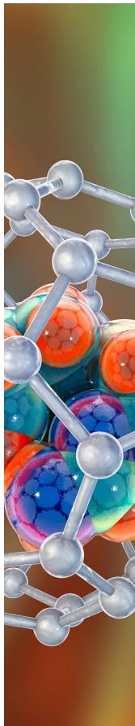

CAS BIOFINDER DISCOVERY PLATFORMTM ELIMINATE DATA SILOS. FIND WHAT YOU NEED, WHEN YOU NEED IT.

A single platform for relevant, high-quality biological and toxicology research

Streamline your R&D