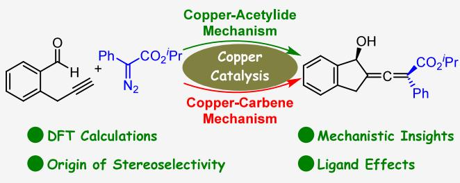
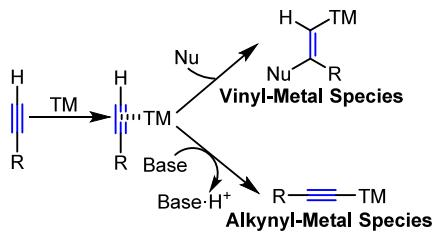
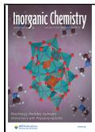
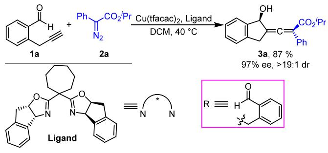
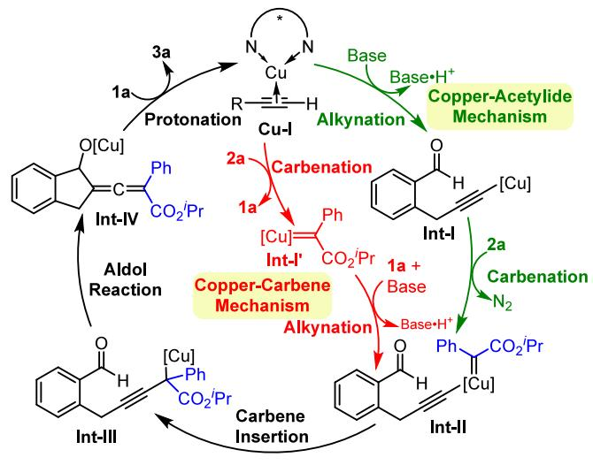
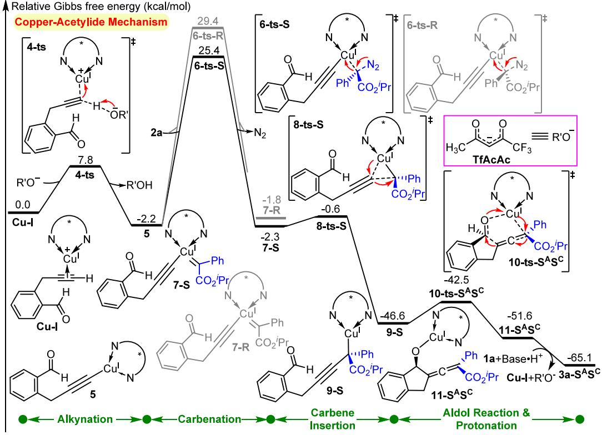
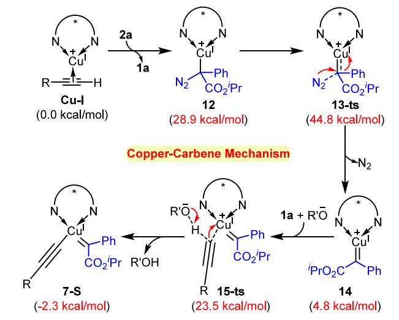
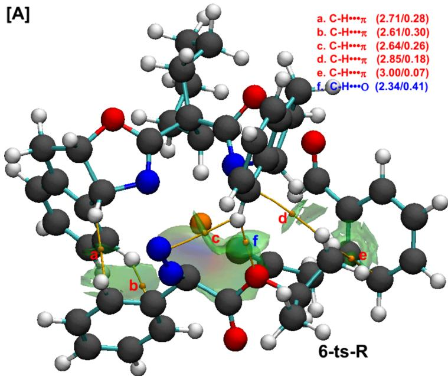
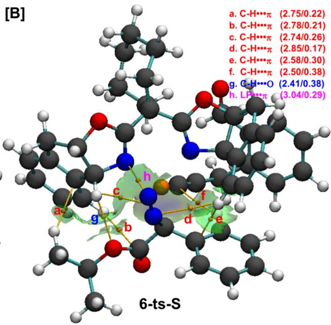
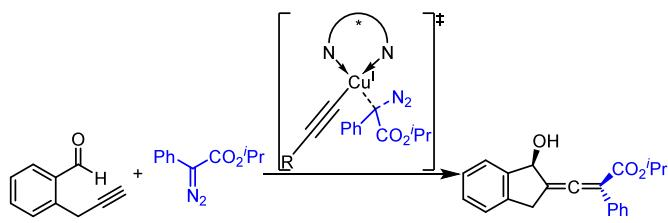

pubs.acs.org/IC

Article

# A Comprehensive Mechanistic Scenario for Asymmetric Cross-Coupling Reaction of Diazoacetate and Terminal Alkyne under Copper Catalysis

Yan-Kun Cui, Sai-Bo Cao, and Yang Wang\*

Cite This: Inorg. Chem. 2025, 64, 24012−24019

Read Online

ACCESS

Metrics & More

Article Recommendations

ABSTRACT: Terminal alkynes have emerged as highly versatile building blocks for constructing C−C bonds. These compounds are thought to undergo conversion to acetylide intermediates before further transformation. In the present work, the possible reaction mechanisms of the cross-coupling reaction of diazoacetate with alkyne under copper catalysis are investigated using the M06-L method. Two diferent reaction pathways including a copper− acetylide mechanism and a copper−carbene mechanism are investigated and comparatively analyzed. Computational results

\*sı Supporting Information

  
demonstrate that the energetically favored pathway follows a copper-acetylide mechanism, comprising alkynation of the terminal alkyne, carbenation, carbene insertion, Aldol reaction, and catalyst regeneration. In contrast, the alternative pathway involving a carbenation−alkynation sequence is found to be less favorable. The rate-determining step is verified by the carbenation process, which also determines the stereoselectivity. Noncovalent interaction (NCI) analysis reveals that noncovalent interactions between the diazo and indane groups of the bisoxazoline ligand are important in controlling stereoselectivity. Calculations involving a series of chiral ligands further demonstrate that the bulky indane moiety in the bisoxazoline ligand is essential for achieving stereoselectivity, consistent with experimental observations.

## 1. INTRODUCTION

Terminal alkynes have garnered significant interest due to their distinctive structural characteristics and high reactivity, making them highly versatile building blocks for constructing C−C bonds. These compounds are typically converted into acetylide intermediates prior to further transformation.1−5 Transformation of terminal alkynes represents one of the most efective strategies to construct multifunctional molecules from simple precursors under transition-metal catalysis.6−14 An alkyne−metal complex forms through the coordination of a transition metal to the alkyne triple bond. This interaction weakens the triple bond and facilitates subsequent nucleophilic attack, leading to the formation of a vinylmetal species (Scheme 1). Additionally, this metal coordination enhances the acidity of the terminal hydrogen, enabling deprotonation to form an alkynyl−metal species.

Copper salts, valued for their low cost and minimal toxicity, are extensively employed in organic transformations.15−22 Among their applications, copper-catalyzed cross-coupling reactions involving terminal alkynes are well-established, and numerous strategies have been devised for the construction of allenes.23−30 Recently, Sun et al. reported a tandem crosscoupling/alkynylogous aldol reaction between terminal alkyne and diazoacetate catalyzed by copper species for the synthesis of tetrasubstituted allenes (Scheme 2).31 This method afords the products in a high yield (87%, Scheme 2) with excellent enantioselectivity (97% ee, Scheme 2) and diastereoselectivity (>19:1 dr, Scheme 2), representing an eficient approach for the enantioselective synthesis of tetrasubstituted allenes bearing both central and axial chirality.

Scheme 1. Activation Modes of Terminal Alkyne under Transition Metal (TM) Catalysis  

The catalytic copper species typically activates the terminal alkyne to produce a copper−acetylide species and also activates the diazoacetate to produce a copper−carbene species. Terminal alkyne undergoes deprotonation to deliver the copper−acetylide, which subsequently reacts with the diazoacetate. Alternatively, the copper catalyst may first activate the diazoacetate to produce the copper−carbene, which then engages with the terminal alkyne. Although Sun and co-workers have made significant progress to elucidate the mechanism of this reaction, two major problems are still unclear. First, establishing a general mechanistic scheme is challenging due to the involvement of diferent activation modes. Second, the molecular origin of the high stereoselectivity requires further clarification. As a result, our interest was drawn to investigating this copper-catalyzed asymmetric synthesis of a tetrasubstituted allene. Theoretical mechanistic analysis of transition-metal-catalyzed reactions32−37 is at the center of our research. Therefore, in this study, we employed density functional theory (DFT), which is a robust computational method for mechanistic investigations,38−49 to theoretically investigate the mechanism of the copper-catalyzed crosscoupling reaction between a terminal alkyne and diazoacetate. In particular, we intend to elucidate the activation mode in detail, specifically whether copper−acetylide or copper− carbene serves as the key intermediate.

Scheme 2. Copper-Catalyzed Cross-Coupling Reaction of a Diazoacetate with a Terminal Alkyne  

## 2. COMPUTATIONAL METHODS

All quantum chemical calculations were performed using the Gaussian 09 software package.50 Geometry optimizations were carried out with the M06-L functional.51,52 The 6-31G(d, p) basis set53,54 was employed for the C, H, O, N, and F atoms, while the SDD basis set55,56 was used for the Cu atom. Solvation efects were incorporated via the continuum solvation model IEF-PCM,57,58 using dichloromethane (DCM, ε = 8.93) as the solvent. Harmonic vibrational analysis verifies that the stationary points are characterized as minima with no imaginary frequency or transition states with one and only one imaginary frequency, respectively. To refine the calculated energy, single-point calculations with a larger basis set were then performed based on these optimized structures, by using the M06-L functional with the Def2-TZVP basis set.59,60 The free energies reported in this work were calculated based on the single point energy at the M06-L/ def2-TZVP level, including the Gibbs free energy thermal correction obtained from vibrational analysis at the geometry optimization level. For disclosing the origin of stereoselectivity, the Multiwfn software package61 is used to generate the interaction wave functions, which are then visualized through VMD 62

## 3. RESULTS AND DISCUSSION

3.1. Reaction Mechanism. Considering the behavior of copper species, we propose both the copper−acetylide mechanism and the copper−carbene mechanism on the copper-catalyzed reaction between diazoacetate and alkyne, as illustrated in Scheme 3. Both pathways were initiated from the Cu-I species. In the copper−acetylide mechanism, the

Scheme 3. Proposed Mechanism of Copper-Catalyzed Asymmetric Cross-Coupling Reaction between Diazoacetate and Terminal Alkyne

sequential base-assisted deprotonation and alkynation of alkyne 1a deliver the copper−acetylide intermediate Int-I. Subsequent carbenation between Int-I and diazoacetate 2a afords the copper−carbene acetylide species Int-II. Alternatively, in the copper−carbene mechanism, Int-II is generated via an alternate route involving initial carbenation of the intermediate Cu-I, accompanied by deprotonation of alkyne 1a. Insertion of the carbene moiety into the acetylide then yields propargyl copper intermediate Int-III. An alkynylogous aldol reaction then occurs, leading to allenoate copper species Int-IV. Protonation of Int-IV delivers the final chiral exocyclic α-allenol and regenerates the active copper species. With these proposed mechanisms in hand, theoretical calculations were conducted to elucidate the detailed mechanism of the Cu(I)- catalyzed cross-coupling reaction between diazoacetate and alkyne.

3.1.1. Copper−Acetylide Mechanism. First, we investigated the copper−acetylide mechanism. As depicted in Figure 1, only the most favorable pathway for the formation of the major isomer is presented, while the energy profiles for the SRconfigured isomer (Figure S1) and R-configured pathway (Figure S2) are provided in the Supporting Information. Deprotonation of alkyne 1a in the active species Cu-I by trifluoroacetylacetonate (Tfacac) yields copper−acetylide 5 associated with transition state 4-ts. The exothermic reaction releases 2.2 kcal/mol energy with an energy barrier of 7.8 kcal/ mol. Subsequent carbenation proceeds via transition state 6-ts through coordination of diazoacetate 2a, afording the copper−carbene acetylide intermediate 7 accompanied by releasing nitrogen gas. This intermediate undergoes carbene insertion to form propargyl copper species 9 via transition state 8-ts. The energy barriers for nitrogen dissociation via transition states 6-ts-R and 6-ts-S are 27.6 and 31.6 kcal/mol, respectively. The relative Gibbs free energies of copper− carbene acetylide species 7-R and 7-S are −1.8 and −2.3 kcal/ mol, respectively, indicating that carbenation is exothermic under experimental conditions. The Cu−carbene bond length in Fischer metal-carbene63 species 7-S is 1.88 Å, suggesting a covalent character. Furthermore, localized orbital bonding analysis61 shows that the oxidation state of Cu remains +1 through these processes. To confirm the reliability of the calculated results and evaluate conformational preferences for the stereoselective transition states, we conducted additional conformational searches for the stereoselective transition states. It is noteworthy that, because of the steric influence of the indane moiety in the ligand, only two orientations are possible during the carbenation process: the N�N moiety in diazo 2a is orientated toward or away from the ligand. The results summarized in Figure S3 of the Supporting Information confirm that the original conformations of these two pathways indeed correspond to the lower-energy configurations.

  
Figure 1. Relative energy profile for the copper-catalyzed asymmetric cross-coupling reaction involved in the copper−acetylide mechanism.

The copper−carbene acetylide intermediate rapidly converts into the more stable propargyl copper species, 9-R (ΔG = −48.6 kcal/mol, Figure S1) and 9-S (ΔG = −46.6 kcal/mol, Figure 1). The chiral center is established during the carbene formation and insertion steps. The energy barriers for the reverse reactions of these processes are 78.0 and 72.0 kcal/mol, respectively, indicating that the transformation of copper− acetylide to copper−carbene acetylide is irreversible. Therefore, these two steps determine the stereoselectivity of the reaction. Re-face addition of 2a to the copper species yields the R-isomer, whereas Si-face addition of 2a afords the S-isomer. Subsequently, an alkynylogous aldol reaction takes place to yield the allenoate copper species $\mathbf { 1 1 - S ^ { A } S ^ { C } }$ via the transition state 10-ts- ${ \bf \nabla } \cdot { \bf S ^ { A } S ^ { C } }$ associated with an energy barrier of 4.1 kcal/ mol. During this aldol process, the central chirality is converted into axial chirality, while a new central chirality is simultaneously generated. The superscripts “A” and “C” denote axial and central chirality, respectively. Finally, protonation of the allenoate copper species $\mathbf { 1 1 - S ^ { A } S ^ { C } }$ releases the exocyclic α-allenol product $3 a { \cdot } S ^ { \mathrm { { A } } } S ^ { \mathrm { { C } } }$ and regenerates the copper catalyst.

3.1.2. Copper−Carbene Mechanism. Next, we examined the copper−carbene mechanism. Ligand exchange with the diazo compound 2a yields complex 12, which is an endergonic process at 28.9 kcal/mol (Scheme 4). Denitrogenation of intermediate 12 proceeds associated with transition state 13-ts,

Scheme 4. Elementary Steps in the Copper−Carbene Mechanism

overcoming an energy barrier of 44.8 kcal/mol to form copper−carbene intermediate 14. The coordinated terminal alkyne 1a in intermediate 14 is deprotonated by Tfacac through transition state 15-ts-S, resulting in the corresponding copper−carbene acetylide 7-S with an energy barrier of 23.5 kcal/mol. Subsequent carbene insertion into the copper− acetylide bond and protonation occur analogously to the copper−acetylide mechanism.

The Gibbs free energy barriers for transition states 4-ts, 6-ts-S, 8-ts-S, and $\mathbf { 1 0 { - } t s { - } S ^ { \tilde { \mathbf { A } } } S ^ { C } }$ in the copper-acetylide mechanism are 7.8, 27.6, 1.6, and 6.4 kcal/mol, respectively. In comparison, the energy barriers for the copper-carbene mechanism corresponding to transition states 13-ts, 15-ts-S, 8-ts-S, and $\mathbf { 1 0 - t s - ^ { \hat { S } ^ { A } S ^ { C } } }$ are 44.8, 23.5, 1.6, and 6.4 kcal/mol, respectively. The overall energy barrier of the copper-acetylide mechanism is 27.6 kcal/mol, while that for the copper-carbene mechanism is 44.8 kcal/mol, which indicates that the copperacetylide mechanism is energetically more favorable. To gain deeper insight into the reactivity of diferent copper species during the formation of copper−carbene acetylide intermediates, a local reactivity index analysis64 was performed on Cu atoms in intermediates 5 and Cu-I. According to the analysis (Table S1), the nucleophilic reactivity indices of the Cu atom in intermediates 5 and Cu-I are 0.51 and 0.14, respectively. This suggests that the alkynated Cu center in the copperacetylide species exhibits higher reactivity, thereby facilitating the denitrogenation process.

3.2. Origin of Stereoselectivity. The analysis in Section 3.1 indicates that the stereoselectivity is governed by the reaction between copper−acetylide 5 and diazo 2a, leading to the formation of R- and S-configured propargyl copper species. The energy barrier for forming the R-isomer $\big ( \Delta \bar { G } _ { 6 \mathrm { - } \mathrm { t s - } \mathrm { R } } ^ { \big ) } \dddot { \dddot { \mathbf { \rho } } } = 3 1 . 6$ kcal/mol, Figure 1) is higher than that for the S-isomer $( \Delta G _ { 6 \mathrm { - } \mathrm { t s - } } ) ^ { \frac { 1 } { \frac { 1 } { \cdot } } } = 2 7 . 6$ kcal/mol, Figure 1), suggesting that generation of 9-S is less favorable. The energy diference corresponds to an enantiomeric excess (ee) value of 99.8%, which aligns closely with the experimentally observed ee of 97% (the calculation formula used to calculate this ee value is provided in the Supporting Information).

For gaining a deeper quantitative insight into the stereoselective outcome, we first conducted an activation strain mode (ASM) analysis.65 As summarized in Table 1, the activation

Table 1. Activation Strain Model for Transition States 6-ts-R and 6-ts-S
<table><tr><td rowspan="2">species</td><td rowspan="2"> $E _ { \mathrm { a c t } }$  (kcal/mol)</td><td colspan="2"> $E _ { \mathrm { d i s t } }$  (kcal/mol)</td><td rowspan="2"> $E _ { \mathrm { i n t } } \ \mathrm { ( k c a l / m o l ) }$ </td></tr><tr><td>5</td><td>2a</td></tr><tr><td>6-ts-R</td><td>17.4</td><td>15.8</td><td>36.0</td><td>-34.4</td></tr><tr><td>6-ts-S</td><td>14.6</td><td>15.1</td><td>36.5</td><td>-37.0</td></tr></table>

energies $\left( E _ { \mathrm { a c t } } \right)$ for 6-ts-S (14.6 kcal/mol) and 6-ts-R (17.4 kcal/mol) align well with their relative Gibbs free energy barriers. Although the diazo moiety in 6-ts-S exhibits greater distortion (36.5 kcal/mol) compared to that in 6-ts-R (36.0 kcal/mol), this destabilizing efect is counterbalanced by the larger distortion energy of the copper-acetylide moiety in 6-ts-R (15.8 mol vs 15.1 kcal/mol in 6-ts-S). The total distortion energies for 6-ts-R (51.8 kcal/mol) and 6-ts-S (51.6 kcal/mol) are nearly identical. In contrast, the interaction energy in 6-ts-S (−37.0 kcal/mol) is more stabilizing than that in 6-ts-R (−34.4 kcal/mol). The results of the ASM analysis indicate that the interaction energy plays a dominant role in stabilizing the transition state and that stereoselectivity is primarily determined by electrostatic interactions.

The above ASM analysis indicates that electrostatic interactions play a key role in inducing stereoselectivity. To further validate these interactions, a qualitative noncovalent interaction (NCI) analysis61 was performed on the transition states 6-ts-R and 6-ts-S formed during nucleophilic addition. The observed stereoselectivity in the carbenation process is attributed to distinct noncovalent interaction patterns between the prochiral faces, as illustrated by the optimized transitionstate geometries in Figure 2. We characterized these interactions using two complementary methods: atom-inmolecule (AIM) and NCI. In the AIM approach, bond critical points (BCPs) and bond paths are identified to determine the electrostatic interactions. The NCI method visualizes noncovalent interactions through RDG isosurfaces. The electron density $( \rho )$ values at these BCPs provide a quantitative measure for elucidating the strength of a specific interaction, which are rendered by the AIM analysis. Together, the two methods resolve ambiguities in interpreting atomic proximities by diferentiating the stabilizing interactions from geometric artifacts. This dual analytical approach aligns with the ASM analysis that supports the integration of AIM and NCI for mapping interaction regions in stereoselective reactions.

Transition states 6-ts-R and 6-ts-S exhibit distinct NCI profiles. In the higher-energy transition state 6-ts-R, five distinct C−H···π interactions are observed, with interatomic distances ranging from 2.61 to 3.00 Å and corresponding Laplacian of ρ values at the BCP between $0 . 0 7 \times 1 0 ^ { - 1 }$ and 0.30 $\times \bar { 1 } 0 ^ { - 1 } \mathrm { a u }$ (labeled a−e in Figure 2A). In addition, a C−H···O interaction is present with a distance of 2.34 Å and a corresponding Laplacian of ρ value o $\mathrm { \dot { \langle } 0 . 4 1 \times 1 0 ^ { - 1 } \ a u }$ (labeled f in Figure 2A). In contrast, the lower-energy transition state 6- ts-S features $\mathrm { C - H } \cdots \pi$ interactions with distances ranging from 2.50 to 2.85 Å and corresponding Laplacian of the $\rho$ values between $0 . 1 7 \times 1 0 ^ { - 1 }$ and $0 . { \overset { - } { 3 } } 8 \times 1 { \overset { - } { 0 } } ^ { - 1 }$ au (labeled a−f in Figure 2B). The C−H···O interaction in 6-ts-S has a distance of 2.41 Å and a corresponding $\rho$ value of $0 . 3 8 \times 1 0 ^ { - 1 }$ au (labeled g in Figure 2B). Based on the computed distances and ρ values, the transition state 6-ts-S owns much more preferential noncovalent interactions (i.e., C−H···O and C−H···π) than those in 6-ts-R.

In addition to their shared ones, distinct noncovalent interactions are also found in transition states 6-ts-R and 6-ts-S. A directional LP···π interaction with a contact distance of 3.04 Å and a $\rho$ value of $0 . 2 9 \times 1 0 ^ { - 1 }$ au is found in the lowerenergy 6-ts-S. According to NCI and AIM analyses, addition via the Si-face leads to more eficient noncovalent interactions $( { \mathrm { i . e . , ~ C { \mathrm { - } } H { \cdots } } } \pi , { \mathrm { ~ L P } } { \cdots } \pi ,$ and C−H···O), resulting in preferential generation of the S-configuration. The stereoselectivity is primarily governed by the noncovalent interactions between the diazo group and the indane moiety of the ligand.

3.3. Ligand Efects. The results in Section 3.2 demonstrate that the chiral bisoxazoline (Box) ligand has an important influence in determining the yield and stereoselectivity of the cross-coupling reaction between diazo compounds and terminal alkynes under copper catalysis. Additional calculations involved in stereoselective transition states were carried out to further elucidate the influences on the stereoselectivity of the chiral ligand. The structures of ligands are shown in Figure S4 of the Supporting Information. The energy gap of the stereoselective step is reduced to 3.5 kcal/mol by replacing the Box ligand with a six-membered ring variant (Ligand-1, Table 2), corresponding to a calculated ee of 99.5%. Switching to a five-membered ring ligand (Ligand-2) further narrows this energy gap to 1.5 kcal/mol, leading to diminished enantioselectivity with only 85.4% ee. Moderate enantioselectivity is observed when the Box ligand features a gem-dimethyl linkage (Ligand-3) as well as the other two types of Box ligands (Ligand-4 and Ligand-5). The computed ee values, derived from the energy profiles, show reasonable agreement with the experimental results. These computational insights also support our earlier proposal that the stereoselectivity is predominantly dictated by the interaction between the substrate and the ligand in the transition state formed during carbene transfer.

  
Figure 2. NCI analysis for (A) stereoselective transition state 6-ts-R and (B) stereoselective transition state 6-ts-S (the interatomic distance and Laplacian of the electron density are shown in brackets in Å and × 10−1 au, respectively).

Table 2. Theoretically Predicted and Experimentally Observed Stereoselectivities for a Series of Chiral Bisoxazoline Ligands  

<table><tr><td colspan="3">ee (%)</td></tr><tr><td>ligand</td><td>ΔΔG</td><td>calcd</td><td>exptl</td></tr><tr><td>Ligand-1</td><td>3.5</td><td>99.5</td><td>95</td></tr><tr><td>Ligand-2</td><td>1.5</td><td>85.4</td><td>78</td></tr><tr><td>Ligand-3</td><td>1.7</td><td>89.4</td><td>86</td></tr><tr><td>Ligand-4</td><td>1.2</td><td>76.7</td><td>80</td></tr><tr><td>Ligand-5</td><td>1.0</td><td>68.9</td><td>63</td></tr></table>

## 4. CONCLUSIONS

The DFT method was performed to explore the mechanism of the cross-coupling reaction of diazoacetate and alkyne catalyzed by Cu(I) species toward the synthesis of chiral allenes. The proposed pathway comprises five key steps: (1) alkynation of the Cu(I) species to form copper−acetylide species, (2) carbenation of the diazoacetate to generate copper−carbene acetylide species, (3) carbene insertion into the copper−carbene acetylide species, yielding a propargyl copper intermediate, (4) an intramolecular aldol reaction that releases the allenoate copper species, and (5) protonation of the allenoate copper species to aford the final chiral exocyclic α-allenol and regenerate the active copper catalyst. The carbenation step was identified as both the stereoselectivityand rate-determining step, with an energy barrier of 27.6 kcal/ mol. DFT calculations indicate that the copper−carbene pathway exhibits an overall energy barrier of 44.8 kcal/mol and is thus energetically disfavored. An NCI analysis revealed the significance of interactions between diazoacetate and the indane group of the Box ligand in governing the stereoselectivity. A range of chiral Box ligands was also evaluated, and the presence of an indane group was found to promote high stereoselectivity, consistent with experimental findings. Computational results demonstrate that when an indane group is present on the Box ligand, the conventional pathway comprising alkynylation, carbenation, carbene insertion, aldol reaction, and protonation is energetically favorable. The present study enhances the mechanistic understanding of the cross-coupling reaction between diazoacetate and alkyne catalyzed by copper and ofers a theoretical foundation for guiding further experimental studies.

## ■ ASSOCIATED CONTENT

## Data Availability Statement

The authors state that all of the data reported in the manuscript are reproducible and available in the Supporting Information.

## \*sı Supporting Information

The Supporting Information is available free of charge at https://pubs.acs.org/doi/10.1021/acs.inorgchem.5c04051.

Energy profile for the formation of the SR-configured isomer (Part 1, Figure S1), energy profile of the Rconfigured pathway (Part 2, Figure S2), evaluation of conformational preferences (Part 3, Figure S3), structures of diferent ligands (Part 4, Figure S4), calculation formula for the ee value (Part 5), local reactivity index analysis (Part 6, Table S1), energy information (Part 7, Table S2), and Cartesian coordinates (Part 8) of all of the stationary points (PDF)

## ■ AUTHOR INFORMATION

## Corresponding Author

Yang Wang − Department of Material and Chemical Engineering, Zhengzhou University of Light Industry, Zhengzhou 450001 Henan Province, P. R. China; orcid.org/0000-0003-0695-385X; Email: wangyang@ zzuli.edu.cn

## Authors

Yan-Kun Cui − Department of Material and Chemical Engineering, Zhengzhou University of Light Industry, Zhengzhou 450001 Henan Province, P. R. China   
Sai-Bo Cao − Department of Material and Chemical Engineering, Zhengzhou University of Light Industry, Zhengzhou 450001 Henan Province, P. R. China

Complete contact information is available at: https://pubs.acs.org/10.1021/acs.inorgchem.5c04051

## Notes

The authors declare no competing financial interest.

## ■ ACKNOWLEDGMENTS

We thank the financial support from the National Natural Science Foundation of China (21903072), the Basic Project of Zhengzhou University of Light Industry (23XJCYJ044), and the Key Projects of Colleges and Universities in Henan Province (no. 24B150045). Liwen Bianji (Edanz) (www.liwenbianji.cn) is also thanked for editing the English text of a draft of this manuscript.

## ■ REFERENCES

(1) Liu, C.; Yuan, J. W.; Gao, M.; Tang, S.; Li, W.; Shi, R. Y.; Lei, A. W. Oxidative Coupling between Two Hydrocarbons: An Update of Recent C-H Functionalizations. Chem. Rev. 2015, 115, 12138−12204.

(2) Trost, B. M.; Masters, J. T. Transition Metal-Catalyzed Couplings of Alkynes to 1,3-Enynes: Modern Methods and Synthetic Applications. Chem. Soc. Rev. 2016, 45, 2212−2238.

(3) Zhou, Y. J.; Zhang, Y.; Wang, J. B. Recent Advances in Transition-Metal-Catalyzed Synthesis of Conjugated Enynes. Org. Biomol. Chem. 2016, 14, 6638−6650.

(4) Chinchilla, R.; Nájera, C. Chemicals from Alkynes with Palladium Catalysts. Chem. Rev. 2014, 114, 1783−1826.

(5) Pradhan, T. R.; Park, J. K. Intermolecular Allene-Alkyne Coupling: A Significantly Useful Synthetic Transformation. ACS Catal. 2024, 14, 7814−7845.

(6) Teng, Q.; Thirupathi, N.; Tung, C. H.; Xu, Z. H. Hydroalkynylative Cyclization of 1,6-enynes with Terminal Alkynes. Chem. Sci. 2019, 10, 6863−6867.

(7) Peng, J.; Bai, R. P.; Lan, Y. How to Achieve Hydrogenation/ Hydrofunctionalization via Metal Hydride Complexes. Acc. Chem. Res. 2025, 58, 1484−1495.

(8) Galiana-Cameo, M.; Urriolabeitia, A.; Barrenas, E.; Passarelli, V.; Pérez-Torrente, J.; Giuseppe, A. D.; Polo, V.; Castarlenas, R. Metal - Ligand Cooperative Proton Transfer as an Efficient Trigger for Rhodium-NHC-Pyridonato Catalyzed gem-Specific Alkyne Dimerization. ACS Catal. 2021, 11, 7553−7567.

(9) Guo, H. Y.; Zhang, S.; Li, Y.; Yu, X. Q.; Feng, X. J.; Yamamoto, Y.; Bao, M. Palladium-Catalyzed Tail-to-Tail Reductive Dimerization of Terminal Alkynes to 2,3-Dibranched Butadienes. Angew. Chem., Int. Ed. 2022, 61, No. e202116870.

(10) Chen, H. H.; Dang, Z. L.; Sha, X. T.; Wang, X.; Zhang, Z. G.; Luo, Y. X.; Lan, Y. Variable Mechanisms for Cobalt-Catalyzed Alkyne Dimerization Pinpointed by Quasi-Classical Trajectory Simulations. ACS Catal. 2024, 14, 16469−16478.

(11) Storey, C. M.; Gyton, D. R.; Andrew, R. E.; Chaplin, A. B. Terminal Alkyne Coupling Reactions through a Ring: Mechanistic Insights and Regiochemical Switching. Angew. Chem., Int. Ed. 2018, 57, 12003−12006.

(12) Heras, L. D. L.; Esteruelas, A. E.; Oliván, M.; Oñate, E. Homoand Cross-Coupling of Phenylacetylenes and α-Hydroxyacetylenes Catalyzed by a Square-Planar Rhodium Monohydride. ACS Catal. 2024, 14, 8389−8404.

(13) Sun, Y. Y.; Zhang, J. Y.; Zeng, Y. L.; Meng, L. P.; Li, X. Y. Mechanism and Stereoselectivity Control of Terminal Alkyne Dimerization Activated by a Zr/Co Heterobimetallic Complex: A DFT Study. J. Org. Chem. 2024, 89, 605−616.

(14) Orbe, M. E. D.; Amenós, L.; Kirillova, M. S.; Wang, Y. H.; López-Carrillo, V.; Maseras, F.; Echavarren, A. M. Cyclobutene vs 1,3- Diene Formation in the Gold-Catalyzed Reaction of Alkynes with Alkenes: The Complete Mechanistic Picture. J. Am. Chem. Soc. 2017, 139, 10302−10311.

(15) Haldón, E.; Nicasio, M. C.; Pérez, P. J. Copper-catalysed Azide-Alkyne Cycloadditions (CuAAC): An Update. Org. Biomol. Chem. 2015, 13, 9528−9550.

(16) Wang, C. L.; Ikhlef, D.; Kahlal, S.; Saillard, J.; Astruc, D. Metalcatalyzed Azide-Alkyne “Click” Reactions: Mechanistic Overview and Recent Trends. Coord. Chem. Rev. 2016, 316, 1−20.

(17) Meldal, M.; Torno̷e, C. W. Cu-Catalyzed Azide−Alkyne Cycloaddition. Chem. Rev. 2008, 108, 2952−3015.

(18) Dong, K. Y.; Liu, M. T.; Xu, X. F. Recent Advances in Catalytic Alkyne Transformation via Copper Carbene Intermediates. Molecules 2022, 27, 3088.

(19) Hattori, G.; Sakata, K.; Matsuzawa, H.; Tanabe, Y.; Miyake, Y.; Nishibayashi, Y. Copper-Catalyzed Enantioselective Propargylic Amination of Propargylic Esters with Amines: Copper−Allenylidene Complexes as Key Intermediates. J. Am. Chem. Soc. 2010, 132, 10592−10608.

(20) Gómez, J. E.; Cristofol, ̀ A.; Kleij, A. W. Copper-Catalyzed Enantioselective Construction of Tertiary Propargylic Sulfones. Angew. Chem., Int. Ed. 2019, 58, 3903−3907.

(21) Hein, J. E.; Fokin, V. Copper-Catalyzed Azide - Alkynecycloaddition (CuAAC) and Beyond: New Reactivity of Copper(i) Acetylides. Chem. Soc. Rev. 2010, 39, 1302−1315.

(22) Makarem, A.; Berg, R.; Rominger, F.; Straub, B. F. A Fluxional Copper Acetylide Cluster in CuAAC Catalysis. Angew. Chem., Int. Ed. 2015, 54, 7431−7435.

(23) Chen, N.; He, M.; Zhou, T.; Zhu, Y. Q.; Zhang, H.; Peng, S. Y. Recent Advances in the Tandem Cyclization/Cycloaddition of Allene Intermediates from Copper-Catalyzed Cross-Coupling of Diazo Compounds with Terminal Alkynes. Synthesis 2021, 53, 611−622.

(24) Zhong, K. B.; Shan, C. H.; Zhu, L.; Liu, S.; Zhang, T.; Liu, F. R.; Shen, B. M.; Lan, Y.; Bai, R. P. Theoretical Study of the Addition of Cu−Carbenes to Acetylenes to Form Chiral Allenes. J. Am. Chem. Soc. 2019, 141, 5772−5780.

(25) Hossain, M. L.; Ye, F.; Zhang, Y.; Wang, J. B. CuI-Catalyzed Cross-Coupling of N-Tosylhydrazones with Terminal Alkynes: Synthesis of 1,3-Disubstituted Allenes. J. Org. Chem. 2013, 78, 1236−1241.

(26) Chu, W. B.; Zhang, L.; Zhang, Z. K.; Zhou, Q.; Mo, F. Y.; Zhang, Y.; Wang, J. B. Enantioselective Synthesis of Trisubstituted Allenes via Cu(I)-Catalyzed Coupling of Diazoalkanes with Terminal Alkynes. J. Am. Chem. Soc. 2016, 138, 14558−14561.

(27) Gao, Y. X.; Wang, G.; Chen, L.; Xu, P. X.; Zhao, Y. F.; Zhou, Y. B.; Han, L. B. Copper-Catalyzed Aerobic Oxidative Coupling of Terminal Alkynes with H-Phosphonates Leading to Alkynylphosphonates. J. Am. Chem. Soc. 2009, 131, 7956−7957.

(28) Jin, L. Q.; Hao, W. F.; Xu, J. N.; Sun, N.; Hu, B. X.; Shen, Z. L.; Mo, W. X.; Hu, X. Q. N-Heterocyclic Carbene Copper-Catalyzed Direct Alkylation of Terminal Alkynes with Non-activated Alkyl Triflates. Chem. Commun. 2017, 53, 4124−4127.

(29) Garcia-Roca, A.; Pérez-Soto, R.; Stoica, G.; Benet-Buchholz, J.; Maseras, F.; Kleij, A. W. Comprehensive Mechanistic Scenario for the

Cu-Mediated Asymmetric Propargylic Sulfonylation Forging Tertiary Carbon Stereocenters. J. Am. Chem. Soc. 2023, 145, 6442−6452.

(30) Poh, J. H.; Makai, S.; Keutz, T. V.; Tran, D. N.; Battilocchio, C.; Pasau, P.; Ley, S. V. Rapid Asymmetric Synthesis of Disubstituted Allenes by Coupling of Flow-Generated Diazo Compounds and Propargylated Amines. Angew. Chem., Int. Ed. 2017, 56, 1864−1868.

(31) Xu, G. Y.; Wang, Z.; Shao, Y.; Sun, J. T. Copper-Catalyzed Tandem Cross-Coupling and Alkynylogous Aldol Reaction: Access to Chiral Exocyclic α-Allenols. Org. Lett. 2021, 23, 5175−5179.

(32) Cao, S. B.; Liang, P. X.; Huang, G. L.; Wang, Y. Theoretical Investigation of a [4 + 2] Annulation Reaction of an Enal with an Ynamide under NHC/Au Dual Catalysis: Mechanism and Origin of Stereoselectivity. Mol. Catal. 2025, 585, No. 115363.

(33) Zhang, Y. R.; Wang, Y. Elucidating the Mechanism and Origin of Diastereoselectivity in Scandium-Catalyzed β-C(sp3)-H Activation and Transformation of an Aliphatic Aldimine. Org. Chem. Front. 2024, 11, 4391−4401.

(34) Luo, C. C.; Cao, S. B.; Yang, H. Y.; Wang, Y. Mechanism and Origin of Stereoselectivity and Regioselectivity in Cobalt-catalyzed C-H Functionalization of Arylphosphinamide. Catal. Sci. Technol. 2025, 15, 4750−4758.

(35) Wang, Y.; Zhang, H.; Liu, Y.; Gong, K. L.; Wei, D. H. Theoretical Investigation on Cobalt-catalyzed Hydroacylation Reaction: Mechanism and Origin of Stereoselectivity. Molecular Catalysis. 2022, 527, No. 112410.

(36) Wang, Y.; Gong, K. L.; Zhang, H.; Liu, Y.; Wei, D. H. Mechanism of a Cobalt-catalyzed Hydroarylation Reaction and Origin of Stereoselectivity. Catal. Sci. Technol. 2022, 12, 4380−4387.

(37) Wang, Y.; Du, C.; Wang, Y. Y.; Guo, X. K.; Fang, L.; Song, M. P.; Niu, J. L.; et al. High-Valent Cobalt-Catalyzed C-H Activation/ Annulation of 2-Benzamidopyridine 1-Oxide with Terminal Alkyne: A Combined Theoretical and Experimental Study. Adv. Synth. Catal. 2018, 360, 2668−2677.

(38) Zhang, N.; Xue, Z. Q.; Shi, L.; Luo, G. Unveiling the Detailed Mechanism and Origins of Chemo-, Regio-, and Stereoselectivity of Rare-Earth Catalyzed Alternating Copolymerization of Polar and Nonpolar Olefins. Inorg. Chem. 2024, 63, 3544−3559.

(39) Qi, X. T.; Lan, Y. Recent Advances in Theoretical Studies on Transition-MetalCatalyzed Carbene Transformations. Acc. Chem. Res. 2021, 54, 2905−2915.

(40) Liu, F. R.; Zhu, L.; Zhang, T.; Zhong, K. B.; Xiong, Q.; Shen, B. M.; Liu, S. H.; Lan, Y.; Bai, R. B. Nucleophilicity versus Bro̷nsted Basicity Controlled Chemoselectivity: Mechanistic Insight into Silver or Scandium-Catalyzed Diazo Functionalization. ACS Catal. 2020, 10, 1256−1263.

(41) Huang, Z.-M.; Sun, Y.; Wang, Y.; Wang, X.-W. Theoretical Insight into Palladium-Catalyzed gem-Difluorovinylation/Cyclopropanation of N-methylindole and N-phenylindole with Trifluoromethyl Diazo Compounds. Mol. Catal. 2024, 564, No. 114279.

(42) Wu, Y.; Cao, S. S.; Douair, I.; Maron, L.; Bi, X. H. Computational Insights into Different Mechanisms for Ag-, Cu-, and Pd-Catalyzed Cyclopropanation of Alkenes and Sulfonyl Hydrazones. Chem. − Eur. J. 2021, 27, 5999−6006.

(43) Sharma, A. K.; Maseras, F. The Subtle Mechanism of Nickel-Photocatalyzed C(sp3)-H Cross-Coupling. Inorg. Chem. 2024, 63, 13801−13806.

(44) Ma, J.; Qi, S. M.; Yan, G. W.; Kirillov, A. M.; Yang, L.; Fang, R. DFT Study on the Mechanisms and Selectivities in Rh (III)-Catalyzed [5 + 1] Annulation of 2-Alkenylanilides and 2-Alkylphenols with Allenyl Acetates. J. Org. Chem. 2024, 89, 8562−8577.

(45) Zhang, W. D.; Yang, X.-J.; Kirillov, A. M.; Yang, L. Z.; Fang, R. Density Functional Theory Rationalization of the Mechanism, Selectivity, and Role of Substituents in Au(I)-Catalyzed Synthesis of Pyrazolines and Dihydropyridines. J. Org. Chem. 2024, 89, 18209− 18217.

(46) Tan, X. Y.; Hu, J. M.; Li, Y.; Luo, L.; Wang, X. T.; Cao, D. Y.; Luo, G. Mechanisms and Origins of Regioselectivity in Rare-Earth-Catalyzed C-H Functionalization of Anisoles and Thioanisoles. Inorg. Chem. 2025, 64, 5778−5788.

(47) Wang, J. Z.; Yang, Y. Y.; Liu, C. B.; Zhang, D. J. Theoretical Insight into the Palladium-Catalyzed Prenylation and Geranylation of Oxindoles with Isoprene. Inorg. Chem. 2024, 63, 4855−4866.

(48) Huo, S. H.; Meng, L. P.; Zeng, Y. L.; Li, X. Y. Mechanism, Stereoselectivity, and Role of O2 in Aza-Diels-Alder Reactions Catalyzed by Dinuclear Molybdenum Complexes: A Theoretical Study. Inorg. Chem. 2022, 61, 4714−4724.

(49) Yan, J.; Dong, L. H.; Yang, Y. Y.; Zhang, D. J. DFT Insight into a Strain-Release Mechanism in Bicyclo[1.1.0]butanes via Concerted Activation of Central and Lateral C-C Bonds with Rh(III) Catalysis. Inorg. Chem. 2024, 63, 8879−8888.

(50) Frisch, M. J.; Trucks, G. W.; Schlegel, H. B.; Scuseria, G. E.; Robb, M. A.; Cheeseman, J. R.; Scalmani, G.; Barone, V.; Petersson, G. A.; Nakatsuji, H.; Li, X.; Caricato, M.; Marenich, A. V.; Bloino, J.; Janesko, B. G.; Gomperts, R.; Mennucci, B.; Hratchian, H. P.; Ortiz, J. V.; Izmaylov, A. F.; Sonnenberg, J. L.; Williams-Young, D.; Ding, F.;

Millam, J. M.; Klene, M.; Adamo, C.; Cammi, R.; Ochterski, J. W.; Martin, R. L.; Morokuma, K.; Farkas, O.; Foresman, J. B.; Fox, D. J. Gaussian 09, Revision D.01; Gaussian, Inc.: Wallingford CT, 2010.

(51) Zhao, Y.; Truhlar, D. G. A New Local Density Functional for Main Group Thermochemistry, Transition Metal Bonding, Thermochemical Kinetics, and Noncovalent Interactions. J. Chem. Phys. 2006, 125, 194101.

(52) Zhao, Y.; Truhlar, D. G. The M06 Suite of Density Functionals for Main Group Thermochemistry, Thermochemical kKnetics, Noncovalent Interactions, Excited States, and Transition Elements: Two New Functionals and Systematic Testing of Four M06-Class Functionals and 12 other Functionals. Theor. Chem. Acc. 2008, 120, 215−241.

(53) Hehre, W. J.; Ditchfield, R.; Pople, J. A. Self-Consistent Molecular Orbital Methods. XII. Further Extensions of Gaussian-Type Basis Sets for Use in Molecular Orbital Studies of Organic Molecules. J. Chem. Phys. 1972, 56, 2257−2261.

(54) Ditchfield, R.; Hehre, W. J.; Pople, J. A. Self-Consistent Molecular-Orbital Methods. IX. An Extended Gaussian-Type Basis for Molecular-Orbital Studies of Organic Molecules. J. Chem. Phys. 1971, 54, 724−728.

(55) Dolg, M.; Wedig, U.; Stoll, H.; Preuss, H. Energy-Adjusted ab Initio Pseudopotentials for the First Row Transition Elements. J. Chem. Phys. 1987, 86, 866−872.

(56) Andrae, D.; Häußermann, U.; Dolg, M.; Stoll, H.; Preuss, H. Energy-Adjusted ab Initio Pseudopotentials for the Second and Third Row Transition Elements. Theor. Chim. Acta. 1990, 77, 123−141.

(57) Mennucci, B.; Tomasi, J. Continuum Solvation Models: A New Approach to the Problem of Solute’s Charge Distribution and Cavity Boundaries. J. Chem. Phys. 1997, 106, 5151−5158.

(58) Barone, V.; Cossi, M. Quantum Calculation of Molecular Energies and Energy Gradients in Solution by a Conductor Solvent Model. J. Phys. Chem. A 1998, 102, 1995−2001.

(59) Weigend, F.; Ahlrichs, R. Balanced Basis Sets of Split Valence, Triple Zeta Valence and Quadruple Zeta Valence Quality for H to Rn: Design and Assessment of Accuracy. Phys. Chem. Chem. Phys. 2005, 7, 3297−3305.

(60) Weigend, F. Accurate Coulomb-Fitting Basis Sets for H to Rn. Phys. Chem. Chem. Phys. 2006, 8, 1057−1065.

(61) Lu, T. A Comprehensive Electron Wavefunction Analysis Toolbox for Chemists, Multiwfn. J. Chem. Phys. 2024, 161, No. 082503.

(62) Humphrey, W.; Dalke, A.; Schulten, K. VMD − Visual Molecular Dynamics (version 1.9.3). J. Mol. Graph 1996, 14, 33−38.

(63) Dotz, K. H.; Stendel, Jr. J. Fischer Carbene Complexes in Organic Synthesis: Metal-Assisted and Metal-Templated Reactions. Chem. Rev. 2009, 109, 3227−3274.

(64) Domingo, L. R.; Ríos-Gutiérrez, M.; Pérez, P. Applications of the Conceptual Density Functional Theory Indices to Organic Chemistry Reactivity. Molecules 2016, 21, 748.

(65) Bickelhaupt, F. M.; Houk, K. N. Analyzing Reaction Rates with the Distortion/Interaction-Activation Strain Model. Angew. Chem., Int. Ed. 2017, 56, 10070−10086.

CAS BIOFINDER DISCOVERY PLATFORMTM

# BRIDGE BIOLOGY AND CHEMISTRY FOR FASTER ANSWERS

Analyze target relationships, compound effects, and disease pathways

Explore the platform