pubs.acs.org/OrgLett

Letter

# Dimethoxyacetaldehyde‑N‑triftosylhydrazone: Preparation and Carbene Reactivity in Cyclopropanation and Doyle−Kirmse Reactions

Yifan Zhang,# Shuang Li,# Hongzhu Chen,# Wei Song,# Yongquan Ning,\* Zeyun Liu, Yong Wu, Karunanidhi Murali, Paramasivam Sivaguru, and Xiaolong Zhang\*

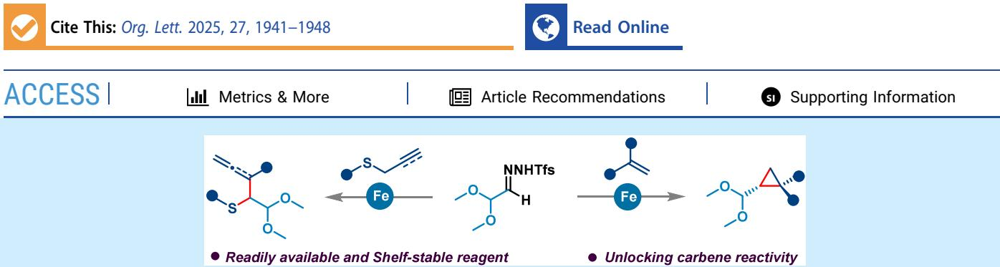  
ABSTRACT: Herein, we developed the new, powerful, and easy-to-handle chemical reagent, dimethoxyacetaldehyde-Ntriftosylhydrazone (DMHz-Tfs), as a convenient in situ source of dimethoxydiazoethane under mild conditions. We demonstrate the carbene reactivity of DMHz-Tfs in iron-catalyzed cyclopropanation and Doyle−Kirmse reactions, providing access to diverse acetal functionalized cyclopropanes and homoallylic- and allenyl-sulfides at gram-scale with high stereoselectivity. DFT calculations elucidated the involvement of the most stable doublet spin state iron-carbene intermediate over other possible spin states.

C ince von Pechmann discovered diazomethane, the smallest S diazo compound, in 1894,1 advances in their synthesis and applications have expanded rapidly.2 Although their synthesis requires stringent safety regulations,3 the utility of diazo compounds as carbene precursors has become indispensable in modern organic synthesis.4 The structural modifications of diazomethane to increase functionality and selectivity in chemical reactions have attracted more attention owing to its rich and tunable reactivity profile and its ability to prepare diverse functionalized chemical entities.4c−i,5 α-Diazocarbonyl compounds4c,d,5 and (di)aryl diazomethanes6 were prominent in early applications. In recent decades, an array of α- functionalized diazoalkanes, including fluorinated moieties $\big ( - \mathrm { C F _ { 2 } H , } ^ { 7 } \mathrm { \phantom { - } - C _ { n } F _ { 2 n + 1 } } ^ { 8 - 1 1 } \big ) , - \mathrm { C N , } ^ { 1 2 ^ { \sim } } - \mathrm { C H O , } ^ { 1 3 } - \mathrm { T M S , } ^ { 1 4 ^ { \sim } }$ sulfone,15 and phosphonate,16 etc., have been practiced in diazo-based carbene chemistry. However, the synthesis and application of dimethoxydiazoethane remains largely untouched despite its potential to construct formylated building blocks (Figure 1A).

The history of dimethoxydiazoethane goes back to 1980 when Abdallah and Greé synthesized it from 2,2-dimethox yethylamine in three steps and studied its reactivity as 1,3- dipoles to prepare acetal/formyl cyclopropanes and pyrazoles.17 Later, Dehmlow and co-workers reported an improved synthesis protocol from the same starting materials without using N O (Figure 1B).18 Nonetheless, the need for multistep procedures, hazardous reagents, and acidic conditions limited its broad applicability. Moreover, the carbene reactivity of dimethoxydiazoethane has yet to be studied. Hence, the design and development of a new diazo surrogate that is able to release dimethoxydiazoethane species under mild conditions could greatly improve the reagent’s synthetic accessibility, especially for large-scale applications. In pursuit of our continuous research eforts in the synthesis and applications of functionalized diazo alkanes derived from easily decomposable N-triftosylhydrazones,19 we here introduce dimethoxyacetaldehyde-N-triftosylhydrazone (DMHz-Tfs) as the shelfstable and safe-to-handle in situ precursor of dimethoxydiazoethane. The carbene reactivity of DMHz-Tfs was demonstrated through the iron-catalyzed cyclopropanation of alkenes and Doyle−Kirmse reaction with allyl and propargyl sulfides (Figure 1C), allowing access to diverse acetal functionalized cyclopropanes as well as homoallylic and allenyl sulfides in high yields with broad scope and excellent functional group compatibility.

Three dimethoxyacetaldehyde-N-sulfonylhydrazones with diferent sulfonyl groups could be readily prepared from commercially available 2,2-dimethoxyacetaldehyde in excellent yields (Scheme 1). These reagents are bench-stable crystalline solids that can be stored at ambient conditions for at least 3 weeks without significant degradation.

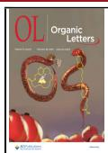

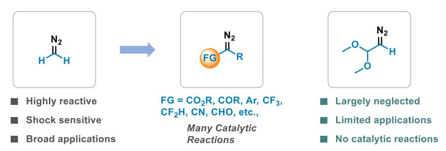

Figure 1. Dimethoxydiazoethane in situ derived from dimethoxyacetaldehyde-N-triftosylhydrazone (DMHz-Tfs) and its applications.  
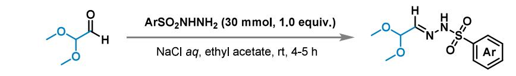  
aReaction conditions: 2,2-dimethoxyacetaldehyde (60 mmol, 2.0 equiv, 60% in water), ArSO NHNH (30 mmol, 1.0 equiv), ethyl acetate (50.0 mL), and saturated NaCl aqueous (50.0 mL) at room temperature (rt). Isolated yields were shown.

Following extensive screening of the reaction conditions, it was observed that the Fe-catalyzed system was efective in the cyclopropanation of DMHz-Tfs (Supporting Information Table S1). With the optimized conditions in hand, we next examined the scope of alkenes for iron-catalyzed cyclopropanation with DMHz-Tfs (1, Scheme 2). Various styrenes bearing electron-donating (e.g., methyl, methoxy, tert-butyl, benzene, and benzyl ether) and electron-withdrawing (e.g., halogens, trifluoromethyl, nitro, cyano, and ester) groups were well tolerated, delivering the desired trans-cyclopropanes 4−20 in 72−98% yields. Notably, the electronic properties of the aryl rings had a negligible efect on the reaction eficiency. For ortho-substituted styrenes, the yield of the fluorine-substituted substrate was higher than methyl- and benzyl ether-substituted substrates (20 vs 18 and 19). Similarly, di- and tri-substituted styrenes as substrates could give the desired acetal cyclopropanes 21−23 in good yields. The reaction conditions were also applicable to fused aryl substrates (e.g., naphthalene and

Scheme 2. Cyclopropanation Reaction of DMHz-Tfsa

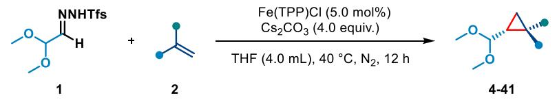

A Scope of alkenes

13, R = 4-CO2Me, 98% (d.r. > 20:1)

14, R = 4-Ph, 95% (d.r. > 20:1)

15, R = 3-Me, 96% (d.r. > 20:1)

$$
1 8 , \mathsf { R } = 2 { \cdot } \mathsf { M e } , 8 5 \% ( \mathsf { d } . \mathsf { r } . > 2 0 { : } 1 )
$$

$$
1 9 , { \mathsf { R } } = 2 { \mathsf { - O B n } } , 8 2 \% \left( { \mathsf { d } } . { \mathsf { r } } . { \mathsf { \Omega } } > 2 0 { \mathsf { : } } 1 \right)
$$

$$
2 0 , \mathsf { R } = 2 { \mathsf { - } } \mathsf { F } , 9 8 ^ { \circ } / _ { 0 } ( \mathsf { d } . \mathsf { r } . > 2 0 { \mathsf { : } } 1 )
$$

$$
2 1 , \mathsf { R } = 3 , 4 \mathrm { - } d i \mathsf { C } 1 , 9 8 \% ( \mathrm { d } . \mathsf { r } , > 2 0 { : } 1 )
$$

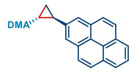

22, R = 3,5-diOMe, 88% (d.r. > 20:1)

$$
2 3 , \mathsf { R } = 2 , 4 , 6 \mathrm { - } t r i \mathsf { M e } , 7 2 \% ( \mathsf { d } . \mathsf { r } , > 2 0 { : } 1 )
$$

$$
2 4 , 9 2 \% ( { \mathsf { d } } . { \mathsf { r } } . > 2 0 { : } 1 )
$$

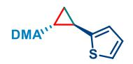

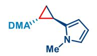

$$
2 8 , X = 0 , 9 6 \% ( { \mathsf { d } } . { \mathsf { r } } . > 2 0 { \mathsf { : } } 1 )
$$

$$
2 9 , X = 5 , 9 4 \% ( { \mathrm { d . r . } } > 2 0 { : } 1 )
$$

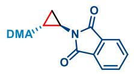

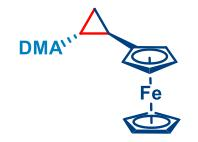

$$
3 0 , 6 8 \% ( { \mathsf { d } } . { \mathsf { r } } . > 2 0 { : } 1 )
$$

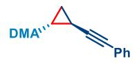

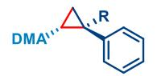

$$
3 4 , \mathsf { R } = \mathsf { M e } , 9 7 \% ( \mathsf { d } . \mathsf { r } . > 2 0 { : } 1 )
$$

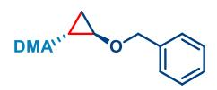

$$
3 3 , 9 8 \% ( { \mathsf { d } } . { \mathsf { r } } . > 2 0 { : } 1 )
$$

$$
3 5 , \mathsf { R } = \mathsf { B r } , 9 5 \% ( \mathsf { d } . \mathsf { r } . = 1 . 2 { : } 1 )
$$

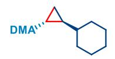

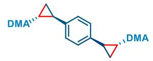

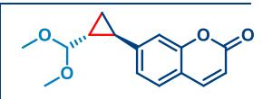

$$
3 7 , 4 9 \% ( { \mathsf { d } } . { \mathsf { r } } . > 2 0 { : } 1 )
$$

$$
3 8 , 9 5 \% ( { \mathsf { d } } . { \mathsf { r } } . > 2 0 { : } 1 ) ^ { b }
$$

B Late-stage modification of natural products

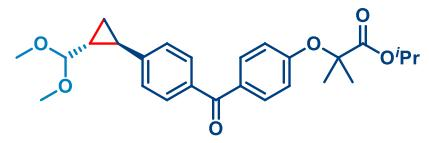

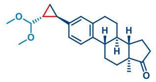

$$
4 0 , 9 4 \% ( { \mathsf { d } } . { \mathsf { r } } . > 2 0 { : } 1 )
$$

aReaction conditions: DMHz-Tfs (2.0 equiv), alkene (1.0 equiv), Fe(TPP)Cl (5.0 mol $\% ) , \mathrm { C s } _ { 2 } \mathrm { C O } _ { 3 } \mathrm { ( 4 . 0 ~ e q u i v ) }$ , THF (4.0 mL) at $4 0 ~ ^ { \circ } \mathrm { C }$ for 12 h under $\mathrm { N } _ { 2 } .$ bDMHz-Tfs (4.0 equiv) and $\mathrm { C s } _ { 2 } \mathrm { C O } _ { 3 }$ (8.0 equiv). Diastereomeric (d.r.) ratio was determined by 1H NMR analysis of the crude reaction mixture. Isolated yields were shown.

pyrene), providing target products 24 and 25 in 92% and 95% yield, respectively. Alkenes embedded in electron-rich heterocycles, such as thiophene (26), N-methylpyrrole (27), benzofuran (28), benzothiophene (29), and phthalimide (30), converted to cyclopropanes without compromising reaction eficiencies. Notably, ferrocene was also compatible with the reaction to give an acetal cyclopropane (31). The reaction is highly regioselective, as only terminal cyclopropanation products 32 (89%) and 33 (98%) with conjugated diene and enyne as substrates were obtained. While α- methylstyrene (34) was cyclopropanated with high stereoselectivity, α-bromostyrene (35) led to only 1.2:1 stereoselectivity. In addition to aryl alkenes, aliphatic alkenes, such as enol ether and vinylcyclohexane, were amenable, furnishing the desired products 36 and 37 in 94% and 49% yields, respectively. The olefin substrate bearing other alkyl substituents aforded the corresponding cyclopropane products in very low yields (see Supporting Information). The reaction also tolerated p-divinylbenzene, which aforded the desired biscyclopropane 38 by doubling other reagents. Late-stage modification of complex molecules, such as 7-hydroxycoumarin, fenofibrate, and estrone derivatives, could also be achieved in good yields with excellent stereocontrol (39−41), demonstrating the potential for the discovery of more promising drug candidates.

Scheme 3. Gram Scale Syntheses of 42 and Its Downstream Diversification  
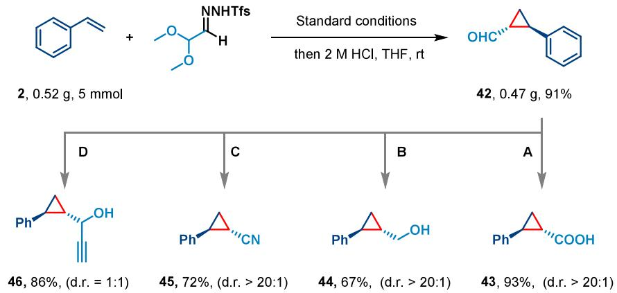  
a(A) 42 (0.5 mmol) and KHSO (0.5 mmol) in MeCN/H O at $3 5 ~ ^ { \circ } \mathrm { C }$ for 24 h. (B) 42 (0.5 mmol) and NaBH (0.6 mmol) in MeOH at $0 ~ ^ { \circ } \mathrm { C }$ to rt for 2 h. (C) 42 (0.5 mmol) and NH OH·HCl (0.75 mmol) in N-methyl-2-pyrrolidone at 100 °C for 2 h. (D) 42 (0.5 mmol) and BrMgC�CH (0.5 mmol) in THF at $2 5 ~ ^ { \circ } \mathrm { C }$ for 12 h. Diastereomeric ratio (d.r.) was determined by 1H NMR analysis of the crude reaction mixture.

To highlight the potential utility of this protocol, we scaled up the reaction of DMHz-Tfs and styrene to a 5 mmol scale, afording the acetal cyclopropane 3 in good yields without erosion of stereoselectivity. Then mild acid hydrolysis of 3 provided the formyl cyclopropane 42 in 91% yield, which could transform into structurally diverse cyclopropane scafolds (Scheme 3). For example, oxidation of 42 with ${ \mathrm { K H S O } } _ { 5 }$ led to the formation of carboxylic acid 43, while it was reduced to primary alcohol 44 with NaBH . Cyclopropanecarbonitrile 45 was also obtained smoothly by treating 42 with hydroxylamine hydrochloride. Finally, the nucleophilic addition of ethynylmagnesium bromide to formyl cyclopropane 42 gave a diastereomeric mixture of propargyl alcohols 46 in 86% yield.

Next, we explored the reactivity of DMHz-Tfs in the Doyle− Kirmse reaction�an interesting [2,3]-sigmatropic rearrangement reaction to construct C−S and C−C bonds.20 We chose DMHz-Tfs and allyl phenyl sulfide as model substrates to optimize the reaction conditions. After a series of experimentations, we were pleased to find that the target product 49 could be isolated in 95% yield when reacting 1 with allyl phenyl sulfide in the presence of Fe(TPP)Cl catalyst and $\mathrm { C s } _ { 2 } \mathrm { C O } _ { 3 }$ base in THF at $4 0 ~ ^ { \circ } \mathrm { C }$ for 12 h under nitrogen atmosphere (see Supporting Information Table S2 for details).

Under the optimized conditions, the generality of the reaction was then examined (Scheme 4A). A wide range of aryl allyl sulfides containing either electron-donating or electronwithdrawing substituents at the para- or meta-positions of the aromatic ring were compatible, afording corresponding products 50−57 in 63 to 98% yields. The steric hindrance on the aromatic ring impacted the product yields, as orthosubstituted aryl allyl sulfides produced slightly lower yields (58−60). The reaction was also amenable to disubstituted aryl allyl sulfides to deliver the desired products in moderate to good yields (61−63). Allyl sulfides bearing electron-rich naphthalene and furan rings smoothly participated in the process, delivering 64 and 65 in 59% and 58% yields, respectively. Besides aryl allyl sulfides, methyl, benzyl, and adamantyl allyl sulfides were also suitable for this conversion, which could react with DMHz-Tfs to obtain corresponding products 66−68 in moderate to good yields. Similarly, the reaction using 2-methylallyl, 1-phenylallyl, and 1,1-dimethy lallyl aryl sulfides was also attempted, furnishing the desired products in moderate to good yield (69−71). It is worth noting that diallyl sulfide can efectively engage in the reaction, yielding the desired bilateral [2,3]-sigmatropic rearrangement product 72 (98% yield and d.r. = 1.5:1) by doubling other reagents.

We then expanded the scope of this reaction to propargyl sulfides 48 (Scheme 4B), which ofered a convenient route to functionalized allenes.21 Aryl propargyl sulfides bearing a methyl or methoxy group at the para-position of the aryl ring and naphthyl propargyl sulfide could be converted smoothly into the corresponding allenyl sulfides 73−76 in moderate to good yields (49−68%). The reaction could proceed efectively with 1-methyl or 1-trimethylsilyl substituted alkynyl sulfides, which delivered target products 77 and 78 in 96% and 91% yield, respectively. Finally, we explored the versatility of the acetal-substituted homoallyl sulfide product 49. The mild acid hydrolysis of 49 produced the corresponding aldehyde analog 79 (92% yield), which then was oxidized in the presence of m-CPBA to give sulfone derivative 80 in 90% yield (Scheme 4C).

To gain insight into the reaction mechanism of cyclopropanation, we performed density functional theory (DFT) calculations on a model reaction of DMHz-Tfs with styrene (Figure 2). The Fe catalyst could exhibit three distinct spin states.22 First, 1 decomposed readily in the presence of ${ \mathrm { C s } } _ { 2 } { \mathrm { C O } } _ { 3 }$ generating the diazo species $\mathbf { 1 } \mathbf { a } . ^ { 2 3 }$ Subsequent interaction of 1a with Fe(TPP)Cl generates stable doublet electrophilic iron-carbene intermediate Int2 with the elimination of dinitrogen via doublet transition state 2TS1 $( \Delta G ^ { \ddagger } =$ 1.1 kcal/mol). Compared to those of 2TS1, the energy barriers for forming quartet transition state $^ 4 \mathrm { \bf T S 1 } \left( \Delta G ^ { \ddagger } = 4 . 0 \ddot { \mathrm { k c a l / m o l } } \right)$ or sextet transition state 6TS1 $( \Delta G ^ { \ddagger } \ = \ 9 . 5 $ kcal/mol) are significantly higher. Subsequent electrophilic concerted addition of iron carbene Int2 to styrene 2 generates the cyclopropane via transition state ${ } ^ { 2 } \mathbf { T } \mathbf { S } 2$ with an energy barrier of 5.7 kcal/mol, which is the rate-determining step. Similarly, the energy barriers of the addition process for the quartet and sextet transition states are much higher (4TS2: $\hat { \Delta G ^ { \ddagger } } = 1 2 . 1$ kcal/mol; 6TS2: $\Delta G ^ { \ddagger } \ = \ 1 7 . 4$ kcal/mol) than the doublet transition state and are thus excluded.

Scheme 4. Doyle−Kirmse Reaction of DMHz-Tfsa  
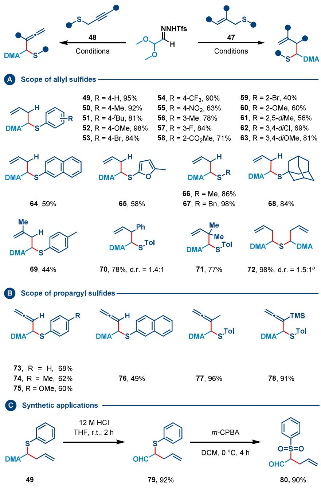  
aReaction conditions: DMHz-Tfs (3.0 equiv), sulfide (1.0 equiv), Fe(TPP)Cl (5.0 mol %), $\mathrm { C s } _ { 2 } \mathrm { C O } _ { 3 } \left( 6 . 0 \right.$ equiv), THF (4.0 mL) at $4 0 ~ ^ { \circ } \mathrm { C }$ for 12 h under N . bDMHz-Tfs (6.0 equiv) and $\mathrm { C } \bar { \bf s } _ { 2 } \mathrm { C O } _ { 3 }$ (12.0 equiv). Diastereomeric ratio (d.r.) was determined by 1H NMR analysis of the crude reaction mixture. Isolated yields were shown.

To probe the origin of the diastereoselectivity, we performed an interaction region indicator (IRI) analysis of the diastereoselectivity-determining transition state ${ } ^ { 2 } \mathbf { T } \mathbf { S } 2$ (Figure 2B). Our calculations indicate that the anti-selective transition state has a stronger $\pi { \cdot } { \cdot } \pi$ interaction between the $\mathrm { C } { = } \mathrm { C }$ bond and the TPP ligand, resulting in a lower energy barrier $( \Delta G ^ { \ddagger }$ = 5.7 kcal/mol) than the syn-selective transition state $( \Delta G ^ { \ddagger } =$ 10.8 kcal/mol). Thus, the anti-cyclopropane formation is far preferable to that of syn-cyclopropane (see Supporting Information for details). On the other hand, according to our calculations for Doyle−Kirmse reaction, the nucleophilic sulfur attack on iron carbene Int2 forms the zwitterionic intermediates Int3 via TS2, which then undergoes a ratedetermining [2,3]-sigmatropic rearrangement to furnish the final product while regenerating the Fe(TPP)Cl catalyst. We also considered free ylide,24 which was excluded because the

## A DFT calculations for cyclopropanation reaction

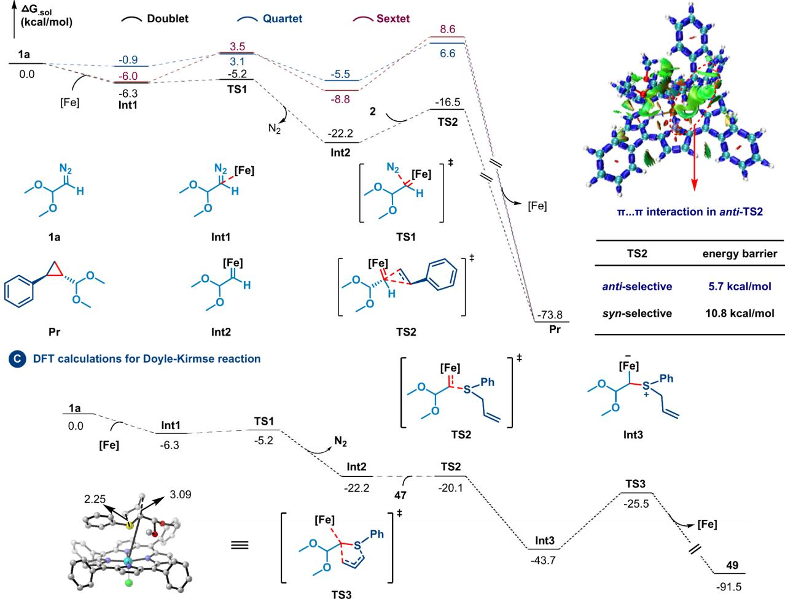  
Figure 2. DFT calculations at the SMD(THF)-B3LYP/6-31G(d,p)-SDD(Fe) level of theory; energies are given in kcal/mol.

energy barrier of free ylide pathway (57 kcal/mol) is much higher than that of metal-bound ylide (18.2 kcal/mol, see Supporting Information for details).

In this work, we developed a new chemical reagent, DMHz-Tfs, which could slowly release dimethoxydiazoethane in situ under mild conditions. Its carbene reactivity was established in iron-catalyzed cyclopropanation and Doyle−Kirmse reactions, enabling access to various acetal functionalized cyclopropanes and homoallyl- and allenyl-sulfides. The broad applicability of the developed protocol was highlighted by the late-stage modification of complex bioactive molecules, gram-scale synthesis, and structural diversification of acetal functionalized products. DFT studies disclosed that the doublet spin state of the iron catalyst enabled the carbene transfer process. Given its ease of preparation, high stability, and operational safety, DMHz-Tfs are expected to have a high potential for carbene transfer reactions.

## ■ ASSOCIATED CONTENT

## Data Availability Statement

The data underlying this study are available in the published article and its online Supporting Information.

## \*sı Supporting Information

The Supporting Information is available free of charge at https://pubs.acs.org/doi/10.1021/acs.orglett.5c00223.

Experimental details, computational details, characterization data, NMR spectra (PDF)

## ■ AUTHOR INFORMATION

## Corresponding Authors

Yongquan Ning − Department of Chemistry, Northeast Normal University, Changchun 130024, PR China; orcid.org/0000-0001-8791-6254; Email: ningyq508@ nenu.edu.cn

Xiaolong Zhang − Department of Chemistry, Northeast Normal University, Changchun 130024, PR China; Email: zhangxl226@nenu.edu.cn

## Authors

Yifan Zhang − Department of Chemistry, Northeast Normal University, Changchun 130024, PR China

Shuang Li − Forestry College of Beihua University, Jilin 132013, PR China

Hongzhu Chen − Department of Chemistry, Northeast Normal University, Changchun 130024, PR China

Wei Song − Department of Chemistry, Northeast Normal University, Changchun 130024, PR China

Zeyun Liu − Department of Chemistry, Northeast Normal University, Changchun 130024, PR China

Yong Wu − Department of Chemistry, Northeast Normal University, Changchun 130024, PR China; orcid.org/ 0000-0002-6806-1817

Karunanidhi Murali − Department of Chemistry, Northeast Normal University, Changchun 130024, PR China

Paramasivam Sivaguru − Department ofChemistry, Northeast Normal University, Changchun 130024, PR China; orcid.org/0000-0003-2225-0054

Complete contact information is available at: https://pubs.acs.org/10.1021/acs.orglett.5c00223

## Author Contributions

#YZ, SL, HC, and WS contributed equally to this work. Notes

The authors declare no competing financial interest.

## ■ ACKNOWLEDGMENTS

This work was supported by NSFC (22101044, 2240011809), the Department of Education of Jilin Province (JJKH20241419KJ) and Department of Science and Technology of Jilin Province (20240601040RC, 20220402040GH).

## ■ REFERENCES

(1) Pechmann, H. Ueber Diazomethan. Ber. Dtsch. Chem. Ges. 1894, 27, 1888−1891.

(2) (a) Black, T. H. The Preparation and Reactions of Diazomethane. Aldrichimica Acta 1983, 16, 3−8. (b) Morandi, B.; Carreira, E. M. Iron-Catalyzed Cyclopropanation in 6 M KOH with In Situ Generation of Diazomethane. Science 2012, 335, 1471−1474. (c) Svec, R. L.; Hergenrother, P. J. Imidazotetrazines as Weighable Diazomethane Surrogates for Esterifications and Cyclopropanations. Angew. Chem., Int. Ed. 2020, 59, 1857−1862.

(3) (a) Green, S. P.; Wheelhouse, K. M.; Payne, A. D.; Hallett, J. P.; Miller, P. W.; Bull, J. A. Thermal Stability and Explosive Hazard Assessment of Diazo Compounds and Diazo Transfer Reagents. Org. Process Res. Dev. 2020, 24, 67−84. (b) National Research Council. Prudent Practices in the Laboratory: Handling and Management of Chemical Hazards, Updated Version; The National Academies Press: Washington, DC, 2011. (c) Schoental, R. Carcinogenic Action of Diazomethane and of Nitroso-N-Methyl Urethane. Nature 1960, 188, 420−421. (d) Doyle, M. P.; McKervey, M. A.; Ye, T. Modern Catalytic Methods for Organic Synthesis with Diazo Compounds; Wiley-Interscience, 1998.

(4) (a) Curtius, T. Ueber die Einwirkung Von Salpetriger Saurë auf Salzsauren Glycocollather.̈ Ber. Dtsch. Chem. Ges. 1883, 16, 2230− 2231. (b) Curtius, T. Ueber Diazoessigsaurë und ihre Derivate. J. Prakt. Chem. 1888, 38, 396−440. (c) Ye, T.; McKervey, M. A. Organic Synthesis with. Alpha-Diazo Carbonyl Compounds. Chem. Rev. 1994, 94, 1091−1160. (d) Ford, A.; Miel, H.; Ring, A.; Slattery, C. N.; Maguire, A. R.; McKervey, M. A. Modern Organic Synthesis with α-Diazocarbonyl Compounds. Chem. Rev. 2015, 115, 9981− 10080. (e) Xia, Y.; Qiu, D.; Wang, J. Transition-Metal-Catalyzed Cross-Couplings through Carbene Migratory Insertion. Chem. Rev. 2017, 117, 13810−13889. (f) Dong, S.; Liu, X.; Feng, X. Asymmetric Catalytic Rearrangements with α-Diazocarbonyl Compounds. Acc. Chem. Res. 2022, 55, 415−428. (g) Jurberg, I. D.; Davies, H. M. L. Blue Light-Promoted Photolysis of Aryldiazoacetates. Chem. Sci. 2018, 9, 5112−5118. (h) Xiong, M.; Liang, X.; Gao, Z.; Lei, A.; Pan, Y. Synthesis of Isoxazolines and Oxazines by Electrochemical Intermolecular [2 + 1 + n] Annulation: Diazo Compounds Act as Radical Acceptors. Org. Lett. 2019, 21, 9300−9305. (i) Yang, D.; Guan, Z.; Peng, Y.; Zhu, S.; Wang, P.; Huang, Z.; Alhumade, H.; Gu, D.; Yi, H.; Lei, A. Electrochemical Oxidative Difunctionalization of Diazo Compounds with Two Different Nucleophiles. Nat. Commun. 2023, 14, 1476.

(5) (a) Doyle, M. P.; Anthony McKervey, M. Recent Advances in Stereoselective Synthesis Involving Diazocarbonyl Intermediates. Chem. Commun. 1997, 983−990. (b) Xiao, Q.; Zhang, Y.; Wang, J. Diazo Compounds and N-Tosylhydrazones: Novel Cross-Coupling Partners in Transition-Metal-Catalyzed Reactions. Acc. Chem. Res. 2013, 46, 236−247. (c) Candeias, N. R.; Paterna, R.; Gois, P. M. Homologation Reaction of Ketones with Diazo Compounds. Chem. Rev. 2016, 116, 2937−2981. (d) Xia, Y.; Wang, J. N-Tosylhydrazones: Versatile Synthons in the Construction of Cyclic Compounds. Chem. Soc. Rev. 2017, 46, 2306−2362. (e) Davies, H. M.; Liao, K. Dirhodium Tetracarboxylates as Catalysts for Selective Intermolecular C−H functionalization. Nat. Rev. Chem. 2019, 3, 347−360.

(6) (a) Sammakia, T. Phenyldiazomethane. In Encyclopedia of Reagents for Organic Synthesis; John Wiley & Sons: Hoboken, NJ, 2001. (b) Zhu, D.; Chen, L.; Fan, H.; Yao, Q.; Zhu, S. Recent Progress on Donor and Donor−Donor Carbenes. Chem. Soc. Rev. 2020, 49, 908−950.

(7) Mykhailiuk, P. K. In Situ Generation of Difluoromethyl Diazomethane for [3 + 2] Cycloadditions with Alkynes. Angew. Chem., Int. Ed. 2015, 54, 6558−6561.

(8) (a) Gilman, H.; Jones, R. 2,2,2-Trifluoroethylamine and 2,2,2- Trifluorodiazoethane. J. Am. Chem. Soc. 1943, 65, 1458−1460. (b) Mykhailiuk, P. K. 2,2,2-Trifluorodiazoethane (CF CHN ): A Long Journey Since 1943. Chem. Rev. 2020, 120, 12718−12755. (c) Mertens, L.; Koenigs, R. M. Fluorinated Diazoalkanes−a Versatile Class of Reagents for the Synthesis of Fluorinated Compounds. Org. Biomol. Chem. 2016, 14, 10547−10556. (d) Jana, S.; Li, F.; Empel, C.; Verspeek, D.; Aseeva, P.; Koenigs, M. P. Stoichiometric Photochemical Carbene Transfer by Bamford−Stevens Reaction. Chem.� Eur. J. 2020, 26, 2586−2591.

(9) (a) Mykhailiuk, P. K. Generation of C F CHN In Situ and Its First Reaction: [3 + 2] Cycloaddition with Alkenes. Chem.�Eur. J. 2014, 20, 4942−4947. (b) Mykhailiuk, P. K. Three-Component Synthesis of C F -Substituted Pyrazoles from $\mathrm { C } _ { 2 } \mathrm { F } _ { 5 } \mathrm { C H } _ { 2 } \mathrm { N H } _ { 2 } { \cdot } \mathrm { H C l } ,$ NaNO and Electron-Deficient Alkynes. Beilstein J. Org. Chem. 2015, 11, 16−24. (c) Mykhailiuk, P. K.; Ishchenko, A. Y.; Stepanenko, V.; Cossy, J. Synthesis of Fluoroalkyl Pyrazoles from In-Situ-Generated C F CHN and Electron-Deficient Alkenes. Eur. J. Org. Chem. 2016, 2016, 5485−5493.

(10) Mykhailiuk, P. K. Heptafluoroisopropyl Diazomethane (i-C F CHN ): In Situ Generation and Synthesis of Pyrazoles. Org. Biomol. Chem. 2017, 15, 7296−7301.

(11) Mertens, L.; Hock, K. J.; Koenigs, R. M. Fluoroalkyl-Substituted Diazomethanes and Their Application in a General Synthesis of Pyrazoles and Pyrazolines. Chem.�Eur. J. 2016, 22, 9542−9545.

(12) Mykhailiuk, P. K.; Koenigs, R. M. Diazoacetonitrile (N2CHCN): A Long Forgotten but Valuable Reagent for Organic Synthesis. Chem.�Eur. J. 2020, 26, 89−101.

(13) (a) Arnold, Z. Diazoacetaldehyde as a Source of Formylcarbene: A New Carbene Species. Chem. Commun. 1967, 299− 300. (b) Ning, Y.; Zhang, X.; Gai, Y.; Dong, Y.; Sivaguru, P.; Wang, Y.; Reddy, B. R. P.; Zanoni, G.; Bi, X. Difluoroacetaldehyde N-Triftosylhydrazone (DFHZ-Tfs) as a Bench-Stable Crystalline Diazo Surrogate for Diazoacetaldehyde and Difluorodiazoethane. Angew. Chem., Int. Ed. 2020, 59, 6473−6481.

(14) (a) Bug, T.; Hartnagel, M.; Schlierf, C.; Mayr, H. How Nucleophilic are Diazo Compounds? Chem.�Eur. J. 2003, 9, 4068− 4076. (b) Podlech, J. Trimethylsilyldiazomethane (TMS-CHN ) and Lithiated Trimethylsilydiazomethane−Versatile Substitutes for Diazomethane. J. Prakt. Chem./Chem.-Ztg. 1998, 340, 679−682.

(15) Plessis, C.; Uguen, D.; De Cian, A.; Fischer, J. Improved Preparation of Tosyldiazomethane. Tetrahedron Lett. 2000, 41, 5489− 5493.

(16) Marinozzi, M.; Pertusati, F.; Serpi, M. λ -Phosphorus-Containing α-Diazo Compounds: A Valuable Tool for Accessing Phosphorus-Functionalized Molecules. Chem. Rev. 2016, 116, 13991− 14055.

(17) (a) Abdallah, H.; Grée, R. Le Dimethyl Acetal Du Diazoacetaldehyde: Une Nouvelle Voie d’acces Aux Cyclopropanes Aldehydes et aux Formyl Pyrazoles. Tetrahedron Lett. 1980, 21, 2239−2242. (b) Abdallah, H.; Grée, R.; Carrié, R. Synthesè de Cyclopropanes Electrophiles à Fonction Aldehydé Libre ou Masquee.́ Can. J. Chem. 1983, 61, 217−223.

(18) Sander, M.; Dehmlow, E. V.; Neumann, B.; Stammler, H.-G. Preparation and Cyclopropanation of Selected Oxapolycycles. Tetrahedron 1999, 55, 13395−13406.

(19) For reviews: (a) Liu, Z.; Sivaguru, P.; Zanoni, G.; Bi, X. N-Triftosylhydrazones: A New Chapter for Diazo-Based Carbene Chemistry. Acc. Chem. Res. 2022, 55, 1763−178. (b) Liu, Z.; Zhang, X.; Sivaguru, P.; Bi, X. Triftosylhydrazone in Single-Atom Skeletal Editing. Acc. Chem. Res. 2025, 58, 130−149. (c) Sivaguru, P.; Pan, Y.; Wang, N.; Bi, X. Who is Who in the Carbene Chemistry of N-Sulfonyl Hydrazones. Chin. J. Chem. 2024, 42 (17), 2071−2108. For selected recent examples: (d) Zhang, X.; Song, Q.; Liu, S.; Sivaguru, P.; Liu, Z.; Yang, Y.; Ning, Y.; Anderson, E. A.; de Ruiter, G.; Bi, X. Asymmetric Dearomative Single-atom Skeletal Editing of Indoles and Pyrroles. Nat. Chem. 2025, 17, 215−225. (e) Liu, S.; Yang, Y.; Song, Q.; Liu, Z.; Lu, Y.; Wang, Z.; Sivaguru, P.; Bi, X. Tunable Molecular Editing of Indoles with Fluoroalkyl Carbenes. Nat. Chem. 2024, 16, 988−997. (f) He, C.; Song, W.; Wei, D.; Zhao, W.; Yu, Q.; Tang, J.; Ning, Y.; Murali, K.; Sivaguru, P.; de Ruiter, G.; Bi, X. Rhodium-Catalyzed Asymmetric Cyclopropanation of Indoles with N-Triftosylhydrazones. Angew. Chem., Int. Ed. 2024, 63, No. e202408220. (g) Ning, Y.; Chen, H.; Ning, Y.; Zhang, J.; Bi, X. Rhodium-Catalyzed One-Carbon Ring Expansion of Aziridines with Vinyl-N-triftosylhydrazones for the Synthesis of 2-Vinyl Azetidines. Angew. Chem., Int. Ed. 2024, 63, No. e202318072. (h) Li, L.; Ning, Y.; Chen, H.; Ning, Y.; Sivaguru, P.; Liao, P.; Zhu, Q.; Ji, Y.; de Ruiter, G.; Bi, X. Dearomative Insertion of Fluoroalkyl Carbenes into Azoles Leading to Fluoroalkyl Heterocycles with a Quaternary Center. Angew. Chem., Int. Ed. 2024, 63, No. e202313807.

(20) West, T. H.; Spoehrle, S. S.; Kasten, K.; Taylor, J. E.; Smith, A. D. Catalytic Stereoselective [2,3]-Rearrangement Reactions. ACS Catal. 2015, 5, 7446−7479.

(21) Modern Allene Chemistry; Krause, N., Hashmi, A. S. K., Eds.; Wiley-VCH: Weinheim, 2004.

(22) Weissenborn, M. J.; Koenigs, R. M. Iron-Porphyrin Catalyzed Carbene Transfer Reactions − an Evolution from Biomimetic Catalysis Towards Chemistry-Inspired Non-Natural Reactivities of Enzymes. ChemCatChem 2020, 12, 2171−2179.

(23) Wu, Y.; Cao, S.; Douair, I.; Maron, L.; Bi, X. Computational Insights into Different Mechanisms for Ag-, Cu-, and Pd-Catalyzed Cyclopropanation of Alkenes and Sulfonyl Hy-drazones. Chem.�Eur. J. 2021, 27, 5999−6006.

(24) (a) Yang, Z.; Guo, Y.; Koenigs, R. M. Photochemical, Metal-Free Sigmatropic Rearrangement Reactions of Sulfur Ylides. Chem.� Eur. J. 2019, 25, 6703−6706. (b) Hock, K. J.; Koenigs, R. M. Enantioselective [2,3]-Sigmatropic Rearrangements: Metal-Bound or Free Ylides as Reaction Intermediates? Angew. Chem., Int. Ed. 2017, 56, 13566−13568. (c) Laconsay, C. J.; Tantillo, D. J. Metal Bound or Free Ylides as Reaction Intermediates in Metal-Catalyzed [2,3]- Sigmatropic Rearrangements? It Depends. ACS Catal. 2021, 11, 829− 839.