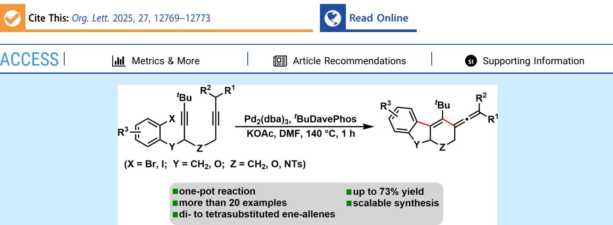
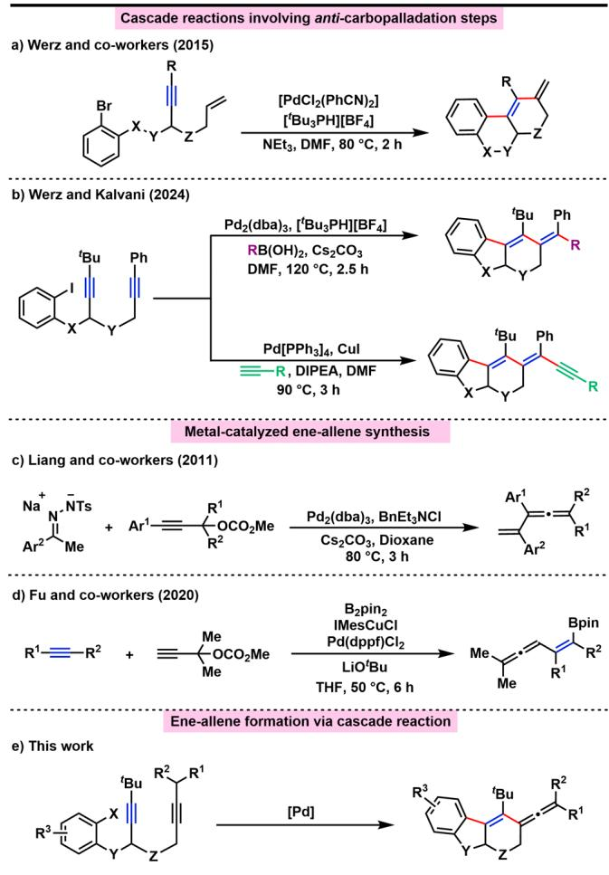
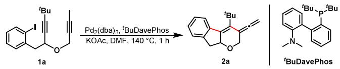
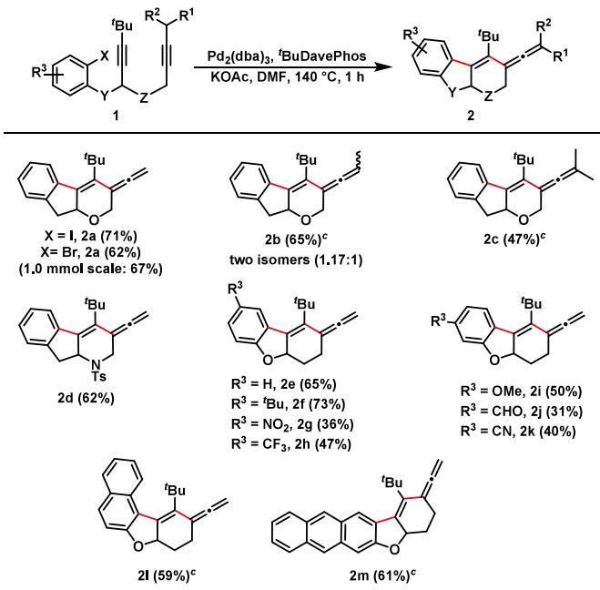
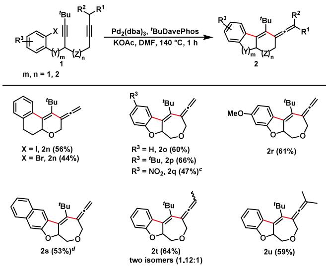
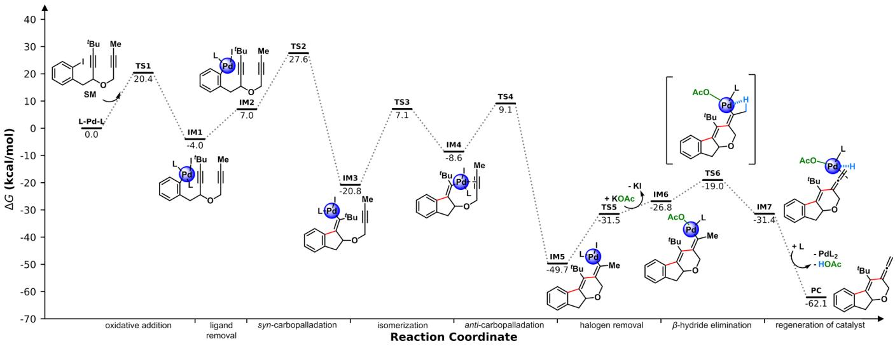

pubs.acs.org/OrgLett

Letter

# Ene-Allenes: Access from Dialkynes by an Intramolecular anti-Carbopalladation Cascade

Pedram Kalvani, Catherine Vanbel, Heinrich F. von Köller, and Daniel B. Werz\*

  
ABSTRACT: Herein, an intramolecular palladium-catalyzed cascade reaction is reported consisting of both formal anticarbopalladation and syn-carbopalladation of internal alkynes. This process leads to two new carbon−carbon bonds across the first double bond formed. The cascade is terminated by β-hydride elimination from the emerging vinyl Pd(II) complex. As a result, di-, tri-, and tetrasubstituted ene-allenes embedded in an oligo(hetero)cyclic ring system are synthesized in yields of up to 73%.

complex compounds in a one-pot process compared to traditional multistep methods.1 Among various cascade methods, palladium-catalyzed domino reactions have proven considerably successful over the last few decades. While domino reactions involving C−C double bonds are common, those involving C−C triple bonds have been gaining renewed attention during the last two decades.2 For a long time, the fundamental type of carbopalladations of alkynes was restricted to syn-carbopalladations, where additions occur on the same side of the emerging double bond.3 This method has enabled the synthesis of interesting structures such as molecular switches,4 chromans,5 fenestranes,6 biphenyls,7 cyclooctatetraenes,8 oligoene-based π-helicenes,9 and other heterocyclic 10   
systems.

In 2015, our group developed a system for the formal anticarbopalladation of internal alkynes.11 In the same year, the Lautens group also achieved anti-carbopalladation reactions of alkynes. They realized this challenge via intramolecular carbohalogenation reactions, which involved a cis-trans isomer ization.12 To avoid undesired reactions during this transformation, particularly β-hydride elimination after the initial syn-attack of the organopalladium species, we installed a tertbutyl group at the alkyne unit. In addition, monodentate bulky phosphine ligands and elevated temperatures allowed the generation of a 14 VE (valence electron) Pd species that is able to isomerize from one double-bond geometry to another through an η2-vinyl palladium transition state. As a result, a cistrans-isomerization takes place in the coordination sphere of the metal. This crucial step was also corroborated by DFT analyses. 13

Having set the stage for the design of such anticarbopalladations, over the past decade, we combined this crucial step with several diferent terminating reactions. Inter alia, there were Heck reactions (Scheme 1a),14 Stille crosscross-coupling reactions.17 We have successfully generated enamines, furans, and tetrasubstituted enol ethers by using suitable heteroatom nucleophiles that are able to attack the vinyl Pd intermediate.18 In our previous work, we reported alkyne systems that underwent anti-carbopalladation terminated intermolecularly by either Suzuki or Sonogashira crosscoupling reactions to aford complex oligocyclic compounds (Scheme 1b).19 During these studies, we realized that, in the case of aliphatic groups attached to the second alkyne unit, other products could be obtained as the result of a β-hydride elimination. Careful analysis revealed that the products of this cascade are ene-allenes (Scheme 1e). Although some methods have already been established for the synthesis of ene-allenes, such as the rearrangement of skipped enynes,20 ring-closing metathesis reactions involving 1,n-allenynes,21 and metalcatalyzed substitution of propargylic alcohol derivatives with nucleophilic reagents (Scheme 1c,d),22 we sought to investigate the access of such allenes by our carbopalladation method.

Scheme 1. Overview of Previous Results and This Work  

At the outset of our studies, compound 1a, equipped with an aryl iodide and two alkynes capped by tert-butyl and methyl groups, was chosen as a model substrate to find optimized reaction conditions that pave the way for yielding ene-allenes. Our earlier investigations showed that aprotic polar solvents, such as DMF or DMA, elevated temperature, and bulky monodentate phosphine ligands are of great importance for the anti-carbopalladation step. Therefore, we began our investigations using a catalytic system consisting of Pd (dba) , $[ ^ { t } \mathrm { \check { B } u _ { 3 } P H } ] [ \mathrm { B F } _ { 4 } ] ,$ , KOAc, and DMF at 90 °C. After 3 h, GC-MS showed the mass of the desired product, and 95% conversion of 1a was observed with an NMR yield of 47% (see Tables S1−S3 for more information).

After thorough and systematic investigation of reaction conditions, we found the optimal conditions when $\mathrm { P d } _ { 2 } ( \mathrm { d } \mathbf { b } \mathbf { a } ) _ { \mathfrak { T } }$ (5 mol %), tBu-DavePhos (10 mol %), and KOAc (7.5 equiv) were used in DMF at $1 4 0 ~ ^ { \circ } \mathrm { C } .$ The corresponding ene-allene is obtained in 79% NMR yield (71% isolated yield, Table 1, entry 1). Variation of the standard experiment demonstrated that the reaction would not occur in the absence of ligand or base, and working under inert gas (Ar) is crucial (entries 2−3). A broad range of organic and inorganic bases were tried; ${ \mathrm { K } } _ { 2 } { \mathrm { C O } } _ { 3 }$ like other carbonate bases led to trace product formation, and

Table 1. Optimization of Reaction Condition  

<table><tr><td>entry</td><td>variation from the standard conditions</td><td> ${ \mathrm { y i e l d } } ^ { b }$ </td></tr><tr><td>1</td><td>none</td><td> $7 9 \% ^ { c }$ </td></tr><tr><td>2</td><td>no ligand, no base</td><td> $\mathrm { n . p . } ^ { d }$ </td></tr><tr><td>3</td><td>open to air</td><td>15%</td></tr><tr><td>4</td><td> ${ \mathrm { K } } _ { 2 } { \mathrm { C O } } _ { 3 }$  instead of KOAc</td><td>trace</td></tr><tr><td>5</td><td> $\mathrm { C s O A c }$  instead of KOAc</td><td>31%</td></tr><tr><td>6</td><td>3.0 equiv of base</td><td>58%</td></tr><tr><td>7</td><td>toluene instead of DMF</td><td>n.p.</td></tr><tr><td>8</td><td>25 mM DMF</td><td>62%</td></tr><tr><td>9</td><td>temperature dropped to  $1 2 0 ~ ^ { \circ } \mathrm { C }$ </td><td>56%</td></tr><tr><td>10</td><td>time increase to 3 h</td><td>79%</td></tr><tr><td> $1 1 ^ { e }$ </td><td> $\mathrm { P d } [ \mathrm { P P h } _ { 3 } ] _ { 4 }$  as catalyst</td><td>34%</td></tr><tr><td>12</td><td> $\operatorname { P d } ( \operatorname { O A c } ) _ { \mathrm { { \acute { \imath } } } }$  instead of  $\mathrm { P d } _ { 2 } ( \mathrm { d b } \mathsf { a } ) _ { 3 }$ </td><td>64%</td></tr><tr><td>13</td><td>TTBP·HBF4 instead of tBu-DavePhos</td><td>71%</td></tr></table>

aThe reaction is conducted by using 1a (50 μmol), precatalyst (5 mol %), ligand (10 mol %), base (7.5 equiv), and solvent $\left( c = 1 2 \right.$ mM) under inert gas. bNMR yields were determined by 1H NMR analysis of the crude reaction mixture using 1,3,5-trimethoxybenzene as the internal standard. cIsolated yield of 71%. dn.p. = no product. e10 mol % of catalyst.

CsOAc resulted in decreased yields (entries 4−5). In addition, changing the amount of base to 3.0 equiv resulted in only 58% of the allene (entry 6). As expected from earlier anticarbopalladation procedures, the use of toluene as solvent resulted in no product being obtained (entry 7). The transformation needs to be conducted in highly diluted reaction mixtures; using higher concentrations, such as 25 and 100 mM, has a negative efect on the cascade process (entry 8 and Table S2). Entry 10 illustrates that stirring for more than 1 h does not afect the yield of desired ene-allenes. Furthermore, a wide range of other catalytic systems was screened; employing $\mathrm { P d } [ \mathrm { P } \mathrm { \bar { P } h } _ { 3 } ] .$ drastically decreased the yield to 34% (entry 11). Several Pd(II) sources such as Pd(OAc) along with monodentate phosphine ligands like $[ ^ { t } \mathrm { B } \mathrm { u } _ { 3 } \mathrm { P H } ] [ \mathrm { B F } _ { 4 } ]$ were analyzed and formed the target ene-allene in 64% and 71% yield, respectively (entries 12−13).

With the optimized reaction conditions in hand, the substrate scope of the formal anti-carbopalladation cascade was examined (Scheme 2). We began to investigate the efect of diferent halogens at the ring where the cascade starts. The corresponding domino product (2a) was obtained in good yield, while the iodide gave slightly better results for the transformation. Moreover, the domino process can be performed on a large scale; as an example, 2a is collected in 67% yield on a scale of 1.0 mmol. The successful formation of tri- and tetrasubstituted ene-allenes was observed upon the change from a methyl-capped alkyne to ethyl- and isopropylcapped alkynes (2b−2c). In addition, a tosyl-protected nitrogen was embedded in the tether between two alkynes to aford product 2d in 62% yield. The developed approach is compatible with a range of substituents at the aryl residue, including both electron-donating and electron-withdrawing ones (2e−2k). Naphthaline- and anthracene-containing vinyl allenes (2l and 2m) were also generated in 59% and 61% yield, respectively. In contrast, other previously published anticarbopalladation cascade silyl groups instead of the shielding

Scheme 2. Scope of the Ene-Allene Synthesisa,b

  
aCascade reaction conditions: 1 (1.0 equiv), Pd (dba) (5 mol %), tBuDavePhos (10 mol %), KOAc (7.5 equiv), DMF (12 mM). bThe precursor with X = I was used unless otherwise stated. cThe precursor with X = Br was used.

tert-butyl groups did not lead to product formation (see the Supporting Information).

In order to further explore the scope of the reaction, our next step was to prepare domino substrates which would lead to larger ring sizes (Scheme 3). We showed that the transformation is not limited to the formation of the six/ five/six-membered ring pattern. Precursors with longer chains between ring and alkyne moiety were prepared, leading to six/

Scheme 3. Scope of the Ene-Allene Synthesis: Larger Scafoldsa,b

  
aCascade reaction conditions: 1 (1.0 equiv), Pd (dba) (5 mol %), tBuDavePhos (10 mol %), KOAc (7.5 equiv), DMF (12 mM). bThe precursor with X = I was used unless otherwise stated. cThe reaction was completed in 2 h. dThe precursor with X = Br was used.

six/six-membered rings with an ene-allene moiety (2n). Such a scafold was obtained in 56% and 44% yield, respectively. In addition, ene-allenes containing a seven-membered ring were obtained by our methodology (2o−2r). Using naphthalinecontaining dialkyne, we were able to access a larger scafold in good yield (2s). Furthermore, six/five/seven-membered ring tri- and tetrasubsituted ene-allenes were successfully synthesized in yields of about 60% (2t and 2u).

To obtain deeper insights into the reaction mechanism of the palladium-catalyzed cascade reaction, we performed DFT computations. Key reaction intermediates and transition states were elucidated by theoretical means (Scheme 4; see computational details in the Supporting Information). The process begins with the oxidative addition of precursor 1a to the Pd(0) complex $\left( { \mathrm { L } } \ = \ { } ^ { t } { \bf B } { \bf u } _ { 3 } { \bf P } \right)$ . This step is favorable, releasing 4.0 kcal/mol energy, and requires an energy input of 20.4 kcal/mol to overcome the activation barrier, ultimately leading to IM1. After the dissociation of one phosphine ligand from the metal complex, which is endothermic by 11.0 kcal/ mol, the newly formed intermediate IM2 undergoes the first syn-carbopalladation process to aford IM3. The key isomerization step via the η2-vinyl transition state results in a more stable 14 VE vinyl palladium species IM4 with an energy barrier of 27.9 kcal/mol. The diference in the energy level of syn- and anti-intermediates is consistent with our previous computational studies.11 The second intramolecular syncarbopalladation of the adjacent triple bond to aford the six membered ring requires a low free energy barrier of 17.7 kcal/ mol compared to 27.9 kcal/mol for the first same process. Subsequently, the ligand exchange in the presence of KOAc occurred in an endergonic manner. To complete the cascade reaction, ligand exchange happens, and the resulting IM6 then undergoes β-hydride elimination through a four-membered ring transition state (TS6) to form allene-coordinated complex IM7. The calculations reveal the transformation is 4.6 kcal/mol exergonic with small barrier energy of 7.8 kcal/mol. Ultimately, PdL coordinated to the desired ene-allene is restored by ligand exchange between the acetate and tert-butyl phosphine; thus, the Pd(0) species is regenerated for the next cycle. The final step releases an energy of 30.7 kcal/mol, indicating that the complete cascade process is thermodynamically favorable. Our DFT calculations indicate that the syn-anti isomerization is the rate-determining step with an overall energy barrier of 27.9 kcal/mol. Also, considering the relatively weak Pd−I bond, the exchange of iodide and acetate might take place after the formation of IM1. If this is the case, the bidentate coordination ability of the acetate ligand could facilitate the dissociation of one phosphine ligand and thereby assist the subsequent carbopalladation step. Nevertheless, the computations for this alternative pathway reveal that this step is unfavorable since the syn-anti isomerization step requires the overall energy barrier of 36.1 kcal/mol, which is an increase by 8.2 kcal/mol compared to our first proposed pathway (See computational details in the Supporting Information).

In summary, we developed a new approach to aford highly substituted ene-allenes embedded in oligocyclic ring systems in good yields. The designed alkyne systems undergo a novel palladium-catalyzed cascade process consisting of two carbopalladations, one being a formal anti-carbopalladation and the other being a syn-carbopalladation. The cascade is terminated intramolecularly by β-hydride elimination. Through the transformation, two carbon−carbon bonds are formed in an anti-fashion across the newly generated double bond.

Scheme 4. Energy Profiles and Geometries of Key Species for the Formation of Ene-Allenes  

Moreover, a broad range of functional groups is well tolerated. To gain insight into the reaction mechanism, DFT calculations were carried out. Based on these computational studies, the key step is ligand exchange and the catalytic cycle terminates through β-hydride elimination.

## ■ ASSOCIATED CONTENT

## Data Availability Statement

The data underlying this study are available in the published article and its Supporting Information.

## \*sı Supporting Information

The Supporting Information is available free of charge at https://pubs.acs.org/doi/10.1021/acs.orglett.5c03990.

Detailed experimental procedures, DFT calculations, analytical data, and 1H-, 13C-, and 19F-NMR spectra of all new compounds (PDF)

## ■ AUTHOR INFORMATION

## Corresponding Author

Daniel B. Werz − Albert-Ludwigs-Universität Freiburg, Institute of Organic Chemistry, 79104 Freiburg, Germany; orcid.org/0000-0002-3973-2212; Email: daniel.werz@ chemie.uni-freiburg.de

## Authors

Pedram Kalvani − Albert-Ludwigs-Universität Freiburg, Institute of Organic Chemistry, 79104 Freiburg, Germany Catherine Vanbel − Vrije Universiteit Brussel, Organic Chemistry Research Group, 1050 Brussels, Belgium Heinrich F. von Köller − Albert-Ludwigs-Universität Freiburg, Institute of Organic Chemistry, 79104 Freiburg, Germany

Complete contact information is available at: https://pubs.acs.org/10.1021/acs.orglett.5c03990

## Notes

The authors declare no competing financial interest.

## ■ ACKNOWLEDGMENTS

The project was financially supported by the German Science Foundation (DFG, WE2932/7-2). The authors acknowledge support by the state of BadenWürttemberg through bwHPC and the German Research Foundation (DFG) through Grant INST 40/575-1 FUGG (JUSTUS 2 cluster). P.K. is grateful to the DAAD for a Ph.D. Fellowship.

## ■ REFERENCES

(1) (a) Tietze, L. F. Domino Reactions: Concepts for Eficient Organic Synthesis; Wiley-VCH: Weinheim, 2013. (b) Tietze, L. F. Domino Reactions in Organic Synthesis. Chem. Rev. 1996, 96, 115−136.

(2) Anderson, T. R.; Slotkin, T. A. Maturation of the adrenal medulla–IV. Effects of morphine. Biochem. Pharmacol. 1975, 24, 1469−1474.

(3) (a) Bai, L.; Yuan, Y.; Liu, J.; Wu, J.; Han, L.; Wang, H.; Wang, Y.; Luan, X. Palladium(0)-Catalyzed Intermolecular Carbocyclization of (1,n)-Diynes and Bromophenols: An Efficient Route to Tricyclic Scaffolds. Angew. Chem., Int. Ed. 2016, 55, 6946−6950. (b) Blond, G.; Bour, C.; Salem, B.; Suffert, J. A new Pd-catalyzed cascade reaction for the synthesis of strained aromatic polycycles. Org. Lett. 2008, 10, 1075−1078. (c) Campbell, C. D.; Greenaway, R. L.; Holton, O. T.; Walker, P. R.; Chapman, H. A.; Russell, C. A.; Carr, G.; Thomson, A. L.; Anderson, E. A. Ynamide carbopalladation: a flexible route to mono-, bi- and tricyclic azacycles. Chem.�Eur. J. 2015, 21, 12627− 12639. (d) Düfert, A.; Werz, D. B. Carbopalladation Cascades Using Carbon-Carbon Triple Bonds: Recent Advances to Access Complex Scaffolds. Chem.�Eur. J. 2016, 22, 16718−16732. (e) Wallbaum, J.; Neufeld, R.; Stalke, D.; Werz, D. B. A domino approach to dibenzopentafulvalenes by quadruple carbopalladation. Angew. Chem., Int. Ed. 2013, 52, 13243−13246. (f) Yoon, H.; Rölz, M.; Landau, F.; Lautens, M. Palladium-Catalyzed Spirocyclization through C-H Activation and Regioselective Alkyne Insertion. Angew. Chem., Int. Ed. 2017, 56, 10920−10923. (g) Lee, Y. H.; Morandi, B. Palladium-Catalyzed Intermolecular Aryliodination of Internal Alkynes. Angew. Chem., Int. Ed. 2019, 58, 6444−6448.

(4) (a) Tietze, L. F.; Düfert, A.; Lotz, F.; Sölter, L.; Oum, K.; Lenzer, T.; Beck, T.; Herbst-Irmer, R. Synthesis of chiroptical molecular switches by pd-catalyzed domino reactions. J. Am. Chem. Soc. 2009, 131, 17879−17884. (b) Tietze, L. F.; Waldecker, B.; Ganapathy, D.; Eichhorst, C.; Lenzer, T.; Oum, K.; Reichmann, S. O.; Stalke, D. Four- and Sixfold Tandem-Domino Reactions Leading to Dimeric Tetrasubstituted Alkenes Suitable as Molecular Switches. Angew. Chem., Int. Ed. 2015, 54, 10317−10321.

(5) (a) Leibeling, M.; Milde, B.; Kratzert, D.; Stalke, D.; Werz, D. B. Intermolecular twofold carbopalladation/cyclization sequence to

access chromans and isochromans from carbohydrates. Chem.�Eur. J. 2011, 17, 9888−9892. (b) Leibeling, M.; Koester, D. C.; Pawliczek, M.; Schild, S. C.; Werz, D. B. Domino access to highly substituted chromans and isochromans from carbohydrates. Nat. Chem. Biol. 2010, 6, 199−201.

(6) (a) Charpenay, M.; Boudhar, A.; Blond, G.; Suffert, J. An expeditious and atom-economical synthesis of a new generation of substituted 4.6.4.6fenestradienes. Angew. Chem., Int. Ed. 2012, 51, 4379−4382. (b) Charpenay, M.; Boudhar, A.; Hulot, C.; Blond, G.; Suffert, J. Expeditious cascade reactions: controlled syntheses of fenestradienes and cyclooctatrienes under palladium catalysis. Tetrahedron 2013, 69, 7568−7591.

(7) Leibeling, M.; Werz, D. B. Winding up alkynes: a Pd-catalyzed tandem-domino reaction to chiral biphenyls. Chem.�Eur. J. 2012, 18, 6138−6141.

(8) Blouin, S.; Gandon, V.; Blond, G.; Suffert, J. Synthesis of Cyclooctatetraenes through a Palladium-Catalyzed Cascade Reaction. Angew. Chem., Int. Ed. 2016, 55, 7208−7211.

(9) (a) Milde, B.; Leibeling, M.; Hecht, A.; Jones, P. G.; Visscher, A.; Stalke, D.; Grunenberg, J.; Werz, D. B. Oligoene-Based π-Helicenes or Dispiranes? Winding up Oligoyne Chains by a Multiple Carbopalla dation/Stille/(Electrocyclization) Cascade. Chem.�Eur. J. 2015, 21, 16136−16146. (b) Milde, B.; Leibeling, M.; Pawliczek, M.; Grunenberg, J.; Jones, P. G.; Werz, D. B. π-Helicenes truncated to a minimum: access through a domino approach involving multiple carbopalladations and a Stille coupling. Angew. Chem., Int. Ed. 2015, 54, 1331−1335.

(10) (a) Greenaway, R. L.; Campbell, C. D.; Holton, O. T.; Russell, C. A.; Anderson, E. A. Palladium-catalyzed cascade cyclization of ynamides to azabicycles. Chem.�Eur. J. 2011, 17, 14366−14370. (b) Campbell, C. D.; Greenaway, R. L.; Holton, O. T.; Chapman, H. A.; Anderson, E. A. Palladium-catalyzed cyclization of bromoenynamides to tricyclic azacycles: synthesis of trikentrin-like frameworks. Chem. Commun. 2014, 50, 5187−5189.

(11) Pawliczek, M.; Schneider, T. F.; Maass, C.; Stalke, D.; Werz, D. B. Formal anti-carbopalladation reactions of non-activated alkynes: requirements, mechanistic insights, and applications. Angew. Chem., Int. Ed. 2015, 54, 4119−4123.

(13) (a) Frohnapfel, D. S.; Templeton, J. L. Transition metal η2- vinyl complexes. Coord. Chem. Rev. 2000, 206−207, 199−235. (b) Schitter, T.; Reding, A.; Werz, D. B. Cascades Involving anti-Carbopalladation Steps: From Our Initial Hypothesis to Natural Product Synthesis. Synlett 2019, 30, 1275−1288.

(14) Pawliczek, M.; Milde, B.; Jones, P. G.; Werz, D. B. Intramolecular Formal anti-Carbopalladation/Heck Reaction: Facile Domino Access to Carbo- and Heterooligocyclic Dienes. Chem.�Eur. J. 2015, 21, 12303−12307.

(15) Milde, B.; Reding, A.; Geffers, F. J.; Jones, P. G.; Werz, D. B. Intramolecular trans-Dicarbofunctionalization of Alkynes by a Formal anti-Carbopalladation/Stille Cascade. Chem.�Eur. J. 2016, 22, 14544−14547.

(16) Reding, A.; Jones, P. G.; Werz, D. B. trans-Carbocarbonation of Internal Alkynes through a Formal anti-Carbopalladation/C-H Activation Cascade. Angew. Chem., Int. Ed. 2018, 57, 10610−10614.

(17) Reding, A.; Ohta, N.; Sebrantke, P.; Jones, P. G.; Nakao, Y.; Werz, D. B. Intramolecular trans-Carbocarbonation of Carbon-Carbon Triple Bonds by an anti-Carbopalladation/Suzuki Coupling Cascade. ChemCatChem. 2020, 12, 3459−3462.

(18) (a) Schitter, T.; Stammwitz, S.; Jones, P. G.; Werz, D. B. An anti-Carbopalladation/Amination Cascade with Alkynes: Access to Tetrasubstituted Enamines and Pyrroles. Org. Lett. 2019, 21, 9415− 9419. (b) Schitter, T.; Roy, N. J.; Jones, P. G.; Werz, D. B. Synthesis of Highly Substituted Furans by a Cascade of Formal anti-Carbopalladation/Hydroxylation and Elimination. Org. Lett. 2019, 21, 640−643. (c) Schitter, T.; Jones, P. G.; Werz, D. B. Intramolecular Pd-Catalyzed Formal anti-Carboalkoxylation of Alkynes: Access to Tetrasubstituted Enol Ethers. Chem.�Eur. J. 2018, 24, 13446− 13449.

(19) Kalvani, P.; Werz, D. B. anti-Carbopalladation Cascades of Internal Alkynes Terminated by Intermolecular Suzuki and Sonogashira Reactions. Org. Lett. 2024, 26, 10404−10408.

(20) Dabrowski, J. A.; Haeffner, F.; Hoveyda, A. H. Combining NHC-Cu and Bro̷nsted base catalysis: enantioselective allylic substitution/conjugate additions with alkynylaluminum reagents and stereospecific isomerization of the products to trisubstituted allenes. Angew. Chem., Int. Ed. 2013, 52, 7694−7699.

(21) (a) Cadran, N.; Cariou, K.; Hervé, G.; Aubert, C.; Fensterbank, L.; Malacria, M.; Marco-Contelles, J. PtCl 2-catalyzed cycloisomerizations of allenynes. J. Am. Chem. Soc. 2004, 126, 3408− 3409. (b) Murakami, M.; Kadowaki, S.; Matsuda, T. Molybdenumcatalyzed ring-closing metathesis of allenynes. Org. Lett. 2005, 7, 3953−3956.

(22) (a) Chen, Z.-S.; Duan, X.-H.; Wu, L.-Y.; Ali, S.; Ji, K.-G.; Zhou, P.-X.; Liu, X.-Y.; Liang, Y.-M. Palladium-catalyzed coupling of propargylic carbonates with N-tosylhydrazones: highly selective synthesis of substituted propargylic N-sulfonylhydrazones and vinylallenes. Chem.�Eur. J. 2011, 17, 6918−6921. (b) Yu, S.-H.; Gong, T.-J.; Fu, Y. Three-Component Borylallenylation of Alkynes: Access to Densely Boryl-Substituted Ene-allenes. Org. Lett. 2020, 22, 2941− 2945.