pubs.acs.org/JACS

Article

# Ionic Remote α‑C−H Allenylation of Silyl Ethers Involving a [1,5]- Hydride Shift Promoted by Silylium-Ion Regeneration

Honghua Zuo, Sebastian Kemper, Hendrik F. T. Klare, and Martin Oestreich\*

Cite This: J. Am. Chem. Soc. 2025, 147, 5426−5431

Read Online

## ACCESS

Metrics & More

ABSTRACT: A silylium-ion-promoted α-C−H allenylation of silyl ethers tethered to an internal alkyne is described. The actual intermolecular allenylation event occurs after the trans-selective hydrosilylation of the alkyne, where an in situ-generated β-siliconstabilized vinyl cation engages in an intramolecular [1,5]-hydride shift. This process transforms the silyl ether into a silylcarboxonium ion, which reacts with propargylsilanes as nucleophiles, formed by the

Article Recommendations

\*sı Supporting Information

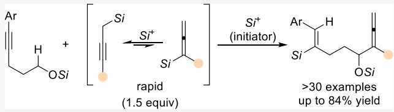  
rapid silylium-ion-catalyzed isomerization of allenylsilanes. As part of the allenylation step, the propagating silylium-ion electrophile is regenerated, thereby closing the catalytic cycle. An allylsilane is also applicable in this transformation, producing the corresponding α-C−H allylation product in high yield.

## ■ INTRODUCTION

Hydride transfer reactions can be exploited as a redox-neutral tool to activate unreactive C(sp3)−H bonds by an ionic mechanism.1 Especially [1,5]-hydride shift reactions from a C(sp3)−H to an unsaturated carbon atom followed by a ring closure onto the newly formed electrophilic site have been utilized for that purpose.1a,c Except for a few isolated reports by Shchegolev, Smit, and coworkers, examples that involve the intermolecular capture of such carbocation-like intermediates arising from a vinyl cation-initiated [1,5]-hydride shift by an external nucleophile are quite rare (Scheme 1A).2 In their seminal work, acyl chlorides are primed for their addition across C−C triple bonds with a stoichiometric amount of AgBF to eventually form vinyl cation intermediate I (gray box). Subsequent to this acylium-ion addition, a [1,5]-hydride shift leads to another carbocation intermediate II that is then intercepted by fluoride from the tetrafluoroborate counteranion. Aside from C(sp3)−F bond formation, that work also includes two examples of $\mathsf { C } ( \mathsf { s p } ^ { 3 } ) \mathsf { - C } ( \mathsf { s p } ^ { 2 } )$ bond formation where carbocation intermediate II engages in a Friedel−Crafts 2f reaction with the arene solvent (not shown).

The Shchegolev−Smit system raises several key questions: (1) What other electrophile or carbophilic Lewis acid can turn a C−C triple bond into a hydride acceptor?3 (2) How can this stoichiometric reaction be translated into a catalytic process? (3) Would there be a terminating carbon nucleophile that would release the above electrophile to maintain catalytic turnover? Silylium ions or silylium-ion-like cations4 do fulfill objective 1 by forming β-silicon-stabilized vinyl cations with alkynes.5,6 With a cationic silicon electrophile as an initiator in place, the proper choice of a silicon-containing nucleophile could then secure the self-regeneration of the silylium-ion initiator4,7 and at the same time close the catalytic cycle, thereby achieving objectives 2 and 3. Based on these considerations, we designed the reaction cascade outlined in Scheme 1B: Electrophilic alkyne activation by silylation gives the crucial vinyl cation intermediate III (gray box), which is supposed to abstract a hydride from the methylene group α to a silyl ether by a [1,5]-hydride shift to yield silylcarboxonium ion IV. While their use in this context is surprisingly uncommon, alkyl and aryl ethers have been employed more frequently.1 However, Jung had shown that the oxidation of silyl ethers involving intermediate V by trityl salt-mediated hydride abstraction is a facile transformation (Scheme 1C). Our idea was to react silylcarboxonium ion IV with propargyland allenylsilanes, respectively, with the former being rapidly generated in situ from the corresponding allenylsilane.6c We report here the realization of this strategy that enables an ionic remote α-C−H allenylation of silyl ethers.

## ■ RESULTS AND DISCUSSION

We began our investigation with triisopropylsilyl-protected 5- phenylpent-4-yn-1-ol (1a) and α-methyl-substituted allenylsilane 2a as model substrates (Table 1). Using 1.0 mol % of silylium carborate $\left[ \mathbf { M e } _ { 3 } \mathbf { S i } \left( \mathbf { H C B } _ { 1 1 } \mathbf { H } _ { 5 } \mathbf { B r } _ { 6 } \right) \right]$ as the initiator in benzene, the reaction proceeded smoothly at ambient temperature to deliver the desired product 3aa in 51% yield (entry 1) but both starting materials were not fully converted. We therefore raised the reaction temperature to $5 0 ~ ^ { \circ } \mathrm { C } ,$ and it turned out to be beneficial as the yield increased to 74% (entry

Scheme 1. Hydride-Shift Processes in the Hydroacylation of Alkynes, α-C−H Allenylation of Silyl Ethers, and Oxidation of Silyl Ethersa

A cis-Selective Hydroacylation of Alkynes by Acylium-lon Addition Followed by a [1,5]-Hydride Shift

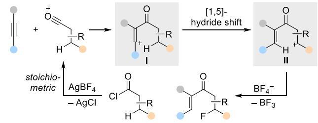

B Remote a-C–H Allenylation of Silyl Ethers Involving trans-Selective Hydrosilylation of Alkynes (this work)  
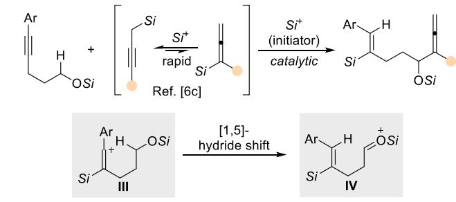

C Oxidation of Silyl Ethers by Hydride Abstraction  
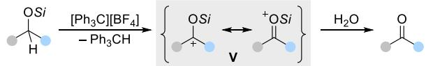

aR = aryl and/or alkyl, Ar = aryl, Si = triorganosilyl. Counteranions $\mathrm { B F _ { 4 } } ^ { - }$ and $[ \mathrm { H C B } _ { 1 1 } \mathrm { H } _ { 5 } \mathrm { \dot { B } r } _ { 6 } ] ^ { - }$ have been omitted for clarity.

Table 1. Optimization of the Reaction Conditionsa,b  
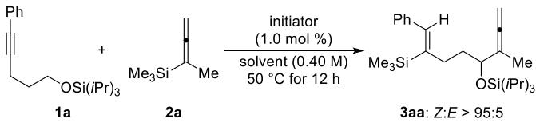

<table><tr><td>entry</td><td>initiator</td><td>solvent</td><td>2a (equiv) yield (%)c</td><td></td></tr><tr><td> $1 ^ { d }$ </td><td> $\left[ \mathbf { M e } _ { 3 } \mathbf { S i } ( \mathbf { H C B } _ { 1 1 } \mathbf { H } _ { 5 } \mathbf { B r } _ { 6 } ) \right]$ </td><td>PhH</td><td>1.2</td><td>51</td></tr><tr><td>2</td><td> $\left[ \mathbf { M e } _ { 3 } \mathbf { S i } \left( \mathbf { H C B } _ { 1 1 } \mathbf { H } _ { 5 } \mathbf { B r } _ { 6 } \right) \right]$ </td><td>PhH</td><td>1.2</td><td>74</td></tr><tr><td>3</td><td> $\left[ \mathbf { M e } _ { 3 } \mathbf { S i } ( \mathbf { H C B } _ { 1 1 } \mathbf { H } _ { 5 } \mathbf { B r } _ { 6 } ) \right]$ </td><td>PhF</td><td>1.2</td><td>54</td></tr><tr><td>4</td><td> $\left[ \mathbf { M e } _ { 3 } \mathbf { S i } \left( \mathbf { H C B } _ { 1 1 } \mathbf { H } _ { 5 } \mathbf { B r } _ { 6 } \right) \right]$ </td><td>PhCl</td><td>1.2</td><td>21</td></tr><tr><td>5</td><td> $\left[ \mathbf { M e } _ { 3 } \mathbf { S i } \left( \mathbf { H C B } _ { 1 1 } \mathbf { H } _ { 5 } \mathbf { B r } _ { 6 } \right) \right]$ </td><td> $\scriptstyle O \to \mathbf { C } _ { 6 } \mathbf { H } _ { 4 } \mathbf { C l } _ { 2 }$ </td><td>1.2</td><td>&lt;10</td></tr><tr><td>6</td><td> $\left[ \mathbf { M e } _ { 3 } \mathbf { S i } ( \mathbf { H C B } _ { 1 1 } \mathbf { H } _ { 5 } \mathbf { B r } _ { 6 } ) \right]$ </td><td>PhMe</td><td>1.2</td><td>71</td></tr><tr><td>7</td><td> $\mathrm { \small { [ H ( C _ { 6 } H _ { 6 } ) ] [ H C B _ { 1 1 } H _ { 5 } B r _ { 6 } ] } }$ </td><td>PhH</td><td>1.2</td><td>70</td></tr><tr><td>8</td><td> $\mathrm { \ [ P h _ { 3 } C ] [ H C B _ { 1 1 } H _ { 5 } B r _ { 6 } ] }$ </td><td>PhH</td><td>1.2</td><td>69</td></tr><tr><td>9</td><td> $\mathbf { M e } _ { 3 } \mathrm { S i O T f }$ </td><td>PhH</td><td>1.2</td><td>n.d.</td></tr><tr><td>10</td><td> $\mathbf { M e } _ { 3 } S \mathbf { i N T f } _ { 2 }$ </td><td>PhH</td><td>1.2</td><td>n.d.</td></tr><tr><td>11</td><td> $\left[ \mathbf { M e } _ { 3 } \mathbf { S i } ( \mathbf { H C B } _ { 1 1 } \mathbf { H } _ { 5 } \mathbf { B r } _ { 6 } ) \right]$ </td><td>PhH</td><td>1.5</td><td>82e</td></tr><tr><td>12</td><td> $\left[ \mathbf { M e } _ { 3 } \mathbf { S i } \left( \mathbf { H C B } _ { 1 1 } \mathbf { H } _ { 5 } \mathbf { B r } _ { 6 } \right) \right]$ </td><td>PhH</td><td>2.0</td><td>73</td></tr></table>

aAll reactions were performed on a 0.20 mmol scale under an argon atmosphere in 0.5 mL of the indicated solvent. ${ } ^ { b } Z { : } E > 9 5 { : } 5$ in all cases, as verified by 1H NMR spectroscopy of the crude reaction mixtures. cYields were determined by 1H NMR spectroscopy using $\mathrm { C H } _ { 2 } \mathrm { B r } _ { 2 }$ as an internal standard. dReaction was performed at room temperature. e78% isolated yield after flash chromatography on silica gel. n.d. = not detected.

2). A screening of arene solvents showed that the reaction is largely dependent on their polarity (entries 3−5), and toluene gave essentially the same result as benzene (entry 6). As expected, Reed’s benzenium ion9 (entry 7) and the trityl salt $[ \mathrm { P h } _ { 3 } \mathrm { C } ] [ \mathrm { H C B } _ { 1 1 } \mathrm { H } _ { 5 } \mathrm { B r } _ { 6 } ]$ (entry 8) worked equally well to initiate this reaction, but both were slightly inferior. Conversely, no desired product was detected with $\mathbf { M e } _ { 3 } S \mathbf { i O T f }$ (entry 9) and $\mathbf { M e } _ { 3 } S \mathbf { i N T f } _ { 2 }$ (entry 10) as the initiators. Given the inherent volatility of allenylsilane, the amount of allenylsilane 2a was gradually increased from 1.2 to 2.0 equiv to improve the reaction eficiency (entries 11 and 12). At 1.5 equiv of $^ { 2 \mathrm { a } , }$ the yield of 3aa reached a maximum, furnishing product 3aa in a 78% isolated yield (entry 11). In all cases, the Z configuration of the alkene was observed exclusively, thus corresponding to a trans hydrosilylation of the alkyne.

With the optimized reaction conditions in hand, we assessed the generality of this α-C−H allenylation reaction (Scheme 2). The model reaction was run on a 1.0 mmol scale, resulting in a slightly diminished yield of 73% for 3aa. A range of silyl ethers containing a methyl (1b−d), t-butyl (1e), and two methyl groups (1f) at the aryl ring were well tolerated, forming the corresponding products 3ba−fa in good to high yields. Apart from these alkyl-substituted cases, a representative example of a 4-phenyl-substituted substrate (1g) was also tested, afording the desired product 3ga in a high yield of 78%. Additionally, no desilylation was observed for 1h bearing a trimethylsilyl group. Notably, a decent yield was also recorded for reactant 1i with a silyl ether functional group installed at the para-position of the aryl ring. Not surprisingly, a series of halogen-substituted silyl ethers proceeded smoothly in this reaction, albeit the yields of 3ja−pa were relatively lower than those of non-halogensubstituted substrates. We attribute this to a weak deactivation efect of the halogen atoms. In addition, using analogous $\beta \mathrm { - }$ naphthyl-substituted silyl ether 1q as a substrate gave an equally high yield. It is noteworthy that applying a benzo[b]- thien-2-yl- and a thien-2-yl-substituted substrate was feasible as well, giving rise to products 3ra and 3sa in 77% and 73% yield, respectively. Surprisingly, potentially competing Lewis adduct formation between the sulfur donor and the silylium ion had no significant efect on this reaction.6b Unfortunately, substrate $\mathbf { 1 t } ,$ as an example with an alkyl substituent at the alkyne terminus, showed no conversion, presumably because the corresponding alkyl-substituted vinyl cation is energetically not accessible. In turn, the neighboring group efect of the aryl group facilitates vinyl cation formation.10 Next, we examined a number of other silyl protecting groups. Both $\left( i \mathrm { P r } \right) _ { 2 } \mathrm { M e } { \mathrm { S i } }$ (1u) and $t \mathrm { B u M e } _ { 2 } \mathrm { S i }$ (1v) groups displayed a similar result, but 1w with a bulkier 2,3-dimethyl-2-butyl group was greatly superior. However, a $\mathrm { P h } _ { 3 } \mathrm { S i }$ group as in 1x was reluctant to react, and other aryl-substituted silyl ethers with Me PhSi and $\mathrm { M e P h } _ { 2 } \mathrm { S i }$ protections were not even chemically stable (not shown).

Variation of allenylsilane 2 was first probed for diferent substitution patterns at the silicon atom while keeping the R part as a methyl group. Replacing one of the methyl groups in Me Si with an ethyl (2b), n-butyl (2c), or isopropyl (2d) group led to the formation of products 3ab−ad in moderate to good yields. Increasing the steric hindrance is detrimental to this transformation, and the tBuMe Si group (2e) was too bulky for this reaction to occur. The messy reaction outcome with a $\mathrm { M e } _ { 2 } \mathrm { P h } S \mathrm { i }$ group (2f) could result from known substituent redistribution processes.4a,11 In addition, product 3ag bearing an Et Si group was generated in a synthetically useful yield. We then turned to the variation of the R group attached to the allenyl moiety, while not changing the $\mathrm { M e } _ { 3 } \mathrm { S i }$ part. A broad array of linear or branched alkyl substituents (2h−l) were well tolerated, allowing for the formation of products 3ah−al in the usual yield range. Particularly, an aryl substituent as in 2m was compatible, while the internal allenylsilane 2n was not.

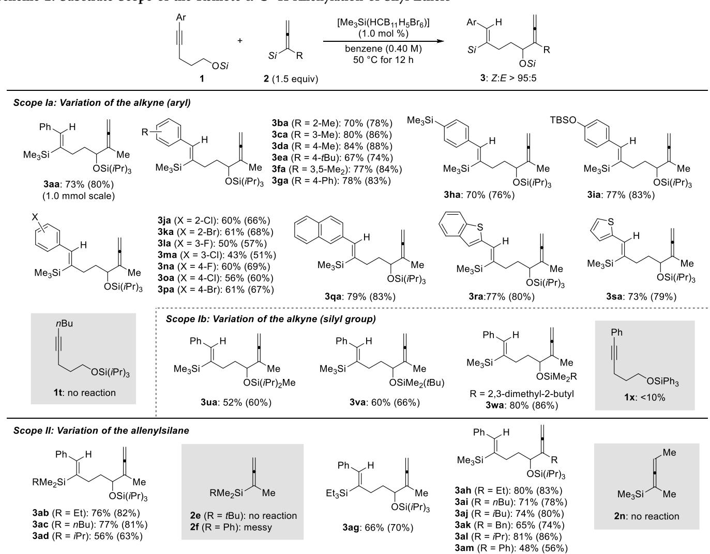  
aAll reactions were performed with silyl ether 1 (0.20 mmol), allenylsilane 2 (0.30 mmol, 1.5 equiv), and initiator $\left[ \mathrm { M e } _ { 3 } \mathrm { S i } \left( \mathrm { H C B } _ { 1 1 } \mathrm { H } _ { 5 } \mathrm { B r } _ { 6 } \right) \right]$ (2.0 μmol, 1.0 mol %) under an argon atmosphere in benzene (0.5 mL) at $5 0 ~ ^ { \circ } \mathrm { C }$ for 12 h. bZ:E > 95:5 in all cases, as verified by 1H NMR spectroscopy of the crude reaction mixtures. cIsolated yields refer to analytically pure material after flash chromatography on silica gel; yields in parentheses were determined by 1H NMR spectroscopy using $\mathrm { C H } _ { 2 } \mathrm { B r } _ { 2 }$ as an internal standard. TBS = tert-butyldimethylsilyl.

In an attempt to expand this protocol to other carbon nucleophiles (Scheme 3, top), we found that directly employing propargylsilane 4a as the substrate resulted in product formation in 74% yield. This observation strongly supports a mechanism where 4a is indeed the external nucleophile in the catalytic cycle, as silylium-ion-promoted allenyl-to-propargylsilane isomerization is known to be a fast process.6c Except for allylsilane 5a that underwent a similar process to achieve the remote α-C−H allylation of silyl ethers, the other nucleophiles shown at the bottom of Scheme 3 were reluctant to give the desired products. No conversion or decomposition was observed for these carbon nucleophiles.

To gain insight into the reaction mechanism, three control experiments were performed (Scheme 4). We had already speculated that a [1,5]-hydride shift is the key step of this cascade. We therefore conducted a deuterium-labeling experiment, and the incorporation of deuterium into the vinylic position of product 3aa- $\cdot d _ { 2 }$ supported our hypothesis (top). To exclude any potential intermolecular hydride shift, a crossover experiment was conducted (middle), and only products 3aa- ${ \bf - } d _ { 2 }$ and 3sa were obtained; no incorporation of deuterium into the vinylic position of 3sa ruled out this alternative pathway. We then explored other, yet less likely, [1,4]- or [1,6]-hydride transfers by treating substrate 7a or 8a with allenylsilane 2a under the standard reaction conditions (bottom). However, no conversion was seen for either starting material, which is again in line with the intramolecular nature of the hydride transfer.

Based on our previous (3 + 2) annulation of internal alkynes with allenylsilanes6c and the outcome of the above control experiments, we propose the catalytic cycle outlined in Scheme $5 .$ The reaction starts with the formation of the $\beta { , } \beta { \mathrm { . } }$ bis(silicon)-stabilized vinyl cation intermediate 9 from allenylsilane 2. Site-selective silylium-ion transfer from 9 to the alkyne moiety of silyl ether 1 generates propargylsilane 4 along with the β-silicon-stabilized vinyl cation 10, which subsequently undergoes the anticipated [1,5]-hydride shift to yield the silylcarboxonium ion 11. Nucleophilic attack of the C−C triple bond in 4 leads to another β-silicon-stabilized vinyl aReactions were performed with 1a (0.2 mmol), propargylsilane 4a (0.3 mmol, 1.5 equiv), or 1a (0.24 mmol, 1.2 equiv), allylsilane 5a (0.20 mmol), and initiator $\left[ \mathrm { M e } _ { 3 } \mathrm { S i } \big ( \mathrm { H C B } _ { 1 1 } \mathrm { H } _ { 5 } \mathrm { B r } _ { 6 } \big ) \right] ^ { \cdot } \left( 2 . 0 \right.$ μmol, 1.0 mol %) under an argon atmosphere in benzene (0.5 mL) at $5 0 ~ ^ { \circ } \mathrm { C }$ or room temperature for 12 h. $^ { \star } { \cal Z } : { \cal E } ~ > ~ 9 5 : 5 ,$ as verified by 1H NMR spectroscopy of the crude reaction mixtures. cIsolated yields refer to analytically pure material after flash chromatography on silica gel; yields in parentheses were determined by 1H NMR spectroscopy using $\mathrm { C H } _ { 2 } \mathrm { B r } _ { 2 }$ as an internal standard.

Scheme 3. Remote α-C−H Allenylation and Allylation of the Silyl Ethe $\cdot ^ { a , b , c }$  
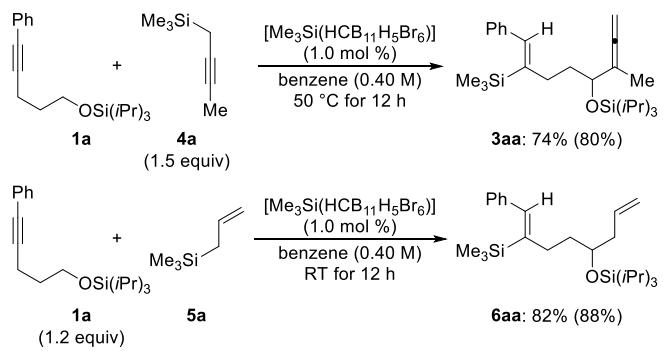

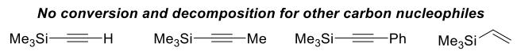

## Scheme 4. Mechanistic Control Experimentsa,b,c

Deuterium-Labeling Experiment  
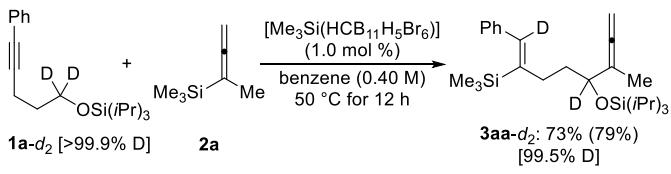

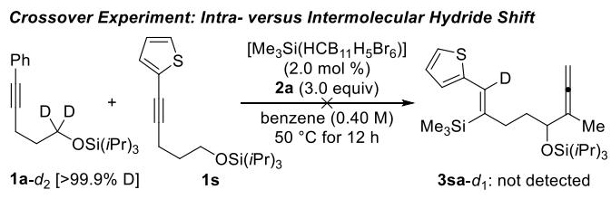

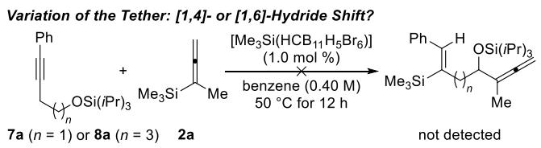  
aIsolated yields refer to analytically pure material after flash chromatography on silica gel. bYields in parentheses were determined by 1H NMR spectroscopy using $\mathrm { C H } _ { 2 } \mathrm { B r } _ { 2 }$ as an internal standard. cThe overall deuteration grades of 1a-d and 3aa-d were calculated by HRMS analysis; the exact deuteration grades for each relevant position were ≥95%, as estimated by 1H NMR spectroscopy.

cation 12. From this, the desired product 3 is released by $\beta -$ elimination of the silylium ion, which, in turn, is captured by propargylsilane 4 to regenerate carbocation 9 as the propagating silylium-ion species.

To illustrate the synthetic value of the densely functionalized products, we investigated a series of synthetic transformations of 3aa (Scheme 6). An iridium-catalyzed regio- and stereoselective hydroboration of the allene unit with pinacolborane

## Scheme 5. Proposed Catalytic Cyclea

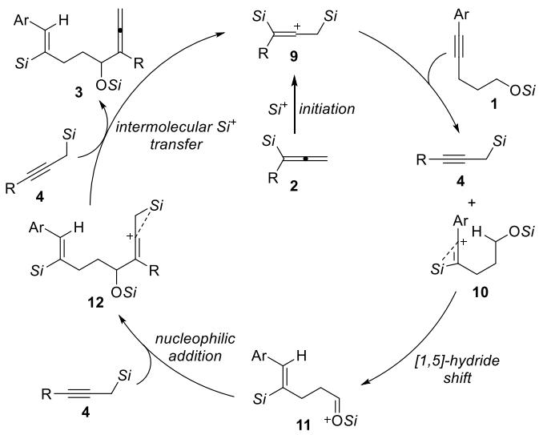  
aThe counteranion $[ \mathrm { H C B } _ { 1 1 } \mathrm { H } _ { 5 } \mathrm { B r } _ { 6 } ] ^ { - }$ is omitted for clarity.

## Scheme 6. Synthetic Transformations $^ { \dag ^ { a , b } }$

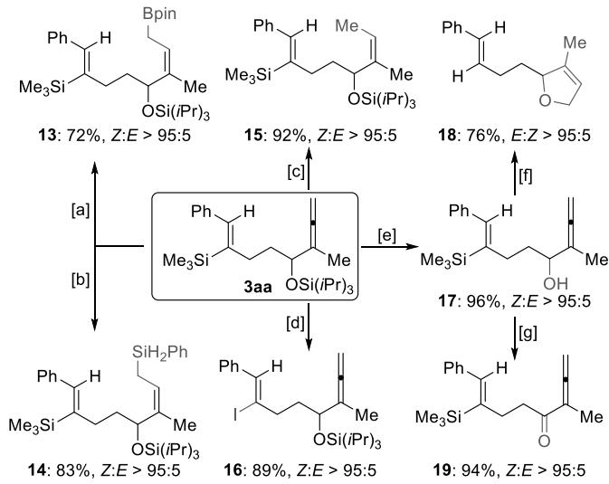  
aIsolated yields refer to analytically pure material after flash chromatography on silica gel. bDiastereomeric ratios were verified by 1H NMR spectroscopy of the crude reaction mixtures. Reagents and reactions conditions: [a] [Ir(cod)Cl] (1.0 mol %), dppm (2.0 mol %), HBpin (1.2 equiv), CH Cl , RT for 12 h; [b] Co(acac) (1.0 mol %), Xantphos (1.0 mol %), PhSiH (1.1 equiv), THF, RT for 2 h; [c] Lindlar’s catalyst (10 wt %), H (balloon), EtOH/EtOAc (1:1), RT for 2 h; [d] NIS (1.2 equiv), MeCN, RT for 2 h; [e] TBAF (1.2 equiv), THF, RT for 2 h; [f] AgNO (1.2 equiv), acetone/H O (1:1), 40 $^ { \circ } \dot { C }$ for 12 h; [g] DMP (1.1 equiv), ${ \mathrm { C H } } _ { 2 } { \bar { \mathrm { C l } } } _ { 2 } ,$ RT for 1.5 h. dppm = 1,1-bis(diphenylphosphino)methane, NIS = N-iodosuccinimide, TBAF = tetra-n-butylammonium fluoride, DMP = Dess-Martin periodinane.

preferentially occurred at the less hindered terminal double bond, giving the allyl boronic ester 13 in good yield.12 Hydrosilylation of this terminal double bond was readily achieved by applying the method developed by Ge and coworkers,13 yielding the allylsilane product 14 in 83% yield with superb regio- and stereoselectivity. Remarkably, the allene moiety can undergo a chemoselective semihydrogenation at the terminal double bond with Lindlar’s catalyst14 to form product 15 as a single stereoisomer in excellent yield.

Moreover, the vinylic silyl group in 3aa can be easily converted into a vinyl iodide 16 through iododesilylation with NIS.15 Upon deprotection with TBAF, α-allenol 17 was obtained in almost quantitative yield, which is a versatile linchpin that allows for further derivatization.16 Treatment of 17 with $\mathrm { \bf A g N O } _ { 3 }$ in aqueous acetone provided access to a 2,5- dihydrofuran derivative 18 in good yield,17 along with a protodesilylation of the vinylsilane moiety. Dess-Martin oxidation cleanly converted the alcohol 17 into ketone product 19 in 94% yield. 18

## ■ CONCLUSIONS

In summary, we disclose here a new approach to C−C bond formation in the α position of silyl ethers by an ionic mechanism. This has been achieved by a silylium-ionpromoted hydrosilylation of an internal C−C triple bond, where the hydride is intramolecularly delivered from a remote methylene group α to a tethered silyl ether. That vinyl cationinitiated [1,5]-hydride shift yields a silylcarboxonium ion, which is intermolecularly captured by propargyl- and allylsilanes as nucleophiles. The reaction displays broad scope with the functional-group tolerance typically seen in silylium-ion catalysis.

## ■ ASSOCIATED CONTENT

## Data Availability Statement

The data underlying this study are available in the published article and its Supporting Information.

## \*sı Supporting Information

The Supporting Information is available free of charge at https://pubs.acs.org/doi/10.1021/jacs.4c18137.

Experimental procedures, including the synthesis of starting materials and characterization data, and NMR spectral data for all new compounds (PDF)

## ■ AUTHOR INFORMATION

## Corresponding Author

Martin Oestreich − Institut für Chemie, Technische Universität Berlin, 10623 Berlin, Germany; orcid.org/ 0000-0002-1487-9218; Email: martin.oestreich@tuberlin.de

## Authors

Honghua Zuo − Institut für Chemie, Technische Universität Berlin, 10623 Berlin, Germany; orcid.org/0000-0003- 3821-5560

Sebastian Kemper − Institut für Chemie, Technische Universität Berlin, 10623 Berlin, Germany; orcid.org/ 0000-0003-0192-518X

Hendrik F. T. Klare − Institut für Chemie, Technische Universität Berlin, 10623 Berlin, Germany; orcid.org/ 0000-0003-3748-6609

Complete contact information is available at: https://pubs.acs.org/10.1021/jacs.4c18137

## Notes

The authors declare no competing financial interest.

## ■ ACKNOWLEDGMENTS

H.Z. thanks the China Scholarship Council for a predoctoral fellowship (2021−2025), and M.O. is indebted to the Einstein Foundation Berlin for an endowed professorship.

## ■ REFERENCES

(1) (a) Mori, K. C(sp3)−H Bond Functionalization Mediated by Hydride a Shift/Cyclization System. Bull. Chem. Soc. Jpn. 2022, 95, 296−305. (b) An, X.-D.; Xiao, J. Recent advances in hydride transferinvolved C(sp3)−H activation reactions. Org. Chem. Front. 2021, 8, 1364−1383. (c) Kwon, S. J.; Kim, D. Y. Organo- and Organometallic-Catalytic Intramolecular [1,5]-Hydride Transfer/Cyclization Process through C(sp3)−H Bond Activation. Chem. Rec. 2016, 16, 1191− 1203. (d) Haibach, M. C.; Seidel, D. C−H Bond Functionalization through Intramolecular Hydride Transfer. Angew. Chem., Int. Ed. 2014, 53, 5010−5036. (e) Peng, B.; Maulide, N. The Redox-Neutral Approach to C−H Functionalization. Chem.�Eur. J. 2013, 19, 13274−13287. (f) Zhang, S.-Y.; Zhang, F.-M.; Tu, Y.-Q. Direct sp3 α- C−H activation and functionalization of alcohol and ether. Chem. Soc. Rev. 2011, 40, 1937−1949.

(2) (a) Shchegolev, A. A.; Kanishchev, M. I. Rearrangements in Vinyl Cations. Russ. Chem. Rev. 1981, 50, 553−564. (b) Schegolev, A. A.; Smit, W. A.; Roitburd, G. V.; Kucherov, V. F. Acylation of alkynes by cationoid reagents with the formation of cyclopent-2-enone derivatives. Tetrahedron Lett. 1974, 15, 3373−3376. (c) Schegolev, A. A.; Smit, W. A.; Kucherov, V. F.; Caple, R. Acylation of Acetylenes. I. Observation of an Intramolecular 1,5-Hydride Shift in a Vinyl Cation Intermediate. J. Am. Chem. Soc. 1975, 97, 6604−6606. (d) Kanischev, M. I.; Smit, W. A.; Schegolev, A. A.; Caple, R. The formation of 1,2- disubstituted adamantanes via the acylation of alkynes with 1- adamantanoyl derivatives. Tetrahedron Lett. 1978, 19, 1421−1424. (e) Kanishchev, M. I.; Smit, V. A.; Shchegolev, A. A.; Caple, R. Formation of Cyclopentanone Derivatives of Adamantane During Acylation of 2-Butyne by 1-Adamantanecarboxylic Acid Derivatives. Russ. Chem. Bull. 1978, 27, 447. (f) Kanishchev, M. I.; Schegolev, A. A.; Smit, W. A.; Caple, R.; Kelner, M. J. 1,5-Hydride Shifts in Vinyl Cation Intermediates Produced upon the Acylation of Acetylenes. J. Am. Chem. Soc. 1979, 101, 5660−5671.

(3) (a) Bhoyare, V. W.; Tathe, A. G.; Das, A.; Chintawar, C. C.; Patil, N. T. The interplay of carbophilic activation and Au(I)/Au(III) catalysis: an emerging technique for 1,2-difunctionalization of C−C multiple bonds. Chem. Soc. Rev. 2021, 50, 10422−10450. (b) Sonawane, A. D.; Sonawane, R. A.; Ninomiya, M.; Koketsu, M. Synthesis of Seleno-Heterocycles via Electrophilic/Radical Cyclization of Alkyne Containing Heteroatoms. Adv. Synth. Catal. 2020, 362, 3485−3515. (c) Bour, C.; Gandon, V. New Procedures for Catalytic Carbophilic Activation by Gold and Gallium π-Acids. Synlett 2015, 26, 1427−1436. (d) Fürstner, A.; Davies, P. W. Catalytic Carbophilic Activation: Catalysis by Platinum and Gold π Acids. Angew. Chem., Int. Ed. 2007, 46, 3410−3449. (e) Godoi, B.; Schumacher, R. F.; Zeni, G. Synthesis of Heterocycles via Electrophilic Cyclization of Alkynes Containing Heteroatom. Chem. Rev. 2011, 111, 2937−2980.

(4) (a) Klare, H. F. T.; Albers, L.; Süsse, L.; Keess, S.; Müller, T.; Oestreich, M. Silylium Ions: From Elusive Reactive Intermediates to Potent Catalysts. Chem. Rev. 2021, 121, 5889−5985. (b) Walker, J. C. L.; Klare, H. F. T.; Oestreich, M. Cationic silicon Lewis acids in catalysis. Nat. Rev. Chem. 2020, 4, 54−62.

(5) (a) Arii, H.; Kurihara, T.; Mochida, K.; Kawashima, T. Silylium ion-promoted dehydrogenative cyclization: Synthesis of siliconcontaining compounds derived from alkynes. Chem. Commun. 2014, 50, 6649−6652. (b) Arii, H.; Nakabayashi, K.; Mochida, K.; Kawashima, T. Intramolecular Chain Hydrosilylation of Alkynylphenylsilanes Using a Silyl Cation as a Chain Carrier. Molecules 2016, 21, 999. (c) Martens, A.; Kreuzer, M.; Ripp, A.; Schneider, M.; Himmel, D.; Scherer, H.; Krossing, I. Investigations on non-classical silylium ions leading to a cyclobutenyl cation. Chem. Sci. 2019, 10, 2821− 2829.

(6) (a) Zuo, H.; Klare, H. F. T.; Oestreich, M. Intramolecular 7- endo-dig-Selective Carbosilylation of Internal Alkynes Involving Silylium-Ion Regeneration. J. Org. Chem. 2023, 88, 4024−4027. (b) Zuo, H.; Irran, E.; Klare, H. F. T.; Oestreich, M. Electrophilic Activation of S−Si Reagents by Silylium Ions for Their Regio- and Diastereoselective Addition Across C−C Multiple Bonds. Angew. Chem., Int. Ed. 2024, 63, No. e202401599. (c) Zuo, H.; Qu, Z.-W.;

Kemper, S.; Klare, H. F. T.; Grimme, S.; Oestreich, M. Silylium-Ion-Promoted (3 + 2) Annulation of Allenylsilanes with Internal Alkynes Involving a Pentadienyl-to-Allyl Cation Electrocyclization. J. Am. Chem. Soc. 2024, 146, 31377−31383.

(7) (a) He, T.; Klare, H. F. T.; Oestreich, M. Silylium-Ion Regeneration by Protodesilylation Enables Friedel−Crafts Alkylation with Less Isomerization and No Defunctionalization. ACS Catal. 2021, 11, 12186−12193. (b) He, T.; Klare, H. F. T.; Oestreich, M. Catalytically Generated Meerwein’s Salt-Type Oxonium Ions for Friedel−Crafts C(sp2)−H Methylation with Methanol. J. Am. Chem. Soc. 2023, 145, 3795−3801. (c) He, T.; Klare, H. F. T.; Oestreich, M. Arenium-ion-catalysed halodealkylation of fully alkylated silanes. Nature 2023, 623, 538−543. (d) Klare, H. F. T.; Oestreich, M. The Power of the Proton: From Superacidic Media to Superelectrophile Catalysis. J. Am. Chem. Soc. 2021, 143, 15490−15507.

(8) (a) Jung, M. E. Oxidation of Trimethylsilyl Ethers via Hydride Abstraction. A New Method for Alcohol Oxidation. J. Org. Chem. 1976, 41, 1479−1480. (b) Jung, M. E.; Pan, Y.-G.; Rathke, M. W.; Sullivan, D. F.; Woodbury, R. P. Oxidation of Trialkylsilyl Enol Ethers via Hydride Abstraction: A New Procedure for Ketone to Enone Conversion. J. Org. Chem. 1977, 42, 3961−3963. (c) Metcalf, B. W.; Burkhart, J. P.; Jund, K. Cleavage of tert-butyldimethylsilyl ethers by tetrafluoroborate salts. Tetrahedron Lett. 1980, 21, 35−36.

(9) (a) Reed, C. A.; Fackler, N. L. P.; Kim, K.-C.; Stasko, D.; Evans, D. R.; Boyd, P. D. W.; Rickard, C. E. F. Isolation of Protonated Arenes (Wheland Intermediates) with BArF and Carborane Anions. A Novel Crystalline Superacid. J. Am. Chem. Soc. 1999, 121, 6314− 6315. (b) See also: Reference 7d.

(10) Stang, P. J.; Dueber, T. E. Mechanism of Reaction of cis- and trans-3-Phenyl-2-buten-2-yl Triflates. Evidence for Vinylidene Phenonium Ions. J. Am. Chem. Soc. 1977, 99, 2602−2610.

(11) Omann, L.; Pudasaini, B.; Irran, E.; Klare, H. F. T.; Baik, M.-H.; Oestreich, M. Thermodynamic versus kinetic control in substituent redistribution reactions of silylium ions steered by the counteranion. Chem. Sci. 2018, 9, 5600−5607.

(12) Yamamoto, Y.; Fujikawa, R.; Umemoto, T.; Miyaura, N. Iridium-catalyzed hydroboration of alkenes with pinacolborane. Tetrahedron 2004, 60, 10695−10700.

(13) Wang, C.; Teo, W. J.; Ge, S. Access to stereodefined (Z)- allylsilanes and (Z)-allylic alcohols via cobalt-catalyzed regioselective hydrosilylation of allenes. Nat. Commun. 2017, 8, 2258.

(14) Johnson, W. S.; Elliott, J. D.; Hanson, G. J. Asymmetric Synthesis via Acetal Templates. 6. A Stereoselective Approach to a Key Intermediate for the Preparation of Vitamin D Metabolites. J. Am. Chem. Soc. 1984, 106, 1138−1139.

(15) Lv, W.; Yu, J.; Ge, B.; Wen, S.; Cheng, G. Palladium-Catalyzed Catellani-Type Bis-silylation and Bis-germanylation of Aryl Iodides and Norbornenes. J. Org. Chem. 2018, 83, 12683−12693.

(16) (a) Alonso, J. M.; Almendros, P. Deciphering the Chameleonic Chemistry of Allenols: Breaking the Taboo of a Onetime Esoteric Functionality. Chem. Rev. 2021, 121, 4193−4252. (b) Alcaide, B.; Almendros, P. Gold-Catalyzed Cyclization Reactions of Allenol and Alkynol Derivatives. Acc. Chem. Res. 2014, 47, 939−952.

(17) Marshall, J. A.; Pinney, K. G. Stereoselective Synthesis of 2,5- Dihydrofurans by Sequential S 2′ Cleavage of Alkynyloxiranes and Ag+-Catalyzed Cyclization of the Allenylcarbinol Products. J. Org. Chem. 1993, 58, 7180−7184.

(18) Yamamoto, K.; Heathcock, C. H. α,β-Epoxy Vinyl Triflates in Pd-Catalyzed Reactions. Org. Lett. 2000, 2, 1709−1712.

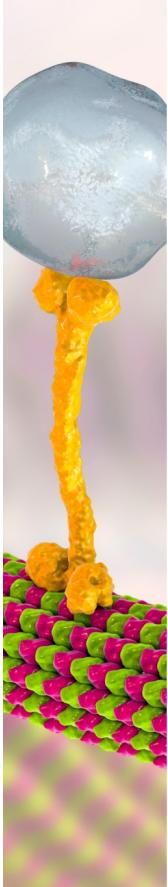

CAS BIOFINDER DISCOVERY PLATFORMTM

# BRIDGE BIOLOGY AND CHEMISTRY FOR FASTER ANSWERS

Analyze target relationships, compound effects, and disease pathways

Explore the platform