pubs.acs.org/OrgLett

Letter

# Sc(III)-Catalyzed Carbonyl−Yne Reaction for the Diastereoselective Allene Synthesis: A Concerted Asynchronous Mechanism

Xinya Yuan, Jiashen Yang, and Shaozhong Wang\*

Cite This: Org. Lett. 2025, 27, 11169−11174

Read Online

## ACCESS

Metrics & More

ABSTRACT: The carbonyl−yne reaction, involving propargylic C−H bond cleavage for carbon−carbon bond formation, is significantly less developed than the classical Alder−ene reaction due to the linear geometry and relatively weak nucleophilicity of alkynes compared to alkenes. Herein, we report a Sc(OTf) -catalyzed carbonyl−yne reaction enabling the diastereoselective synthesis of multisubstituted allenes from α-ketoamide-tethered alkynes with 100% atom economy and

Article Recommendations

\*sı Supporting Information

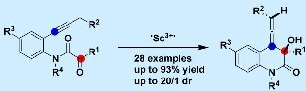

excellent diastereoselectivity (up to 20/1 dr). DFT calculations support a concerted, asynchronous mechanism involving C−C bond formation and propargylic C−H cleavage. Theoretical analysis suggests that the observed stereoselectivity arises from an interplay of electronic and entropic efects in the transition states.

A llenyl moieties constitute privileged axially chiral scafolds with broad utility across organic synthesis, pharmaceuticals, and materials science.1−4 Their orthogonal π-systems enable unique reactivity profiles, facilitating diverse transformations including cycloadditions, cycloisomerizations, allylic substitutions, and transition-metal-catalyzed couplings5−10 While classical allene syntheses typically require stoichiometric reagents or multistep sequences,11−14 catalytic carbonyl−yne reactions ofer an atom-economical, convergent alternative for direct construction from alkynes and carbonyl partners. Mechanistically, this transformation parallels the classical ene reaction15,16 but substitutes the “ene” component with a propargylic fragment (Scheme 1a,b). Where classical ene reactions engage an allylic C−H bond, an alkene C�C bond, and an enophile, the carbonyl−yne variant utilizes a propargylic C−H bond, an alkyne C�C bond, and an ynophile (carbonyl group). Investigation of this “propargyl− ene-type” reaction would provide a rational mechanistic explanation and deeper understanding for the stereoselective formation of multisubstituted allene products. Nevertheless, achieving high diastereo- and even enantioselectivity for multisubstituted allenes, particularly sterically congested architectures, remains challenging.17−20

Existing carbonyl−yne reactions can present certain limitations, such as a somewhat narrow substrate scope, modest levels of stereocontrol, and mechanistic aspects that are still being uncovered. Lewis acid catalysis might potentially overcome these limitations by coordinatively activating metal triflates exhibit exceptional oxophilicity, functional group tolerance, and moisture compatibility, positioning 23 them as ideal catalysts for the carbonyl−yne transformation. Herein, we report the first Sc(OTf) -catalyzed carbonyl−yne reaction for diastereoselective synthesis of multisubstituted

Scheme 1. Reaction Design

Ene reaction

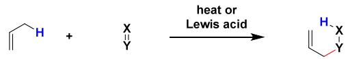

(a)

Thermo carbonyl-yne reaction (Burger's work)  
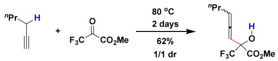

(b)

Lewis acid-catalyzed carbonyl-yne reaction (this work)

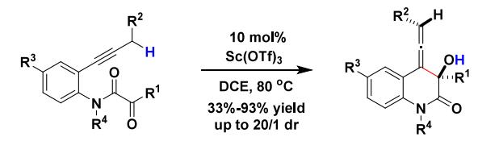  
(c)

allenes from α-ketoamide-tethered alkynes (Scheme 1c). This method features perfect atom economy, broad substrate scope and exceptional diastereoselectivity. Mechanistic studies supported by DFT calculations suggest a concerted asynchronous pathway where an interplay of electronic and entropic efects in the transition states might control the stereoselectivity. Furthermore, we demonstrate the synthetic versatility of the resulting allenes through diverse downstream transformations, including cycloisomerization and semipinacol rearrangements for accessing complex dihydrofurans.

We initiated our investigation using alkyne 1a as a model substrate. Reactions conducted in DCE at room temperature with catalytic amounts of oxophilic Lewis acids including $\operatorname { F e } ( \operatorname { O T f } ) _ { 3 } , \operatorname { C u } ( \operatorname { O T f } ) _ { 2 } , \operatorname { S n } ( \operatorname { O T f } ) _ { 2 } ,$ and $\operatorname { A l } ( \mathrm { O T f } ) _ { 3 }$ aforded allene 2a in low yields with dr values ranging from 2.5/1 to 5/1 (Table 1, entries 1−4). In contrast, employing In(OTf) as the

Table 1. Optimization for the Sc(III)-Catalyzed Carbonyl− yne Reaction  
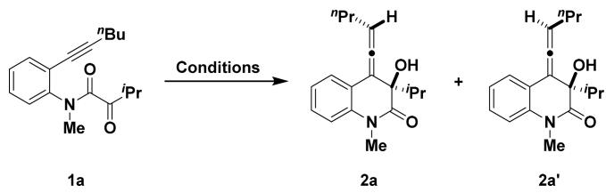

<table><tr><td colspan="4"></td><td colspan="3">Yield of 2a</td></tr><tr><td>Entry</td><td>Catalyst</td><td>Solvent</td><td>T (°C) t (h)</td><td></td><td>(%)b</td><td>drº</td></tr><tr><td>1</td><td>Fe(OTf)₃</td><td>DCE</td><td>rt</td><td>12</td><td>11</td><td>2.5/1</td></tr><tr><td>2</td><td>Cu(OTf)₂</td><td>DCE</td><td>rt</td><td>12</td><td>17</td><td>3.4/1</td></tr><tr><td>3</td><td>Sn(OTf)₂2</td><td>DCE</td><td>rt</td><td>12</td><td>36</td><td>2.6/1</td></tr><tr><td>4</td><td>Al(OTf)₃</td><td>DCE</td><td>rt</td><td>12</td><td>44</td><td>5/1</td></tr><tr><td>5</td><td>In(OTf)3</td><td>DCE</td><td>rt</td><td>12</td><td>70</td><td>7/1</td></tr><tr><td>6</td><td>Y(OTf)₃</td><td>DCE</td><td>rt</td><td>12</td><td>trace</td><td>-</td></tr><tr><td>7</td><td>La(OTf)3</td><td>DCE</td><td>rt</td><td>12</td><td>trace</td><td>-</td></tr><tr><td>8</td><td>Sm(OTf)3</td><td>DCE</td><td>rt</td><td>12</td><td>9</td><td>6.8/1</td></tr><tr><td>9</td><td>Yb(OTf)₃</td><td>DCE</td><td>rt</td><td>12</td><td>12</td><td>9/1</td></tr><tr><td>10</td><td>Sc(OTf)₃</td><td>DCE</td><td>rt</td><td>12</td><td>45</td><td>10.5/1</td></tr><tr><td>11</td><td>Sc(OTf)₃</td><td>DCM</td><td>rt</td><td>12</td><td>45</td><td>9.7/1</td></tr><tr><td>12</td><td>Sc(OTf)3</td><td>PhMe</td><td>rt</td><td>12</td><td>33</td><td>9/1</td></tr><tr><td>13</td><td>Sc(OTf)3</td><td>PhCF3</td><td>rt</td><td>12</td><td>32</td><td>9.3/1</td></tr><tr><td>14</td><td>Sc(OTf){3</td><td>dioxane</td><td>rt</td><td>12</td><td>17</td><td>5.3/1</td></tr><tr><td>15</td><td>Sc(OTf)₃</td><td>DCE</td><td>60</td><td>6</td><td>61</td><td>8.5/1</td></tr><tr><td>16 17ª</td><td>Sc(OTf)3</td><td>DCE</td><td>80</td><td>4</td><td>80</td><td>9/1</td></tr><tr><td>18e</td><td>Sc(OTf)₃3</td><td>DCE</td><td>80 80</td><td>4</td><td>45 0</td><td>8.1/1</td></tr><tr><td>19f</td><td>- HOTf</td><td>DCE DCE</td><td>80</td><td>12 4</td><td></td><td>-</td></tr><tr><td></td><td></td><td></td><td></td><td></td><td>0</td><td>-</td></tr></table>

aReaction conditions: a mixture containing 1a (0.1 mmol), Lewis acid (0.01 mmol), and solvent (1.0 mL) was stirred in a vial for the mentioned time. bNMR yield using mesitylene as an internal standard. cdr values were determined by the integration of peaks shown in 1H NMR spectra. dr = diastereoisomeric ratio. $^ { d } 2 . 5$ mol % of Sc(OTf) was used. eIn the absence of Sc(OTf) . fHOTf (0.03 mmol).

catalyst gave the product in high yield with moderate dr (Table 1, entry 5). Subsequent screening of rare earth metal triflates $[ \mathrm { Y ( O T f ) } _ { 3 } , \mathrm { L a ( O T f ) } _ { 3 } , \mathrm { S m ( O T f ) } _ { 3 } , \mathrm { Y b ( O T f ) } _ { 3 } ]$ yielded only trace amounts of 2a (Table $^ { 1 , }$ entries 6−9). However, catalytic $\csc ( \mathrm { O T f } ) _ { 3 }$ provided the best diastereoselectivity, enabling the formation of 2a in 45% yield (Table 1, entry 10). The relative stereochemistry was assigned based on X-ray of single crystal difraction study of its analog 2u (see SI for details). Using $\csc ( \mathrm { O T f } ) _ { 3 }$ as the catalyst, we observed similar results with DCM, toluene, or $\mathrm { P h C F } _ { 3 }$ as solvent (Table 1, entries 11−13). In contrast, the yield decreased significantly in dioxane (Table

1, entry14). Elevating the reaction temperature to $8 0 ~ ^ { \circ } \mathrm { C }$ in 1,2- DCE improved the yield while maintaining comparable diastereoselectivity (Table 1, entries 15−16). Control experiments showed that reduced $\operatorname { S c } ( \mathrm { O T f } ) _ { 3 }$ loadings led to lower yields, and the carbonyl−yne reaction failed to occur either in the absence of $\csc ( \mathrm { O T f } ) _ { 3 }$ or in the presence of Brϕnsted acid HOTf, which could originate from the partial decomposition of Sc(OTf) (Table 1, entries 17−19).

With optimized conditions established, we next explored the scope of the $\operatorname { S c } ( \operatorname { O T f } ) _ { 3 } .$ -catalyzed carbonyl−yne reaction by varying substituents on the ketone, alkyne, benzene ring, and nitrogen atom. Similar to substrate ${ \bf 1 } { \bf a } ,$ alkynes 1b−1f bearing aliphatic α-ketoamide groups with primary, secondary, or tertiary alkyl substituents (Me, Et, phenylethyl, Cy, t-Bu) underwent smooth conversion to allenes 2b−2f in 33−88% yield with 5/1 to 8/1 dr (Table 2, entries 1−6). Alkynes 1g− 1k with arylated α-ketoamides reacted similarly, afording allenes 2g−2k in 42−73% yield with 2.6/1 to 5.8/1 dr (Table 2, entries 7−11). Alkynes 1l−1u with primary, secondary, tertiary alkyl, or phenyl substituents at the propargylic position (Et, phenethyl, i-Bu, cyanoethyl, BnOCH , 1-chloropropyl, 2- (1H-indol-1-yl)ethyl, i-Pr, cyclohexyl, Ph) all produced allenes 2l−2u in excellent yields (up to 90%) with dr values up to 20/ 1 (Table 2, entries 12−21). Substrates 1v−1z with substituents (Br, F, NO , Me, Ph) on the aniline ring linking the α- ketoamide and alkyne units also performed well, delivering allenes 2v−2z in comparable eficiency (Table 2, entries 22− 26). Finally, alkynes 1aa−1ab featuring benzyl or propargyl groups on the nitrogen atom participated efectively, yielding allenes 2aa (84% yield, 8/1 dr) and 2ab (67% yield, 5.6/1 dr), respectively (Table 2, entries 27−28). However, in the case of alkynes 1ac−1ae bearing secondary alkyl substituents (i-Pr, cyclohexyl, cyclopentyl) at the alkyne terminus, a Sc(III)- catalyzed tandem carbonyl−yne/cycloisomerization reaction occurred, furnishing polycyclic 2,5-dihydrofuran products 2ac−2ae (Table 2, entries 29−30).

To elucidate the origin of diastereoselectivity in the scandium-catalyzed formation of multisubstituted allenes, density functional theory (DFT) calculations were performed (Figure 1).24−38 The reaction initiates with coordination of the α-ketoamide group to scandium trifluoromethanesulfonate, forming intermediates INT1 and INT2. These intermediates then undergo C−C bond formation and hydrogen migration, giving INT3 and INT4 via transition states TS1 and TS2, respectively. Subsequent decomplexation yields allenes 2a and 2a′. The calculated Gibbs free energy of activation (ΔG‡) for the pathway via TS1 (8.7 kcal/mol) is 1.8 kcal/mol lower than that for the TS2 pathway (10.5 kcal/mol), which is in excellent agreement with the experimentally observed product distribution. Geometric analysis of TS1 indicates a concerted yet asynchronous mechanism.

This asynchronicity is evidenced by the bond lengths within the transition state structure: the forming C1−C2 bond (1.98 Å) is substantially formed, whereas the scissile C3−H bond is marginally elongated to 1.12 from 1.09 Å, and the H−O bond is only 2.16 Å. This disparity demonstrates that C−C bond formation is significantly more advanced than C−H bond cleavage.

A notable finding is that the overall free energy trend is inverted relative to the electronic energies. TS2 is electronically more stable than TS1 by approximately 0.19 kcal/mol. However, the diastereoselectivity is governed by the Gibbs free energy, and the preference for the TS1 pathway is determined by entropic contributions (Table 3). The butyl substituent in TS1 possesses greater conformational and vibrational freedom, which manifests as a larger population of low-frequency vibrational modes. These modes make a substantial contribution to the vibrational entropy, thereby lowering the overall Gibbs free energy of TS1. In contrast, in TS2, the motion of the butyl group is sterically restricted by interactions with the triflate anion. This restriction results in an increase in its vibrational wavenumbers by approximately $5 { - } 1 0 ~ \mathrm { c m ^ { - 1 } }$ relative to TS1, leading to a significant entropic penalty and rendering this pathway less favorable. Furthermore, the influence of the $\mathbb { R } ^ { 1 } \left( \bar { \mathbf { M } } \mathbf { e } , \mathbb { E } \mathrm { t } , i \mathbf { \mathrm { P r } } , t \mathbf { \mathrm { - } } \mathbf { B } \mathbf { u } \right)$ substituent on the ketone group might also be linked to dispersion forces. Interactions between R1 and the n-butyl on the alkyne group could potentially narrow the electronic energy diference between TS1 and TS2, thereby afecting the reaction’s diastereoselectivity.

Table 2. Scope of Substratesa
<table><tr><td>Entry</td><td>Alkyne</td><td>Allene</td><td>(%)b</td><td>Yield</td><td>Dr</td><td>Entry</td><td>Alkyne</td><td>Allene</td><td>Yield (%)b</td><td></td><td>Dr</td></tr><tr><td rowspan="5"></td><td></td><td></td><td></td><td></td><td></td><td></td><td></td><td></td><td></td><td></td><td></td></tr><tr><td></td><td></td><td></td><td>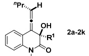</td><td></td><td></td><td></td><td></td><td></td><td></td><td></td></tr><tr><td></td><td>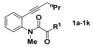</td><td></td><td></td><td></td><td></td><td>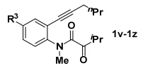</td><td></td><td></td><td>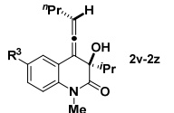</td><td></td></tr><tr><td></td><td></td><td></td><td></td><td></td><td></td><td></td><td></td><td></td><td></td><td></td></tr><tr><td> $\mathrm { R } ^ { 1 } = { } ^ { i } \mathrm { P r } , \mathbf { 1 } \mathbf { a }$ </td><td></td><td>2a</td><td>Me 76</td><td>9/1</td><td>22</td><td> $\mathrm { R } ^ { 3 } = \mathrm { B r } , 1 \mathbf { v }$ </td><td></td><td></td><td></td><td></td></tr><tr><td>2</td><td> $\mathrm { R } ^ { 1 } = \mathrm { C y c l o h e x y l } , 1 \mathbf { b }$ </td><td></td><td>2b</td><td>78</td><td>8/1</td><td>23</td><td> $\mathrm { R } ^ { 3 } = \mathrm { F } , \mathbf { 1 w }$ </td><td></td><td></td><td></td><td></td></tr><tr><td>3</td><td> ${ \mathrm { R } } ^ { 1 } = { \mathrm { M e } } , 1 \mathbf { c }$ </td><td></td><td>2c</td><td>40</td><td>5/1</td><td>24</td><td> $\mathbb { R } ^ { 3 } = \mathrm { N O } _ { 2 } , \mathbf { 1 } \mathbf { x }$ </td><td></td><td></td><td>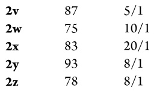</td><td></td></tr><tr><td>4</td><td> $\mathbf { R } ^ { 1 } = \mathrm { E t } , \mathbf { 1 } \mathbf { d }$ </td><td></td><td>2d</td><td>88</td><td>5.7/1</td><td>25</td><td> $\mathbf { R } ^ { 3 } = \mathbf { M } \mathbf { e } , \mathbf { 1 } \mathbf { y }$ </td><td></td><td></td><td></td><td></td></tr><tr><td>5</td><td> $\mathrm { R ^ { 1 } } = \mathrm { P h C H _ { 2 } C H _ { 2 } } , 1 \mathbf { e }$ </td><td></td><td>2e</td><td>75</td><td>5/1</td><td>26</td><td> $\mathrm { R } ^ { 3 } = \mathrm { P h } , 1 \mathbf { z }$ </td><td></td><td></td><td></td><td></td></tr><tr><td>6</td><td> $\mathrm { R } ^ { 1 } = \mathrm { ^ { \prime } B u , 1 f }$ </td><td></td><td>2f</td><td>33</td><td>5.2/1</td><td></td><td></td><td></td><td></td><td></td><td></td></tr><tr><td>7</td><td> $\mathbf { R } ^ { 1 } = \mathrm { P h } , \mathbf { 1 } \mathbf { g }$ </td><td></td><td>2g</td><td>42</td><td>5.8/1</td><td></td><td></td><td></td><td></td><td></td><td></td></tr><tr><td>8</td><td> $\mathrm { R } ^ { 1 } = 4 \mathrm { - C l C } _ { 6 } \mathrm { H } _ { 4 } , \mathbf { 1 } \mathbf { h }$ </td><td></td><td>2h</td><td>68</td><td>4.6/1</td><td></td><td></td><td></td><td></td><td></td><td></td></tr><tr><td>9</td><td> $\mathrm { R } ^ { 1 } = 4 \mathrm { - C F } _ { 3 } \mathrm { C } _ { 6 } \mathrm { H } _ { 4 } , \mathrm { \bf I i }$ </td><td></td><td>2i</td><td>73</td><td>5/1</td><td></td><td>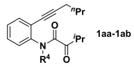</td><td></td><td></td><td>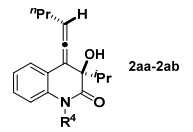</td><td></td></tr><tr><td>10</td><td> $\mathrm { R ^ { 1 } } = 4 { \cdot } \mathrm { M e O C } _ { 6 } \mathrm { H } _ { 4 } , \mathbf { 1 } \mathbf { j }$ </td><td></td><td>2j</td><td>52</td><td>2.6/1</td><td></td><td></td><td></td><td></td><td></td><td></td></tr><tr><td>11</td><td> $\mathrm { R ^ { 1 } } = 2 \mathrm { - n a p h t h y l } , 1 \mathrm { k }$ </td><td></td><td>2k</td><td>46</td><td>3/1</td><td></td><td></td><td></td><td></td><td></td><td></td></tr><tr><td></td><td></td><td></td><td></td><td></td><td></td><td>27 28</td><td> $\mathrm { R } ^ { 4 } = \mathrm { B n } , 1 \mathbf { a } \mathbf { a }$ </td><td></td><td>2aa</td><td>84</td><td>8/1</td></tr><tr><td rowspan="4">12</td><td></td><td>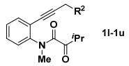</td><td></td><td>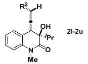</td><td></td><td></td><td> $\mathrm { R ^ { 4 } } = \mathrm { 1 - p r o p a r g y l , 1 a b }$ </td><td></td><td>2ab</td><td>67</td><td>5.6/1</td></tr><tr><td></td><td></td><td></td><td></td><td></td><td></td><td></td><td></td><td></td><td></td><td></td></tr><tr><td></td><td></td><td></td><td></td><td></td><td></td><td></td><td></td><td></td><td></td><td></td></tr><tr><td> $\mathrm { R } ^ { 2 } = \mathrm { E t } , 1 \mathbf { l }$   $\mathrm { R } ^ { 2 } = \mathrm { P h C H _ { 2 } C H _ { 2 } } , 1 \mathbf { m }$ </td><td></td><td>21 2m</td><td>90 88</td><td>11/1 6.6/1</td><td></td><td></td><td></td><td></td><td></td><td></td></tr><tr><td>14</td><td> $\mathrm { R } ^ { 2 } = \mathrm { ^ { \mathrm { i } } B u , \mathbf { 1 } n }$ </td><td></td><td>2n</td><td>71</td><td>9/1</td><td>29</td><td>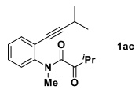</td><td></td><td></td><td></td><td></td></tr><tr><td>15</td><td> $\mathrm { R } ^ { 2 } = \mathrm { C l C H _ { 2 } C H _ { 2 } C H _ { 2 } } , 1 \mathbf { o }$ </td><td></td><td></td><td>82</td><td></td><td></td><td></td><td></td><td></td><td>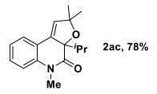</td><td></td></tr><tr><td></td><td></td><td></td><td>20</td><td></td><td>8.1/1</td><td></td><td></td><td></td><td></td><td></td><td></td></tr><tr><td>16</td><td> $\mathrm { R ^ { 2 } } = \mathrm { N C C H _ { 2 } C H _ { 2 } } , \mathrm { 1 p }$ </td><td></td><td>2p</td><td>81</td><td>7/1</td><td></td><td></td><td></td><td></td><td></td><td></td></tr><tr><td>17</td><td> $\mathrm { R } ^ { 2 } = \mathrm { B n O C H } _ { 2 } , \mathbf { 1 } \mathbf { q }$ </td><td></td><td>2q</td><td>76</td><td>7.7/1</td><td></td><td></td><td></td><td></td><td></td><td></td></tr><tr><td>18</td><td> $\mathrm { R ^ { 2 } = 1 H - I n d o l e C H _ { 2 } C H _ { 2 } , \bf 1 r }$ </td><td></td><td>2r</td><td>75</td><td>7.6/1</td><td></td><td></td><td></td><td></td><td></td><td></td></tr><tr><td>19</td><td> $\mathrm { R } ^ { 2 } = ^ { i } \mathrm { P r } \ , \ \mathbf { 1 } \mathbf { s }$ </td><td></td><td>2s</td><td>48</td><td>17/1</td><td>30</td><td>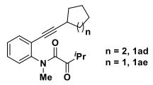</td><td></td><td></td><td>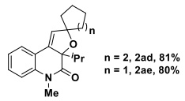</td><td></td></tr><tr><td>20</td><td> $\mathrm { R } ^ { 2 } = \mathrm { C y c l o h e x y l } , 1 \mathrm { t }$ </td><td></td><td>2t</td><td>65</td><td>12/1</td><td></td><td></td><td></td><td></td><td></td><td></td></tr><tr><td>21</td><td> $\mathrm { R } ^ { 2 } = \mathrm { P h } , 1 \mathbf { u }$ </td><td></td><td>2u</td><td>85</td><td>20/1</td><td></td><td></td><td></td><td></td><td></td><td></td></tr></table>

aReaction conditions: a mixture containing 1 (0.1 mmol), Sc(OTf) (0.01 mmol), and 1,2-DCE (1.0 mL) was stirred in a vial at $8 0 ~ ^ { \circ } \mathrm { C }$ for 4 h. bIsolated yields. cdr values were determined by the integration of peaks shown in 1H NMR spectra.

Table 3. Comparative Analysis of Electronic and Thermodynamic Parameters for TS1 and TS2
<table><tr><td></td><td>TS1</td><td>TS2</td><td>Difference</td></tr><tr><td> $E _ { \mathrm { ( H a r t r e e ) } }$ </td><td>-3588.90038</td><td>-3588.90069</td><td>0.0003106</td></tr><tr><td> $G _ { \mathrm { c o r r } }$ </td><td>0.340408</td><td>0.343547</td><td>-0.003139</td></tr><tr><td> $H _ { \mathrm { c o r r } }$ </td><td>0.481621</td><td>0.482035</td><td>-0.000414</td></tr><tr><td> $T ^ { \ast } S _ { ( \mathrm { E n t r o p y } ) }$ </td><td>0.141213</td><td>0.138488</td><td>0.002725</td></tr></table>

To demonstrate the synthetic potential of the Sc-catalyzed carbonyl−yne reaction, we performed a series of transformations on allene 2a (Figure 2). Treatment of 2a with silver(I) triflate induced cyclization, afording dihydrofuran 3 in 76% yield. Alternatively, palladium-catalyzed cyclization/ allylation of 2a produced dihydrofuran 4. Employing Niodosuccinimide (NIS) provided dihydrofuran 5 in 70% yield. Notably, the formation of dihydrofurans 3−5 proceeded diastereoselectively, as confirmed by X-ray crystallographic analysis. Under the promotion of N-bromosuccinimide (NBS), 2a underwent a semipinacol rearrangement featuring 1,2- migration of the isopropyl group. This transformation furnished trisubstituted alkene 6 as the major product, whose structure was unambiguously confirmed by X-ray crystallographic analysis.

In summary, we have developed a Sc(OTf) -catalyzed carbonyl−yne reaction for the diastereoselective synthesis of multisubstituted allenes from α-ketoamide-tethered alkynes. This method features excellent atom economy, a broad substrate scope (tolerating diverse alkyl, aryl, and functional groups), and good-to-excellent diastereoselectivity. Theoretical analysis suggests that the observed stereoselectivity arises from a sophisticated interplay of electronic and entropic efects in the transition states. Meanwhile, this work addresses longstanding challenges in carbonyl−yne chemistry, establishing a robust platform for allene synthesis with applications in targetoriented synthesis. Further investigations into the asymmetric carbonyl−yne reaction and its synthetic applications are underway in our laboratory.

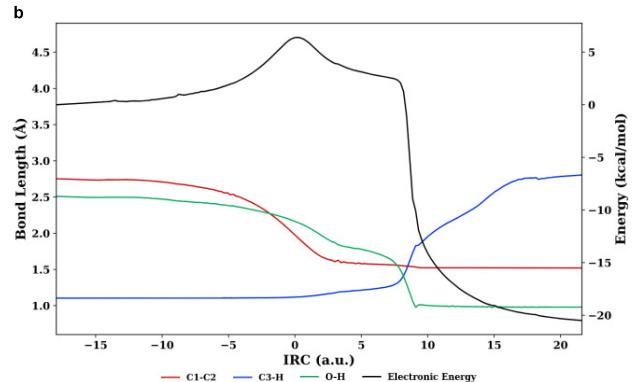

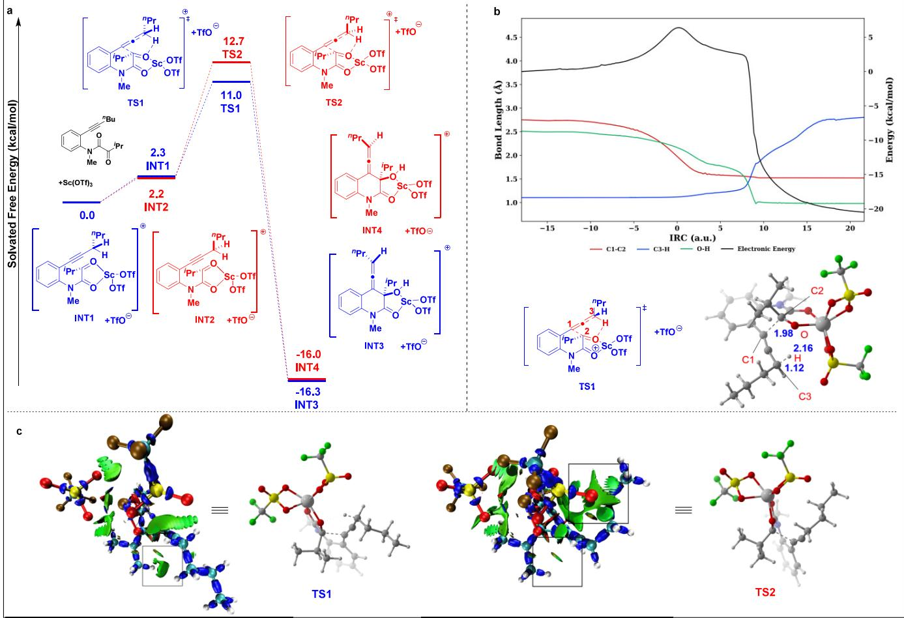

Figure 1. a) Potential energy profile of the Sc(III)-catalyzed carbonyl−yne reaction of 1a. b) Solvated electronic energies and selected bond lengths along the IRC of TS1. Bond lengths labeled in TS1 structure are in Å. c) IRI analysis of transition states TS1 (top) and TS2 (bottom). Areas emphasized by the squares are dispersion attraction and steric hindrance between isopropyl and butyl in TS1, dispersion attraction between triflate and butyl, and steric hindrance between isopropyl and butyl in TS2, respectively. The color scale represents: blue for strong attraction, green for van der Waals interactions, and red for strong repulsion.  
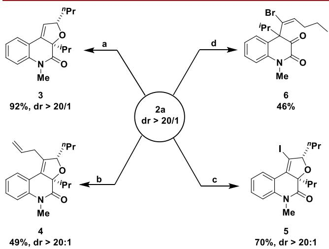  
Figure 2. Synthetic applications of allene 2a. a) AgOTf (0.1 equiv), acetone $/ \mathrm { H } _ { 2 } \mathrm { O }$ (1/0.1 mL), rt, 12 h; b) PdCl (20 mol %), $\mathrm { C H } _ { 2 } \mathrm { C l } _ { 2 }$ (1.0 mL), allyl bromide (5.0 equiv), $\mathrm { N } _ { 2 } ,$ rt, 4 h; c) NIS (1.2 equiv), CHCl (1.0 mL), rt, 3 h; d) NBS (1.2 equiv), CHCl (1.0 mL), rt, 3 h.

## ■ ASSOCIATED CONTENT

## Data Availability Statement

The data underlying this study are available in the published article and its Supporting Information.

## \*sı Supporting Information

The Supporting Information is available free of charge at https://pubs.acs.org/doi/10.1021/acs.orglett.5c03172.

Experimental procedures, characterizations, and copies of $\mathrm { \hat { \Omega } _ { H } }$ and $^ { 1 3 } \mathrm { C }$ NMR spectra of products (PDF)

## Accession Codes

Deposition Numbers 2391753, 2391994, 2403415, 2404896, 2404940, and 2483069 contain the supplementary crystallographic data for this paper. These data can be obtained free of charge via the joint Cambridge Crystallographic Data Centre (CCDC) and Fachinformationszentrum Karlsruhe Access Structures service.

## ■ AUTHOR INFORMATION

## Corresponding Author

Shaozhong Wang − State Key Laboratory of Coordination Chemistry, Jiangsu Key Laboratory of Advanced Organic Materials, Engineering Research Center of Photoresist Materials, Ministry of Education, School of Chemistry and Chemical Engineering, Nanjing University, Nanjing, Jiangsu 210023, China; orcid.org/0000-0002-7766-4433; Email: wangsz@nju.edu.cn

## Authors

Xinya Yuan − State Key Laboratory of Coordination Chemistry, Jiangsu Key Laboratory of Advanced Organic Materials, Engineering Research Center of Photoresist Materials, Ministry of Education, School of Chemistry and Chemical Engineering, Nanjing University, Nanjing, Jiangsu 210023, China

Jiashen Yang − State Key Laboratory of Coordination Chemistry, Jiangsu Key Laboratory of Advanced Organic Materials, Engineering Research Center of Photoresist Materials, Ministry of Education, School of Chemistry and Chemical Engineering, Nanjing University, Nanjing, Jiangsu 210023, China

Complete contact information is available at: https://pubs.acs.org/10.1021/acs.orglett.5c03172

## Notes

The authors declare no competing financial interest.

## ■ ACKNOWLEDGMENTS

The work was financially supported by the National Natural Science Foundation of China (21871132, 21572098). The authors are grateful to the High Performance Computing Center (HPCC) of Nanjing University for performing the numerical calculations in this paper on its blade cluster system.

## ■ REFERENCES

(1) Modern Allene Chemistry; Krause, N., Hashmi, A. S. K., Eds.; WILEY-VCH Verlag GmbH & Co. KGaA: Weinheim, 2004.

(2) Hoffmann-Röder, A.; Krause, N. Synthesis and Properties of Allenic Natural Products and Pharmaceuticals. Angew. Chem., Int. Ed. 2004, 43, 1196−1216.

(3) Ma, S. Some Typical Advances in the Synthetic Applications of Allenes. Chem. Rev. 2005, 105, 2829−2871.

(4) Rivera-Fuentes, P.; Diederich, F. Allenes in Molecular Materials. Angew. Chem., Int. Ed. 2012, 51, 2818−2828.

(5) Zimmer, R.; Dinesh, C. U.; Nandanan, E.; Khan, F. A. Palladium-Catalyzed Reactions of Allenes. Chem. Rev. 2000, 100, 3067−3125.

(6) Alcaide, B.; Almendros, P.; Aragoncillo, C. Exploiting [2 + 2] Cycloaddition Chemistry: Achievements with Allenes. Chem. Soc. Rev. 2010, 39, 783−816.

(7) Aubert, C.; Fensterbank, L.; Garcia, P.; Malacria, M.; Simonneau, A. Transition Metal Catalyzed Cycloisomerizations of 1,n-Allenynes and -Allenenes. Chem. Rev. 2011, 111, 1954−1993.

(8) Kitagaki, S.; Inagaki, F.; Mukai, C. [2+2+1] Cyclization of Allenes. Chem. Soc. Rev. 2014, 43, 2956−2978.

(9) Lledó, A.; Pla-Quintana, A.; Roglans, A. Allenes, Versatile Unsaturated Motifs in Transition-metal-catalysed [2+2+2] Cyclo addition Reactions. Chem. Soc. Rev. 2016, 45, 2010−2023.

(10) Mascareñas, J. L.; Varela, I.; López, F. Allenes and Derivatives in Gold(I)- and Platinum(II)-Catalyzed Formal Cycloadditions. Acc. Chem. Res. 2019, 52, 465−479.

(11) Brummond, K. M.; DeForrest, J. E. Synthesizing Allenes Today (1982−2006). Synthesis 2007, 2007, 795−818.

(12) Yu, S.; Ma, S. How Easy are the Syntheses of Allenes? Chem. Commun. 2011, 47, 5384−5418.

(13) Neff, R. K.; Frantz, D. E. Recent Advances in the Catalytic Syntheses of Allenes: A Critical Assessment. ACS Catal. 2014, 4, 519−528.

(14) Huang, X.; Ma, S. Allenation of Terminal Alkynes with Aldehydes and Ketones. Acc. Chem. Res. 2019, 52, 1301−1312.

(15) Oppolzer, W.; Snieckus, V. Intramolecular Ene Reactions in Organic Synthesis. Angew. Chem., Int. Ed. Engl. 1978, 17, 476−486.

(16) Hoffmann, H. M. R. The Ene Reaction. Angew. Chem., Int. Ed. 1969, 8, 556−577.

(17) Altable, M.; Filippone, S.; Martín-Domenech, A.; Güell, M.; Sola,̀ M.; Martín, N. Intramolecular Ene Reaction of 1,6-Fullerenynes: A New Synthesis of Allenes. Org. Lett. 2006, 8, 5959−5962.

(18) Sakai, T.; Danheiser, R. L. Cyano Diels−Alder and Cyano Ene Reactions. Applications in a Formal [2 + 2 + 2] Cycloaddition Strategy for the Synthesis of Pyridines. J. Am. Chem. Soc. 2010, 132, 13203−13205.

(19) Sasaki, M.; Hamzik, P. J.; Ikemoto, H.; Bartko, S. G.; Danheiser, R. L. Formal Bimolecular [2 + 2 + 2] Cycloaddition Strategy for the Synthesis of Pyridines: Intramolecular Propargylic Ene Reaction/Aza Diels−Alder Reaction Cascades. Org. Lett. 2018, 20, 6244−6249.

(20) Tawatari, T.; Kato, R.; Takasu, K.; Takikawa, H. Intramolecular Propargylic Ene Reaction of Benzyne En Route to Highly Functionalized Allenes and Allenamides. Synthesis 2022, 54, 4979−4988.

(21) Golubev, A. S.; Sergeeva, N. N.; Hennig, L.; Kolomiets, A. F.; Burger, K. Carbonyl-yne Reactions of 3,3,3-Trifluoropyruvates. Tetrahedron 2003, 59, 1389−1394.

(22) Lewis Acids in Organic Synthesis; Yamamoto, H., Ed.; Wiley− VCH: Weinheim, 2000.

(23) Kobayashi, S.; Sugiura, M.; Kitagawa, H.; Lam, W. W. L. Rare-Earth Metal Triflates in Organic Synthesis. Chem. Rev. 2002, 102, 2227−2302.

(24) Grabowski, S. J. Dihydrogen Bond and X-H···σ Interaction as Sub-classes of Hydrogen Bond. J. Phys. Org. Chem. 2013, 26, 452− 459.

(25) Lu, T.; Chen, Q. Interaction Region Indicator: A Simple Real Space Function Clearly Revealing Both Chemical Bonds and Weak Interactions. Chemistry-Methods 2021, 1, 231−239.

(26) Li, B.; Xu, H.; Dang, Y.; Houk, K. N. Dispersion and Steric Effects on Enantio-/Diastereoselectivities in Synergistic Dual Transition-Metal Catalysis. J. Am. Chem. Soc. 2022, 144, 1971−1985.

(27) Barcellona, P.; Bennett, R.; Buhmann, S. Y. Lateral Interatomic Dispersion Forces. Phys. Rev. A 2020, DOI: 10.1103/PhysRevA.102.020802.

(28) Chen, J.; Wei, H.; Gridnev, I. D.; Zhang, W. Weak Attractive Noncovalent Interactions in Metal-Catalyzed Asymmetric Hydrogenation. Angew. Chem., Int. Ed. 2025, 64, No. e202425589.

(29) Zheng, T.; Ma, J.; Chen, H.; Jiang, H.; Lu, S.; Shi, Z.; Liu, F.; Houk, K. N.; Liang, Y. Computational Design of Ligands for the Ir-Catalyzed C5-Borylation of Indoles through Tuning Dispersion Interactions. J. Am. Chem. Soc. 2024, 146, 25058−25066.

(30) Echeverría, J.; Aullón, G.; Danovich, D.; Shaik, S.; Alvarez, S. Dihydrogen Contacts in Alkanes are Subtle but not Faint. Nat. Chem. 2011, 3, 323−330.

(31) Grabowski, S. J.; Sokalski, W. A.; Leszczynski, J. Wide Spectrum of H···H Interactions: Van Der Waals Contacts, Dihydrogen Bonds and Covalency. Chem. Phys. 2007, 337, 68−76.

(32) Politzer, P.; Murray, J. S. The Use and Misuse of Van Der Waals Radii. Struct. Chem. 2021, 32, 623−629.

(33) Forbes, C. R.; Sinha, S. K.; Ganguly, H. K.; Bai, S.; Yap, G. P. A.; Patel, S.; Zondlo, N. J. Insights into Thiol-Aromatic Interactions: A Stereoelectronic Basis for S-H/π Interactions. J. Am. Chem. Soc. 2017, 139, 1842−1855.

(34) Truhlar, D. G. Dispersion Forces: Neither Fluctuating Nor Dispersing. J. Chem. Educ. 2019, 96, 1671−1675.

(35) Grimme, S. Supramolecular Binding Thermodynamics by Dispersion-Corrected Density Functional Theory. Chem. Eur. J. 2012, 18, 9955−9964.

(36) Lu, T.; Chen, Q. Shermo: A General Code for Calculating Molecular Thermochemistry Properties. Comput. Theor. Chem. 2021, 1200, No. 113249.

(37) Grimme, S.; Ehrlich, S.; Goerigk, L. Effect of the Damping Function in Dispersion Corrected Density Functional Theory. J. Comput. Chem. 2011, 32, 1456−1465.

(38) Stephens, P. J.; Devlin, F. J.; Chabalowski, C. F.; Frisch, M. J. Ab Initio Calculation of Vibrational Absorption and Circular Dichroism Spectra Using Density Functional Force Fields. J. Phys. Chem. 1994, 98, 11623−11627.