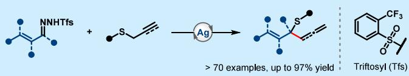
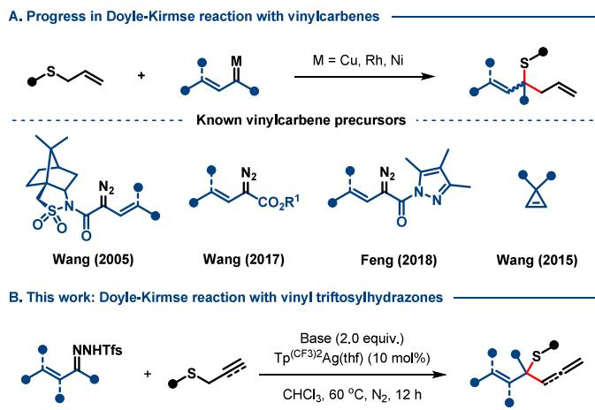
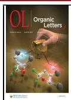
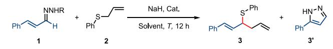
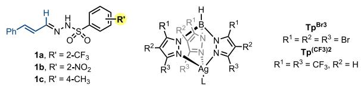
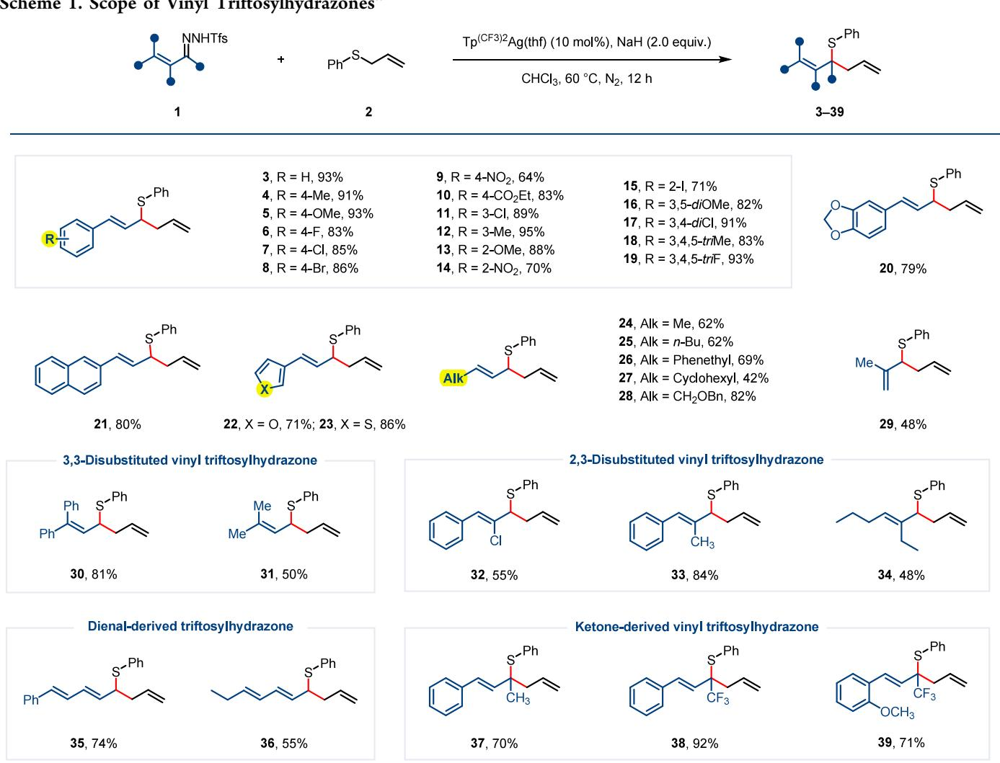
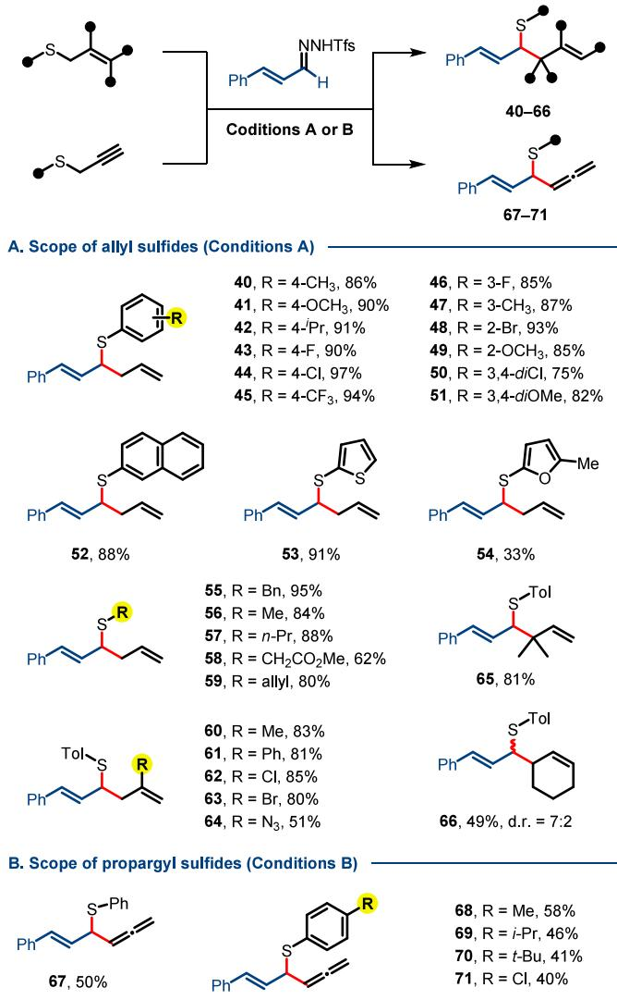
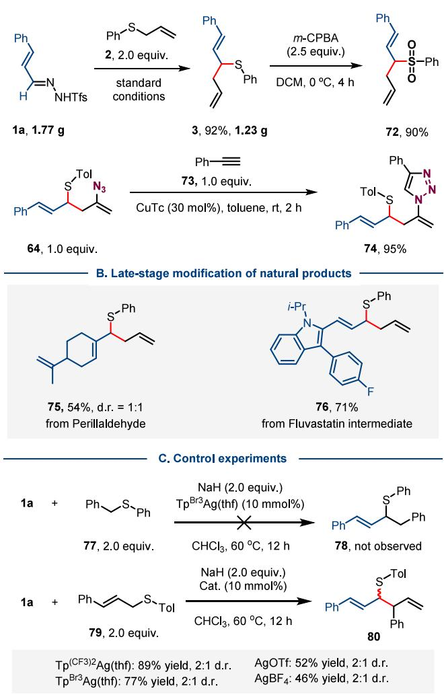

pubs.acs.org/OrgLett

Letter

# Silver-Catalyzed Doyle−Kirmse Reaction of Allyl Sulfides with Vinyl Triftosylhydrazones

Ziying Li, Zhaohong Liu,\* Paramasivam Sivaguru, Yong Yang, Karunanidhi Murali, Kuan Wang, and Xihe Bi\*

Cite This: Org. Lett. 2025, 27, 4057−4062

ACCESS

## Read Online

Metrics & More

  
Article Recommendations

ABSTRACT: Here, we report a general and practical Doyle− Kirmse reaction of allyl/propargyl sulfides with donor-only vinyl carbenes generated in situ from vinyl triftosylhydrazones in the presence of a silver catalyst. This protocol features mild conditions, exhibits a broad substrate scope and exceptional functional group tolerance, and provides corresponding 1,5-dienyl and 1,4-enallenyl sulfides in high yields. Moreover, gram-scale synthesis, late-st transformations were performed to demonstrate the applicability o

[2,3]-Sigmatropic rearrangements of onium ylides are an important and fundamental transformation in organic chemistry for synthesizing valuable heteroatom-containing compounds with high stereoselectivity.1 Among these, the [2,3]- sigmatropic rearrangement of sulfonium ylides generated from carbenes and allyl/propargyl sulfides, known as the Doyle− Kirmse (D−K) reaction,2 ofers a potentially general method for the stereoselective construction of a high-value sulfurcontaining quaternary or tertiary carbon center, which has found applications in the synthesis of bioactive molecules and natural products. Over the decades, various transition metal and metal-free D−K reactions using tetramethylsilane (TMS)- stabilized3 or electron-withdrawing group (EWG)-derived diazo reagents4−7 as well as a few donor-only diazomethane reagents8 and N-sulfonyl-1,2,3-triazoles9 as carbene precursors have been established. In contrast, the utilization of α-vinyl diazo compounds in D−K reactions remains challenging and scarcely explored because of their propensity to undergo intramolecular cyclization to form pyrazoles.10 Despite these challenges, Wang and Feng’s groups successfully employed vinyl diazoacetates4e or vinyldiazo compounds with chiral Oppolzer’s camphor sultam6a or pyrazoleamide6b auxiliary as vinylcarbene precursors for the enantioselective D−K reaction (Figure 1A). However, to the best of our knowledge, there has been no general catalytic system for the D−K reaction with donor-substituted α-vinyldiazomethanes as carbene precursors to date due to their inherent reactivity. A single example of a rhodium-catalyzed D−K reaction of phenyl allyl sulfide with in situ generated vinyldiazomethane from tosylhydrazone was found in a report by Wang and co-workers, although providing the desired product in 48% yield.8a In 2015, Wang and coworkers used cyclopropenes as vinylcarbene precursors in the D−K reaction to bypass the general reactivity issues of α- vinyldiazomethanes as donor diazo compounds (Figure 1A).11

  
Figure 1. Background and motivation of the present work.

Recently, we discovered vinyl triftosylhydrazones as easily decomposable diazo surrogates and addressed the general issue of the reactivity of α-vinyldiazomethane toward pyrazole formation by merging it with a bulky silver catalyst to generate highly electrophilic silver vinylcarbenes.12 Encouraged by our success in transition-metal-catalyzed carbene transfer reactions using vinyl triftosylhydrazones as vinylcarbene precursors,13,14 we envision that the merger of vinyl triftosylhydrazones with silver catalysis might govern the highly eficient D−K reaction on α-vinyldiazomethanes. Herein, we report a general and eficient silver-catalyzed D−K reaction between allyl/propargyl sulfides and α-vinyldiazomethanes derived from vinyl triftosylhydrazones (Figure 1B). This approach provides practical access to diverse 1,5-dienyl or 1,4-enallenyl sulfides with high eficiency. Dienyl sulfides are valuable core structures in biologically active molecules and versatile building blocks for the synthesis of value-added products.15

Table 1. Optimization of the Reaction Conditionsa  

<table><tr><td>entry</td><td>1</td><td>catalyst</td><td>solvent</td><td> $T \ ( ^ { \circ } \mathrm { C } )$ </td><td> $3 \ : \left( \% \right) ^ { b }$ </td><td> $3 ^ { \prime } \left( \% \right) ^ { b }$ </td></tr><tr><td>1</td><td>la</td><td> $\mathrm { T p ^ { B r _ { 3 } } A g ( t h f ) }$ </td><td>CHCl3</td><td>60</td><td>82</td><td>trace</td></tr><tr><td>2</td><td>la</td><td> $\mathrm { T p } ^ { \mathrm { ( C F _ { 3 } ) _ { 2 } } } \mathrm { A g ( t h f ) }$ </td><td>CHCl3</td><td>60</td><td> $9 7 \ ( 9 3 )$ </td><td>trace</td></tr><tr><td>3</td><td>la</td><td> $\operatorname { A g O T f }$ </td><td>CHCl3</td><td>60</td><td>60</td><td>23</td></tr><tr><td>4</td><td>la</td><td> $\mathrm { C u } ( \mathrm { C H } _ { 3 } \mathrm { C N } ) _ { 4 } \mathrm { P F } _ { 6 }$ </td><td>CHCl3</td><td>60</td><td>28</td><td>59</td></tr><tr><td>5c</td><td>la</td><td> $\mathrm { R h } _ { 2 } ( \mathrm { O A c } ) _ { 4 }$ </td><td>CHCl3</td><td>60</td><td>67</td><td>11</td></tr><tr><td>6</td><td>la</td><td> $\mathrm { T p } ^ { \mathrm { ( C F _ { 3 } ) _ { 2 } } } \mathrm { A g ( t h f ) }$ </td><td>DCM</td><td>60</td><td>55</td><td>16</td></tr><tr><td>7</td><td>la</td><td> $\mathrm { T p } ^ { \mathrm { ( C F _ { 3 } ) _ { 2 } } } \mathrm { A g ( t h f ) }$ </td><td> $\mathrm { P h C F } _ { 3 }$ </td><td>60</td><td>78</td><td>trace</td></tr><tr><td>8</td><td>la</td><td> $\mathrm { T p } ^ { \mathrm { ( C F _ { 3 } ) _ { 2 } } } \mathrm { A g ( t h f ) }$ </td><td>1,4-dioxane</td><td>60</td><td>trace</td><td>53</td></tr><tr><td>9</td><td>la</td><td> $\mathrm { T p } ^ { \mathrm { ( C F _ { 3 } ) _ { 2 } } } \mathrm { A g ( t h f ) }$ </td><td> $\mathrm { C H C l } _ { 3 }$ </td><td>80</td><td>85</td><td>trace</td></tr><tr><td>10</td><td>la</td><td> $\mathrm { T p } ^ { \mathrm { ( C F _ { 3 } ) _ { 2 } } } \mathrm { A g ( t h f ) }$ </td><td> $\mathrm { C H C l } _ { 3 }$ </td><td>40</td><td>41</td><td>trace</td></tr><tr><td>11</td><td>1b</td><td> $\mathrm { T p } ^ { \mathrm { ( C F _ { 3 } ) _ { 2 } } } \mathrm { A g ( t h f ) }$ </td><td> $\mathrm { C H C l } _ { 3 }$ </td><td>60</td><td>76</td><td>8</td></tr><tr><td>12</td><td>1c</td><td> $\mathrm { T p } ^ { \mathrm { ( C F _ { 3 } ) _ { 2 } } } \mathrm { A g ( t h f ) }$ </td><td> $\mathrm { C H C l } _ { 3 }$ </td><td>60</td><td>64</td><td>13</td></tr></table>

aReaction conditions: compound 1 (0.3 mmol), allyl phenyl sulfide 2 (0.6 mmol), NaH (0.6 mmol), and catalyst (10 mol %) in CHCl (6 mL) at the specified temperature for 12 h. bThe yield was determined by 1H NMR using $\mathrm { C H } _ { 2 } \mathrm { B r } _ { 2 }$ as the internal standard. cWith 1 mol % of catalyst. The yield in parentheses refers to the isolated yield.

To test our hypothesis, we employed the reaction of α- cinnamyl N-sulfonyl hydrazone 1 and allyl phenyl sulfide $^ { 2 , }$ using NaH as a base, as a model system to identify a suitable catalyst (Table 1; for details, see Tables S1−S5 of the Supporting Information). Initially, the reaction using bulky $\mathrm { T p } ^ { \mathrm { \hat { B r } _ { 3 } } } \mathrm { A g } ( \mathrm { t h f } )$ as a catalyst in chloroform (CHCl ) at $ 6 0 ~ ^ { \circ } \dot { \mathrm { { C } } }$ provided the desired product 3 in 82% nuclear magnetic resonance (NMR) yield (entry 1 in Table 1). Delightfully, the relatively more electrophilic silver catalyst $\mathrm { T p } ^ { \mathrm { ( C F _ { 3 } ) _ { 2 } } } \mathrm { A g ( t h f ) }$ produced the target product 3 in superior yield (97% NMR yield, entry 2). In both cases, only a negligible amount of pyrazole ${ \mathfrak { z } } ^ { \flat }$ was detected. Other catalysts commonly used for $\mathrm { D - K }$ reactions, such as AgOTf, $\mathrm { C u } ( \mathrm { C H } _ { 3 } \mathrm { C N } ) _ { 4 } \mathrm { P F } _ { 6 } ,$ and $\mathrm { R h } _ { 2 } ( \mathrm { O A c } ) _ { 4 } , ^ { 4 \mathrm { c } , \mathrm { e } , 6 \mathrm { a } , 8 }$ aforded the desired product 3, albeit in a decreased yield along with more undesired product 3′ (entries $_ { 3 - 5 ) }$ . Other solvents, such as dichloromethane $\left( \mathrm { C H } _ { 2 } \mathrm { C l } _ { 2 } \right)$ and trifluorotoluene $\left( \mathrm { P h C F } _ { 3 } \right)$ , did not improve the yield of product 3, but 1,4-dioxane yielded pyrazole (3′) as a major product (entries $_ { 6 - 8 ) }$ . Increasing or decreasing the reaction temperature could negatively afect the reaction eficiency (entries 9 and 10). The reactions involving N-nosylhydrazone $\mathbf { 1 6 } ^ { 1 6 }$ and N-tosylhydrazone $\mathbf { 1 } \mathbf { c } ^ { 1 7 }$ also proceeded well but aforded the desired product 3 in lower yields (entries 11 and 12), suggesting the superior performance of triftosylhydrazone compared to other N-sulfonyl hydrazones.18 Interestingly, when an excessive amount of triftosylhydrazone 1a was employed, product 3 preferentially underwent cyclopropylation instead of proceeding with the second D−K rearrangement (Table S5 of the Supporting Information).

With the optimized reaction conditions in hand, we explored the scope of vinyl triftosylhydrazones derived from various $\alpha { , } \beta { - }$ unsaturated aldehydes, using allyl phenyl sulfide 2 as the reaction partner (Scheme 1). A variety of α-(arylvinyl) triftosylhydrazones, bearing electron-withdrawing or electrondonating substituents at the para, meta, or ortho position of the aryl ring, were well-tolerated and provided the desired 1,5- dienyl sulfides 3−20 in high to excellent yields. Vinyl triftosylhydrazones containing medicinally relevant (hetero)- aryl rings, such as naphthalene, furan, and thiophene, underwent the reaction smoothly, afording the target products 21−23 in good yields. This silver-catalyzed system was also applicable to vinyl triftosylhydrazones bearing non-aryl substituents, including methyl (24 and 29), n-butyl (25), phenylethyl (26), cyclohexyl (27), and (phenylmethoxy)- methyl (28) groups. Likewise, a set of 3,3-disubstituted and 2,3-disubstituted vinyl triftosylhydrazones could also be efectively activated by the current conditions, leading to the formation of multisubstituted 1,5-dienyl sulfide products 30− 34 in 48−84% yields. 2,4-Pentadienal-derived triftosylhydrazones also serve as suitable substrates, furnishing corresponding 1,5,7-trienyl sulfide products 35 and 36 in 74 and 55%, respectively, which are common skeletons in bioactive natural products and drug molecules.19 Finally, we examined the reactivity of vinyl triftosylhydrazones derived from $\alpha { , } \beta { - }$ unsaturated ketones, which underwent smooth reaction to deliver desired 1,5-dienyl sulfides containing a quaternary carbon center in good yields (37−39). These compounds represent the most potent inhibitors of stromelysin-1.20

Next, we surveyed the scope of allyl sulfides using vinyl triftosylhydrazone 1a as the constant coupling reagent (Scheme 2A). Aryl allyl sulfides substituted with various substituents, such as methyl, methoxy, isopropyl, halogens, and trifluoromethyl groups, reacted smoothly to aford corresponding products 40−51 in good to excellent yields. Replacing the phenyl ring of aryl allyl sulfides with electron-rich naphthalene (52) and thiophene (53) rings aforded the desired product in high yields, while 2-methyl furyl allyl sulfide (54) resulted in a poor yield. Similarly, benzyl-, alkyl-, alkyl ester-, and allylsubstituted allyl sulfides (55−59) were also compatible with the reaction conditions. In the case of diallyl sulfide, the desired product 59 was exclusively obtained in 80% yield under standard conditions. Intriguingly, upon adjustment of the stoichiometric ratio of compound 1a to diallyl sulfide from 1:2 to 2:1, no detectable double D−K reaction product was observed. Instead, product 59 was isolated in 63% yield, along with side products resulting from cyclopropanation and selfcyclization (Scheme S2 of the Supporting Information). The reaction demonstrated a high tolerance of various functionalities, such as methyl (60), phenyl (61), halogens (62 and 63), and azide (64), on the vinyl unit of aryl allyl sulfides, furnishing target products in 51−85% yields. Sterically hindered 1,1-dimethylallyl aryl sulfide could still provide the desired product 65 in a high yield. Likewise, the current protocol was suitable for cyclohex-2-enyl aryl sulfide, giving desired product 66 in 49% yield with moderate diastereoselectivity (49% yield, dr = 7:2). Finally, the scope of this reaction was successfully extended to propargyl sulfides, thereby providing a convenient route to synthetically useful 1,4-enallenyl sulfides (Scheme 2B).21 However, a slight modification from the original conditions, such as changing the base from NaH to CsF, is necessary to achieve a synthetically useful yield (see Tables S6−S9 of the Supporting Information). Under these modified conditions, aryl propargyl sulfides with methyl, isopropyl, tert-butyl, and chloro functionality at the para position of the aryl ring reacted smoothly to aford corresponding 1,4-enallenyl sulfides 67−71 in 50−58% yields.

  
aStandard conditions: compound 1 (0.3 mmol), allyl phenyl sulfide 2 (0.6 mmol), NaH (2.0 equiv), $\mathrm { T p } ^ { \mathrm { ( C F _ { 3 } ) _ { 2 } } } \mathrm { A g ( t h f ) }$ (10 mol %), and CHCl (6 mL), under $\Nu _ { 2 }$ for 12 h. In all cases, isolated yields are shown.

To further demonstrate the practicality of this protocol, we performed a 5 mmol scale reaction between vinyl triftosylhydrazone 1a and allyl phenyl sulfide 2, resulting in the successful formation of product 3 in 92% (1.23 g) isolated yield (Scheme 3A). The synthetic value of formed products 3 and 64 was then demonstrated. Oxidation of compound 3 with mchloroperbenzoic acid (m-CPBA) produced sulfone 72 in 90% yield. Pleasingly, compound 64 could undergo Cu(I)- catalyzed azide−alkyne cycloaddition to obtain medicinally significant triazole 74 in 95% yield.22 The late-stage modification of complex molecules, such as perillaldehyde and fluvastatin-decorated vinyl triftosylhydrazones, was also possible, giving products 75 and 76 in 54 and 71% yields,

Scheme 2. Scope of Allyl and Propargyl Sulfidesa,b

  
aCondition A: vinyl triftosylhydrazone 1a (0.3 mmol), allyl sulfides 2 (0.6 mmol), NaH (2.0 equiv), $\mathrm { T p } ^ { \mathrm { ( C F _ { 3 } ) _ { 2 } } } \mathrm { A g ( t h f ) }$ (10 mol %), and CHCl (6 mL), under ${ \Nu } _ { 2 }$ for 12 h. bCondition B: vinyl triftosylhydrazones 1 (0.3 mmol), propargyl sulfides (0.9 mmol), CsF (2.0 equiv), $\mathrm { T p } ^ { \mathrm { ( C \dot { F } _ { 3 } ) _ { 2 } } } \mathrm { A g ( t h f ) }$ (10 mol %), and CHCl (6 mL), under $\Nu _ { 2 }$ for 12 h. Tol = p-methyl phenyl.

respectively (Scheme 3B), highlighting their potential in medicinal chemistry.

Finally, a series of control experiments were conducted to elucidate the reaction mechanism (Scheme 3C). First, the reaction of vinyl triftosylhydrazone 1a with benzyl phenyl sulfide 77 failed to yield the Stevens rearrangement product 78 under standard conditions, which could rule out a probable [1,2]-sigmatropic rearrangement. Next, we performed reactions between vinyl triftosylhydrazone 1a and cinnamyl tolyl sulfide 79 with diferent Ag(I) catalysts. The diastereoselectivity (dr) of product 80 was consistently determined to be 2:1, regardless of the silver catalyst or its associated ligands. Based on the above observations and previous literature, this sivlercatalyzed [2,3]-sigmatropic rearrangement likely proceeds via a metal-free ylide intermediate (Scheme S4 of the Supporting Information).4c,e,g,8b

In conclusion, we have demonstrated that the merger of vinyl triftosylhydrazones with silver catalysis enabled the highly eficient D−K reaction of sulfides with donor-substituted

Scheme 3. Scale-Up Synthesis, Synthetic Applications, and Control Experiments

vinyldiazomethanes. The bulky and weakly coordinated $\mathrm { T } _ { \mathrm { P } } ^ { \mathrm { ( C F _ { 3 } ) _ { 2 } } } \mathrm { A g }$ catalyst is capable of activating donor-only α- vinyldiazomethanes under mild conditions toward the D−K reaction of diverse allyl/propargyl sulfides, afording medicinally interesting 1,5-dienyl and 1,4-enallenyl sulfides with high catalytic eficiency. The asymmetric D−K reaction of allyl sulfides with vinyl triftosylhydrazones is under exploration and will be reported in due course (for preliminary experimental results, see Scheme S1 of the Supporting Information).

## ■ ASSOCIATED CONTENT

## Data Availability Statement

The data underlying this study are available in the published article and its Supporting Information.

## \*sı Supporting Information

The Supporting Information is available free of charge at https://pubs.acs.org/doi/10.1021/acs.orglett.5c01059.

Experimental details, characterization data, and NMR spectra copies (PDF)

(4) (a) McMillen, D. W.; Varga, N.; Reed, B. A.; King, C. Asymmetric Copper-Catalyzed [2,3]-Sigmatropic Rearrangements of Alkyl- and Aryl-Substituted Allyl Sulfides. J. Org. Chem. 2000, 65, 2532−2536. (b) Zhang, X.; Qu, Z.; Ma, Z.; Shi, W.; Jin, X.; Wang, J. Catalytic Asymmetric [2,3]-Sigmatropic Rearrangement of Sulfur Ylides Generated from Copper(I) Carbenoids and Allyl Sulfides. J. Org. Chem. 2002, 67, 5621−5625. (c) Davies, P. W.; Albrecht, S. J.- C.; Assanelli, G. Silver-Catalysed Doyle−Kirmse Reaction of Allyl and Propargyl Sulfides. Org. Biomol. Chem. 2009, 7, 1276−1279. (d) Tyagi, V.; Sreenilayam, G.; Bajaj, P.; Tinoco, A.; Fasan, R. Biocatalytic Synthesis of Allylic and Allenyl Sulfides through a Myoglobin-Catalyzed Doyle−Kirmse Reaction. Angew. Chem., Int. Ed. 2016, 55, 13562. (e) Zhang, Z.; Sheng, Z.; Yu, W.; Wu, G.; Zhang, R.; Chu, W.-D.; Zhang, Y.; Wang, J. Catalytic Asymmetric Trifluoromethylthiolation via Enantioselective [2,3]-Sigmatropic Rearrange ment of Sulfonium Ylides. Nat. Chem. 2017, 9, 970−976. (f) Jana, S.; Koenigs, R. M. Doyle−Kirmse Rearrangement Reactions of Difluoroacetates. Asian J. Org. Chem. 2019, 8, 683−686. (g) He, F.; Jana, S.; Koenigs, R. M. Gold-Catalyzed Sigmatropic Rearrangement Reactions via Carbene Transfer Reactions. J. Org. Chem. 2020, 85, 11882−11891. (h) Orlowska, K.; Rybicka-Jasinska,́ K.; Krajewski, P.; Gryko, D. Photochemical Doyle−Kirmse Reaction: A Route to Allenes. Org. Lett. 2020, 22, 1018−1021. (i) Wang, K.; Li, S.-S.; Wang, J. Cu(I)/Chiral Bisoxazoline-Catalyzed Enantioselective Doyle−Kirmse Reaction of Allenyl Sulfides with α-Diazoesters. Chem. - Eur. J. 2022, 28, No. e202200170. (j) Lu, X.; Yang, K.; Xu, X.; Sun, S.; Feng, S.; Bashir, M. A.; Liang, F.; Lin, J.; Huang, G. Rh(II)-Catalyzed Dovle-Kirmse Reaction: Access to Unprotected 3 Allyl/3-Allenyl-3-(thio)oxindoles. Org. Biomol. Chem. 2022, 20, 9228−9233. (k) Midya, S.; Hari, D. P. A Highly Diastereoselective Strain-Release Doyle−Kirmse Reaction: Access to Functionalized Difluoro(methylene)cyclopropanes. Chem. Sci. 2023, 14, 13560− 13567. (l) Bhardwaj, S.; Gopalakrishnan, D. K.; Deshwal, S.; Sen, R.; Tiwari, V.; Karmakar, T.; Vaitla, J. ACS Catal. 2024, 14, 2805−2815. (5) (a) Hommelsheim, R.; Guo, Y.; Yang, Z.; Empel, C.; Koenigs, R. M. Blue-Light-Induced Carbene-Transfer Reactions of Diazoalkanes. Angew. Chem., Int. Ed. 2019, 58, 1203−1207. (b) Yang, Z.; Guo, Y.; Koenigs, R. M. Photochemical, Metal-Free Sigmatropic Rearrangement Reactions of Sulfur Ylides. Chem. - Eur. J. 2019, 25, 6703−6706. (c) Yang, J.; Wang, J.; Huang, H.; Qin, G.; Jiang, Y.; Xiao, T. gem Difluoroallylation of Aryl Diazoesters via Catalyst-Free, Blue-Light-Mediated Formal Doyle−Kirmse Reaction. Org. Lett. 2019, 21, 2654− 2657. (d) Orłowska, K.; Rybicka-Jasinska,́ K.; Krajewski, P.; Gryko, D. Photochemical Doyle−Kirmse Reaction: A Route to Allenes. Org. Lett. 2020, 22, 1018−1021. (e) Wang, Y.; Jia, P.; Hao, Y.; Li, J.; Lai, R.; Guo, L.; Wu, Y. Blue Light Induced [2,3]-Sigmatropic Rearrangement Reactions of Tosylhydrazones. Tetrahedron Lett.

## ■ AUTHOR INFORMATION

## Corresponding Authors

Zhaohong Liu − Department of Chemistry, Northeast Normal University, Changchun 130024, China; orcid.org/0000- 0001-9951-8675; Email: liuzh944@nenu.edu.cn

Xihe Bi − Department of Chemistry, Northeast Normal University, Changchun 130024, China; State Key Laboratory of Elemento-Organic Chemistry, Nankai University, Tianjin 300071, China; orcid.org/0000-0002-6694-6742; Email: bixh507@nenu.edu.cn

## Authors

Ziying Li − Department of Chemistry, Northeast Normal University, Changchun 130024, China

Paramasivam Sivaguru − Department of Chemistry, Northeast Normal University, Changchun 130024, China; orcid.org/0000-0003-2225-0054

Yong Yang − Department of Chemistry, Northeast Normal University, Changchun 130024, China

Karunanidhi Murali − Department of Chemistry, Northeast Normal University, Changchun 130024, China

Kuan Wang − Department of Chemistry, Northeast Normal University, Changchun 130024, China

Complete contact information is available at: https://pubs.acs.org/10.1021/acs.orglett.5c01059

## Notes

The authors declare no competing financial interest.

## ■ ACKNOWLEDGMENTS

This work was supported by the National Natural Science Foundation of China (22331004 and 22371035) and the Science and Technology Development Plan Project of Jilin Province, China (20230508054RC and 20240601040RC).

## ■ REFERENCES

(1) (a) Nakai, T.; Mikami, K. [2,3]-Wittig Sigmatropic Rearrangements in Organic Synthesis. Chem. Rev. 1986, 86, 885−902. (b) Sweeney, J. B. Sigmatropic Rearrangements of ‘Onium’ Ylids. Chem. Soc. Rev. 2009, 38, 1027−1038. (c) Jones, A. C.; May, J. A.; Sarpong, R.; Stoltz, B. M. Toward a Symphony of Reactivity: Cascades Involving Catalysis and Sigmatropic Rearrangements. Angew. Chem., Int. Ed. 2014, 53, 2556−2591.

(2) For selected reviews, see (a) Shi, C.-Y.; Zhou, B.; Teng, M.-Y.; Ye, L.-W. Recent Advances in the Asymmetric Doyle−Kirmse Reaction. Synthesis 2023, 55, 3895−3905. (b) Liu, Y.; Liu, X.; Feng, X. Recent Advances in Metal-catalysed Asymmetric Sigmatropic Rearrangements. Chem. Sci. 2022, 13, 12290−12308. (c) Dong, S.; Liu, X.; Feng, X. Asymmetric Catalytic Rearrangements with α- Diazocarbonyl Compounds. Acc. Chem. Res. 2022, 55, 415−428. (d) Jana, S.; Guo, Y.; Koenigs, R. M. Recent Perspectives on Rearrangement Reactions of Ylides via Carbene Transfer Reactions. Chem. - Eur. J. 2021, 27, 1270−1281. (e) West, T. H.; Spoehrle, S. S. M.; Kasten, K.; Taylor, J. E.; Smith, A. D. Catalytic Stereoselective [2,3]-Rearrangement Reactions. ACS Catal. 2015, 5, 7446−7479. (f) Zhang, Y.; Wang, J. Catalytic [2,3]-Sigmatropic Rearrangement of Sulfur Ylide Derived from Metal Carbene. Coord. Chem. Rev. 2010, 254, 941−953. (g) Doyle, M. P.; Tamblyn, W. H.; Bagheri, V. Highly Effective Catalytic Methods for Ylide Generation from Diazo Compounds. Mechanism of the Rhodium- and Copper-Catalyzed Reactions with Allylic Compounds. J. Org. Chem. 1981, 46, 5094− 5102.

(3) Carter, D. S.; Van Vranken, D. L. Iron-Catalyzed Doyle−Kirmse Reaction of Allyl Sulfides with (Trimethylsilyl)-diazomethane. Org. Lett. 2000, 2, 1303−1305.

(6) (a) Ma, M.; Peng, L.; Li, C.; Zhang, X.; Wang, J. Highly Stereoselective [2,3]-Sigmatropic Rearrangement of Sulfur Ylide Generated through Cu(I) Carbene and Sulfides. J. Am. Chem. Soc. 2005, 127, 15016−15017. (b) Lin, X.; Tang, Y.; Yang, W.; Tan, F.; Lin, L.; Liu, X.; Feng, X. Chiral Nickel(II) Complex Catalyzed Enantioselective Doyle−Kirmse Reaction of α-Diazo Pyrazoleamides. J. Am. Chem. Soc. 2018, 140, 3299−3305. (c) Bankar, O. S.; Pal, C.; Laha, D.; Sabale, A. S.; Bhat, R. G. The Reactivity of Acceptor-Acceptor Diazo Pyrazolones with Allyl Thioethers under Visible Light: Access to Homoallyl Sulfides, Spiropyrazolones - Pesticide Analogues and Photoflow Synthesis. Org. Lett. 2024, 26, 9191−9197. (7) (a) Zhang, X.; Liu, Z.; Yang, X.; Dong, Y.; Virelli, M.; Zanoni, G.; Anderson, E. A.; Bi, X. Use of Trifluoroacetaldehyde N-Tfsylhydrazone as a Trifluorodiazoethane Surrogate and Its Synthetic Applications. Nat. Commun. 2019, 10, 284. (b) Ning, Y.; Zhang, X.; Gai, Y.; Dong, Y.; Sivaguru, P.; Wang, Y.; Reddy, B. R. P.; Zanoni, G.; Bi, X. Difluoroacetaldehyde N-Triftosylhydrazone (DFHZ-Tfs) as a

Bench-Stable Crystalline Diazo Surrogate for Diazoacetaldehyde and Difluorodiazoethane. Angew. Chem., Int. Ed. 2020, 59, 6473−6481.

(8) (a) Li, Y.; Huang, Z.; Wu, X.; Xu, P.-F.; Jin, J.; Zhang, Y.; Wang, J. Rh(II)-Catalyzed [2,3]-Sigmatropic Rearrangement of Sulfur Ylides Derived from N-Tosylhydrazones and Sulfides. Tetrahedron 2012, 68, 5234−5240. (b) Vaid, H.; Sharma, A.; Jamwal, P.; Sharma, P.; Gurubrahamam, R. Doyle−Kirmse Reaction on Alkynyl Hydrazone Carboxylates: Synthesis of 1,4-Allenyne and 1,5-Enyne Thioaryl Carboxylates. Org. Lett. 2024, 26, 2135−2140. (c) Fang, Z.; Wang, Y.; Ma, Y.; Han, X.; Liu, Z.; Ning, Y. Rh-Catalyzed [2,3]-Sigmatropic Rearrangement of Alkynyl Carbenes with Allyl Sulfides to Access Sulfide-Substituted 1,5-Enynes. J. Org. Chem. 2023, 88, 9677−9685.

(9) (a) Yadagiri, D.; Anbarasan, P. Rhodium-Catalyzed Denitrogenative [2,3] Sigmatropic Rearrangement: An Efficient Entry to Sulfur-Containing Quaternary Centers. Chem. - Eur. J. 2013, 19, 15115− 15119. (b) Wang, J.; Yu, J.; Chen, J.; Jiang, Y.; Xiao, T. Doyle−Kirmse Reaction using 3,3-Difluoroallyl Sulfide and N-Sulfonyl-1,2,3-triazole: an Efficient Access to gem-Difluoroallylated Multifunctional Quaternary Carbon. Org. Biomol. Chem. 2021, 19, 6974−6978.

(10) (a) Doyle, M. P.; Yan, M. Effective and Highly Stereoselective Coupling with Vinyldiazomethanes to form Symmetrical Trienes. J. Org. Chem. 2002, 67, 602−604. (b) Aggarwal, V. K.; Alonso, E.; Bae, I.; Hynd, G.; Lydon, K. M.; Palmer, M. J.; Patel, M.; Porcelloni, M.; Richardson, J.; Stenson, R. A.; Studley, J. R.; Vasse, J.-L.; Winn, C. L. A New Protocol for the in-situ Generation of Aromatic, Heteroaromatic, and Unsaturated Diazo Compounds and Its Application in Catalytic and Asymmetric Epoxidation of Carbonyl Compounds. Extensive Studies to Map Out Scope and Limitations, and Rationalization of Diastereo- and Enantioselectivities. J. Am. Chem. Soc. 2003, 125, 10926−10940.

(11) Zhang, H.; Wang, B.; Yi, H.; Zhang, Y.; Wang, J. Rh(II)- Catalyzed [2,3]-Sigmatropic Rearrangement of Sulfur Ylides Derived from Cyclopropenes and Sulfides. Org. Lett. 2015, 17, 3322−3325.

(13) For reviews on triftosylhydrazones, see (a) Liu, Z.; Sivaguru, P.; Zanoni, G.; Bi, X. N-Triftosylhydrazones: A New Chapter for Diazo-Based Carbene Chemistry. Acc. Chem. Res. 2022, 55, 1763−1781. (b) Liu, Z.; Zhang, X.; Sivaguru, P.; Bi, X. Triftosylhydrazone in Single-Atom Skeletal Editing. Acc. Chem. Res. 2025, 58, 130−149. (c) Sivaguru, P.; Pan, Y.; Wang, N.; Bi, X. Who is Who in the Carbene Chemistry of N-Sulfonyl Hydrazones. Chin. J. Chem. 2024, 42, 2071− 2108.

(14) For selected examples, see (a) Liu, Z.; Yang, Y.; Jiang, X.; Song, Q.; Zanoni, G.; Liu, S.; Bi, X. Dearomative [4 + 3] Cycloaddition of Furans with Vinyl-N-triftosylhydrazones by Silver Catalysis: Stereoselective Access to Oxa-bridged Seven Membered Bicycles. Org. Chem. Front. 2022, 9, 2444−2452. (b) Fang, Z.; Ma, Y.; Liu, S.; Bai, H.; Li, S.; Ning, Y.; Zanoni, G.; Liu, Z. Silver-Catalyzed [4 + 3] Cycloaddition of 1,3-Dienes with Alkenyl-N-triftosylhydrazones: A Practical Approach to 1,4-Cycloheptadienes. Org. Chem. Front. 2022, 9, 4426−4434. (c) Yang, Y.; Liu, S.; Li, S.; Liu, Z.; Liao, P.; Sivaguru, P.; Lu, Y.; Gao, J.; Bi, X. Site-Selective C−H Allylation of Alkanes: Facile Access to Allylic Quaternary sp3-Carbon Centers. Angew. Chem., Int. Ed. 2023, 62, No. e202214519. (d) Yang, Y.; Song, Q.; Sivaguru, P.; Liu, Z.; Shi, D.; Tian, T.; de Ruiter, G.; Bi, X. Controllable Skeletal and Peripheral Editing of Pyrroles with Vinylcarbenes. Angew. Chem., Int. Ed. 2024, 63, No. e202401359. (e) Tang, J.; Tian, T.; Wang, Y.; Wei, D.; Yang, Y.; Wang, X.; Sivaguru, P.; Ning, Y.; Liu, Z.; Nenajdenko, V. Ring Expansion of Unsubstituted Aziridinium Ylides to Trifluoromethylated Dehydropi-

peridines. Org. Chem. Front. 2024, 11, 3358−3363. (f) Liu, S.; Yang, Y.; Song, Q.; Liu, Z.; Sivaguru, P.; Zhang, Y.; de Ruiter, G.; Anderson, E. A.; Bi, X. Halogencarbene-free Ciamician-Dennstedt Single-Atom Skeletal Editing. Nat. Commun. 2024, 15, 9998. (g) Ning, Y.; Chen, H.; Ning, Y.; Zhang, J.; Bi, X. Rhodium-Catalyzed One-Carbon Ring Expansion of Aziridines with Vinyl-N-triftosylhydrazones for the Synthesis of 2-Vinyl Azetidines. Angew. Chem., Int. Ed. 2024, 63, No. e202318072.

(15) (a) Breitmaier, E. Terpenes: Flavors, Fragrances, Pharmaca, Pheromones; Wiley-VCH: Weinheim, Germany, 2006. (b) Ichikawa, Y.; Kashiwagi, T.; Urano, N. Biomimetic Synthesis of Agelasidine A. J. Chem. Soc., Perkin. Trans. 1992, 1, 1497−1500. (c) Gordon, J. S.; Wolanin, P. M.; Gonzalez, A. V.; Fela, D. A.; Sarngadharan, G.; Rouzard, K.; Perez, E.; Stock, J. B.; Stock, M. B. Topical N-Acetyl-Sfarnesyl-L-cysteine Inhibits Mouse Skin Inflammation, and Unlike Dexamethasone, Its Effects are Restricted to the Application Site. J. Invest. Dermatol. 2008, 128, 643−654.

(16) Liu, Z.; Li, Q.; Liao, P.; Bi, X. Silver-Catalyzed [2 + 1] Cyclopropenation of Alkynes with Unstable Diazoalkanes: N-Nosylhydrazones as Room-Temperature Decomposable Diazo Surrogates. Chem. - Eur. J. 2017, 23, 4756−4760.

(17) For selected reviews on N-tosylhydrazones, see (a) Barluenga, J.; Valdés, C. Tosylhydrazones: New Uses for Classic Reagents in Palladium-Catalyzed Cross-Coupling and Metal-Free Reactions. Angew. Chem., Int. Ed. 2011, 50, 7486−7500. (b) Xia, Y.; Wang, J. N-Tosylhydrazones: Versatile Synthons in the Construction of Cyclic Compounds. Chem. Soc. Rev. 2017, 46, 2306−2362. (c) Xia, Y.; Wang, J. Transition-Metal-Catalyzed Cross-Coupling with Ketones or Aldehydes via N-Tosylhydrazones. J. Am. Chem. Soc. 2020, 142, 10592−10605.

(18) Liu, Z.; Raveendra Babu, K.; Wang, F.; Yang, Y.; Bi, X. Influence of sulfonyl substituents on the decomposition of Nsulfonylhydrazones at room temperature. Org. Chem. Front. 2019, 6, 121−124.

(19) Jang, B.-C.; Muñoz-Najar, U.; Paik, J.-H.; Claffey, K.; Yoshida, M.; Hla, T. Leptomycin B, an Inhibitor of the Nuclear Export Receptor CRM1, Inhibits COX-2 Expression. J. Biol. Chem. 2003, 278, 2773−2776.

(20) Sani, M.; Candiani, G.; Pecker, F.; Malpezzi, L.; Zanda, M. Novel Highly Potent, Structurally Simple γ-Trifluoromethyl γ-Sulfone Hydroxamate Inhibitor of Stromelysin-1 (MMP-3). Tetrahedron Lett. 2005, 46, 2393−2396.

(21) Modern Allene Chemistry; Krause, N., Hashmi, A. S. K., Eds.; Wiley-VCH: Weinheim, Germany, 2004.

(22) Bonandi, E.; Christodoulou, M. S.; Fumagalli, G.; Perdicchia, D.; Rastelli, G.; Passarella, D. The 1,2,3-Triazole Ring as a Bioisostere in Medicinal Chemistry. Drug Discovery Today 2017, 22, 1572−1581.