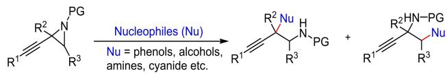
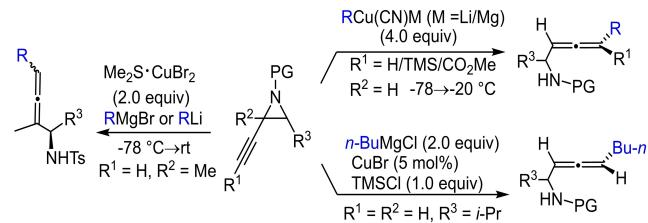
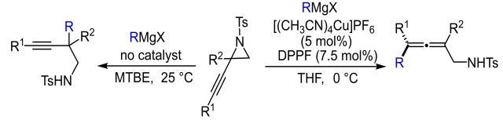
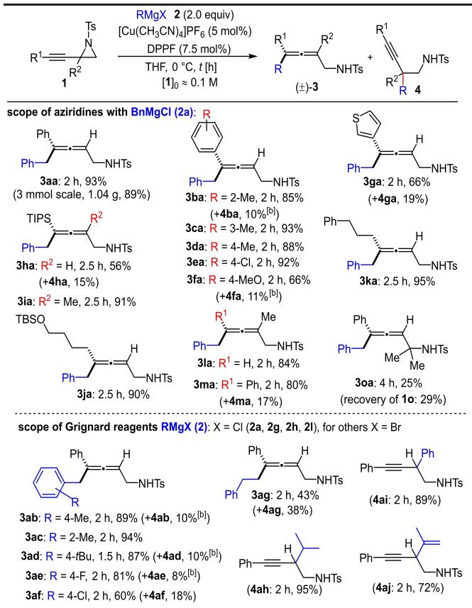
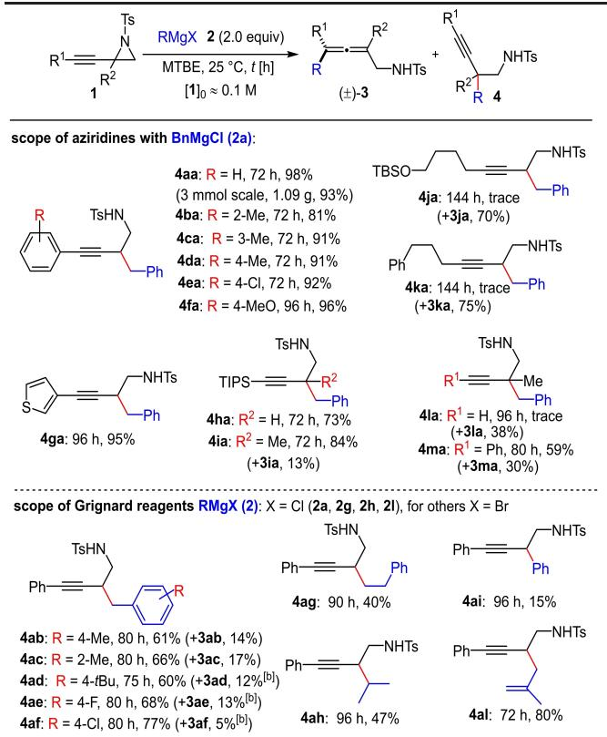
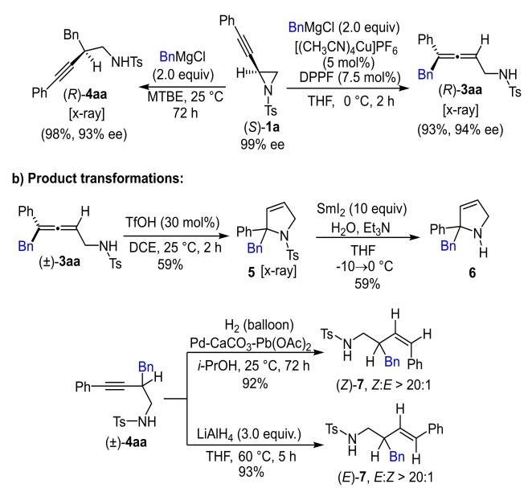

# Regiodivergent Reactions of 2-Alkynyl Aziridines with Grignard Reagents

Wen-Tao Ji,a A-Nan Ping,a Gaosheng Yang,a and Zhuo Chaia,\*

a MOE Key Laboratory of Functionalized Molecular Solids, Anhui Key Laboratory of Molecule-Based Materials (State Key Laboratory Cultivation Base), College of Chemistry and Materials Science, Anhui Normal University, 189 South Jiuhua Road, Wuhu, Anhui 241002, People’s Republic of China Fax: 0553-3883517

E-mail: chaizhuo@ahnu.edu.cn

Manuscript received: October 22, 2024; Revised manuscript received: December 13, 2024; Version of record online: January 7, 2025

Supporting information for this article is available on the WWW under https://doi.org/10.1002/adsc.202401311

Abstract: Herein, we report regiodivergent nucleophilic attack of Grignard reagents to 2-alkynyl aziridines. Under the catalysis of a Cu(I)-diphosphine complex, benzylic Grignard reagents add to the carbon-carbon triple bond of the aziridines to deliver α-allenylamines in moderate to excellent yields; the direct addition of the Grignard reagents to the aziridines in the absence of catalyst provided homopropargylic amine derivatives. Both reactions could proceed in highly enantiospecific ways. Further synthetic manipulations of these products enable rapid access to diverse useful heterocyclic molecular scaffolds.

Keywords: aziridines; ring opening; Grignard reagents; alkynes; allenes

## Introduction

Owing to the presence of both the strained aziridine ring and the alkyne bond, 2-alkynl aziridines represent a particular class of synthetic building blocks with multiple reactive sites for accessing diverse useful nitrogencontaining molecules while attracting much research intention.[1] Whilst the nucleophilic ring opening reactions of 2-alkyl or aryl aziridines usually proceed via an $\mathrm { S } _ { \mathrm { N } } 2 \mathrm { - } \mathrm { t y p e }$ mechanism,[2] the reaction with 2-alkynyl aziridines may proceed via $\mathrm { S } _ { \mathrm { N } } 2 { \ - } \mathrm { - } \mathrm { t y p e }$ and/or $\mathrm { S _ { N } } 2 ^ { \prime } { \mathrm { - t y p e } }$ mechanisms to provide alkynyl products and/or allenic products. Oxygen nucleophiles,[3] especially phenols, have been reported to attack the aziridine ring to predominantly provide alkynyl products with elegant applications to the syntheses of complex bioactive molecules such as ustiloxin[4] and phomopsin B.[5] Relevant reaction systems with other nucleophiles such as nitrogen- and sulphur-nucleophiles have also been developed with varied degrees of success (Scheme 1a).[3c,6]

On the other hand, highly regioselective and enantiospecific nucleophilic attacks at the carbon-carbon triple bond in 2-alkynyl aziridines (mostly bearing a terminal alkyne) to generate allenic products have been realized with traditional reactive organometallic reagents a) Nucleophilic ring opening of 2-alkynl aziridines to propargylic products (refs. 3-6):

b) Cu(l)-mediated ring opening of 2-alkynl aziridines to allenic products (refs. 7-8):

c) Regiodivergent reactions of 2-alkynl aziridines with RMgBr (this work)

  
Scheme 1. Nucleophilic ring opening reactions of 2-alkynyl aziridines.

such as organolithium and organomaganesium under the mediation of stoichiometric amounts of Cu(I) salts (Scheme 1b), which typically require cryogenic conditions.[7–8] In contrast, relevant catalytic reaction systems remained underdeveloped while two isolated examples of Cu(I)-catalyzed ring opening reactions with n-BuMgCl in the presence of 1.0 equiv. of TMSCl have been reported.[7b] Notably, sporadic examples of Cu(I)- catalyzed borylative[9] and silylative[10] transformation of 2-alkynyl aziridines to allenic products have also been recently reported.[11] We report herein regiodivergent reactions of 2-alkynyl aziridines with Grignard reagents. With a catalytic amount of a Cu(I) salt, the reaction provided β-allenylamine products with good to excellent yields, whereas in the absence of the Cu(I) salt, homopropargylic amine products were obtained instead (Scheme 1c).

## Results and Discussion

We initiated the study by screening the reaction conditions for the model reaction between aziridine 1 a and the Grignard reagent 2 a (Table 1). After a preliminary screening of metal salts (see Table S1 in the SI for details), [Cu(CH CN) ]PF was selected to evaluate different phosphine ligands (entries 1–6). In general, the presence of a phosphine ligand directed the reaction to the formation of the allenic product 3 aa with high selectivity and DPPF turned out to be the optimum ligand (Table 1, entry 5). Notably, previous relevant studies have been mainly restricted to aziridines bearing a terminal alkyne moiety,[7–8] and the current study first incorporates aziridines bearing an aryl alkyne into such a transformation. Unfortunately, the use of several chiral phosphine and BOX ligands hardly provided any chiral induction in both the product and the recovered aziridine (see Table S1 in the SI for details). An obvious solvent effect on the reaction was also observed: the use of toluene, MTBE and $\mathrm { E t } _ { 2 } \mathrm { O }$ as solvent all led to inferior results in terms of both yield and product selectivity (Table 1, entries 7–9). Decreasing the amount of either the ligand or the catalyst combination or increasing the reaction temperature led to inferior product selectivity (Table 1, entries 10–12). In the absence of a ligand, the S 2-type ring opening product 4aa was formed as major product, which could be obtained almost quantitatively when the reaction was performed in MTBE at ambient temperature (Table 1, entry 16).

Table 1. Screening of reaction conditions.[a]
<table><tr><td colspan="2">H. Ts N&gt; Ph- 1a</td><td colspan="2">PhMgCl 2a (2.0 equiv) Ph H [Cu (CH₃CN)₄]PF6 (5 mol%) L (7.5 mol%) Ph solvent, Temp. [°C], t [h]</td><td colspan="2">-NHTs 4aa</td></tr><tr><td>Entry</td><td>L</td><td>Solvent</td><td>Temp. [°C] t [h]</td><td>Yield [%][b] 3aa</td><td>4aa</td></tr><tr><td>1</td><td>PPh3</td><td>THF</td><td>0</td><td>2 78</td><td>7[d]</td></tr><tr><td>2</td><td>PCy₃</td><td>THF</td><td>0 2</td><td>91</td><td>5[d]</td></tr><tr><td>3</td><td>t-BuXPhos</td><td>THF</td><td>0 2</td><td>87</td><td> $5 ^ { [ \mathrm { d } ] }$ </td></tr><tr><td>4</td><td>rac-BINAP</td><td>THF</td><td>0 2</td><td>81</td><td>4[d]</td></tr><tr><td>5</td><td>DPPF</td><td>THF</td><td>0 2</td><td>93</td><td>4[d]</td></tr><tr><td>6</td><td>(p-Tolyl)₃P</td><td>THF</td><td>0 2</td><td>73</td><td>9[d]</td></tr><tr><td>7</td><td>DPPF</td><td>toluene 0</td><td>2</td><td>32</td><td>23</td></tr><tr><td>8</td><td>DPPF</td><td>MTBE 0</td><td></td><td>2 30</td><td>21</td></tr><tr><td>9</td><td>DPPF</td><td>Et2O 0</td><td></td><td>2 32</td><td>20</td></tr><tr><td>10</td><td>DPPF (6 mol%)</td><td>THF 0</td><td></td><td>2 75</td><td>12</td></tr><tr><td>11[c]</td><td>DPPF</td><td>THF 0</td><td>25</td><td>6 70</td><td>15</td></tr><tr><td>12</td><td>DPPF</td><td>THF</td><td>-15</td><td>1 45</td><td>17</td></tr><tr><td>13</td><td>DPPF</td><td>THF</td><td>25</td><td>13 87 5[d]</td><td>8[d]</td></tr><tr><td>14</td><td></td><td>THF toluene</td><td>25</td><td>72 72 11</td><td>71</td></tr><tr><td>15</td><td></td><td>MTBE</td><td>25</td><td>72 trace</td><td>89</td></tr><tr><td>16</td><td></td><td>Et2}O</td><td>25</td><td>96 14</td><td>98</td></tr><tr><td>17</td><td></td><td></td><td></td><td></td><td>82</td></tr></table>

[a] Reaction scale 0.1 mmol. The Grignard reagent was used as solution in THF.  
[b] Isolated yields were reported unless noted otherwise.  
[c] Run with 2.5 mol% of [Cu(CH3CN)4]PF6 and 3.75 mol% of DPPF.  
[d] Yields were determined by 1H NMR analysis using p-bromobenzaldehyde as internal standard. Ts: p-toluenesulfonyl; BINAP: 1,1’-binaphthyl-2,2’-diphemyl phosphine; t-BuXPhos: 2-di-tert-butylphosphino-2’,4’,6’-triisopropylbiphenyl; DPPF: 1,1’- bis(diphenylphosphino)ferrocene; MTBE: methyl t-butyl ether.

Subsequently, we examined the reaction scope with regard to the formation of the allenic products 3 (Table 2). In general, the reaction tolerated well a range of aziridines bearing (hetero)aryl-, silyl- and alkylsubstituted and terminal alkyne moieties to provide the desired products in high yields. In some cases, in addition to the allenic products, the S 2-type ringopening products were also obtained in considerable amounts (4 fa, 4 ga and 4 ha). The gram-scale preparation of the product 4 aa in a comparable yield demonstrates the practicality of this reaction. Notably, 2,2-disubstituted propargylic aziridine disfavoured the S 2-type ring opening while preferring the formation of the tetrasubstituted allenic product (3 ha vs 3 ia). It’s worth noting that the N-Boc counterpart of aziridine 1a was not tolerated in this reaction in that only the aziridine (1n) was recovered (55%) after a prolonged reaction time of 48 h, together with the formation of

Table 2. Reaction scope of the allenic products 3.[a]  

[a] Reaction scale 0.1 mmol. The Grignard reagents RMgX (X=Br/Cl) were used as solution in THF/Et O. Unless noted otherwise, isolated yields were reported and product ratios (3:4) are � 20:1 as estimated by 1H NMR analysis of the crude reaction mixture.

[b] Yields were determined by 1H NMR analysis by using pbromobenzaldehyde as internal standard.

unidentified complex mixture. The aziridine 1o bearing two methyl groups at the 3-position also gave a poor yield of the desired product together with the recovery of starting material and the formation of unidentified mixtures. As to the scope of Grignard reagents in the reaction with aziridine 1 a, benzylic Grignard reagents bearing different substituents on the benzene ring were suitable for the reaction to provide the allenic products in generally high yields. Surprisingly, the reaction with 4’-cholorobenzylmagnesium bromide gave 18% of homopropargylic amine product 4af together with 60% of 3 af. For the primary alkyl Grignard reagents, the regioselectivity for the ring opening is poor in that the two types of products were obtained in comparable yields (3 ag and 4 ag). In the case of isopropylmagnesium bromide, only the homopropargylic amine product 4ah was obtained in 95% yield. The use of corresponding phenyl or isopropenyl Grignard reagents all furnished the alkynyl products as the major products (4ai and 4aj). Notably, alkyl Grignard reagents have been shown to undergo $\mathrm { S _ { N } } \bar { 2 } ^ { \prime } { \cdot } \mathrm { t y p e }$ reaction with propargylic ammonium salts with excellent regioselectivity.[12] The use of ethynylmagnesium bromide (2k) in this reaction with the aziridine 1 a hardly produced any desired product while 57% of the aziridine was recovered together with unidentifiable complex mixture. The use of either 2-methylallylmagnesium chloride (2l) or the organolithium reagent n-BuLi produced a complex reaction mixture.[13] The structure of the product 3 ca was determined by single crystal x-ray crystallographic analysis (CCDC 2391017).[14]

Next, the scope of the S 2-type ring opening reaction of 2-alkynyl aziridines was investigated (Table 3). For aziridines bearing aryl alkyne moieties, the reaction proceeded smoothly to provide the desired homopropargylic amine products in good to excellent yields (4 aa– 4 ga). The reaction could also be performed on gramscale as demonstrated in the case of 4 aa. While good yields could be obtained with aziridines bearing silyl alkynes, the reaction with those bearing alkyl-substituted alkynes provided allenic products (3ja and 3 ka) as major products. The aziridine 1 l bearing a terminal alkyne was also not tolerated in this reaction to provide the allenic product (3 la) in a low yield together with unidentifiable complex mixture. The use of substituted benzylic Grignard reagents generally provided moderate yields in this reaction while the corresponding allenic products and/or other unidentified side products were formed concomitantly (4ab–4af). In addition, alkyl and aryl Grignard reagents provided low yields of the desired products (4 ag–4 ai) together with unidentifiable complex mixture. It’s worth noting that in the presence of the Cu(I)-dppf complex, the homopropargylic amine products 4ah and 4ai were obtained in high yields (Table 2). Vinyl (2j) and ethynyl (2k) Grignard reagents were not tolerated in this reaction to give complex reaction mixtures whereas the allylic Grignard reagent 2l provided the desired product 4al in 80% yield. Such a result is reminiscent of early findings that allylic Grignard reagents tend to undergo 1,2-addition to α,β- unsaturated carbonyl compounds, which could be accommodated by a six-membered-ring transition state.[15]

Table 3. Reaction scope of the alkynyl products 4.[a]  
  
[a] Reaction scale 0.1 mmol. The Grignard reagents RMgX (X=Br/Cl) were used as solution in THF/Et O. Unless noted otherwise, isolated yields were reported and product ratios (4:3) are � 20:1 as estimated by 1H NMR analysis of the crude reaction mixture.  
[b] Yields were determined by 1H NMR analysis by using pbromobenzaldehyde as internal standard.

Under the standard reaction conditions, the regiodivergent reactions between enantioenriched aziridine (S)- 1 a and the Grignard reagent 2 a proceeded smoothly to provide the desired products with high enantiospecificity (Scheme 2a). The absolute configurations of the two products were unambiguously confirmed by single crystal x-ray crystallographic analysis,[14] which supports that the allenic product (R)-3aa (CCDC 2391015) might be formed via an $a n t i { - } \mathrm { S } _ { \mathrm { N } } 2 ^ { \prime } { \mathrm { - } } \mathrm { t y p e }$ mechanism[7b] and the homopropargylic amine product (R)-4aa (CCDC 2391016) might be formed via an $\mathrm { S _ { N } } 2 { \cdot } \mathrm { t y p e }$ mechanism. In previous relevant studies on copper-catalyzed reactions between Grignard reagents and propargylic electrophiles involving C N bond cleavage,[12] the generation of Gilman-type organocuprates have been proposed and their tendency to attack carbon-carbon triple bond might be attributed to the “softer” nature of them according to hard and soft acid and base concept.[16] The α-allenylamine[17] product 3 aa could undergo an acid-catalyzed intramolecular hydroamination to produce compound 5, the structure of which was confirmed by single crystal x-ray crystallographic analysis (CCDC 2391014).[14] Notably, when a sample of enantioenriched (R)-3aa (94% ee) was subjected to the otherwise same conditions, the product (S)-5 was obtained in 59% yield and 85% ee. Detosylation of 5 with SmI furnished the dihydropyrrole 6 in a moderate yield (Scheme 2b). Synthetically useful (Z)- and (E)- homoallylic amines 7 could be prepared in excellent yields from the homopropargylic amine product 4 aa.[18]

  
Scheme 2. Experiments with enantioenriched (S)-1 a and product transformations.

## Conclusion

In summary, the regiodivergent ring opening reactions of 2-alkynyl aziridines with Grignard reagents has been investigated. Depending mainly on the use of a Cu(I) catalyst or the Grignard reagents, the ring opening reaction might proceed via either an $a n t i - S _ { \mathrm { { N } } } \bar { 2 } ^ { \prime }$ -type pathway to provide α-allenylamine products or an $\mathrm { S } _ { \mathrm { N } } 2 \cdot$ type mechanism to furnish homopropargylic amine products. The reaction is scalable and occurs in a highly enantiospecific fashion with enantioenriched 2-alkynyl aziridines.

## Experimental Section

Typical procedure for the preparation of allenic products 3: Under argon atmosphere, to an oven-dried Schlenk tube was added $\mathrm { [ ( C H _ { 3 } C N ) _ { 4 } C u ] P F _ { 6 } }$ (1.9 mg, 0.005 mmol) and DPPF (4.2 mg, 0.0075 mmol). The system was evacuated under vacuum and back-filled with argon (repeated twice). Then 0.5 mL of anhydrous THF was added and the resulting mixture was stirred at rt for 30 minutes. The tube was then placed in a cold bath $( 0 ^ { \circ } \mathrm { C } )$ followed by the sequential addition of aziridine 1 (0.1 mmol), Grignard reagent (as solution in THF/Et O, 0.2 mmol) and 0.3 mL of anhydrous THF. The reaction mixture was stirred at $0 \%$ until the disappearance of 1 as monitored by TLC (visualized by staining with iodine and/or irradiation with UV light). Then 10 mL of saturated aqueous NaHCO solution and 10 mL of ethyl acetate (EtOAc) were added, and the phases were separated. The aqueous phase was extracted with EtOAc (3×8 mL). The combined organic phases were dried over anhydrous ${ \mathrm { N a } } _ { 2 } { \mathrm { S O } } _ { 4 }$ and concentrated via rotary evaporation under reduced pressure. Then the crude mixture was purified by column chromatography on silica gel (eluting with petroleum ether/ EtOAc (v/v): 6:1–5:1) to furnish the desired products 3.

## Acknowledgements

Financial support of this work from the NSFC (No. 21971003), Anhui Provincial Natural Science Foundation (2008085J07) and the Excellent Scientific Research and Innovation Team ofAnhui Provincial Universities (2022AH010011) is gratefully acknowledged.

## References

[1] For reviews: a) H. Ohno, Chem. Rev. 2014, 114, 7784– 7814; b) F. Chemla, F. Ferreira, Curr. Org. Chem. 2002, 6, 539–570.

[2] For selected general reviews on the ring opening chemistry of aziridines: a) J. B. Sweeney, Chem. Soc. Rev. 2002, 31, 247–258; b) A. Padwa, In Comprehensive Heterocyclic Chemistry III, Vol. 1; A. R. Katritzky, C. A. Ramsden, E. F. V. Scriven, R. J. K.Taylor, Eds.; Elsevier: Oxford, 2008; 1; c) C. Schneider, Angew. Chem. 2009, 121, 2116–2118; Angew. Chem. Int. Ed. 2009, 48, 2082– 2084; d) P. Dauban, G. Malik, Angew. Chem. 2009, 121, 9188–9191; Angew. Chem. Int. Ed. 2009, 48, 9026–9029; e) P. Lu, Tetrahedron 2010, 66, 2549–2560; f) A. L. Cardoso, T. M. V. D. Pinho e Melo, Eur. J. Org. Chem. 2012, 6479–6501; g) C.-Y. Huang, A. G. Doyle, Chem. Rev. 2014, 114, 8153–8198; h) Z. Chai, Synthesis 2020, 52, 1738–1750; i) P.-J. Yang, Z. Chai, Org. Biomol. Chem. 2023, 21, 465–478.

[3] a) L. Palais, F. Chemla, F. Ferreira, Synlett 2006, 1039– 1042; b) F. Chemla, F. Ferreira, X. Gaucher, L. Palais, Synthesis 2007, 1235–1241; c) E. M. Forbeck, C. D. Evans, J. A. Gilleran, P. Li, M. M. Joullié, J. Am. Chem. Soc. 2007, 129, 14463–14469; d) M. Escudero-Casao, A. Cardona, R. Beltrán-Debón, Y. Díaz, M. I. Matheu, S. Castillón, Org. Biomol. Chem. 2018, 16, 7230–7235; e) P. Li, E. M. Forbeck, C. D. Evans, M. M. Joullié, Org. Lett. 2006, 8, 5105–5107; f) B. T. Kelley, P. Carroll, M. M. Joullié, J. Org. Chem. 2014, 79, 5121–5133; g) M. Corro-Morón, A. Granell, V. Ivanova, E. Domingo,

R. Beltrán-Debón, X. Barril, M.-J. Sanz, M. I. Matheu, S. Castillón, Y. Díaz, Bioorg. Chem. 2022, 121, 105668; h) A. M. Rodríguez, G. Sciortino, L. Muñoz-Gutierrez, F. Molina, F. Maseras, M. M. Díaz-Requejo, P. J. Pérez, Chem Catal. 2024, 4, 100865.

[4] a) P. Li, C. D. Evans, M. M. Joullié, Org. Lett. 2005, 7, 5325–5327; b) P. Li, C. D. Evans, E. M. Forbeck, H. Park, R. Bai, E. Hamel, M. M. Joullié, Bioorg. Med. Chem. Lett. 2006, 16, 4804–4807; c) P. Li, C. D. Evans, Y. Wu, B. Cao, E. Hamel, M. M. Joullié, J. Am. Chem. Soc. 2008, 130, 2351–2364; d) M. M. Joullié, S. Berritt, E. Hamel, Tetrahedron Lett. 2011, 52, 2136–2139.

[5] J. S. Grimley, A. M. Sawayama, H. Tanaka, M. M. Stohlmeyer, T. F. Woiwode, T. J. Wandless, Angew. Chem. 2007, 119, 8305–8307; Angew. Chem. Int. Ed. 2007, 46, 8157–8159.

[6] a) Y. Sawayama, T. Nishikawa, Synlett 2011, 651–654; b) Y. Sawayama, T. Nishikawa, Angew. Chem. 2011, 123, 7314–7316; Angew. Chem. Int. Ed. 2011, 50, 7176– 7178; c) B. T. Kelley, M. M. Joullié, Org. Lett. 2010, 12, 4244–4247.

[7] a) H. Ohno, A. Toda, Y. Miwa, T. Taga, N. Fujii, T. Ibuka, Tetrahedron Lett. 1999, 40, 349–352; b) H. Ohno, A. Toda, N. Fujii, Y. Takemoto, T. Tanaka, T. Ibuka, Tetrahedron 2000, 56, 2811–2820.

[8] B. T. Kelley, M. M. Joullié, Tetrahedron: Asymmetry 2013, 24, 1233–1239.

[9] J. Zhao, K. J. Szabó, Angew. Chem. 2016, 128, 1524– 1528; Angew. Chem. Int. Ed. 2016, 55, 1502–1506.

[10] a) X.-H. Chang, Z.-L. Liu, Y.-C. Luo, C. Yang, X.-W. Liu, B.-C. Da, J.-J. Li, T. Ahmad, T.-P. Loh, Y.-H. Xu, Chem. Commun. 2017, 53, 9344–9347; For relevant ring opening with tris(dimethylphenylsilyl)zincate: b) V. N. Bochatay, Y. Sanogo, F. Chemla, F. Ferreira, O. Jackowski, A. Pérez-Luna, Adv. Synth. Catal. 2015, 357, 2809–2814.

[11] For other relevant studies: a) M. Hatano, K. Yamashita, M. Mizuno, O. Ito, K. Ishihara, Angew. Chem. 2015, 127, 2745–2749; Angew. Chem. Int. Ed. 2015, 54, 2707–2711; b) N. Kern, A. Blanc, J.-M. Weibel, P. Pale, Chem. Commun. 2011, 47, 6665–6667; c) N. Kern, A. Blanc, S. Miaskiewicz, M. Robinette, J.-M. Weibel, P. Pale, J. Org. Chem. 2012, 77, 4323–4341; d) T. Song, L. Zhu, H. Li, C.-H. Tung, Y. Lan, Z. Xu, Org. Lett. 2020, 22, 2419– 2424; e) Z. He, A. K. Yudin, Angew. Chem. 2010, 122, 1651–1654; Angew. Chem. Int. Ed. 2010, 49, 1607–1610; f) M. Yoshida, T. Mizuguchi, K. Namba, Angew. Chem. 2014, 126, 14778–14782; Angew. Chem. Int. Ed. 2014, 53, 14550–14554.

[12] For relevant studies: a) M. Guisán-Ceinos, V. Martín-Heras, R. Soler-Yanes, D. J. Cárdenas, M. Tortosa, Chem. Commun. 2018, 54, 8343–8346; b) M. Guisán-Ceinos, V. Martín-Heras, M. Tortosa, J. Am. Chem. Soc. 2017, 139, 8448–8451; c) S. Ma, Q. Liu, X. Tang, Y. Cai, Asian J. Org. Chem. 2017, 6, 1209–1212.

[13] The high basicity of organolithiums may lead to α- lithiation of aziridines: D. M. Hodgson, B. Štefany, T. J.

Miles, J. Witherington, J. Org. Chem. 2006, 71, 8510– 8515 and references cited therein.

[14] CCDC 2391014–2391017 contain the supplementary crystallographic data for this paper. These data can be obtained free of charge from The Cambridge Crystallographic Data Centre via www.ccdc.cam.ac.uk/structures.

[15] For a review: N. D. Bartolo, J. A. Read, E. M. Valentín, K. A. Woerpel, Chem. Rev. 2020, 120, 1513–1619.

[16] The concept of charge-controlled vs frontier orbitalcontrolled mechanism might also be invoked to provide rationale for the regiodivergency: S. J. Coles, J. M. Mellor, A. H. El-Sagheer, E. E.-D. M. Salem, R. N.

Metwally, Tetrahedron 2000, 56, 10057–10066 and references cited therein.

[17] For reviews on the synthesis and applications of α- allenylamines: a) T. Thaima, F. Zamani, C. J. T. Hyland, S. G. Pyne, Synthesis 2017, 49, 1461–1480; b) B. Alcaide, P. Almendros, Adv. Synth. Catal. 2011, 353, 2561–2576.

[18] For reviews on the synthesis and applications of homoallylic and homopropargylic amines: a) R. Abonia, D. Insuasty, K. K. Laali, Molecules 2023, 28, 3379; b) M. Yus, J. C. González-Gómez, F. Foubelo, Chem. Rev. 2013, 113, 5595–5698.