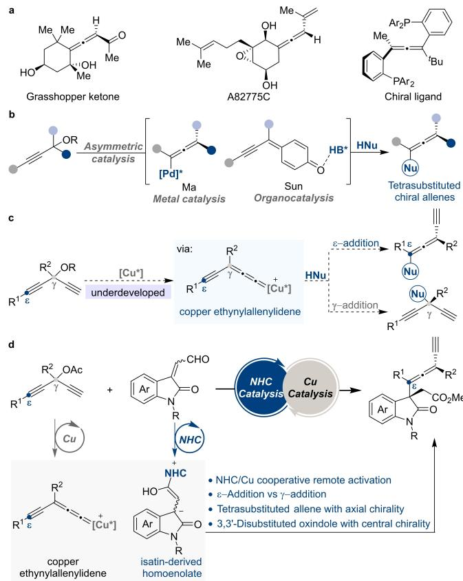
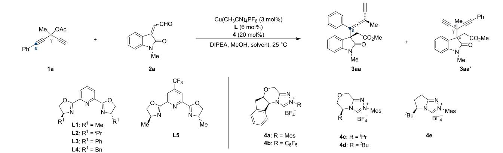
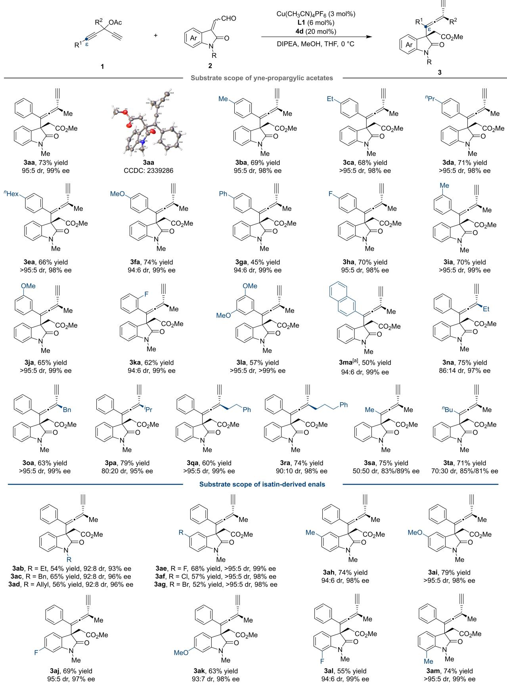
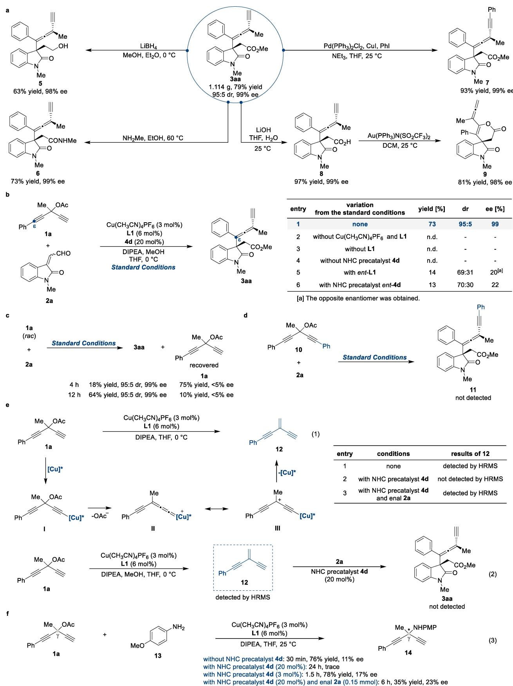
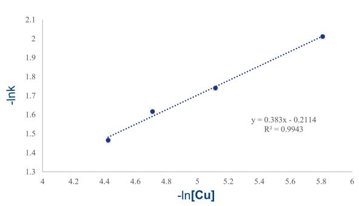
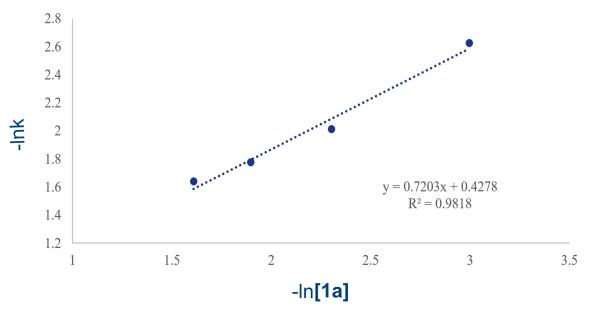
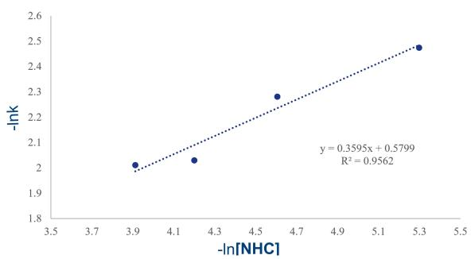
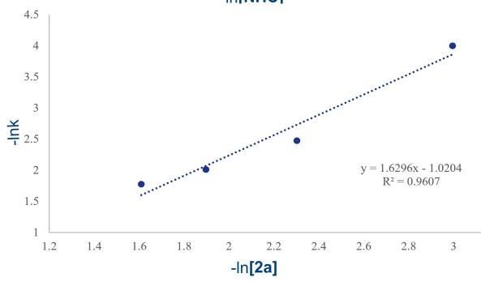
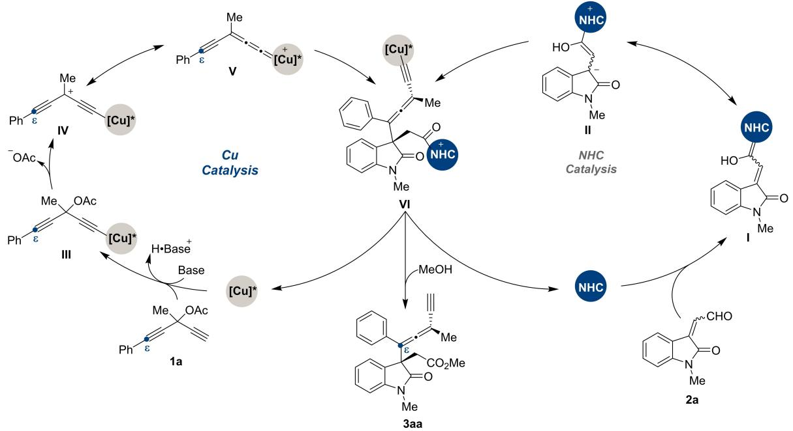

Cooperative Catalysis

# Remote Enantioselective ɛ-Alkylation of Copper Ethynylallenylidenes: Precise Control of Central and Axial Chirality

Yu-Hua Wen, Minghao Liu, Yu-Hao Wang, Qian-Wei Gong, Shuai Li, Jin Song,\* and Liu-Zhu Gong\*

Abstract: Chiral tetrasubstituted allenes have emerged as important architectures for engineering biologically active compounds. The construction of unique tetrasubstituted allene scaffolds with precise control of continuous central and axial chirality remains yet to be developed. Here, we report a remote enantioselective ɛ- alkylation of yne-propargylic acetates with enals enabled by NHC and copper cooperative catalysis, leading to a series of tetrasubstituted allenes with excellent enantioselectivities (up to > 99 % ee) and diastereoselectivities (up to >95 :5 dr). This method features high regioselectivity and simultaneous control of axial and central chirality. Mechanistic studies suggest a cooperative activation mode and synergistic control of distal chirality created from the copper ethynylallenylidenes.

## Introduction

Allenes are significant structural motifs with unique reactivity patterns. They have frequently been utilized as fundamental components in various downstream transformations and have also functioned as important elements in bioactive natural products, functional materials, and asymmetric catalysis (Figure 1a).[1] Over the past decades, substantial efforts have been devoted to the construction of axially chiral allenes.[2] Nevertheless, the development of feasible synthetic methods to access optically active fully substituted allenes poses particular challenges.[3] Since the pioneering research conducted by Ma,[4] Sun,[5] and coworkers, regio- and stereoselective functionalization of propargyl alcohols containing internal alkyne groups has been achieved through metal catalysis[6] and organocatalysis,[7] which basically involves nucleophilic addition towards chiral allenylpalladium species and chiral phosphoric acid-activated para-quinone methides (Figure 1b). These concepts have indeed proliferated various efficient transformations to access fully substituted chiral allenes. Nevertheless, new concepts enabling catalytic asymmetric synthesis of chiral allenes bearing vicinal stereocenters, especially those densely functionalized, remains rather rare.[8] The fundamental obstacle to address this issue is the lack of a reliable stereocontrol model that allows the tetrasubstituted allenes to be accessed by asymmetric catalysis in a highly stereoselective manner.

  
Figure 1. Remote enantioselective ɛ-alkylation of copper ethynylallenyli denes. a) Representative chiral allenes. b) Asymmetric synthesis of fully substituted chiral allenes from propargyl alcohols. c) Remote activation modes: asymmetric ɛ-alkylation via copper ethynylallenylidenes. d) This work: NHC/copper cooperatively catalyzed remote enantioselective ɛ- alkylation reactions.

Remote stereocontrol is a pivotal concept in the field of organic synthesis, referring to the ability to manipulate the stereochemistry of a molecule through the influence of functional groups located at a distance, and has long been a challenging and highly interesting focus in the field of asymmetric catalysis.[9] Transition-metal-catalyzed asymmetric substitution of propargylic alcohol derivatives serves as one of the most powerful and reliable methods for constructing carbon-carbon and carbon-heteroatom bonds with propargylic stereocenters.[10] Recently, the groups of Xu,[11] He,[12] Lin,[13] Fang,[14] and Huang[15] conquered the obstacle of regio- and stereoselectivity at more than three bonds distance from the metal center in the stereoselective coupling events of copper-bound electrophiles with amines, 1,3-dicarbonyl compounds, sodium sulfinates, and arene nucleophiles. While these examples of asymmetric remote functionalization are pioneering, they are limited to the synthesis of chiral yne-allylic derivatives. Yne-propargylic acetates with a terminal alkyne group, featuring easy availability, represent a new type of highly functionalized molecules and hold significant potential in organic synthesis; however, they have not yet received enough attention. Principally, they can undergo carbocupration to form copper ethynylallenylidenes that might be able to undergo an asymmetric remote ɛ-alkylation reaction to access chiral tetrasubstituted allenes or a classical propargylation process at γ-carbon (Figure 1c).

N-Heterocyclic carbene (NHC)-mediated umpolung reactivity has paved the way to numerous significant reactions.[16] NHC/transition metal cooperative catalysis[17] has showcased its robustness by enabling new transformations that surpass the capabilities of individual catalytic systems.[18] Within this context, our group discovered that the NHC-bound isatin-derived homoenolate equivalents[19] showed high reactivity toward a broad range of transition metal-activated electrophilic species, culminating in diverse protocols to access a wide spectrum of chiral oxindole derivatives bearing tetrasubstituted stereocenters with remarkable efficiency and stereoselectivity.[20] As a consequence, we envisioned that the NHC-bound isatin-derived homoenolates might be sufficiently reactive to undergo the stereoselective ɛ-alkylation of yne-propargylic acetates, leading to the access of fully substituted chiral allenes (Figure 1d). However, both the ɛ- and γ-carbons of the copper ethynylallenylidene intermediates are electrophilic, with the γ-carbon appearing to be even more (see preliminary DFT calculations in Supporting Information), thus the identification of optimal NHC and copper dual catalyst capable of leveraging the regioselectivity comes foremost. In addition, remote control of the stereoselectivity is always highly challenging. In this case, the ɛ-carbon locates five carbons away from the copper bonded to the chiral ligand and is part of a linear π-system, which further complicates the stereoselective creation of axial chirality. Moreover, the simultaneous control of both axial and central chirality would be another key element for the realization of the proposed reaction. Herein, we report NHC/Cu cooperatively catalyzed remote enantioselective ɛ-alkylation reactions of isatinderived enals and yne-propargylic acetates with precise control of the regio- and enantioselectivity of both central and axial chirality.

## Results and Discussion

We began our investigation into the asymmetric allenylation reaction of yne-propargylic acetate 1a and enal 2a in the presence of 3 mol% of copper salt, 6 mol% of Pybox ligand L1, and 20 mol% of NHC precatalyst 4a in tetrahydrofuran at 25°C (Table 1). To our delight, the reaction preferred the ɛ- alkylation reaction over the γ-propargylation, leading to chiral tetrasubstituted allene 3aa in high yield and with great stereoselectivity, together with a trace amount of γ-regiomer of the alkylation product 3aa’ (Table 1, entry 1, and also see Table S1 in the Supporting Information for details). Ligand screening revealed that L1 was the most competent one for the copper catalyst to achieve the highest enantioselectivity (entry 1 vs 2–5). Evaluation of chiral NHC precatalysts showed that using 20 mol% of precatalyst 4d allowed 3aa to be isolated in an acceptable 42% yield and with excellent stereoselectivity (93:7 dr, 99% ee, entry 8 vs 6–9). Survey of solvents, including dichloromethane, 1,4-dioxane, and toluene, suggested that THF turned out to be the most suitable reaction media in terms of reaction conversion and stereoselectivity (entry 8 vs 10–12). Lowering the reaction temperature could further enhance both the yield and stereoselectivity, and the desired allene-oxindole 3aa was successfully obtained in 73% yield with 95:5 dr and 99% ee (entry 13).

Using the optimized reaction conditions (Table 1, entry 13), we then explored the generality of the NHC/Cu cooperatively catalyzed ɛ-alkylation reaction. First, the scope of yne-propargylic acetates 1 was examined (Scheme 1, top). Substrates bearing an electron-donating or -withdrawing substituent at the para position of the benzene ring were tolerated, furnishing the corresponding products (3 ba–3ha) in good yields and excellent stereoselectivities (up to > 95 : 5 dr, 99 % ee). Yne-propargylic acetates incorporating either a methyl or a methoxy substituent at the meta-position proved to be good substrates. As showcased by examples 3ka and 3la, yne-propargylic acetates 2 bearing 2-fluorophenyl and 3,4-dimethoxyphenyl were also accommodated. The reaction of 3-methyl-1-(naphthalen-2- yl)penta-1,4-diyn-3-yl acetate (1 b) with enal 2 a successfully delivered 3ma in 50% yield with 94 : 6 dr and 99 % ee. Moreover, yne-propargylic acetates with either linear or branched alkyl substituents at the γ-carbon also participated in the reaction smoothly, as exemplified by 3na–3ra which were generated in 95–99 % ee. We next carried out reactions of propargylic acetates bearing methyl and butyl-substituted alkyne moieties. The desired alkylation products 3sa and 3ta could be obtained in high yields and enantioselectivities, but the diastereoselectivity was rather poor. Unfortunately, the desired product 3ua was not isolated when the R1 group is tert-butyl. Furthermore, the absolute configuration of 3aa was assigned by single-crystal X-ray analysis.[21] Next, we explored the scope of isatin-derived α,β-unsaturated aldehydes 2 (Scheme 1, bottom). The N-substituent, including Et, Bn, and allyl groups, did not show considerable effect on the reaction performance, giving rise to the target ɛ- alkylation adducts (3 ab–3ad) in good yields (54–65 %) and with excellent stereoselectivities (92 : 8 dr, 93–96 % ee). Isatin-derived enals with F, Cl, Br, Me, and OMe groups were all tolerated. Neither the substitution pattern nor the electronic nature exerts notable impact on the stereoselectivity. As a result, tetrasubstituted oxindole-allene products (3 ae–3 am) were obtained in high yields and with excellent stereoselectivities (93 :7 to >95: 5 dr, 97–99 % ee).

Table 1: Optimization of the Reaction Conditions.[a]  

<table><tr><td>entry</td><td>L</td><td>4</td><td>solvent</td><td>yield [%][b]</td><td> $\mathsf { d r } ^ { [ \mathsf { c } ] }$ </td><td>ee [%][d]</td></tr><tr><td>1</td><td>L1</td><td>4a</td><td>THF</td><td>68</td><td>73:27</td><td>94</td></tr><tr><td>2</td><td>L2</td><td>4a</td><td>THF</td><td>58</td><td>76:24</td><td>76</td></tr><tr><td>3</td><td>L3</td><td>4a</td><td>THF</td><td>49</td><td>70:30</td><td>75</td></tr><tr><td>4</td><td>L4</td><td>4a</td><td>THF</td><td>32</td><td>52:48</td><td>48</td></tr><tr><td>5</td><td>L5</td><td>4a</td><td>THF</td><td>67</td><td>70:30</td><td>91</td></tr><tr><td>6</td><td>L1</td><td>4b</td><td>THF</td><td>27</td><td>70:30</td><td>93</td></tr><tr><td>7</td><td>L1</td><td>4c</td><td>THF</td><td>66</td><td>76:24</td><td>95</td></tr><tr><td>8</td><td>L1</td><td>4d</td><td>THF</td><td>42</td><td>93:7</td><td>99</td></tr><tr><td>9</td><td>L1</td><td>4e</td><td>THF</td><td>43</td><td>86:14</td><td>96</td></tr><tr><td>10</td><td>L1</td><td>4d</td><td>DCM</td><td>28</td><td>92:8</td><td>98</td></tr><tr><td>11</td><td>L1</td><td>4d</td><td>1,4-dioxane</td><td>31</td><td>86:14</td><td>98</td></tr><tr><td>12</td><td>L1</td><td>4d</td><td>toluene</td><td>26</td><td>83:17</td><td>97</td></tr><tr><td>13[e]</td><td>L1</td><td>4d</td><td>THF</td><td>73</td><td>95:5</td><td>99</td></tr></table>

[a] Unless otherwise specified, all the reactions were carried out using Cu(CH CN) PF (3 mol %), L (6 mol %), NHC precatalyst 4 (20 mol %), 1 a (0.10 mmol), 2a (0.15 mmol), DIPEA (0.1 mmol), and MeOH (2.5 mmol) in THF (1.0 mL) at 25 °C for 12 h under $\mathsf { N } _ { 2 } .$ [b] Isolated yields of 3 aa after chromatography are shown. [c] The diastereomeric ratio (dr) of 3 aa was determined by 1H NMR spectroscopy. [d] The enantiomeric excess (ee) of the major diastereomer of 3 aa was determined by HPLC. [e] At 0 °C for 24 h. DIPEA = N,N-diisopropylethylamine, Mes = mesityl, THF = tetrahydrofuran, DCM = dichloromethane.

First, to manifest the scalability of the present method, we performed a gram-scale synthesis of oxindole-allene 3aa under the standard reaction conditions and comparable results were obtained (1.114 g, 79% yield, 95:5 dr, 99% ee, Figure 2a). Moreover, readily achievable conversions of 3aa were amenable to the preparation of other value-added chiral molecules. Reduction of 3aa with $\mathrm { L i B H } _ { 4 }$ smoothly generated a primary alcohol 5 in 63% yield and with 98% ee. Amidation of 3aa with ${ \mathrm { M e N H } } _ { 2 }$ furnished an amide product 6 (73% yield, 99% ee). Furthermore, the terminal alkyne and tetrasubstituted allene groups installed by this remote ɛ-alkylation reaction could be easily transformed into various functional groups. The terminal alkynyl moiety of 3aa could undergo the Sonagashira reaction with iodobenzene to give compound 7 with an internal alkyne group. Hydrolysis of the ester moiety of 3aa over LiOH delivered a carboxylic acid 8 smoothly. Notably, the treatment of 8 with catalytic Au(PPh )N-$( \mathrm { S O } _ { 2 } \mathrm { C F } _ { 3 } ) _ { 2 }$ in dichloromethane at $2 5 ^ { \circ } \mathrm { C }$ resulted in an intramolecular annulation reaction to give a fused pyran-spirooxindole 9 in 81% yield and with 98% ee.

To gain deep insights into the reaction, a series of mechanistic investigations were conducted as outlined in Figures 2b–2f. First, some related control experiments were performed (Figure 2b). In the absence of either of the individual catalysts or the ligand, no desired product was obtained, indicating that any of the copper complex, the NHC catalyst and the chiral ligand was requisite to drive the reaction (entries 2–4 vs 1). Switching the configuration of either the Pybox ligand L1 or the NHC precatalyst 4d resulted in dramatically reduced yields and stereoselectivity (entries 5 and 6), implying that the matched chirality of the ligand and NHC organocatalyst turned to be essential element to ensure high efficiency and stereoselectivity of the dual catalyst system. As shown in Figure 2c, we then detected enantiopurity of the product 3aa and the recovered yne-propargylic acetate 1a from the model reaction quenched at different reaction time (4 h and 12 h). The product 3aa was obtained with high levels of stereoselectivity (95:5 dr and 99% ee), while the racemic 1a was consistently recovered. This result indicates that no kinetic resolution took place and that a rapid carbocupration of racemic starting material occurred, leading to the formation of a cationic intermediate.

Moreover, yne-propargylic acetate 10, featuring two internal alkyne groups, does not participate in the reaction (Figure 2d), indicating that π-Lewis acid activation of the triple

Scheme 1. Unless otherwise specified, all the reactions were carried out using $\mathsf { C u } ( \mathsf { C H } _ { 3 } \mathsf { C N } ) _ { 4 } \mathsf { P F } _ { 6 } \ ( 3$ mol %), L1 (6 mol %), NHC precatalyst 4 d (20 mol %), 1 (0.10 mmol), 2 (0.15 mmol), DIPEA (0.1 mmol), and MeOH (2.5 mmol) in THF (1.0 mL) at $0 ^ { \circ } \mathsf { C }$ for 24 h under $\mathsf { N } _ { 2 } .$ [a] With 30 mol % of 4d.

  
Figure 2. Synthetic applications and mechanistic investigations. a) Gram scale synthesis and synthetic applications. b) Control experiments. c) Racemization investigations. d) Reaction of yne-propargylic acetate bearing an internal alkyne group. e) Investigation of possible reaction intermediates. f) Reaction of yne-propargylic acetate 1 a with p-anisidine 13.

  
Figure 3. a) Kinetic investigations. b) Proposed catalytic cycles.

bond is insufficient to facilitate the $\mathbf { S } _ { \mathbf { N } } 2 ^ { \prime } .$ -type transformation that would yield an allene structure under these circumstances, and instead, Cu-allenylidene acts as an electron-withdrawing group to make the triple bond reactive toward the nucleophile at ɛ-carbon. Additional control experiments were conducted to identify possible intermediates (Figure 2e). Exposure of the yne-propargylic acetate 1a to DIPEA and the copper complex of $\mathrm { C u ( C H _ { 3 } C N ) _ { 4 } P F _ { 6 } }$ and Pybox ligand L1, an unstable deacety lated conjugated enyne 12 was detected (see Figure 2e, equation 1, entry 1). When the yne-propargylic acetate 1a was treated with dual catalytic system consisting of Cu-$( \mathrm { C H _ { 3 } C N } ) _ { 4 } \mathrm { P F } _ { 6 } ,$ Pybox ligand L1, and NHC precatalyst 4d under otherwise identical conditions, the transformation of 1a to enyne 12 was completely inhibited due to the excess amount of NHC compared to the copper salt used (entry 2). In contrast, the addition of enal 2a to the NHC/Cu dual catalytic system and yne-propargylic acetate 1a, the compound 12 appeared again, suggesting that the addition of enal helps to release the active copper catalyst (entry 3). Afterwards, stepwise experiments were conducted to elucidate the possible intermediates of the reaction (Figure 2e, equation 2). Following the disappearance of 1a and the detection of 12, the NHC precatalyst 4d and enal 2a were introduced into the reaction mixture. However, the desired alkylation product 3aa was not observed, thereby minimizing the probability of the reaction pathway involving the compound 12 as an intermediate that can theoretically be converted to a cationic species. As such, the activation of yne-propargylic acetate 1a with active cooper catalyst occurs through the intermediacy of the alkynyl copper species I and its deacetylated resonant intermediate III (II). For comparison purposes, a reaction of yne-propargylic acetate 1a with p-anisidine 13 was carried out under the catalysis of the chiral copper complex [Cu(CH CN) PF /L1] (Figure 2f, equation 3). However, propargylic amination at the γ-carbon proceeded completely in 30 minutes, generating 14 in a 76% yield but with only 11% ee. Under the model reaction conditions (Table 1, entry 13), where the amount of NHC significantly exceeds that of the copper salt, the starting material remained largely unreacted and only a trace amount of product was detected even after a duration of 24 hours. However, reducing the amount of the NHC catalyst to 3 mol% enabled the successful synthesis of 14 with slightly improved ee value. Upon the addition of enal 2a to the reaction system, the copper catalyst was reactivated and allowed the γ-propargylic amination product 14 to be detectable, which suggests that the addition of enal 2a helps to release the active copper catalyst. To gain insight into the origin of the regioselectivity observed under the present reaction system (Table 1, entry 13), we performed density functional theory (DFT) calculations on transition states of the reaction of the yne-propargylic acetate 1a with either panisidine 13 or enal 2a. The computational optimizations of reaction intermediates suggest a chiral ternary copper complex [CuI/L1/NHC 4d] bound ethynylallenylidene is most likely to get involved in the reaction, and as expected, exhibits higher electrophilicity at the γ-carbon in comparison with the ɛ-carbon (see Supporting Information for details). Indeed, the calcu lations on the amination reaction with p-anisidine 13 show that the transition state for the γ-propargylic amination is predicted to be more stable than that of the ɛ-amination by 9.8 kJ/mol. As such, the γ-amination product 14 that was observed experimentally is favorably formed. In contrast, in the alkylation reaction with enal 2a, the transition state for the ɛ- alkylation of copper ethynylallenylidene with the Breslow intermediate was found to be more stable than that of the γ- alkylation by 4.1 kJ/mol. Consequently, the ɛ-alkylation prod uct 3aa, which was observed experimentally, is formed preferentially, primarily due to the increased steric hindrance of the Breslow intermediate compared to p-anisidine. The observed variation in regioselectivity with different nucleophiles is controlled either by the electrostatic potential difference of the electrophilic sites or the steric hindrance of the nucleophilic reagents.

As shown in Figure 3a, to even better understand the mechanism, some related kinetic experiments were performed under the standard conditions and the initial rates of the reaction were measured. The NHC/Cu cooperatively catalyzed reaction appeared to have a first-order dependence on the concentrations of the copper catalyst, NHC precatalyst 4d, yne-propargylic acetate 1a, and enal 2 a as well. The first-order dependence on both the catalysts and substrates indicates that each plays a role in the rate-limiting steps. Based on these results, we proposed a catalytic reaction cycle shown in Figure 3b. The NHC catalyst 4d reacts with the enal 2a and delivers the Breslow intermediate I (azolium homoenolate species II). The coordination of the chiral copper catalyst to the yne-propargylic acetate 1a, followed by a deprotonation process, affords an alkyne copper intermediate III. The subsequent elimination of an acetyl group delivers a copper ethynylallenylidene complex V (resonant intermediate IV). Then, the above two intermediates (II and V) approach each other, and the chiral NHC catalyst along with the copper complex works cooperatively during the intermolecular asymmetric remote allenylic alkylation process to yield an adduct VI. Finally, the alcoholysis of the intermediate VI with methanol leads to the oxindole-containing tetrasubstituted allene 3aa.

## Conclusion

In summary, we have demonstrated that the combination of a chiral copper complex and a chiral N-heterocyclic carbene effectively catalyzes the asymmetric allenylic alkylation reaction of isatin-derived enals with yne-propargylic acetates. This method allows the remote ɛ-alkylation of copper ethynylallenylidenes to couple with NHC-bound nucleophiles and to give tetrasubstituted allene scaffolds with precise control of continuous central and axial chirality (up to >95:5 dr, >99% ee). Mechanistic investigations have revealed that the cooperative activation mode as well as the matched chirality of the ligand and NHC exerts considerable impact on both reaction efficiency and stereoselectivity. We anticipate that this study will inspire further exploration of cooperative organo- and copper-catalyzed remote activation reactions.

## Acknowledgements

The authors acknowledge financial support from the National Key R&D Program of China (2023YFA1506700), National Natural Science Foundation of China (grant no. 22071229, 223B2122), and Anhui Provincial Natural Science Foundation (2308085Y12). This research was also supported by the advanced computing resources provided by the Super-computing Center of the USTC.

## Conflict of Interest

The authors declare no conflict of interest.

## Data Availability Statement

The data that support the findings of this study are available in the supplementary material of this article.

Keywords: allenes · chirality · cooperative catalysis · remote stereocontrol · copper ethynylallenylidene

[1] a) Modern Allene Chemistry (Ed.: N. Krause, A. S. K. Hashmi), Wiley-VCH, Weinheim, 2004; b) S. Ma, Chem. Rev. 2005, 105, 2829–2872; c) P. Rivera-Fuentes, F. Diederich, Angew. Chem. Int. Ed. 2012, 51, 2818–2828; Angew. Chem. 2012, 124, 2872– 2882.

[2] a) S. Yu, S. Ma, Chem. Commun. 2011, 47, 5384–5418; b) S. Yu, S. Ma, Angew. Chem. Int. Ed. 2012, 51, 3074–3112; Angew. Chem. 2012, 124, 3128–3167; c) W.-D. Chu, Y. Zhang, J. Wang, Catal. Sci. Technol. 2017, 7, 4570–4579; d) Q. H. Li, X. Jiang, K. Wu, R. Q. Luo, M. Liang, Z. H. Zhang, Z. Y. Huang, Curr. Org. Chem. 2020, 24, 694–708.

[3] a) T. Hayashi, N. Tokunaga, K. Inoue, Org. Lett. 2004, 6, 305– 307; b) Z. J. Li, V. Boyarskikh, J. H. Hansen, J. Autschbach, D. G. Musaev, H. M. L. Davies, J. Am. Chem. Soc. 2012, 134, 15497–15504; c) S. Wu, X. Huang, W. Wu, P. Li, C. Fu, S. Ma, Nat. Commun. 2015, 6, 7946–7954; d) Q. Lu, S. Greßies, F. J. R. Klauck, F. Glorius, Angew. Chem. Int. Ed. 2017, 56, 6660–6664; Angew. Chem. 2017, 129, 6760–6764; e) R. J. Armstrong, M. Nandakumar, R. M. P. Dias, A. Noble, E. L. Myers, V. K. Aggarwal, Angew. Chem. Int. Ed. 2018, 57, 8203– 8208; Angew. Chem. 2018, 130, 8335–8340; f) C. Sheng, Z. Ling, J. Xiao, K. Yang, F. Xie, S. Ma, W. Zhang, Angew. Chem. Int. Ed. 2023, 62, e202305680; Angew. Chem. 2023, 135, e202305680; g) A. Hossain, R. L. Anderson, C. S. Zhang, P.-J. Chen, G. C. Fu, J. Am. Chem. Soc. 2024, 146, 7173–7177.

[4] Y. Wang, W. Zhang, S. Ma, J. Am. Chem. Soc. 2013, 135, 11517–11520.

[5] D. Qian, L. Wu, Z. Lin, J. Sun, Nat. Commun. 2017, 8, 567– 575.

[6] a) W.-F. Zheng, W. Zhang, C. Huang, P. Wu, H. Qian, L. Wang, Y.-L. Guo, S. Ma, Nat. Catal. 2019, 2, 997–1005; b) S. Teng, Y. R. Chi, J. S. Zhou, Angew. Chem. Int. Ed. 2021, 60, 4491–4495; Angew. Chem. 2021, 133, 4541–4545; c) J. Wang, W.-F. Zheng, Y. Li, Y.-L. Guo, H. Qian, S. Ma, Org. Chem. Front. 2024, 11, 2477–2484.

[7] a) M. Chen, D. Qian, J. Sun, Org. Lett. 2019, 21, 8127–8131; b) P. Zhang, Q. Huang, Y. Cheng, R. Li, P. Li, W. Li, Org. Lett. 2019, 21, 503–507; c) X. Li, J. Sun, Angew. Chem. Int. Ed. 2020, 59, 17049–17054; Angew. Chem. 2020, 132, 17197–17202; d) J. Yang, Z. Wang, Z. He, G. Li, L. Hong, W. Sun, R. Wang, Angew. Chem. Int. Ed. 2020, 59, 642–647; Angew. Chem. 2020, 132, 652–657; e) J.-Y. Wang, S. Zhang, X.-Y. Yu, Y.-H. Wang, H.-L. Wan, S. Zhang, W. Tan, F. Shi, Tetrahedron Chem 2022, 1, 100007–100016; f) X. Wang, B. Shen, M. Liu, Z. Wang, C. Liu, P. Li, P. Yu, W. Li, Angew. Chem. Int. Ed. 2024, 63, e202400143; Angew. Chem. 2024, 136, e202400143.

[8] a) Y. Tang, J. Xu, J. Yang, L. Lin, X. Feng, X. Liu, Chem 2018, 4, 1658–1672; b) Y. Xie, X. Yang, J. Xu, H. Chai, H. Liu, J. Zhang, J. Song, Y. Gao, Z. Jin, Y. R. Chi, Angew. Chem. Int. Ed. 2021, 60, 14817–14823; Angew. Chem. 2021, 133, 14943– 14949; c) G. Wang, X. Liu, Y. Chen, J. Yang, J. Li, L. Lin, X. Feng, ACS Catal. 2016, 6, 2482–2486; d) J. Lin, M. Jia, X. Song, H. Yu, S. Ma, Org. Lett. 2024, 26, 2349–2353.

[9] a) J.-L. Li, T.-Y. Liu, Y.-C. Chen, Acc. Chem. Res. 2012, 45, 1491–1500; b) I. Massad, R. Suresh, L. Segura, I. Marek, Nat. Synth. 2022, 1, 37–48.

[10] a) C.-H. Ding, X.-L. Hou, Chem. Rev. 2011, 111, 1914–1937; b) D.-Y. Zhang, X.-P. Hu, Tetrahedron Lett. 2015, 56, 283–295; c) H. Tsuji, M. Kawatsura, Asian J. Org. Chem. 2020, 9, 1924– 1941.

[11] a) H.-H. Kong, C. Zhu, S. Deng, G. Xu, R. Zhao, C. Yao, H.- M. Xiang, C. Zhao, X. Qi, H. Xu, J. Am. Chem. Soc. 2022, 144, 21347–21355; b) H.-D. Qian, X. Li, T. Yin, W.-F. Qian, C. Zhao, C. Zhu, H. Xu, Sci. China Chem. 2024, 67, 1175–1180.

[12] a) J.-S. Ma, H.-Y. Lu, Y.-W. Chen, W.-C. Zhao, Y.-Z. Sun, R.- P. Li, H.-X. Wang, G.-Q. Lin, Z.-T. He, Nat. Synth. 2023, 2, 37–48; b) Y.-Z. Sun, Z.-Y. Ren, Y.-X. Yang, Y. Liu, G.-Q. Lin, Z.-T. He, Angew. Chem. Int. Ed. 2023, 62, e202314517; Angew. Chem. 2023, 135, e202314517.

[13] M.-D. Li, Z.-H. Wang, H. Zhu, X.-R. Wang, J.-R. Wang, T.-Y. Lin, Angew. Chem. Int. Ed. 2023, 62, e202313911; Angew. Chem. 2023, 135, e202313911.

[14] a) S. Niu, Y. Luo, C. Xu, J. Liu, S. Yang, X. Fang, ACS Catal. 2022, 12, 6840–6850; b) D. Luo, S. Niu, F. Gong, C. Xu, S. Lan, J. Liu, S. Yang, X. Fang, ACS Catal. 2024, 14, 2746–2757.

[15] H. Zhu, L. Xu, B. Zhu, M. Liao, J. Li, Z. Han, J. Sun, H. Huang, Org. Lett. 2023, 25, 9213–9218.

[16] a) D. Enders, O. Niemeier, A. Henseler, Chem. Rev. 2007, 107, 5606–5655; b) M. N. Hopkinson, C. Richter, M. Schedler, F. Glorius, Nature 2014, 510, 485–495; c) D. M. Flanigan, F. Romanov-Michailidis, N. A. White, T. Rovis, Chem. Rev. 2015, 115, 9307–9387; d) X. Chen, H. Wang, Z. Jin, Y. R. Chi, Chin. J. Chem. 2020, 38, 1167–1202; e) H. Ohmiya, ACS Catal. 2020, 10, 6862–6869; f) P. Bellotti, M. Koy, M. N. Hopkinson, F. Glorius, Nat. Chem. Rev. 2021, 5, 711–725.

[17] a) M. H. Wang, K. A. Scheidt, Angew. Chem. Int. Ed. 2016, 55, 14912–14922; Angew. Chem. 2016, 128, 15134–15145; b) K. Nagao, H. Ohmiya, Top. Curr. Chem. 2019, 377, 35–49; c) J. Song, L.-Z. Gong, Synlett 2024, 35, 1621–1628; d) K. Namitharan, T. Zhu, J. Cheng, P. Zheng, X. Li, S. Yang, B.-A. Song, Y. R. Chi, Nat. Commun. 2014, 5, 3982–3988; e) C. Guo, M. Fleige, D. Janssen-Müller, C. G. Daniliuc, F. Glorius, J. Am. Chem. Soc. 2016, 138, 7840–7843; f) C. Guo, D. Janssen-Müller, M. Fleige, A. Lerchen, C. G. Daniliuc, F. Glorius, J. Am. Chem. Soc. 2017, 139, 4443–4451; g) J. Chen, P. Yuan, L. Wang, Y. Huang, J. Am. Chem. Soc. 2017, 139, 7045–7051; h) S. Singha, T. Patra, C. G. Daniliuc, F. Glorius, J. Am. Chem. Soc. 2018, 140, 3551–3554; i) S. Singha, E. Serrano, S. Mondal, C. G. Daniliuc, F. Glorius, Nat. Catal. 2020, 3, 48–54.

[18] a) Asymmetric organo-metal catalysis: concepts, principles, and applications (Ed.: L.-Z. Gong) Wiley-VCH, Weinheim, 2021; b) D.-F. Chen, L.-Z. Gong, J. Am. Chem. Soc. 2022, 144, 2415– 2437; c) S. Krautwald, D. Sarlah, M. A. Schafroth, E. M. Carreira, Science 2013, 340, 1065–1068.

[19] L. Wang, S. Li, M. Blümel, A. R. Philipps, A. Wang, R. Puttreddy, K. Rissanen, D. Enders, Angew. Chem. Int. Ed. 2016, 55, 11110–11114; Angew. Chem. 2016, 128, 11276–11280.

[20] a) Z.-J. Zhang, L. Zhang, R.-L. Geng, J. Song, X.-H. Chen, L.- Z. Gong, Angew. Chem. Int. Ed. 2019, 58, 12190–12194; Angew. Chem. 2019, 131, 12318–12322; b) Z.-J. Zhang, Y.-H. Wen, J. Song, L.-Z. Gong, Angew. Chem. Int. Ed. 2021, 60, 3268–3276; Angew. Chem. 2021, 133, 3305–3313; c) Y.-H. Wen, Z.-J. Zhang, S. Li, J. Song, L.-Z. Gong, Nat. Commun. 2022, 13, 1344–1353; d) T. Fan, J. Song, L.-Z. Gong, Angew. Chem. Int. Ed. 2022, 61, e202201678; Angew. Chem. 2022, 134, e202201678; e) S. Li, Y.-H. Wen, J. Song, L.-Z. Gong, Sci. Adv. 2023, 9, No. eadf5606; f) Y.-H. Wen, F. Yang, S. Li, X. Yao, J. Song, L.-Z. Gong, J. Am. Chem. Soc. 2023, 145, 4199–4207; g) L. Peng, M. Wang, J. Huang, C. Guo, L.-Z. Gong, J. Song, J. Am. Chem. Soc. 2023, 145, 28085–28095.

[21] Deposition number 2339286 (for 3 aa) contains the supplementary crystallographic data for this paper. These data are provided free of charge by the joint Cambridge Crystallographic Data Centre and Fachinformationszentrum Karlsruhe Access Structures service.