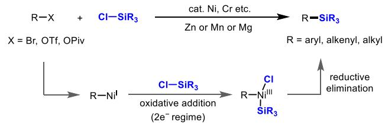
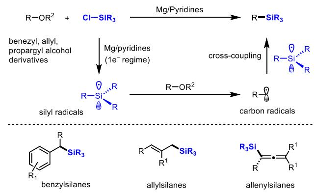
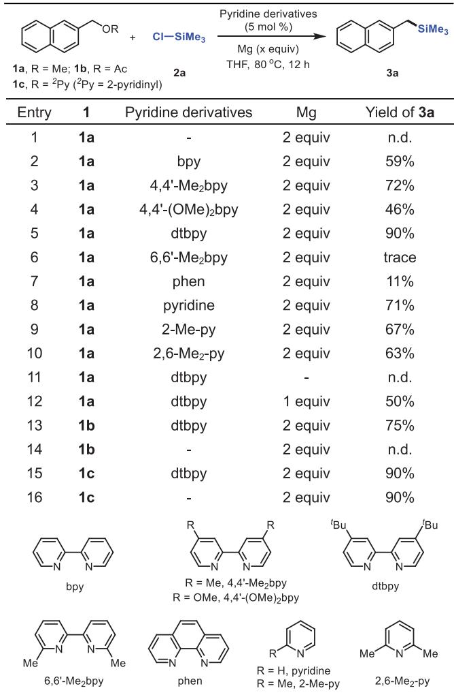
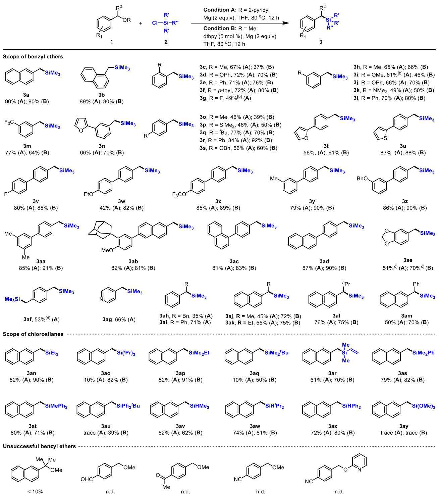
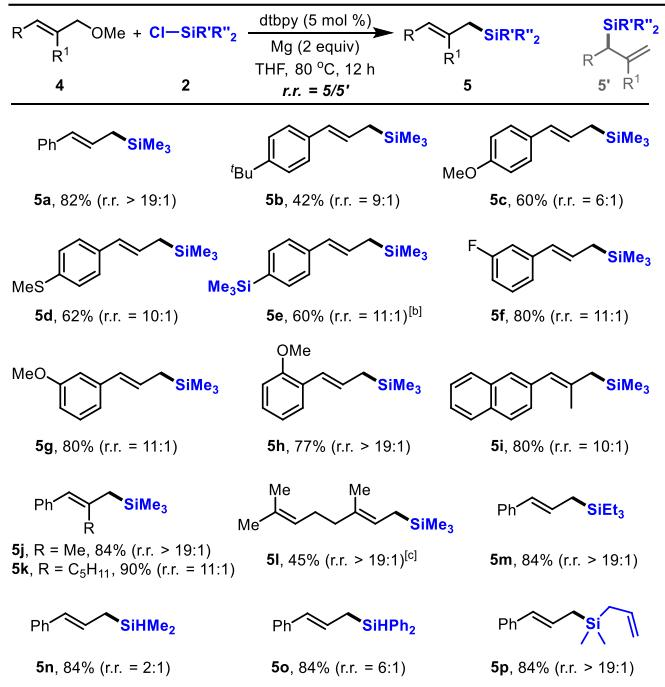
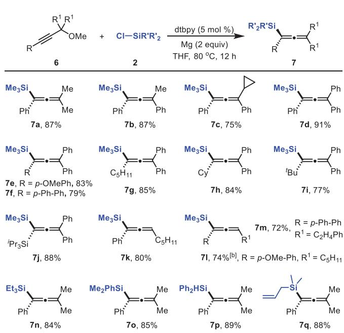
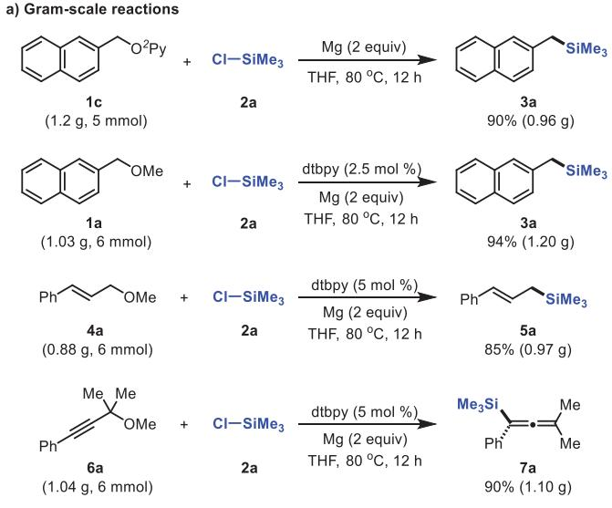
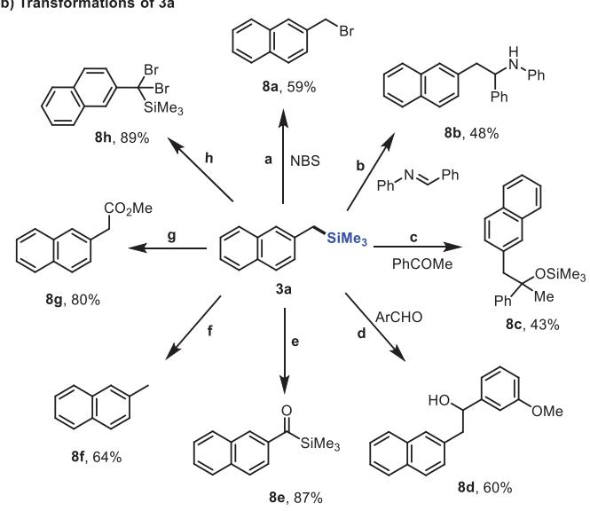
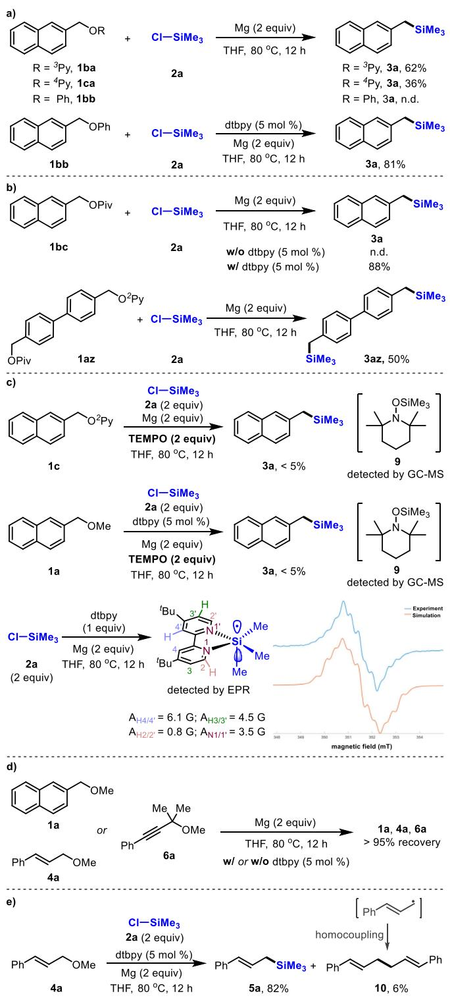
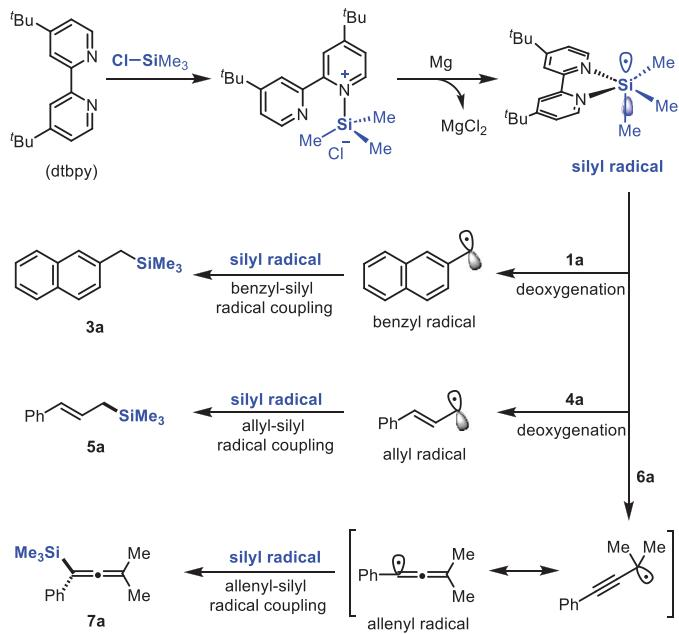

Homogeneous Catalysis

How to cite: Angew. Chem. Int. Ed. 2025, 64, e202518431   
doi.org/10.1002/anie.202518431

# Reductive Cross-Coupling of Alcohol Derivatives with Chlorosilanes via Pyridines-Promoted Si─Cl Activation

Changpeng Chen+, Tenggang Jiao+, Zhitao Zhang, Xiaoming Zeng,\* and Xuefeng Cong\*

Abstract: The development of efficient approaches mediated by silyl radicals for constructing C─Si bonds is of great interest and importance, yet methods to generate these intermediates from readily available chlorosilanes remain scarce. Herein, we report a new strategy for silyl radical generation via pyridines-promoted reductive Si─Cl activation of chlorosilanes and demonstrate its application in the reductive cross-coupling with a wide array of benzyl, allyl, and propargyl alcohol derivatives. This protocol offers an efficient and step-economical route for the synthesis of diverse benzyl-, allyl-, and allenylsilanes, featuring broad substrate scope and easy scalability. Mechanistic investigations suggest that the coupling reaction was initiated by the reductive Si─Cl activation of chlorosilanes with magnesium promoted by pyridine derivatives, which generates silyl radicals. These silyl radicals subsequently mediate the deoxygenation of alcohol derivatives to form carbon radicals, culminating in C─Si radical–radical cross-coupling.

## Introduction

Organosilicon compounds have broad applications in many research fields of modern chemistry. In particular, benzyl-, allyl-, and allenylsilanes serve as versatile building blocks in synthetic chemistry and material science due to their diverse reactivity.[1–12] Therefore, the development of an efficient and general strategy for the synthesis of these organosilicon compounds is of great interest and much importance. Crosscoupling reactions with silicon reagents have emerged as one of the most attractive and powerful strategies for constructing silicon-containing molecules.[13–18] Remarkable advances have recently been made to develop cross-coupling of carbon electrophiles with diverse silicon nucleophiles by transition metal catalysts, greatly expanding access to functionalized organosilanes.[19–36] However, the reductive cross-coupling of carbon electrophiles with silicon electrophiles has remained underdeveloped to date. Given the diversity and abundance of both carbon electrophiles and silicon electrophiles, developing an efficient and general strategy for the reductive cross-coupling of these two bench-stable electrophiles to access organosilanes such as benzyl-, allyl-, and allenylsilanes is of great interest and importance.(Supporting Information)

Chlorosilanes are among the most accessible feedstock chemical in organosilicon chemistry. Recently, transitionmetal-catalyzed reductive cross-coupling reactions of chlorosilanes have become a powerful tool for the C─Si bond formation,[37–40] and the coupling reactions with various carbon electrophiles have been achieved.[37–52] These coupling reactions are facilitated by oxidative addition of a Si─Cl bond to a low-valent metal center to form a silametalated intermediate (Scheme 1a). Alternatively, the direct generation of a silyl radical by means of the reductive activation of chlorosilanes followed by coupling with a carbon electrophile or radical is a synthetically appealing strategy for the construction of C─Si bonds. However, such coupling reaction remains rarely studied due to the challenging singleelectron reduction of the strong Si─Cl bonds. Recently, Lin and coworkers developed an electro reductive approach to access silyl radicals by activating chlorosilanes with attractive applications in coupling with various alkenes for the formation of the C─Si bonds.[53,54] Herein, we report a new and alternative method for generating silyl radicals via the reductive activation of chlorosilanes with magnesium promoted by pyridine derivatives and demonstrate its attractive application in the reductive cross-coupling with a wide array of benzyl, allyl, and propargyl alcohol derivatives (Scheme 1b). This work represents not only a new strategy for silyl radical generation from readily available chlorosilane but also a rare example of reductive cross-coupling of alcohol derivatives with chlorosilanes without the need for transition-metal-catalysts, offering an efficient and stepeconomical route for the synthesis of diverse benzyl-, allyl-, and allenylsilanes.

## Results and Discussion

At first, we examined the cross-coupling reaction of 2- naphthylmethyl methyl ether 1a with chlorotrimethylsilane 2a by using 99.99% purity magnesium as the reductant (Table 1). When the reaction was carried out in THF at 80 °C, no significant reaction between 1a and 2a was observed (Table 1, entry 1). To our delight, addition of a catalytic amount of 2,2-- bipyridine (5 mol%) into the reaction dramatically promoted the reaction, affording the cross-coupling product 3a in 59% yield (Table 1, entry 2). The replacement of 2,2--bipyridine by 4,4--dimethyl-2,2--bipyridyl further increased the yield of coupling product 3a to 72% (Table 1, entry 3), whereas 4,4-- dimethoxyl-2,2--dipyridyl showed a slightly lower reactivity (Table 1, entry 4). The use of 4,4--di-tert-butyl-2,2--dipyridyl (dtbpy) remarkably increased the reactivity to afford the desired coupling product 3a in 90% yield (Table 1, entry 5). In contrast, 6,6--di-methyl-2,2--dipyridyl and o-phenanthroline showed much less efficiency in promoting the cross-coupling of 1a with 2a (Table 1, entries 6 and 7). It was worth noting that various pyridines such as pyridine, 2-methylpyridine and 2,6-dimethylpyridine are also effective for the present coupling reaction with slightly diminished yields (Table 1, entries 8–10). In the presence of a catalytic amount of dtbpy (5 mol%), decreasing the amount of magnesium from 2.0 equiv. to 1.0 equiv. lowered the product yield to 50% (Table 1, entry 11). No significant reaction between 1a and 2a was observed in the absence of a magnesium reductant (Table 1, entry 12). Subsequently, the coupling reaction of other 2-naphthalenylmethyl alcohol derivatives with 2a was examined. The reaction of 2-naphthalenylmethyl acetate 1b with 2a showed a similar performance with that of 1a, giving the desired coupling product 3a in 75% yield in the presence of dtbpy (5 mol%) but no product 3a in the absence of dtbpy (5 mol%) (Table 1, entries 13 and 14). In the reaction of 2-naphthylmethyl 2-pyridyl ether 1c with 2a, the absence of dtbpy did not influence the reactivity, affording the coupling product 3a in 90% yield (Table 1, entries 15 and 16). These results indicated that the pyridine unit played a critically important role in promoting the cross-coupling reaction of 2-naphthylmethyl alcohol derivatives with 2a.

a) Previous studies: Reductive C-Si coupling via transition-metal-catalyzed Si-Cl activation  
  
b) This work: Reductive cross-coupling of alcohol derivatives with chlorosilanes via pyridines-promoted Si-CI activation

  
Scheme 1. Reductive cross-coupling of chlorosilanes via Si─Cl activation.

Table 1: Optimization of reaction conditions.a)  
  
a) Reaction conditions unless otherwise noted: 1a (0.4 mmol), 2a (0.8 mmol), pyridine derivatives (5 mol%), Mg (99.99% purity, 0.8 mmol), THF (1 mL), 80 °C, 12 h, isolated yield.

Having established the cross-coupling reaction of 2-naphthylmethyl alcohol derivatives 1a–1c with 2a, we then investigated the coupling reactions of various (hetero)arylmethyl ethers 1 with 2. Some representative results are summarized in Table 2. In addition to 1a, 1- naphthylmethyl 2-pyridyl ether was also suitable substrate for the reaction with 2a, affording the coupling product 3b in 89% yield. Benzyl 2-pyridyl ether derivatives bearing diverse substituents at para-, meta-, or ortho-position of the benzyl group all worked well with 2a, affording the corresponding coupling products 3c–3ae in 46%–87% yields. Function groups such as OPh (3d, 3j), OBn (3s, 3z), F (3g, 3v), NMe (3k), CF (3m), OCF (3x), SiMe (3p), and aromatic heterocycles (3t, 3u) were all well-tolerated. Interestingly, the two C–O bonds of 1,4-bis((pyridin-2-yloxy)methyl)benzene were coupled with 2a to form the bis-silylation product 3af in 53% yield. The reaction of 4-pyridylmethyl 2-pyridyl ether gave the corresponding product 3ag in 66% yield. Notably,

Table 2: Reductive cross-coupling reactions of various (hetero)arylmethyl ether derivatives 1 with 2.a)

  
a) Reaction conditions unless otherwise noted: Method A: 1 (0.4 mmol), 2 (0.8 mmol), Mg (99.99% purity, 0.8 mmol), THF (1 mL), 80 °C, 12 h; Method B: 1 (0.4 mmol), 2 (0.8 mmol), dtbpy (5 mol%), Mg (99.99% purity, 0.8 mmol), THF (1 mL), 80 °C, 12 h. Isolated yields are given. b)2a (1.2 mmol). c)100 °C. d)2a (1.6 mmol), Mg (99.99% purity, 1.6 mmol).

secondary benzyl and 2-naphthylmethyl ethers bearing Bn, Me, Et, nPr, and Ph groups at the benzylic position were also compatible, affording the desired products 3ah–3am in 35%–76% yields.

The cross-coupling reactions of various arylmethyl methyl ethers 1 with 2a promoted by a catalytic amount of dtbpy (5 mol%) were also examined. As in the reactions of arylmethyl 2-pyridyl ethers with 2a, the cross-coupling reactions of arylmethyl methyl ethers 1 with 2a in the presence of a catalytic amount of dtbpy (5 mol%) were also compatible with diverse functional groups such as alkyl, aryl, SiMe3, OMe, $\mathrm { C F } _ { 3 } , \mathrm { F } , \mathrm { O C F } _ { 3 } ,$ and aromatic heterocycles. Remarkably, secondary 2-naphthylmethyl methyl ethers bearing Me, Et, nPr, and Ph groups at the benzylic position underwent the coupling reaction with 2a well, affording the desired products 3aj–3am in good yields. However, this coupling reaction was incompatible with tertiary benzyl ether as well as substrates containing aldehyde, ketone, or cyano functional groups.

Table 3: Reductive cross-coupling of allyl methyl ethers 4 with chlorosilanes 2 promoted by a catalytic amount of dtbpy.a)  
  
a) Reaction conditions unless otherwise noted: 4 (0.4 mmol), 5 (0.8 mmol), dtbpy (5 mol%), Mg (99.99% purity, 0.8 mmol), THF (1 mL), 80 °C, 12 h. Isolated yields are given. b)4-Chlorocinnamyl methyl ether was used. c)Geraniol-derived 2-pyrindyl ether (0.4 mmol) was used in the absence of dtbpy, 100 °C.

We then examined the cross-coupling reactions of various chlorosilanes with 1a and 1c, respectively. A diverse array of chlorosilanes proved to be effective for the coupling reactions with 1a and 1c under the optimal conditions, affording the targeted products 3am–3aw in good yields. It was worth noting that, in the case of chlorohydrosilanes, the strong Si─Cl bonds selectively couple with benzyl C─O bonds smoothly to afford the 2-naphthylmethyl-substituted hydrosilanes 3au–3aw in 62%–82% yields, and the reactive Si–H group remained intact. However, the reactions of chloro(trimethoxy)silane with either 1a or 1c were unsuccessful probably due to the electronic effect.

The analogous coupling reactions of allyl methyl ethers 4 with chlorosilanes 2 were then examined. As shown in Table 3, a range of allyl methyl ethers worked well with 2a in the presence of a catalytic amount of dtbpy (5 mol%) and 2 equiv. of magnesium at 80 °C in 12 h, affording the corresponding allylsilanes 5a–5h in 42%–82% yields with high stereoselectivity. The α-substituents such as methyl (5i, 5j) and n-pentyl (5k) did not hamper the reaction with 2a. Geraniol-derived 2-pyrindyl ether was also suitable for the reaction with 2a, affording the corresponding product 5l in 45% yield. In addition to 2a, chlorotriethyl-, chlorodimethyl-, chlorodiphenyl-, and allylchlorodimethylsilanes were also compatible for the coupling reactions with 4a, giving the targeted products 5m–5p in 84% yields.

Table 4: Reductive cross-coupling of propargyl methyl ethers 6 with chlorosilanes 2 promoted by a catalytic amount of dtbpy.a)  
  
a) Reaction conditions unless otherwise noted: 6 (0.4 mmol), 2 (0.8 mmol), dtbpy (5 mol%), Mg (99.99% purity, 0.8 mmol), THF (1 mL), 80 °C, 12 h. Isolated yields are given. b)Formation of the corresponding propargylsilane 7l’ was observed (7l/7l’  2:1).

Table 4 summarizes the analogous coupling reactions of propargyl methyl ethers 6 with 2 in the presence of a catalytic amount of dtbpy (5 mol%). A series of propargyl methyl ethers bearing diverse alkyl and aryl groups on the alkynyl unit or at propargyl position underwent the coupling reaction with 2a smoothly, giving the corresponding tetraor trisubstituted silylallenes 7a–7m in good to excellent yields (72%–91%). Triisopropylsilyl (TIPS) group directly bonded to the alkynyl unit was also compatible, affording the disilyl-substituted allene 7j in 88% yield. In addition to 2a, chlorotriethyl-, chlorodimethyl-, chlorodiphenyl-, and allylchlorodimethylsilanes also worked well with 6a, affording the corresponding products 7n–7q in 84%–89% yields.

To highlight the practical value of the present protocol, some gram-scale reactions were conducted. As shown in Scheme 2a, the reactions of 5 mmol of 1a and 6 mmol of 1c with 2a under the standard conditions afforded the desired product 3a in 90% and 94% yields, respectively. Similarly, the reactions of 6 mmol of 4a and 6a with 2a in the presence of a catalytic amount of dtbpy (5 mol%) yielded the corresponding allylsilane 5a and allenylsilane 7a in 85% and 90% yields, respectively. Scheme 2b shows some transformations of 3a,[55–60] which afforded a variety of structurally diverse compounds including 2-(bromomethyl)naphthalene (8a),[55] secondary amine (8b),[56] silicon ether (8c),[57] secondary alcohol (8d),[57] acyl silane (8e),[58] 2-methylnaphthalene (8f),[59] methyl 2-(naphthalen-2-yl)acetate (8g),[60] and (dibromo(naphthalen-2-yl)methyl)trimethylsilane (8h).[58]

  
Scheme 2. a) Gram scale reactions; b) Transformations of 3a, reaction conditions: 3a (0.2 mmol), a) NBS (0.2 mmol), MeCN (1 mL), hv, r.t., 6 h; b) (E)-N,1-diphenylmethanimine (0.15 mmol), TBAF (5 mol%), 4 Å MS (100 mg), THF (1 mL), 80 °C, 12 h; c) Acetophenone (0.4 mmol), TBAT (5 mol%), THF (1 mL), 80 °C, 6 h; d) 3-Methoxybenzaldehyde (0.4 mmol), TBAT (5 mol%), THF (1 mL), 80 °C, 6 h; e) (i) NBS (0.4 mmol), AIBN (5 mol%), benzene (1 mL), 80 °C, 12 h; (ii) AgOAc (0.4 mmol), H2O:Acetone:EtOH  1:2:3 (2 mL), r.t., 24 h; f) KOSiMe3 (5 mol%), DMSO (1 mL), 70 °C, 6 h; g) (i) CO2 (1 atm), CsF (0.6 mmol), DMF (1 mL), 100 °C, 4 h, (ii) MeI (2 equiv.), Cs2CO3 (2 equiv.), r.t., 30 min; h) NBS (0.4 mmol), AIBN (5 mol%), benzene (1 mL), 80 °C, 12 h.

To gain information on the reaction mechanism, several control experiments were carried out (Scheme 3). 2-Naphthylmethyl 3-pyrindyl ether 1ba and 4-pyrindyl ether 1ca reacted well with 2a, giving the product 3a in 62% and 36% yields, respectively. The reaction of the analogous substrate 2-naphthylmethyl phenyl ether 1bb with 2a did not occur, but worked well in the presence of a catalytic amount of dtbpy (5 mol%) to afford 3a in 81% yield (Scheme 3a). Similar with that of 2-naphthalenylmethyl acetate 1b, no desired coupling product 3a was observed in the reaction of 2-naphthalenylmethyl pivalate 1bc with 2a in the absence of dtbpy (5 mol%). Interestingly, both 2- pyrindyl ether and pivalate unit of the diol derivative 1az coupled with 2a under the same reaction conditions, affording the disilylated product 3az in 50% yield (Scheme 3b). These findings further indicated that the pyridine unit played a critically important role in promoting the reductive crosscoupling of benzyl C─O bonds with Si─Cl bonds. The radical trapping experiments using 2,2,6,6-tetramethylpiperidinyl-1- oxide (TEMPO) significantly suppressed the cross-coupling of 1a and 1c with 2a, and the corresponding silylated TEMPO 9 was detected by gas chromatography–mass spectrometry (GC–MS) analysis (Scheme 3c). Furthermore, the electron paramagnetic resonance (EPR) spectroscopy of the reaction mixture of dtbpy, 2a and magnesium gave a distinct signal, which is attributed to the formation of a dtbpy-coordinated silyl radical (Scheme 3c), whereas no signal was detected for the reaction mixture of 2a and magnesium in the absence of dtbpy. It was worth noting that no significant reaction was observed when treating 1a, 4a, and 6a with magnesium in the presence/absence of a catalytic amount of dtbpy (5 mol%), and 1a, 4a, and 6a were recovered in >95% yield (Scheme 3d). In the reaction of 4a with 2a, homo-coupling side-product 10 was obtained in 6% yield (Scheme 3e), indicating the potential generation of an allyl radical, which may undergo radical-radical homocoupling to form 10.

  
Scheme 3. Mechanistic studies.

  
Scheme 4. Possible mechanism for the reductive cross-coupling of methyl ethers 1a, 4a, and 6a with 2a promoted by a catalytic amount of dtbpy.

Although more studies are required to establish a precise mechanism, based on the above experimental results and previous reports,[61–64] possible mechanisms for the reductive cross-coupling reactions of benzyl methyl ether 1a, cinnamyl methyl ether 4a, and propargyl methyl ether 6a with 2a in the presence of dtbpy are proposed as shown in Scheme 4. The combination of 2a and dtbpy would form a siliconiumchloride salt,[65–67] which undergoes reductive activation with magnesium to generate a dtbpy-coordinated silyl radical. The subsequent deoxygenation of 1a and 4a by the resulting silyl radical would yield the corresponding benzyl and allyl radical, respectively.[68] The C─Si radical coupling of the benzyl and allyl radical with the silyl radical would give the desired products 3a and 5a, respectively, and release dtbpy. In the case of propargyl methyl ether 6a, the deoxygenation with the silyl radical would yield a propargyl radical and its resonance hybrid allenyl radical. The allenyl–silyl radical coupling would selectively take place due to the steric reason, giving the allenylsilane 7a. It should be noted that, although silyl radical formation was unambiguously established, a competing silyl anion pathway cannot be fully excluded.

## Conclusion

In summary, we have developed a pyridines-promoted strategy for the reductive Si─Cl activation of readily available chlorosilanes and demonstrated its attractive application in the reductive cross-coupling with a wide array of benzyl, allyl, and propargyl alcohol derivatives under simple and transition-metal-free conditions. Mechanistic studies revealed that the coupling reaction proceeded through the generation of silyl radicals via pyridines-promoted reductive activation of the strong Si–Cl bond of chlorosilanes with magnesium followed by the deoxygenation of alcohol derivatives by the resulting silyl radicals to form carbon radicals and subsequent C–Si radical-radical cross-coupling. This work not only constitutes an efficient and step-economical protocol for the synthesis of diverse benzyl-, allyl,- and allenylsilanes but also offers a new and general strategy for developing new silyl radical chemistry. Further studies on transformations of chlorosilanes via the reductive activation of strong Si─Cl bonds are in progress.

## Acknowledgements

This work was financially supported by the National Natural Science Foundation of China (grants 22125107 and 21971168) and the Haihe Laboratory of Sustainable Chemical Transformations (24HHWCSS00009).

## Conflict of Interests

The authors declare no conflict of interest.

## Data Availability Statement

The data that support the findings of this study are available in the supplementary material of this article.

Keywords: Chlorosilanes • Magnesium • Pyridines • Reductive cross-coupling • Silyl radicals

[1] J. Y. Corey, Chem. Rev. 1999, 99, 175–292, https://doi.org/10. 1021/cr9701086.

[2] Y. You, C. G. An, J. J. Kim, S. Y. Park, J. Org. Chem. 2007, 72, 6241–6246, https://doi.org/10.1021/jo070968e.

[3] K. Mochida, M. Shimizu, T. Hiyama, J. Am. Chem. Soc. 2009, 131, 8350–8351, https://doi.org/10.1021/ja901622b.

[4] Y. Liang, S. G. Zhang, Z. F. Xi, J. Am. Chem. Soc. 2011, 133, 9204–9207, https://doi.org/10.1021/ja2024959.

[5] K. Franz, S. O. Wilson, J. Med. Chem. 2013, 56, 388–405, https:// doi.org/10.1021/jm3010114.

[6] C. Cheng, J. F. Hartwig, Science 2014, 343, 853–857, https://doi. org/10.1126/science.1248042.

[7] C. Cheng, J. F. Hartwig, Chem. Rev. 2015, 115, 8946–8975, https:// doi.org/10.1021/cr5006414.

[8] S. Bahr, W. Xue, M. Oestreich, ACS Catal. 2019, 9, 16–24, https:// doi.org/10.1021/acscatal.8b04230.

[9] M. A. Brook, Silicon in Organometallic and Polymer Chemistry 97, Wiley, New York 2000.

[10] N. A uner, J. Weis, Organosilicon Chemistry V: From Molecules to Materials (Eds:N. Auner, J. Weis), Wiley-VCH, Weinheim 2003.

[11] B. A. Kamino, T. P. Bender, Chem. Soc. Rev. 2013, 42, 5119–5130, https://doi.org/10.1039/c3cs35519e.

[12] X. Huang, J. Zhu, C. He, Chin. Chem. Lett. 2024, 35, 108783, https://doi.org/10.1016/j.cclet.2023.108783.

[13] W. Xue, Z.-W. Qu, S. Grimme, M. Oestreich, J. Am. Chem. Soc. 2016, 138, 14222–14225, https://doi.org/10.1021/jacs. 6b09596.

[14] G. L. Cai, Y. D. Huang, T. T. Du, S. W. Zhang, B. Yao, X. F. Li, Chem. Commun. 2016, 52, 5425–5427, https://doi.org/10.1039 C6CC01312K.

[15] H. Liu, Q. Q. Li, Y. Yang, X. H. Bi, Chem. Commun. 2017, 53, 2503–2506, https://doi.org/10.1039/C6CC09650F.

[16] Z. X. Liu, J. F. Huo, T. R. Fu, H. C. Tan, F. Ye, M. L. Hossaina, J. B. Wang, Chem. Commun. 2018, 54, 11419–11422, https://doi. org/10.1039/C8CC06768F.

[17] W. Xue, R. Shishido, M. Oestreich, Angew. Chem. Int. Ed. 2018, 57, 12141–12145, https://doi.org/10.1002/anie.201807640.

[18] B. Cui, S. Jia, E. Tokunaga, N. Shibata, Nat. Commun. 2018, 9, 4393, https://doi.org/10.1038/s41467-018-06830-w.

[19] Selected examples of Pd-catalyzed cross-coupling with silicon nucleophiles: R. Moser, T. Nishikata, B. H. Lipshutz, Org. Lett. 2010, 12, 28–31, https://doi.org/10.1021/ol9023908.

[20] Z.-D. Huang, R. Ding, P. Wang, Y.-H. Xu, T.-P. Loh, Chem. Commun. 2016, 52, 5609–5612, https://doi.org/10.1039/C6CC00713A.

[21] A. P. Cinderella, B. Vulovic, D. A. Watson, J. Am. Chem. Soc. 2017, 139, 7741–7744, https://doi.org/10.1021/jacs.7b04364.

[22] B. Vulovic, A. P. Cinderella, D. A. Watson, ACS Catal. 2017, 7, 8113–8117, https://doi.org/10.1021/acscatal.7b03465.

[23] X.-H. Zhou, J.-H. Zhu, G.-A. Song, X.-L. Jiang, X.-J. Fang, Z. Xu, L.-W. Xu, Org. Chem. Front. 2023, 10, 5443–5450, https:// doi.org/10.1039/D3QO01277H.

[24] Selected examples of Ni-catalyzed cross-coupling with silicon nucleophiles: C. K. Chu, Y. Liang, G. C. Fu, J. Am. Chem. Soc. 2016, 138, 6404–6407, https://doi.org/10.1021/jacs.6b03465.

[25] M. Leiendecker, C.-C. Hsiao, L. Guo, N. Alandini, M. Rueping, Angew. Chem. Int. Ed. 2014, 53, 12912–12915, https://doi.org/10. 1002/anie.201402922.

[26] C. Zarate, R. Martin, J. Am. Chem. Soc. 2014, 136, 2236–2239, https://doi.org/10.1021/ja412107b.

[27] C. Zarate, M. Nakajima, R. Martin, J. Am. Chem. Soc. 2017, 139, 1191–1197, https://doi.org/10.1021/jacs.6b10998.

[28] R. J. Somerville, L. V. A. Hale, E. Gómez-Bengoa, J. Burés, R. Martin, J. Am. Chem. Soc. 2018, 140, 8771–8780, https://doi.org 10.1021/jacs.8b04479.

[29] X. Q. Yan, F. Z. Yang, G. L. Cai, Q. W. Meng, X. F. Li, Org. Lett. 2018, 20, 624–627.

[30] Y. A. Ho, M. Leiendecker, X. Q. Liu, C. M. Wang, N. Alandini, M. Rueping, Org. Lett. 2018, 20, 5644–5647, https://doi.org/10. 1021/acs.orglett.8b02351.

[31] J. Wang, Z. Duan, X. Liu, S. Dong, K. Chen, J. Li, Angew. Chem. Int. Ed. 2022, 61, e202202379, https://doi.org/10.1002 anie.202202379.

[32] Selected examples of Cu-catalyzed cross-coupling with silicon nucleophiles: M. Takeda, R. Shintani, T. Hayashi, J. Org. Chem. 2013, 78, 5007–5017, https://doi.org/10.1021/ jo400888b.

[33] J. Scharfbier, M. Oestreich, Synlett 2016, 1274–1276.

[34] W. Xue, M. Oestreich, Angew. Chem. Int. Ed. 2017, 56, 11649– 11652, https://doi.org/10.1002/anie.201706611.

[35] J. Scharfbier, B. M. Gross, M. Oestreich, Angew. Chem. Int. Ed. 2020, 59, 1577–1580, https://doi.org/10.1002 anie.201912490.

[36] Y. Xiao, Z.-Y. Zhao, S. Kemper, E. Irran, M. Oestreich, Angew. Chem. Int. Ed. 2024, 63, e202407056, https://doi.org/10.1002 anie.202407056.

[37] Selected reviews: X. B. Pang, P.-F. Su, X.-Z. Shu, Acc. Chem. Res. 2022, 55, 2491–2509, https://doi.org/10.1021/acs.accounts. 2c00381.

[38] X. B. Pang, X.-Z. Shu, Chem. - Eur. J. 2022, e202203362.

[39] Y.-H. Yang, X. B. Pang, X.-Z. Shu, Synthesis 2023, 55, 868– 876.

[40] W. Zhang, W. Guan, J. I. Martinez Alvarado, L. F. T. Novaes, S. Lin, ACS Catal. 2023, 13, 8038–8048, https://doi.org/10.1021/ acscatal.3c01174.

[41] Selected examples of Ni-catalyzed cross-coupling with chlorosilanes: J. C. Duan, K. Wang, G.-L. Xu, S. L. Kang, L. L. Qi, X.-Y. Liu, X.-Z. Shu, Angew. Chem. Int. Ed. 2020, 59, 23083–23088, https://doi.org/10.1002/anie.202010737.

[42] L. Zhang, M. Oestreich, Angew. Chem. Int. Ed. 2021, 60, 18587– 18590, https://doi.org/10.1002/anie.202107492.

[43] J. C. Duan, Y. Q. Wang, L. L. Qi, P. Guo, X. B. Pang, X.-Z. Shu, Org. Lett. 2021, 23, 7855–7859, https://doi.org/10.1021/acs. orglett.1c02874.

[44] Z.-Z. Zhao, X. B. Pang, X.-X. Wei, X.-Y. Liu, X.-Z. Shu, Angew. Chem. Int. Ed. 2022, 61, e202200215, https://doi.org/10.1002 anie.202200215.

[45] L. L. Qi, X. B. Pang, K. Yin, Q.-Q. Pan, X.-X. Wei, X.-Z. Shu, Chin. Chem. Lett. 2022, 33, 5061–5064, https://doi.org/10.1016/j. cclet.2022.03.070.

[46] Q.-Q. Pan, L. L. Qi, X. B. Pang, X.-Z. Shu, Angew. Chem. Int. Ed. 2023, 62, e202215703, https://doi.org/10.1002/anie. 202215703.

[47] L. L. Qi, Q.-Q. Pan, X.-X. Wei, X. B. Pang, Z. T. Liu, X.-Z. Shu, J. Am. Chem. Soc. 2023, 145, 13008–13014, https://doi.org/10.1021/ jacs.3c04209.

[48] X.-X. Wei, Z.-Z. Zhao, X. B. Pang, X.-Z. Shu, Org. Lett. 2024,24, 6125–6129.

[49] X. Liu, B. Xu, M. Oestreich, Org. Lett. 2025, 27, 3686–3690, https://doi.org/10.1021/acs.orglett.5c00830.

[50] Selected examples of Cr-catalyzed cross-coupling with chlorosilanes: C. Li, S. R. Yang, X. M. Zeng, ACS Catal. 2023, 13, 12062–12073, https://doi.org/10.1021/acscatal.3c02852.

[51] F. Fan, L. H. Long, L. Ling, C. Li, M. M. Luo, H. Chen, X. M. Zeng, Nat. Synth. 2023, 2, 1046–1058, https://doi.org/10.1038/ s44160-023-00364-w.

[52] F. Fan, Y. Peng, X. Y. Zhang, S. Wang, Z. Luo, M. M. Luo, X. M. Zeng, Nat. Commun. 2024, 15, 6455, https://doi.org/10.1038/ s41467-024-50675-5.

[53] L. Lu, J. C. Siu, Y. Lai, S. Lin, J. Am. Chem. Soc. 2020, 142, 21272–21278.

[54] W. Guan, L. Lu, Q. Jiang, A. F. Gittens, Y. Wang, L. F. T. Novaes, R. S. Klausen, S. Lin, Angew. Chem. Int. Ed. 2023, 62, e202303592.

[55] J. Sun, X. H. Peng, H. Guo, Chin. J. Org. Chem. 2015, 35, 1375– 1379, https://doi.org/10.6023/cjoc201412028.

[56] W.-X. Zhang, C.-H. Ding, Z.-B. Luo, X.-L. Hou, L.-X. Dai, Tetrahedron Lett. 2006, 47, 8391–8393, https://doi.org/10.1016/j. tetlet.2006.09.062.

[57] M. Das, D. F. O’Shea, Tetrahedron 2013, 69, 6448–6460, https:// doi.org/10.1016/j.tet.2013.05.078.

[58] J. R. Huckins, S. D. Rychnovsky, J. Org. Chem. 2003, 68, 10135– 10145, https://doi.org/10.1021/jo035260o.

[59] W. B. Yao, R. R. Li, H. J. Jiang, D. M. Han, J. Org. Chem. 2018, 83, 2250–2255, https://doi.org/10.1021/acs.joc.7b03139.

[60] T. Mita, K. Michigami, Y. Sato, Org. Lett. 2012, 14, 3462–3465, https://doi.org/10.1021/ol301431d.

[61] C. Chatgilialoglu, Organosilanes in Radical Chemistry (Ed: C. Chatgilialoglu), John Wiley & Sons, 2004.

[62] H. Qrareya, D. Dondi, D. Ravelli, M. Fagnoni, ChemCatChem 2015, 7, 3350–3357, https://doi.org/10.1002/cctc.201500562.

[63] P. Zhang, C. Le, D. W. C. MacMillan, J. Am. Chem. Soc. 2016, 138, 8084–8087, https://doi.org/10.1021/jacs.6b04818.

[64] R. Zhou, Y. Y. Goh, H. Liu, H. Tao, L. Li, J. Wu, Angew. Chem. Int. Ed. 2017, 56, 16621–16625, https://doi.org/10.1002/ anie.201711250.

[65] T. Tanaka, G. Matsubayashi, A. Shimizu, Inorg. Nucl. Chem. Letters. 1967, 3, 275–278, https://doi.org/10.1016/0020-1650(67) 80081-3.

[66] K. Chandrasekaran, D. G. Whitten, J. Am. Chem. Soc. 1981, 103, 7270–7275, https://doi.org/10.1021/ja00414a038.

[67] A. R. Bassindale, M. Borbaruah, S. J. Glynn, D. J. Parker, P. G. Taylor, J. Organomet. Chem. 2000, 606, 125–131, https://doi.org/ 10.1016/S0022-328X(00)00263-1.

[68] The formation of carbon radicals through the deoxygenation of alkyl, allyl and propargyl alcohol derivatives by the silyl radical has been reported previously, see: H. Miura, M. Doi, Y. Yasui, Y. Masaki, H. Nishio, T. Shishido, J. Am. Chem. Soc. 2023, 145, 4613–4625, https://doi.org/10.1021/jacs.2c12311.