Palladium Catalysis

How to cite: Angew. Chem. Int. Ed. 2025, 64, e202517878   
doi.org/10.1002/anie.202517878

# Chemo- and Regiodivergent Allyl-Propargyl Cross-Coupling Reactions for the Construction of 1,4-Enallenes and 1,5-Enynes

Huijun Qian+, Gabriel N. Morais+, Katherine E. Colbaugh, Junqi Su, Zili Chen, Zhiping Li,\* Shuming Chen,\* and Leiyang Lv\*

Abstract: Catalyst-controlled divergent transformations represent a vital strategy for the efficient production of structurally diverse molecules from the same readily available precursors. Herein, we report the palladium/phosphine-catalyst-driven chemo- and regiodivergent allyl-propargyl cross-coupling of propargyl carbonates with allyl boronates. Density functional theory (DFT) calculations reveal that the bidentate phosphine ligand plays a crucial role in determining the relative favorability of possible reductive elimination modes from the 3-allyl- 1-allenyl palladium intermediate species. Specifically, MeO-BIPHEP facilitates the 1,1--reductive elimination to form the 1,4-enallenes; in contrast, XantPhos favors the formation of 1,5-enynes through a 3,3--reductive elimination pathway.

## Introduction

Chemo- and regiodivergent synthesis has emerged as a powerful and efficient strategy for the selective synthesis of different structurally valuable molecules from the same precursors.[1–4] In this context, the precise manipulation of reaction intermediates to regulate product distributions has become a promising approach for designing structural diversity and complexity.[5–8] This approach depends primarily on the elaborate selection of appropriate catalytic systems, the fine-tuning of tailor-made the catalyst structure and/or appropriate reagents, which has attracted significant attention of chemists.[9–11] For example, the palladium-catalyzed coupling reaction of propargyl electrophiles (e.g., propargyl acetates, esters, carbonates, and halides) with various nucleophiles has captured the attention of the scientific community since Tsuji’s seminal report in 1985.[12] This reaction involves key allenyl or propargyl palladium species that can facilitate allenylation,[13] alkenylation,[14,15] propargylation,[16–21] dienylation,[22–25] and other related processes.[26–29] A key concern in these processes is the control of chemo- and regioselectivity due to the presence of both the propargylic and allenic palladium species.[30–34] Typically, allene products are obtained via the corresponding allenyl palladium species that generated via S 2’-type oxidative addition or S 2-type oxidative addition followed by isomerization via a propargyl intermediate. In a few cases, direct propargyl substitution with carbon nucleophiles has been achieved as the main product via the propargyl palladium intermediate (Scheme 1a).

Both propargyl compounds [35–37] and allenes[38–41] are recognized as valuable synthetic building blocks for a variety of downstream transformations in organic chemistry. However, the issue of chemo- and regioselectivity poses a challenge in cross-coupling reactions involving propargyl/1,2-allenyl metal species.[42] To address this problem, Ma and coworkers realized the regiodivergent Pd-catalyzed Negishi coupling reaction of propargyl mesylates with (alkoxycarbonyl)ethenyl zinc reagents, in which the neutral or anionic phosphine ligand was used to achieve the 1,4-enynes or 1,3-enallenes, respectively (Scheme 1b).[43] Recently, our lab has investigated palladium/N-heterocyclic carbene (NHC)-catalyzed regiodivergent (aza)allyl-fluoroallyl type cross-coupling reactions of gem-difluorocyclopropanes with ambident nucleophiles (X Y-Z−).[44–46] In these transformations, 3,3--reductive elimination[47] via a seven-membered ring transition state has been identified as the key step to enable both the chemoand regioselectivity. This reaction mode modality contrasts with the more common direct 1,1--reductive elimination via a three-membered ring transition state.

Based on our studies and inspired by the contributions of Echavarren,[48] Morken,[49–51] and Hou[52,53] on the palladium/phosphine-catalyzed regiodivergent coupling of allylic electrophiles with allyl metal reagents, we hypothesized that the chemo- and regioselectivity in analogous allylpropargyl cross-coupling reactions could be modulated by the selection of appropriate ligands.[54–59] However, in contrast to allyl precursors, transformations invloving propargylic derivatives presented several challenges: 1) the coexistence of both propargylic and allenic palladium species; 2) the chemo- and regioselectivity issues arising from the interaction of nucleophilic allylic species with the propargylic or allenic palladium species; and 3) the predominance of either 3,3-- reductive elimination or 1,1--reductive elimination in the allyl-propargylic cross-couplings. We hypothesized that tuning the electronic and steric properties of palladium through ligand coordination could influence the relative energy and reactivity of the propargylic and allenic palladium species, thus addressing these issues (Scheme 1c).

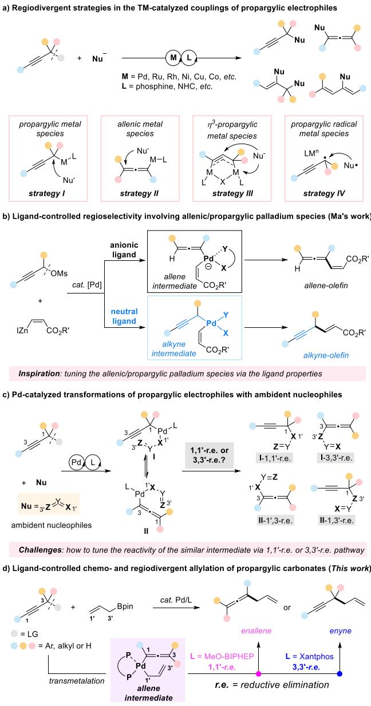  
Scheme 1. Transition metal-catalyzed selective cross-coupling reactions of propargyl precursors.

Here, we present our efforts to develop a palladium/phosphine catalyst-driven chemo- and regiodivergent allyl-propargyl cross-coupling of propargyl carbonates with allyl boronates, which enables the highly selective synthesis of 1,4-enallenes and 1,5-alkynes (Scheme 1d). DFT calculations reveal that the ligands significantly influence the selectivity by modulating the reductive elimination pathway from the $\boldsymbol \eta ^ { 3 } -$ allyl-ƞ1-allenyl palladium species. Specifically, MeO-BIPHEP promotes 1,1--reductive elimination to form the 1,4-enallenes, whereas XantPhos favors the formation of 1,5-enynes via the $^ { 3 , 3 ^ { \prime } }$ -reductive elimination pathway.

## Results and Discussion

## Reaction Optimization

The investigation commenced with the treatment of propargylic carbonate 1a and allyl boronate 2a in the presence of palladium acetate (5 mol%), phosphine ligand and base in THF (Table 1). The 1,4-enallene product 3a was obtained in 77% yield, along with 12% yield of the byproduct 4a when BINAP (L1) was used as the ligand. Further investigation of various bidentate phosphine ligands, including Tol-BINAP (L2), SDP (L3), MeO-BIPHEP (L4), GARPHOS (L5), SEGPHOS (L6), DTBM-SEGPHOS (L7), revealed that L4 was the most effective ligand for the formation of the allene product, affording 3a in 92% yield with only 4% yield for 4a. Notably, the yield of the byproduct 4a was increased to 31% when DPEphos (L8) was used. This serendipitous observation prompted us to explore strategies to enhance the formation of the 1,5-enyne as the main product through ligand optimization. Encouragingly, the application of Xantphos (L9) resulted in a significant increase in yield of 4a to 90%. We then evaluated a series of Xantphos-type ligands,[60–62] including SiXantphos (L10), NiXantphos (L11), N-Bn-NiXantphos (L12), SulfoXantphos (L13), tBu-XantPhos (L14), XantPhos-Pd-G2 (L15), XantPhos-Pd-G3 (L16), and another Xantphosbased ligand (L17). With the exception of L17, which did not facilitate the reaction, all other XantPhos-type ligands effectively generated 4a as the major product. Among them, L9 was still the best ligand in terms of both yield and selectivity. For additional parameters that affect the transformation, see Tables S1–S10 for further details.

## Substrate Scope for 1,4-Enallenes

The substrate scope of propargylic carbonates for the synthesis of allenes was investigated using MeO-BIPHEP (L4) as the ligand (Table 2). Generally, propargylic carbonates bearing both electron-donating and electron-withdrawing groups reacted efficiently with allyl boronate 2a, delivering the 1,4-enallene products in good to excellent yields. Notably, the electron-donating substrates exhibited higher regioselectivity (>16:1). A variety of substituents, including methyl, ethyl, tert-butyl, phenyl, methoxyl, ethoxyl, phenoxy, fluoride, bromide, chloride, and trifluoromethyl, were well-tolerated regardless of the para-, meta-, or ortho-substitutions, resulting in the formation of the corresponding products 3b–3o in 61%– 96% yields under the optimized conditions. Additionally, propargylic carbonates derived from naphthalene, thiophene and pyridine were also suitable candidates in this transformation (3p-3s). Moreover, alkyl propargylic carbonates, such as methyl non-2-yn-1-yl carbonate and 5-(benzyloxy)pent-2- yn-1-yl methyl carbonate delivered the desired products 3t and 3u in 78% and 93% yields, respectively, with excellent selectivity. Notably, this protocol can be extended to gem-aliphatic and cyclic propargylic carbonates, including gem-methyl, gem-ethyl, cyclobutyl, cyclopropyl, cyclohexyl, and adamantane, affording the desired 1,4-enallene 3v-3aa in 83%–94% yields with excellent selectivity (>20:1). However, the propargylic carbonate bearing the dipenyl substituent was an unsuitable reaction partner (3ab).

Table 1: Reaction optimization.a)  
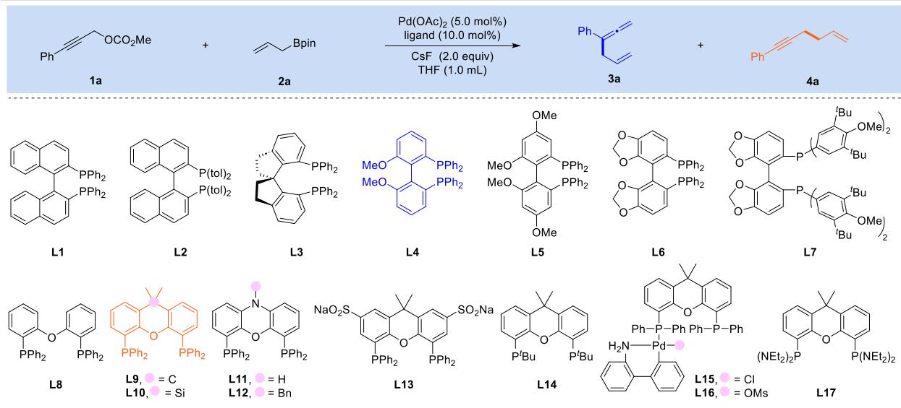

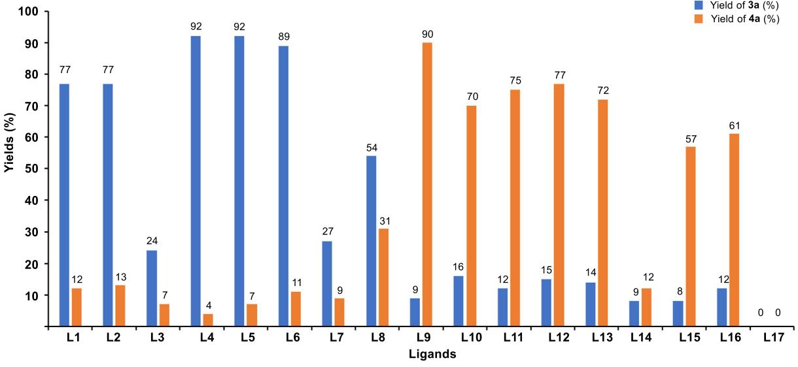  
a) Reaction conditions: propargylic carbonate 1a (0.1 mmol), allyl boronate 2a (0.2 mmol), Pd(OAc) (5.0 mol%), ligand (10.0 mol%) and CsF or Et N (0.2 mmol) in THF (1.0 mL) at rt or 80 °C for 3 h or 12 h under $\mathsf { N } _ { 2 } .$ The yields of 3a and 4a were determined by 1H NMR using mesitylene as an internal standard.

## Substrate Scope for 1,5-Enynes

A notable advantage of this protocol is its high flexibility and selectivity for the synthesis of 1,5-enynes under the Pd/XantPhos catalytic system (Table 3). Similarly, propargylic carbonates with either electron-donating or electronwithdrawing groups at the para-, meta-, or ortho-positions of the aryl ring reacted efficiently with allyl boronate 2a with good selectivity. For instance, substituents such as methyl (4b-4d), ethyl (4e), tert-butyl (4f), phenyl (4g), methoxyl (4h), ethoxyl (4i), phenoxy (4j), fluoride (4k and 4l), chloride (4m), bromide (4n), trifluoromethyl (4o), and cyanide (4p) were all compatible under the established reaction conditions. Fused aromatic and heterocyclic propargylic carbonates, including those derived from naphthalene (4q and 4r) and thiophene (4s), were readily converted to the desired products in 70%–90% yields with good selectivity. In the case of aliphatic propargylic carbonate, the product 4t was obtained in 74% yield. Furthermore, propargylic carbonate bearing the monophenyl substituent was also applicable and provided the product 4u in 77% yield with excellent selectivity (>50:1). However, propargylic carbonate with gemmethyl substitution failed in this transformation. Notably, propargylic carbonates derived from bioactive molecules, such as ketoprofen and dihydrocholesterol, were successfully transformed into the corresponding enynes 4w and 4x in 85% and 89% yields, respectively.

Table 2: Scope of propargylic carbonates for the synthesis of 1,4-enallenes.a)  
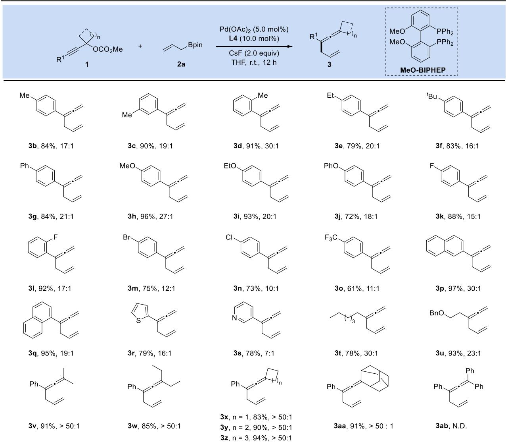  
a) Reaction conditions: propargylic carbonate 1 (0.2 mmol), allyl boronate 2a (0.4 mmol), $P d ( O A c ) _ { 2 }$ (5.0 mol%), MeO-BIPHEP (10.0 mol%) and CsF (0.4 mmol) in THF (2.0 mL) at rt for 12 h under $\mathsf { N } _ { 2 } .$ Reported yields are the isolated ones. The isomeric ratios were determined by 1H NMR analysis of the crude mixture.

## Efects ofLeaving Groups on Propargylic Electrophiles and Organoboronates

We evaluated the effect of common leaving groups, such as - OAc, -Boc, and -Cl, on propargylic electrophiles (1ai 1ak). As summarized in Table 4, the corresponding products (3a and 4a) were obtained under Condition A or Condition B. However, both the yields and selectivities were inferior to those achieved with propargyl carbonate 1a (entries 1– 3). Notably, potassium allyl trifluoroboronate 2b reacted efficiently with propargyl carbonate 1a to afford the enallene products 3a and 4a in good yields and selectivities (entry 4). We have also investigated the effect of substituents on allylboronates for this reaction. When 2-substituted allylboronates, such as 2-methyl allyl boronate (2c) and 2-phenyl allyl boronate (2d) were applied, the desired products 5a and 5b were obtained in 75% and 67% yields, respectively (entries 5 and 6).In the case of 3-methyl- and 1-methyl-substituted allylboronates (2e and 2f), the same product 5c was obtained in yields of 48% and 35%, respectively (entries 7 and 8). These results suggest that an ${ \bf S } _ { \mathrm { E } } 2 '$ transmetalation pathway is operative, with the $\sigma - \pi - \sigma$ isomerization of the allyl-palladium species prior to the 1,1--reductive elimination.[49–51] Furthermore, when the 1,1-dimethyl-substituted allylboronate 2 h was tested under condition A, the desired product 5e was obtained in 65% yield (entry 9). However, the 3,3-dimethyl substituted allylboronate 2 h did not give the enallenes 5e or 5f (entry 10), probably due to the high activation energy required for transmetalation. Notably, the enyne products 6a-6f were absent under condition B, which was attributed to the high energy barrier associated with the $^ { 3 , 3 ^ { \prime } }$ -reductive elimination pathway.[51]

## Table 3: Scope of propargylic carbonates for the synthesis of 1,5-enynes.a)

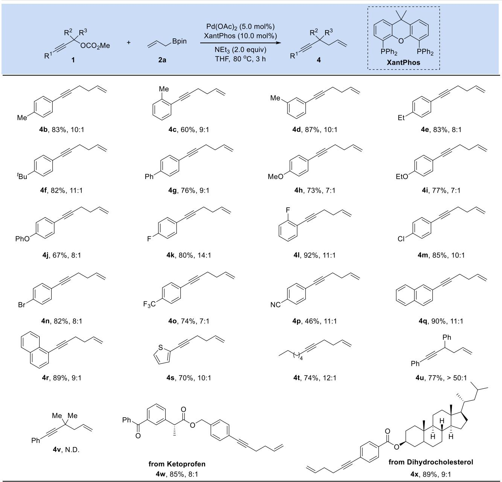  
a) Reaction conditions: propargylic carbonate 1 (0.2 mmol), allyl boronate 2a (0.4 mmol), Pd(OAc) (5.0 mol%), XantPhos (10.0 mol%) and Et N (0.4 mmol) in THF (2.0 mL) at 80 °C for 3 h under $\mathsf { N } _ { 2 } .$ Reported yields are the isolated ones. The isomeric ratios were determined by 1H NMR analysis of the crude mixture.

## Reactions ofBis-Propargyl Carbonate with Allyl Boronate

Encouraged by the above results, we extended this chemoand regioselective methodology to the manipulation of bis-propargyl carbonate 7. We were pleased to observe that the desired products, bis-allylated allene 8 and enyne 9, were obtained in 65% and 73% yields, respectively (Scheme 2).

## DFT Calculations

To provide further insight into the reaction, we performed density functional theory (DFT) calculations. A plausible reaction mechanism is illustrated in Scheme 3. The process begins with an $\mathrm { S _ { N } } 2 ^ { \cdot } \mathrm { - t y p e }$ anti-oxidative addition of propargylic carbonate to Pd(0), resulting in the formation of the ƞ1-allenyl Pd species C, which can equilibrate to the propargyl Pd species A through 1,3-Pd shift (B).[30] From either the propargyl or the allenyl Pd species, transmetalation of the allyl boronate then primes the system to undergo the C─C forming reductive elimination step, which can occur in either 1,1-- or 3,3-- fashion to yield the enallene or enyne product. To probe whether any of the four possible reductive limitation modes are inherently more favorable than others, we first performed calculations on small model phosphine ligand systems including PH and $\mathrm { H } _ { 2 } \mathrm { P C H } _ { 2 } \mathrm { C H } _ { 2 } \mathrm { P H } _ { 2 } ;$ both model ligand systems showed only a small distinction ( 0.5 kcal mol−1) in activation free energies between enyneforming and enallene-forming reductive elimination modes (see Figure S1 for details), indicating that the inherent enyne/enallene selectivity is low. Our subsequent DFT calculations therefore specifically aimed to address the following central question: is it possible that the bidentate phosphine ligands modulate the divergent formation of an enallene or an enyne through favoring certain reductive elimination modes over others?

Table 4: Efects of leaving groups and organoboronates.a)  
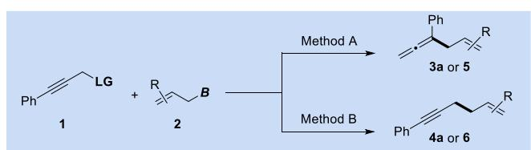

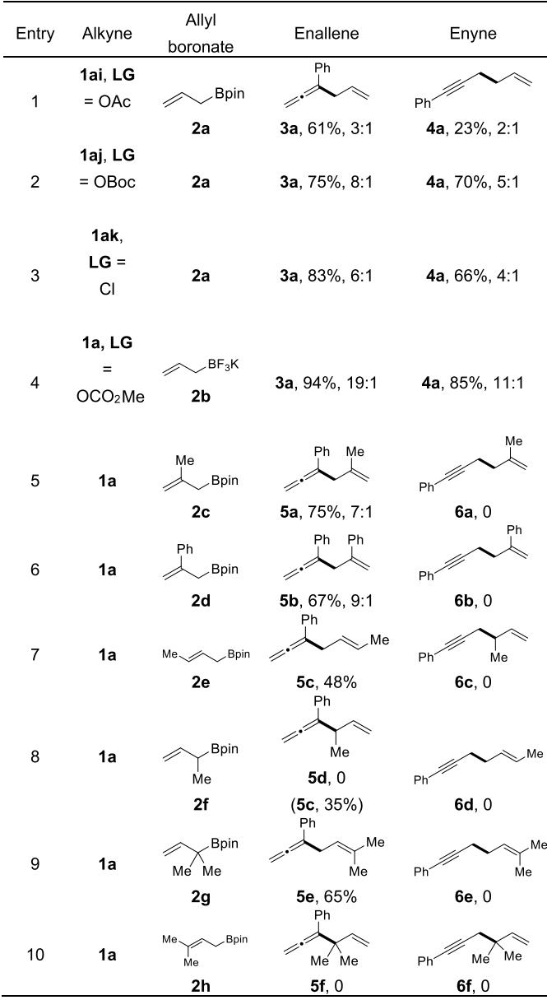  
a)Reaction conditions: Method A: propargylic carbonate 1 (0.2 mmol), allyl boronate 2 (0.4 mmol), Pd(OAc)2 (5.0 mol%), MeO-BIPHEP (10.0 mol%) and Et N (0.4 mmol) in THF (2.0 mL) at 25 °C for 12 h under N . Method B: propargylic carbonate 1 (0.2 mmol), allyl boronate 2 (0.4 mmol), Pd(OAc)2 (5.0 mol%), XantPhos (10.0 mol%) and Et3N (0.4 mmol) in THF (2.0 mL) at 80 °C for 3 h under N2. Reported yields are the isolated ones. The isomeric ratios were determined by 1H NMR analysis of the crude mixture.

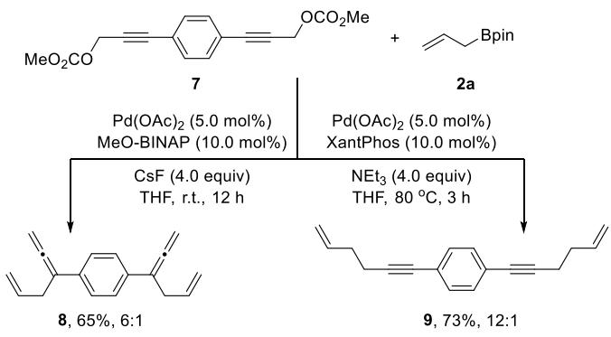  
Scheme 2. Reaction of bis-propargyl carbonate with allyl boronate.

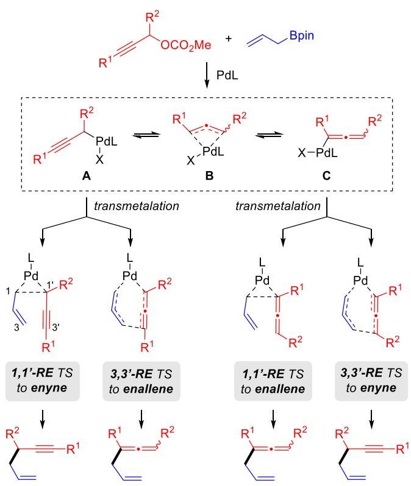  
Scheme 3. Proposed mechanism.

DFT-optimized structures of the possible reductive elimination transition states (TSs) for the allyl-propargyl cross coupling between 1a and 2a are shown in Figure 1. Our calculations showed that with MeO-BIPHEP as the bidentate phosphine ligand, the 1,1--reductive elimination mode through an ƞ1-allenyl Pd species had the lowest-energy TS (TS-1c). This TS leads to the formation of the experimentally favored 1,4-enallene product 3a and lies 3.2 kcal mol−1 lower than the lowest-energy enyne-forming TS, TS-1b. In contrast, the XantPhos ligand was calculated to favor the 3,3--reductive elimination mode (TS-2b) from an ƞ1-allenyl Pd structure to yield the 1,3-enyne product 4a. TS-2b was found to be 5.1 kcal mol−1 more favorable than the lowestenergy enallene-forming TS, TS-2c. These results are in good agreement with the experimentally observed selectivities.

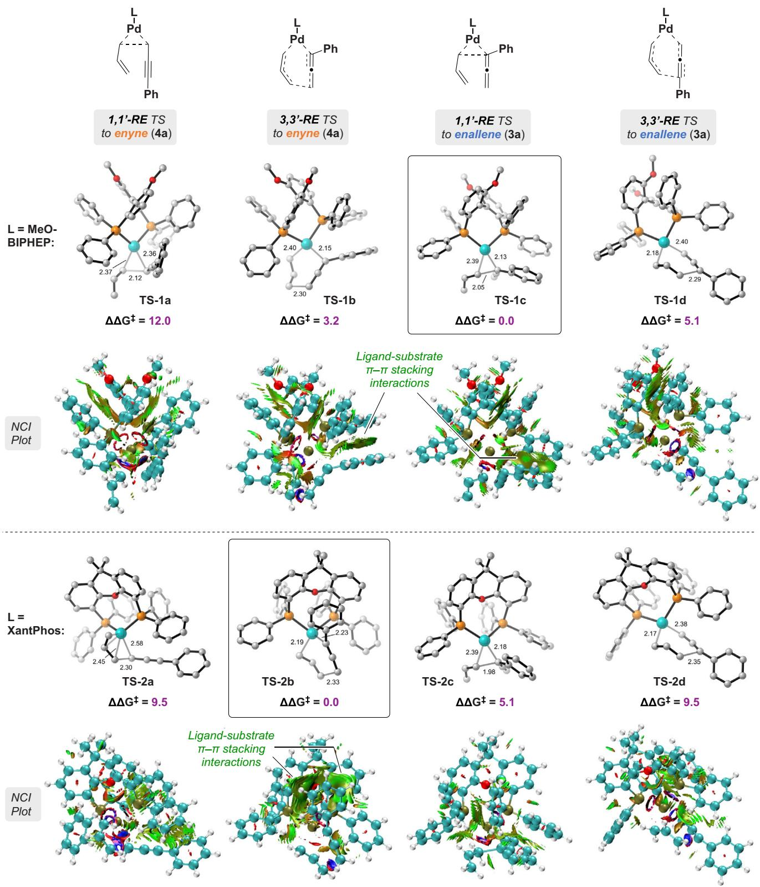  
Figure 1. Calculated reductive elimination transition states and their relative Gibbs free energies for the Pd-catalyzed allyl-propargyl cross coupling between 1a and 2a at the M06-D3/def2-TZVPP–SDD(Pd), SMD(THF)//B3LYP-D3/def2-SVP–LANL2DZ(Pd) level of theory. Energies are in kcal/mol. Interatomic distances are in Å. Non-covalent interaction (NCI) plots are shown with an isosurface value of 0.5 au. All transition states were verified by Intrinsic Reaction Coordinate (IRC) calculations to be actual transition states connecting the expected reactants and products.

Table 5: Calculated relative activation free energies with diferent functional. All values are in kcal mol−1.a)
<table><tr><td>Structure</td><td> $\Delta \Delta \mathsf { G } ^ { \ddagger }$  (B3LYP)</td><td> $\Delta \Delta \mathsf { G } ^ { \ddagger }$  (B3LYP-D3)</td><td> $\Delta \Delta \mathsf { G } ^ { \ddagger }$  (M06-D3)</td></tr><tr><td>TS-2a</td><td>9.5</td><td>12.5</td><td>9.5</td></tr><tr><td>TS-2b</td><td>5.2</td><td>0.0</td><td>0.0</td></tr><tr><td>TS-2c</td><td>4.1</td><td>7.0</td><td>5.1</td></tr><tr><td>TS-2d</td><td>0.0</td><td>6.5</td><td>9.5</td></tr></table>

a) The levels of theory employed are: $\Delta \Delta \mathsf { C } ^ { \ddagger }$ (B3LYP):  
B3LYP/def2-TZVPP–SDD(Pd),  
SMD(THF)//B3LYP-D3/def2-SVP–LANL2DZ(Pd); $\Delta \Delta \mathsf { C } ^ { \ddagger }$ (B3LYP-D3): B3LYP-D3/def2-TZVPP–SDD(Pd),  
SMD(THF)//B3LYP-D3/def2-SVP–LANL2DZ(Pd); and --G‡ (M06-D3): M06-D3/def2-TZVPP–SDD(Pd),  
SMD(THF)//B3LYP-D3/def2-SVP–LANL2DZ(Pd).

To further probe the factors underpinning the relative favorability of some reductive elimination TSs over others, we generated non-covalent interaction (NCI) plots for all reductive elimination TSs (Figure 1). The NCI plot of TS-2b revealed extensive stabilizing π–π stacking interactions between the substrate’s phenyl substituent and the tricyclic core of the XantPhos ligand. Similar, albeit less extensive, π– π stacking interactions were also observed in the NCI plots of TS-1b and TS-1c. To elucidate the role of dispersion interactions (including attractive π–π stacking) in determining the order of relative free energies of the reductive elimination transition states, we compared TS energies calculated with B3LYP (without dispersion) and B3LYP-D3 (with empirical dispersion). This kind of comparison has been used to gauge the contribution of dispersion toward calculated energy differences.[63,64] As Table 5 shows, the B3LYP-D3 values rank the four TSs in the same order as M06-D3, while the B3LYP values show significant qualitative disagreement, ranking TS-2d as the lowest-energy TS and TS-2b as much higher in energy. These values underline the important role played by dispersion effects, including π–π stacking interactions, in stabilizing TS-2b. Energy decomposition analysis (EDA) performed on TS-2a–d also showed that TS-2b has the most favorable interaction energy between the Pd-XantPhos framework and the substrate fragments, including particularly favorable electrostatic interaction and charge transfer terms (see Table S15 for details).

Another potential contributing factor to the different ordering of TS free energies between the MeO-BIPHEP and XantPhos systems is the steric contours of the ligands. While XantPhos possesses a relatively flat fused tricyclic core that can accommodate coordinated substrate fragments in a variety of different orientations, MeO-BIPHEP has a markedly more three-dimensional shape with phenyl groups protruding toward both flanks of the central P─Pd─P axis (Figure 2). Calculated steric maps also showed that the MeO-BIPHEP system experiences more steric pressure at the potential substrate coordination sites than the XantPhos system (see Figure S3 for details). In particular, this difference may partially explain the favorability of the enyne-producing 3,3-reductive elimination mode in the XantPhos system (TS-2b), in which the phenyl substituent of the substrate must be placed close to the ligand framework.

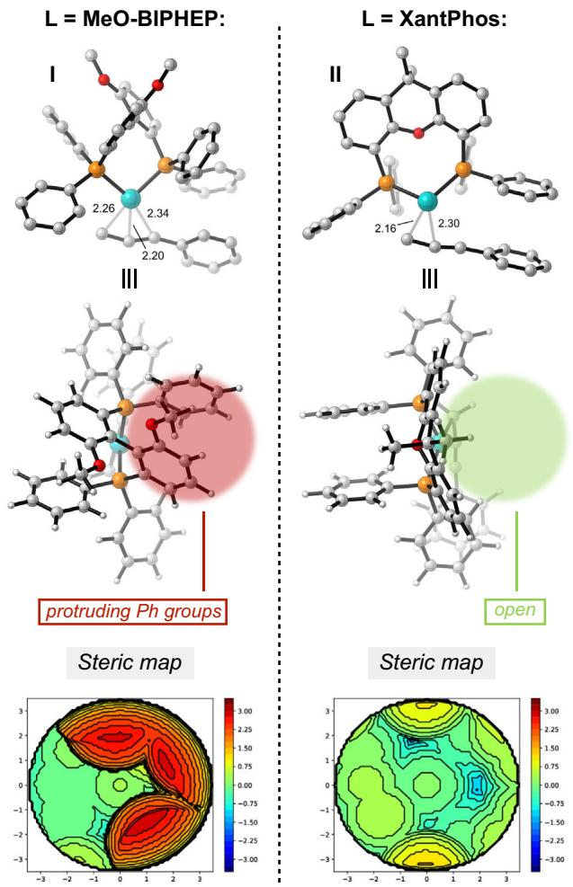  
Figure 2. Calculated steric maps of Pd intermediates I and II with MeO-BIPHEP and XantPhos as the ligand, respectively.

While these computational investigations results have revealed important differences in non-covalent interaction strength and ligand steric profiles, we carefully note that the regioselectivity of this transformation is also significantly impacted by factors such as the identity of the leaving group, some of which (including acetate or chloride anions) were found to lower the regioselectivity in increased concentrations (see Tables S13 and S14 for details). Although the relative free energies of the reductive elimination TSs provide one plausible explanation for the divergent regioselectivity in the MeO-BIPHEP and XantPhos systems, further modeling efforts will be necessary to address the roles played by leaving group anions in influencing the regioselectivity and provide a complete mechanistic picture.

## Conclusion

In conclusion, we have developed a ligand-dependent chemoand regioselective allylation of propargylic carbonates with allylboronates that allows for the highly selective synthesis of 1,4-enallenes and 1,5-alkynes. DFT calculations showed that the bidentate phosphine ligands play a critical role in determining the relative favorability of different reductive elimination modes from the putative ƞ3-allyl-ƞ1-allenyl palladium species. Specifically, MeO-BIPHEP promotes 1,1--reductive elimination to form the 1,4-enallenes, whereas XantPhos favors the formation of 1,5-enynes via the 3,3--reductive elimination pathway. This study provides in-depth insights into the underlying mechanisms of allylation reactions involving allenyl-palladium complexes and offers a highly efficient strategy for chemo- and regiodivergent transformations using readily available identical starting materials.

## Acknowledgements

This work was supported by the Outstanding Innovative Talents Cultivation Funded Programs 2023 of Renmin University of China, the National Natural Science Foundation of China (22571319, 22201300 to L.L. and 22571320 to Z.L.) and the Public Computing Cloud Platform at Renmin University of China. The research was also supported by the Beijing Natural Science Foundation (2252010 to L.L.), the Fundamental Research Funds for the Central Universities, and the Research Funds of Renmin University of China (24XNKJ27 to L.L.). S.C. is grateful to the National Science Foundation (NSF CHE-2338438) and Oberlin College for financial support. DFT calculations were performed using the SCIURus, the Oberlin College HPC cluster (NSF MRI 1427949), and research allocations (CHE210088) from the Advanced Cyberinfrastructure Coordination Ecosystem: Services & Support (ACCESS) program, which is supported by National Science Foundation grants #2138259, #2138286, #2138307, #2137603, and #2138296.

## Conflict of Interests

The authors declare no conflict of interest.

## Data Availability Statement

The data that support the findings of this study are available in the Supporting Information material of this article.

Keywords: Allenes • Allylation • Enynes • Palladium catalysis • Propargyl carbonates

[1] B. M. Trost, Science 1983, 219, 245–250.

[2] S. L. Schreiber, Science 2000, 287, 1964–1969.

[3] J. Mahatthananchai, A. M. Dumas, J. W. Bode, Angew. Chem. Int. Ed. 2012, 51, 10954–10990.

[4] L. Li, Z. Chen, X. Zhang, Y. Jia, Chem. Rev. 2018, 118, 3752– 3832.

[5] H. Mayr, A. R. Ofial, Angew. Chem. Int. Ed. 2006, 45, 1844–1854.

[6] C. Nájera, I. P. Beletskaya, M. Yus, Chem. Soc. Rev. 2019, 49, 7101–7166.

[7] I. P. Beletskaya, C. Nájera, M. Yus, Chem. Soc. Rev. 2020, 49, 7101–7166.

[8] C. C. Chintawar, A. K. Yadav, A. Kumar, S. P. Sancheti, N. T. Patil, Chem. Rev. 2021, 121, 8478–8558.

[9] S. R. Neufeldt, M. S. Sanford, Acc. Chem. Res. 2012, 45, 936–946.

[10] N. A. Afagh, A. K. Yudin, Angew. Chem. Int. Ed. 2010, 49, 262– 310.

[11] V. Blanco, D. A. Leigh, V. Marcos, Chem. Soc. Rev. 2015, 44, 5341–5370.

[12] J. Tsuji, H. Watanabe, I. Minami, I. Shimizu, J. Am. Chem. Soc. 1985, 107, 2196–2198.

[13] S. Yu, S. Ma, Chem. Commun. 2011, 47, 5384–5418.

[14] H.-P. Bi, X.-Y. Liu, F.-R. Gou, L.-N. Guo, X.-H. Duan, X.-Z. Shu, Y.-M. Liang, Angew. Chem. Int. Ed. 2007, 46, 7068–7071.

[15] L. Ding, S.-L. You, Org. Lett. 2018, 20, 6206–6210.

[16] N. Ljungdahl, N. Kann, Angew. Chem. Int. Ed. 2009, 48, 642–644.

[17] M. R. Luzung, F. D. Toste, J. Am. Chem. Soc. 2003, 125, 15760– 15761;

[18] A. J. Oelke, J. Sun, G. C. Fu, J. Am. Chem. Soc. 2012, 134, 2966– 2969;

[19] C.-H. Ding, X.-L. Hou, Chem. Rev. 2011, 111, 1914–1937;

[20] F. Tong, D. Hu, C. Zhang, J.-Q. Zhang, H. Ren, Org. Chem. Front. 2024, 11, 1843–1857.

[21] J. Ye, S. Ma, Angew. Chem. Int. Ed. 2013, 52, 10809–10813.

[22] M. Dai, Z. Sun, L.-A. Chen, Angew. Chem. Int. Ed. 2022, 61, e202203835.

[23] N. Ishida, Y. Hori, S. Okumura, M. Murakami, J. Am. Chem. Soc. 2013, 52, 2217–2220;

[24] T. Nemoto, Z. Zhao, T. Yokosaka, Y. Suzuki, R. Wu, Y. Hamada, Angew. Chem. Int. Ed. 2013, 52, 2217–2220.

[25] M. Dai, L. Song, L.-A. Chen, Sci. China Chem. 2024, 67, 1384– 1396.

[26] J. Tsuji, T. Mandai, Angew. Chem. Int. Ed. Engl. 1996, 34, 2589– 2612.

[27] R. K. Shiroodi, V. Gevorgyan, Chem. Soc. Rev. 2013, 42, 4991– 5001.

[28] C. Q. O’Broin, P. J. Guiry, J. Org. Chem. 2020, 85, 10321–10333.

[29] Z.-Z. Zhou, X.-R. Song, S. Du, K.-J. Xia, W.-F. Tian, Q. Xiao, Y.-M. Liang, Chem. Commun. 2021, 57, 9390–9393.

[30] X. Huang, S. Wu, W. Wu, P. Li, C. Fu, S. Ma, Nat. Commun. 2016, 7, 12382.

[31] X. Huang, B.-Z. Chen, P. Li, D.-W. Ji, J. Liu, H. Zheng, S.-N. Yang, Y.-C. Hu, B. Wan, X.-P. Hu, C. Fu, Y. Huang, J. Zheng, Q.-A. Chen, S. Ma, Nat. Chem. 2022, 14, 1185–1192.

[32] T. M. Locascio, J. A. Tunge, Chem.- Eur. J. 2016, 22, 18140– 18146.

[33] Z. Sun, M. Dai, C. Ding, S. Chen, L.-A. Chen, J. Am. Chem. Soc. 2023, 145, 18115–18125.

[34] F.-D. Lu, D. Liu, L. Zhu, L.-Q. Lu, Q. Yang, Q.-Q. Zhou, Y. Wei, Y. Lan, W.-J. Xiao, J. Am. Chem. Soc. 2019, 141, 6167–6172.

[35] L.-N. Guo, X.-H. Duan, Y.-M. Liang, Acc. Chem. Res. 2011, 44, 111–122;

[36] N. Marion, S. P. Nolan, Angew. Chem. Int. Ed. 2007, 46, 2750– 2752;

[37] H. Qian, D. Huang, Y. Bi, G. Yan, Adv. Synth. Catal. 2019, 361, 3240–3280.

[38] S. Ma, Chem. Rev. 2005, 105, 2829–2872;

[39] S. Ma, Acc. Chem. Res. 2009, 42, 1679–1688;

[40] J. Ye, S. Ma, Acc. Chem. Res. 2014, 47, 989–1000;

[41] L. Liu, R. M. Ward, J. M. Schomaker, Chem. Rev. 2019, 119, 12422–12490.

[42] S. Ma, Eur. J. Org. Chem. 2004, 2004, 1175–1183.

[43] S. Ma, G. Wang, Angew. Chem. Int. Ed. 2003, 42, 4215– 4217.

[44] L. Lv, C.-J. Li, Angew. Chem. Int. Ed. 2021, 60, 13098–13104.

[45] L. Lv, H. Qian, Y. Ma, S. Huang, X. Yan, Z. Li, Chem. Sci. 2021, 12, 15511–15518.

[46] H. Qian, H. D. Nguyen, L. Lv, S. Chen, Z. Li, Angew. Chem. Int. Ed. 2023, 62, e202303271.

[47] L. Lv, H. Qian, G. Synth, Green Synth. Catal. 2023, 4, 190–205.

[48] M. Méndez, J. M. Cuerva, E. Gómez-Bengoa, D. J. Cárdenas, A. M. Echavarren, Chem.- Eur. J. 2002, 8, 3620–3628.

[49] P. Zhang, L. A. Brozek, J. P. Morken, J. Am. Chem. Soc. 2010, 132, 10686–10688.

[50] M. J. Ardolino, J. P. Morken, J. Am. Chem. Soc. 2012, 134, 8770– 8773.

[51] M. J. Ardolino, J. P. Morken, J. Am. Chem. Soc. 2014, 136, 7092– 7100.

[52] J.-P. Chen, Q. Peng, B.-L. Lei, X.-L. Hou, Y.-D. Wu, J. Am. Chem. Soc. 2011, 133, 14180–14183.

[53] S. Huang, F.-F. Tong, D.-C. Bai, G.-P. Zhang, Y.-J. Jiang, B. Zhang, X. Leng, Y.-L. Guo, X.-L. Wan, X. Zhang, C.-H. Ding, X.-L. Hou, Nat. Commun. 2021, 12, 6551.

[54] F. Schoenebeck, K. N. Houk, J. Am. Chem. Soc. 2010, 132, 2496– 2497.

[55] Y. Yang, S. L. Buchwald, J. Am. Chem. Soc. 2013, 135, 10642– 10645.

[56] W. A. Golding, H. L. Schmitt, R. J. Phipps, J. Am. Chem. Soc. 2020, 142, 21891–21898.

[57] Y.-C. Lee, K. Kumar, H. Waldmann, Angew. Chem. Int. Ed. 2018, 57, 5212–5226.

[58] L. Lv, L. Yu, Z. Qiu, C.-J. Li, Angew. Chem. Int. Ed. 2020, 59, 6466–6472.

[59] X.-Q. Chu, R. Cheng, C.-J. Li, ACS Catal. 2024, 14, 574–584.

[60] D. S. B. Daniels, A. S. Jones, A. L. Thompson, R. S. Paton, E. A. Anderson, Angew. Chem. Int. Ed. 2014, 53, 1915–1920.

[61] P. C. J. Kamer, P. W. N. M. van Leeuwen, J. N. H. Reek, Acc. Chem. Res. 2001, 34, 895–904.

[62] P. W. N. M. van Leeuwen, P. C. J. Kamer, J. N. H. Reek, P. Dierkes, Chem. Rev. 2000, 100, 2741–2770.

[63] X. Xu, P. Liu, A. Lesser, L. E. Sirois, P. A. Wender, K. N. Houk, J. Am. Chem. Soc. 2012, 134, 11012–11025;

[64] R. Guo, S. Adak, P. Bellotti, X. Gao, W. W. Smith, S. N. Le, J. Ma, K. N. Houk, F. Glorius, S. Chen, M. K. Brown, J. Am. Chem. Soc. 2022, 144, 17680–17691.