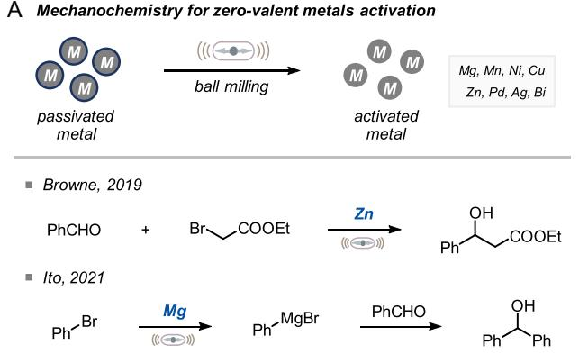
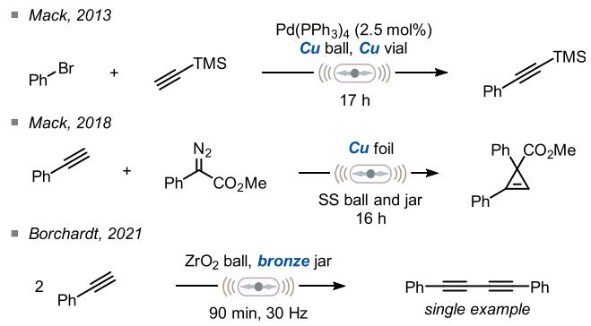
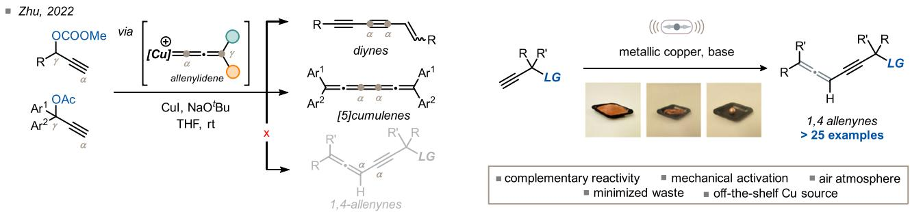
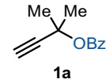
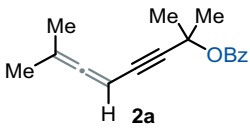
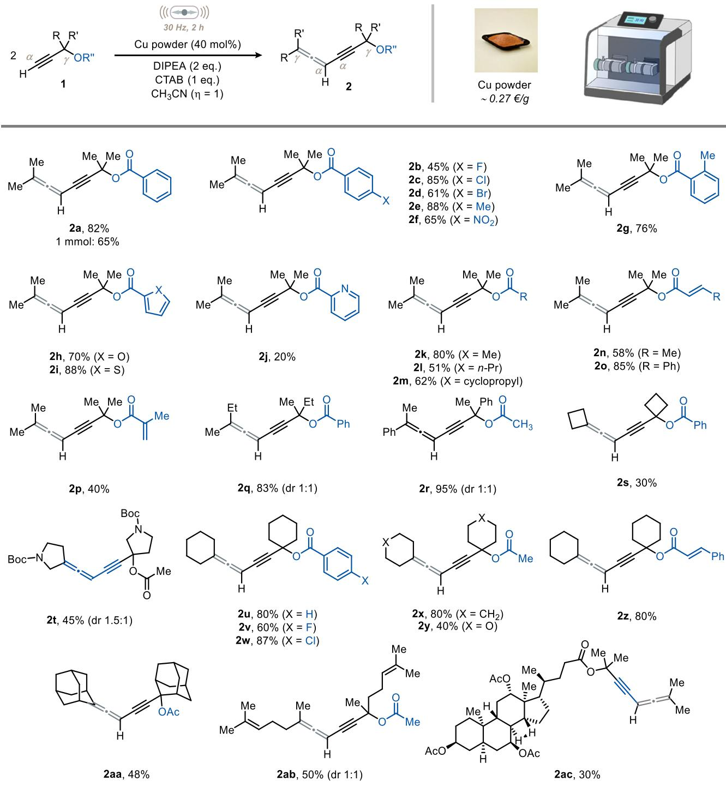
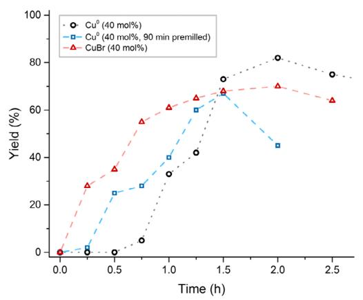
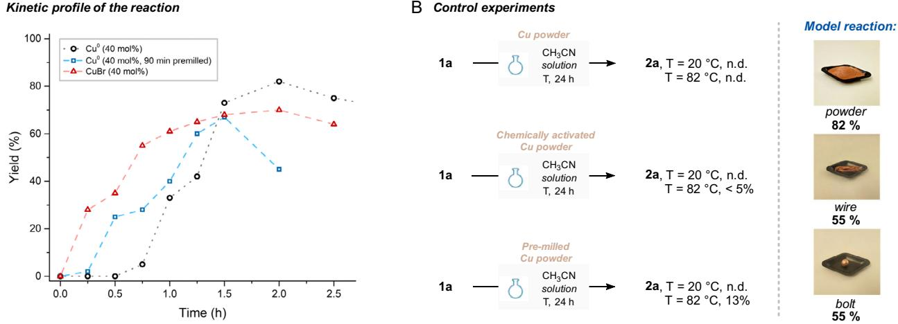
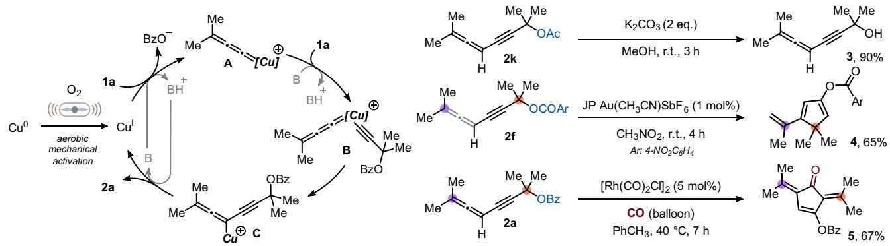

www.chemsuschem.org

# Mechanochemical Aerobic Activation of Metallic Copper for the Synthesis of 1,4-Allenynes

Ana M. Constantin, Francesco Mele, Matteo Lanzi, Giovanni Maestri, Raimondo Maggi, Nicola Della Ca’,\* and Luca Capaldo\*

Mechanical activation of zero-valent metals is emerging as a new paradigm in sustainable synthesis, opening up a broad swath of chemical space under more practical conditions than solutionphase methods. Contrary to its neighboring elements in the periodic table, copper has been significantly overlooked in this domain, especially for C─C bond formation. Herein, a mechanochemical method for synthesizing >25 previously unreported conjugated allenynes—a valuable scaffold in organic synthesis is presented—through copper-catalyzed homocoupling of

## 1. Introduction

Mechanochemistry is having a tremendous impact as a transformative and sustainable approach in the synthetic community.[1–7] It utilizes mechanical forces to drive chemical reactions, thus complementing thermal, electrical, and photochemical activation modes, and offers advantages such as reduced waste, shorter reaction times, and alternative selectivity.

Recently, ball milling has been successfully applied for the activation of zero-valent metals[8] including $M g , ^ { [ 9 - 1 3 ] } Z n , ^ { [ 1 4 - 1 7 ] }$ Mn,[18,19] Ni,[20] $\mathsf { A g } , ^ { [ 2 1 , 2 2 ] }$ and $\mathsf { B i } , ^ { [ 2 3 ] }$ and their use in C─C bond forming reactions has been extensively documented in mechanochemistry. In fact, the comminution of these elements can be exploited to remove the outer passivated layer (typically made of metal oxides) and expose more active metal surface (Figure 1A). This generally allows for milder reaction conditions and eliminates the need for additives to trigger reactivity. Magnesium[9–13] and zinc[14–17,24,25] undoubtedly stand out as the most investigated metals in this realm (Figure 1A).

propargylic esters. This approach utilizes ball milling to activate inexpensive zero-valent copper under solvent-minimized conditions, sourced from both powders and recycled waste materials, including wires and bolts, into catalytically active CuI species under aerobic conditions. The synthetic utility of the synthesized compounds is showcased through an unprecedented rhodiumcatalyzed cyclocarbonylation and a gold-catalyzed cyclization reaction.

Despite its low cost and abundance, copper has been largely underutilized in the development of mechanochemical methodologies for C─C bond formation, particularly when compared to its neighboring elements in the periodic table. In contrast, the formation of C─N bonds was more widely explored.[26–31] Notable examples of C─C bond formation include a mechanocatalytic Sonogashira coupling[32] and a cyclopropenation of terminal alkynes[21] reported by Mack and colleagues (Figure 1B). More recently, Borchardt and co-workers developed a $\mathsf { \Omega } \subset \mathsf { u } ^ { 0 } .$ -based mechanochemical Glaser coupling (one single example).[33] In these reports, high-speed ball milling in a copper jar equipped with a copper bead was exploited to generate the catalytic amount of metal needed for the C(sp)─H bond activation step (Figure 1B). Moreover, the same group has reported the development of direct mechanocatalysis, activating Pd alloys with Ni and Cu for Suzuki and Sonogashira couplings.[34]

Building upon our previous work on copper catalysis[35] and set to expand the scope of copper-catalyzed mechanochemical transformations for building molecular complexity, we were triggered by the promiscuous reactivity of copper with alkynes shown in solution.[36,37] Indeed, on one side, Cu can activate terminal acetylenes under basic conditions to form copper acetylides; on the other, it can facilitate the formation of copper allenylidenes when propargylic alcohol derivatives are employed. This peculiarity has been very recently exploited in solution[38–40] relying on CuI complexes and inert conditions.

In one of these cases, Zhu and co-workers reported the copper-catalyzed synthesis of diynes and [5]cumulenes (Figure 1C) via a copper allenylidene intermediate by leveraging a base-assisted proton transfer (BAPT) mechanism.[40] Unfortunately, the occurrence of BAPT prevented the isolation of conjugated allenynes,[41–44] a highly sought-after scaffold in natural products[45–47] and molecular materials.[48]

Motivated by the underexplored potential of mechanochemical synthesis via zero-valent copper, we decided to exploit this

BMechanochemical activation of Cuº for C-C bond formation

  
D This work: Cu-catalyzed mechanosynthesis of 1,4-allenynes

  
Figure 1. Context and state of the art. A) Mechanochemistry can be used for the activation of zero-valent metals as an alternative to experimental tricks. B) Precedents of mechanochemical activation of copper for C─C bond formation. C) Precedent for the exploitation of the copper-allenylidene species for the formation of C─C bond in solution. D) This work.

synthetic opportunity. Such an approach would unlock copper catalysis without protective atmospheres and offer a costeffective, readily available alternative to air-sensitive ${ \mathsf { C u } } ^ { \iota }$ salts for this type of catalysis. However, it remained uncertain whether the transient copper species mentioned above (e.g., Cu allenylidene) could be harnessed under mechanochemical conditions.

Herein, we present the successful development of a coppercatalyzed synthesis of 1,4-allenynes under ball milling conditions (Figure 1D). Readily available forms of copper, including powder, wires, and bolts, were shown to effectively promote the desired reactivity. Our mechanistic investigation proved the critical role of mechanochemistry in enabling the controlled, on demandgeneration of the CuI species for efficient catalysis under aerobic conditions.

## 2. Results and Discussion

We started by optimizing the homocoupling of propargylic ester 1a on a 0.2 mmol scale in the presence of cheap copper powder (5.1 mg, 40 mol%) and diisopropylethylamine (DIPEA, 1 eq.) as the base to promote deprotonation of the alkyne proton. The reaction mixture was milled in a stainless steel jar with one stainless steel ball (Ø = 10 mm) for 2 h at 30 Hz at room temperature, in the presence of CH CN as a liquid-assisted grinding (LAG) agent $( \eta = 1 )$ , under air-equilibrated conditions. Gratifyingly, under these conditions, the expected allenyne (2a) was formed in 65% 1H-NMR yield with no major byproducts observed (Table 1, entry 1). Increasing or decreasing the loading of copper did not improve this result (entries 2 and 3). Thus, we opted to double the milling time to 4 h; however, we found that 2a undergoes decomposition upon prolonged milling (40%, entry 4; see also Section 7, Supporting Information). When attempting a gentler grinding (10 Hz), only 5% yield was obtained (entry 5). Replacing DIPEA with inorganic bases did not prove beneficial either (entries 6 and 7). More specifically, the use of ${ \sf K } _ { 2 } { \sf C O } _ { 3 } ,$ used for a copper-based Glaser coupling,[38] did not produce the expected product. Similarly, when using KOtBu as the base, the product was detected only in traces, with no consumption of the starting 1a whatsoever.

Next, with the aim of affecting the texture and heat capacity of the reaction mixture, we screened inert solid grinding agents like ZnO and NaCl (entry 8). Unfortunately, neither attempt led to improved yields. After extensive screening (see Section 4, Supporting Information), we found that using an excess of the base and a bromide source significantly improved reaction yield. In particular, among the bromide sources tested, cetyltrimethylammonium bromide (CTAB) proved the best, delivering 2a in 84% yield (82% after isolation). Interestingly, the reaction delivers 2a in satisfying yield, also in the absence of LAG (59%, entry 10).

Finally, control experiments were conducted to ascertain the crucial role of all the components: the removal of copper or DIPEA led to no conversion (entries 11 and 12), as did static conditions (i.e., no milling, entry 13). It is worth mentioning that no Glaser byproduct was observed under the investigated conditions.

With optimized conditions in hand, we turned to evaluate the generality of our approach (Figure 2). First, we focused on the carboxylate group. Several substituents, including halogens, alkyl, and strongly electron-withdrawing groups (e.g., NO ), were well tolerated and the expected products 2a–2f were isolated in serviceable to excellent yields (45–88%). Gratifyingly, substituents on the ortho position of the aromatic ring did not hamper the reaction (2g, 76%). Other electron-rich aromatics such as furan and thiophene (2h and 2i) were also well tolerated; however, electron-poor pyridine did not work well (2j, 20%) under optimized conditions. We attribute this result to the well-known tendency of pyridine to coordinate the metal center and thus hamper the activation of 1.

<table><tr><td colspan="3">Table 1. Optimization of reaction conditions.</td></tr><tr><td colspan="3"> $( ( ( \overbrace { \left. \sum _ { 3 0 } ^ { + } \mu _ { H z , 2 } ^ { - } \lambda _ { h } ^ { - } \right. } ) ) )$ </td></tr><tr><td rowspan="3">2 </td><td>Cu powder (40 mol%)</td><td></td></tr><tr><td> ${ \mathsf { D I P E A } } \left( 1 \ { \mathsf { e q . } } \right)$ </td><td></td></tr><tr><td> $\mathsf { C H } _ { 3 } \mathsf { C N } \left( \mathsf { n } = 1 \right)$ </td><td></td></tr><tr><td>Entry</td><td>Variation from conditionsª)</td><td>Yield of 2a [%]b)</td></tr><tr><td>1 2</td><td>None</td><td>65</td></tr><tr><td>3</td><td>Cu (50 mol%)</td><td>62</td></tr><tr><td>4</td><td>Cu (20 mol%)</td><td>33</td></tr><tr><td></td><td>Milling time: 4 h</td><td>40</td></tr><tr><td>5</td><td>Milling frequency: 10 Hz</td><td>5</td></tr><tr><td>6</td><td>K₂CO₃ instead of DIPEA</td><td>n.d.</td></tr><tr><td>7</td><td>KOtBu instead of DIPEA</td><td>&lt;5</td></tr><tr><td>8</td><td>ZnO or NaCl as grinding agents</td><td>10</td></tr><tr><td>9</td><td>DIPEA (2 eq.), CTAB (1 eq.)</td><td>84 (82)</td></tr><tr><td>10</td><td>As entry 9, no LAG (neat)</td><td>59</td></tr><tr><td>11</td><td>As entry 9, no copper</td><td>n.d.</td></tr><tr><td>12</td><td>As entry 9, no DIPEA</td><td>n.d.</td></tr><tr><td>13</td><td>As entry 9, no milling</td><td>n.d.</td></tr></table>

a)General procedure: In a stainless steel jar $( \mathsf { V } = 5 \mathsf { m L } )$ equipped with one stainless steel bead (Ø = 10 mm), alkyne (0.2 mmol), copper (40 mol%), additives, and LAG (η = 1) are sequentially added. The jar is sealed, mounted on a ball mill, and shaken as indicated. Bz: benzoyl. b)1H-NMR yield $( \mathsf { C H } _ { 2 } \mathsf { B r } _ { 2 }$ as internal standard).

Next, we wondered if we could replace the aroyl group with an acyl one. Gratifyingly, we observed that the reaction remained efficient when replacing the phenyl ring with a methyl (2k), n-propyl (2l), or cyclopropyl group (2m), which delivered the expected products in 80, 51, and 62%, respectively. Similarly, crotonates (2n), cinnamate (2o), and methacrylate (2p) allowed to obtain the corresponding allenynes to be obtained in modest-to-very good yields (Figure 2).

Next, we turned our attention to the carbon atom bearing the leaving group and assessed the impact of its substitution pattern on the overall transformation: we found that quaternary centers are uniquely suited for this method. Mixed alkyl substituents were well tolerated (2q, 2r, 83% and 95%, respectively), while the use of 1-ethynylcyclobutyl benzoate allowed to obtain the corresponding spirocyclic homocoupling product to be obtained only in modest yield (2s, 30%). N-Boc pyrrolidine was also tolerated under the optimized conditions, and the corresponding spiroallenyne 2t was obtained in 45% yield. Interestingly, less strained six-membered rings on the quaternary carbon typically afforded the desired products 2u–2z in higher yields. Finally, a very congested alkyne underwent homocoupling under our mechanochemical conditions (2aa) too, delivering the expected product in 48% yield. Notably, a citronellal and a cholic acid derivatives underwent the desired transformation in acceptable yields (2b-2ac, >50%). It is important to note that alcohols and amines require protection to be compatible with our protocol (see 2t and 2ac). Additionally, alkynes bearing a less hindered tertiary carbon at the γ-position represented a limitation, as they were fully recovered unreacted at the end of the reaction.

Subsequently, we examined this mechanochemical transformation from a mechanistic perspective and started by recording the reaction profile over time in optimized conditions. Interestingly, the analysis revealed an induction period (Figure 3A, black dotted line), with no 2a observed until 45 min of milling time. To account for this observation, we formulated two hypotheses: (1) milling under aerobic conditions facilitates comminution of the metal, increasing its surface–to–volume ratio and promoting the formation of oxidized copper species that drive the observed reactivity; or (2) similarly to other metals, the milling process is needed to remove the copper basic oxide patina, thereby exposing fresh zero-valent copper, which serves as the active species in the reaction.

To test our first hypothesis, we surmised that a copper bromide species could be formed under our conditions and be the active catalytic species. Specifically, CuI species may be stabilized by the additives (amine and bromide) as CuBr. Accordingly, we replaced ${ \mathsf { C u } } ^ { 0 }$ powder with CuBr (40 mol%) and monitored the reaction profile under otherwise standard conditions (Figure 3A, red dotted line). The induction period disappeared. We also tracked the reaction profile using premilled copper (90 min at 30 Hz) and found that the induction period was significantly reduced compared to standard conditions (Figure 3A, see blue and black dotted lines). To put our second hypothesis to the test, we started by adding off-the-shelf copper powder to a stirring CH CN solution of propargyl ester 1a, DIPEA (2 eq.), and CTAB (1 eq.) at room temperature: unsurprisingly, no product was formed even after 24 h (Figure 3B). A similar outcome was observed when we used chemically activated copper (via HNO etching) or mechanically activated copper (ball milling, 90 min at 30 Hz). In both cases, allenyne 2a was not formed, and the starting material 1a was largely recovered (≈90%).

Furthermore, in any of the cases mentioned above, increasing the reaction temperature had a positive impact (Figure 3B). Based on these findings, we excluded a pivotal role for zero-valent copper in this reaction. It is important to mention here that we excluded ${ \mathsf { C u } } _ { 2 } { \mathsf { O } } ,$ CuO, and $\mathsf { C u B r } _ { 2 }$ as putative catalysts in our reaction conditions (see Section 4, Supporting Information).

Moreover, when the model reaction was performed under an inert atmosphere (Ar), we obtained little amount of the product (15% via 1H-NMR), which identifies molecular oxygen as the terminal oxidant to form the active CuI species (see Section $^ { 7 , }$ Supporting Information).[33] Overall, we propose that the initial milling time of copper is needed for the in situ generation of CuI, which effectively starts catalysis.

  
Figure 2. Scope of the copper-catalyzed mechanochemical synthesis of 1,4-allenynes. Reaction conditions: in a stainless steel jar (V = 5 mL) equipped with one stainless steel bead (Ø = 10 mm), alkyne (0.2 mmol), copper (40 mol%), DIPEA (2 eq.), CTAB (1 eq.), and CH CN (η = 1) are sequentially added. The jar is sealed, mounted on a ball mill, and shaken as indicated.

To evaluate the robustness of our reaction, we tested alternative copper sources, including electrical wires and bolts purchased at a local electrical supply store. We found that, although copper powder delivers the best yield in the series, other forms can be utilized to convert 1a into 2a in serviceable yields. However, in these cases, a significant abrasion of the metal was observed.[33]

Considering the above findings and drawing from solutionphase precedents,[37,40] we propose the mechanistic pathway illustrated in Figure 3C. Specifically, mechanical activation of zero-valent copper under aerobic conditions generates the catalytically active CuI species, which is stabilized by the base and additive. In the presence of DIPEA as the base, an alkynyl copper intermediate is formed, and subsequent expulsion of the carboxylate group yields copper allenylidene intermediate (A). This is followed by the involvement of an additional equivalent of 1a, leading to the formation of the mixed copper species (B) and, upon migratory insertion, of C. Finally, protodecupration of C leads to product 2a. Notably, unlike the solution-phase mechanism reported by Zhu and coworkers, we did not observe the formation of diynes or cumulenes.[40,49]

C Proposed mechanism  
Late-Stage ManipulationD  
  
Figure 3. A) Kinetic profile of the reaction. B) Control experiments. C) Proposed mechanism. D) Late-stage manipulation of 2a. JP: JohnPhos.

Finally, to prove the versatility of the 1,4-allenynes synthesized in this work, we explored diverse conditions for the latestage manipulation of 2a (Figure 3D). First, 2a could be easily deprotected under basic conditions, yielding propargylic alcohol 3 in 90% yield, with no need for column chromatography. The allenyne core remained untouched. Second, intrigued by the well-known reactivity of allenes with transition metals,[50] we attempted a gold-catalyzed cascade cyclization.[51,52] When using JohnPhos as the ligand, cyclopentadiene 4 was isolated in 65% yield after stirring in CH NO for 4 h at room temperature. Finally, a low-pressure Rh-catalyzed cyclocarbonylation was carried out to deliver cyclopentenone 5 in 67% yield after 7 h of stirring at 40 °C in toluene.[53] [Correction added on 14 May 2025, after first online publication: Reference 49 has been added in Section 2.]

## 3. Conclusion

In conclusion, we have reported the first mechanochemical approach for the synthesis of conjugated allenynes. We successfully exploited the reactivity of copper allenylidene under solventminimized conditions by activating zero-valent, inexpensive copper metal from diverse sources, including low-cost feedstock items. While there is still room to enhance the catalytic efficiency, we demonstrated that ball milling is essential for generating catalytically active CuI species under aerobic conditions, thereby eliminating the need for air- and moisture-sensitive CuI salts. Finally, the synthetic utility of the allenynes synthesized herein was demonstrated through their catalytic transformation into cyclopentenones via a novel rhodium-catalyzed carbonylation and into cyclopentenes through a gold-catalyzed rearrangement.

## Acknowledgements

Open access publishing facilitated by Universita degli Studi di Parma, as part of the Wiley - CRUI-CARE agreement.

## Conflict of Interest

The authors declare no conflict of interest.

## Author Contributions

Ana M. Constantin: data curation (lead); investigation (equal); methodology (equal); writing—review editing (supporting). Francesco Mele: data curation (supporting); investigation (equal); methodology (equal; validation (lead); writing—review editing (supporting). Matteo Lanzi: writing—review editing (supporting); giovanni maestri: writing—review editing (supporting); Raimondo Maggi: resources (equal); writing—review editing (supporting). Nicola Della Ca’: funding acquisition (equal); resources (equal); supervision (equal); writing—review editing (supporting). Luca Capaldo: conceptualization (lead); funding acquisition (supporting); project administration (lead); supervision (lead); writing—original draft (lead); writing—review editing (lead). Ana M. Constantin and Francesco Mele contributed equally to this work.

## Data Availability Statement

The data that support the findings of this study are available from the corresponding author upon reasonable request.

Keywords: ball milling · copper allenylidenes · copper catalysis · mechanochemistry · propargylic esters

[1] J. L. Howard, Q. Cao, D. L. Browne, Chem. Sci. 2018, 9, 3080.

[2] S. L. James, C. J. Adams, C. Bolm, D. Braga, P. Collier, T. Frišci´ˇ c, F. Grepioni, K. D. M. Harris, G. Hyett, W. Jones, A. Krebs, J. Mack, L. Maini, A. G. Orpen, I. P. Parkin, W. C. Shearouse, J. W. Steed, D. C. Waddell, Chem. Soc. Rev. 2012, 41, 413.

[3] F. Cuccu, L. De Luca, F. Delogu, E. Colacino, N. Solin, R. Mocci, A. Porcheddu, ChemSusChem 2022, 15, e202200362.

[4] J.-L. Do, T. Frišci´ˇ c, ACS Cent. Sci. 2017, 3, 13.

[5] V. Martinez, T. Stolar, B. Karadeniz, I. Brekalo, K. Užarevi´c, Nat. Rev. Chem. 2022, 7, 51.

[6] G.-W. Wang, Chem. Soc. Rev. 2013, 42, 7668.

[7] F. Mele, A. M. Constantin, A. Porcheddu, R. Maggi G. Maestri, N. D. Ca’, L. Capaldo, Beilstein J. Org. Chem. 2025, 21, 458.

[8] A. C. Jones, J. A. Leitch, S. E. Raby-Buck, D. L. Browne, Nat. Synth. 2022, 1, 763F775.

[9] V. S. Pfennig, R. C. Villella, J. Nikodemus, C. Bolm, Angew. Chem. Int. Ed. 2022, 61, e202116514.

[11] I. R. Speight, T. P. Hanusa, Molecules 2020, 25, 570.

[10] J. M. Harrowfield, R. J. Hart, C. R. Whitaker, Aust. J. Chem. 2001, 54, 423.

[12] R. Takahashi, A. Hu, P. Gao, Y. Gao, Y. Pang, T. Seo, J. Jiang, S. Maeda, H. Takaya, K. Kubota, H. Ito, Nat. Commun. 2021, 12, 6691.

[13] C. Wu, T. Ying, X. Yang, W. Su, A. V. Dushkin, J. Yu, Org. Lett. 2021, 23, 6423.

[14] G.-W. Wang, Y. Murata, K. Komatsu, T. S. M. Wan, Chem. Commun. 1996, 2059.

[15] Q. Cao, R. T. Stark, I. A. Fallis, D. L. Browne, ChemSusChem 2019, 12, 2554.

[16] J. Yin, R. T. Stark, I. A. Fallis, D. L. Browne, J. Org. Chem. 2020, 85, 2347.

[17] Q. Cao, J. L. Howard, E. Wheatley, D. L. Browne, Angew. Chem. Int. Ed. 2018, 57, 11339.

[18] S. Wu, W. Shi, G. Zou, New J. Chem. 2021, 45, 11269.

[19] W. I. Nicholson, J. L. Howard, G. Magri, A. C. Seastram, A. Khan, R. R. A. Bolt, L. C. Morrill, E. Richards, D. L. Browne, Angew. Chem. Int. Ed. 2021, 60, 23128.

[20] R. A. Haley, A. R. Zellner, J. A. Krause, H. Guan, J. Mack, ACS Sustainable Chem. Eng. 2016, 4, 2464.

[21] L. Chen, D. Leslie, M. G. Coleman, J. Mack, Chem. Sci. 2018, 9, 4650.

[22] L. Chen, M. O. Bovee, B. E. Lemma, K. S. Keithley, S. L. Pilson, M. G. Coleman, J. Mack, Angew. Chem. Int. Ed. 2015, 54, 11084.

[23] S. Wada, N. Hayashi, H. Suzuki, Org. Biomol. Chem. 2003, 1, 2160.

[24] L. Pontini, J. A. Leitch, D. L. Browne, Green Chem. 2023, 25, 4319.

[25] A. C. Jones, W. I. Nicholson, J. A. Leitch, D. L. Browne, Org. Lett. 2021, 23, 6337.

[26] L. Rinaldi, K. Martina, F. Baricco, L. Rotolo, G. Cravotto, Molecules 2015, 20, 2837.

[27] T. L. Cook, J. A. Walker, J. Mack, Green Chem. 2013, 15, 617.

[28] M. Tireli, S. Maracic, S. Lukin, M. J. Kulcsar, D. Zilic, M. Cetina, I. Halasz, S. Raic-Malic, K. Uzarevic, Beilstein J. Org. Chem. 2017, 13, 2352.

[29] D. Tan, V. Strukil, C. Mottillo, T. Friscic, Chem. Commun. 2014, 50, 5248.

[30] P. Wu, L. Ling, Y. Hu, S. Pan, C. Bolm, ACS Sustainable Chem. Eng. 2024, 12, 15875.

[31] W. Shi, Y. Shi, M. Xü, G. Zou, X.-Y. Wu, Molecular Catalysis 2022, 528, 112472.

[32] D. A. Fulmer, W. C. Shearouse, S. T. Medonza, J. Mack, Green Chem. 2009, 11, 1821.

[33] C. G. Vogt, M. Oltermann, W. Pickhardt, S. Grätz, L. Borchardt, Adv. Energy Sustainability Res. 2021, 2, 2100011.

[34] W. Pickhardt, F. J. L. Kraus, M. Wohlgemuth, M. Etter, M. Spallek, M. Schwensow, Z. Genç, S. Grätz, L. Borchardt, ChemCatChem 2024, 16, e202400491.

[35] F. Mele, A. M. Constantin, F. Sacchelli, D. Schiroli, P. P. Mazzeo, G. Maestri, E. Motti, R. Maggi, R. Mancuso, B. Gabriele, F. Pancrazzi, N. Della Ca’, Green Chem. 2024, 26, 6429.

[36] A. Delgado, P. Orlando, M. Lanzi, J. Benet-Buchholz, D. Passarella, A. W. Kleij, Org. Lett. 2024, 26, 7596.

[37] G. Hattori, K. Sakata, H. Matsuzawa, Y. Tanabe, Y. Miyake, Y. Nishibayashi, J. Am. Chem. Soc. 2010, 132, 10592.

[38] K. Zhong, C. Shan, L. Zhu, S. Liu, T. Zhang, F. Liu, B. Shen, Y. Lan, R. Bai, J. Am. Chem. Soc. 2019, 141, 5772.

[39] Z. Y. Wang, R. Zhu, J. Am. Chem. Soc. 2023, 145, 23755.

[40] Q. Yao, B. Liu, T. Cao, S. Zhu, Chem. Commun. 2022, 58, 4969.

[41] J. Wang, H. Qian, S. Ma, Org. Chem. Front. 2024, 11, 437.

[42] G. Wu, Y. Yao, G. Li, X. Zhang, H. Qian, S. Ma, Angew. Chem. Int. Ed. 2022, 61, e202112427.

[43] X. Duan, Q. Jin, K. Wang, Y. Sun, Y. Wei, Z. Wang, J.-K. Qiu, K. Guo, X. Bao, X. Wu, ACS Catal. 2024, 14, 13219.

[44] S. Yu, S. Ma, Angew. Chem. Int. Ed. 2012, 51, 3074.

[45] A. Hoffmann-Röder, N. Krause, Angew. Chem. Int. Ed. 2004, 43, 1196.

[46] J. G. Ondeyka, D. L. Zink, K. Young, R. Painter, S. Kodali, A. Galgoci, J. Collado, J. R. Tormo, A. Basilio, F. Vicente, J. Wang, S. B. Singh, J. Nat. Prod. 2006, 69, 377.

[47] R. E. Bew, J. R. Chapman, E. R. H. Jones, B. E. Lowe, G. Lowe, J. Chem. Soc. C 1966, 129.

[48] P. Rivera-Fuentes, F. Diederich, Angew. Chem. Int. Ed. 2012, 51, 2818.

[49] K. J. Ardila-Fierro, C. Bolm, J. G. Hernández, Angew. Chem. Int. Ed. 2019, 58, 12945.

[50] A. S. K. Hashmi, Angew. Chem. Int. Ed. 2000, 39, 3590.

[51] G. Lemière, V. Gandon, N. Agenet, J.-P. Goddard, A. de Kozak, C. Aubert, L. Fensterbank, M. Malacria, Angew. Chem. Int. Ed. 2006, 45, 7596.

[52] W. Yang, A. S. K. Hashmi, Chem. Soc. Rev. 2014, 43, 2941.

[53] Z. Y. Tian, Q. Cui, C. H. Liu, Z. X. Yu, Angew. Chem. Int. Ed. 2018, 57, 15544.