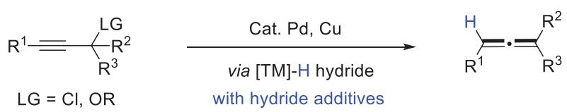
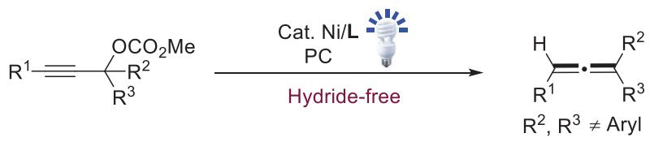
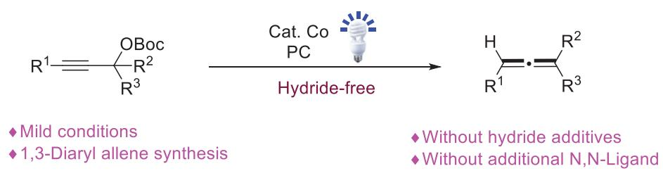
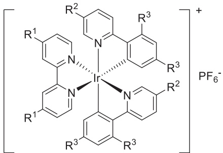
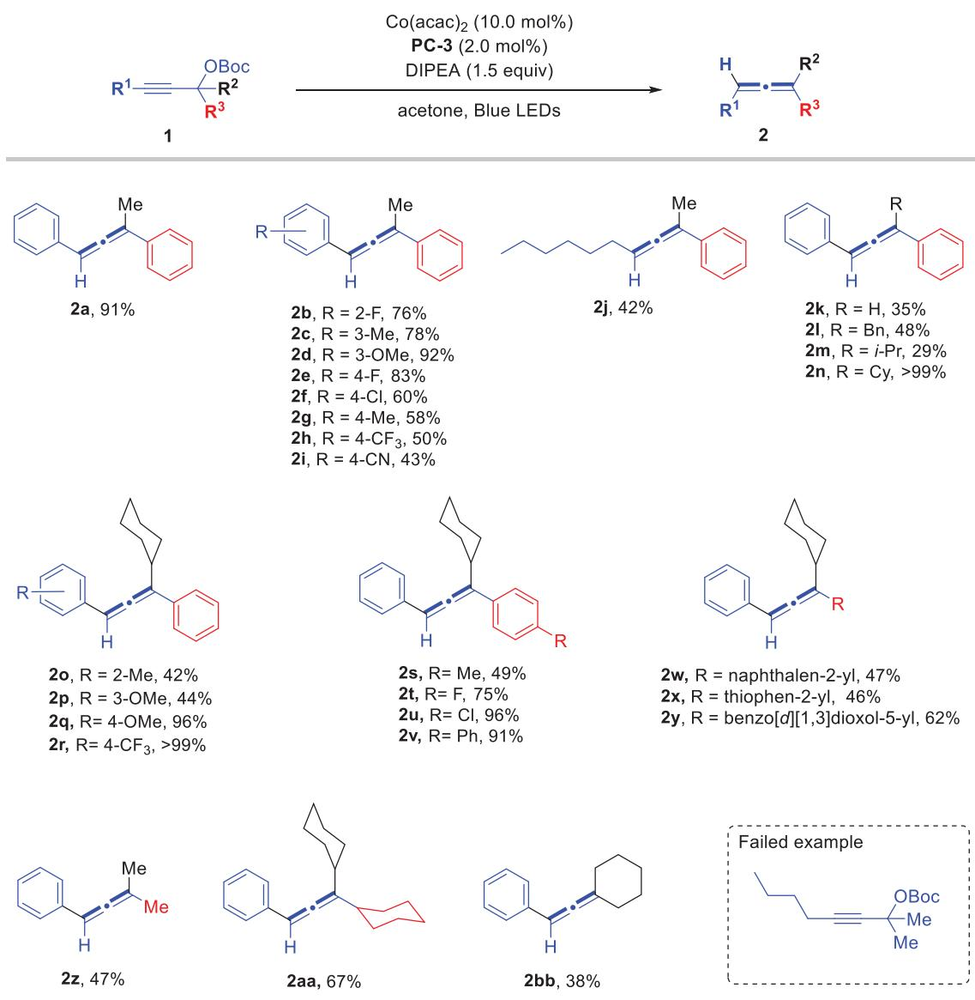
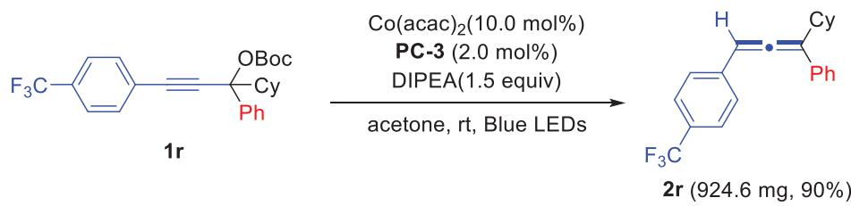
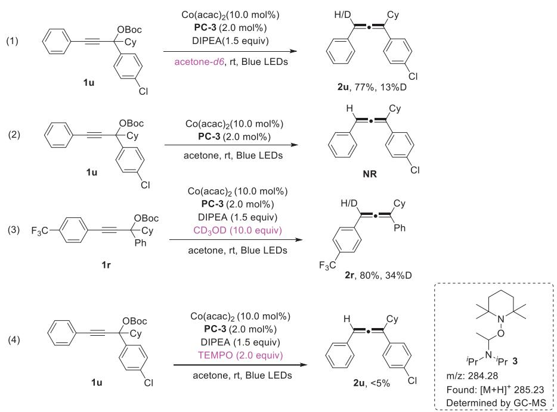
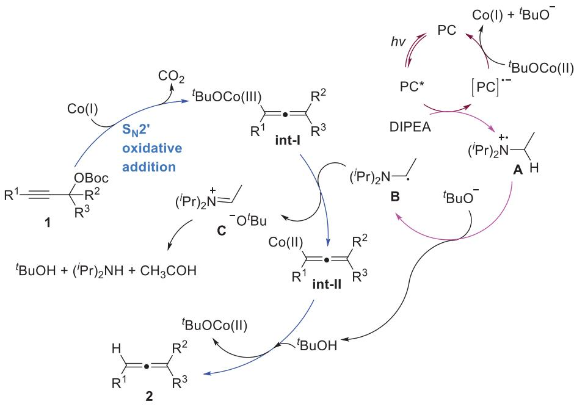

www.chemeurj.org

# Cobalt-Catalyzed Reduction ofPropargyl Alcohols for the Synthesis of1,3-Diarylallenes Under N,N-Ligand and Hydride-free Conditions

Luyao Wei,[a] Biao Zhu,[a] Luning Tang,[a] Zhengyu Han,\*[a] Jianwei Sun,[b] and Hai Huang\*[a]

Allenes are a class of important organic compounds, and their synthesis has always been of great interest. In this article, we have developed a cobalt-catalyzed photoredox strategy, providing an alternative and eficient approach for the synthesis of 1,3-diarylallenes from propargyl alcohols. The reaction utilized organic amines as a hydrogen source to avoid the use of con-

## 1. Introduction

Allenes, as an important class of organic structures, are found to be widely present in natural products, drug molecules, and functional molecules.[1] In addition, due to the presence of two C═C bonds, allenes are also a class of synthetic scaffolds with high synthetic value, which are extensively used in organic synthesis, including cycloaddition reactions, nucleophilic and electrophilic addition reactions, cyclization reactions, etc., providing convenient synthetic methods for many important molecules.[2] In the past few decades, in order to achieve eficient synthesis of allenes, synthetic scientists have developed many strategies for the synthesis of allenes, in which transformation of propargyl alcohol derivatives into allenes is the most direct method, including transition metal-catalyzed coupling reactions, Lewis acid or Brønsted acid-promoted propargylic substitutions, metal hydride-mediated hydride reduction, et al.[3] Relatedly, the strategy of catalytic hydride reduction of propargyl electrophiles has been an established method for constructing mono- to tri-substituted allenes (Scheme 1a). However, the currently developed catalytic hydride reductions mostly depend on metal hydride species, which requires the use of hydride-based reducing agents in the reaction conditions, such as aluminium[4] or boron hydrides,[5] formates,[6] and silanes.[7] This can lead to limitations in functional group tolerance and ventional hydride additives and does not require the addition of extra N,N-ligands to activate the cobalt catalyst, achieving a mild reaction condition. As a result, the reaction was able to synthesize the desired 1,3-diarylallene compounds with good yields and functional group compatibility.

reaction safety. Moreover, the metal-catalyzed hydride reduction strategy has not demonstrated satisfactory results in the synthesis of 1,3-diarylallenes.[8]

Recently, Amgoune and co-workers[9] developed a nickelcatalyzed photoredox strategy, which eficiently achieved the conversion of propargyl alcohol derivatives to allene compounds without the need for a hydride additive (Scheme 1b). However, the reaction required the addition of a N,N-ligand to promote the occurrence of the reaction. Moreover, the method they developed was also incompatible with the synthesis of 1,3-diarylallenes. Cobalt, as an earth-abundant metal, has the advantages of being inexpensive and readily available. Due to its excellent catalytic activity, it has been widely used in organic synthesis, particularly in Pauson–Khand reaction, cross-coupling C–H activation, and so on.[10] In addition, similar to the activity of nickel metal, cobalt can also undergo S 2 oxidative addition reactions with propargyl electrophiles, forming Co-allenyl or Copropargyl intermediates, thereby facilitating the transformation of propargyl electrophiles.[11] To the best of our knowledge, the reduction of propargyl electrophiles catalyzed by cobalt has not yet been developed. In order to further develop the synthetic methods of allenes and leverage the catalytic advantages of metal cobalt, as well as our recent interesting in transformation of propargyl alcohols.[12] In this paper, we developed a cobaltcatalyzed reduction strategy for propargyl alcohol derivatives, achieving the synthesis of 1,3-diarylallenes (Scheme 1c). As an improvement, the reaction did not require hydride additive or ligands, leading to the mild conditions.

## 2. Results and Discussion

In order to achieve the synthesis of 1,3-diarylallenes, we first synthesized a series of propargyl alcohol derivatives 1a-1e to investigate the efect of diferent leaving groups (LGs) on the reaction activity (Table 1). Initially, we found that the designed substrates 1a-1e could not provide the corresponding product 2a a) Pd or Cu-catalyzed hydride reduction of propargyl electrophiles for the synthesis of allenes

b) Ni-catalyzed photoredox strategy for allene synthesis from propargyl electrophiles  
  
c) This work: Co-catalyzed photoredox strategy for 1,3-diaryl allene synthesis

  
Scheme 1. The introduction of allene synthesis from propargyl electrophiles.

<table><tr><td colspan="6">Table 1. The evaluation of leaving group.</td></tr><tr><td colspan="3">LG Ph —Me Ph</td><td colspan="3">Co(acac)2 (10 mol%) PC-1 (2.0 mol%) DIPEA (1.5 equiv) H Ph</td></tr><tr><td colspan="3">1a-1e</td><td colspan="3">acetone, Blue LEDs (LG = Leaving Group)</td></tr><tr><td rowspan="2">LG</td><td colspan="3">=</td><td rowspan="2" colspan="3">2a</td></tr><tr><td>OBoc</td><td>OAc</td><td>OBz</td></tr><tr><td rowspan="2"></td><td>(1a)</td><td>(1b)</td><td>(1c)</td><td>OCOCF5 (1d)</td><td>OH (1e)</td></tr><tr><td>75%</td><td>36%</td><td>54%</td><td>41%</td><td>NR</td></tr></table>

under the optimal conditions reported by Amgoune,[9] indicating that their method currently has limitations in the synthesis of 1,3-diarylallenes. After screening diferent catalysts, we were surprised to find that under Co(acac) condition, substrate 1a could achieve a 75% yield of the desired product 2a. And it is worth mentioning that no additional ligand was required in the reac tion conditions. Moreover, other leaving groups, including OAc, OBz, etc., could not provide better reaction results. In addition, when using propargyl alcohol 1e as the substrate directly, the reaction did not proceed normally. Therefore, we identified the OBoc group as the optimal leaving group for our subsequent research.

After determining the most eficient leaving group, we next investigated and optimized other reaction factors (Table 2). Firstly, the screening of solvents showed that acetone still remained the optimal reaction solvent, and this reaction could not proceed normally under protic solvent conditions. Changing the cobalt catalyst also failed to further improve the reaction yield (Table 2, entries 7–10). Next, we systematically examined the impact of photocatalysts on the reaction, including Ir complexes, Ru complexes, and organic photocatalysts. It was found that the photocatalyst PC-3 could significantly improve the reaction, increasing the yield to 90% (Table 2, entry 15).

After obtaining the optimal reaction conditions, we systematically investigated the scope of this reaction as shown in Scheme 2. Under the optimal conditions, the isolated yield of the template product 2a could reach 91%. The aryl group (R1) connected to the alkyne could tolerate both electronwithdrawing and electron-donating groups, and the corresponding 1,3-diarylallenes 2b-2i could be synthesized with moderate to excellent yields. Alkyl propargyl alcohol derivative could also serve as a suitable substrate, forming the product 2j with a moderate yield. Next, we replaced the methyl substituent in the propargyl alcohol structure and found that the substrate could not only tolerate other alkyl substituents, including Bn, i-Pr and cyclohexyl, but also the hydrogen atom. Moreover, we found that cyclohexyl-substituted propargyl alcohols could synthesize the corresponding 1,3-diaryl allene products 2n-2r more eficiently, possibly due to the enhanced stability of the products. For the R3 substituent, it could not only tolerate diferently substituted phenyl groups but also naphthyl, thiophene, and others, with forming the corresponding products 2s-2x in 46%–96% yield. It is worth mentioning that the reaction could also tolerate dialkyl-substituted propargyl alcohol derivatives, ultimately converting into the corresponding products 2z-2bb with moderate yields. Therefore, our reaction could not only synthesize 1,3-diarylallenes but was also applicable to the synthesis of 1-aryl-3-alkyl allenes. However, a propargyl alcohol derivative bearing fully aliphatic substituents could not be converted into the final products.

<table><tr><td colspan="5">Table 2. The optimization of reaction conditions.[a]</td></tr><tr><td></td><td></td><td></td><td></td></tr><tr><td colspan="6">PC-2,  $\mathsf { R } ^ { 1 } = \mathsf { R } ^ { 2 } = \mathsf { R } ^ { 3 } = \mathsf { \Omega } \mathsf { H }$  PC-3,  $\mathsf { R } ^ { 1 } = { } ^ { t } \mathsf { B u } , \mathsf { R } ^ { 2 } = \mathsf { R } ^ { 3 } = \mathsf { F }$ </td></tr><tr><td>Entry</td><td> $\mathsf { P C } \mathsf { - } 4 , \mathsf { R } ^ { 1 } = { } ^ { t } \mathsf { B u } , \mathsf { R } ^ { 2 } = \mathsf { C F } _ { 3 } , \mathsf { R } ^ { 3 } = \mathsf { \Delta F }$  Cat. Co</td><td></td><td>Solvent</td></tr><tr><td>1</td><td>Co(acac)₂</td><td>PC PC-1 MeCN</td><td>Yield 42</td></tr><tr><td>2</td><td>Co(acac)₂</td><td>PC-1 DCE</td><td>19</td></tr><tr><td>3</td><td>Co(acac)₂</td><td>PC-1 EA</td><td>30</td></tr><tr><td>4</td><td>Co(acac)₂</td><td>PC-1 DME PC-1</td><td>46</td></tr><tr><td>5</td><td>Co(acac)₂ Co(acac)₂</td><td>MeOH DMF</td><td>ND</td></tr><tr><td>6</td><td> $\mathsf { C o } ( \mathsf { N O } _ { 3 } ) _ { 2 } { \bullet } 6 \mathsf { H } _ { 2 } \mathsf { O }$ </td><td>acetone</td><td>45</td></tr><tr><td>7 8</td><td> ${ \mathsf { C o } } ( { \mathsf { O A c } } ) _ { 2 }$ </td><td>acetone</td><td>31 28</td></tr><tr><td>9</td><td>CoBr2</td><td>acetone</td><td>48</td></tr><tr><td>10</td><td>CoCl₂2</td><td>PC-1 PC-1 acetone</td><td>35</td></tr><tr><td>11</td><td> ${ \mathsf { C o } } ( \mathsf { a c a c } ) _ { 2 }$ </td><td>acetone</td><td>55</td></tr><tr><td>12</td><td>Co(acac)₂</td><td>acetone</td><td>90</td></tr><tr><td>13</td><td>Co(acac)₂ PC-4</td><td>acetone</td><td>一</td></tr><tr><td>14</td><td>Co(acac)₂ PC-5</td><td>acetone</td><td></td></tr><tr><td>15</td><td>PC-6</td><td></td><td>一 &lt;10%</td></tr><tr><td></td><td>Co(acac)₂</td><td>acetone</td><td></td></tr><tr><td>16 17</td><td>Co(acac)₂</td><td>4CzIPN acetone</td><td>64</td></tr><tr><td>Co(acac)₂ [a] Reaction conditions: 1a (0.2 mmol), Cat. Co (0.02 mmol, 10.0 mol%), PC (0.004 mmol, 2.0 mol%) and DIPEA (0.3 mmol, 1.5 equiv) in solvent (2.0 mL) at</td><td>Eosin Y</td><td>acetone</td><td>一</td></tr></table>

[a] Reaction conditions: 1a (0.2 mmol), Cat. Co (0.02 mmol, 10.0 mol%), PC (0.004 mmol, 2.0 mol%) and DIPEA (0.3 mmol, 1.5 equiv) in solvent (2.0 mL) at rt using Blue LEDs (405 nm) for 12 hours. Yield was determined by crude 1H NMR analysis using CH Br as an internal standard.

To verify the synthetic potential of the reaction, we investigated the scaled-up reaction. The results showed that the reaction could be scaled up to the gram level while maintaining consistent reaction eficiency (Scheme 3).

  
Scheme 2. The reaction scope[a] a) Reaction conditions: 1 (0.2 mmol), Co(acac)2 (0.02 mmol, 10.0 mol%), PC-3 (0.004 mmol, 2.0 mol%) and DIPEA (0.3 mmol, 1.5 equiv) in acetone (2.0 mL) at rt using Blue LEDs (405 nm) for 12 hours.

  
Scheme 3. Gram-scale synthesis.

In order to further understand the reaction mechanism, we carried out a series of controlled laboratory experiments. First, under the condition of acetone-d6 as the solvent, we observed a deuterium incorporation rate of 13% in the product (Scheme 4, eq 1). This might be due to the acidic nature of the α-CH of acetone, which could lead to the protonation of Co-allenyl intermediates. In addition, we found that the initiation of the reaction still requires the participation of DIPEA, verifying the importance of amines (Scheme 4, eq 2). With CD OD as an additive, we also observed a deuterium incorporation rate of 37%, indicating that alcohol compounds act as protonolysis shuttle agents in the reaction (Scheme 4, eq 3). However, due to the in-situ generation of tBuOH in our system, the deuterium incorporation rate of the product was not as high as in previous report.[9] Moreover, the reaction was completely inhibited in the presence of the radical scavenger 2,2,6,6-tetramethylpiperidinyloxy (TEMPO), which fully

Scheme 4. The control experiments for mechanism understand.

  
Scheme 5. The proposed mechanism.

demonstrated that the reaction involves a free radical process (eq 4). At the same time, a product 3 captured by TEMPO was identified by GC-MS, indicating that the DIPEA in the reaction would form an alkyl radical under photocatalysis. Then, we performed Stern-Volmer fluorescence quenching experiments and showed that the photoexcited state of the photocatalyst was eficiently quenched by DIPEA (Scheme 4, eq 4).

Based on the obtained results and previous reports,[9] we speculate on the mechanism of the Co-catalyzed reduction of propargyl alcohol derivatives that we have developed (Scheme 5). First, under the action of a photocatalyst, the transformation from Co(II) to active Co(I) catalyst is achieved, accompanied by the single-electron oxidation of DIPEA to form intermediate A. The active Co(I) catalysis then undergoes an $S _ { \mathbb { N } ^ { 2 } }$ oxidative addition with the propargyl alcohol derivatives 1 to form an Co(III)-allenyl intermediate int-I after releasing $\mathsf { C O } _ { 2 } . \mathsf { ^ { [ 1 3 ] } }$ Subsequently, under the action of the alkyl radical specie B which generated from intermediate A via a deprotonation process, a single-electron transfer occurs to generate the Co(II)-allenyl intermediate int-II, which is finally protonated to produce the allene products 2 and tBuOCo(II).

## 3. Conclusion

In summary, a method for the photocatalytic reduction of propargyl alcohols has been successfully developed, capable of achieving an eficient transformation of a series of propargyl alcohols into allene compounds, particularly the synthesis of 1,3-diarylallenes. This method has several advantages, including good yields, good functional group tolerance, the use of the inexpensive metal cobalt as a catalyst without the need for additional ligands, the use of organic amines as a hydrogen source without the need for hydride additives, and the use of non-toxic solvents. More transformations of propargyl alcohol derivatives catalyzed by cobalt are under development in our lab.

## Acknowledgments

This work was supported by the NSFC (22201023, 22271242), Changzhou Sci&Tech Program (CZ20240027).

## Conflict of Interest

The authors declare no conflicts of interest.

## Data Availability Statement

The data that support the findings of this study are available in the Supporting Information of this article.

Keywords: 1 • 3-diarylallenes • cobalt catalysis • ligand and hydride-free • photoredox • propargyl alcohols

[1] a) A. Hofmann-Röder, N. Krause, Angew. Chem. Int. Ed. 2004, 43, 1196; b) P. Rivera-Fuentes, F. Diederich, Angew. Chem. Int. Ed. 2012, 51, 2818; c) S. Yu, S. Ma, Angew. Chem., Int. Ed. 2012, 51, 3074; d) C. Wang, H. Zou, N. Liu, Z. Q. Wu, Chem. Asian J. 2021, 16, 3864; e) N. Krause, A. S. K. Hashmi, in Modern Allene Chemistry, Vol. 1 and 2, Wiley-VCH, Weinheim, Germany 2004.

[2] a) S. Ma, Acc. Chem. Res. 2003, 36, 701; b) S. Ma, Chem. Rev. 2005, 105, 2829; c) S. Ma, Acc. Chem. Res. 2009, 42, 1679; d) C. Aubert, L. Fensterbank, P. Garcia, M. Malacria, A. Simonneau, Chem. Rev. 2011, 111,

1954; e) J. Ye, S. Ma, Chem. Res. 2014, 47, 989; f) N. Krause, C. Winter, Chem. Rev. 2011, 111, 1994.

[3] a) K. M. Brummond, J. E. DeForrest, Synthesis 2007, 795; b) M. Ogasawara, Tetrahedron: Asymmetry 2009, 20, 259; c) S. Yu, S. Ma, Chem. Commun. 2011, 47, 5384; d) R. K. Nef, D. E. Frantz, ACS Catal. 2014, 4, 519; e) X. Huang, S. Ma, Acc. Chem. Res. 2019, 52, 1301; f) S. Du, A.-X. Zhou, X.- R. S. R.-C. Yang, Q. Xiao, Org. Chem. Front. 2021, 8, 6760; g) W. Xiao, J. Wu, Org. Chem. Front. 2022, 9, 5053.

[4] Y. Kim, H. Lee, S. Park, Y. Lee, Org. Lett. 2018, 20, 5478.

[5] a) Y. Colas, B. Cazes, J. Gore, Tetrahedron Lett. 1984, 25, 845; b) K. Guo, A. W. Kleij, Angew. Chem. Int. Ed. 2021, 60, 4901.

[6] J. Tsuji, T. Sugiura, M. Yuhara, I. Minami, J. Chem. Soc., Chem. Commun. 1986, 922.

[7] a) C. Deutsch, B. H. Lipshutz, N. Krause, Angew. Chem. Int. Ed. 2007, 46, 1650; b) C. Zhong, Y. Sasaki, H. Ito, M. Sawamura, Chem. Commun. 2009, 5850; c) C. Deutsch, B. H. Lipshutz, N. Krause, Org. Lett. 2009, 11, 5010; d) H. Reeker, P. O. Norrby, N. Krause, Organometallics 2012, 31, 8024.

[8] In past, only a few examples of 1,3-diarylallenes have been successfully synthesized via catalytic hydride reductions: Y. Zheng, B. Miao, A. Qin, J. Xiao, Q. Liu, G. Li, L. Zhang, F. Zhang, Y. Guo, S. Ma, Chin. J. Chem. 2019, 37, 1003.

[9] T. J. Hu, V. Fagué, D. Bouyssi, N. Monteiroa, A. Amgoune, Green Chem. 2024, 26, 6124.

[10] a) S. E. Gibson, A. Stevenazzi, Angew. Chem. Int. Ed. 2003, 42, 1800; b) J. Blanco-Urgoiti, L. Añorbe, L. Pérez-Serrano, G. Domínguez, J. Pérez-Castells, Chem. Soc. Rev. 2004, 33, 32; c) S. Laschat, A. Becheanu, T. Bell, A. Baro, Synlett 2005, 2547; d) T. Shibata, Adv. Synth. Catal. 2006, 348, 2328; e) H. W. Lee, F. Y. Kwong, Eur. J. Org. Chem. 2010, 789; f) J. D. Ricker, L. M. Geary, Top. Catal. 2017, 60, 609; g) C. Gosmini, J. M. Bégouin, A. Moncomble, Chem. Commun. 2008, 3221; h) G. Cahiez, A. Moyeux, Chem. Rev. 2010, 110, 1435; i) J. M. Hammann, M. S. Hofmayer, F. H. Lutter, L. Thomas, P. Knochel, Synthesis 2017, 49, 3887; j) K. Gao, N. Yoshikai, Chem. Res. 2014, 47, 1208; k) M. Moselage, J. Li, L. Ackermann, ACS Catal. 2016, 6, 498; l) N. Sauermann, T. H. Meyer, L. Ackermann, Eur. J. 2018, 24, 16209.

[11] a) K. Nogi, T. Fujihara, J. Terao, Y. Tsuji, Chem. Commun. (Cambridge, United Kingdom) 2014, 50 13052; b) L. Wang, C. Lin, Q. Chong, Z. Zhang, F. Meng, Nat. Commun. 2023, 14 4825; c) Y. Wang, X. Zhang, M. Xie, H. Guo, Org. Lett. 2023, 25 7105; d) C. S. Vizniowski, J. R. Green, T. L. Breen, A. V. Dalacu, J. Org. Chem. 1995, 60, 7496.

[12] a) J. Li, M. Liao, H. Zhu, Z. Han, J. Sun, H. Huang, J. Org. Chem. 2024, 18, 12935; b) X. Hu, H. Zhu, X. Li, Z. Han, J. Sun, X. Jin, H. Huang, J. Org. Chem. 2024, 2024, e202400306; c) H. Zhu, L. Xu, B. Zhu, M. Liao, J. Li, Z. Han, J. Sun, H. Huang, Org. Lett. 2023, 25, 9213.40; d) Y. Bao, H. Zhu, H. Huang, Tetrahedron Lett. 2025, 158, 155487.

[13] a) A. E. Nibbs, T. D. Montgomery, Y. Zhu, V. H. Rawal, J. Org. Chem. 2015, 80, 4928; b) X.-Q. Chu, R. Cheng, C.-J. Li, ACS Catal. 2024, 14, 574; c) Y. Jin, H. Wen, F. Yang, D. Ding, C. Wang, ACS Catal. 2021, 11, 13355.