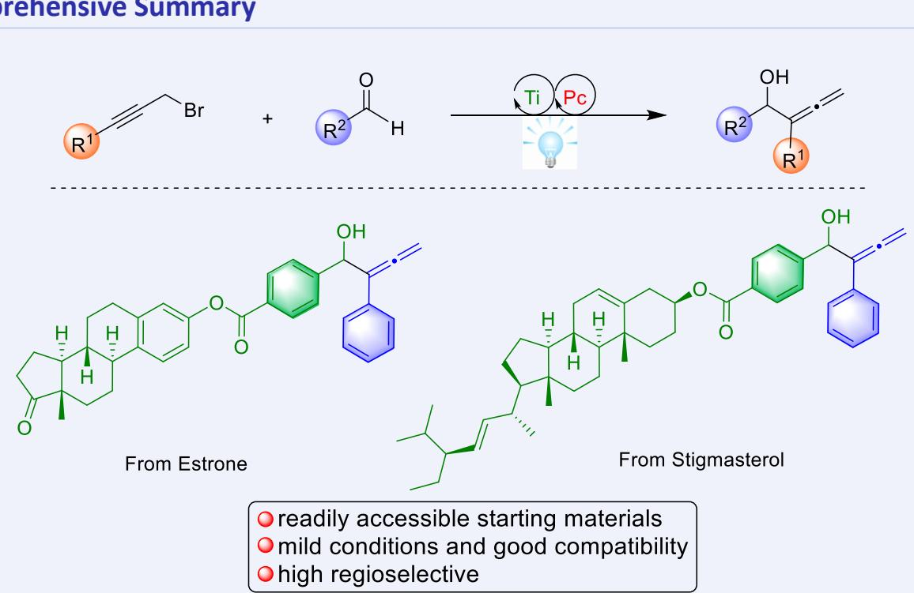
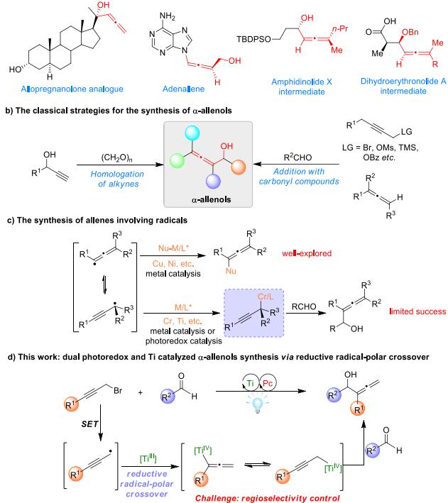
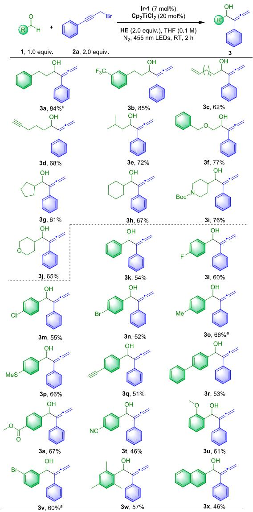
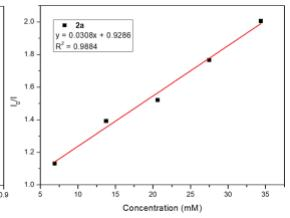
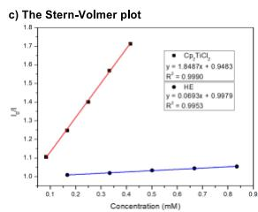
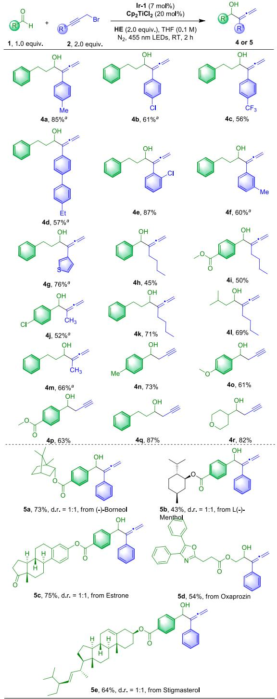
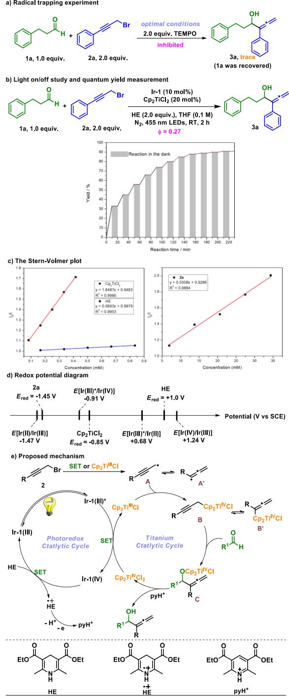
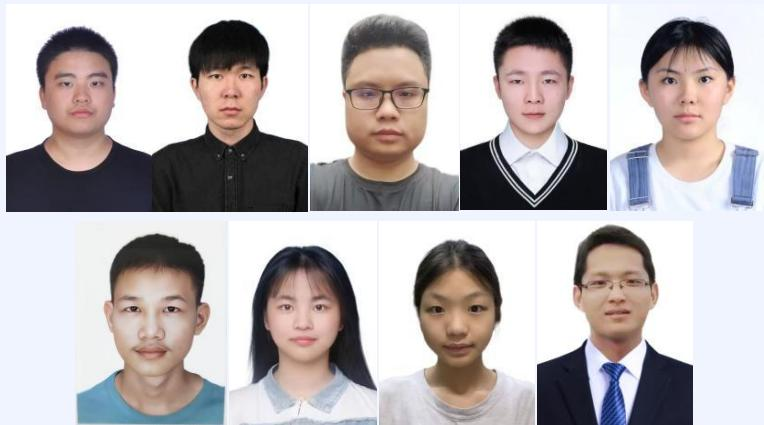

Cite this paper: Chin. J. Chem. 2025, 43, 275—280. DOI: 10.1002/cjoc.202400705

# Dual Photoredox and Titanium Catalyzed Regioselective Allenylation of Aldehydes via Reductive Radical-Polar Crossover

Zulin Xiao,‡,a Wenzhe Shang,‡,b Tao Huang,‡,a Lei He,a Jingyao Li,a Shen Luo,a Xiaoxia He,a Xiang Li,a and Fusheng Li\*,a

a School of Chemistry and Chemical Engineering, University of South China, Hengyang, Hunan 421001, China b Dalian University of Technology, School of Chemistry, Dalian, Liaoning 116024, China

## Keywords

Photoredox catalysis | Titanium catalysis | α-Allenols | Regioselectivity | Reductive radical-polar crossover | C—C coupling

## Comprehensive Summary

The direct reductive coupling of carbonyl compounds with propargyl halides is a powerful and reliable tool in the synthesis of α-allenols. However, stoichiometric metal reductants, harsh reaction conditions and a variety of additional additives are required in the traditional strategies. Additionally, the reactivity and regioselectivity control remains an elusive challenge. Herein, we developed the Ti-catalyzed regioselective reductive coupling of readily available aldehydes and racemic propargyl bromides to rapidly access a wide range of α-allenols. This method proceed efficiently in a reductive radical-polar crossover manner featuring mild conditions, excellent regioselectivity control, broad substrate scope, and eco-friendliness. Preliminary mechanistic studies support the radical-involved catalytic cycle. And the DFT calculations demonstrate that the regioselectivity is determined by the Zimmerman-Traxler-type transition states.

## Background and Originality Content

α-Allenols not only bear the π-activated hydroxyl unit showing an extra reactivity toward substitutions or eliminations, but also have allene group that can promote cycloaddition, electropholic addition, or metal-catalyzed coupling reaction.[1-4] The presence of both the functional groups endows the unique value of allenols in the synthesis of many bioactive molecules, natural products and pharmaceutical molecules (Figure 1a).[4-6] The conventional approaches to the synthesis of α-allenols start from alkynes or activated allenes through homologation of propargylic alcohols or addition with carbonyl compounds (Figure 1b).[1,3] Many excellent reports have been achieved by Ma,[7] Feng,[8] List[9] and other groups[10-16] with transition-metal catalysts. However, these reactions primarily focus on ionic pathway via a two-electron transfer. In sharp contrast, radical chemistry could endow the efficient construction of allenols stereoselectively under mild condition but remains limited explored.[4,17-18] Therefore, further exploration of new reaction patterns involving radicals that enable the synthesis of allenols in an efficient, selective, straightforward and eco-friendly manner is highly desired.

a) The selected examples of α-allenol in organic chemistry

  
Figure 1 The research background and our strategy for α-allenols synthesis.

Nowadays, the radical-polar crossover has emerged as a potent strategy in organic chemistry.[18-23] With this strategy, the radical intermediate could been transformed into an electrophile or nucleophile via single-electron transfer (SET). Notably, it provides a potential solution for the synthesis of allenes. While the regioselectivity control remains an elusive challenge owing to the rearrangement between propargylic radicals and allenyl radicals.[4,17-18,24] Many reports about the synthesis of allenes were disclosed by the groups of Liu,[25] Ma,[26] Wang,[27] Bao,[28-29] and others[30-32] independently through the cross-coupling of the preformed nucleophile-metal species with allenyl radicals (Figure 1c, top). However, the transition metal-catalyzed allenylation of aldehydes to access α-allenols via reductive radical-polar crossover reaction remains less explored. Although several elegant methods have been developed by Nakada,[33] Yamamoto,[34] Guiry,[35] Oltra,[36] and Wang[4] groups via Cr/Ti-catalyzed reductive coupling of propargyl halides and carbonyl compounds to rapidly afford various valuable allenols (Figure 1c, bottom), stoichiometric metal reductants and a variety of additional additives are required in this reaction. In comparison, photoredox catalysis has the advantage of mild condition, easy regulation, and environmental friendliness and plays an indispensable role in the radical synthesis as well.[37-38] In 2022, Wang group[17] described the elegant photoredox/Cr co-catalyzed enantioselective synthesis of α-allenols through a radical-involved redox-neutral pathway. And to the best of our knowledge, it’s also the only report on the synthesis of α-allenols through metallaphotoredox. Thus, it is necessary to develop alternative photoredox catalysis to enrich the diversity of the reaction.

Titanium is one of the most abundant inexpensive transition metals and highly attractive for the development of novel catalytic radical reaction because the metal frequently and efficiently undergoes facile one-electron oxidation state changes.[39-40] Moreover, based on the previous observations,[41-43] Cp2TiIIICl as a good one-electron reductant can be prepared in situ from the higher valent ${ \mathsf { C p } } _ { 2 } { \mathsf { T i } } ^ { \mathsf { N } } { \mathsf { C l } } _ { 2 } .$ In addition, the limited oxidizing power of TiIV radical intermediates, which may impede the cyclic regeneration of titanium catalyst, can be overcome by photoredox catalysis.[44-45] Herein, we describe the photoredox and titanium co-catalyzed regioselective coupling of aldehydes with propargyl bromides via reductive radical-polar crossover (Figure 1d). Distinct from the previous work,[41,46] we envisioned that the allenylation instead of propargylation could proceed through precise control over reaction parameters. This methodology not only obviates the need of stoichiometric metal reductants, or additional additives, but also features mild conditions, good functional group compatibility, and broad substrate scope.

## Results and Discussion

We commenced the allenylation reaction with phenylpropyl aldehyde (1a) and (3-bromoprop-1-yn-1-yl)benzene (2a) as the model substrates (Table 1). After detailed investigation of an array of reaction parameters, we determined that the merger of Cp TiCl co-catalysis with 4CzIPN could achieve the regioselective allenylation reaction in good yield under visible-light irradiation (Table 1, entry 1). The reaction could also provide the desired product in CH3CN, DCM, or 1,4-dioxane with a decrease in yield (Table 1, entries 2, 5—6). While trace yield was achieved when DCE, toluene, DMF, or DMSO was used as the solvent (Table 1, entries 3—4, 7—8). When decreasing the concentration from 0.1 mol/L to 0.05 mol/L, the yield decreased from 60% to 38% (Table 1, entry 9). And the reaction was also performed well when the concentration was increased from 0.1 mol/L to 0.3 mol/L (Table 1, entries 10—11). The allenylation product was also affected when the amount of 2a, HE, or Cp TiCl was changed (Table 1, entries 12—17). It is noteworthy that the product of 3a could be obtained in the yield of 69%, if 20 mol% Cp TiCl was used (Table 1, entry 17). The photocatalysts Ir-2 or Ir-3 also led to the product but with an erosion in yield (Table 1, entries 19—20). The satisfying result was achieved when 7 mol% Ir-1 and 20 mol% Cp2TiCl2 were performed (Table 1, entry 18, 21—22). And the yield was basically unchanged when Ir-1 was further increased (Table 1, entry 23). Control experiments disclosed that Cp2TiCl2, photocatalyst, HE, and light are indispensable for this allenylation reaction (Table 1, entries 24—27).

Based on the optimal conditions, we explored the synthetic scope of aldehyde firstly. It is pleasing that a broad array of aliphatic and aromatic aldehydes can proceed smoothly to afford the α-allenols in moderate to good yields (Figure 2, 3a—3x). To our delight, apart from the tethered aldehydes (3a—3f), the cyclic aldehydes (3g—3j) could also react well with (3-bromoprop-1-yn-1-yl)benzene. And the presence of heteroatoms has no effect on the process of allenylation (3i—3j). In addition, various functional groups are compatible under the mild conditions, including CF3 (3b), -CH=CH2 (3c), -C≡CH (3d, 3q), ether (3f, 3j, 3p, 3u), amide (3i), halogen (3l—3n, 3v), carboxylate ester (3s), phenyl (3r), naphthalene (3x). Remarkably, the sterically hindered 2,4,6-trimethylbenzaldehyde was also compatible with the reaction condition and produced the allenylation product in 61% yield (3w). Moreover, the different position of the substituent (3o, 3u-3v) and the effect of electron-withdrawing/electron-donating (3p, 3s—3t, 3u) do not affect the occurrence of the reaction. Unfortunately, the desired products were not afforded when ketones participated in the reaction. These results demonstrate that the propargylic titanium complex is easier to be reduced than its coupling reaction with ketones.

Table 1 The optimization of different parameters on the Ti-catalyzed allenylation reactiona,b
<table><tr><td></td><td>H D</td><td>4CzIPN (5 mol%) Br Cp_2TiCl2 (10 mol%)</td><td>OH</td><td>O EtO</td><td></td><td>O</td></tr><tr><td></td><td></td><td></td><td>HE (2.0 equiv.), THF (0.1 M) N2, 455 nm LEDs, RT, 2 h</td><td></td><td></td><td>Zェ</td></tr><tr><td>1a, 1.0 equiv.</td><td>2a, 2.0 equiv.</td><td>&quot;standard condition&quot;</td><td>3a</td><td></td><td>HE</td><td></td></tr><tr><td>Entry</td><td></td><td>Variation from &quot;standard condition &quot;</td><td></td><td></td><td>Yield / %</td><td></td></tr><tr><td>1</td><td></td><td>none</td><td></td><td></td><td>60</td><td></td></tr><tr><td>2</td><td></td><td>CH3CN, instead of THF DCE, instead of THF</td><td></td><td></td><td>23</td><td></td></tr><tr><td>3 4</td><td></td><td>Toluene, instead of THF</td><td></td><td></td><td>trace</td><td></td></tr><tr><td>5</td><td></td><td>DCM, instead of THF</td><td></td><td></td><td>trace</td><td></td></tr><tr><td>6</td><td></td><td>1,4-dioxane, instead of THF</td><td></td><td></td><td>16</td><td></td></tr><tr><td>7</td><td></td><td>DMF, instead of THF</td><td></td><td></td><td>30 trace</td><td></td></tr><tr><td>8</td><td></td><td>DMSO, instead of THF</td><td></td><td></td><td>trace</td><td></td></tr><tr><td>9</td><td></td><td>0.05 M, instead of 0.1 M, in THF</td><td></td><td></td><td>38</td><td></td></tr><tr><td>10</td><td></td><td>0.2 M, instead of 0.1 M, in THF</td><td></td><td></td><td>58</td><td></td></tr><tr><td>11</td><td></td><td>0.3 M, instead of 0.1 M, in THF</td><td></td><td></td><td>55</td><td></td></tr><tr><td>12</td><td></td><td>1.0, instead of 2.0 equiv. 2a</td><td></td><td></td><td>45</td><td></td></tr><tr><td>13</td><td></td><td>3.0, instead of 2.0 equiv. 2a</td><td></td><td>61</td><td></td><td></td></tr><tr><td>14</td><td></td><td>1.0, instead of 2.0 equiv. HE</td><td></td><td>32</td><td></td><td></td></tr><tr><td>15</td><td></td><td>3.0, instead of 2.0 equiv. HE</td><td></td><td></td><td>62</td><td></td></tr><tr><td>16</td><td></td><td>5 mol% Cp{2TiCl_{2</td><td></td><td></td><td>50</td><td></td></tr><tr><td>17</td><td></td><td>20 mol% CPp2TiCl{2</td><td></td><td></td><td>69</td><td></td></tr><tr><td>18</td><td></td><td>20 mol% Cp2TiCl2 and 5 mol% Ir-1</td><td></td><td></td><td>80</td><td></td></tr><tr><td>19</td><td></td><td>20 mol% Cp2TiCl2 and 5 mol% Ir-2</td><td></td><td></td><td>46</td><td></td></tr><tr><td>20</td><td></td><td>20 mol% Cp2TiCl2 and 5 mol% Ir-3</td><td></td><td></td><td>28</td><td></td></tr><tr><td>21</td><td></td><td>20 mol% Cp2TiCl2 and 1 mol% Ir-1</td><td></td><td></td><td>35</td><td></td></tr><tr><td>22</td><td></td><td>20 mol% Cp2TiCl2 and 7 mol% Ir-1</td><td></td><td></td><td>87</td><td></td></tr><tr><td>23</td><td></td><td>20 mol% Cp₂TiCl2 and 10 mol% Ir-1</td><td></td><td></td><td>88</td><td></td></tr><tr><td>24</td><td></td><td>no C_p2TiCl2}</td><td></td><td></td><td></td><td></td></tr><tr><td>25</td><td></td><td>no 4CzIPN</td><td></td><td></td><td></td><td></td></tr><tr><td>26</td><td></td><td>no HE</td><td></td><td></td><td></td><td></td></tr><tr><td>27</td><td></td><td>no light</td><td></td><td></td><td></td><td></td></tr><tr><td></td><td></td><td>F CF3 Bu</td><td></td><td></td><td></td><td></td></tr><tr><td>N</td><td>Bu</td><td>N</td><td></td><td>N NC.</td><td>R</td><td>CN</td></tr><tr><td></td><td>-Jf PF6</td><td>F Ieif PF6 F</td><td>Irln</td><td>R</td><td></td><td></td></tr><tr><td></td><td></td><td>N N</td><td>N</td><td></td><td>R</td><td>R</td></tr><tr><td></td><td>tBu</td><td>tBu</td><td></td><td></td><td></td><td></td></tr><tr><td></td><td></td><td>È CF3</td><td></td><td></td><td></td><td></td></tr><tr><td></td><td></td><td></td><td></td><td></td><td>R = carbazolyl</td><td></td></tr><tr><td></td><td>Ir-1</td><td></td><td>Ir-2</td><td>Ir-3</td><td>4CzIPN</td><td></td></tr></table>

a Reaction conducted under ${ \mathsf N } _ { 2 }$ on 0.2 mmol scale of 1a. b The yield was determined by 1H NMR analysis using 1,3,5-trimethoxybenzene as the internal standard.

Furthermore, the scope of the propargyl bromides was also investigated (Figure 3, 4a—4r). Various propargyl bromides with different terminal substituents reacted efficiently with the aldehyde to provide the desired α-allenols in the yield of 45%—87% (4a—4m). However, using 3-bromopropyne as the reaction component could afford the desired propargylation products (4n—4r). According to previous reports,[46] the type of products is controlled by the different energy barriers in transition states relative to the reaction of the propargyl and allenyl titanium(IV) precursors with carbonyls. Additionally, no allenylation product or propargylation product could be obtained when more sterically hindered (3-bromohex-1-yn-1-yl)benzene was used as the substrate. These results indicate that the steric hindrance of the propargyl bromides was critical for regioselectivity control under the current optimized condition. And the single electron reduction of propargylic radicals or allenyl radicals by Cp2TiIIICl could compete with hydrogen transfer reaction. DFT calculations suggest that regioselectivity is determined by the Zimmerman−Traxler-type transition states.[30] And the lower Gibbs free energy of the intermediates of allenylation contributes to promoting the production of allenols (see ESI). To further demonstrate the potential synthetic utility of this new method, several natural products or drug-related aldehydes reacted smoothly with 2a in a highly regioselective manner (Figure 3 5a—5e). Additionally, the allenol 3a could be performed well in a large-scale (5 mmol) with a pleasing yield of 75%, which further illustrated the practicality of the method. Despite some issues in the substrate scope study, this method provides efficient access to α-allenols from readily available starting materials in a reductive radical-polar crossover manner.

  
Figure 2 Substrate scope for aldehydes. Reactions were conducted on a 0.2 mmol scale and the yields were determined after column chromatog raphy. a The hydroxyl unit was protected by triethylsilane.

A series of mechanistic experiments were conducted to shed light on the reaction pathway. The addition of 2.0 equiv. of TEMPO (2,2,6,6-tetramethyl-1-piperidinyloxy) as the radical scavenger to the model reaction inhibited the formation of α-allenols, and the aldehyde was recovered absolutely (Figure 4a). These data indicate that the reaction might involve the generation of propargyl radical, and the ketyl radical intermediates are most likely not involved. The use of ethyl acrylate, ethene-1,1-diyldibenzene, and 1,2-diphenyldiselane as radical scavenger, led to no propargyl radical adduct, and allenol 3a could be isolated in moderate yields (see the ESI). These results demonstrate that the organo-titanium(III) intercepts the propargyl radical very fast.[47] The results of the quantum yield (Φ = 0.27) and intermittent light-dark reaction demonstrate that the allenylation process undergoes a photoredox pathway (Fingure 4b). To further understand the photocatalytic process, the Stern-Volmer luminescence quenching studies proved that ${ \mathsf { C p } } _ { 2 } { \mathsf { T i C l } } _ { 2 } ,$ HE, and 2a can quench the excited-state photocatalyst Ir-1, suggesting both reductive and oxidation quenching pathways can occur (Figure 4c). Additionally, the excited-state photocatalyst $\lvert \lvert \mathbf { r } - \mathbf { 1 } \big ( \lvert \lvert \mathbf { l } \rvert \big ) ^ { * } \big ( E \big [ \lvert \mathbf { r } \big ( \lvert \boldsymbol { \mathrm { l } } \rvert \big ) ^ { * } \big / \lvert \mathbf { r } \big ( \lvert \boldsymbol { \mathrm { V } } \rvert \big ) \big ] \big ) \ = \ - 0 . 9 1 \ \mathrm { ~ V } \big )$ cannot directly reduce 2a $( E _ { \mathrm { r e d } } = - 1 . 4 5 \ \vee ) , \AA ^ { [ 4 8 ] }$ but can be reduced by HE $( E _ { \mathsf { r e d } } \ = \ + 1 . 0 \ \mathsf { V } ) ^ { [ 4 9 ] }$ to produce the Ir-1(II) complex (E[Ir(III) ${ } ^ { * } / \{ \mathsf { r } ( \left| \mathsf { I } \right| ) \} = + 0 . 6 8 ~ \mathsf { V } ) ,$ ,[48] which depicts that propargyl bromide 2a would be reduced by the Ir-1(II) complex (E[Ir(II)/Ir(III)]) $= - 1 . 4 7 \ \mathsf { V } \mathsf { I } ^ { [ 4 8 ] }$ via reductive quenching cycle, furnishing the propargyl radical A. Alternatively, A can also be produced through the halogen atom transfer between Cp2TiIIICl and propargyl bromide.[30] In sharp contrast, Cp2TiCl2 $( E _ { \mathrm { r e d } } = - 0 . 8 5 \ \vee ) ^ { [ 5 0 - 5 1 ] }$ can be directly reduced by the excited-state photocatalyst $^ { 1 \ r _ { \mathbf { r } } - \mathbf { 1 } ^ { * } } ,$ , and the resulting Ir-1(IV) complex $( E [ { \bf { I r } ( { \bf { I V } } ) / { I r } ( { \bf { I I I } } ) } ] ) = + 1 . 2 4 { \bf { \Sigma } } \vee ) ^ { [ 4 8 ] }$ can be reduced by HE, which supports the oxidative quenching cycle (Figure 4d). This was consistent with the Stern-Volmer analysis.

  
Figure 3 Substrate scope for propargyl bromides and natural product or drug-related aldehydes. Reactions were conducted on a 0.2 mmol scale and the yields were determined after column chromatography. a The hydroxyl unit was protected by triethylsilane.

  
Figure 4 Mechanistic investigations. a) Radical trapping experiment; b) Light on/off study and quantum yield measurement; c) The Stern-Volmer plot; d) Redox potential diagram; e) Proposed mechanism.

According to these preliminary mechanistic studies and previous reports, the putative photocatalytic cycle is proposed as follows (Figure 4e). The reaction is initiated by the single electron transfer (SET) between $\mathsf { C p } _ { 2 } \mathsf { T i } ^ { \mathsf { N v } } \mathsf { C l } _ { 2 }$ and photocatalyst, generating the reduced $\mathsf { C p } _ { 2 } \mathsf { T i } ^ { \mathsf { I I I } } \mathsf { C l }$ and the oxidized Ir-1(IV). Simultaneously, the Ir-1(IV) is reduced to the ground state by HE. The subsequent radical is captured by $\mathsf { C p } _ { 2 } \mathsf { T i } ^ { \mathsf { I I I } } \mathsf { C l }$ via single electron reduction to forge the propargylic titanium complex B, which is in equilibrium with the allenic titanium complex B’. Next, the nucleophilic attack to aldehydes from intermediate B affords the allenylation adduct C via a plausible six-member cyclic transition state. The dissociation of the Ti—O bond in the adduct C by $\mathsf { p } \mathsf { y } \mathsf { H } ^ { + }$ provides the desired α-allenols and free $\pi ^ { \mathsf { N } }$ species, which closes the catalytic cycle.

## Conclusions

In this study, we have demonstrated a novel reductive radical-polar crossover coupling reaction of aldehydes with propargyl bromides through dual photoredox and titanium catalysis. This eco-friendly method exhibits good substrate scope and exceptional functional group compatibility, providing facile access to valuable α-allenols from readily available starting material. Meanwhile, the super-stoichiometric metal reductants and external additives are not required. The development of new catalytic systems for allenols synthesis based on dual photoredox and titanium catalysis is underway in our group.

## Experimental

An oven-dried Schlenk tube equipped with an stirring bar was charged under nitrogen gas with the corresponding propargyl bromides (2, 2.0 equiv.), aldehyde (1, 0.2 mmol), Ir-1 (10 mol%), Hantzsch ester (HE, 2.0 equiv.), $\mathsf { c p } _ { 2 } \mathsf { T i C l } _ { 2 }$ (20 mol%), and THF (0.1 mol/L, 2.0 mL). The reaction mixture was then degassed by freeze-pump-thaw for three times, then the vessel was back-filled with nitrogen gas. The substrate was added after being degassed when it’s a liquid. Subsequently, the reaction was stirred at room temperature under blue LEDs irradiation (10 W, 455 nm) for 2 h. The reaction solution was concentrated in vacuo and then purified by column chromatography on silica gel (pentane/EtOAc) to afford the corresponding compounds.

## Supporting Information

The supporting information for this article is available on the WWW under https://doi.org/10.1002/cjoc.202400705.

## Acknowledgement

We express our gratitude to Dr. Wenzhe Shang for his valuable suggestions and assistance in the calculation of DFT. This work is supported by the Fundamental Research Funds for the University of South China (No. 220XQD08).

## References

[1] Huang, X.; Ma, S. Allenation of Terminal Alkynes with Aldehydes and Ketones. Acc. Chem. Res. 2019, 52, 1301–1312.

[2] Mascareñas, J. L.; Varela, I.; López, F. Allenes and Derivatives in Gold(I)- and Platinum(II)-Catalyzed Formal Cycloadditions. Acc. Chem. Res. 2019, 52, 465–479.

[3] Alonso, J. M.; Almendros, P. Deciphering the Chameleonic Chemistry of Allenols: Breaking the Taboo of a Onetime Esoteric Functionality. Chem. Rev. 2021, 121, 4193–4252.

[4] Zhang, F.; Guo, X.; Zeng, X.; Wang, Z. Catalytic Enantioconvergent Allenylation of Aldehydes with Propargyl Halides. Angew. Chem. Int. Ed. 2022, 61, e202117114.

[5] Yu, L.; Wang, H.; Akhmedov, N. G.; Sowa, C.; Liu, K.; Kim, H.; Williams, L. Direct Entry to 4,10-Didesmethyl (9S)-Dihydroerythronolide A via Catalytic Allene Osmylation. Org. Lett. 2016, 18, 2868–2871.

[6] Deliaval, M.; Jayarajan, R.; Eriksson, L.; Szabó, K. J. Three-Component Approach to Densely Functionalized Trifluoromethyl Allenols by Asymmetric Organocatalysis. J. Am. Chem. Soc. 2023, 145, 10001– 10006.

[7] Huang, X.; Cao, T.; Han, Y.; Jiang, X.; Lin, W.; Zhang, J.; Ma, S. General CuBr2-Catalyzed Highly Enantioselective Approach for Optically Active Allenols From Terminal Alkynols. Chem. Commun. 2015, 51,

6956–6959.

[8] Wang, G.; Liu, X.; Chen, Y.; Yang, J.; Li, J.; Lin, L.; Feng, X. Diastereoselective and Enantioselective Alleno-Aldol Reaction of Allenoates with Isatins to Synthesis of Carbinol Allenoates Catalyzed by Gold. Acs Catal. 2016, 6, 2482–2486.

[9] Tap, A.; Blond, A.; Wakchaure, V. N.; List, B. Chiral Allenes via Alkynylogous Mukaiyama Aldol Reaction. Angew. Chem. Int. Ed. 2016, 55, 8962–8965.

[10] Tang, Y.; Xu, J.; Yang, J.; Lin, L.; Feng, X.; Liu, X. Asymmetric Three-Component Reaction for the Synthesis of Tetrasubstituted Allenoates via Allenoate-Copper Intermediates. Chem 2018, 4, 1658–1672.

[11] Zhong, F.; Xue, Q.; Yin, L. Construction of Chiral 2,3-Allenols through a Copper(I)-Catalyzed Asymmetric Direct Alkynylogous Aldol Reaction. Angew. Chem. Int. Ed. 2020, 59, 1562–1566.

[12] Law, C.; Kativhu, E.; Wang, J.; Morken, J. P. Diastereo- and Enantioselective 1,4-Difunctionalization of Borylenynes by Catalytic Conjunctive Cross-Coupling. Angew. Chem. Int. Ed. 2020, 59, 10311– 10315.

[13] Xu, G.; Wang, Z.; Shao, Y.; Sun, J. Copper-Catalyzed Tandem Cross-Coupling and Alkynylogous Aldol Reaction: Access to Chiral Exocyclic Α-Allenols. Org. Lett. 2021, 23, 5175–5179.

[14] Mukaiyama, T.; Harada, T. A Convenient Synthesis of Α-Hydroxyallenes by the Reaction of Propargyl Iodides with Aldehydes in the Presence of Stannous Halide. Chem. Lett. 1981, 10, 621–624.

[15] Ma, S.; Gao, W. Efficient Synthesis of 4-(2’-Alkenyl)-2,5-Dihydrofurans and 5, 6-Dihydro-2H-Pyrans via the Pd-Catalyzed Cyclizative Coupling Reaction of 2,3- Or 3,4-Allenols with Allylic Halides. J. Org. Chem. 2002, 67, 6104–6112.

[16] Kong, W.; Fu, C.; Ma, S. Indium and Zinc-Mediated Barbier-Type Addition Reaction of 2,3-Allenals with Allyl Bromide: An Efficient Synthesis of 1,5,6-Alkatrien-4-Ols. Org. Biomol. Chem. 2008, 6, 4587– 4592.

[17] Zhang, F.; Guo, X.; Zeng, X.; Wang, Z. Asymmetric 1,4-Functionalization of 1,3-Enynes via Dual Photoredox and Chromium Catalysis. Nat. Commun. 2022, 13, 5036.

[18] Guo, X.; Shi, Z.; Zhang, F.; Wang, Z. Cr-Catalyzed Regio-, Diastereo-, and Enantioselective Reductive Couplings of Ketones and Propargyl Halides. ACS Catal. 2023, 13, 3170–3178.

[19] Pitzer, L.; Schwarz, J. L.; Glorius, F. Reductive Radical-Polar Crossover: Traditional Electrophiles in Modern Radical Reactions. Chem. Sci. 2019, 10, 8285–8291.

[20] Sharma, S.; Singh, J.; Sharma, A. Visible Light Assisted Radical-Polar/ Polar-Radical Crossover Reactions in Organic Synthesis. Adv. Synth. Catal. 2021, 363, 3146–3169.

[21] Jiang, X.; Jiang, H.; Yang, Q.; Cheng, Y.; Lu, L.; Tunge, J. A.; Xiao, W. Photoassisted Cobalt-Catalyzed Asymmetric Reductive Grignard-Type Addition of Aryl Iodides. J. Am. Chem. Soc. 2022, 144, 8347–8354.

[22] Jiang, H.; He, X.; Jiang, X.; Zhao, W.; Lu, L.; Cheng, Y.; Xiao, W. Photoinduced Cobalt-Catalyzed Desymmetrization of Dialdehydes to Access Axial Chirality. J. Am. Chem. Soc. 2023, 145, 6944–6952.

[23] Liang, T.; Wu, Y.; Sun, J.; Li, M.; Zhao, H.; Zhang, J.; Zheng, G.; Zhang, Q. Visible Light-Mediated Cobalt and Photoredox Dual-Catalyzed Asymmetric Reductive Coupling for Axially Chiral Secondary Alcohols. Chin. J. Chem. 2023, 41, 3253–3260.

[24] Wu, J.; Xu, X.; Duan, C.; Chen, S.; Wang, D.; Fang, L.; Tang, W.; Li, F. Diastereoselective 1,2-Difunctionalization of 1,3-Enynes Enabled by Merging Photoexcited Hantzsch Ester with Chromium Catalysis. Org. Chem. Front. 2024, 11, 284–289.

[25] Wang, F.; Wang, D.; Zhou, Y.; Liang, L.; Lu, R.; Chen, P.; Lin, Z.; Liu, G. Divergent Synthesis of CF ‐Substituted Allenyl Nitriles by Ligand Controlled Radical 1,2‐and 1,4‐Addition to 1,3‐Enynes. Angew. Chem. Int. Ed. 2018, 57, 7140–7145.

[26] Song, Y.; Fu, C.; Ma, S. Copper-Catalyzed Syntheses of Multiple Functionalizatized Allenes via Three-Component Reaction of Enynes. ACS Catal. 2021, 11, 10007–10013.

[27] Zhang, K. F.; Bian, K. J.; Li, C.; Sheng, J.; Li, Y.; Wang, X. S. Nickel‐Catalyzed Carbofluoroalkylation of 1, 3‐Enynes to Access Structurally Diverse Fluoroalkylated Allenes. Angew. Chem. Int. Ed. 2019, 58,

5069–5074.

[28] Zhu, X.; Deng, W.; Chiou, M.; Ye, C.; Jian, W.; Zeng, Y.; Jiao, Y.; Ge, L.; Li, Y.; Zhang, X.; Bao, H. Copper-Catalyzed Radical 1,4-Difunctionalization of 1,3-Enynes with Alkyl Diacyl Peroxides and N-Fluorobenzenesulfonimide. J. Am. Chem. Soc. 2018, 141, 548–559.

[29] Zeng, Y.; Chiou, M.; Zhu, X.; Cao, J.; Lv, D.; Jian, W.; Li, Y.; Zhang, X.; Bao, H. Copper-Catalyzed Enantioselective Radical 1,4-Difunctionalization of 1, 3-Enynes. J. Am. Chem. Soc. 2020, 142, 18014–18021.

[30] Dong, X. Y.; Zhan, T. Y.; Jiang, S. P.; Liu, X. D.; Ye, L.; Li, Z. L.; Gu, Q. S.; Liu, X. Y. Copper‐Catalyzed Asymmetric Coupling of Allenyl Radicals with Terminal Alkynes to Access Tetrasubstituted Allenes. Angew. Chem. Int. Ed. 2021, 133, 2188–2192.

[31] Liu, W.; Liu, C.; Wang, M.; Kong, W. Modular Synthesis of Multifunctionalized CF -Allenes through Selective Activation of Saturated Hydrocarbons. ACS Catal. 2022, 12, 10207–10221.

[32] Hu, D.; Gao, Q.; Dai, J.; Cui, R.; Li, Y.; Li, Y.; Zhou, X.; Bian, K.; Wu, B.; Zhang, K. Visible-Light-Induced, Autopromoted Nickel-Catalyzed Three-Component Arylsulfonation of 1, 3-Enynes and Mechanistic Insights. Sci. China Chem. 2022, 65, 753–761.

[33] Inoue, M.; Nakada, M. Studies Into Asymmetric Catalysis of the Nozaki–Hiyama Allenylation. Angew. Chem. Int. Ed. 2006, 45, 252– 255.

[34] Xia, G.; Yamamoto, H. Catalytic Enantioselective Allenylation Reactions of Aldehydes with Tethered Bis(8-Quinolinolato) (Tbox) Chromium Complex. J. Am. Chem. Soc. 2007, 129, 496–497.

[35] Coeffard, V.; Aylward, M.; Guiry, P. J. First Regio- And Enantioselective Chromium-Catalyzed Homoallenylation of Aldehydes. Angew. Chem. Int. Ed. 2009, 48, 9152–9155.

[36] Padial, N. M.; Hernández-Cervantes, C.; Muñoz-Bascón, J.; Roldán-Molina, E.; García-Martínez, M.; Ruiz-Muelle, A. B.; Rosales, A.; Álvarez-Corral, M.; Muñoz-Dorado, M.; Rodríguez-García, I.; Oltra, J. E. Ti-Catalyzed Synthesis of Exocyclic Allenes On Oxygen Heterocycles. Eur. J. Org. Chem. 2017, 2017, 639–645.

[37] Lang, X.; Zhao, J.; Chen, X. Cooperative Photoredox Catalysis. Chem. Soc. Rev. 2016, 45, 3026–3038.

[38] Chan, A. Y.; Perry, I. B.; Bissonnette, N. B.; Buksh, B. F.; Edwards, G. A.; Frye, L. I.; Garry, O. L.; Lavagnino, M. N.; Li, B. X.; Liang, Y.; Mao, E.; Millet, A.; Oakley, J. V.; Reed, N. L.; Sakai, H. A.; Seath, C. P.; MacMillan, D. W. C. Metallaphotoredox: The Merger of Photoredox and Transition Metal Catalysis. Chem. Rev. 2022, 122, 1485–1542.

[39] Zhang, Z.; Slak, D.; Krebs, T.; Leuschner, M.; Schmickler, N.; Kuchuk, E.; Schmidt, J.; Domenianni, L. I.; Kleine Büning, J. B.; Grimme, S.; Vöhringer, P.; Gansäuer, A. A Chiral Titanocene Complex as Regiodivergent Photoredox Catalyst: Synthetic Scope and Mechanism of Catalyst Generation. J. Am. Chem. Soc. 2023, 145, 26667–26677.

[40] Schmidt, J.; Domenianni, L. I.; Leuschner, M.; Gansäuer, A.; Vöhringer, P. Observing the Entry Events of a Titanium-Based Photoredox Catalytic Cycle in Real Time. Angew. Chem. Int. Ed. 2023, 62, e202307178.

[41] Li, F.; Chen, Y.; Lin, S.; Shi, C.; Li, X.; Sun, Y.; Guo, Z.; Shi, L. Visible-Light-Mediated Barbier Allylation of Aldehydes and Ketones via Dual Titanium and Photoredox Catalysis. Org. Chem. Front. 2020, 7, 3434–3438.

[42] Gualandi, A.; Calogero, F.; Mazzarini, M.; Guazzi, S.; Fermi, A.; Bergamini, G.; Cozzi, P. G. Cp TiCl -Catalyzed Photoredox Allylation of Aldehydes with Visible Light. ACS Catal. 2020, 10, 3857–3863.

[43] Li, F.; Lin, S.; Chen, Y.; Shi, C.; Yan, H.; Li, C.; Wu, C.; Lin, L.; Duan, C.; Shi, L. Photocatalytic Generation of Π-Allyltitanium Complexes via Radical Intermediates. Angew. Chem. Int. Ed. 2021, 60, 1561–1566.

[44] Gansäuer, A.; Kube, C.; Daasbjerg, K.; Sure, R.; Grimme, S.; Fianu, G. D.; Sadasivam, D. V.; Flowers, R. A. I. Substituent Effects and Supramolecular Interactions of Titanocene(III) Chloride: Implications for Catalysis in Single Electron Steps. J. Am. Chem. Soc. 2014, 136, 1663– 1671.

[45] Lin, S.; Chen, Y.; Li, F.; Shi, C.; Shi, L. Visible-Light-Driven Spirocyclization of Epoxides Via Dual Titanocene and Photoredox Catalysis. Chem. Sci. 2020, 11, 839–844.

[46] Calogero, F.; Gualandi, A.; Matteo, M. D.; Potenti, S.; Fermi, A.; Bergamini, G.; Cozzi, P. G. Photoredox Propargylation of Aldehydes Catalytic in Titanium. J. Org. Chem. 2021, 86, 7002–7009.

[47] Zeng, X.; Zhang, F.; Wang, Z. Cr-Catalyzed Chiral Allenone Synthesis via Sequential Radical–Polar Crossover and Oppenauer Oxidation. Org. Chem. Front. 2023, 10, 310–316.

[48] Kim, S.; Lee, Y.; Cho, E. J. Photoredox Selective Homocoupling of Propargyl Bromides. J. Org. Chem. 2023, 88, 6382–6389.

[49] Wang, P.; Chen, J.; Xiao, W. Hantzsch Esters: An Emerging Versatile Class of Reagents in Photoredox Catalyzed Organic Synthesis. Org. Biomol. Chem. 2019, 17, 6936–6951.

[50] Nikitin, O. M.; Magdesieva, T. V. Electrochemically Induced Titanocene-Mediated Reductive Opening of Epoxides. Mendeleev Commun. 2011, 21, 194–195.

[51] Liedtke, T.; Spannring, P.; Riccardi, L.; Gansäuer, A. Mechanism-Based Condition Screening for Sustainable Catalysis in Single-Electron Steps by Cyclic Voltammetry. Angew. Chem. Int. Ed. 2018, 57, 5006–5010.

Manuscript received: July 1, 2024   
Manuscript revised: September 12, 2024   
Manuscript accepted: September 30, 2024   
Version of record online: October 25, 2024

The Authors  
  
Left to Right: (Top) Zulin Xiao, Wenzhe Shang, Tao Huang, Lei He, Jingyao Li, (Bottom) Shen Luo, Xiaoxia He, Xiang Li, and Fusheng Li