Cite this paper: Chin. J. Chem. 2025, 43, 2749—2755. DOI: 10.1002/cjoc.70188

# Organocatalytic Access to C1-Functionalized Indolizines via Remote Stereocontrolled Construction of Axially Chiral Allenes

Xuan Zhang,a Xu-Hua Jiang,a Chun-Dong Huang,b Cheng Gao,a Shao-Fei Ni,\*,b,c and Qi-Jian Ni\*,a

a College of Chemistry and Materials Science, Key Laboratory of Functionalized Molecular Solids, Ministry of Education,

Anhui Laboratory of Molecule-Based Materials, Anhui Normal University, Wuhu, Anhui 241002, China

b Department of Chemistry, Shantou University, Shantou, Guangdong 515063, China

c Chemistry and Chemical Engineering Guangdong Laboratory, Shantou, Guangdong 515063, China

## Keywords

Asymmetric catalysis | Enantioselectivity | Organocatalysis | Chiral allenes | Indolizines | 1,8-Conjugate addition | Regioselectivity | Chiral phosphoric acid | Axial chirality

## Comprehensive Summary

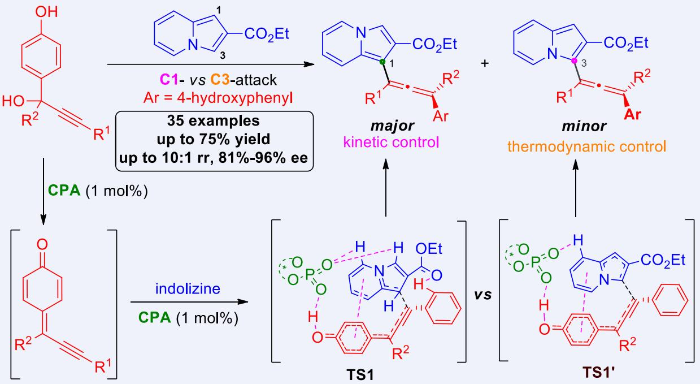

We present here a straightforward protocol for the enantioselective synthesis of axially chiral tetrasubstituted allenes enabled by chiral phosphoric acid (CPA)-catalyzed 1,8-addition of indolizines to propargylic alcohols. This strategy achieves enantioselective and regioselective C1-functionalization of indolizines under mild reaction conditions with low catalyst loading, broad functional group tolerance (35 examples), and excellent enantioselectivities (up to 96% ee). Moreover, the scale-up reaction and late-stage C3-functionalizations demonstrated its potential applications. DFT calculations were carried out to clarify the reaction mechanism and the origin of enantio- and regioselective control.

## Background and Originality Content

Axially chiral allenes are important structural motifs commonly found in natural products,[1] pharmaceuticals,[2] and chiral catalysts or ligands (Figure 1a).[3] Consequently, numerous methods for the catalytic asymmetric synthesis of chiral allenes have been developed,[4] primarily including direct functionalization of allenes,[5] conversion of prochiral $1 , 3 \mathrm { - e n y n e } , ^ { [ 6 ] }$ and isomerization of alkynes.[7] However, most of the established approaches focus on synthesizing 1,3-di- or trisubstituted chiral allenes. Very recently, organocatalytic $^ { 1 , 6 - ^ { \left[ 8 \right] } }$ or 1,8-conjugate addition[9] of propargylic alcohol has been demonstrated as a powerful method for the construction of chiral tetrasubstituted allenes. Despite these advances, driven by the persistent challenges in accessing chiral tetrasubstituted allenes formation, the development of new catalytic enantioselective approaches is still highly valuable and desirable.

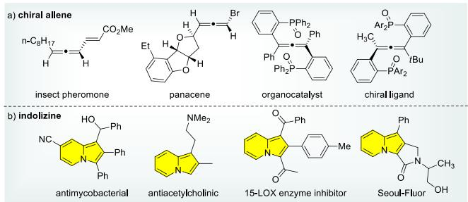  
Figure 1 Representative examples of functional molecules containing chiral allene and indolizine moiety.

On the other hand, indolizines have garnered increasing attention due to their distinctive structural features and unique properties, which render them highly promising for biomedical and fluorescence applications (Figure 1b).[10] As a result, extensive efforts have been devoted to synthesizing structurally diverse indolizines over the past decades.[11] In recent years, the direct functionalization of indolizines has emerged as an efficient synthetic route for modifying indolizine moieties and attracted considerable attention. Among these, several attractive C3-functionalizations of indolizines have been reported in this field, including C‒H activation,[12] propargylation,[13] Lewis acid catalysis,[14] visible-light or electro-induced,[15] as well as organocatalytic 1,4-conjugate addition (Scheme 1a).[16] In sharp contrast to the well-developed C3-functionalization of indolizine, the direct and regioselective C1-functionalization of indolizine remains challenging and elusive, especially for the C3-unsubstituted derivatives. Very recently, only very few reports concerned on the regioselective and enantioselective C1-functionalizations of indolizines through Mannich reaction.[17] Our group also successfully disclosed a CPAcatalyzed regio- and enantioselective C1-arylation of β,γ-alkynylα-imino esters with pyrrolo[2,1-a]isoquinolines.[18] Building upon these results, we became interested in this promising asymmetric C1-functionalization of indolizine via remote 1,8-conjugate addition of in situ generated propargylic para-quinone methides, providing an organocatalytic protocol for the construction of axially chiral tetrasubstituted allenes. Toward this goal, several challenging issues should be concerned: 1) controlling nucleophilic attack by indolizines at C1 versus C3-position; 2) achieving siteselective 1,6- or 1,8-conjugate addition of propargylic-para-quinone methides; 3) establishing remote stereocontrol from the reaction site without hydrogen bonding involvement.

Scheme 1 Catalytic enantioselective functionalization of indolizines  
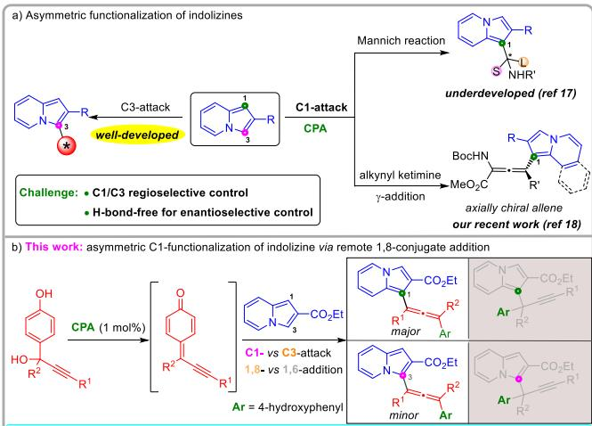

## Results and Discussion

To achieve this transformation, we initiated our investigation by selecting racemic propargylic alcohol 1a and indolizine 2a as the model substrates (Table 1). The initial test was performed in the presence of 10 mol% CPA catalyst C1 at room temperature. To our delight, the desired chiral allene 3aa was obtained in 46% yield with 50% ee and the regioisomeric C3-adduct 4aa was isolated in 15% yield (entry 1). Notably, the absence of the 1,6-addition adduct confirmed the exclusive 1,8-site specificity of this approach. Decreasing the reaction temperature to ‒40 °C improved the ee value to 75% while maintaining a comparable yield upon extended reaction time (entry 2). To further enhance the enantio- and regioselectivity, some other catalysts with different substituents and scaffolds were then evaluated, and catalyst C2, possessing bulkier 2,4,6-tricyclohexylphenyl substituents at the

Table 1 Optimization of the reaction conditionsa  
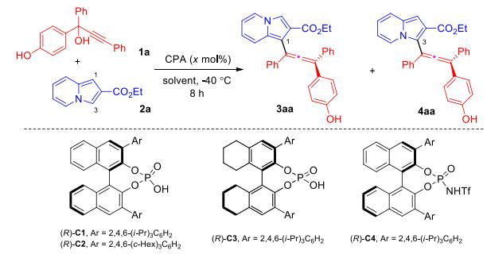

<table><tr><td>Entry</td><td>CPA</td><td>Solvent</td><td></td><td>Yieldb/% rr (3aa/4aa)c</td><td>eed/%</td></tr><tr><td>1e</td><td>C1</td><td>DCE:c-hexane 4:1</td><td>46</td><td>3:1</td><td>51</td></tr><tr><td>2</td><td>C1</td><td>DCE:c-hexane 4:1</td><td>49</td><td>3:1</td><td>75</td></tr><tr><td>3</td><td>C2</td><td>DCE:c-hexane 4:1</td><td>73</td><td>5:1</td><td>93</td></tr><tr><td>4</td><td>C3</td><td>DCE:c-hexane 4:1</td><td>49</td><td>2:1</td><td>81</td></tr><tr><td>5</td><td>C4</td><td>DCE:c-hexane 4:1</td><td>12</td><td>1:1.6</td><td>69</td></tr><tr><td>6</td><td>C2</td><td>DCE: toluene 4:1</td><td>51</td><td>3:1</td><td>91</td></tr><tr><td>7</td><td>C2</td><td>DCE:CCl₄4:1</td><td>49</td><td>2:1</td><td>93</td></tr><tr><td>8</td><td>C2</td><td>DCE:CHCl₃4:1</td><td>46</td><td>1:1</td><td>91</td></tr><tr><td>9</td><td>C2</td><td>DCE: n-hexane 4:1</td><td>67</td><td>4:1</td><td>93</td></tr><tr><td>10f</td><td>C2</td><td>DCE:c-hexane 4:1</td><td>73</td><td>5:1</td><td>93</td></tr><tr><td>119</td><td>C2</td><td>DCE:c-hexane 4:1</td><td>73</td><td>5:1</td><td>93</td></tr><tr><td>12h</td><td>C2</td><td>DCE:c-hexane 4:1</td><td>73</td><td>5:1</td><td>93</td></tr></table>

a Reaction conditions: 1a (0.05 mmol), 2a (0.06 mmol) and CPA (10 mol%) in 0.5 mL solvent at ‒40 °C for 8 h. b Isolated yields of 3aa. c Determined based on the masses of the isolated isomers. d Determined by HPLC analysis on a chiral stationary phase. e Performed at room temperature. f5 mol% CPA. g 2.5 mol% CPA. h 1 mol% CPA for 18 h.

3,3’-positions, proved optimal in terms of reactivity, regioselectivity and enantioselectivity (entry 3). Encouraged by these promising results, we screened various mixed solvents. No superior alternatives were identified when mixing DCM with other solvents, such as toluene, CCl4, CHCl3, or n-hexane (entries 6‒9). Subsequently, catalyst loading was investigated due to the high reactivity (entries 10‒12). Notably, the enantio- and regioselectivity of chiral allene 3aa were well maintained with only 1 mol% of C2 upon extended reaction time (18 h, entry 12). Control experiments confirmed that no reaction occurred in the absence of catalyst.

With the optimal reaction conditions established, we next explored the scope and generality of the reaction. As summarized in Scheme 2, this 1,8-addition proceeded efficiently with a wide range of propargylic alcohols 1. Various substituents on the phenyl-tethered alkyne (R1) were well tolerated, affording the C1- selective 1,8-adducts 3aa‒3ma in moderate to good yields, excellent enantioselectivities and regioselective ratios (rr) of 2 : 1 to 5 : 1. The electronic nature and the position of the substituents on the aromatic R1 moiety did not significantly affect the formation of tetrasubstituted chiral allenes. Furthermore, naphthyl and heterocyclic substituents also reacted smoothly with indolizine 2a, producing the corresponding 3na‒3qa in moderate yields, acceptable rr and 87%‒95% ee. In addition, alkyl (R1 = n-Bu) substituted propargylic alcohols furnished the chiral allene 3ra in 37% yield with 93% ee and 2 : 1 rr. Remarkably, the more challenging bulky t-butyl group on the alkyne was compatible, delivering 3ra with only a slight decrease in enantioselectivity. The propargylic aryl ring (R2) was also amenable to this transformation. Both electron-donating (Me or MeO) and electron-withdrawing (F or Cl) substituents on the phenyl ring of R2 were compatible and gave the corresponding chiral allenes 3ta‒3wa in 53%‒72% yields, 81%‒91% ee and rr of 3 : 1‒4 : 1.

Scheme 2 Scope of propargylic alcohols 1a  
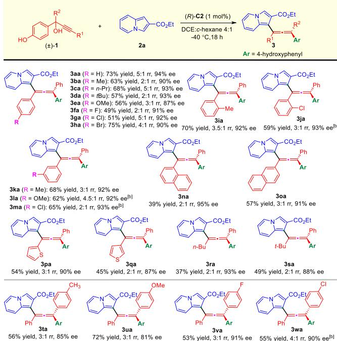  
Unless noted otherwise, all reactions were carried out with conditions as stated in Table 1, entry 12 on 0.1 mmol scale. All yields of 3 are isolated yields after purification by column chromatography. The regioisomers were separated. The ee values were determined by HPLC analysis on a chiral stationary phase. b With 5 mol% of C2.

The scope of the indolizines was then evaluated by the 1,8-addition with propargylic alcohols 1a (Scheme 3). Variations on the ester moiety at the C2 position of indolizine were well tolerated under the optimal conditions and furnished the desired 3ab‒3ad in moderate yields with excellent enantioselectivities (91%‒93% ee) and good regioselective ratios (rr 3 : 1‒4 : 1). Substituents on the indolizine ring were also investigated. As expected, the reaction with indolizines bearing substituents at C5 position blocked the 1,8-addition at C3 site, thus affording adducts 3ae and 3af in excellent regioselectivities, good yields and 87%‒91% ee. Furthermore, both electron-donating and electron-withdrawing groups at C6 and C7 positions of indolizines proceeded smoothly to produce 3ag‒3ak in 45%‒73% yields with 85%‒96% ee. In addition, 8-methylindolizine proved a suitable substrate, affording 3al in 45% yield with 95% ee and 1 : 1 rr. Significantly, extension of this protocol to the pyrroloquinoline ring successfully produced the expected 3am in 62% yield with excellent enantio- and regioselectivity (88% ee, 4 : 1 rr), demonstrating broad compatibility of our methodology.

## Scheme 3 Scope of indolizines 2a

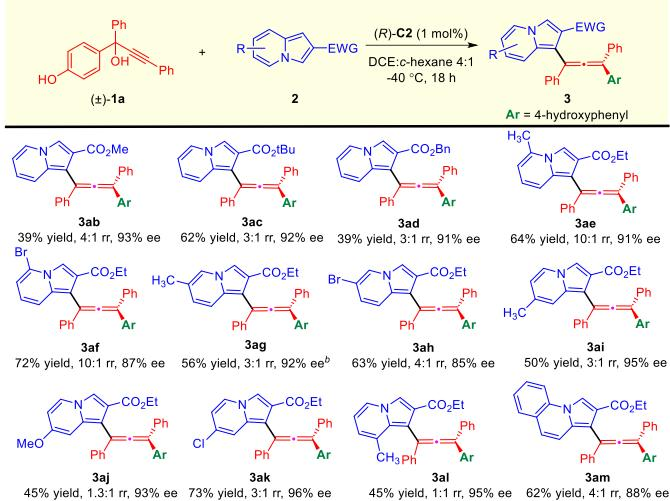  
a All reactions were carried out with conditions as stated in Table 1, entry 12 on 0.1 mmol scale. All yields of 3 are isolated yields after purification by column chromatography. The regioisomers were separated. The ee values were determined by HPLC analysis on a chiral stationary phase. b With 5 mol% of C2.

In order to demonstrate the synthetic utility of this protocol, scale-up preparation and product derivatization were conducted (Scheme 4). A scale-up reaction between racemic 1h and 2a proceeded smoothly, giving product 3ha in 73% yield with 93% ee and 3.5 : 1 rr. To further showcase the synthetic value of this work, we first protected the hydroxy group via a one-pot reaction with TsCl, yielding sulfonate 5ha in 72% yield and 90% ee. Notably, the unsubstituted C3-position provided great potential for further functionalization. For example, the direct C‒H amination of 5ha with azodicarboxylate proceeded smoothly to yield product 6ha in 70% yield with 89% ee. In addition, subjecting C3-substituted indolizine 2n to the one-pot reaction also delivered sulfonate 5an in 72% yield and 69% ee. The structure of product 5an was elucidated by X-ray crystallographic analysis, and the absolute configuration of product 5ha was unambiguously assigned by comparison between its experimental and calculated electronic circular dichroism spectra, which was confirmed to be the (S) configuration (for details, see the SI).

To elucidate the origins of the excellent stereocontrol and regiocontrol in this catalytic system, several control experiments were performed. Introducing a secondary amide group at C2-position of the indolizine 2p resulted in only 9% conversion with 40% ee value of 3ap, indicating a detrimental H-bond interaction between the indolizine and the CPA catalyst (Scheme 5a). Furthermore, considering the detection of accumulated intermediate QM, we isolated QM in the presence of Brønsted acid and conducted

Scheme 4 Scale-up synthesis and synthetic transformation of 3ha

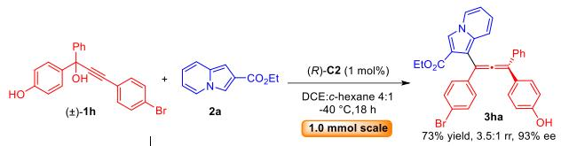

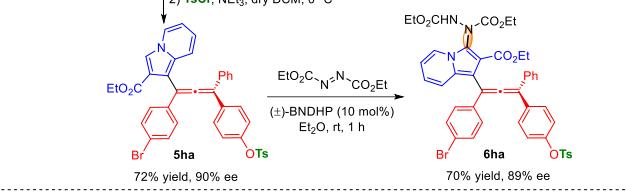

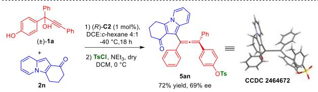

the reaction with indolizine 2a under the standard conditions. The reaction proceeded smoothly, affording 3aa with comparable results (Scheme 5b). This observation in combination with the control experiment that no reaction occurred between methylated propargylic alcohol $\pmb { 1 } \mathbf { a } ^ { \prime }$ and indolizine 2a under the standard reaction conditions demonstrated that 1,8-addition was the rateand enantio-determining step and ruled out an ion-pairing activation mode. The kinetic studies as shown in Scheme 5e indicated that ee value of the product remained constant (93% ee) and substrate 1a remained racemic throughout the reaction progress. These results, combined with the related reports, implied the enantioselective outcome relied entirely on the CPA catalyst via a dynamic kinetic resolution during the catalytic process.[9a-b] In addition, several control 31P NMR experiments disclosed the weak interaction of CPA catalyst with propargylic alcohol 1a and indolizine 2a (Scheme 5d). Interestingly, the reaction performed at $- 4 0 ~ ^ { \circ } \mathsf C$ in the presence of catalyst C2 delivered C1-functionalized 3aa in 93% ee with 5 : 1 rr. Upon warming the mixture to room temperature, the 3aa : 4aa ratio dropped to an equilibrium value of 1 : 1 (Scheme 5c). This finding establishes 3aa as the kinetically controlled C1-regioisomer, whereas elevated temperatures drive equilibration toward the thermodynamically favored C3-regioisomer 4aa. Finally, the observed linear proportionality between the ee values of product 3aa and catalyst C2 (Scheme 5f) strongly supported a monomolecular catalyst involvement in the enantiodetermining 1,8-addition transition state.

To gain deeper mechanistic insights, density functional theory (DFT) calculations were systematically performed. The reaction pathway begins with the dehydration of substrate 1a catalyzed by chiral phosphonic acid (CPA), leading to the formation of key intermediate I1. Subsequently, substrate 2a approaches I1 under the stereocontrol of CPA, where two competitive pathways emerge: (1) the kinetically favored 1,8-addition proceeding through transition state TS1 with a Gibbs free energy barrier of 15.1 kcal/mol to afford product 3aa; and (2) the thermodynamically controlled 1,6-addition via transition state TS1' with a higher barrier of 18.5 kcal/mol, yielding regioisomer 4aa. Notably, an enantioselective $^ { 1 , 8 \cdot }$ -addition pathway was also identified, exhibiting an energy barrier of 18.5 kcal/mol for $\pmb { \tilde { \mathbf { I } } \pmb { \ S 1 } ^ { \prime \prime } }$ . Both side reactions demonstrate a significant 3.4 kcal/mol higher energy barrier compared to the main 1,8-addition pathway, rationalizing the observed kinetic preference for 3aa formation. To further analyze the mechanism, density functional theory (DFT) calculations were carried out. Initially, substrate 1a was dehydrated with the chiral phosphonic acid catalyst CPA, resulting in the formation of intermediate I1. Subsequently, substrate 2a approaches I1 under the

Scheme 5 Mechanism study. a‒c) Control experiments. d) 31P NMR study. e) Time-course study. f) Nonlinear effects

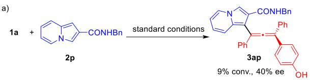

b)  
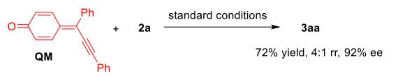

c)  
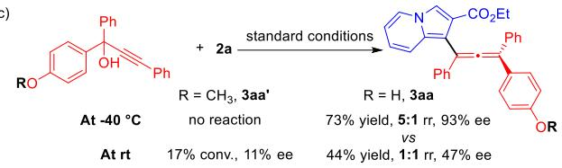

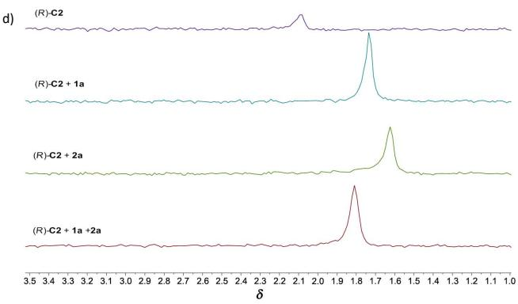

e)  
f)  
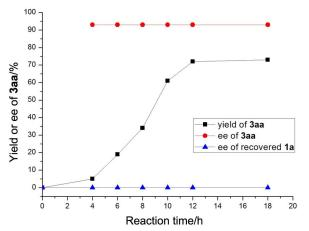

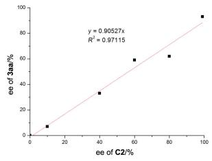

effect of CPA, undergoing 1,8-addition, overcoming a Gibbs free energy barrier of 15.1 kcal/mol to generate the kinetically controlled product 3aa. Simultaneously, a regioselective competitive reaction occurs, producing the thermodynamically controlled product 4aa, with a Gibbs free energy barrier of 18.5 kcal/mol for the transition states TS1'. Additionally, enantioselective 1,8-addition is also possible, with an energy barrier of 18.5 kcal/mol. The free energy barriers of both side reactions are 3.4 kcal/mol higher than that of the main reactions.

To elucidate the origin of regioselectivity and enantioselectivity in the reaction, three distinct transition states (TS1, TS1' and $\pmb { \tilde { \mathbf { I } } \pmb { \Omega } } \mathbf { 1 } ^ { \prime \prime }$ , Figure 2) were identified, respectively forming the main product, regioselective product and enantiomeric product. For regioselectivity, energy decomposition analysis revealed that the energy difference between TS1 and $\pmb { \tilde { \mathbf { I } } \pmb { \mathcal { S } } \pmb { 1 } ^ { \prime } }$ primarily originates from differential catalyst-substrate interactions. Detailed structural analysis demonstrated significant differences in non-covalent interactions: TS1 features multiple stabilizing C–H···O interactions (b1 = 2.122 Å, ${ \sf b } 2 = 2 . 0 7 1$ Å, b3 = 2.328 Å) and π–π interaction (b4 = 3.183 Å) between the catalyst and substrate fragment, while TS1' possesses only one ${ \mathsf { C } } { \mathrm { - } } { \mathsf { H } } { \cdots } { \mathsf { O } }$ interaction $( \mathsf { b } 5 = 1 . 8 4 9 \ \mathring { \mathsf { A } } )$ and one π–π interaction $( \mathsf { b 6 } = 3 . 2 5 8 \mathrm { ~ \AA } )$ . This disparity in stabilizing interactions accounts for the relative preference for TS1. All these interactions could be visualized from NCI plot (see details in Supporting Information). For enantioselectivity, energy decomposition analysis has shown that catalyst distortion is the primary source of the energy difference between TS1 and TS1''. Comparative analysis of dihedral angles revealed that the transformation from pre-intermediate I2 $( \angle \mathsf { a b c d } = 1 6 8 . 5 ^ { \circ } )$ to TS1'' involves significant structural distortion $( \angle a ^ { \prime \prime } b ^ { \prime \prime } c ^ { \prime \prime } d ^ { \prime \prime } = - 6 6 . 6 ^ { \circ } )$ , whereas the corresponding angle in TS1 only exhibits minor changes $( \angle a ^ { \prime } b ^ { \prime } c ^ { \prime } { \mathsf { d } } ^ { \prime }$ $= - 1 6 3 . 9 ^ { \circ } )$ . These computational findings provide a coherent explanation for the observed regioselectivity and enantioselectivity, as the higher energy barrier for TS1' and TS1'' effectively suppresses the competing pathway, in excellent agreement with experimental results.

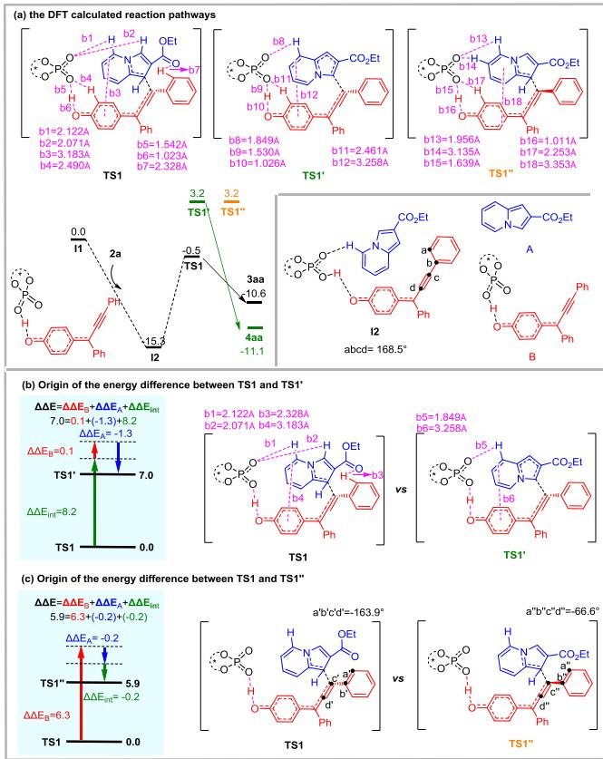  
Figure 2 (a) DFT calculated reaction pathway in kcal/mol; (b) and (c) the energy decomposition analysis and structure analysis on the key transition states leading to regioselective product and enantiomeric product.

## Conclusions

In conclusion, we have successfully established a CPA-catalyzed 1,8-conjugate addition of propargylic alcohols with indolizines, enabling direct access to axially chiral tetrasubstituted allenes via remote stereocontrolled C1-functionalization. This strategy addresses the long-standing challenge of regioselective C1-attack on indolizines, featuring mild conditions, low catalyst loading, broad substrate scope with high regio- and enantiocontrol. The reaction scalability and late-stage derivatization demonstrated their potential as versatile chiral building blocks. Mechanistic studies and DFT calculations confirm a kinetically favored C1-attack pathway, providing insights for future asymmetric design.

## Experimental

General experimental procedures: To a 4 mL vial was added propargyl alcohol 1 (0.1 mmol, 1.0 equiv), indolizine 2 (0.12 mmol, 1.2 equiv) and (R)-C2 (0.001 mmol, 1 mol%) in DCE : c-hexane = 4 : 1 (1 mL, V/V). The mixture was stirred $\mathsf { a t } - 4 0 ^ { \circ } \mathsf C$ and monitored by TLC until completion of the reaction. The reaction mixture was directly subjected to flash column chromatography on silica gel (petroleum ether/ethyl acetate 8 : 1) to afford the product 3.

## Supporting Information

The supporting information for this article is available on the WWW under https://doi.org/10.1002/cjoc.70188.

## Acknowledgement

We gratefully acknowledge the financial support from the National Natural Science Foundation of China (22001010), the Scientific Research Foundation of the Higher Education Institutions of Anhui Province (2023AH040024), the Guangdong Basicand Applied Basic Research Foundation (2024A1515010323, 2025A1515011907), and the open research fund of Songshan Lake Materials Laboratory (2023SLABFN16).

## References

[1] Yu, S.; Ma, S. Allenes in Catalytic Asymmetric Synthesis and Natural Product Syntheses. Angew. Chem. Int. Ed. 2012, 51, 3074‒3112.

[2] Hoffmann-Röder, A.; Krause, N. Synthesis and Properties of Allenic Natural Products and Pharmaceuticals. Angew. Chem. Int. Ed. 2004, 43, 1196‒1216.

[3] (a) Pu, X.; Qi, X.; Ready, J. M. Allenes in Asymmetric Catalysis: Asymmetric Ring Opening of meso-Epoxides Catalyzed by Allene-Containing Phosphine Oxides. J. Am. Chem. Soc. 2009, 131, 10364‒ 10365; (b) Cai, F.; Pu, X.; Qi, X.; Lynch, V.; Radha, A.; Ready, J. M. Chiral Allene-Containing Phosphines in Asymmetric Catalysis. J. Am. Chem. Soc. 2011, 133, 18066‒18069; (c) Brooner, R. E. M.; Widenhoefer, R. A. Two-Coordinate Gold π Complexes. Angew. Chem. Int. Ed. 2013, 52, 11714‒11724.

[4] For selected reviews and examples, see: (a) Chu, W.-D.; Zhang, Y.; Wang, J. Recent advances in catalytic asymmetric synthesis of allenes. Catal. Sci. Technol. 2017, 7, 4570‒4579; (b) Wang, X.; Chen, X.; Lin, W.; Li, P.; Li, W. Recent Advances in Organocatalytic Enantioselective Synthesis of Axially Chiral Allenes. Adv. Synth. Catal. 2022, 364, 1212‒1222; (c) Xiao, W.; Wu, J. Recent advances in the metal-catalyzed asymmetric synthesis of chiral allenes. Org. Chem. Front. 2022, 9, 5053‒5073; (d) Nguyen, T. T. Organocatalytic synthesis of axially chiral tetrasubstituted allenes. Org. Biomol. Chem. 2023, 21, 252‒ 272; (e) Gan, L.; Wan, X.; Pang, Y.; Zou, Y.; Deng, Y.-H.; Shao, Z. Catalytic Asymmetric Synthesis and Synthetic Application of Heteroatom-substituted Axially Chiral Allenes. Org. Chem. Front. 2025, 12, 1001‒1064..

[5] For selected examples, see: (a) Hashimoto, T.; Sakata, K.; Tamakuni, F.; Dutton, M. J.; Maruoka, K. Phase-transfer-catalysed asymmetric synthesis of tetrasubstituted allenes. Nat. Chem. 2013, 5, 240‒244; (b) Mbofana, C. T.; Miller, S. J. Diastereo- and Enantioselective Addition of Anilide-Functionalized Allenoates to N-Acylimines Catalyzed by a Pyridylalanine-Based Peptide. J. Am. Chem. Soc. 2014, 136, 3285‒3292; (c) Song, S.; Zhou, J.; Fu, C.; Ma, S. Catalytic enantioselective construction of axial chirality in 1,3-disubstituted allenes. Nat. Commun. 2019, 10, 507; (d) Hu, Y.; Shi, W.; Zheng, B.; Liao, J.; Wang, W.; Wu, Y.; Guo, H. Organocatalytic Asymmetric C(sp2)−H Allylic Alkylation: Enantioselective Synthesis of Tetrasubstituted Allenoates. Angew. Chem. Int. Ed. 2020, 59, 19820‒19824.

[6] (a) Zhang, W.; Zheng, S.; Liu, N.; Werness, J. B.; Guzei, I. A.; Tang, W. Enantioselective Bromolactonization of Conjugated (Z)-Enynes. J. Am. Chem. Soc. 2010, 132, 3664‒3665; (b) Tap, A.; Blond, A.; Wakchaure, V. N.; List, B. Chiral Allenes via Alkynylogous Mukaiyama Aldol Reaction. Angew. Chem. Int. Ed. 2016, 55, 8962‒8965; (c) Adamson, N. J.; Jeddi, H.; Malcolmson, S. J. Copper Hydride Catalyzed Enantioselective Synthesis of Axially Chiral 1,3-Disubstituted Allenes. J. Am. Chem. Soc. 2019, 141, 13788‒13794; (d) Wang, J.; Zheng, S.; Rajkumar, S.; Xie, J.; Yu, N.; Peng, Q.; Yang, X. Chiral phosphoric

acid-catalyzed stereodivergent synthesis of trisubstituted allenes and computational mechanistic studies. Nat. Commun. 2020, 11, 5527; (e) Zeng, Y.; Chiou, M.-F.; Zhu, X.; Cao, J.; Lv, D.; Jian, W.; Li, Y.; Zhang, X.; Bao, H. Copper-Catalyzed Enantioselective Radical 1,4-Difunctionalization of 1,3-Enynes. J. Am. Chem. Soc. 2020, 142, 18014‒18021; (f) Chen, Y.; Wang, J.; Lu, Y. Decarboxylative 1,4-carbocyanation of 1,3-enynes to access tetra-substituted allenes via copper/photoredox dual catalysis. Chem. Sci. 2021, 12, 11316‒11321; (g) Dong, X.-Y.; Zhan, T.-Y.; Jiang, S.-P.; Liu, X.-D.; Ye, L.; Li, Z.-L.; Gu, Q.-S.; Liu, X.-Y. Copper-Catalyzed Asymmetric Coupling of Allenyl Radicals with Terminal Alkynes to Access Tetrasubstituted Allenes. Angew. Chem. Int. Ed. 2021, 60, 2160‒2164; (h) Huang, H.; Zhang, H.; Wang, Q.; Sun, Y.; Su, L.; Xu, W.; Ma, Y.; Kong, S.; Zhang, G.; Guo, R. Copper-Catalyzed Asymmetric 1,4-Aryl/Alkynylation of 1,3-Enynes to Access Axially Chiral Tetrasubstituted Allenes. ChemCatChem 2023, 15, e202300697; (i) Zhang, Y.; Wu, J.; Ning, L.; Chen, Q.; Feng, X.; Liu, X. Enantioselective synthesis of tetrasubstituted allenes via addition/ arylation tandem reaction of 2-activated 1,3-enynes. Sci. China Chem. 2023, 66, 526‒533.

[7] (a) Liu, H.; Leow, D.; Huang, K.-W.; Tan, C.-H. Enantioselective Synthesis of Chiral Allenoates by Guanidine-Catalyzed Isomerization of 3-Alkynoates. J. Am. Chem. Soc. 2009, 131, 7212‒7213; (b) Wang, Y.; Zhang, W.; Ma, S. A Room-Temperature Catalytic Asymmetric Synthesis of Allenes with ECNU-Phos. J. Am. Chem. Soc. 2013, 135, 11517‒11520; (c) Liu, Y.; Hu, H.; Zheng, H.; Xia, Y.; Liu, X.; Lin, L.; Feng, X. Nickel(II)-Catalyzed Asymmetric Propargyl and Allyl Claisen Rearrangements to Allenyl- and Allyl-Substituted β-Ketoesters. Angew. Chem. Int. Ed. 2014, 53, 11579‒11582; (d) Zhong, F.; Xue, Q.-Y.; Yin, L. Construction of Chiral 2,3-Allenols through a Copper(I)-Catalyzed Asymmetric Direct Alkynylogous Aldol Reaction. Angew. Chem. Int. Ed. 2020, 59, 1562‒1566; (e) O’Connor, T. J.; Mai, B. K.; Nafie, J.; Liu, P.; Toste, F. D. Generation of Axially Chiral Fluoroallenes through a Copper-Catalyzed Enantioselective β-Fluoride Elimination. J. Am. Chem. Soc. 2021, 143, 13759‒13768; (f) Lu, R.; Yang, T.; Chen, X.; Fan, W.; Chen, P.; Lin, Z.; Liu, G. Enantioselective Copper-Catalyzed Radical Cyanation of Propargylic C–H Bonds: Easy Access to Chiral Allenyl Nitriles. J. Am. Chem. Soc. 2021, 143, 14451‒14457.

[8] (a) Zhu, W.-R.; Su, Q.; Diao, H.-J.; Wang, E.-X.; Wu, F.; Zhao, Y.-L.; Weng, J.; Lu, G. Enantioselective Dehydrative γ-Arylation of α-Indolyl Propargylic Alcohols with Phenols: Access to Chiral Tetrasubstituted Allenes and Naphthopyrans. Org. Lett. 2020, 22, 6873‒6878; (b) Wang, Z.; Lin, X.; Chen, X.; Li, P.; Li, W. Organocatalytic stereoselective 1,6-addition of thiolacetic acids to alkynyl indole imine methides: access to axially chiral sulfur-containing tetrasubstituted allenes. Org. Chem. Front. 2021, 8, 3469‒3474; (c) Zhang, Y.; Du, S.; Yang, T.; Jin, F.; Zhou, J.; Cao, B.; Mao, Z.-J.; Song, X.-R.; Xiao, Q. Direct and efficient synthesis of tetrasubstituted allenyl organothiophosphates from propargylic alcohols under catalyst- and additivefree conditions. Org. Chem. Front. 2022, 9, 3156‒3162.

[9] (a) Qian, D.; Wu, L.; Lin, Z.; Sun, J. Organocatalytic synthesis of chiral tetrasubstituted allenes from racemic propargylic alcohols. Nat. Commun. 2017, 8, 567; (b) Chen, M.; Qian, D.; Sun, J. Organocatalytic Enantioconvergent Synthesis of Tetrasubstituted Allenes via Asymmetric 1,8-Addition to aza-para-Quinone Methides. Org. Lett. 2019, 21, 8127‒8131; (c) Zhang, L.; Han, Y.; Huang, A.; Zhang, P.; Li, P.; Li, W. Organocatalytic Remote Stereocontrolled 1,8-Additions of Thiazolones to Propargylic Aza-p-quinone Methides. Org. Lett. 2019, 21, 7415‒7419; (d) Li, X.; Sun, J. Organocatalytic Enantioselective Synthesis of Chiral Allenes: Remote Asymmetric 1,8-Addition of Indole Imine Methides. Angew. Chem. Int. Ed. 2020, 59, 17049‒17054; (e) Zhang, P.; Huang, Q.; Cheng, Y.; Li, R.; Li, P.; Li, W. Remote Stereocontrolled Construction of Vicinal Axially Chiral Tetrasubstituted Allenes and Heteroatom-Functionalized Quaternary Carbon Stereocenters. Org. Lett. 2019, 21, 503‒507; (f) Pan, H.-P.; Zhu, Z.-Q.; Qiu, Z.-W.; Liu, H.-F.; Ma, J.-D.; Li, B. Q.; Feng, N.; Ma, A.-J.; Peng, J.-B.; Zhang, X.-Z. Dearomatization of 2,3-Disubstituted Indoles via 1,8-Addition of Propargylic (Aza)-para-Quinone Methides. J. Org. Chem. 2021, 86, 16518‒16534; (g) Yue, Z.; Xia, Y.; Shen, B.; Liu, C.; Yu, P.; Li,

P.; Li, W. Organocatalytic Remote Stereocontrolled Synthesis of Tetrasubstituted Allenes via Asymmetric 1,8-Addition of Propargylic Aza-p-Quinone Methides. Adv. Synth. Catal. 2024, 366, 1078‒1083.

[10] For selected examples, see: (a) Gundersen, L.-L.; Negussie, A. H.; Rise, F.; Østby, O. B. Antimycobacterial Activity of 1-Substituted Indolizines. Arch. Pharm. 2003, 336, 191‒195; (b) Sharma, V.; Kumar, V. Indolizine: a biologically active moiety. Med. Chem. Res. 2014, 23, 3593‒3606; (c) Lucescu, L.; Ghinet, A.; Belei, D.; Rigo, B.; Dubois, J.; Bîcu, E. Discovery of indolizines containing triazine moiety as new leads for the development of antitumoral agents targeting mitotic events. Bioorg. Med. Chem. Lett. 2015, 25, 3975‒3979; (d) Xiang, Q.; Wang, C.; Wu, T.; Zhang, C.; Hu, Q.; Luo, G.; Hu, J.; Zhuang, X.; Zou, L.; Shen, H.; Wu, X.; Zhang, Y.; Kong, X.; Liu, J.; Xu, Y. Design, Synthesis, and Biological Evaluation of 1-(Indolizin-3-yl)ethan-1-ones as CBP Bromodomain Inhibitors for the Treatment of Prostate Cancer. J. Med. Chem. 2022, 65, 785‒810; (e) Kim, E.; Lee, Y.; Lee, S.; Park, S. B. Understanding, and Bioapplication of Organic Fluorophore: A Case Study with an Indolizine-Based Novel Fluorophore, Seoul-Fluor. Acc. Chem. Res. 2015, 48, 538‒547.

[11] Huang, J.; Li, C.; Li, X.; Li, G.; Yang, Z.; Yu, Y.; Xie, Y.; Huang, H.; Yu, F.; He, Z. Recent Advances in the Development of Indolizine Scaffolds: Synthetic Methodology and Mechanistic Insights. Chin. J. Chem. 2025, 43, 315‒348.

[12] (a) Park, C.-H.; Ryabova, V.; Seregin, I. V.; Sromek, A. W.; Gevorgyan, V. Palladium-Catalyzed Arylation and Heteroarylation of Indolizines. Org. Lett. 2004, 6, 1159‒1162; (b) Koszarna, B.; Matczak, R.; Krzeszewski, M.; Vakuliuk, O.; Klajn, J.; Tasior, M.; Nowicki, J. T.; Gryko, D. T. Direct arylation of electron-poor indolizines. Tetrahedron 2014, 70, 225‒231; (c) Jadhav, P. P.; Kahar, N. M.; Dawande, S. G. Ruthenium(II) Catalysed Highly Regioselective C-3 Alkenylation of Indolizines and Pyrrolo[1,2-a]quinolines. Eur. J. Org. Chem. 2019, 2019, 7831‒7835; (d) Liu, C.-X.; Zhang, W.-W.; Yang, P.; Zhao, F.; Feng, Z.; Wang, Q.; Zhang, S.-Z.; Gu, Q.; You, S.-L. Pd-catalyzed asymmetric oxidative C-H/C-H cross-coupling reaction between dialkylaminomethylferrocenes and indolizines. Chem. Catal. 2022, 2, 102‒ 113; (e) Zhang, W.-W.; Liu, C.-X.; Yang, P.; Zhang, S.-Z.; Gu, Q.; You, S.-L. Rhodium-Catalyzed Atroposelective C–H/C–H Cross-Coupling Reaction between 1-Aryl Isoquinoline Derivatives and Indolizines. Org. Lett. 2022, 24, 564‒569; (f) Priyanka; Rani, P.; Kiran; Sindhu, J. Indolizine: A Promising Framework for Developing a Diverse Array of C−H Functionalized Hybrids. ChemistrySelect 2023, 8, e202203531.

[13] Yang, L.; Pu, X.; Niu, D.; Fu, Z.; Zhang, X. Copper-Catalyzed Asymmetric Propargylation of Indolizines. Org. Lett. 2019, 21, 8553‒8557.

[14] (a) Wang, Y.; Zhang, Z.; Deng, L.; Lao, T.; Su, Z.; Yu, Y.; Cao, H. Mechanochemical Synthesis of 1,2-Diketoindolizine Derivatives from Indolizines and Epoxides Using Piezoelectric Materials. Org. Lett. 2021, 23, 7171‒7176; (b) Song, D.; Huang, C.; Liang, P.; Zhu, B.; Liu, X.; Cao, H. Lewis acid-catalyzed regioselective C–H carboxamidation of indolizines with dioxazolones via an acyl nitrene type rearrangement. Org. Chem. Front. 2021, 8, 2583‒2588; (c) Chen, K.-W.; Chen, Z.-H.; Yang, S.; Wu, S.-F.; Zhang, Y.-C.; Shi, F. Organocatalytic Atroposelective Synthesis of N−N Axially Chiral Indoles and Pyrroles by De Novo Ring Formation. Angew. Chem. Int. Ed. 2022, 61, e202116829.

[15] (a) Teng, L.; Liu, X.; Guo, P.; Yu, Y.; Cao, H. Visible-Light-Induced Regioselective Dicarbonylation of Indolizines with Oxoaldehydes via Direct C–H Functionalization. Org. Lett. 2020, 22, 3841‒3845; (b) Zhang, Y.; Yu, Y.; Liang, B.-b.; Pei, Y.-y.; Liu, X.; Yao, H.-g.; Cao, H. Synthesis of Pyrrolo[2,1,5-cd]indolizine Rings via Visible-Light-Induced Intermolecular [3+2] Cycloaddition of Indolizines and Alkynes. J. Org. Chem. 2020, 85, 10719‒10727; (c) Liu, X.; Jiang, W.; Huang, C.; Ma, S.; Wang, Q.; Cao, H. Electrochemical phosphorothiolation and 1,4-S → C phospho-Fries rearrangement: controlled access to phosphorothiolated and mercapto-phosphono substituted indolizines. Org. Chem. Front. 2023, 10, 5198‒5204.

[16] (a) Correia, J. T. M.; List, B.; Coelho, F. Catalytic Asymmetric Conjugate Addition of Indolizines to α,β-Unsaturated Ketones. Angew. Chem. Int. Ed. 2017, 56, 7967‒7970; (b) Zhang, Y.-Z.; Sheng, F.-T.; Zhu, Z.; Li, Z.-M.; Zhang, S.; Tan, W.; Shi, F. Organocatalytic

C3-functionalization of indolizines: synthesis of biologically important indolizine derivatives. Org. Biomol. Chem. 2020, 18, 5688‒5696; (c) Ni, Q.; Zhu, Z.; Fan, Y.; Chen, X.; Song, X. Chiral Phosphoric Acid Catalyzed Desymmetrization of Cyclopentendiones via Friedel–Crafts Conjugate Addition of Indolizines. Org. Lett. 2021, 23, 9548‒9553; (d) Song, X.; Fan, Y.; Zhu, Z.; Ni, Q. Chiral Phosphoric Acid-Catalyzed Asymmetric Arylation of Indolizines: Atroposelective Access to Axially Chiral 3-Arylindolizines. Org. Lett. 2022, 24, 2315‒2320; (e) Mane, K. D.; Mukherjee, A.; Das, G. K.; Suryavanshi, G. Acetic Acid-Catalyzed Regioselective C(sp2)–H Bond Functionalization of Indolizines: Concomitant Involvement of Synthetic and Theoretical Studies. J. Org. Chem. 2022, 87, 5097‒5112; (f) Li, Q.; Xu, Y.-Y.; Feng, B.-X.; Wang, T.; Wang, Y.-Q. Chiral Phosphoric Acid-Catalyzed Enantioselective Synthesis of Biphenyl-Bridged ɛ-Sultams via Friedel-Crafts Reactions of Cyclic N-Sulfonylimines with Indolizines. Org. Chem. Front. 2024, 11, 4829‒4835.

[17] (a) Kassir, A. F.; Rad, N.; Klochowicz, P.; Granda, J. M. Diversity-Oriented Chiral Phosphoric Acid Catalyzed Alkylation of Indolizines

with Aminals. Org. Chem. Front. 2024, 11, 7186‒7198; (b) Zhong, J.; Pan, R.; Lin, X. Enantioselective synthesis of α-tetrasubstituted (1-indolizinyl) (diaryl)-methanamines via chiral phosphoric acid catalysis. RSC Adv. 2024, 14, 1106‒1113; (c) Zhu, Z.; Wu, Q.; Song, X.; Ni, Q. Thermodynamic Controlled Regioselective C1-Functionalization of Indolizines with 3-Hydroxyisoindolinones via Brønsted Acid Catalyzed aza-Friedel–Crafts Reaction. J. Org. Chem. 2024, 89, 2794‒ 2799.

[18] Zhang, X.; Song, X.; Ni, Q. Organocatalytic Regio- and Enantioselective C1-arylation of β,γ-alkynyl-α-imino esters with pyrrolo[2,1-a]iso quinolines. Chem. Commun. 2024, 60, 831‒834.

## The Authors

  
Left to Right: Xuan Zhang, Xu-Hua Jiang, Chun-Dong Huang, Cheng Gao, Shao-Fei Ni and Qi-Jian Ni