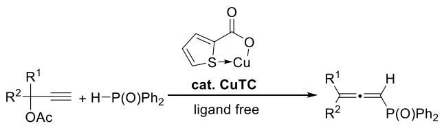
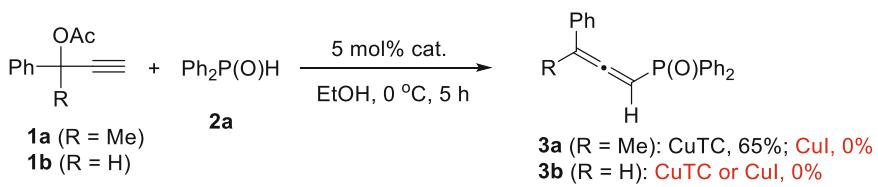
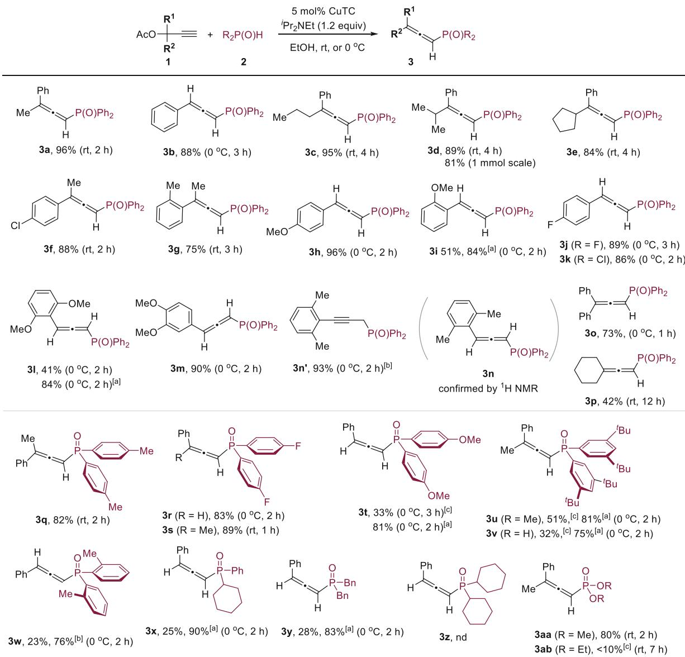
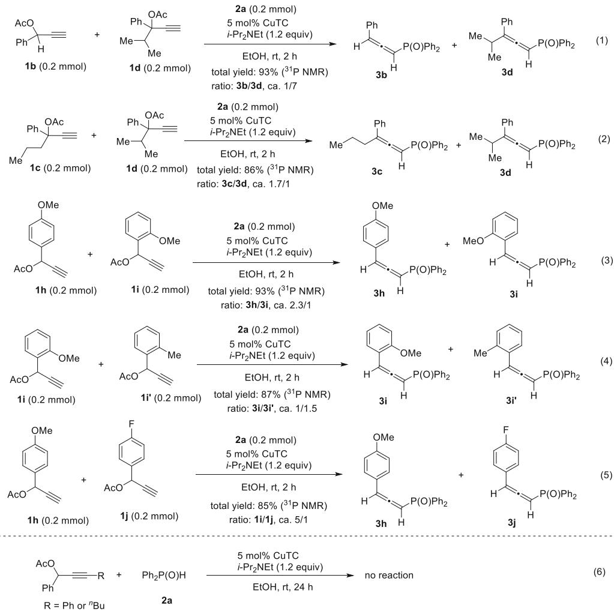
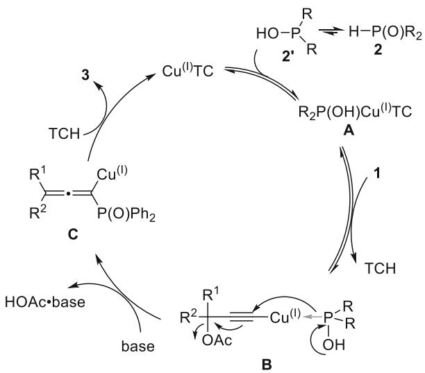

www.eurjoc.org

# Ligand-Free Copper-Catalyzed Allenylative C─P Coupling of Propargylic Acetates with H-Phosphine Oxides

Shaoqing Liu, Jiawei Liu, Li-Biao Han, and Ruwei Shen\*

The extra-ligand-free CuTC-catalyzed C─P cross coupling reaction of propargylic acetates with H-phosphine oxides is reported to afford allenylphosphine oxides. The reaction took place efficiently with diphenylphosphine oxide and electron-deficient

## 1. Introduction

Allenylphosphorus compounds are a unique class of unsaturated organophosphorus compounds that have important applications in organic synthesis due to the presence of the unique allenic structure and the versatile organophosphorus functionality.[1–8] For example, they have been employed in catalytic asymmetric hydroarylation for the synthesis of chiral organophosphorus compounds.[9,10] Some of these compounds have also been used in cyclization reactions to access other structurally phospha-cyclic products.[11–13] Several allenylphosphoryl compounds even exhibit good pharmaceutical properties, that lead to the development of drug candidates with such moieties.[14–16] The classical method for the synthesis of allenylphosphoryl compounds is the Horner–Mark [2,3]-rearrangement reaction of propargyl phosphates using propargylic alcohols and highly toxic, moisturesensitive, and odorous phosphorus chlorides.[17,18] The transitionmetal catalyzed allenylative C─P coupling reactions of H-phosphoryl compounds with propargylic substrates provide an attractive alternative strategy to access these compounds.[19] The Pd,[20,21] Ni,[22] and $\mathsf { C u } ^ { [ 2 3 , 2 4 ] }$ catalysts have been reported to catalyze the reactions of H-phosphoryl compounds with propargylic carboxylates while Cu, Ag, Cd, Zn, and recently Pd catalysts have been used to catalyze the dehydrated allenylative C─P coupling reactions of H-phosphoryl compounds with propargylic

di(4-fluorophenyl)phosphine oxide, but less effectively with electron-rich ones such as di(4-methoxylphenyl)phosphine oxide and dialkylphosphine oxides. H-phosphine oxides themselves may serve as the ligand.

alcohols.[25–29] In this regard, we have reported the first highly selective copper-catalyzed SN20-type cross coupling reaction of propargylic acetates with hydrophosphoryl compounds to afford allenylphosphoryl products under very mild conditions.[23] The reaction was proposed to proceed via copper allenylidene intermediate. During these studies, we have observed that Liebeskind’s copper(I) thiophene-2-carboxylate (CuTC)[30] alone can catalyze the allenylative C─P cross coupling reaction of propargylic acetates with some hydrophosphoryl compounds under ligand-free conditions (Equation (1)). Herein we wish to report this reaction and describe its scope.

(1)

## 2. Results and Discussion

The investigation was motivated by serendipitous observations (Scheme 1). While our established copper iodide/tetramethylethane-1,2-diamine (CuI/TMEDA) catalytic system demonstrated high efficacy,[23] a distinct reactivity pattern emerged when employing CuTC as the catalyst. Thus, the reaction between 2-phenylbut-3-yn-2-yl acetate (1a) and diphenylphosphine oxide (2a) could take place to produce allenylphosphine oxide 3a in 65% yield in the presence of a catalytic amount of CuTC under base-free conditions, whereas no product formation occurred using CuI alone under similar conditions. When a secondary propargylic acetate such as 1-phenylprop-2-yn-1-yl acetate (1b) was used, no reaction was observed with either CuTC or CuI under identical conditions. These unexpected results led us to investigate the CuTC-catalyzed allenylative C─P coupling between propargylic acetates and H-phosphine oxides under simplified or ligand-free conditions. CuTC, a tan and air-stable powder that can be stored and handled at room temperature without special precaution, has been used for many catalytic C─N and C─C bond-forming reactions.[30–34]

  
Scheme 1. Unexpected observations on CuTC-catalyzed allenylative C─P coupling reaction under ligand and base-free conditions.

Since the reaction theoretically generates one equivalent of acid, subsequent investigation was conducted by performing the reaction in the presence of a proton scavenger (Table 1). The product yield of 3a was significantly improved to 90% when 2 equivalent of triethylamine $( \mathsf { E t } _ { 3 } \mathsf { N } )$ was added (Table 1, entry 1). Switching to diisopropylethylamine (i-Pr NEt) as the base further improved the yield to 95% (Table 1, entry 2). Inorganic bases were also investigated. The reaction using ${ \sf K } _ { 2 } { \sf C O } _ { 3 }$ and ${ \sf C s } _ { 2 } { \sf C O } _ { 3 }$ gave 3a in 82% and 80% yield, respectively (Table 1, entries 4 and 5). In addition, 1,4-diazabicyclo[2.2.2]octane (DABCO) appears to be compatible to give 3a in 77% yield (Table 1, entry 6). However, likely due to its strong coordination to the copper catalyst, the reaction using pyridine as the base produced a mixture of products (Table 1, entry 7). 31P NMR analysis of the mixture revealed that 3a formed in only 26% yield and 20% of 2a remained unreacted. The CuTC-catalyzed reaction of 1a and 2a could be performed at room temperature with 1.2 equiv. of i-Pr NEt without loss of yield (Table 1, entry 3).

The scope of the CuTC-catalyzed reaction was next investigated (Scheme 2). Propargylic acetates 1 bearing phenyl as $\mathsf { R } ^ { 1 }$ and alkyl substituents such as propyl, isopropyl, and cyclopentyl as $\mathsf { R } ^ { 2 }$ reacted well to deliver products 3c–3e in high yields. Notably, in the presence of a base, propargylic acetate 1b also worked to afford 3b in 88% yield. Several other propargylic acetates by varying $\mathsf { R } ^ { 1 }$ and $\mathsf { R } ^ { 2 }$ were successfully used to afford the corresponding products 3f–3k in good to high yields. It is noteworthy that when propargylic acetates 1 bearing hydrogen atoms as ${ \tt R } ^ { 2 }$ were used, the reactions were preferably conducted at 0°C to minimize potential allene–alkyne isomerization, which might occur slightly at room temperature. The reactions of propargylic acetates bearing 2,6-disubstituted phenyl group as R1 proceeded sluggishly likely because of steric hindrance effect. For example, the reaction of propargylic acetate bearing a 2,6- dimethoxylphenyl group proceeded with low efficiency to afford 3n in 41% yield. In contrast, propargylic acetate bearing 3,4-dimethoxylphenyl group as $\mathsf { R } ^ { 2 }$ gave 3m in 90% yield under identical conditions. Remarkably, the reaction efficiency could be significantly enhanced using the previously developed CuI/ TMEDA catalytic system. When 1-(2,6-dimethylphenyl)prop-2- yn-1-yl acetate was used, pure propargylphosphine oxide 3n rather than allenylphosphine oxide 3n was obtained in most cases because a very rapid allene–alkyne isomerization took place. The formation of allenylphosphine oxide 3n was confirmed by an immediate proton NMR analysis after purification, revealing a mixture containing ≈25% 3n (3n/3n’ = 1:4 by 1H NMR). This mixture completely converted to 3n’ upon standing at room temperature for several hours. In addition, diphenyl propargylic acetate reacted smoothly to afford 3o in 73% yield, whereas 1-ethynylcyclohexyl acetate exhibited lower reactivity, yielding 3p in 42% after 12 h. Scale-up synthesis of allenylphosphine oxide 3d to 1 mmol afforded the product in 81% yield (290.3 mg), demonstrating the synthetic utility of the method.

<table><tr><td colspan="3">Table 1. Base effect on the CuTC-catalyzed reaction of 1a and 2a.</td></tr><tr><td rowspan="3">OAc Ph Me 1a</td><td rowspan="3">+ Ph₂P(O)H 2a</td><td>5 mol% CuTC base (2 equiv)</td></tr><tr><td>Me P(O)Ph_2 EtOH, 0 ℃ H</td></tr><tr><td>3a</td></tr><tr><td>Entrya)</td><td>Base</td><td>Time [h] Yield of 3a [%]b)</td></tr><tr><td>1</td><td>Et3N 3</td><td>90</td></tr><tr><td>2</td><td>i-Pr2NEt</td><td>95</td></tr><tr><td>3</td><td>i-Pr2NEt</td><td>96c)</td></tr><tr><td>4</td><td> ${ \sf K } _ { 2 } { \sf C } { \sf O } _ { 3 }$ </td><td>3 82</td></tr><tr><td>5</td><td> ${ \mathsf { C s } } _ { 2 } { \mathsf { C O } } _ { 3 }$ </td><td>3 80</td></tr><tr><td>6</td><td>DABCO</td><td>3 77</td></tr><tr><td>7</td><td>pyridine</td><td>7 26d)</td></tr></table>

a)A mixture of 1 (0.24 mmol), 2 (0.2 mmol), CuTC (5 mol%), and base (0.4 mmol) in 2 mL EtOH was stirred at rt or 0 °C; b)Isolated yields; c)Room temperature, 1.2 equiv. of i-Pr Net; d)31P NMR yield.

Notably, the efficiency of the reaction is strongly dependent on the structure of H-phosphine oxides 2. We observed that that bis(4-fluorophenyl)phosphine oxide performed well to give 3r and 3s in high yields. In comparison, the reaction of electron-rich bis(4-methoxylphenyl)phosphine oxide proceeded less effective to afford 3t in a low yield. We presume that this low efficiency stems from its relatively strong coordination to the copper center, which likely inhibits the catalytic cycle. On the other hand, bis(3,5- di-tert-butylphenyl)phosphine oxide and bis(2-methylphenyl) phosphine oxide also gave 3u–3w in low yields likely due to the steric hinderance effect. Nevertheless, the combination of CuI/TMEDA as the catalyst could improve the reactions to deliver the products 3u–3w in 75–81% yields. Comparable results were also obtained from the reactions of cyclohexyl(phenyl)phosphine oxide and dibenzylphosphine oxide. However, no reaction took place using dicyclohexylphosphine oxide as a substrate. Furthermore, it was observed that dimethyl phosphonate reacted efficiently with 1a, affording allenylphosphonate 3aa in 80% yield. In contrast, the reaction of diethyl phosphonate proceeded poorly, producing 3ab in a very low yield (<10% by 31P NMR analysis). These results suggest that H-phosphine oxides may serve not only as nucleophilic substrates but also as ligands in the reaction system. Conversely, introducing external ligands such as

  
Scheme 2. CuTC-catalyzed synthesis of allenylphosphine oxides (Conditions: unless otherwise noted, a mixture of 1 (0.24 mmol), 2 (0.2 mmol), CuTC (5 mol%), and i-Pr NEt (0.24 mmol) in EtOH was stirred at rt or 0 °C; Isolated yields were given. a) 5 mol% CuI and 6 mol% TMEDA as the catalyst; b) 5 mol% CuTC and 6 mol% TMEDA as the catalyst; and ${ \mathsf { c } } ) \ { } ^ { 3 1 } { \mathsf { P } }$ NMR yield).

TMEDA may suppress H-phosphine oxide coordination to copper, thereby enabling a catalytic cycle proceeding through copperallenylidene intermediates as described before.[23]

As indicated from the preliminary results in Scheme 1, the reactivity of propargylic acetates also appears distinct. To further probe this, we conducted competition experiments to compare their relative reactivities. When equimolar amounts of 1b, 1d, and 2a were reacted, a mixture of 3a and 3d formed in 93% yield with a ratio of 1/7 (Scheme 3, Equation 1). The reaction of 1c, 1d, and 2a under similar conditions afforded 3c and 3d in 86% yield with a ratio of 1.7/1 (Scheme 3, Equation 2). These results demonstrate that tertiary propargylic acetates exhibit significantly higher reactivity than secondary analogs, and this effect dominated over steric influence. The competition reaction of 1h and 1j with 2a afforded 3h and 3j in 93% yield in a ratio of 2.3/1 while the reaction of 1j and 1k gave 3j and 3k in 87% yield in a ratio of 1.5/1 (Scheme 3, Equation 3 and Equation 4). In striking contrast, the reaction of an equimolar amount of 1h and 1j with 2a afforded 3h and 3j in a ratio of 5/1 (Scheme 3, Equation 5). These results indicate a moderate steric effect from substituted phenyl groups on the reaction and a pronounced electronic effect. Additionally, no reaction was observed when nonterminal propargylic acetates were used (Scheme 3, Equation 6).

A simplified working mechanism for the reaction is shown in Scheme 4. The coordination of 2 (in the form of the trivalent phosphinate 2’) to CuTC may take place to give intermediate A,[35] which then reacts with propargylic acetate 1 to afford the copper-acetylide intermediate B. We reason that this process should be a dynamic equilibrium, considering that the reaction of 1a and 2a occurs in the absence of a base. The thiophenecarboxylate anion, functioning as the conjugate base, may in part facilitate deprotonation. The complete inertness of nonterminal propargylic acetates under similar conditions may indicate the engagement of such a copper-acetylide complex in driving the transformation. Subsequently, the 1,2-migration of the nucleophilic phosphinate from copper to carbon with the loss of acetate anion may deliver an allenylcopper species C which upon protonation gives the product 3 and regenerate the catalyst. Accordingly, although more nucleophilic, H-phosphine oxides with higher copper-binding ability exhibit lower reaction efficiency. The precise mechanism however remains to be elucidated.

  
Scheme 3. The reactivity of different propargylic acetates.

  
Scheme 4. The proposed mechanism.

## 3. Conclusion

In conclusion, we have reported the CuTC-catalyzed reaction of propargylic acetates with H-phosphine oxides in the absence of extra ligands. H-phosphine oxides themself may serve as the ligand, yet their different coordination abilities to the copper catalyst influence the reaction. The reaction took place efficiently with diphenylphosphine oxide and the electron-deficient bis (4-fluorophenyl)phosphine oxide, but less effectively with electron-rich ones such as bis(4-methoxylphenyl)phosphine oxide and dialkylphosphine oxides. The reactivity of propagylic acetates were examined and compared. These results would be helpful for better understanding the copper-catalyzed P─H allenylation and related C─P coupling reactions.

## Acknowledgements

Financial support from the National Natural Science Foundation of China (22271149), Postgraduate Research & Practice Innovation Program of Jiangsu Province (KYCX25\_1792), and Nanjing Tech University is acknowledged. L.-B.H. thanks partially support by Leading Innovative and Entrepreneur Team Introduction Program of Zhejiang (2022R01021).

## Conflict of Interest

The authors declare no conflict of interest.

## Data Availability Statement

The data that support the findings of this study are available in the supplementary material of this article.

Keywords: allenylphosphine oxides · copper catalysis · C─P coupling · H-phosphine oxides · selectivities

[1] G. He, C. Fu, S. Ma, Tetrahedron 2009, 65, 8035.

[2] H. Guo, R. Qian, Y. Guo, S. Ma, J. Org. Chem. 2008, 73, 7934.

[3] T. Liu, J. Sun, Q. Wang, L. Li, M. Zhou, Eur. J. Org. Chem. 2017, 2017, 1915.

[4] I. Essid, C. Laborde, F. Legros, N. Sevrain, S. Touil, M. Rolland, T. Ayad, J. N. Volle, J. L. Pirat, D. Virieux, Org. Lett. 2017, 19, 1882.

[6] D. Cao, J.-P. Wan, Y. Liu, Org. Biomol. Chem. 2025, 23, 799.

[5] Y.-Z. Chen, L. Zhang, A.-M. Lu, F. Yang, L. Wu, J. Org. Chem. 2015, 80, 673.

[7] H. Wang, Q. Li, L. Qi, M. Hao, B. Tang, Y. Tian, Z. Yao, Y. Zhou, Q. Huang, Eur. J. Org. Chem. 2025, 8, e202500312.

[8] D. Cao, J.-P. Wan, Y. Liu, Adv. Synth. Catal. 2025, 366, 3670.

[9] T. Kawamoto, S. Hirabayashi, X.-X. Guo, T. Nishimura, T. Hayashi, Chem. Commun. 2009, 3528.

[10] T. Nishimura, S. Hirabayashi, Y. Yasuhara, T. Hayashi, J. Am. Chem. Soc. 2006, 128, 2556.

[11] M. Shankar, A. Kalyani, M. Anitha, A. S. Reddy, K. C. Kumara Swamy, J. Org. Chem. 2022, 87, 13683.

[12] K. C. Kumara Swamy, M. Anitha, G. Gangadhararao, R. Rama Suresh, Pure Appl. Chem. 2017, 89, 367.

[13] V. Srinivas, E. Balaraman, K. V. Sajna, K. C. Kumara Swamy, Eur. J. Org. Chem. 2011, 2011, 4222.

[14] K. C. Nicolaou, P. Maligres, J. Shin, E. de Leon, D. Rideout, J. Am. Chem. Soc. 1990, 112, 7825.

[15] D. H. Beach, F. Chen, M. T. Cushion, R. S. Macomber, G. A. Krudy, M. A. Wyder, E. S. Kaneshiro, Antimicrob. Agents Chemother. 1997, 41, 162.

[16] K. Abaid, W. Erb, D. Virieux, L. Picot, B. Musnier, V. Thiéry, T. Roisnel, F. Mongin, S. Touil, ACS Omega 2022, 7, 38894.

[17] V. Mark, Tetrahedron Lett. 1962, 3, 281.

[18] A. P. Boisselle, N. A. Meinhardt, J. Org. Chem. 1962, 27, 1828.

[19] H. Yang, S. Liu, R. Shen, L. B. Han, Tetrahedron 2025, 170, 134388.

[20] M. Kalek, T. Johansson, M. Jezowska, J. Stawinski, Org. Lett. 2010, 12, 4702.

[21] M. Kalek, J. Stawinski, Adv. Synth. Catal. 2011, 353, 1741.

[22] X. Gu, K. Ngai, W. Wang, B. Li, J. Wang, Chem. Catal. 2024, 4, 100903.

[23] R. Shen, B. Luo, J. Yang, L. Zhang, L.-B. Han, Chem. Commun. 2016, 52, 6451.

[24] S. Liu, K. Yin, Y. Fan, L. B. Han, R. Shen, Org. Chem. Front. 2024, 11, 4836.

[25] G. Hu, C. Shan, W. Chen, P. Xu, Y. Gao, Y. Zhao, Org. Lett. 2016, 18, 6066.

[26] L.-L. Mao, Y.-H. Li, S.-D. Yang, Org. Chem. Front. 2017, 4, 608.

[27] J. Yang, M. Zhang, K. Qiu, L. Wang, J. Yu, Z. Xia, R. Shen, L.-B. Han, Adv. Synth. Catal. 2017, 359, 4417.

[28] J. Yang, M. Zhang, C. Dong, L.-B. Han, R. Shen, Phosphorus, Sulfur Silicon Relat. Elem. 2018, 193, 691.

[29] Z. Chen, H. Qian, Org. Lett. 2025, 27, 522.

[30] G. D. Allred, L. S. Liebeskind, J. Am. Chem. Soc. 1996, 118, 2748.

[31] A. Innitzer, Synlett 2005, 2405.

[32] R. Shen, J. A. Porco, Org. Lett. 2000, 2, 1333.

[33] S. Y. Jabri, L. E. Overman, J. Am. Chem. Soc. 2013, 135, 4231.

[34] J. Raushel, V. V. Fokin, Org. Lett. 2010, 12, 4952.

[35] Y. Zhou, S. Yin, Y. Gao, Y. Zhao, M. Goto, L. B. Han, Angew. Chem., Int. Ed. 2010, 49, 6852.