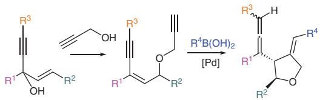
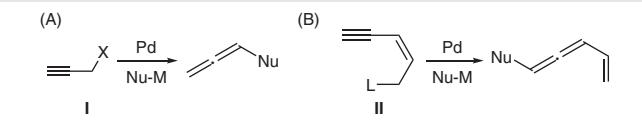
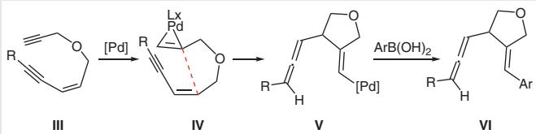
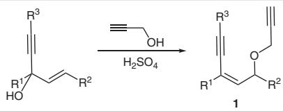
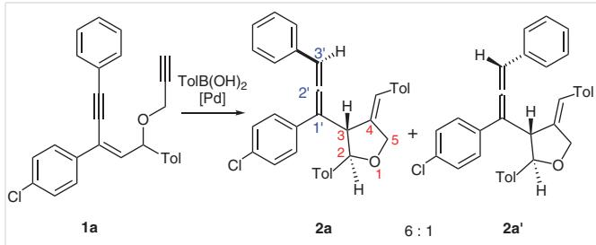
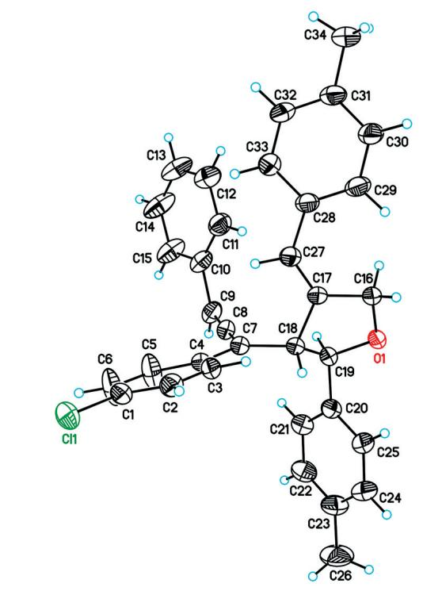
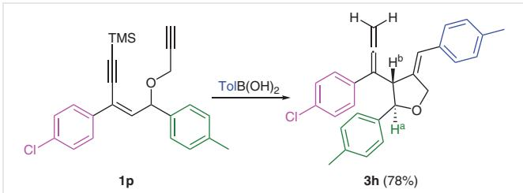
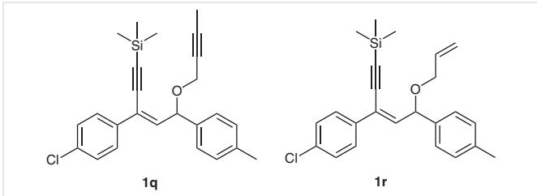
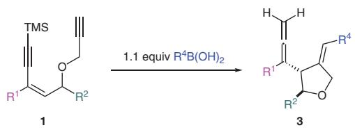
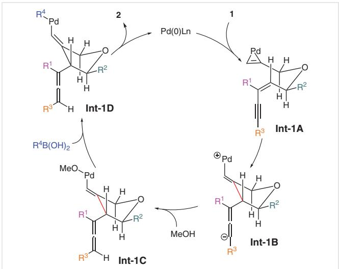

# Preparation of 3-Allenyl-4-methylenetetrahydrofurans

Yu-Min Wang Yi-Hung Liu Shiuh-Tzung Liu\*

Department of Chemistry, National Taiwan University, 1, Sec. 4, Roosevelt Road, Taipei 10617, Taiwan stliu@ntu.edu.tw

Published online: 06.02.2025 (Accepted Manuscript), 17.03.2025 (Version of Record) DOI: 10.1055/a-2534-9086; Art ID: SS-2025-01-0001-OP

Abstract A novel method for the preparation of 3-allenyl-4-methylenetetrahydrofurans via a Pd-catalyzed enyne cyclization reaction of propargyl 2-en-4-ynyl ethers under Suzuki coupling conditions is disclosed. The reaction proceeds via Pd activation of the terminal alkyne, cyclization, formation of the allenyl moiety, and reductive elimination, leading to the final product. This methodology offers several advantages, such as easy manipulation, mild reaction conditions, and easily accessible starting materials, providing a range of trisubstituted and 1,1- disubstituted allenyl(methylene)furan derivatives.

Key words allenes, furans, propargyl ethers, palladium, cyclization, Suzuki coupling

Allenyl heterocycles are useful synthetic intermediates due to the potential cyclization of heterocycles with the allenylic moiety to form polycyclic frameworks.1,2 In addition, such allenyl heterocycles appear in natural products and pharmaceutical molecules.2 Thus, development of synthetic methods for the construction of allenyl heterocycles and their applications have received much attention.1–3

Synthetic methodologies leading to allenyl compounds are well documented. Among them, Pd-catalyzed reaction of propargylic compounds I with nucleophilic organometallic or organoboron reagents to give the corresponding allene products is a known procedure (Scheme 1A).4 In further applications, conjugated (Z)-2-en-4-ynes II behave similarly to provide the vinylallene products (Scheme 1B).5

  
Scheme 1 Conversion of propargylic compounds into allenes catalyzed by Pd

By adopting this concept, we imagined that a 2-en-4-yl propargyl ether III with a terminal alkynyl group moiety could be useful to prepare allenyl(methylene)furans VI (Scheme 2). Presumably, activation of the terminal alkyne by Pd gives IV as the primary intermediate.6 Hopefully, an intramolecular addition to the enyne moiety followed by isomerization and protonation at the terminal allenyl carbon would take place to provide vinylpalladium species V. Aryl group transfer from the boron reagent to the Pd center and then reductive elimination would deliver the target framework VI.

  
Scheme 2 A proposed reaction pathway leading to allenyl(methylene)furans

1-En-4-yn-3-ols are useful synthetic intermediates and readily available from the addition of acetylides to chalcone molecules.7 The substrates 1a–1r were prepared by an $S _ { \mathrm { N } } 1$ type ether formation between 1-en-4-yn-3-ols and propargyl alcohol under acidic conditions (Scheme 3). Various substituents at the R1 to R3 positions were prepared for this investigation.

Investigation of the cyclization began with the reaction of 1a with p-tolylboronic acid [TolB(OH) ] in the presence of $\mathrm { P d } _ { 2 } ( \mathsf { d b } \mathsf { a } ) _ { \bar { \mathsf { a } } }$ (5 mol%), $\mathrm { P C y } _ { 3 } { \cdot } \mathrm { H B F } _ { 4 }$ (40 mol%), and ${ \mathrm { N a } } _ { 2 } { \mathrm { C O } } _ { 3 }$ in

  
Scheme 3 Preparation of propargyl ethers 1

b NMR yields.

  
Scheme 4 Reaction of 1a with TolB(OH)2 catalyzed by Pd

THF/MeOH solution under refluxing conditions (Scheme 4). To our delight, a pair of diastereomeric products, 2a and 2a′, were obtained. Compound 2a was characterized by NMR, mass spectrometry, and X-ray crystallography. HRMS (ESI-TOF) gave a signal at $[ \mathrm { M } + \mathrm { H } ] ^ { + } \mathrm { \Delta } m / z = 4 8 9 . 1 9 5 0 ,$ , consistent with the molecular formula of 2a. The coupling constants $J _ { ( \mathrm { H } 2 - \mathrm { H } 3 ) }$ for 2a and $\mathbf { 2 } \mathbf { a } ^ { \prime }$ are 8.8 and 7.0 Hz, respectively, which are consistent with a trans arrangement of these protons.8 In addition, the $^ { 1 3 } \mathsf { C }$ NMR spectrum of 2a shows three signals at  207, 108, and 99 ppm, which are consistent with the signals of a trisubstituted allenyl moiety.9 Nevertheless, X-ray crystallographic determination of 2a does confirm the structural details including the relative stereochemistry (Figure 1).10

Optimization of the reaction conditions for a better production of 2a was then studied (Table 1). The optimal conditions for this reaction are running the reaction of 1a with p-tolylboronic acid (1.1 equiv) with the use of $\mathrm { P d } _ { 2 } ( \mathsf { d b a } ) _ { 3 }$ (5 mol%) and $\mathrm { P C y } _ { 3 } { \cdot } \mathrm { H B F } _ { 4 }$ (40 mol%) as the catalyst in the presence of ${ \mathrm { N a } } _ { 2 } { \mathrm { C O } } _ { 3 }$ (0.8 equiv) in a mixed solvent of THF and MeOH at 65 $^ \circ C$ for 16 hours (entry 3). Due to easy manipulation, we chose to use $\mathrm { P C y _ { 3 } \cdot H B F _ { 4 } }$ as the ligand source instead of $\mathrm { P C y } _ { 3 } .$ By screening various amounts of ${ \ N a } _ { 2 } C 0 _ { 3 }$ (entries 1–4), we found that the use of 0.8 equivalent gave the best production of ${ \bf 2 } { \bf a } + { \bf 2 } { \bf a } ^ { \prime } .$ . Other bases, such as $\mathrm { K } _ { 2 } \mathrm { C O } _ { 3 }$ or ${ \mathrm { C s } } _ { 2 } { \mathrm { C O } } _ { 3 } ,$ did not provide the desired product at all (entries 5 and 6). Sodium hydroxide is another choice, but was not as good as ${ \ N a } _ { 2 } C 0 _ { 3 }$ (entry 7). Carrying out the reaction in THF/MeOH was found to be the best medium and other solvent systems gave poor results (entries 8–10). Among various phosphine ligands, tricyclohexylphosphine appears to be the most suitable for the reaction while other phosphine ligands impeded the catalysis (entries 11–15).

Figure 1 ORTEP plot of 2a (30% probability ellipsoids)  

<table><tr><td colspan="5">Table 1 Reaction Optimizationª</td></tr><tr><td>Entry</td><td>Base (equiv)</td><td>Solvent</td><td>Catalyst (mol%)</td><td>Yield (%)b</td></tr><tr><td>1</td><td> $\mathsf { N a } _ { 2 } \mathsf { C O } _ { 3 } \left( 1 . 0 \right)$ </td><td> $\mathsf { T H F } / \mathsf { M e O H } \left( 1 { : } 1 \right)$ </td><td> $\mathsf { P d } _ { 2 } ( \mathsf { d b a } ) _ { 3 } \left( 5 \right) , \mathsf { P C y } _ { 3 } { \cdot } \mathsf { H B F } _ { 4 } \left( 4 0 \right)$ </td><td>42</td></tr><tr><td>2</td><td> $\mathsf { N a } _ { 2 } \mathsf { C O } _ { 3 } \left( 1 . 2 \right)$ </td><td>THF/MeOH (1:1)</td><td> $\mathsf { P d } _ { 2 } ( \mathsf { d b a } ) _ { 3 } \left( 5 \right) , \mathsf { P C y } _ { 3 } { \cdot } \mathsf { H B F } _ { 4 } \left( 4 0 \right)$ </td><td>0</td></tr><tr><td>3</td><td> $\Nu \mathsf { a } _ { 2 } \mathsf { C O } _ { 3 } \left( 0 . 8 \right)$ </td><td>THF/MeOH (1:1)</td><td> $\mathsf { P d } _ { 2 } ( \mathsf { d b a } ) _ { 3 } \left( 5 \right) , \mathsf { P C y } _ { 3 } { \cdot } \mathsf { H B F } _ { 4 } \left( 4 0 \right)$ </td><td>81</td></tr><tr><td>4</td><td> $\mathsf { N a } _ { 2 } \mathsf { C O } _ { 3 } \left( 0 . 6 \right)$ </td><td>THF/MeOH (1:1)</td><td> $\mathsf { P d } _ { 2 } ( \mathsf { d b a } ) _ { 3 } \left( 5 \right) , \mathsf { P C y } _ { 3 } { \cdot } \mathsf { H B F } _ { 4 } \left( 4 0 \right)$ </td><td>0</td></tr><tr><td>5</td><td> $\mathsf { K } _ { 2 } \mathsf { C O } _ { 3 } \left( 0 . 8 \right)$ </td><td>THF/MeOH (1:1)</td><td> $\mathsf { P d } _ { 2 } ( \mathsf { d b a } ) _ { 3 } \left( 5 \right) , \mathsf { P C y } _ { 3 } { \cdot } \mathsf { H B F } _ { 4 } \left( 4 0 \right)$ </td><td>0</td></tr><tr><td>6</td><td> $\mathsf { C s } _ { 2 } \mathsf { C O } _ { 3 } \left( 0 . 8 \right)$ </td><td>THF/MeOH (1:1)</td><td> $\mathsf { P d } _ { 2 } ( \mathsf { d b a } ) _ { 3 } \left( 5 \right) , \mathsf { P C y } _ { 3 } { \cdot } \mathsf { H B F } _ { 4 } \left( 4 0 \right)$ </td><td>0</td></tr><tr><td>7</td><td> ${ \mathsf { N a O H } } ( 0 . 8 )$ </td><td>THF/MeOH (1:1)</td><td> $\mathsf { P d } _ { 2 } ( \mathsf { d b a } ) _ { 3 } \left( 5 \right) , \mathsf { P C y } _ { 3 } { \cdot } \mathsf { H B F } _ { 4 } \left( 4 0 \right)$ </td><td>56</td></tr><tr><td>8</td><td>Na₂CO₃ (0.8)</td><td>MeCN/MeOH (1:1)</td><td> $\mathsf { P d } _ { 2 } ( \mathsf { d b a } ) _ { 3 } \left( 5 \right) , \mathsf { P C y } _ { 3 } { \cdot } \mathsf { H B F } _ { 4 } \left( 4 0 \right)$ </td><td>46</td></tr><tr><td>9</td><td> $\Nu \mathsf { a } _ { 2 } \mathsf { C O } _ { 3 } \left( 0 . 8 \right)$ </td><td>THF</td><td> $\mathsf { P d } _ { 2 } ( \mathsf { d b a } ) _ { 3 } \left( 5 \right) , \mathsf { P C y } _ { 3 } { \cdot } \mathsf { H B F } _ { 4 } \left( 4 0 \right)$ </td><td>0</td></tr><tr><td>10</td><td> $\Nu \mathsf { a } _ { 2 } \mathsf { C O } _ { 3 } \left( 0 . 8 \right)$ </td><td>THF/tBuOH (1:1)</td><td> $\mathsf { P d } _ { 2 } ( \mathsf { d b a } ) _ { 3 } \left( 5 \right) , \mathsf { P C y } _ { 3 } { \cdot } \mathsf { H B F } _ { 4 } \left( 4 0 \right)$ </td><td>0</td></tr><tr><td>11</td><td> $\Nu \mathsf { a } _ { 2 } \mathsf { C O } _ { 3 } \left( 0 . 8 \right)$ </td><td>THF/MeOH (1:1)</td><td> $\mathsf { P d } _ { 2 } ( \mathsf { d b a } ) _ { 3 } ( 5 ) , \mathsf { P } ^ { \mathrm { t } } \mathsf { B u } _ { 3 } { \cdot } \mathsf { H B F } _ { 4 } ( 4 0 )$ </td><td>0</td></tr><tr><td>12</td><td> $\Nu \mathsf { a } _ { 2 } \mathsf { C O } _ { 3 } \left( 0 . 8 \right)$ </td><td>THF/MeOH (1:1)</td><td> $\mathsf { P d } _ { 2 } ( \mathsf { d b a } ) _ { 3 } ( 5 ) , \mathsf { d p p e } ( 2 0 )$ </td><td>0</td></tr><tr><td>13</td><td> ${ \mathsf { N a } } _ { 2 } { \mathsf { C O } } _ { 3 }$  (0.8)</td><td>THF/MeOH (1:1)</td><td> $\mathsf { P d } _ { 2 } ( \mathsf { d b a } ) _ { 3 } \left( 5 \right) , \mathsf { D P E p h o s } \left( 2 0 \right)$ </td><td>0</td></tr><tr><td>14</td><td> $\Nu \mathsf { a } _ { 2 } \mathsf { C O } _ { 3 } \left( 0 . 8 \right)$ </td><td>THF/MeOH (1:1)</td><td> $\mathsf { P d } _ { 2 } ( \mathsf { d b a } ) _ { 3 } ( 5 ) , \mathsf { C y } _ { 2 } \mathsf { P C H } _ { 2 } \mathsf { C H } _ { 2 } \mathsf { P C y } _ { 2 } ( 2 0 )$ </td><td>0</td></tr><tr><td>15</td><td>Na₂CO₃ (0.8)</td><td>THF/MeOH (1:1)</td><td> $\mathsf { P d } ( \mathsf { P P h } _ { 3 } ) _ { 4 } \left( 1 0 \right)$ </td><td>0</td></tr></table>

a Reaction conditions: 1a (0.1 mmol), base, catalyst, solvent (10 mL), stirred, 65 °C, 16 h, under $\mathsf { N } _ { 2 } .$

With the optimized conditions, reactions of various substituted groups R1, R2, and ${ \tt R } ^ { 3 }$ in 1 with various aryl- or alkylboronic acids were examined (Table 2). Reactants 1 with various substituents $\mathsf { R } ^ { 1 }$ reacted with phenylboronic acids smoothly under the catalytic conditions described above to give the allenylfuran products 2, except for 1d (R1 = Me) (Table 2, entries 1–4). It appears that these substituents with different electronic natures affect the yield. When R1 is a p-nitrophenyl group, the yield of 2b dropped to 55% (entry 2). Unfortunately, compound 1d with an alkyl substituent as $\mathsf { R } ^ { 1 }$ did not provide the desired product 2d at all (entry 4).

As for the boronic acids, phenylboronic acids with an electron-withdrawing or -donating substituent are suitable for the reaction, to give 2e and 2f in good yields (entries 5 and 6). However, reaction of 1a with butylboronic acid gave an unexpected product, 2g $\left( \mathbb { R } ^ { 4 } = \mathbb { H } \right)$ , indicating that the butyl group underwent -hydride elimination followed by reductive elimination to give the vinylidine moiety (entry 7). As for the $\mathsf { R } ^ { 2 }$ group, reactants 1 with a p-fluorophenyl or 3,5-dimethoxyphenyl substituent are suitable substrates, giving 2h and 2i in 61% and 87% yield, respectively (entries 8 and 9). The reactivity of three substrates with different $\mathbb { R } ^ { 3 }$ substituents was investigated. Both tolyl and butyl groups impede the formation of allenylfuran products (entries 10 and 12), whereas the reactant with $\mathbb { R } ^ { 3 }$ as a dichlorophenyl group provided the expected product 2k (entry 11). It appears that the nature of the $\mathbb { R } ^ { 3 }$ substituent affects the reaction significantly.

Finally, we investigated the activity of substrates with $\mathsf { R } ^ { 3 }$ as a trimethylsilyl (TMS) group. Compound 1p $( { \mathbb { R } } ^ { 1 } \ = \ p -$ $\mathrm { C l C _ { 6 } H _ { 4 } } , \mathrm { R } ^ { 2 } = p \mathrm { - } \mathrm { M e C _ { 6 } H _ { 4 } } , \mathrm { R } ^ { 3 } = \mathrm { T M S } )$ reacted with TolB(OH)2 under the catalytic conditions described above to yield 3h in 78% yield (Scheme 5). The structure of 3h was characterized by spectroscopic methods. The shortage of a 1H NMR signal for the TMS group clearly shows that desilylation took place during the cyclization, rendering the 1,1-disubstituted allene product 3h. Confirmation of this moiety came from the $^ { 1 3 } \mathsf { C }$ NMR shifts at  209, 104, and 84 ppm corresponding to the 1,1-disubstituted allenylic carbons and 1H NMR shifts for the methylidene group.11 In addition, the coupling constant of $J _ { \mathrm { ( H a - H b ) } } = 7 . 5$ Hz, similar to that for 2, suggests the trans relationship of the substituents on the furan ring. The success in obtaining 3h led us to prepare a series of this type of compound.

Table 2 Reaction Scopea
<table><tr><td>Entry 1</td><td> ${ p \mathrm { - } C l C _ { 6 } H _ { 4 } }$ </td><td> ${ p \mathrm { - } M e C _ { 6 } H _ { 4 } }$ </td><td> ${ \mathsf { C } } _ { 6 } { \mathsf { H } } _ { 5 }$ </td><td> $\mathsf { R } ^ { 4 }$   ${ p \mathrm { - } } \mathsf { M e C } _ { 6 } \mathsf { H } _ { 4 }$ </td><td>Productb</td></tr><tr><td>2</td><td> $\mathsf { \Pi } _ { P ^ { - } } \mathsf { O } _ { 2 } \mathsf { N C } _ { 6 } \mathsf { H } _ { 4 }$ </td><td> ${ p \mathrm { - } M e C _ { 6 } H _ { 4 } }$ </td><td> ${ \mathsf { C } } _ { 6 } { \mathsf { H } } _ { 5 }$ </td><td> $\mathsf { p - M e C _ { 6 } H _ { 4 } }$ </td><td>2a (78%, d.r. = 6:1)</td></tr><tr><td>3</td><td></td><td> ${ p \mathrm { - } M e C _ { 6 } H _ { 4 } }$ </td><td> ${ \mathsf { C } } _ { 6 } { \mathsf { H } } _ { 5 }$ </td><td> ${ p \mathrm { - } } \mathsf { M e C } _ { 6 } \mathsf { H } _ { 4 }$ </td><td>2b (55%, d.r. = 3:1)</td></tr><tr><td></td><td> ${ p \mathrm { - } M e C _ { 6 } H _ { 4 } }$  Me</td><td> ${ p \mathrm { - } M e C _ { 6 } H _ { 4 } }$ </td><td> ${ \mathsf { C } } _ { 6 } { \mathsf { H } } _ { 5 }$ </td><td> $\mathsf { p - M e C _ { 6 } H _ { 4 } }$ </td><td>2c (84%, d.r. = 8:1)</td></tr><tr><td>4 5</td><td> ${ p \mathrm { - } C l C _ { 6 } H _ { 4 } }$ </td><td> ${ p \mathrm { - } M e C _ { 6 } H _ { 4 } }$ </td><td> ${ \mathsf { C } } _ { 6 } { \mathsf { H } } _ { 5 }$ </td><td> ${ p \mathrm { - } \mathsf { H O C } } _ { 6 } \mathsf { H } _ { 4 }$ </td><td>2d (0%)</td></tr><tr><td>6</td><td> ${ p \mathrm { - } C l C _ { 6 } H _ { 4 } }$ </td><td> ${ p \mathrm { - } M e C _ { 6 } H _ { 4 } }$ </td><td> ${ \mathsf { C } } _ { 6 } { \mathsf { H } } _ { 5 }$ </td><td> $\mathsf { \Pi } _ { P ^ { - } } \mathsf { M e C O C } _ { 6 } \mathsf { H } _ { 4 }$ </td><td>2e (74%, d.r. = 8:1) 2f (86%, d.r. = 6:1)</td></tr><tr><td>7</td><td> ${ p \mathrm { - } C l C _ { 6 } H _ { 4 } }$ </td><td> ${ p \mathrm { - } M e C _ { 6 } H _ { 4 } }$ </td><td> ${ \mathsf { C } } _ { 6 } { \mathsf { H } } _ { 5 }$ </td><td>Bu</td><td> $\mathbf { 2 g } \left( 1 7 \% , \mathsf { d . r . } = 4 { : } 1 \right) ; \mathsf { R ^ { 4 } } = \mathsf { H }$ </td></tr><tr><td>8</td><td> ${ p \mathrm { - } C l C _ { 6 } H _ { 4 } }$ </td><td> ${ p \mathrm { - } } \mathsf { F C } _ { 6 } \mathsf { H } _ { 4 }$ </td><td> ${ \mathsf { C } } _ { 6 } { \mathsf { H } } _ { 5 }$ </td><td> $\mathsf { p - M e C _ { 6 } H _ { 4 } }$ </td><td>2h (61%, d.r. = 8:1)</td></tr><tr><td>9</td><td> ${ p \mathrm { - } C l C _ { 6 } H _ { 4 } }$ </td><td> $3 , 5 \cdot ( \mathsf { M e O } ) _ { 2 } C _ { 6 } \mathsf { H } _ { 3 }$ </td><td> ${ \mathsf { C } } _ { 6 } { \mathsf { H } } _ { 5 }$ </td><td> $\mathsf { p - M e C _ { 6 } H _ { 4 } }$ </td><td>2i (87%, d.r. = 5:1)</td></tr><tr><td>10</td><td> ${ p \mathrm { - } C l C _ { 6 } H _ { 4 } }$ </td><td> ${ p \mathrm { - } M e C _ { 6 } H _ { 4 } }$ </td><td> $\mathsf { p - M e C _ { 6 } H _ { 4 } }$ </td><td> $\mathsf { p - M e C _ { 6 } H _ { 4 } }$ </td><td>2j(0%)</td></tr><tr><td>11</td><td> ${ p \mathrm { - } C l C _ { 6 } H _ { 4 } }$ </td><td> ${ p \mathrm { - } M e C _ { 6 } H _ { 4 } }$ </td><td> $3 , 5 \mathrm { - C l } _ { 2 } C _ { 6 } \mathsf { H } _ { 3 }$ </td><td> $\mathsf { p - M e C _ { 6 } H _ { 4 } }$ </td><td>2k (75%, d.r. = 2:1)</td></tr><tr><td>12</td><td> ${ p \mathrm { - } C l C _ { 6 } H _ { 4 } }$ </td><td> ${ p \mathrm { - } M e C _ { 6 } H _ { 4 } }$ </td><td>Bu</td><td> $\mathsf { p - M e C _ { 6 } H _ { 4 } }$ </td><td>21 (0%)</td></tr></table>

b Isolated yield given in parentheses.  
a Reaction conditions: 1 (0.6 mmol), Pd2(dba)3 (0.03 mmol), PCy3·HBF4 (0.24 mmol), R4B(OH)2 (0.66 mmol), Na2CO3 (0.48 mmol), THF/MeOH (1:1, 60 mL), $6 5 ^ { \circ } \mathsf C ,$ 16 h, under N2.

  
Scheme 5 Preparation of 1,1-disubstituted allenyl compound 3h

As shown in Table 3, substrates 1 with various substituted phenyl rings R1 and R2 underwent cyclization followed by formation of the allenyl group to render the desired products 3 in good yields, except for 1l $( { \tt R } ^ { 1 } = p { \mathrm { - } } { \tt M e C } _ { 6 } { \tt H } _ { 4 } , { \tt R } ^ { 2 } =$ $\scriptstyle { p \mathrm { - M e C } _ { 6 } \mathrm { H } _ { 4 } } )$ (Table 3, entry 3). This observation is unlike the formation of compound 2c (Table 2, entry 3). Similar to 2g, reaction of 1p with butylboronic acid provided 3l in low yield (14%) (Table 3, entry 12). It should be noted that 1q (Figure 2) with an internal alkynyl moiety did not undergo the expected cascade cyclization and decomposed during the reaction. In addition, this reaction did not proceed with compound 1r (Figure 2), with an allyl ether instead of propargyl ether, indicating the necessity of the alkynyl functionality.

  
Figure 2 Structures of 1q and 1r

A possible reaction pathway leading to 2 is illustrated in Scheme 6. Activation of the terminal alkyne of 1 by Pd(0) results in the formation of $\mathbf { I n t { - } 1 A } , ^ { 6 a }$ which then undergoes nucleophilic attack at the enyne moiety to yield the furan ring, Int-1B, where R2 is seated at the pseudo-equatorial position to avoid steric strain. This orientation of R2 readily renders the stereochemistry of the furan ring in the final product. The allenyl anion in Int-1B is able to accept a proton from a solvent molecule to give Int-1C. Transmetalation of the $\mathbb { R } ^ { 4 }$ group from $\mathsf { R } ^ { 4 } \mathsf { B } ( \mathrm { O H } ) _ { 2 }$ to Pd gives the intermediate Int-1D, which proceeds to undergo reductive elimination to yield the final product 2. For 1 with ${ \tt R } ^ { 3 }$ as a TMS substituent, desilylation might take place during the reaction in the formation of 3.

Table 3 Preparation of Compounds 3a  

<table><tr><td>Entry R1</td><td></td><td>R²</td><td>R⁴</td><td>Productb</td></tr><tr><td>1</td><td> ${ \mathsf { C } } _ { 6 } { \mathsf { H } } _ { 5 }$ </td><td> ${ p \mathrm { - } M e C _ { 6 } H _ { 4 } }$ </td><td> ${ p \mathrm { - } M e C _ { 6 } H _ { 4 } }$ </td><td>3a (64%)</td></tr><tr><td>2</td><td> ${ p { \mathrm { - } } \mathsf { F C } } _ { 6 } { \mathsf { H } } _ { 4 }$ </td><td> ${ p \mathrm { - } M e C _ { 6 } H _ { 4 } }$ </td><td> ${ p \mathrm { - } M e C _ { 6 } H _ { 4 } }$ </td><td>3b (68%)</td></tr><tr><td>3</td><td> ${ p \mathrm { - } M e C _ { 6 } H _ { 4 } }$ </td><td> ${ p \mathrm { - } M e C _ { 6 } H _ { 4 } }$ </td><td> ${ p \mathrm { - } M e C _ { 6 } H _ { 4 } }$ </td><td>3c (0%)</td></tr><tr><td>4</td><td> ${ p \mathrm { - } C l C _ { 6 } H _ { 4 } }$ </td><td> ${ p \mathrm { - } } \mathsf { F C } _ { 6 } \mathsf { H } _ { 4 }$ </td><td> ${ p \mathrm { - } M e C _ { 6 } H _ { 4 } }$ </td><td>3d (80%)</td></tr><tr><td>5</td><td> ${ p \mathrm { - } C l C _ { 6 } H _ { 4 } }$ </td><td> $3 , 5 \cdot ( \mathsf { M e O } ) _ { 2 } C _ { 6 } \mathsf { H } _ { 3 }$ </td><td> ${ p \mathrm { - } M e C _ { 6 } H _ { 4 } }$ </td><td>3e (61%)</td></tr><tr><td>6</td><td> ${ p { \mathrm { - } } \mathsf { F C } } _ { 6 } { \mathsf { H } } _ { 4 }$ </td><td> ${ p { \mathrm { - } } { \mathsf { M e O C } } _ { 6 } { \mathsf { H } } _ { 4 } }$ </td><td> ${ p \mathrm { - } } \mathsf { F C } _ { 6 } \mathsf { H } _ { 4 }$ </td><td>3f (70%)</td></tr><tr><td>7</td><td> ${ p \mathrm { - } C l C _ { 6 } H _ { 4 } }$ </td><td> $\mathsf { p - M e C _ { 6 } H _ { 4 } }$ </td><td> ${ \mathsf { C } } _ { 6 } { \mathsf { H } } _ { 5 }$ </td><td>3g (83%)</td></tr><tr><td>8</td><td> ${ p \mathrm { - } C l C _ { 6 } H _ { 4 } }$ </td><td> ${ p \mathrm { - } M e C _ { 6 } H _ { 4 } }$ </td><td> ${ p \mathrm { - } M e C _ { 6 } H _ { 4 } }$ </td><td>3h (78%)</td></tr><tr><td>9</td><td> ${ p \mathrm { - } C l C _ { 6 } H _ { 4 } }$ </td><td> $\mathsf { p - M e C _ { 6 } H _ { 4 } }$ </td><td> ${ \mathsf { p } } { \mathsf { - M e O C } } _ { 6 } { \mathsf { H } } _ { 4 }$ </td><td>3i (75%)</td></tr><tr><td>10</td><td> ${ p \mathrm { - } C l C _ { 6 } H _ { 4 } }$ </td><td> ${ p \mathrm { - } M e C _ { 6 } H _ { 4 } }$ </td><td> $\mathsf { \Pi } _ { P ^ { - } } \mathsf { M e C O C } _ { 6 } \mathsf { H } _ { 4 }$ </td><td>3j (54%)</td></tr><tr><td>11</td><td> ${ p \mathrm { - } C l C _ { 6 } H _ { 4 } }$ </td><td> $\mathsf { p - M e C _ { 6 } H _ { 4 } }$ </td><td> $\mathsf { \Pi } _ { P ^ { - } } \mathsf { O } _ { 2 } N \mathsf { C } _ { 6 } \mathsf { H } _ { 4 }$ </td><td>3k (54%)</td></tr><tr><td>12</td><td> ${ p \mathrm { - } C l C _ { 6 } H _ { 4 } }$ </td><td> ${ p \mathrm { - } M e C _ { 6 } H _ { 4 } }$ </td><td>Bu</td><td>3I (14%); R4 = H</td></tr></table>

a Reaction conditions: 1 (0.6 mmol), Pd2(dba)3 (0.03 mmol), PCy3·HBF4 (0.24 mmol), R4B(OH)2 (0.66 mmol), Na2CO3 (0.48 mmol), THF/MeOH (1:1, 60 mL), 65 °C, 16 h, under N2.  
b Isolated yield given in parentheses.

In summary, we have disclosed an efficient method to prepare 3-allenyl-4-methylenetetrahydrofurans 2 and 3 via the Pd-catalyzed enyne cyclization reaction of propargyl 2- en-4-ynyl ethers 1 under Suzuki coupling conditions. This methodology offers several advantages such as easy manipulation, mild reaction conditions, and easily accessible starting materials. Further study to extend the application of allenyl(methylene)furans in synthetic utility is ongoing in our laboratory.

  
Scheme 6 Mechanistic pathway leading to 2

1H and 13C NMR spectra were recorded in CDCl at 298 K on a 400 MHz spectrometer and referenced to TMS. All chemicals were commercially purchased and used without further purification. Flash chromatography was performed using silica gel 230–400 mesh. Melting points were determined on a Fargo MP-1D instrument. Unless otherwise noted, all reactions were performed under nitrogen atmosphere. Compounds 1 were prepared according to our previously reported method.7

## Propargyl Ethers 1; General Procedure

In a 100-mL round-bottom flask was placed propargyl alcohol (1.01 g, 18 mmol) and $\mathrm { H } _ { 2 } S 0 _ { 4 }$ (0.48 mL, 9 mmol) in THF (10 mL). A solution of 1-en-4-yn-3-ol (3 mmol) in THF (15 mL) was then syringed into the flask with stirring at room temperature for 2 h. The reaction was quenched with sat. aq NaHCO and the mixture was extracted with ether (2 × 30 mL). The organic extracts were dried with MgSO and concentrated. The residue was chromatographed on a silica gel column (hexane/EtOAc, 19:1).

## (Z)-1-Chloro-4-(1-phenyl-5-(prop-2-yn-1-yloxy)-5-(p-tolyl)pent-3-en-1-yn-3-yl)benzene (1a)

Yield: 857.3 mg (72%); light yellow oil.

1H NMR (400 MHz, CDCl ):  = 7.61–7.50 (m, 4 H), 7.39–7.34 (m, 5 H), 7.29 (d, J = 8.7 Hz, 2 H), 7.16 (d, J = 7.8 Hz, 2 H), 6.48 (d, J = 8.9 Hz, 1 H), 5.84 (d, J = 8.9 Hz, 1 H), 4.16 (qd, J = 27.0, 2.4 Hz, 2 H), 2.39 (t, J = 2.4 Hz, 1 H), 2.30 (s, 3 H).

13C NMR (100 MHz, CDCl ):  = 137.8, 136.8, 136.4, 135.5, 134.1, 131.6, 129.3, 128.7, 128.5, 127.6, 126.7, 124.4, 122.8, 96.9, 85.5, 79.9, 78.9, 74.3, 55.6, 21.1.

HRMS (ESI-TOF): m/z [M + H]+ calcd for C H ClO: 397.1354; found: 397.1360.

## (Z)-1-Methyl-4-(3-(4-nitrophenyl)-5-phenyl-1-(prop-2-yn-1-yloxy)pent-2-en-4-yn-1-yl)benzene (1b)

Yield: 709.1 mg (58%); light yellow oil.

1H NMR (400 MHz, CDCl ):  = 8.24 (d, J = 8.9 Hz, 2 H), 7.87 (d, J = 8.9 Hz, 2 H), 7.69–7.61 (m, 2 H), 7.48–7.44 (m, 5 H), 7.26 (d, J = 7.9 Hz, 2 H), 6.76 (d, J = 8.8 Hz, 1 H), 5.96 (d, J = 8.8 Hz, 1 H), 4.16 (qd, J = 32.0, 2.4 Hz, 2 H), 2.50 (t, J = 2.4 Hz, 1 H), 2.40 (s, 3 H).

13C NMR (100 MHz, CDCl ):  = 147.4, 143.3, 139.7, 138.2, 136.4, 131.6, 129.5, 129.1, 128.5, 127.0, 126.8, 123.7, 123.4, 122.4, 97.8, 84.7, 79.8, 78.9, 76.7, 74.6, 55.7, 21.1.

HRMS (ESI-TOF): m/z [M + Na]+ calcd for $\mathrm { C } _ { 2 7 } \mathrm { H } _ { 2 1 } \mathrm { N N a O } _ { 3 } \mathrm { ; }$ 430.1414;   
found: 430.1392. (Z)-4,4′-(5-Phenyl-1-(prop-2-yn-1-yloxy)pent-2-en-4-yne-1,3-diyl)bis(methylbenzene) (1c)   
Yield: 903.6 mg (80%); light yellow oil.

1H NMR (400 MHz, CDCl ):  = 7.61–7.52 (m, 4 H), 7.39–7.33 (m, 5 H), 7.17–7.12 (m, 4 H), 6.46 (d, J = 9.0 Hz, 1 H), 5.86 (d, J = 9.0 Hz, 1 H), 4.16 (qd, J = 24.0, 2.4 Hz, 2 H), 2.38 (t, J = 2.4 Hz, 1 H), 2.33 (s, 3 H), 2.32 (s, 3 H).

13C NMR (100 MHz, CDCl ):  = 138.3, 137.7, 137.5, 135.3, 134.3, 131.7, 129.4, 129.2, 128.7, 128.5, 126.8, 126.4, 125.7, 123.2, 96.5, 86.4, 80.3, 79.1, 74.4, 55.7, 21.3, 21.2.

HRMS (ESI-TOF): m/z [M + Na]+ calcd for $\mathrm { C } _ { 2 8 } \mathrm { H } _ { 2 4 } \mathrm { N a O } \colon$ 399.1719; found: 399.1696.

## (Z)-1-Methyl-4-(3-methyl-5-phenyl-1-(prop-2-yn-1-yloxy)pent-2- en-4-yn-1-yl)benzene (1d)

Yield: 189.3 mg (21%); light yellow oil.

1H NMR (400 MHz, CDCl ):  = 7.59–7.52 (m, 2 H), 7.42–7.36 (m, 5 H), 7.23–7.19 (d, J = 7.8 Hz, 2 H), 5.90 (d, J = 9.1 Hz, 1 H), 5.71 (d, J = 9.1 Hz, 1 H), 4.16 (dd, J = 16.0, 1.9 Hz, 1 H), 4.27 (dd, J = 16.0, 1.9 Hz, 1 H), 2.44 (t, J = 1.9 Hz, 1 H), 2.39 (s, 3 H), 2.03 (s, 3 H).

13C NMR (100 MHz, CDCl ):  = 137.5, 136.7, 131.5, 129.2, 128.3, 126.9, 126.5, 123.2, 121.5, 94.2, 87.8, 80.1, 78.7, 74.0, 55.3, 23.1, 21.1. HRMS (ESI-TOF): m/z [M + H]+ calcd for ${ \mathrm { C } } _ { 2 2 } { \mathrm { H } } _ { 2 1 } { \mathrm { O } } \colon$ 301.1587; found: 301.1592.

## (Z)-1-Chloro-4-(5-(4-fluorophenyl)-1-phenyl-5-(prop-2-yn-1- yloxy)pent-3-en-1-yn-3-yl)benzene (1e)

Yield: 938.0 mg (78%); light yellow oil.

1H NMR (400 MHz, CDCl ):  = 7.67–7.55 (m, 4 H), 7.51–7.45 (m, 2 H), 7.42–7.36 (m, 3 H), 7.33 (d, J = 8.6 Hz, 2 H), 7.07 (t, J = 8.7 Hz, 2 H), 6.47 (d, J = 8.9 Hz, 1 H), 5.91 (d, J = 8.9 Hz, 1 H), 4.23 (qd, J = 25.0, 2.4 Hz, 2 H), 2.44 (t, J = 2.4 Hz, 1 H).

13C NMR (100 MHz, CDCl ):  = 163.7, 161.2, 135.9, 135.8, 135.3, 134.3, 131.6, 128.9, 128.6, 128.5, 128.4, 127.6, 124.9, 122.6, 115.6, 115.4, 97.1, 85.3, 79.8, 78.4, 74.5, 55.7.

19F NMR (376 MHz, CDCl ):  = –113.9.

HRMS (ESI-TOF): m/z [M + H]+ calcd for C H ClFO: 401.1103; found: 401.1110.

## (Z)-1-(3-(4-Chlorophenyl)-5-phenyl-1-(prop-2-yn-1-yloxy)pent-2- en-4-yn-1-yl)-3,5-dimethoxybenzene (1f)

Yield: 810.6 mg (61%); light yellow oil.

1H NMR (400 MHz, CDCl ):  = 7.62–7.55 (m, 4 H), 7.42–7.36 (m, 3 H), 7.30 (d, J = 8.6 Hz, 2 H), 6.65 (d, J = 2.2 Hz, 2 H), 6.45 (d, J = 8.8 Hz, 1 H), 6.38 (t, J = 2.2 Hz, 1 H), 5.82 (d, J = 8.8 Hz, 1 H), 4.19 (qd, J = 26.0, 2.3 Hz, 2 H), 3.75 (s, 6 H), 2.41 (t, J = 2.3 Hz, 1 H).

13C NMR (100 MHz, CDCl ):  = 161.1, 142.3, 136.0, 135.4, 134.2, 131.6, 128.8, 128.5, 128.4, 127.6, 124.6, 122.7, 104.6, 99.9, 97.0, 85.5, 79.9, 79.1, 74.5, 55.7, 55.2.

HRMS (ESI-TOF): m/z [M + H]+ calcd for $\mathrm { C _ { 2 8 } H _ { 2 4 } C l O _ { 3 } } \mathrm { : }$ 443.1409; found: 443.1415.

## (Z)-4,4′-(3-(4-Chlorophenyl)-5-(prop-2-yn-1-yloxy)pent-3-en-1- yne-1,5-diyl)bis(methylbenzene) (1g)

Yield: 949.3 mg (77%); light yellow oil.

1H NMR (400 MHz, CDCl ):  = 7.61 (d, J = 8.7 Hz, 2 H), 7.47 (d, J = 8.0 Hz, 2 H), 7.39 (d, J = 8.0 Hz, 2 H), 7.31 (d, J = 8.7 Hz, 2 H), 7.20–7.16 (m, 4 H), 6.49 (d, J = 8.9 Hz, 1 H), 5.87 (d, J = 8.9 Hz, 1 H), 4.19 (qd, J = 27.0, 2.4 Hz, 2 H), 2.41 (t, J = 2.4 Hz, 1 H), 2.39 (s, 3 H), 2.34 (s, 3 H).

13C NMR (100 MHz, CDCl ):  = 139.0, 137.8, 137.0, 136.1, 135.6, 134.1, 131.5, 129.3, 129.2, 128.5, 127.6, 126.7, 124.5, 119.8, 97.2, 84.9, 80.0, 79.0, 74.3, 55.6, 21.5, 21.1.   
HRMS (ESI-TOF): m/z [M + Na]+ calcd for $\mathrm { C } _ { 2 8 } \mathrm { H } _ { 2 3 } \mathrm { C l N a O } { \mathrm { : } }$ 433.1330; found: 433.1297.

## (Z)-1,3-Dichloro-5-(3-(4-chlorophenyl)-5-(prop-2-yn-1-yloxy)-5- (p-tolyl)pent-3-en-1-yn-1-yl)benzene (1h)

Yield: 1159.8 mg (83%); light yellow oil.   
1H NMR (400 MHz, CDCl ):  = 7.56 (d, J = 8.7 Hz, 2 H), 7.45 (d, J = 1.9 Hz, 2 H), 7.40–7.35 (m, 3 H), 7.33 (d, J = 8.7 Hz, 2 H), 7.21 (d, J = 7.9 Hz, 2 H), 6.58 (d, J = 8.7 Hz, 1 H), 5.83 (d, J = 8.9 Hz, 1 H), 4.19 (qd, J = 29.0, 2.4 Hz, 2 H), 2.47 (t, J = 2.4 Hz, 1 H), 2.36 (s, 3 H).   
13C NMR (100 MHz, CDCl ):  = 138.0, 137.9, 136.5, 135.0, 134.9, 134.4, 129.7, 129.4, 128.9, 128.6, 127.5, 126.7, 125.5, 123.7, 94.8, 87.8, 80.0, 78.7, 74.4, 55.5, 21.1.   
HRMS (ESI): m/z [M + H]+ calcd for $\mathrm { C } _ { 2 7 } \mathrm { H } _ { 2 0 } \mathrm { C l } _ { 3 } 0 \colon$ 465.0575; found: 465.0580.

## (Z)-1-Chloro-4-(1-(prop-2-yn-1-yloxy)-1-(p-tolyl)non-2-en-4-yn-3-yl)benzene (1i)

Yield: 859.3 mg (76%); light yellow oil.   
1H NMR (400 MHz, CDCl ):  = 7.54 (d, J = 8.5 Hz, 2 H), 7.35 (d, J = 7.9 Hz, 2 H), 7.27 (d, J = 8.5 Hz, 2 H), 7.17 (d, J = 7.9 Hz, 2 H), 6.38 (d, J = 8.9 Hz, 1 H), 5.74 (d, J = 8.9 Hz, 1 H), 4.16 (qd, J = 23, 2.3 Hz, 2 H), 2.51 (t, J = 7.0 Hz, 2 H), 2.43 (t, J = 2.3 Hz, 1 H), 2.34 (s, 3 H), 1.70–1.60 (m, 2 H), 1.58–1.47 (m, 2 H), 0.97 (t, J = 7.3 Hz, 3 H).   
13C NMR (100 MHz, CDCl ):  = 137.6, 137.1, 136.1, 135.1, 133.8, 129.2, 128.3, 127.5, 126.5, 124.9, 98.4, 80.1, 79.0, 73.9, 55.5, 30.7, 22.1, 21.1, 19.3, 13.5.   
HRMS (ESI): m/z [M + H]+ calcd for $\mathrm { C } _ { 2 5 } \mathrm { H } _ { 2 6 } \mathrm { C l O } \mathrm { : }$ : 377.1667; found: 377.1660.

## (Z)-Trimethyl(3-phenyl-5-(prop-2-yn-1-yloxy)-5-(p-tolyl)pent-3- en-1-yn-1-yl)silane (1j)

Yield: 1011.1 mg (94%); light yellow oil.   
1H NMR (400 MHz, CDCl ):  = 7.68–7.64 (m, 2 H), 7.44–7.40 (m, 2 H), 7.38–7.31 (m, 3 H), 7.23 (d, J = 7.8 Hz, 2 H), 6.57 (d, J = 8.9 Hz, 1 H), 5.86 (d, J = 8.9 Hz, 1 H), 4.23 (qd, J = 23.0, 2.4 Hz, 2 H), 2.48 (t, J = 2.4 Hz, 1 H), 2.39 (s, 3 H), 0.37 (s, 9 H).   
13C NMR (100 MHz, CDCl ):  = 137.6, 137.1, 137.0, 136.6, 129.2, 128.3, 128.2, 126.6, 126.2, 125.4, 102.3, 101.3, 80.1, 78.9, 74.1, 55.5, 21.1, –0.11.   
HRMS (ESI-TOF): m/z [M + Na]+ calcd for C H NaOSi: 381.1645; found: 381.1616.

## (Z)-(3-(4-Fluorophenyl)-5-(prop-2-yn-1-yloxy)-5-(p-tolyl)pent-3- en-1-yn-1-yl)trimethylsilane (1k)

Yield: 1118.3 mg (99%); light yellow oil.   
1H NMR (400 MHz, CDCl ):  = 7.70–7.60 (m, 2 H), 7.45 (d, J = 8.0 Hz, 2 H), 7.26 (d, J = 7.8 Hz, 2 H), 7.08 (t, J = 8.7 Hz, 2 H), 6.54 (d, J = 8.9 Hz, 1 H), 5.88 (d, J = 8.9 Hz, 1 H), 4.23 (qd, J = 26.0, 2.4 Hz, 2 H), 2.51 (t, J = 2.4 Hz, 1 H), 2.41 (s, 3 H), 0.40 (s, 9 H).   
13C NMR (100 MHz, CDCl ):  = 163.9, 161.5, 137.7, 137.1, 136.9, 132.7, 129.3, 128.0, 127.9, 126.2, 124.2, 115.3, 115.1, 102.5, 101.2, 80.1, 79.0, 74.2, 55.5, 21.1, –0.11.   
19F NMR (376 MHz, CDCl ):  = –113.5. HRMS (ESI-TOF): m/z [M + Na]+ calcd for C H FNaOSi: 399.1551;   
found: 399.1528.

## (Z)-Trimethyl(5-(prop-2-yn-1-yloxy)-3,5-di(p-tolyl)pent-3-en-1- yn-1-yl)silane (1l)

Yield: 782.5 mg (70%); light yellow oil.   
1H NMR (400 MHz, CDCl ):  = 7.49 (d, J = 8.1 Hz, 2 H), 7.36 (d, J = 8.0 Hz, 2 H), 7.16 (d, J = 8.1 Hz, 2 H), 7.12 (d, J = 8.0 Hz, 2 H), 6.46 (d, J = 9.0 Hz, 1 H), 5.79 (d, J = 9.0 Hz, 1 H), 4.17 (qd, J = 23, 2.4 Hz, 2 H), 2.42 (t, J = 2.4 Hz, 1 H), 2.34 (s, 3 H), 2.33 (s, 3 H), 0.29 (s, 9 H).   
13C NMR (100 MHz, CDCl ):  = 138.1, 137.5, 137.2, 136.1, 133.8, 129.2, 128.9, 126.6, 126.1, 125.3, 101.9, 101.5, 80.1, 79.0, 74.0, 55.5, 21.1, 21.0, –0.11.   
HRMS (ESI-TOF): m/z [M + Na]+ calcd for $\mathrm { C _ { 2 5 } H _ { 2 8 } N a O S i }$ : 395.1802; found: 395.1780.

## (Z)-(3-(4-Chlorophenyl)-5-(4-fluorophenyl)-5-(prop-2-yn-1- yloxy)pent-3-en-1-yn-1-yl)trimethylsilane (1m)

Yield: 1178.9 mg (99%); light yellow oil.   
1H NMR (400 MHz, CDCl ):  = 7.57 (d, J = 8.2 Hz, 2 H), 7.50–7.43 (m, 2 H), 7.33 (d, J = 8.5 Hz, 2 H), 7.08 (t, J = 8.6 Hz, 2 H), 6.47 (d, J = 8.9 Hz, 1 H), 5.83 (d, J = 8.9 Hz, 1 H), 4.27 (d, J = 16 Hz, 1 H), 4.20 (d, J = 16 Hz, 1 H), 2.48 (t, J = 2.8 Hz, 1 H), 0.34 (s, 9 H).   
13C NMR (100 MHz, CDCl ):  = 163.6, 161.2, 136.9, 135.7, 134.9, 134.2, 128.5, 128.3, 128.2, 127.5, 124.7, 115.5, 115.3, 103.1, 100.6, 79.7, 78.4, 74.4, 55.7, –0.20.   
19F NMR (376 MHz, CDCl ):  = –114.0.   
HRMS (ESI-TOF): m/z [M + Na]+ calcd for C H ClFNaOSi: 419.1005; found: 419.1010.

## (Z)-(3-(4-Chlorophenyl)-5-(3,5-dimethoxyphenyl)-5-(prop-2-yn-1-yloxy)pent-3-en-1-yn-1-yl)trimethylsilane (1n)

Yield: 1251.2 mg (95%); light yellow oil.   
1H NMR (400 MHz, CDCl ):  = 7.56 (d, J = 8.4 Hz, 2 H), 7.32 (d, J = 8.4 Hz, 2 H), 6.66 (d, J = 2.2 Hz, 2 H), 6.46 (d, J = 8.9 Hz, 1 H), 6.42 (t, J = 2.2 Hz, 1 H), 5.78 (d, J = 8.9 Hz, 1 H), 4.23 (qd, J = 15, 2.0 Hz, 2 H), 3.82 (s, 6 H), 2.46 (t, J = 2.0 Hz, 1 H), 0.33 (s, 9 H).   
13C NMR (100 MHz, CDCl ):  = 160.9. 142.2, 136.8, 135.0, 134.1, 128.4, 127.5, 124.4, 104.4, 102.7, 100.8, 99.9, 79.8, 79.0, 74.2, 55.7, 55.2, –0.17.   
HRMS (ESI-TOF): m/z [M + Na]+ calcd for $\mathrm { C } _ { 2 5 } \mathrm { H } _ { 2 7 } \mathrm { C l N a O } _ { 3 } \mathrm { S i } ;$ 461.1310; found: 461.1283.

## (Z)-(3-(4-Fluorophenyl)-5-(4-methoxyphenyl)-5-(prop-2-yn-1- yloxy)pent-3-en-1-yn-1-yl)trimethylsilane (1o)

Yield: 1130.5 mg (96%); light yellow oil.   
1H NMR (400 MHz, CDCl ):  = 7.60–7.50 (m, 2 H), 7.36 (d, J = 8.7 Hz, 2 H), 6.98 (t, J = 8.7 Hz, 2 H), 6.87 (d, J = 8.7 Hz, 2 H), 6.42 (d, J = 8.9 Hz, 1 H), 5.72 (d, J = 8.9 Hz, 1 H), 4.16 (qd, J = 15, 2.3 Hz, 2 H), 3.78 (s, 3 H), 2.41 (t, J = 2.3 Hz, 1 H), 0.28 (s, 9 H).   
13C NMR (100 MHz, CDCl ):  = 163.9, 159.4, 136.9, 132.7, 132.1, 127.9, 127.8, 127.1, 124.0, 115.3, 115.1, 113.9, 102.5, 101.1, 79.9, 78.7, 74.1, 55.4, 55.2, –0.15.   
19F NMR (376 MHz, CDCl ):  = –113.7.   
HRMS (ESI-TOF): m/z [M + Na]+ calcd for $\mathrm { C } _ { 2 4 } \mathrm { H } _ { 2 5 } \mathrm { F N a O } _ { 2 }$ Si: 415.1500; found: 415.1493.

## (Z)-(3-(4-Chlorophenyl)-5-(prop-2-yn-1-yloxy)-5-(p-tolyl)pent-3- en-1-yn-1-yl)trimethylsilane (1p)

Yield: 990.3 mg (84%); light yellow oil.

Hz, 1 H), 5.94 (d, J = 8.9 Hz, 1 H), 4.31 (qd, J = 16, 2.1 Hz, 2 H), 2.54 (t, J = 2.1 Hz, 1 H), 2.44 (s, 3 H), 0.44 (s, 9 H).

13C NMR (100 MHz, CDCl ):  = 137.8, 137.6, 137.0, 135.2, 134.1, 129.4, 128.5, 127.6, 126.7, 124.2, 102.8, 101.0, 80.1, 79.0, 74.4, 55.6, 21.2, –0.04.

HRMS (ESI-TOF): m/z [M + Na]+ calcd for C H ClNaOSi: 415.1255;   
found: 415.1235.

## (Z)-(5-(But-2-yn-1-yloxy)-3-(4-chlorophenyl)-5-(p-tolyl)pent-3- en-1-yn-1-yl)trimethylsilane (1q)

Yield: 769.3 mg (63%); light yellow oil.

1H NMR (400 MHz, CDCl ):  = 7.54 (d, J = 8.7 Hz, 2 H), 7.38 (d, J = 8.0 Hz, 2 H), 7.29 (d, J = 8.7 Hz, 2 H), 7.19 (d, J = 8.0 Hz, 2 H), 6.53 (d, J = 8.8 Hz, 1 H), 5.75 (d, J = 8.9 Hz, 1 H), 4.14 (qq, J = 21, 2.3 Hz, 2 H), 2.35 (s, 3 H), 1.87 (d, J = 2.3 Hz, 3 H), 0.34 (s, 9 H).

13C NMR (100 MHz, CDCl ):  = 138.1, 137.6, 137.2, 135.2, 133.9, 129.2, 128.4, 127.5, 126.6, 123.6, 102.6, 101.1, 82.2, 78.9, 75.3, 56.3, 21.1, 3.69, –0.12.

HRMS (ESI-TOF): m/z [M + Na]+ calcd for C H ClNaOSi: 429.1412;   
found: 429.1397.

## (Z)-(5-(Allyloxy)-3-(4-chlorophenyl)-5-(p-tolyl)pent-3-en-1-yn-1- yl)trimethylsilane (1r)

Yield: 1019.1 mg (86%); light yellow oil.

1H NMR (400 MHz, CDCl ):  = 7.63 (d, J = 8.6 Hz, 2 H), 7.51 (d, J = 8.0 Hz, 2 H), 7.37 (d, J = 8.6 Hz, 2 H), 7.28 (d, J = 8.0 Hz, 2 H), 6.62 (d, J = 8.9 Hz, 1 H), 6.10 (ddt, J = 17.0, 10.0, 5.5 Hz, 1 H), 5.76 (d, J = 8.9 Hz, 1 H), 5.45 (dq, J = 17.0, 1.6 Hz, 1 H), 5.32 (dq, J = 10.0, 1.6 Hz, 1 H), 4.25– 4.13 (m, 2 H), 2.43 (s, 3 H), 0.44 (s, 9 H).

13C NMR (100 MHz, CDCl ):  = 138.8, 137.9, 137.5, 135.3, 134.8, 134.0, 129.3, 128.5, 127.5, 126.5, 123.6, 117.0, 102.4, 101.4, 79.2, 69.4, 21.2, –0.01.

HRMS (ESI-TOF): m/z [M + Na]+ calcd for C H ClNaOSi: 417.1412;   
found: 417.1372.

## 3-Allenyl-4-methylenetetrahydrofurans 2 and 3; General Procedure

A mixture of 1 (0.6 mmol), Pd (dba) (27.5 mg, 0.03 mmol), PCy ·HBF (88.4 mg, 0.24 mmol), Na CO (50.8 mg, 0.48 mmol), and arylboronic acid (0.66 mmol) in THF/MeOH (1:1, 60 mL) in a flask equipped with reflux condenser was heated at 65 °C under nitrogen atmosphere for 16 h. Solvents were removed under reduced pressure and the residue was chromatographed on a silica gel column (hexane/EtOAc, 19:1).

## 3-(1-(4-Chlorophenyl)-3-phenylpropa-1,2-dien-1-yl)-4-((Z)-4- methylbenzylidene)-2-(p-tolyl)tetrahydrofuran (2a)

Yield: 228.9 mg (78%); d.r. = 6:1; light yellow oil.

Recrystallization gave 2a as a pale yellow solid.

1H NMR (400 MHz, CDCl ):  (major isomer, 2a) = 7.37 (d, J = 8.6 Hz, 2 H), 7.33 (d, J = 8.0 Hz, 2 H), 7.28–7.21 (m, 7 H), 7.20–7.14 (m, 4 H), 7.03 (d, J = 8.0 Hz, 2 H), 6.67 (s, 1 H), 6.54–6.49 (m, 1 H), 5.11 (d, J = 14 Hz, 1 H), 4.93 (d, J = 8.8 Hz, 1 H), 4.85 (d, J = 14 Hz, 1 H), 3.96 (d, J = 8.8

Hz, 1 H), 2.37 (s, 3 H), 2.36 (s, 3 H);  (minor isomer, 2a′) = 7.37 (d, J = 8.6 Hz, 2 H), 7.33 (d, J = 8.0 Hz, 2 H), 7.28–7.21 (m, 7 H), 7.20–7.14 (m, 4 H), 7.03 (d, J = 8.0 Hz, 2 H), 6.65 (s, 1 H), 6.47–6.38 (m, 1 H), 5.03 (d, J = 15 Hz, 1 H), 4.93 (d, J = 8.8 Hz, 1 H), 4.85 (d, J = 15 Hz, 1 H), 4.07 (d, J = 7.0 Hz, 1 H), 2.37 (s, 3 H), 2.36 (s, 3 H).

13C NMR (100 MHz, CDCl ):  (major isomer, 2a) = 207.9, 142.7, 137.7,   
137.1, 136.6, 134.0, 133.9, 133.3, 133.1, 129.2, 129.1, 128.7, 128.1,   
127.9, 127.4, 127.1, 126.9, 126.4, 122.3, 108.4, 99.2, 83.9, 70.3, 55.1,   
21.1, 21.0;  (minor isomer, 2a′) = 207.9, 142.7, 137.7, 137.1, 136.6,   
134.0, 133.9, 133.3, 133.1, 129.2, 129.1, 128.7, 128.1, 127.9, 127.4,   
127.1, 126.9, 126.4, 122.3, 108.4, 99.2, 83.9, 70.3, 55.1, 21.1, 21.0.

HRMS (ESI-TOF): m/z [M + H]+ calcd for $\mathrm { C } _ { 3 4 } \mathrm { H } _ { 3 0 } \mathrm { C l O } \mathrm { : }$ 489.1980; found: 489.1950.

## 4-((Z)-4-Methylbenzylidene)-3-(1-(4-nitrophenyl)-3-phenylpropa-1,2-dien-1-yl)-2-(p-tolyl)tetrahydrofuran (2b) Yield: 164.9 mg (55%); d.r. = 3:1; light yellow oil.

1H NMR (400 MHz, CDCl ):  (major isomer) = 8.15 (d, J = 8.9 Hz, 2 H), 7.58 (d, J = 8.0 Hz, 2 H), 7.35–7.24 (m, 7 H), 7.22–7.16 (m, 4 H), 7.03 (d, J = 8.1 Hz, 2 H), 6.79 (s, 1 H), 6.50 (q, J = 2.3 Hz, 1 H), 5.14 (d, J = 14 Hz, 1 H), 4.95–4.83 (m, 2 H), 4.03 (d, J = 8.8 Hz, 1 H), 2.39 (s, 3 H), 2.38 (s, 3 H);  (minor isomer) = 8.17 (d, J = 7.8 Hz, 2 H), 7.60 (d, J = 7.8 Hz, 2 H), 7.35–7.24 (m, 7 H), 7.22–7.11 (m, 4 H), 7.07 (d, J = 8.1 Hz, 2 H), 6.77 (s, 1 H), 6.40 (q, J = 2.2 Hz, 1 H), 5.06 (d, J = 13 Hz, 1 H), 4.95–4.83 (m, 2 H), 4.14 (d, J = 7.8 Hz, 1 H), 2.38 (s, 3 H), 2.37 (s, 3 H).

13C NMR (100 MHz, CDCl ):  (major isomer) = 209.6, 146.7, 142.6,   
142.3, 137.9, 136.9, 136.7, 133.7, 132.3, 129.2, 128.8, 127.9, 127.8,   
127.3, 127.1, 126.4, 123.8, 122.6, 108.4, 99.9, 84.1, 70.3, 54.9, 21.1,   
21.0;  (minor isomer) = 208.9, 146.7, 142.7, 141.9, 138.0, 136.9,   
136.6, 133.8, 132.2, 129.2, 128.8, 128.1, 127.3, 127.1, 126.8, 126.4,   
123.9, 122.8, 108.4, 100.3, 84.7, 70.4, 54.4, 21.1, 21.0.

HRMS (ESI-TOF): m/z [M + H]+ calcd for ${ \cal C } _ { 3 4 } \mathrm { H } _ { 3 0 } \mathrm { N O } _ { 3 }$ : 500.2220; found: 500.2196.

## 4-((Z)-4-Methylbenzylidene)-3-((R)-3-phenyl-1-(p-tolyl)propa-1,2-dien-1-yl)-2-(p-tolyl)tetrahydrofuran (2c)

Yield: 236.2 mg (84%); d.r. = 8:1; light yellow oil.

1H NMR (400 MHz, CDCl ):  (major isomer) = 7.52–7.46 (m, 4 H), 7.41–7.35 (m, 4 H), 7.32–7.26 (m, 5 H), 7.24 (d, J = 8.0 Hz, 2 H), 7.17 (d, J = 8.1 Hz, 2 H), 6.78 (s, 1 H), 6.73–6.68 (m, 1 H), 5.24 (d, J = 14 Hz, 1 H), 5.12 (d, J = 8.8 Hz, 1 H), 5.00 (d, J = 14 Hz, 1 H), 4.14 (d, J = 8.8 Hz, 1 H), 2.48 (s, 3 H), 2.47 (s, 3 H), 2.45 (s, 3 H);  (minor isomer) = 7.52– 7.46 (m, 4 H), 7.41–7.35 (m, 4 H), 7.32–7.26 (m, 5 H), 7.24 (d, J = 8.0 Hz, 2 H), 7.17 (d, J = 8.1 Hz, 2 H), 6.75 (s, 1 H), 6.61–6.58 (m, 1 H), 5.17 (d, J = 12 Hz, 1 H), 5.12 (d, J = 7.7 Hz, 1 H), 5.00 (d, J = 12 Hz, 1 H), 4.14 (d, J = 7.7 Hz, 1 H), 2.52 (s, 3 H), 2.47 (s, 3 H), 2.44 (s, 3 H).

13C NMR (100 MHz, CDCl ):  (major isomer) = 207.8, 143.3, 137.6,   
137.5, 137.2, 136.5, 134.3, 134.0, 132.6, 129.4, 129.3, 129.2, 128.7,   
128.1, 127.0, 126.9, 126.6, 122.3, 109.3, 84.1, 70.5, 55.2, 21.3, 21.2,   
21.1;  (minor isomer) = 207.8, 143.3, 137.6, 137.5, 137.2, 136.5,   
134.3, 134.0, 132.6, 129.4, 129.3, 129.2, 128.7, 128.1, 127.0, 126.9,   
126.6, 122.3, 109.3, 84.1, 70.5, 55.2, 21.3, 21.2, 21.1.

HRMS (ESI-TOF): m/z [M + H]+ calcd for $\mathrm { C } _ { 3 5 } \mathrm { H } _ { 3 3 } \mathrm { O } \colon$ 469.2526; found: 469.2502.

4-((Z)-(4-(1-(4-Chlorophenyl)-3-phenylpropa-1,2-dien-1-yl)-5-(ptolyl)dihydrofuran-3(2H)-ylidene)methyl)phenol (2e) Yield: 218.0 mg (74%); d.r. = 8:1; colorless oil

1H NMR (400 MHz, CDCl ):  (major isomer) = 7.46–7.34 (m, 5 H), 7.33–7.28 (m, 4 H), 7.25–7.17 (m, 4 H), 6.99 (d, J = 7.5 Hz, 2 H), 6.78 (d, J = 7.5 Hz, 2 H), 6.70 (s, 1 H), 6.50 (s, 1 H), 5.98 (s, 1 H), 5.11 (d, J = 14 Hz, 1 H), 4.98 (d, J = 8.5 Hz, 1 H), 4.88 (d, J = 14 Hz, 1 H), 4.00 (d, J = 8.5 Hz, 1 H), 2.40 (s, 3 H);  (minor isomer) = 7.46–7.34 (m, 5 H), 7.33–7.28 (m, 4 H), 7.25–7.17 (m, 4 H), 6.99 (d, J = 7.5 Hz, 2 H), 6.78 (d, J = 7.5 Hz, 2 H), 6.70 (s, 1 H), 6.39 (s, 1 H), 5.80 (s, 1 H), 5.04 (d, J = 14 Hz, 1 H), 4.98 (d, J = 6.7 Hz, 1 H), 4.88 (d, J = 14 Hz, 1 H), 4.11 (d, J = 6.7 Hz, 1 H), 2.38 (s, 3 H).

13C NMR (100 MHz, CDCl ):  (major isomer) = 207.9, 154.8, 140.8, 137.9, 136.8, 133.9, 133.3, 133.1, 129.5, 129.3, 129.2, 128.7, 127.5, 126.9, 126.5, 122.2, 115.4, 108.4, 99.3, 84.1, 70.2, 54.9, 21.2;  (minor isomer) = 207.9, 154.8, 140.8, 137.9, 136.8, 133.9, 133.3, 133.1, 129.5, 129.3, 129.2, 128.7, 127.5, 126.9, 126.5, 122.2, 115.4, 108.4, 99.3, 84.1, 70.2, 54.9, 21.2.

HRMS (ESI-TOF): m/z [M + H]+ calcd for ${ \mathrm { C } } _ { 3 3 } { \mathrm { H } } _ { 2 8 } { \mathrm { C l } } 0 _ { 2 } { \mathrm { : } }$ 491.1773; found: 491.1780.

## 1-(4-((Z)-(4-(1-(4-Chlorophenyl)-3-phenylpropa-1,2-dien-1-yl)-5- (p-tolyl)dihydrofuran-3(2H)-ylidene)methyl)phenyl)ethan-1-one (2f)

Yield: 266.8 mg (86%); d.r. = 6:1; yellow oil.

1H NMR (400 MHz, CDCl ):  (major isomer) = 7.97 (d, J = 8.4 Hz, 2 H), 7.43–7.36 (m, 4 H), 7.34–7.26 (m, 7 H), 7.25–7.19 (m, 4 H), 6.75 (s, 1 H), 6.66–6.61 (m, 1 H), 5.17 (d, J = 14 Hz, 1 H), 5.01 (d, J = 8.8 Hz, 1 H), 4.91 (d, J = 14 Hz, 1 H), 4.06 (d, J = 8.7 Hz, 1 H), 2.63 (s, 3 H), 2.41 (s, 3 H);  (minor isomer) = 7.97 (d, J = 8.4 Hz, 2 H), 7.43–7.36 (m, 4 H), 7.34–7.26 (m, 7 H), 7.25–7.19 (m, 4 H), 6.72 (s, 1 H), 6.56–6.52 (m, 1 H), 5.10 (d, J = 16 Hz, 1 H), 5.01 (d, J = 7.9 Hz, 1 H), 4.91 (d, J = 14 Hz, 1 H), 4.12 (d, J = 7.9 Hz, 1 H), 2.63 (s, 3 H), 2.39 (s, 3 H).

13C NMR (100 MHz, CDCl ):  (major isomer) = 208.1, 197.3, 147.3, 141.4, 137.9, 136.8, 135.2, 133.8, 133.2, 133.1, 129.3, 128.9, 128.8, 128.7, 128.6, 128.2, 128.0, 127.8, 127.6, 127.4, 127.2, 126.9, 126.8, 126.4, 121.7, 108.4, 99.5, 84.3, 70.3, 55.4, 26.5, 21.2;  (minor isomer) = 207.2, 197.3, 147.3, 141.4, 137.9, 136.8, 135.2, 133.8, 133.2, 133.1, 129.3, 128.9, 128.8, 128.7, 128.6, 128.2, 128.0, 127.8, 127.6, 127.4, 127.2, 126.9, 126.8, 126.4, 121.7, 108.4, 99.5, 84.3, 70.3, 54.7, 26.5, 21.2.

HRMS (ESI): m/z [M + H]+ calcd for $\mathrm { C } _ { 3 5 } \mathrm { H } _ { 3 0 } \mathrm { C l } 0 _ { 2 } \mathrm { : }$ 517.1929; found: 517.1935.

## 3-(1-(4-Chlorophenyl)-3-phenylpropa-1,2-dien-1-yl)-4-methylene-2-(p-tolyl)tetrahydrofuran (2g)

Yield: 40.7 mg (17%); d.r. = 4:1; light yellow oil.

1H NMR (400 MHz, CDCl ):  (major isomer) = 7.37–7.29 (m, 6 H), 7.28–7.20 (m, 5 H), 7.18 (d, J = 7.8 Hz, 2 H), 6.66 (s, 1 H), 5.13 (q, J = 2.4 Hz, 1 H), 5.09 (q, J = 2.4 Hz, 1 H), 4.93 (d, J = 8.8 Hz, 1 H), 4.78 (d, J = 13 Hz, 1 H), 4.59 (dq, J = 13.0, 2.4 Hz, 1 H), 3.78 (d, J = 8.8 Hz, 1 H), 2.37 (s, 3 H);  (minor isomer) = 7.37–7.29 (m, 6 H), 7.28–7.20 (m, 5 H), 7.09 (d, J = 7.9 Hz, 2 H), 6.66 (s, 1 H), 5.07 (q, J = 2.4 Hz, 1 H), 5.03 (q, J = 2.4 Hz, 1 H), 4.90 (d, J = 8.4 Hz, 1 H), 4.74 (d, J = 14 Hz, 1 H), 4.52 (dq, J = 14.0, 2.4 Hz, 1 H), 3.87 (d, J = 8.4 Hz, 1 H), 2.35 (s, 3 H).

13C NMR (100 MHz, CDCl ):  (major isomer) = 207.3, 150.9, 137.7,   
137.3, 134.0, 133.3, 133.0, 129.1, 128.9, 128.7, 128.6, 128.5, 127.9,   
127.8, 127.5, 127.2, 126.9, 126.8, 126.4, 108.3, 105.9, 99.5, 85.0, 71.4,   
53.1, 21.1;  (minor isomer) = 206.6, 150.9, 137.7, 137.3, 134.0, 133.3,   
133.0, 129.1, 128.9, 128.7, 128.6, 128.5, 127.9, 127.8, 127.5, 127.2,   
126.9, 126.8, 126.4, 108.3, 105.9, 99.7, 85.0, 71.4, 52.9, 21.1.

HRMS (ESI-TOF): m/z [M + H]+ calcd for $\mathrm { C } _ { 2 7 } \mathrm { H } _ { 2 4 } \mathrm { C l O } \mathrm { : }$ 399.1511; found: 399.1520.

## 3-(1-(4-Chlorophenyl)-3-phenylpropa-1,2-dien-1-yl)-2-(4-fluorophenyl)-4-((Z)-4-methylbenzylidene)tetrahydrofuran (2h)

Yield: 180.4 mg (61%); d.r. = 8:1; light yellow oil.

1H NMR (400 MHz, CDCl ):  (major isomer) = 7.44–7.35 (m, 4 H), 7.32–7.20 (m, 7 H), 7.18 (d, J = 7.9 Hz, 2 H), 7.09–7.01 (m, 4 H), 6.69 (s, 1 H), 6.53 (d, J = 2.4 Hz, 1 H), 5.12 (d, J = 14 Hz, 1 H), 4.93 (d, J = 9.0 Hz, 1 H), 4.59 (dt, J = 14.0, 2.4 Hz, 1 H), 3.91 (d, J = 9.0 Hz, 1 H), 2.36 (s, 3 H);  (minor isomer) = 7.44–7.35 (m, 4 H), 7.32–7.20 (m, 7 H), 7.18 (d, J = 7.9 Hz, 2 H), 7.09–7.01 (m, 4 H), 6.67 (s, 1 H), 6.42 (d, J = 2.4 Hz, 1 H), 5.05 (d, J = 14 Hz, 1 H), 4.93 (d, J = 9.0 Hz, 1 H), 4.59 (dt, J = 14.0, 2.4 Hz, 1 H), 4.03 (d, J = 9.0 Hz, 1 H), 2.36 (s, 3 H).

13C NMR (100 MHz, CDCl ):  (major isomer) = 207.9, 163.8, 161.3,   
142.3, 136.8, 135.9, 133.9, 133.8, 133.3, 133.2, 129.2, 128.8, 128.7,   
128.2, 128.1, 128.0, 127.9, 127.8, 127.6, 126.9, 122.6, 115.5, 115.2,   
108.1, 99.3, 83.4, 70.4, 55.5, 21.1;  (minor isomer) = 207.1, 163.8,   
161.3, 141.9, 136.8, 135.9, 133.9, 133.8, 133.3, 133.2, 129.2, 128.8,   
128.7, 128.2, 128.1, 128.0, 127.9, 127.8, 127.6, 127.2, 122.8, 115.5,   
115.2, 108.1, 99.7, 83.8, 70.4, 54.7, 21.1.

19F NMR (376 MHz, CDCl ):  (major isomer) = –113.9;  (minor isomer) = –114.0.

HRMS (ESI-TOF): m/z [M + H]+ calcd for $\mathrm { C } _ { 3 3 } \mathrm { H } _ { 2 7 } ( $ ClFO: 493.1729; found: 493.1720.

## 3-(1-(4-Chlorophenyl)-3-phenylpropa-1,2-dien-1-yl)-2-(3,5-dimethoxyphenyl)-4-((Z)-4-methylbenzylidene)tetrahydrofuran (2i)

Yield: 279.3 mg (87%); d.r. = 5:1; light yellow oil.

1H NMR (400 MHz, CDCl ):  (major isomer) = 7.40 (d, J = 8.6 Hz, 2 H), 7.33–7.25 (m, 7 H), 7.17 (d, J = 8.0 Hz, 2 H), 7.00 (d, J = 8.0 Hz, 2 H), 6.70 (s, 1 H), 6.62 (d, J = 2.3 Hz, 2 H), 6.53 (q, J = 2.2 Hz, 1 H), 6.44 (t, J = 2.3 Hz, 1 H), 5.11 (d, J = 13 Hz, 1 H), 4.93 (d, J = 8.7 Hz, 1 H), 4.87 (dt, J = 14.0, 2.2 Hz, 1 H), 3.96 (d, J = 8.7 Hz, 1 H), 3.77 (s, 6 H), 2.36 (s, 3 H);  (minor isomer) = 7.40 (d, J = 8.6 Hz, 2 H), 7.33–7.25 (m, 7 H), 7.17 (d, J = 8.0 Hz, 2 H), 7.05 (d, J = 8.0 Hz, 2 H), 6.65 (s, 1 H), 6.55 (d, J = 2.3 Hz, 2 H), 6.53 (q, J = 2.2 Hz, 1 H), 6.41 (t, J = 2.3 Hz, 1 H), 5.03 (d, J = 15 Hz, 1 H), 4.91 (d, J = 7.5 Hz, 1 H), 4.87 (dt, J = 15.0, 2.2 Hz, 1 H), 4.11 (d, J = 7.5 Hz, 1 H), 3.69 (s, 6 H), 2.36 (s, 3 H).

13C NMR (100 MHz, CDCl ):  (major isomer) = 208.1, 160.9, 142.8,   
142.4, 136.7, 134.0, 133.9, 133.2, 133.1, 129.2, 128.7, 128.2, 127.9,   
127.5, 126.9, 122.5, 108.6, 104.7, 104.2, 99.9, 99.2, 84.0, 70.4, 55.3,   
55.2, 21.1;  (minor isomer) = 207.2, 160.9, 142.5, 142.0, 136.7, 134.0,   
133.9, 133.2, 133.1, 129.2, 128.7, 128.2, 127.9, 127.5, 127.0, 122.7,   
108.6, 104.7, 104.2, 100.2, 99.6, 84.5, 70.3, 55.2, 54.5, 21.1.

HRMS (ESI-TOF): m/z [M + H]+ calcd for $\mathrm { C } _ { 3 5 } \mathrm { H } _ { 3 2 } \mathrm { C l O } _ { 3 } \mathrm { ; }$ 535.2034; found: 535.2002.

3-(1-(4-Chlorophenyl)-3-(3,5-dichlorophenyl)propa-1,2-dien-1- yl)-4-((Z)-4-methylbenzylidene)-2-(p-tolyl)tetrahydrofuran (2k) Yield: 251.1 mg (75%); d.r. = 2:1; light yellow oil.

1H NMR (400 MHz, CDCl ):  (major isomer) = 7.41–7.22 (m, 7 H), 7.22–7.11 (m, 6 H), 7.09–7.06 (m, 2 H), 6.56 (s, 1 H), 6.53 (q, J = 2.3 Hz, 1 H), 5.12 (d, J = 14 Hz, 1 H), 4.93 (d, J = 8.4 Hz, 1 H), 4.87 (dt, J = 14.0, 2.3 Hz, 1 H), 4.00 (d, J = 8.4 Hz, 1 H), 2.37 (s, 6 H);  (minor isomer) = 7.41–7.22 (m, 7 H), 7.22–7.11 (m, 6 H), 7.09–7.06 (m, 2 H), 6.52 (s, 1 H), 6.39 (q, J = 2.3 Hz, 1 H), 5.08 (d, J = 15 Hz, 1 H), 4.85 (d, J = 8.3 Hz, 1 H), 4.83 (dt, J = 15, 2.3 Hz, 1 H), 4.14 (d, J = 8.3 Hz, 1 H), 2.37 (s, 6 H).

13C NMR (100 MHz, CDCl ):  (major isomer) = 208.4, 142.4, 137.9,   
136.9, 136.6, 135.3, 133.7, 133.1, 129.3, 129.2, 128.9, 128.2, 127.9,   
127.4, 127.1, 126.3, 125.3, 125.1, 122.7, 110.1, 97.5, 84.0, 70.3, 55.1,   
21.2, 21.1;  (minor isomer) = 207.7, 142.0, 138.2, 136.9, 136.1, 135.3,   
133.9, 133.2, 129.3, 129.2, 128.9, 128.2, 127.9, 127.4, 126.3, 125.3,   
125.1, 109.8, 97.8, 84.3, 70.3, 54.1, 21.2, 21.1.

HRMS (ESI-TOF): m/z [M + H]+ calcd for $\mathrm { C } _ { 3 4 } \mathrm { H } _ { 2 8 } \mathrm { C l } _ { 3 } 0 \colon$ 557.1201; found: 557.1210.

## 4-((Z)-4-Methylbenzylidene)-3-(1-phenylpropa-1,2-dien-1-yl)-2- (p-tolyl)tetrahydrofuran (3a)

Yield: 145.3 mg (64%); light yellow oil.

1H NMR (400 MHz, CDCl ):  = 7.43 (d, J = 7.3 Hz, 2 H), 7.36–7.31 (m, 4 H), 7.27–7.16 (m, 5 H), 7.09 (d, J = 8.1 Hz, 2 H), 6.40 (q, J = 2.3 Hz, 1 H), 5.23 (s, 2 H), 5.10 (d, J = 14 Hz, 1 H), 4.97–4.86 (m, 2 H), 3.91 (d, J = 7.6 Hz, 1 H), 2.39 (s, 3 H), 2.37 (s, 3 H).

13C NMR (100 MHz, CDCl ):  = 209.2, 142.6, 137.5, 137.4, 136.5, 134.3, 129.1, 129.0, 128.4, 128.1, 126.9, 126.6, 122.2, 105.0, 83.9, 79.5, 70.3, 53.9, 21.1.

HRMS (ESI-TOF): m/z [M + H]+ calcd for $\mathrm { C _ { 2 8 } H _ { 2 7 } O } \mathrm { : }$ 379.2057; found: 379.2060.

## 3-(1-(4-Fluorophenyl)propa-1,2-dien-1-yl)-4-((Z)-4-methylbenzylidene)-2-(p-tolyl)tetrahydrofuran (3b)

Yield: 161.8 mg (68%); light yellow oil.

1H NMR (400 MHz, CDCl ):  = 7.39–7.32 (m, 2 H), 7.32 (d, J = 8.0 Hz, 2 H), 7.23–7.15 (m, 4 H), 7.08 (d, J = 8.0 Hz, 2 H), 7.02 (d, J = 8.8 Hz, 2 H), 6.37 (q, J = 2.3 Hz, 1 H), 5.22 (s, 2 H), 5.09 (d, J = 14 Hz, 1 H), 4.93–4.84 (m, 2 H), 3.86 (d, J = 7.9 Hz, 1 H), 2.39 (s, 3 H), 2.37 (s, 3 H).

13C NMR (100 MHz, CDCl ):  = 209.1, 163.0, 160.6, 142.4, 137.5, 137.4, 136.6, 134.1, 131.7, 129.2, 129.0, 128.2, 128.0, 126.3, 122.2, 115.4, 115.2, 104.1, 83.9, 79.7, 70.3, 54.2, 21.1.

19F NMR (376 MHz, CDCl ):  = –115.5.

HRMS (ESI): m/z [M + H]+ calcd for ${ \mathrm { C } } _ { 2 8 } { \mathrm { H } } _ { 2 6 } { \mathrm { F O } } { \mathrm { : } }$ 397.1963; found: 397.1970.

## 3-(1-(4-Chlorophenyl)propa-1,2-dien-1-yl)-2-(4-fluorophenyl)-4- ((Z)-4-methylbenzylidene)tetrahydrofuran (3d)

Yield: 200.1 mg (80%); light yellow oil.

1H NMR (400 MHz, CDCl ):  = 7.46–7.39 (m, 2 H), 7.37–7.29 (m, 4 H), 7.23 (d, J = 7.9 Hz, 2 H), 7.13–7.03 (m, 4 H), 6.39 (q, J = 2.3 Hz, 1 H), 5.27 (s, 2 H), 5.13 (d, J = 14 Hz, 1 H), 4.97–4.84 (m, 2 H), 3.82 (d, J = 8.5 Hz, 1 H), 2.40 (s, 3 H).

13C NMR (100 MHz, CDCl ):  = 209.2, 163.7, 161.2, 141.8, 136.8, 136.2, 134.2, 133.9, 132.8, 129.2, 128.6, 128.1, 128.0, 127.9, 127.8, 122.5, 115.4, 115.2, 103.9, 83.5, 80.1, 70.4, 54.3, 21.2.

19F NMR (376 MHz, CDCl ):  = –114.1.

HRMS (ESI-TOF): m/z [M + H]+ calcd for C27H23ClFO: 417.1416; found: 417.1425.

## 3-(1-(4-Chlorophenyl)propa-1,2-dien-1-yl)-2-(3,5-dimethoxyphenyl)-4-((Z)-4-methylbenzylidene)tetrahydrofuran (3e)

Yield: 167.9 mg (61%); light yellow oil. 1H NMR (400 MHz, CDCl ):  = 7.29 (d, J = 8.6 Hz, 2 H), 7.24 (d, J = 8.6 Hz, 2 H), 7.15 (d, J = 7.9 Hz, 2 H), 7.02 (d, J = 7.9 Hz, 2 H), 6.54 (d, J = 2.2 Hz, 2 H), 6.37 (d, J = 2.2 Hz, 1 H), 6.31 (q, J = 2.3 Hz, 1 H), 5.24–5.14 (m,

2 H), 5.03 (d, J = 14 Hz, 1 H), 4.86–7.77 (m, 2 H), 3.79 (d, J = 6.4 Hz, 1 H), 3.74 (s, 6 H), 2.34 (s, 3 H).

13C NMR (100 MHz, CDCl ):  = 209.2, 160.7, 142.9, 141.9, 136.7, 134.3, 134.0, 132.7, 129.2, 128.6, 128.0, 127.9, 122.4, 104.4, 104.0, 99.8, 83.9, 79.9, 70.4, 55.2, 54.1, 21.1.

HRMS (ESI): m/z [M + Na]+ calcd for $\mathrm { C } _ { 2 9 } \mathrm { H } _ { 2 7 } \mathrm { C l N a O } _ { 3 } \mathrm { ; }$ 481.1541; found: 481.1514.

## 4-((Z)-4-Fluorobenzylidene)-3-(1-(4-fluorophenyl)propa-1,2- dien-1-yl)-2-(4-methoxyphenyl)tetrahydrofuran (3f)

Yield: 174.1 mg (70%); light yellow oil.

1H NMR (400 MHz, CDCl ):  = 7.35–7.27 (m, 4 H), 7.13–7.07 (m, 2 H), 7.06–6.95 (m, 4 H), 6.87 (d, J = 8.7 Hz, 2 H), 6.31 (q, J = 2.3 Hz, 1 H), 5.23–5.14 (m, 2 H), 5.01 (d, J = 14 Hz, 1 H), 4.85–4.76 (m, 2 H), 3.83– 3.75 (m, 4 H).

13C NMR (100 MHz, CDCl ):  = 209.0, 163.1, 162.7, 160.6, 160.3, 159.4, 143.2, 133.1, 132.2, 131.7, 129.7, 129.6, 128.2, 128.1, 127.6, 121.2, 115.5, 115.3, 113.8, 103.9, 83.9, 79.8, 70.1, 55.1, 54.0.

HRMS (ESI): m/z [M + H]+ calcd for $\mathrm { C } _ { 2 7 } \mathrm { H } _ { 2 3 } \mathrm { F } _ { 2 } 0 _ { 2 } \mathrm { : }$ 417.1661; found: 417.1668.

## 4-((Z)-Benzylidene)-3-(1-(4-chlorophenyl)propa-1,2-dien-1-yl)-2- (p-tolyl)tetrahydrofuran (3g)

Yield: 198.6 mg (83%); light yellow oil.

1H NMR (400 MHz, CDCl ):  = 7.47–7.26 (m, 9 H), 7.24–7.18 (m, 4 H), 6.46–6.41 (m, 1 H), 5.28 (s, 2 H), 5.15 (d, J = 14 Hz, 1 H), 4.99–4.89 (m, 2 H), 3.91 (d, J = 8.3 Hz, 1 H), 2.41 (s, 3 H).

13C NMR (100 MHz, CDCl ):  = 209.2, 143.4, 137.6, 137.3, 136.9, 134.3, 132.7, 129.1, 128.6, 128.5, 127.8, 126.8, 126.3, 122.4, 104.2, 84.1, 80.1, 70.3, 53.9, 21.1.

HRMS (ESI-TOF): m/z [M + H]+ calcd for $\mathrm { C } _ { 2 7 } \mathrm { H } _ { 2 4 } \mathrm { C l O } \colon$ 399.1511; found: 399.1520.

## 3-(1-(4-Chlorophenyl)propa-1,2-dien-1-yl)-4-((Z)-4-methylbenzylidene)-2-(p-tolyl)tetrahydrofuran (3h)

Yield: 193.2 mg (78%); light yellow oil.

1H NMR (400 MHz, CDCl ):  = 7.38–7.28 (m, 6 H), 7.21 (d, J = 8.6 Hz, 4 H), 7.10 (d, J = 8.1 Hz, 2 H), 6.39 (q, J = 2.3 Hz, 1 H), 5.30–5.20 (m, 2 H), 5.12 (d, J = 14 Hz, 1 H), 4.96–4.87 (m, 2 H), 3.88 (d, J = 7.5 Hz, 1 H), 2.41 (s, 3 H), 2.39 (s, 3 H).

13C NMR (100 MHz, CDCl ):  = 209.2, 142.3, 137.6, 137.3, 136.6, 134.3, 134.1, 132.6, 129.2, 129.0, 128.5, 128.0, 127.8, 126.3, 122.2, 104.2, 83.9, 79.9, 70.3, 53.9, 21.1.

HRMS (ESI): m/z [M + H]+ calcd for $\mathrm { C _ { 2 8 } H _ { 2 6 } C l O \colon }$ 413.1667; found: 413.1670.

## 3-(1-(4-Chlorophenyl)propa-1,2-dien-1-yl)-4-((Z)-4-methoxybenzylidene)-2-(p-tolyl)tetrahydrofuran (3i)

Yield: 193.0 mg (75%); light yellow oil.   
1H NMR (400 MHz, CDCl ):  = 7.36–7.25 (m, 6 H), 7.17 (d, J = 8.0 Hz, 2 H), 7.11 (d, J = 8.0 Hz, 2 H), 6.93 (d, J = 8.0 Hz, 2 H), 6.32 (q, J = 2.4 Hz, 1 H), 5.23 (s, 2 H), 5.07 (d, J = 14 Hz, 1 H), 4.91–4.82 (m, 2 H), 3.88– 3.79 (m, 4 H), 2.37 (s, 3 H).   
13C NMR (100 MHz, CDCl ):  = 209.2, 158.4, 140.9, 137.6, 137.3, 134.4, 132.6, 129.7, 129.4, 129.0, 128.5, 127.8, 126.3, 121.8, 113.9, 104.3, 83.9, 79.9, 70.3, 55.2, 53.9, 21.1.

HRMS (ESI): m/z [M + H]+ calcd for $\mathrm { C _ { 2 8 } H _ { 2 6 } C l O _ { 2 } }$ : 429.1616; found: 429.1620.

## 1-(4-((Z)-(4-(1-(4-Chlorophenyl)propa-1,2-dien-1-yl)-5-(p-tolyl)- dihydrofuran-3(2H)-ylidene)methyl)phenyl)ethan-1-one (3j)

Yield: 156.1 mg (64%); yellow oil.

1H NMR (400 MHz, CDCl ):  = 7.98 (d, J = 8.2 Hz, 2 H), 7.35–7.26 (m, 6 H), 7.24 (d, J = 8.2 Hz, 2 H), 7.17 (d, J = 7.9 Hz, 2 H), 6.41 (q, J = 2.1 Hz, 1 H), 5.26 (s, 2 H), 5.11 (d, J = 14 Hz, 1 H), 4.95–4.83 (m, 2 H), 3.88 (d, J = 8.4 Hz, 1 H), 2.62 (s, 3 H), 2.36 (s, 3 H).

13C NMR (100 MHz, CDCl ):  = 209.2, 197.3, 146.9, 141.5, 137.7, 136.9, 135.2, 134.1, 132.8, 129.1, 128.7, 128.6, 128.1, 127.7, 126.3, 121.5, 84.1, 80.3, 70.3, 54.1, 26.5, 21.1.

HRMS (ESI-TOF): m/z [M + H]+ calcd for ${ \mathrm { C } } _ { 2 9 } { \mathrm { H } } _ { 2 6 } { \mathrm { C l } } 0 _ { 2 } { \mathrm { : } }$ 441.1616; found: 441.1609.

## 3-(1-(4-Chlorophenyl)propa-1,2-dien-1-yl)-4-((Z)-4-nitrobenzylidene)-2-(p-tolyl)tetrahydrofuran (3k)

Yield: 143.8 mg (54%); orange solid; mp 125–126 °C.

1H NMR (400 MHz, CDCl ):  = 8.18 (d, J = 8.6 Hz, 2 H), 7.27–7.20 (8 H), 7.12 (d, J = 7.9 Hz, 2 H), 6.37 (q, J = 2.3 Hz, 1 H), 5.26–5.16 (m, 2 H), 5.04 (d, J = 14 Hz, 1 H), 4.87–4.78 (m, 2 H), 3.83 (d, J = 8.4 Hz, 1 H), 2.31 (s, 3 H).

13C NMR (100 MHz, CDCl ):  = 209.1, 149.1, 146.1, 143.2, 136.5, 133.9, 132.9, 129.1, 128.7, 128.5, 127.6, 126.2, 124.3, 123.8, 120.6, 103.8, 84.2, 80.4, 70.2, 54.1, 21.1.

HRMS (ESI): m/z [M + H]+ calcd for $\mathrm { C } _ { 2 7 } \mathrm { H } _ { 2 3 } \mathrm { C l N } 0 _ { 3 } \mathrm { ; }$ 444.1361; found: 444.1334.

## 3-(1-(4-Chlorophenyl)propa-1,2-dien-1-yl)-4-methylene-2-(ptolyl)tetrahydrofuran (3l)

Yield: 27.1 mg (14%); light yellow oil.

1H NMR (400 MHz, CDCl ):  = 7.31–7.22 (m, 6 H), 7.15 (d, J = 7.9 Hz, 2 H), 5.22 (s, 2 H), 5.03 (q, J = 2.3 Hz, 1 H), 4.94 (q, J = 2.3 Hz, 1 H), 4.86 (d, J = 8.7 Hz, 1 H), 4.76 (q, J = 13 Hz, 1 H), 4.57 (dq, J = 13.0, 2.3 Hz, 1 H), 3.61 (d, J = 8.7 Hz, 1 H), 2.34 (s, 3 H).

13C NMR (100 MHz, CDCl ):  = 208.6, 150.4, 137.6, 137.3, 134.3, 132.5, 128.9, 128.4, 127.7, 126.2, 105.6, 103.7, 85.1, 80.2, 71.4, 52.1, 21.1.

HRMS (ESI): m/z [M + H]+ calcd for $\mathrm { C } _ { 2 1 } \mathrm { H } _ { 2 0 } \mathrm { C l O } ;$ : 323.1198; found: 323.1190.

## Crystallography

A crystal of 2a suitable for X-ray determination was obtained by recrystallization. Data were collected at room temperature on a Bruker D8 Venture diffractometer. The structure was solved using the SHELXS-97 program12 and refined using the SHELXL-97 program13 by full-matrix least-squares on F2 values.10

## Conflict of Interest

The authors declare no conflict of interest.

## Funding Information

The National Science and Technology Council of Taiwan is thanked for financial support (NSTC112-2113-M-002-023).Na

## Acknowledgment

We thank the Instrumentation Center (NTU), Ministry of Science and Technology Taiwan for assistance with X-ray crystallography. The mass spectrometry technical research services of the NTU Consortia of Key Technologies is acknowledged for mass measurements.

## Supporting Information

Supporting information for this article is available online at https://doi.org/10.1055/a-2534-9086.

## References

(1) Reviews: (a) Muñoz, M. P. Chem. Soc. Rev. 2014, 43, 3164. (b) Krause, N.; Winter, C. Chem. Rev. 2011, 111, 1994.

(2) Reviews: (a) Hoffmann-Röder, A.; Krause, N. Angew. Chem. Int. Ed. 2004, 43, 1196. (b) Li, Y.; Bao, H. Chem. Sci. 2022, 13, 8491; and references cited therein.

(3) (a) Brown, R. W.; Zamani, F.; Gardiner, M. G.; Yu, H.; Pyne, S. G.; Hyland, C. J. T. Chem. Sci. 2019, 10, 9051. (b) Zamani, F.; Pyne, S. G.; Hyland, C. J. T. J. Org. Chem. 2017, 82, 6819. (c) Liu, N.; Werness, J. B.; Guzei, I. A.; Tang, W. Tetrahedron 2011, 67, 4385. (d) Castelhano, A. L.; Pliura, D. H.; Taylor, G. J.; Hsieh, K. C.; Krantz, A. J. Am. Chem. Soc. 1984, 106, 2734. (e) Babudri, F.; Florio, S.; Ronzini, L. Tetrahedron 1986, 42, 3905.

(4) (a) Wojcicki, A. Inorg. Chem. Commun. 2002, 5, 82. (b) Chen, J.-T. Coord. Chem. Rev. 1999, 190–192, 1143.

(5) (a) Krause, N.; Purpura, M. Angew. Chem. Int. Ed. 2000, 39, 4355. (b) Ucuncu, M.; Karakus, E.; Kus, M.; Akpinar, G. E.; Aksin-Artok, O.; Krause, N.; Karaca, S.; Elmaci, N.; Artok, L. J. Org. Chem. 2011, 76, 5959. (c) Chi, Z.; Zhou, Y.; Liu, B.; Xu, X.; Liu, X.; Liang, Y. Chem. Sci. 2024, 15, 13271. (d) Luo, D.; Niu, S.; Gong, F.; Xu, C.; Lan, S.; Liu, J.; Yang, S.; Fang, X. ACS Catal. 2024, 14, 2746.

(6) (a) Jiang, B.; Gui, W.-T.; Wang, H.-T.; Xie, K.; Chen, Z.-C.; Zhu, L.; Ouyang, Q.; Du, W.; Chen, Y.-C. Chem. Sci. 2023, 14, 10867. (b) Watanabe, K.; Nakano, K.; Sato, H.; Yamaoka, T.; Yoshida, Y.; Takita, R.; Kasashima, Y.; Sakamoto, M.; Mino, T. J. Org. Chem. 2024, 89, 8111. (c) Chen, Z.-C.; Ouyang, Q.; Du, W.; Chen, Y.-C. J. Am. Chem. Soc. 2024, 146, 6422.

(7) Chiang, A.-C.; Liu, Y.-H.; Peng, S.-M.; Liu, S.-T. Org. Lett. 2022, 24, 7649; and references cited therein.

(8) Grigorjeva, L.; Kinens, A.; Jirgensons, A. J. Org. Chem. 2015, 80, 920.

(9) Xin, X.; Wang, D.; Wu, F.; Wang, C.; Wang, H.; Li, X.; Wan, B. Org. Lett. 2013, 15, 4512.

(10) CCDC 2409623 (2a) contains the supplementary crystallographic data for this paper. The data can be obtained free of charge from The Cambridge Crystallographic Data Centre via www.ccdc.cam.ac.uk/structures

(11) Pertschi, R.; Wagner, P.; Ghosh, N.; Gandon, V.; Blond, G. Org. Lett. 2019, 21, 6084.

(12) Sheldrick, G. M. Acta Crystallogr., Sect. A: Found. Crystallogr. 1990, 46, 467.

(13) Sheldrick, G. M. SHELXL-97 1997.