pubs.acs.org/joc

Article

# Assembly of Diverse Allenes via Activator-Free Palladium-Catalyzed Regioselective γ‑Arylation of Propargylamines with Boronic Acids

Yan Sun,§ Ya Pan,§ Tao Zhao,\* Junwei Li, Aiguo Gu, Junhai Huang, and Huangdi Feng\*

Cite This: J. Org. Chem. 2025, 90, 2662−2669

Read Online

ACCESS

Metrics & More

Article Recommendations

ABSTRACT: Controlling the reaction selectivity to achieve a precision synthesis is a constant concern for chemists. Here, we report a palladium-catalyzed deaminative coupling of propargylamines with arylboronic acids to generate allene skeletons. Importantly, this approach allows the regioselective γ-arylation of unactivated propargyl tertiary amines to access various allenes in the absence of amino-activating reagents. We present a wide range of propargylamines and

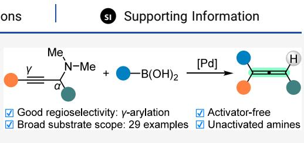

boronic acids and demonstrate the synthetic application of the target products to construct valuable compounds.

## ■ INTRODUCTION

The amine family, a wide range of building blocks, has been extensively used as synthetic handles in synthetic chemistry and medicinal chemistry.1 Although amines ofer immense synthetic leverage, the direct deaminative transformations of tertiary amines remain underutilized because the amino group, as a low heterolytic nucleofugal leaving group, has a high homolytic C−N bond dissociation energy and stronger characteristic basicity.2 Accordingly, much efort has been spent toward the deaminative functionalization of unactivated tertiary amines. The classical method for C−N functionalization involves the conversion of tertiary amines to ammonium salts.3 This preactivation strategy requires at least two distinct transformations to achieve C−N functionalization. In addition, in situ activation strategies such as the catalytic oxidation of tertiary amines to form iminium intermediates4 or the use of activating agents5 to induce deaminative functionalization have been demonstrated. However, each of these previous reports required the use of a large excess of oxidant or activator, producing chemical waste that does not meet the demand for green chemistry. Currently, many research groups have focused on a variety of transition metal-catalyzed6 and metal-free strategies but are generally limited to aryl and benzylic tertiary amines in cross-coupling reactions. To date, a few examples of direct deaminative transformations of tertiary amines are stark reminders of the shortcomings in this area of synthetic chemistry. Therefore, developing a novel, eficient, and atomeconomic protocol for the C−N functionalization of tertiary amines is highly important.

On the other hand, allenes have proven to be eficient and versatile synthons in various cycloaddition reactions, providing access to valuable molecules with medicinal, agrochemical, and material significance.8 They are also important scafolds widely found in natural products, bioactive compounds, and marketed drugs.9 In this context, a great deal of eforts have been devoted to the development of eficient approaches for the construction of allene moieties.10 In this regard, the transition metal-catalyzed deaminative reaction has emerged as one of the most attractive methods for the synthesis of allenes.11 Among these deaminative strategies, the C−N cleavage of propargyl amines has been widely investigated, and various metal catalysts such as Zn, Cu, In, Cd, Ag, Au, and Pd have been employed (Scheme 1A).12 However, these previous reports mainly rely upon the use of specific substrates and limit the structural diversity of allenes. The catalytic cross-coupling of electrophilic propargyl derivatives with various nucleophiles has ofered a promising approach for designing structural diversity and complexity.13 However, the reported deaminative strategies to access allenes are limited to the utilization of propargyl ammonium salts and organometallic reagents through a process of γ-alkylation13b (Scheme 1B). To address this shortfall, difluorocarbene-induced and alkyne-mediated deaminative couplings of unactivated propargylamines and boronic acids have been successfully developed by Song's group14a and our group, 14b respectively, yielding propargylic substitution products rather than allenes (Scheme 1C). The exploitation of catalytic deaminative coupling methods to access allenes using simple propargylamines and nucleophiles remains underdeveloped, with the main challenge being selective control to avoid the propargylic substitution reaction. As part of our ongoing investigation into propargylamine functionalizations, we report herein a novel palladiumcatalyzed deaminative coupling of propargyl tertiary amines and arylboronic acids to construct diverse allenes via a regioselective γ-arylation process (Scheme 1D).

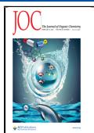

Scheme 1. Deaminative Strategies for Propargylamine Transformations au  
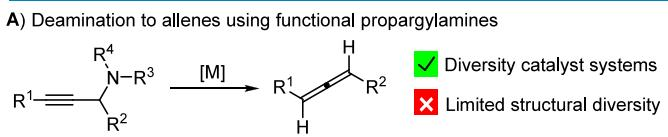

B) Deaminative coupling: y-Alkylation to allenes using activated substrates  
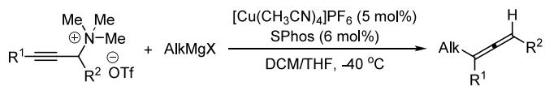  
C) Deaminative coupling: a-Substitution to alkynes using activating agents

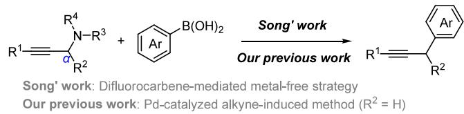

D) This work: Pd-Catalyzed y-arylation to allenes without added activator  
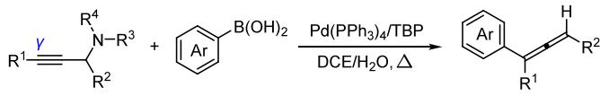  
a(A−C) Previous reports; (D) our work.

## ■ RESULTS AND DISCUSSION

We initially discovered that the introduction of a substituent at the α-position of the nitrogen atom was highly efective in promoting the deaminative γ-arylation of propargylamines. Thus, we started our initial screen by using N,N-dimethyl-1,3- diphenylprop-2-yn-1-amine 1a and phenylboronic acid 2a as model substrates in the presence of $\mathrm { \bar { P d C l } } _ { 2 } ( \mathrm { P P h } _ { 3 } ) _ { 2 }$ (5 mol %), tributylphosphine (TBP; 10 mol %), and $\mathrm { K } _ { 2 } \mathrm { C O } _ { 3 } \left( 2 . 5 \mathrm { e q u i v } \right)$ in 1,2-dichloroethane (DCE; 2 mL) at $1 2 0 ~ ^ { \circ } \mathrm { C }$ for 3 h to aford allene product 3a in a 39% yield (Table 1, entry 1). Subsequently, various commercially available Pd catalysts including $\mathrm { P d } _ { 2 } ( \mathrm { d b a } ) _ { 3 } , \ \mathrm { P d } ( \mathrm { P P h } _ { 3 } ) _ { 4 } ,$ and Pd(OAc) were tested for this reaction (entries 2−4). To our delight, the yield of 3a was increased to 49% when $\mathrm { P d } ( \mathrm { P P h } _ { 3 } ) _ { \mathfrak { c } }$ was used. Diferent ligands were also examined in this coupling reaction under the catalysis of $\mathrm { P d } ( \mathrm { P P h } _ { 3 } ) .$ (entries 5−7), but none of them could improve the yield. In general, the trialkylphosphines $\left( \mathrm { P E t } _ { 3 } \right.$ and $\bar { \mathrm { P C } } \bar { \mathrm { y } } _ { 3 } )$ served as ligands and gave higher yields than those with an aromatic group such as 2-dicyclohexylphosphino- $^ { - 2 ^ { \prime } , 4 ^ { \prime } , 6 ^ { \prime } . }$ triisopropylbiphenyl (XPhos). Taking advantage of the addition of water to enhance the reaction,14b,15 we then screened a number of solvents (fluorobenzene, trifluoromethylbenzene, toluene, and 1,4-dioxane) with the addition of water (entries 8−12). It is obvious that the combination of DCE and water is the most eficient for this deaminative transformation. We were pleased to find that the yield of allene 3a was further improved to 74% when the amount of phenylboronic acid 2a was increased to 2.5 equiv (entry 13). Lowering the reaction temperature to 100 ${ } ^ { \circ } \dot { \mathrm { C } }$ resulted in a significant decrease in the yield of 3a (entry 14, 56%). In addition, other experimental parameters such as the type and loading of the base, the amount of water added, and the reaction time were also evaluated, but all led to a negative result (for details, see the Supporting Information, Table S1).

With the optimized conditions in hand, we next investigated the generality of the reaction substrates (Scheme 2). First, we investigated the extent to which propargylamines 1 containing diferent $\mathbb { R } ^ { 1 }$ and R2 substituent groups would react with phenylboronic acid 2a. Propargylamines 1 containing both aromatic and aliphatic $\mathbb { R } ^ { 1 }$ groups were smoothly converted to a small library of trisubstituted allenes 3ba−3ja in moderate to good yields. For example, various para-substituted aromatic groups, including $n – \mathrm { P r } , \mathrm { M e O } , \mathrm { C l } , \mathrm { B r } , \mathrm { F } ,$ and Ph substitutions as well as the thiophene group, all reacted smoothly. Analogously, aliphatic groups such as cyclohexenyl and cyclopropyl substitutions were also tolerated, providing the target products 3ia and 3ja in 74 and 58% yields, respectively. The generality of $\mathrm { R } ^ { 2 }$ groups on propargylamines 1 was then evaluated. In general, diferent R2-substituted propargylamines 1k−1p reacted well in this deaminative functionalization process. When the $\mathbb { R } ^ { 2 }$ substitution was the substituted phenyl groups, 44−88% yields of the desired products 3ka−3na were obtained. Other $\mathbb { R } ^ { 2 }$ groups including the n-butyl group and hydrogen could be converted to the desired allenes 3oa and 3pa in moderate yields. In addition, the modification of both $\mathrm { R } ^ { \hat { 1 } }$ and $\mathbb { R } ^ { 2 }$ groups was found to be eficient and aforded the corresponding products 3qa and 3ra in reasonable yields.

Table 1. Reaction Optimization for Coupling of 1a with $2 \mathsf { a } ^ { a }$
<table><tr><td></td><td rowspan="2"></td><td rowspan="2">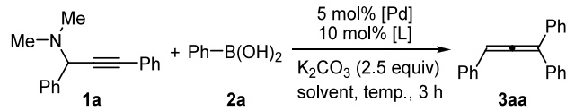</td><td colspan="2"></td><td rowspan="2"></td></tr><tr><td></td><td></td></tr><tr><td>entry</td><td>catalyst</td><td>ligand</td><td>solvent</td><td>temp (°C)</td><td>yieldb (%)</td></tr><tr><td>1</td><td> $\mathrm { P d C l } _ { 2 } ( \mathrm { P P h } _ { 3 } ) _ { 2 }$ </td><td>TBP</td><td>DCE</td><td>120</td><td>39</td></tr><tr><td>2</td><td> $\mathrm { P d } _ { 2 } ( \mathrm { d b } \mathsf { a } ) _ { 3 }$ </td><td>TBP</td><td>DCE</td><td>120</td><td>trace</td></tr><tr><td>3</td><td> $\mathrm { P d } ( \mathrm { P P h } _ { 3 } ) _ { 4 }$ </td><td>TBP</td><td>DCE</td><td>120</td><td>49</td></tr><tr><td>4</td><td> $\mathrm { P d } ( \mathrm { O A c } ) _ { 2 }$ </td><td>TBP</td><td>DCE</td><td>120</td><td>21</td></tr><tr><td>5</td><td> $\mathrm { P d } ( \mathrm { P P h } _ { 3 } ) _ { 4 }$ </td><td> $\mathrm { P E t } _ { 3 }$ </td><td>DCE</td><td>120</td><td>40</td></tr><tr><td>6</td><td> $\mathrm { P d } ( \mathrm { P P h } _ { 3 } ) _ { 4 }$ </td><td> $\mathrm { P C } _ { \mathbf { \nabla } y _ { 3 } }$ </td><td>DCE</td><td>120</td><td>39</td></tr><tr><td> $^ { 7 }$ </td><td> $\mathrm { P d } ( \mathrm { P P h } _ { 3 } ) _ { 4 }$ </td><td> $\mathrm { { \ X P h o s } }$ </td><td>DCE</td><td>120</td><td>34</td></tr><tr><td> ${ } ^ { 8 ^ { c } }$ </td><td> $\mathrm { P d } ( \mathrm { P P h } _ { 3 } ) _ { 4 }$ </td><td>TBP</td><td> $\mathrm { D C E } / \mathrm { H } _ { 2 } \mathrm { O }$ </td><td>120</td><td>69</td></tr><tr><td> $9 ^ { c }$ </td><td> $\mathrm { P d } ( \mathrm { P P h } _ { 3 } ) _ { 4 }$ </td><td>TBP</td><td> $\mathrm { P h F / H } _ { 2 } \mathrm { O }$ </td><td>120</td><td>56</td></tr><tr><td> $1 0 ^ { c }$ </td><td> $\mathrm { P d } ( \mathrm { P P h } _ { 3 } ) _ { 4 }$ </td><td>TBP</td><td> $\mathrm { P h C F } _ { 3 } / \mathrm { H } _ { 2 } \mathrm { O }$ </td><td>120</td><td>60</td></tr><tr><td> $1 1 ^ { c }$ </td><td> $\mathrm { P d } ( \mathrm { P P h } _ { 3 } ) _ { 4 }$ </td><td>TBP</td><td> $\mathrm { P h M e / H } _ { 2 } \mathrm { O }$ </td><td>120</td><td>37</td></tr><tr><td> $1 2 ^ { c }$ </td><td> $\mathrm { P d } ( \mathrm { P P h } _ { 3 } ) _ { 4 }$ </td><td>TBP</td><td> $\mathrm { { d i o x a n e / H _ { 2 } O } }$ </td><td>120</td><td>n.d.</td></tr><tr><td> $1 3 ^ { c , d }$ </td><td> $\mathrm { P d } ( \mathrm { P P h } _ { 3 } ) _ { 4 }$ </td><td>TBP</td><td> $\mathrm { D C E } / \mathrm { H } _ { 2 } \mathrm { O }$ </td><td>120</td><td>74</td></tr><tr><td> $1 4 ^ { c , d }$ </td><td> $\mathrm { P d } ( \mathrm { P P h } _ { 3 } ) _ { 4 }$ </td><td>TBP</td><td> $\mathrm { D C E } / \mathrm { H } _ { 2 } \mathrm { O }$ </td><td>100</td><td>56</td></tr></table>

aReaction conditions: 1a (0.2 mmol), 2a (2 equiv), Pd catalyst (5 mol %), ligand (10 mol %), ${ \mathrm { K } } _ { 2 } { \mathrm { C O } } _ { 3 }$ (0.5 mmol), solvent (2 mL) at 100− $1 2 0 ~ ^ { \circ } \mathrm { C }$ for 3 h under atmospheric conditions. n.d., not detected. bIsolated yield based on 1a. cSolvent/H O (v/v) = 10/1. dUsing 2.5 equiv of 2a. XPhos = 2-dicyclohexylphosphino-2′,4′,6′-triisopropylbiphenyl; TBP=tri-n-butylphosphine; DCE = 1,2-dichloroethane.

Next, various boronic acids 2 were tested for their efect on deaminative coupling with 1a (Scheme 3). In this transformation, all aromatic boronic acids aforded the desired products 3ab−3al in moderate to good yields. For example, both electron-rich (Me, Et, t-Bu, and OMe groups) and electron-deficient (Cl and F groups) aryl boronic acids aforded the corresponding allenes 3ab−3ag in 48−62% yields. Electron-neutral aromatic boronic acids including vinyl- and phenyl-substituted phenylboronic acids as well as naphthyl boronic acids were compatible with the reaction systems, providing the target products 3ah−3ak in 36−87% yields. In particular, heterocyclic boronic acid was found to be a suitable substrate for deaminative coupling to form product

Scheme 2. Substrate Scope of Propargylaminesa  
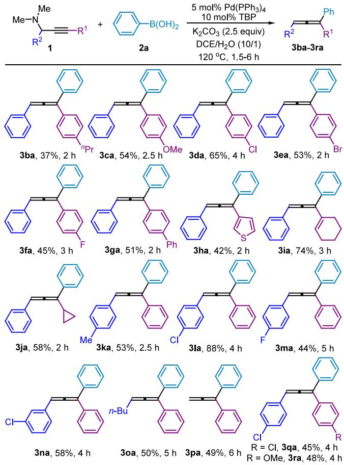  
aReaction conditions: 1 (0.2 mmol), 2a (0.5 mmol), Pd(PPh ) (5 mol %), TBP (10 mol %), ${ \mathrm { K } } _ { 2 } { \mathrm { C O } } _ { 3 }$ (0.5 mmol), DCE/H O (v/v = 10/ 1) at 120 °C for 1.5−6 h under atmospheric conditions. Isolated yield based on 1.

3al. However, the deaminative coupling of cyclohexylboronic acid with 1a did not yield the target product 3am. In addition, we also tried other boronic acids, such as (E)-styrylboronic acid, (4-formylphenyl)boronic acid, n-pentylboronic acid, and pyridine-4-boronic acid. However, all of them did not generate the target products (for details, see the Supporting Information, Table S2).

Finally, the reaction on a 2 mmol scale was carried out without any further optimization but aforded a somewhat diminished yield for product 3aa (Scheme 4a). We also adjusted the amount of catalyst and the amount of solvent, but unfortunately, the yield did not improve significantly (for details, see the Supporting Information, Table S3). Furthermore, the synthetic utility of the obtained product was demonstrated by the following transformations (Scheme 4b).16 Utilizing a previous method16a and starting from 3aa, the indene compound 4 was eficiently constructed in a yield of 41% by TfOH-promoted cyclization. The treatment of 3aa using the (PPh )AuCl/AgBF catalyst system gave the oxidation product 5 in a yield of 69%.16b

On the basis of the previous literature17 and our studies, a plausible mechanism is proposed as shown in Scheme 5. First, the oxidative addition of Pd(0) species and propargylamine 1 forms the allenylpalladium complex A through σ−π−σ rearrangement. Subsequently, the allenylic palladium species A is converted to the Pd hydroxide intermediate B by reaction with water under basic conditions, followed by the transmetalation with boronic acid 2 to deliver the corresponding allenylic intermediate C. Finally, the allene product 3 is generated via reductive elimination of intermediate C and the catalytically active Pd(0) species is regenerated.

Scheme 3. Substrate Scope of Boronic Acidsa  
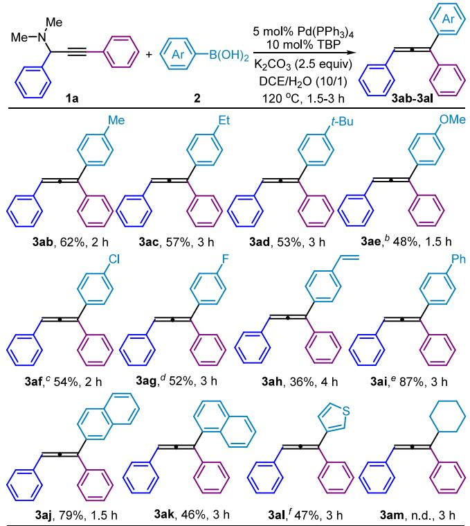  
aReaction conditions: 1a (0.2 mmol), 2 (0.5 mmol), Pd(PPh ) (5 mol %), TBP (10 mol %), K CO (0.5 mmol), DCE/H O (v/v = 10/ 1) at 120 °C for 1.5−3 h under atmospheric conditions. Isolated yield based on 1a. b3ae = 3ca. c3af = 3da. d3ag = 3fa. e3ai = 3ga. f3al = 3ha.

Scheme 4. Scalability and Product Transformations  
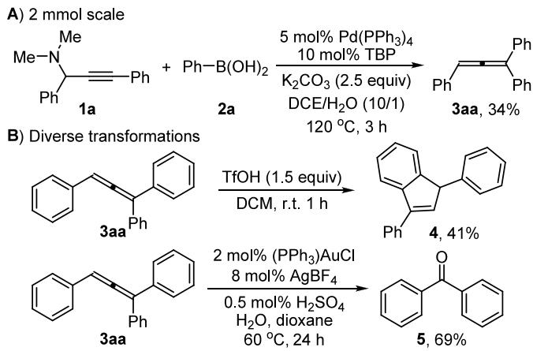  
a(A) Millimole-scale synthesis; (B) transformations of product 3aa.

## ■ CONCLUSIONS

In summary, a straightforward synthetic protocol has been developed for the preparation of trisubstituted allenes via the palladium-catalyzed deaminative coupling of unactivated propargylamines and aryboronic acids. Importantly, we demonstrate for the first time that this catalytic deaminative coupling reaction can be achieved in the absence of any external activator. Compared to the traditional catalytic deaminative coupling via in situ amino activation, the activator-free method ofers some sustainable features in terms of operational simplicity, good functional group tolerance with high yield and regioselectivity, and the absence of toxic byproducts. Eforts to explore new synthetic applications for activator-free catalytic deaminative transformation are currently underway in our laboratory.

Scheme 5. Proposed Mechanism  
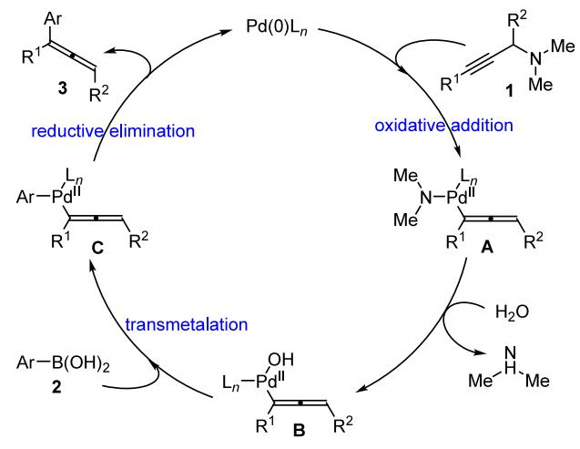

## ■ EXPERIMENTAL SECTION

General Information. Unless otherwise noted, all commercial reagents, such as boronic acids, catalyst, ligands, and solvent, were used directly as purchased. All reactions were carried out under air. Thin-layer chromatography (TLC) was performed, and visualization of the compounds was accomplished with ultraviolet light (254 nm) or iodine. Products were purified by flash chromatography on silica gel (100−200 mesh). The solvent was removed under reduced pressure, and the residue was purified by column chromatography on silica gel and eluted with petroleum/ethyl acetate to aford the desired product.1H nuclear magnetic resonance (NMR), 13C NMR, and 19F spectra were recorded in $\mathrm { C D C l } _ { 3 }$ operating at 400, 101, and 376 MHz, respectively. Proton chemical shifts are reported relative to the residual proton signals of deuterated solvent CDCl (7.29 ppm). Carbon chemical shifts were internally referenced to the deuterated solvent signals in CDCl (77.10 ppm). Chemical shifts are reported in δ (parts per million) values. Coupling constants J are reported in Hz. Proton coupling patterns were described as singlet (s), doublet (d), triplet (t), quartet (q), and multiple (m). High-resolution mass spectrometry (HRMS) was recorded on a Q-TOF (AB SCIEX X500R with an electrospray ionization (ESI) source and Agilent 7250 with an electron ionization (EI) source), which combines quadrupole precursor ion selection and a high-resolution accurate-mass time-offlight mass analyzer to deliver mass accuracy.

General Procedure for the Synthesis of the Desired Product 3. Pd(PPh ) (11.6 mg, 0.01 mmol, 5 mol %), TBP (4.0 mg, 0.02 mol, 10 mol %), K CO (0.5 mmol, 2.5 equiv), propargylamines 1 (0.2 mmol), and arylboronic acids 2 (0.5 mmol, 2.5 equiv) were added to a 5 mL Schlenk reaction tube, followed by the addition of DCE (2 mL) and water (0.2 mL). The mixture was stirred in an oil bath and heated to $1 2 0 ~ ^ { \circ } \mathrm { C }$ (oil bath temperature) for 1.5−6 h in reflux. After the reaction had reached completion (as determined by TLC), the reaction mixture was cooled to room temperature and extracted with DCM. It was then filtered, and the solvent was removed in a rotary evaporator. The residue was purified by flash chromatography (petroleum ether) to provide desired products 3aa.

2 mmol of the Scaled Reaction. Pd(PPh ) (115.6 mg, 0.1   
mmol, 5 mol %), TBP (40.5 mg, 0.2 mol, 10 mol %), $\mathrm { K } _ { 2 } \mathrm { C O } _ { 3 }$ (5.0

mmol, 2.5 equiv), propargylamines 1 (2.0 mmol), and arylboronic acids 2 (5 mol, 2.5 equiv) were added to a 50 mL single-necked flask, followed by the addition of DCE (10 mL) and water (1.0 mL). The mixture was stirred in an oil bath preheated to 120 °C for 3 h (monitored by TLC). After the reaction had reached completion (as determined by TLC), the reaction mixture was cooled to room temperature and extracted with DCM. It was then filtered, and the solvent was removed in a rotary evaporator. The residue was purified by flash chromatography (petroleum ether) to provide the desired products 3 (34%, 184.5 mg).

General Procedure for the Synthesis of the Desired Product $4 . { } ^ { 1 9 } \ \mathrm { T o }$ a suspension of trifluoromethylated allene 3aa (53.7 mg, 0.2 mmol) in CH Cl (2 mL) was added TfOH (18 μL, 0.15 mmol) at room temperature. The resulting mixture was stirred at room temperature for 1 h. Then, the mixture was poured into ice water (20 mL) and extracted with CH Cl . The combined organic layers were washed with saturated NaHCO (aq.), dried over $\mathrm { { \dot { M } g S O _ { 4 } } } ,$ and concentrated in vacuo. The residue was purified by column chromatography using n-hexane as an eluent to aford 1,3-diphenyl-1H-indene 4 (22.0 mg, 41% yield).

General Procedure for the Synthesis of the Desired Product $5 . { } ^ { 1 6 6 }$ Sulfuric acid (0.5 mol %) was added to a mixture of 3aa (0.2 mmol), water (4 mmol), (PPh )AuCl (2 mol %), AgBF (8 mol %), and dioxane (1 mL). The mixture was stirred at $6 0 ~ ^ { \circ } \mathrm { C }$ for $^ { 2 4 } \mathrm { h } ,$ and the reaction was quenched with a saturated solution of ${ \mathrm { N a H C O } } _ { 3 }$ and extracted with ethyl acetate (3 × 10 mL). The combined organic layers were washed with brine, dried over ${ \mathrm { N a } } _ { 2 } S { \mathrm { O } } _ { 4 } ,$ and concentrated in vacuo. The residue was purified by flash chromatography to give desired products 5 (25.1 mg, 69%).

Propa-1,2-diene-1,1,3-triyltribenzene $( 3 \pmb { a } \pmb { a } ) . ^ { 2 0 }$ Purification by silica gel column chromatography (petroleum ether (PE)) aforded 3aa (53.1 mg, 74% yield) as a yellow oil. 1H NMR (400 MHz, CDCl ) δ 7.47−7.38 (m, 6H), 7.38−7.26 (m, 8H), 7.25−7.19 (m, 1H), 6.71 (s, 1H). 13C{1H} NMR (101 MHz, CDCl ) δ 208.4, 135.9, 133.0, 132.5, 129.0, 128.6, 128.5, 128.2, 127.8, 114.2, 96.9.

(1-(4-Propylphenyl)propa-1,2-diene-1,3-diyl)dibenzene (3ba). Purification by silica gel column chromatography (PE) aforded 3ba (23.0 mg, 37% yield) as a yellow oil. 1H NMR (400 MHz, CDCl ) δ 7.45−7.39 (m, 4H), 7.38−7.27 (m, 7H), 7.24−7.17 (m, 1H), 7.15 (d, J = 8.2 Hz, 2H), 6.69 (s, 1H), 2.62−2.55 (m, 2H), 1.68−1.60 (m, 2H), 0.95 (t, J = 7.4 Hz, 3H). 13C{1H} NMR (101 MHz, CDCl ) δ 208.2, 142.3, 136.4, 134.1, 133.4, 131.5, 128.8, 128.7, 128.5, 128.5, 128.3, 127.6, 127.3, 127.0, 113.7, 97.6, 37.8, 24.6, 13.9. HRMS (EI) m/z: [M+] calcd for $\mathrm { C } _ { 2 4 } \mathrm { H } _ { 2 2 } , 3 1 0 . 1 7 1 7 ;$ found, 310.1715.

(1-(4-Methoxyphenyl)propa-1,2-diene-1,3-diyl)dibenzene $( 3 c a ) . ^ { \ \sum \dot { o } }$ Purification by silica gel column chromatography (PE) aforded 3ca (32.2 mg, 54% yield) as a yellow oil. 1H NMR (400 MHz, CDCl ) δ 7.46−7.38 (m, 4H), 7.38−7.27 (m, 7H), 7.25−7.19 (m, 1H), 6.91−6.86 (m, 2H), 6.68 (s, 1H), 3.81 (s, 3H). 13C{1H} NMR (101 MHz, CDCl ) δ 208.0, 159.2, 136.5, 134.2, 129.6, 128.8, 128.5, 128.5, 128.3, 127.6, 127.3, 127.0, 114.0, 97.6, 55.4.

(1-(4-Chlorophenyl)propa-1,2-diene-1,3-diyl)dibenzene (3da). Purification by silica gel column chromatography (PE) aforded 3da (39.4 mg, 65% yield) as a yellow oil. 1H NMR (400 MHz, CDCl ) δ 7.43−7.38 (m, 4H), 7.37−7.27 (m, 10H), 6.66 (s, 1H). 13C{1H} NMR (101 MHz, CDCl ) δ 208.3, 135.8, 134.7, 133.6, 133.4, 129.7, 128.9, 128.7, 128.6, 128.4, 127.8, 127.6, 127.0, 112.9, 98.1. HRMS (ESI-TOF) m/z: $[ \mathbf { M } + \mathbf { H } ] ^ { + }$ calcd for $\mathrm { C _ { 2 l } H _ { 1 6 } C l } ,$ 303.0936; found, 303.0930.

(1-(4-Bromophenyl)propa-1,2-diene-1,3-diyl)dibenzene $( 3 e a ) . ^ { 2 1 }$ Purification by silica gel column chromatography (PE) aforded 3ea (36.8 mg, 53% yield) as a yellow oil. 1H NMR (400 MHz, CDCl ) δ 7.47−7.43 (m, 2H), 7.41−7.26 (m, 11H), 7.25−7.20 (m, 1H), 6.70 (s, 1H). 13C{1H} NMR (101 MHz, CDCl ) δ 208.3, 135.7, 135.3, 133.5, 131.7, 130.1, 128.9, 128.6, 128.4, 127.9, 127.6, 127.0, 121.6, 113.0, 98.1.

(1-(4-Fluorophenyl)propa-1,2-diene-1,3-diyl)dibenzene (3fa). Purification by silica gel column chromatography (PE) aforded 3fa (25.8 mg, 45% yield) as a yellow oil. 1H NMR (400 MHz, CDCl ) δ 7.42−7.27 (m, 11H), 7.25−7.20 (m, 1H), 7.06−6.99 (m, 2H), 6.70

(s, 1H). 13C{1H} NMR (101 MHz, CDCl ) δ 208.1, 163.6, 161.1, 136.1, 133.8, 132.2 (d, J = 3.2 Hz), 130.1 (d, J = 8.1 Hz), 128.9, 128.6, 128.4, 127.8, 127.5, 127.0, 115.6, 115.4, 112.9, 97.9. 19F NMR (376 MHz, CDCl ) δ −113.17. HRMS (ESI-TOF) m/z: $[ \mathbf { M } + \mathbf { H } ] ^ { + }$ calcd for ${ \mathrm { C } } _ { 2 1 } { \mathrm { H } } _ { 1 6 } { \mathrm { F } } ,$ 287.1231; found, 287.1235.

4-(1,3-Diphenylpropa-1,2-dien-1-yl)-1,1′-biphenyl $( 3 g a ) . ^ { 2 0 }$ Purification by silica gel column chromatography (PE) aforded 3ga (35.1 mg, 51% yield) as a yellow oil. 1H NMR (400 MHz, CDCl ) δ 7.61− 7.55 (m, 3H), 7.53−7.40 (m, 8H), 7.39−7.28 (m, 6H), 7.25−7.20 (m, 2H), 6.73 (s, 1H). 13C{1H} NMR (101 MHz, CDCl ) δ 208.5, 140.8, 140.5, 136.2, 135.1, 133.9, 128.9, 128.8, 128.57, 127.7, 127.5, 127.4, 127.3, 127.1, 113.5, 97.9.

3-(1,3-Diphenylpropa-1,2-dien-1-yl)thiophene (3ha). Purification by silica gel column chromatography (PE) aforded 3ha (23.0 mg, 42% yield) as a yellow oil. 1H NMR (400 MHz, CDCl ) δ 7.51−7.47 (m, 2H), 7.42−7.30 (m, 8H), 7.25−7.19 (m, 2H), 7.20−7.14 (m, 2H)., 6.68 (s, 1H). 13C{1H} NMR (101 MHz, CDCl ) δ 208.3, 136.7, 136.3, 133.9, 128.8, 128.8, 128.6, 128.2, 128.0, 127.8, 127.4, 127.1, 125.7, 122.8, 109.3, 97.6. HRMS (ESI-TOF) m/z: [M + H]+ calcd for ${ \mathrm { C } } _ { 1 9 } { \mathrm { H } } _ { 1 5 } { \mathrm { S } } ,$ 275.0889; found, 275.0886.

(1-(Cyclohex-1-en-1-yl)propa-1,2-diene-1,3-diyl)dibenzene (3ia). Purification by silica gel column chromatography (PE) aforded 3ia (40.3 mg, 74% yield) as a yellow oil. 1H NMR (400 MHz, CDCl ) δ 7.39−7.27 (m, 8H), 7.27−7.22 (m, 1H), 7.21−7.16 (m, 1H), 6.50 (s, 1H), 5.72−5.64 (m, 1H), 2.29−2.08 (m, 4H), 1.74−1.60 (m, 4H). 13C{1H} NMR (101 MHz, CDCl ) δ 206.8, 136.5, 134.9, 132.9, 129.1, 128.7, 128.2, 127.6, 127.2, 127.0, 126.8, 115.6, 97.0, 27.6, 26.0, 22.9, 22.3. HRMS (ESI-TOF) m/z: $[ \mathbf { M } \ + \ \mathbf { H } ] ^ { + }$ calcd for $\mathrm { C } _ { 2 1 } \mathrm { H } _ { 2 1 } ,$ 273.1638; found, 273.1640.

(1-Cyclopropylpropa-1,2-diene-1,3-diyl)dibenzene $( 3 j a ) . ^ { 2 2 }$ Purification by silica gel column chromatography (PE) aforded 3ja (26.9 mg, 58% yield) as a yellow oil. 1H NMR (400 MHz, CDCl ) δ 7.64− 7.59 (m, 2H), 7.43−7.36 (m, 2H), 7.36−7.30 (m, 3H), 7.30−7.26 (m, 4H), 6.54 (d, J = 2.6 Hz, 1H), 1.74−1.64 (m, 1H), 0.90 (d, J = 8.0 Hz, 2H), 0.67−0.55 (m, 2H). 13C{1H} NMR (101 MHz, CDCl ) δ 205.8, 136.5, 134.31, 128.8, 128.5, 127.2, 127.2, 126.76, 126.4, 113.3, 99.0, 11.1, 7.4, 6.9.

(3-(p-Tolyl)propa-1,2-diene-1,1-diyl)dibenzene $( 3 k a ) . ^ { 2 3 }$ Purification by silica gel column chromatography (PE) aforded 3ka (29.9 mg, 53% yield) as a yellow oil. 1H NMR (400 MHz, CDCl ) δ 7.44− 7.39 (m, 4H), 7.37−7.25 (m, 8H), 7.13 (d, J = 7.9 Hz, 2H), 6.68 (s, 1H), 2.33 (s, 3H). 13C{1H} NMR (101 MHz, CDCl ) δ 208.2, 137.3, 136.4, 130.9, 129.6, 128.5, 127.5, 127.4, 127.3, 126.9, 113.6, 97.6, 21.3.

(3-(4-Chlorophenyl)propa-1,2-diene-1,1-diyl)dibenzene $( 3 I a ) . ^ { 2 0 }$ Purification by silica gel column chromatography (PE) aforded 3la (53.3 mg, 88% yield) as a yellow oil. 1H NMR (400 MHz, CDCl ) δ 7.42−7.38 (m, 4H), 7.38−7.34 (m, 3H), 7.34−7.26 (m, 7H), 6.66 (s, 1H). 13C{1H} NMR (101 MHz, CDCl ) δ 208.4, 135.9, 133.0, 132.5, 129.0, 128.6, 128.5, 128.2, 127.8, 114.2, 96.9.

(3-(4-Fluorophenyl)propa-1,2-diene-1,1-diyl)dibenzene (3ma).20 Purification by silica gel column chromatography (PE) aforded 3ma (34.0 mg, 44% yield) as a yellow oil. 1H NMR (400 MHz, CDCl ) δ 7.43−7.28 (m, 11H), 7.26−7.20 (m, 1H), 7.03 (t, J = 8.8 Hz, 2H), 6.70 (s, 1H). 13C{1H} NMR (101 MHz, CDCl ) δ 208.0, 163.4, 161.0, 136.1, 129.9 $\left( \mathrm { d } , J = 3 . 2 ~ \mathrm { H z } \right) .$ , 128.5 (d, J = 8.8 Hz), 128.4, 127.7, 115.9, 115.7, 114.0, 96.8. 19F NMR (376 MHz, CDCl ) δ −114.62.

(3-(3-Chlorophenyl)propa-1,2-diene-1,1-diyl)dibenzene (3na). Purification by silica gel column chromatography (PE) aforded 3na (35.1 mg, 58% yield) as a yellow oil. 1H NMR (400 MHz, CDCl ) δ 7.43−7.38 (m, 4H), 7.38−7.27 (m, 8H), 7.27−7.22 (m, 2H), 7.22− 7.17 (m, 1H), 6.65 (s, 1H). 13C{1H} NMR (101 MHz, CDCl ) δ 208.5, 136.0, 135.8, 134.8, 130.3, 130.0, 128.6, 128.5, 127.8, 127.4, 126.8, 125.1, 114.3, 96.8. HRMS m/z (ESI-TOF): calculated for $\mathrm { C } _ { 2 1 } \mathrm { H } _ { 1 6 } \mathrm { C l } \left( [ \mathrm { M } + \mathrm { H } ] ^ { + } \right)$ , 303.0936; found, 303.0930.

Hepta-1,2-diene-1,1-diyldibenzene (3oa).20 Purification by silica gel column chromatography (PE) aforded 3oa (24.8 mg, 50% yield) as a yellow oil. 1H NMR (400 MHz, CDCl ) δ 7.37−7.29 (m, 8H), 7.27−7.22 (m, 2H), 5.69 (t, J = 6.7 Hz, 1H), 2.19 (q, J = 7.1 Hz, 2H),

1.55−1.45 (m, 2H), 1.43−1.33 (m, 2H), 0.89 (t, J = 7.4 Hz, 3H). 13C{1H} NMR (101 MHz, CDCl ) δ 205.5, 137.4, 137.4, 128.4, 128.3, 128.2, 128.1, 127.0, 98.0, 94.5, 31.4, 28.8, 22.4, 14.0.

Propa-1,2-diene-1,1-diyldibenzene (3pa).23 Purification by silica gel column chromatography (PE) aforded 3pa (18.8 mg, 49% yield) as a yellow oil. 1H NMR (400 MHz, CDCl ) δ 7.40−7.23 (m, 10H), 5.27 (s, 2H). 13C{1H} NMR (101 MHz, CDCl ) δ 207.8, 136.2, 133.6, 128.7, 128.4, 128.4, 127.3, 127.0, 98.4.

4,4′-(1-Phenylpropa-1,2-diene-1,3-diyl)bis(chlorobenzene) (3qa). Purification by silica gel column chromatography (PE) aforded 3qa (30.4 mg, 45% yield) as a yellow oil. 1H NMR (400 MHz, CDCl ) δ 7.40−7.34 (m, 5H), 7.33−7.29 (m, 8H), 7.26 (s, 1H), 6.68 (s, 1H), 1.32−1.27 (m, 1H), 1.25 (s, 4H), 0.91−0.80 (m, 2H). 13C{1H} NMR (101 MHz, CDCl ) δ 208.3, 135.5, 133.6, 133.2, 132.1, 129.7, 129.1, 128.8, 128.7, 128.4, 128.2, 128.0, 113.3, 97.2, 29.7. HRMS (ESI-TOF) m/z: [M + H]+ calcd for $\mathrm { C _ { 2 1 } H _ { 1 5 } C l _ { 2 } } ,$ 337.0546; found, 337.0548.

1-Chloro-4-(3-(4-methoxyphenyl)-3-phenylpropa-1,2-dien-1-yl)- benzene (3ra). Purification by silica gel column chromatography (PE) aforded 3ra (32.0 mg, 48% yield) as a yellow oil. 1H NMR (400 MHz, CDCl ) δ 7.43−7.38 (m, 2H), 7.38−7.25 (m, 12H), 6.64 (s, 1H), 3.82 (s, 3H). 13C{1H} NMR (101 MHz, CDCl ) δ 208.1, 159.3, 136.2, 133.0, 132.9, 132.7, 129.6, 129.3, 129.0, 128.6, 128.6, 128.5, 128.1, 128.0, 127.7, 114.0, 96.7, 55.4. HRMS (ESI-TOF) m/z: [M + H]+ calcd for $\mathrm { C } _ { 2 2 } \mathrm { H } _ { 1 8 } \mathrm { C l O } ,$ , 333.1041; found, 333.1044.

(1-(p-Tolyl)propa-1,2-diene-1,3-diyl)dibenzene (3ab).24 Purification by silica gel column chromatography (PE) aforded 3ab (47.4 mg, 62% yield) as a yellow oil. 1H NMR (400 MHz, CDCl ) δ 7.45− 7.38 (m, 4H), 7.37−7.27 (m, 7H), 7.24−7.19 (m, 1H), 7.16 (d, J = 7.9 Hz, 2H), 6.69 (s, 1H), 2.36 (s, 3H). 13C{1H} NMR (101 MHz, CDCl ) δ 208.2, 137.5, 136.4, 134.1, 133.2, 129.2, 128.8, 128.5, 128.4, 127.5, 127.3, 127.0, 113.6, 97.6, 21.2.

(1-(4-Ethylphenyl)propa-1,2-diene-1,3-diyl)dibenzene (3ac). Purification by silica gel column chromatography (PE) aforded 3ac (33.8 mg, 57% yield) as a yellow oil. 1H NMR (400 MHz, CDCl ) δ 7.46−7.37 (m, 4H), 7.36−7.23 (m, 7H), 7.22−7.13 (m, 3H), 6.67 (s, 1H), 2.64 (q, J = 7.6 Hz, 2H), 1.23 (t, J = 7.6 Hz, 3H). 13C{1H} NMR (101 MHz, CDCl ) δ 208.3, 143.9, 136.4, 134.2, 133.5, 131.8, 128.9, 128.6, 128.6, 128.5, 128.2, 127.6, 127.4, 127.1, 113.8, 97.7, 28.7, 15.70. HRMS (ESI-TOF) m/z: $[ \mathbf { M } + \mathbf { H } ] ^ { + }$ calcd for $\mathrm { C } _ { 2 3 } \mathrm { H } _ { 2 1 } ,$ 297.1638; found, 297.1642.

(1-(4-(tert-Butyl)phenyl)propa-1,2-diene-1,3-diyl)dibenzene (3ad). Purification by silica gel column chromatography (PE) aforded 3ad (34,4 mg, 53% yield) as a yellow oil. 1H NMR (400 MHz, CDCl ) δ 7.36−7.32 (m, 2H), 7.32−7.27 (m, 2H), 7.27−7.24 (m, 4H), 7.24−7.14 (m, 5H), 7.12−7.07 (m, J = 10.0, 8.4, 2.1 Hz, 1H), 6.60 (s, 1H), 1.24 (s, 9H). 13C{1H} NMR (101 MHz, CDCl ) δ 208.4, 150.7, 136.4, 134.1, 133.2, 128.9, 128.6, 128.6, 128.2, 127.6, 127.4, 127.1, 125.5, 113.6, 97.7, 34.7, 31.4. HRMS (EI) m/z: [M]+ calcd for ${ \mathrm { C } } _ { 2 5 } { \mathrm { H } } _ { 2 4 } ,$ 324.1873; found, 324.1867.

(1-(4-Methoxyphenyl)propa-1,2-diene-1,3-diyl)dibenzene (3ae = 3ca).20 Purification by silica gel column chromatography (PE) aforded 3ae (28.6 mg, 48% yield) as a yellow oil. 1H NMR (400 MHz, CDCl ) δ 7.46−7.36 (m, 4H), 7.37−7.25 (m, 7H), 7.24−7.18 (m, 1H), 6.88 (d, J = 8.8 Hz, 2H), 6.68 (s, 1H), 3.80 (s, 3H). 13C{1H} NMR (151 MHz, CDCl ) δ 207.0, 158.2, 135.5, 133.1, 128.6, 127.8, 127.4, 127.4, 127.3, 126.5, 126.3, 125.9, 112.9, 112.3, 96.5, 54.3.

(1-(4-Chlorophenyl)propa-1,2-diene-1,3-diyl)dibenzene (3af = 3da). Purification by silica gel column chromatography (PE) aforded 3af (32.7 mg, 54% yield) as a yellow oil. 1H NMR (600 MHz, CDCl ) δ 7.39 (d, J = 7.3 Hz, 4H), 7.37−7.28 (m, 10H), 7.25−7.22 (m, 1H), 6.71 (s, 1H).

(1-(4-Fluorophenyl)propa-1,2-diene-1,3-diyl)dibenzene (3ag = 3fa). Purification by silica gel column chromatography (PE) aforded 3ag (29.8 mg, 52% yield) as a yellow oil. 1H NMR (400 MHz, CDCl ) δ 7.43−7.35 (m, 6H), 7.38−7.24 (m, 7H), 7.24−7.18 (m, 1H), 7.05−6.98 (m, 2H), 6.69 (s, 1H). 13C{1H} NMR (151 MHz, CDCl ) δ 207.1, 162.1, 160.5, 135.0, 132.7, 131.1 (d, J = 3.5 Hz),

129.0 (d, J = 8.4 Hz), 127.8, 127.6, 127.3, 126.7, 126.5, 126.0, 114.5, 114.3, 111.9, 96.8. 19F NMR (376 MHz, CDCl ) δ −114.49.

(1-(4-Vinylphenyl)propa-1,2-diene-1,3-diyl)dibenzene (3ah). Purification by silica gel column chromatography (PE) aforded 3ah (21.2 mg, 36% yield) as a yellow oil. 1H NMR (400 MHz, CDCl ) δ 7.46−7.36 (m, 8H), 7.36−7.27 (m, 5H), 7.24−7.20 (m, 1H), 6.71 (s, 1H), 5.75 (d, J = 17.6 Hz, 1H), 5.25 (d, J = 11.8 Hz, 1H). 13C{1H} NMR (101 MHz, CDCl ) δ 208.5, 137.0, 136.4, 136.1, 135.6, 133.9, 128.9, 128.6, 128.6, 127.7, 127.4, 127.0, 126.4, 114.0, 113.6, 97.8. HRMS (ESI-TOF) m/z: [M + H]+ calcd for $\mathrm { C } _ { 2 3 } \mathrm { H } _ { 1 9 } ,$ 295.1482; found, 295.1474.

4-(1,3-Diphenylpropa-1,2-dien-1-yl)-1,1′-biphenyl (3ai = 3ga).20 Purification by silica gel column chromatography (PE) aforded 3ai (59.9 mg, 87% yield) as a yellow oil. 1H NMR (400 MHz, CDCl ) δ 7.62−7.56 (m, 4H), 7.52−7.41 (m, 8H), 7.40−7.30 (m, 6H), 7.25− 7.21 (m, 1H), 6.75 (s, 1H).

2-(1,3-Diphenylpropa-1,2-dien-1-yl)naphthalene (3aj). Purification by silica gel column chromatography (PE) aforded 3aj (50.3 mg, 79% yield) as a yellow oil. 1H NMR (400 MHz, CDCl ) δ 7.97−7.90 (m, 1H), 7.91−7.85 (m, 1H), 7.83−7.78 (m, 2H), 7.77−7.73 (m, 1H), 7.62−7.55 (m, 1H), 7.54−7.41 (m, 6H), 7.40−7.30 (m, 4H), 7.26−7.20 (m, 1H), 6.77 (s, 1H). 13C{1H} NMR (101 MHz, CDCl ) δ 208.8, 136.3, 133.9, 133.6, 133.5, 132.9, 128.9, 128.7, 128.6, 128.2, 128.1, 127.8, 127.7, 127.5, 127.2, 127.1, 126.6, 126.3, 126.1, 125.8, 114.0, 98.0. HRMS (EI) m/z: [M]+ calcd for ${ \mathrm { C } } _ { 2 5 } { \mathrm { H } } _ { 1 8 } ,$ 318.1404; found, 318.1398.

1-(1,3-Diphenylpropa-1,2-dien-1-yl)naphthalene (3ak). Purification by silica gel column chromatography (PE) aforded 3ak (26.3 mg, 46% yield) as a yellow oil. 1H NMR (400 MHz, CDCl ) δ 7.99 (d, J = 8.1 Hz, 1H), 7.87−7.79 (m, 2H), 7.59 (d, J = 7.0 Hz, 1H), 7.52−7.33 (m, 5H), 7.32−7.11 (m, 8H), 6.67 (s, 1H). 13C{1H} NMR (101 MHz, CDCl ) δ 207.5, 136.6, 134.0, 133.9, 133.8, 132.1, 128.8, 128.6, 128.4, 128.4, 127.8, 127.4, 127.3, 127.2, 127.1, 126.3, 126.2, 125.9, 125.7, 111.1, 97.4. HRMS (ESI-TOF) m/z: [M + H]+ calcd for C H , 319.1482; found, 319.1477.

3-(1,3-Diphenylpropa-1,2-dien-1-yl)thiophene (3al = 3ha). Purification by silica gel column chromatography (PE) aforded 3al (25.8 mg, 47% yield) as a yellow oil. 1H NMR (400 MHz, CDCl ) δ 7.40−7.27 (m, 9H), 7.27−7.22 (m, 1H), 7.21−7.16 (m, 1H), 6.50 (s, 1H).

1,3-Diphenyl-1H-indene (4).19 Purification by silica gel column chromatography (PE) aforded 4 (32.7 mg, 22.0% yield) as a white solid. 1H NMR (600 MHz, CDCl ) δ 7.71−7.67 (m, 2H), 7.64−7.61 (m, 1H), 7.50 (t, J = 7.5 Hz, 2H), 7.44−7.41 (m, 1H), 7.36−7.29 (m, 5H), 7.29−7.24 (m, 3H), 7.23−7.20 (m, 2H), 6.67 (d, J = 2.1 Hz, 1H), 4.74 (s, 1H).

Benzophenone (5).16b Purification by silica gel column chromatography (PE) aforded 5 (25.1 mg, 69% yield) as a white solid. 1H NMR (500 MHz, CDCl ) δ 7.82−7.79 (m, 4H), 7.62−7.56 (m, 2H), 7.49 (t, J = 7.8 Hz, 4H).

## ■ ASSOCIATED CONTENT

## Data Availability Statement

The data underlying this study are available in the published article and its Supporting Information.

## \*sı Supporting Information

The Supporting Information is available free of charge at https://pubs.acs.org/doi/10.1021/acs.joc.4c02708.

Experimental procedures; spectral data, including 1H, 19F, and 13C NMR spectra (PDF)

## ■ AUTHOR INFORMATION

## Corresponding Authors

Tao Zhao − College of Chemistry and Chemical Engineering, Shanghai University of Engineering Science, Shanghai 201620, China; Email: zhaotao1982@126.com

Huangdi Feng − College of Chemistry and Chemical Engineering, Shanghai University of Engineering Science, Shanghai 201620, China; orcid.org/0000-0002-5500- 8283; Email: hdfeng@sues.edu.cn

## Authors

Yan Sun − College of Chemistry and Chemical Engineering, Shanghai University of Engineering Science, Shanghai 201620, China

Ya Pan − College of Chemistry and Chemical Engineering, Shanghai University of Engineering Science, Shanghai 201620, China

Junwei Li − College of Chemistry and Chemical Engineering, Shanghai University of Engineering Science, Shanghai 201620, China

Aiguo Gu − Jiangsu Product Quality Testing & Inspection Institute, Nanjing, Jiangsu Province 210007, China

Junhai Huang − College of Chemistry and Chemical Engineering, Shanghai University of Engineering Science, Shanghai 201620, China; orcid.org/0000-0002-0723- 3507

Complete contact information is available at: https://pubs.acs.org/10.1021/acs.joc.4c02708

## Author Contributions

§Y. Sun and Y. Pan contributed equally to this work.

## Notes

The authors declare no competing financial interest.

## ■ ACKNOWLEDGMENTS

We gratefully acknowledge the National Natural Science Foundation of China (nos. 22078192 and 32472612) and the Jiangsu Province Science and Technology of Market Supervision and Administration Foundation (no. KJ2024003) for their financial support.

## ■ REFERENCES

(1) (a) Wang, Y.; Haight, I.; Gupta, R.; Vasudevan, A. What Is in Our Kit? An Analysis of Building Blocks Used in Medicinal Chemistry Parallel Libraries. J. Med. Chem. 2021, 64, 17115−17122.

(b) Afanasyev, O. I.; Kuchuk, E.; Usanov, D. L.; Chusov, D. Reductive Amination in the Synthesis of Pharmaceuticals. Chem. Rev. 2019, 119, 11857−11911.

(2) (a) Kong, D.; Moon, P. J.; Lundgren, R. J. Radical Coupling from Alkyl Amines. Nat. Catal. 2019, 2, 473−476. (b) Li, Y.-N.; Xiao, F.; Guo, Y.; Zeng, Y.-F. Recent Developments in Deaminative Functionalization of Alkyl Amines. Eur. J. Org. Chem. 2021, 2021, 1215−1228. (c) Ouyang, K.; Hao, W.; Zhang, W.-X.; Xi, Z. Transition-Metal-Catalyzed Cleavage of C-N Single Bonds. Chem. Rev. 2015, 115, 12045−12090.

(3) (a) Guisán-Ceinos, M.; Martín-Heras, V.; Tortosa, M. Regioand Stereospecific Copper-Catalyzed Substitution Reaction of Propargylic Ammonium Salts with Aryl Grignards. J. Am. Chem. Soc. 2017, 139, 8448−8451. (b) Reeves, J. T.; Fandrick, D. R.; Tan, Z.; Song, J. J.; Lee, H.; Yee, N. K.; Senanayake, C. H. Room Temperature Palladium-Catalyzed Cross Coupling of Aryltrimethylammonium Triflates with Aryl Grignard Reagents. Org. Lett. 2010, 12, 4388− 4391. (c) Xie, L.-G.; Wang, Z.-X. Nickel-Catalyzed Cross-Coupling of Aryltrimethylammonium Iodides with Organozinc Reagents. Angew. Chem., Int. Ed. 2011, 50, 4901−4909. (d) Miao, M.; Liao, L.-L.; Cao, G.-M.; Zhou, W.-J.; Yu, D.-G. Visible-Light-Mediated External-Reductant-Free Reductive Cross Coupling of Benzylammonium Salts with (Hetero)aryl Nitriles. Sci. China Chem. 2019, 62, 1519− 1524. (e) Feng, H.; Xie, Y.; Huang, L.; Xu, Y.; Huang, J.; Feng, H.

Sequence [2,3]-Sigmatropic Rearrangement: One-Pot Synthesis of Propargyl Allenylamines. Chin. J. Chem. 2024, 42, 2223−2227.

(4) (a) García-Cárceles, J.; Bahou, K. A.; Bower, J. F. Recent Methodologies That Exploit Oxidative Addition of C-N Bonds to Transition Metals. ACS Catal. 2020, 10, 12738−12759. (b) Xie, Y.; Feng, H.; Qi, Y.; Huang, J.; Huang, L. Chemodivergent Synthesis of Oxazolidin-2-Ones via Cu-Catalyzed Carboxyl Transfer Annulation of Propiolic Acids with Amines. J. Org. Chem. 2021, 86, 16940−16947.

(5) (a) Li, C.; Guo, Y.; Su, J.; Hu, X.; Xuan, Q.; Song, Q. Expedient Deaminative Phosphorylation and Sulfonylation of Benzylic Tertiary Amines Enabled by Difluorocarbene. Org. Chem. Front. 2024, 11, 3179−3185. (b) Xie, Y.; Huang, L.; Qi, Y.; Hu, J.; Song, L.; Feng, H. A Highly Efficient Metal-Free Hydrocarbonylation of Alkynes with Propargylamines and Water. Green Chem. 2022, 24, 1978−1982. (c) Xu, X.; Huang, L.; Yin, X.; Van der Eycken, E. V.; Feng, H. Dual Roles of Ynoates: Desymmetrization of Dicarboxylic Acids Using Trialkylamines as Alkyl Equivalents. Org. Chem. Front. 2018, 5, 2955− 2959.

(6) (a) Ueno, S.; Chatani, N.; Kakiuchi, F. Ruthenium-Catalyzed Carbon-Carbon Bond Formation via the Cleavage of An Unreactive Aryl Carbon-Nitrogen Bond in Aniline Derivatives with Organoboronates. J. Am. Chem. Soc. 2007, 129, 6098−6099. (b) Wen, K.; Chen, C.; Kong, W.; Gao, Q.; Shi, J.; Tang, X. Cooperative Triple Catalysis Enables Deaminative α-Indolmethylation of Carbonyl Compounds with Gramines. J. Org. Chem. 2024, 89, 1064−1072. (c) Cao, Z.-C.; Xie, S.-J.; Fang, H.; Shi, Z.-J. Ni-Catalyzed Cross-Coupling of Dimethyl Aryl Amines with Arylboronic Esters under Reductive Conditions. J. Am. Chem. Soc. 2018, 140, 13575−13579. (d) Xu, J.-X.; Zhao, F.; Yuan, Y.; Wu, X.-F. Org. Lett. 2020, 22, 2756− 2760. (e) He, X.-Y.; Wang, Z.-X. Synthesis of 2-Methylindoles through Ruthenium (II)-Catalyzed Reaction of Aniline Derivatives with Allylamines. Adv. Synth. Catal. 2023, 365, 355−366. (f) Zhong, L.; Shi, R.; Huang, L.; Huang, J.; Feng, H. Synthesis of Oxazolines through a Pd-Catalyzed Alkyne-Enabled C-N Activation of Oxazolidines. Tetrahedron Lett. 2024, 134, No. 154882.

(7) (a) Gao, Q.; Luo, L.; Chen, C.; Wen, K.; Zhu, Z.; Tang, X. Transition-Metal-Free Base-Promoted Deaminative Coupling of Gramines with Aminomaleimides. J. Org. Chem. 2023, 88, 13303− 13314. (b) Zhou, P.; Huang, L.; Xie, Y.; Ma, G.; Feng, H. Amine-Catalyzed Metal-Free Deamination of Propargylamines with Water toward Chalcones. Mol. Catal. 2023, 534, 112808−112812. (c) Su, J.; Guo, Y.; Li, C.; Song, Q. Difluorocarbene-Induced [1,2]- and [2,3] Rearrangement of Tertiary Amines. Nat. Commun. 2024, 15, 4794. (d) Zhou, T.; Zhou, J.; Liu, Y.; Wan, J.-P.; Chen, F.-E. Transition Metal-Free Tunable Synthesis of 3-(Trifluoromethylthio) and 3- Trifluoromethylsulfinyl Chromones via Domino C-H Functionaliza tion and Chromone Annulation of Enaminones. Chin. Chem. Lett. 2024, 35, No. 109683. (e) Ye, J.; Liu, Y.; Luo, J.; Wan, J.-P. Alkene-to-Alkene” Difunctionalization of Enaminones for the Synthesis of Polyfunctionalized Alkenes by Transition-Metal-Free C-H and C-N Bond Transformation. Org. Lett. 2023, 25, 8451−8456.

(8) (a) Shi, Y.; Fu, C.; Zheng, J.; Ma, S. Photocatalytic Chemoselective Cyclic Oxysulfonylation of 2,3-Allenoic Acids. Org. Lett. 2024, 26, 5182−5186. (b) Xu, H.; Ma, S. Palladium-Catalyzed [6 + 2] Double Allene Annulation for Benzazocin Synthesis. Angew. Chem., Int. Ed. 2023, 62, No. e202213676. (c) Han, Y.; Qin, A.; Zhang, Q.; Zhang, X.; Qian, H.; Ma, S. Rhodium-Catalyzed Dynamic Kinetic [4 + 2] Cycloaddition of Allene-1,3-Dienes. Angew. Chem., Int. Ed. 2022, 61, No. e202211635. (d) Su, W.; Zhu, J.; Chen, Y.; Zhang, X.; Qiu, W.; Yang, K.; Song, Q. Copper-Catalysed Asymmetric Hydroboration of Alkenes with 1, 2-Benzazaborines to Access Chiral Naphthalene Isosteres. Nat. Chem. 2024, 16, 1312−1319. (e) Han, Y.; Qin, A.; Ma, S. One Stone for Three Birds-Rhodium-Catalyzed Highly Diastereoselective Intramolecular [4 + 2] Cycloaddition of Optically Active Allene-1, 3-Dienes. Chin. J. Chem. 2019, 37, 486− 496. (f) Que, Y.; Lei, W.; Fang, Y.; He, S.; Chen, Y. Recent Advances in (4 + 3) Cycloaddition of Allenes. Green Synth. Catal. 2024, 5, 270− 276.

(9) Hoffmann-Röder, A.; Krause, N. Synthesis and Properties of Allenic Natural Products and Pharmaceuticals. Angew. Chem., Int. Ed. 2004, 43, 1196−1216.

(10) (a) Armstrong, R. J. Synthesis of Allenes by 1,2-Elimination. Curr. Org. Chem. 2020, 23, 3027−3039. (b) Li, Y.; Bao, H. Radical Transformations for Allene Synthesis. Chem. Sci. 2022, 13, 8491− 8506.

(11) (a) Zhang, X.; Jiao, C.; Qi, D.; Liu, X.; Zhang, Z.; Zhang, G. Nickel-Catalyzed Deaminative Allenylation of Amino Acid Derivatives: Catalytic Activity Enhanced by an Amide-Type NN Pincer Ligand. Org. Lett. 2022, 24, 5361−5365. (b) Xiao, Q.; Xia, Y.; Li, H.; Zhang, Y.; Wang, J. Coupling of N-Tosylhydrazones with Terminal Alkynes Catalyzed by Copper(I): Synthesis of Trisubstituted Allenes. Angew. Chem., Int. Ed. 2011, 50, 1114−1117. (c) Hossain, M. L.; Ye, F.; Zhang, Y.; Wang, J. CuI-Catalyzed Cross-Coupling of N-Tosylhydrazones with Terminal Alkynes: Synthesis of 1,3-Disubstituted Allenes. J. Org. Chem. 2013, 78, 1236−1241. (d) Chu, W.-D.; Zhang, L.; Zhang, Z.; Zhou, Q.; Mo, F.; Zhang, Y.; Wang, J. Enantioselective Synthesis of Trisubstituted Allenes via Cu(I)- Catalyzed Coupling of Diazoalkanes with Terminal Alkynes. J. Am. Chem. Soc. 2016, 138, 14558−14561. (e) Poh, J.-S.; Tran, D. N.; Battilocchio, C.; Hawkins, J. M.; Ley, S. V. A Versatile Room-Temperature Route to Di- and Trisubstituted Allenes Using Flow-Generated Diazo Compounds. Angew. Chem., Int. Ed. 2015, 54, 7920−7923.

(12) (a) Tang, X.; Zhu, C.; Cao, T.; Kuang, J.; Lin, W.; Ni, S.; Zhang, J.; Ma, S. Cadmium Iodide-Mediated Allenylation of Terminal Alkynes with Ketones. Nat. Commun. 2013, 4, 2450−2456. (b) Kuang, J.; Ma, S. One-Pot Synthesis of 1,3-Disubstituted Allenes from 1-Alkynes, Aldehydes, and Morpholine. J. Am. Chem. Soc. 2010, 132, 1786−1787. (c) Lo, V. K.-Y.; Wong, M.-K.; Che, C.-M. Gold-Catalyzed Highly Enantioselective Synthesis of Axially Chiral Allenes. Org. Lett. 2008, 10, 517−519. (d) Samanta, S.; Hajra, A. Divergent Synthesis of Allenylsulfonamide and Enaminonesulfonamide via In(III)-Catalyzed Couplings of Propargylamine and N-Fluorobenzenesulfonimide. J. Org. Chem. 2018, 83, 13157−13165. (e) Wu, G.; Yao, Y.; Li, G.; Zhang, X.; Qian, H.; Ma, S. Enantioselective Allenation of Terminal Alkynes Catalyzed by Copper Halides of Mixed Oxidation States and Its Application to the Total Synthesis of Scorodonin. Angew. Chem., Int. Ed. 2022, 61, No. e202112427.

(13) (a) Posevins, D.; Bermejo-López, A.; Bäckvall, J.-E. Iron-Catalyzed Cross-Coupling of Propargyl Ethers with Grignard Reagents for the Synthesis of Functionalized Allenes and Allenols. Angew. Chem., Int. Ed. 2021, 60, 22178−22183. (b) Guisán-Ceinos, M.; Martín-Heras, V.; Soler-Yanes, R.; Cárdenas, D. J.; Tortosa, M. Copper-Catalyzed Cross-Coupling of Alkyl Grignard Reagents and Propargylic Ammonium Salts: Stereospecific Synthesis of Allenes. Chem. Commun. 2018, 54, 8343−8346. (c) Li, C.; Zhou, Z.; Ma, S. A Pd-Catalyzed Highly Selective Three-Component Protocol for Trisubstituted Allenes. Chem. Sci. 2023, 14, 7709−7715.

(14) (a) Su, J.; Li, C.; Hu, X.; Guo, Y.; Song, Q. Deaminative Arylation and Alkenyaltion of Aliphatic Tertiary Amines with Aryl and Alkenylboronic Acids via Nitrogen Ylides. Angew. Chem., Int. Ed. 2022, 61, No. e202212740. (b) Sun, Y.; Zhao, T.; Wang, H.; Pan, Y.; Huang, L.; Feng, H. Precision Propargylic Substitution Reaction: Pd-Catalyzed Suzuki-Miyaura Coupling of Nonactivated Propargylamines with Boronic Acids. J. Org. Chem. 2024, 89, 13774−13781.

(15) (a) Ji, H. T.; Wang, K. L.; Ouyang, W. T.; Luo, Q. X.; Li, H. X.; He, W. M. Photoinduced, Additive-and Photosensitizer-Free Multi-Component Synthesis of Naphthoselenazol-2-Amines with Air in Water. Green Chem. 2023, 25, 7983−7987. (b) Liu, M. Y.; Jiang, J.; Ji, H. T.; Wang, K. L.; Huang, X. J.; Wu, C.; He, W. M. H-Bond Promoted NPh -Mediated SrTiO -Photocatalyzed Cascade Decarboxylative Coupling/ Annulation of Benzo [d] Isothiazole 1, 1- Dioxides. J. Catal. 2024, 434, No. 115509. (c) Xu, H.; Li, X.; Ma, J.; Zuo, J.; Song, X.; Lv, J.; Yang, D. An Electron Donor-Acceptor Photoactivation Strategy for the Synthesis of S-Aryl Dithiocarbamates Using Thianthrenium Salts under Mild Aqueous Micellar Conditions. Chin. Chem. Lett. 2023, 34, No. 108403. (d) Lu, Y. H.; Mu, S. Y.;

Jiang, J.; Zhou, M. H.; Wu, C.; Ji, H. T.; He, W. M. Parafor-aldehyde as C1 Synthon: Electrochemical Three-Component Synthesis of Tetrahydroimidazo [1, 5-a] Quinoxalin-4 (5H)-Ones in Aqueous Ethanol. ChemSusChem 2023, 16, No. e202300523. (e) Song, H. Y.; Jiang, J.; Song, Y. H.; Zhou, M. H.; Wu, C.; Chen, X.; He, W. M. Supporting-Electrolyte-Free Electrochemical [2+ 2+ 1] Annulation of Benzo [d] Isothiazole 1, 1-Dioxides, N-Arylglycines and Paraformaldehyde. Chin. Chem. Lett. 2024, 35, No. 109246.

(16) (a) Pei, C.; Yang, Z.; Koenigs, R. M. Synthesis of Trifluoromethylated Tetrasubstituted Allenes via Palladium-Catalyzed Carbene Transfer Reaction. Org. Lett. 2020, 22, 7300−7304. (b) Cui, D.; Zhuang, D.; Chen, Y.; Zhang, C. Gold-Catalyzed Oxidation of Arylallenes: Synthesis of Quinoxalines and Benzimidazoles. Beilstein J. Org. Chem. 2011, 7, 860−865.

(17) (a) Wang, H.; Luo, H.; Zhang, Z.-M.; Zheng, W.-F.; Yin, Y.; Qian, H.; Zhang, J.; Ma, S. Pd-Catalyzed Enantioselective Syntheses of Trisubstituted Allenes via Coupling of Propargylic Benzoates with Organoboronic Acids. J. Am. Chem. Soc. 2020, 142, 9763−9771. (b) Chu, X.-Q.; Cheng, R.; Li, C.-J. Palladium-Catalyzed Alkylation and Dienylation of Propargylic Carbonates with Hydrazones through Carbonyl Umpolung. ACS Catal. 2024, 14, 574−584.

(18) (a) Zhang, C. Y.; Zhu, J.; Cui, S. H.; Xie, X. Y.; Wang, X. D.; Wu, L. Visible-Light-Induced 1, 4-Hydroxysulfonylation of Vinyl Enynes with Sulfonyl Chlorides: The Bridge of Chloride Linking Water and Enynes. Org. Lett. 2021, 23, 3530−3535. (b) Watanabe, Y.; Yamazaki, T. Divergent Preparation of Allenyl Tosylates and α- Tosyloxy Ketones by Facile and Efficient Isomerization of CF - Containing Propargylic Tosylates. J. Fluor. Chem. 2010, 131, 646− 651. (c) Nishimura, T.; Makino, H.; Nagaosa, M.; Hayashi, T. Rhodium-Catalyzed Enantioselective 1,6-Addition of Arylboronic Acids to Enynamides: Asymmetric Synthesis of Axially Chiral Allenylsilanes. J. Am. Chem. Soc. 2010, 132, 12865−12867.

(19) Jana, S.; Pei, C.; Empel, C.; Koenigs, R. M. Photochemical Carbene Transfer Reactions of Aryl/aryl Diazoalkanes-Experiment and Theory. Angew. Chem., Int. Ed. 2021, 60, 13271−13279.

(20) Wu, C.; Hu, F.; Liu, Z.; Deng, G.; Ye, F.; Zhang, Y.; Wang, J. Cu (I)-Catalyzed Coupling of Diaryldiazomethanes with Terminal Alkynes: An Efficient Synthesis of Tri-Aryl-Substituted Allenes. Tetrahedron. 2015, 71, 9196−9201.

(21) Yang, Y.; Liu, Z.; Porta, A.; Zanoni, G.; Bi, X. Alkynyl N-Nosylhydrazones: Easy Decomposition to Alknynl Diazomethanes and Application in Allene Synthesis. Chem. - Eur. J. 2017, 23, 9009− 9013.

(22) Xiao, J.; Luo, H.; Huang, S.; Qian, H.; Ma, S. Tri (o-tolyl) Phosphine for Highly Efficient Suzuki Coupling of Propargylic Carbonates with Boronic Acids. Chem. Commun. 2018, 54, 10451− 10454.

(23) Liu, Z.; Liao, P.; Bi, X. Lewis and Bro̷nsted Acid Cocatalyzed Reductive Deoxyallenylation of Propargylic Alcohols with 2-Nitrobenzenesulfonylhydrazide. Chem. - Eur. J. 2014, 20, 17277−17281.

(24) Zhao, G.; Wu, Y.; Wu, H. H.; Yang, J.; Zhang, J. Pd/GF-Phos-Catalyzed Asymmetric Three-Component Coupling Reaction to Access Chiral Diarylmethyl Alkynes. J. Am. Chem. Soc. 2021, 143, 17983−17988.

CAS INSIGHTS™

## EXPLORE THE INNOVATIONS SHAPING TOMORROW

Discover the latest scientific research and trends with CAS Insights. Subscribe for email updates on new articles, reports, and webinars at the intersection of science and innovation.

Subscribe today