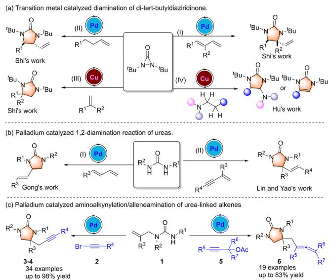
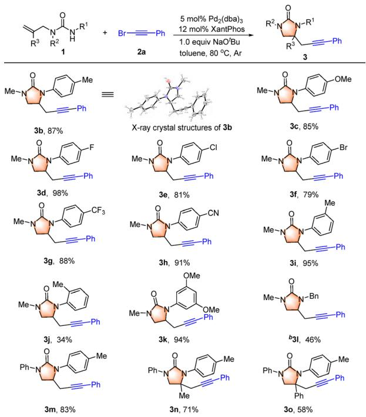
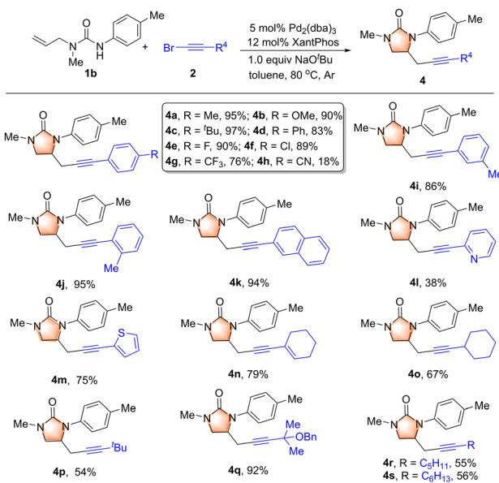
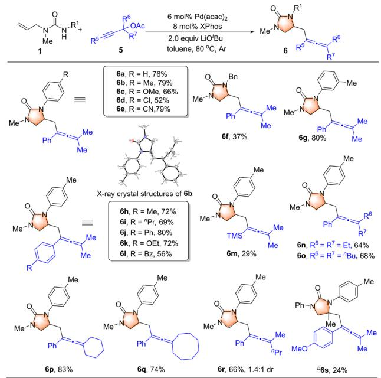
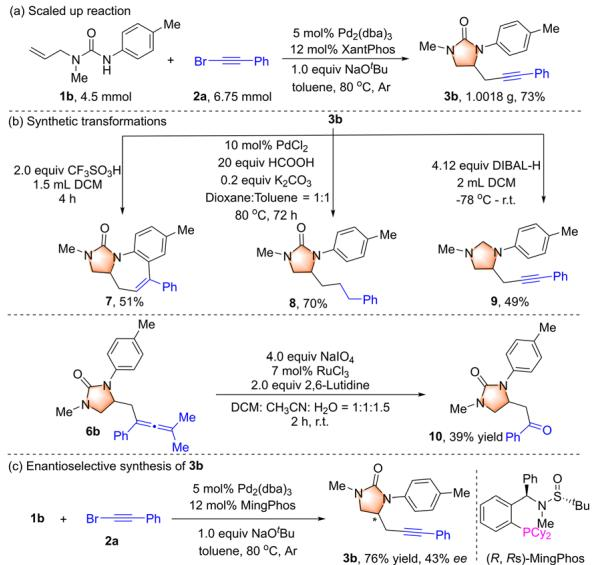
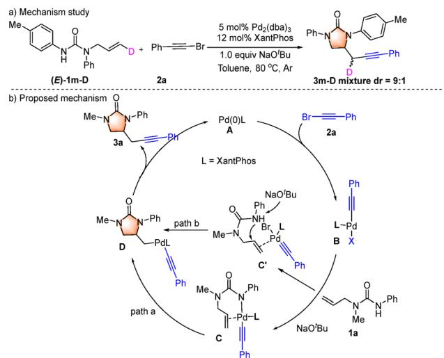

COMMUNICATION

View Article Online View Journal | View Issue

Check for updates

Cite this: Chem. Commun., 2025, 61, 17898

Received 29th July 2025, Accepted 3rd October 2025

DOI: 10.1039/d5cc04327a

# Palladium-catalyzed aminoalkynylation/ alleneamination of urea-tethered alkenes: access to imidazolidinones bearing alkynes and allenes

Qianqian Hu,†a Cangzhu Hu,†a Tian Tang,a Qing Wu,a Weiming Hu, \*b Qiang Dai \*c and Lei Wang \*a

rsc.li/chemcomm

A novel palladium-catalyzed aminoalkynylation/alleneamination of urea-tethered alkenes has been developed, ofering an eficient strategy for the synthesis of imidazolidinones bearing alkynes and allenes in moderate to good yields. The reaction exhibits a broad substrate scope, excellent functional group tolerance and good synthetic versatility.

Imidazolidinones represent an important class of heterocyclic compounds, which are widely found in numerous natural products, bioactive molecules, and pharmacologically relevant agents.1,2 In addition to their biological significance, imidazolidinones play a crucial role in synthetic organic chemistry as valuable intermediates for the construction of more complex and functionalized molecules. Owing to their structural diversity and potential for distinct biological activities, the development ofeficient synthetic methodologies for imidazolidinone frameworks has garnered considerable attention over the past two decades.3–5 Among the established strategies, transition metal-catalyzed diamination of di-tert-butyldiaziridinone has been extensively explored for the construction of these key imidazolidinone scaffolds (Scheme 1a).5 Alternatively, the 1,2-diamination of ureas has emerged as an attractive approach for the synthesis of imidazolidinones.6–8 For example, Gong and co-workers reported a Pd(II)-catalyzed asymmetric 1,2- diamination of 1,3-dienes with ureas, enabling access to a variety of enantioenriched imidazolidinone derivatives (Scheme 1b(I)).7 Subsequently, Lin and Yao developed a novel Pd-catalyzed sequential hydroamination of 1,3-enynes with diverse ureas, affording aminomethyl-substituted allenes, which then underwent cyclization to yield a broad range of imidazolidinones (Scheme 1b(II)).8 Despite these notable advances, the development of more efficient, selective, and broadly applicable synthetic methods for imidazolidinone construction remains highly desirable.

The direct difunctionalization of alkenes has emerged as a powerful and eficient strategy for the straightforward construction of complex molecular architectures.9 Over the past few decades, palladium-catalyzed carboheterofunctionalization of alkenes has been extensively developed as a general and efective approach for the synthesis of nitrogen-containing heterocycles.10,11 Despite significant progress, these methodologies have largely been limited to the incorporation of aryl or alkenyl groups, highlighting the need for broader functional group diversity. Palladium-catalyzed aminoalkynylation of alkenes remains a significant synthetic challenge, with only a limited number of strategies reported to date. For instance, Waser and co-workers developed an intriguing intramolecular aminoalkynylation of alkenes using ethynylbenziodoxolone (EBX) or alkyl-substituted alkynyl bromides, enabling the synthesis of valuable alkyne-functionalized aza-heterocycles.12,13 More recently, Carreira’s group disclosed a distinctive Pd-catalyzed aminoalkynylation of highly substituted alkenes facilitated by picolinamide directing groups and iodoalkynes to aford a diverse array of alkynylated pyrrolidines.13 Despite these advances, further development of new methodologies and their application to synthetically relevant scafolds remain highly desirable. In this context, we have developed an eficient Pd-catalyzed aminoalkynylation of urea-tethered alkenes with alkynyl bromides, afording alkynyl-functionalized imidazolidinones (Scheme 1c). In addition, we have successfully achieved a Pd-catalyzed alleneamination of urea-linked alkenes with propargylic acetates, providing access to imidazolidinones bearing allene moieties (Scheme 1c).

  
Scheme 1 Transition metal catalyzed strategy to access imidazolidones. (a) Transition metal catalyzed diamination of di-tert-butyldiaziridinone. (b) Palladium catalyzed 1,2-diamination reaction of ureas. (c) Palladium catalyzed aminoalkynylation/alleneamination of urea-linked alkenes.

Our investigation was initiated by using 1-allyl-1-methyl-3- phenylurea 1a and (bromoethynyl)benzene 2a as model substrates. Delightedly, the desired product imidazolidin-2-one 3a was obtained successfully in 23% yield in the presence of $\mathrm { P d } _ { 2 } ( \mathrm { d b } \mathbf { a } ) _ { 3 }$ (5 mol%), RuPhos (12 mol%) and KOtBu (1.0 equiv) in 2.0 mL of toluene under argon at 80 1C for 24 h (Table 1, entry 1). Afterwards, a variety of phosphine ligands, such as XPhos, DPPB, DPEPhos, XantPhos and $\mathrm { P P h } _ { 3 } ,$ were explored carefully, and the yield of 3a was increased to a moderate level of 60% by using XantPhos as a ligand (Table 1, entry 5). Other palladium catalysts including Pd(OAc) , Pd(acac) , Pd(cod)Cl and PdCl did not give good results (Table 1, entries 7– 10). Screening bases and NaOtBu improved the yield of 3a to 77% (Table 1, entry 15). In addition, when the reaction was carried out under an air atmosphere, the yield of 3a significantly decreased to 60% (Table 1, entry 16). Scaling up the reaction to 0.3 mmol led to product 3a in 73% yield (Table 1, entry 17). Subsequently, several solvents including MeCN, THF and $^ { 1 , 4 }$ -dioxane were tested, but product 3a was afforded in lower yields. In addition, the control experiments indicated that all of the catalyst, ligand and base were crucial for the reaction efficiency (for details, please see the SI).

Table 1 Optimization of reaction conditionsa
<table><tr><td colspan="4">O Ph [Pd]/ Ligand Me-N N ZH + Br—Ph Me Base, Solvent 1a 2a</td></tr><tr><td>Entry</td><td>Pd sources</td><td>Ligand</td><td>Base  ${ \mathrm { Y i e l d } } ^ { b }$ </td></tr><tr><td>1</td><td> $\mathrm { P d } _ { 2 } ( \mathrm { d b } \mathrm { a } ) _ { 3 }$ </td><td>RuPhos</td><td>KOBu 23</td></tr><tr><td>2</td><td> $\mathrm { P d } _ { 2 } ( \mathrm { d b a } ) _ { 3 }$ </td><td>XPhos</td><td>KOBu 20</td></tr><tr><td>3</td><td>Pd2(dba)3}</td><td>DPPB</td><td>KOBu 41</td></tr><tr><td>4</td><td> $\mathrm { P d } _ { 2 } ( \mathrm { d b a } ) _ { 3 }$ </td><td>DPEPhos</td><td>KOBu 46</td></tr><tr><td>5</td><td> $\mathrm { P d } _ { 2 } ( \mathrm { d b a } ) _ { 3 }$ </td><td>XantPhos</td><td>KOBu 60</td></tr><tr><td>6</td><td> $\mathrm { P d } _ { 2 } ( \mathrm { d b a } ) _ { 3 }$ </td><td> $\mathrm { P h } _ { 3 } \mathrm { P }$ </td><td>KOBu 22</td></tr><tr><td> $7 ^ { c }$ </td><td> ${ \mathrm { P d } } ( \mathbf { O A c } ) _ { 2 }$ </td><td>XantPhos</td><td>KOBu 38</td></tr><tr><td> $8 ^ { c }$ </td><td> $\operatorname { P d } ( \mathrm { a c a c } ) _ { 2 }$ </td><td>XantPhos</td><td>KOBu 44</td></tr><tr><td> $9 ^ { c }$ </td><td> $\mathbf { P d } ( \mathbf { c o d } ) \mathbf { \dot { C } } \mathbf { l } _ { 2 }$ </td><td>XantPhos</td><td>KOBu 39</td></tr><tr><td> ${ 1 0 } ^ { c }$ </td><td> $\mathbf { P d C l } _ { 2 }$ </td><td>XantPhos</td><td>KOBu 50</td></tr><tr><td>11</td><td> $\mathrm { P d } _ { 2 } ( \mathrm { d b } \mathrm { a } ) _ { 3 }$ </td><td>XantPhos</td><td>LiOBu NR</td></tr><tr><td>12</td><td> $\mathrm { P d } _ { 2 } ( \mathrm { d b a } ) _ { 3 }$ </td><td>XantPhos</td><td> $\mathbf { K } _ { 2 } \mathbf { C O } _ { 3 }$  38</td></tr><tr><td>13</td><td> $\mathrm { P d } _ { 2 } ( \mathrm { d b a } ) _ { 3 }$ </td><td>XantPhos</td><td> $\mathrm { N a } _ { 2 } \mathrm { C O } _ { 3 }$  NR</td></tr><tr><td>14</td><td> $\mathrm { P d } _ { 2 } ( \mathrm { d b a } ) _ { 3 }$ </td><td>XantPhos</td><td> $\mathrm { C s } _ { 2 } \mathrm { C O } _ { 3 }$  45</td></tr><tr><td>15</td><td> $\mathrm { P d } _ { 2 } ( \mathrm { d b } \mathrm { a } ) _ { 3 }$ </td><td>XantPhos</td><td>NaOtBu 77</td></tr><tr><td> $1 6 ^ { d }$ </td><td> $\mathrm { P d } _ { 2 } ( \mathrm { d b a } ) _ { 3 }$ </td><td>XantPhos</td><td>NaOBu 60</td></tr><tr><td> $1 7 ^ { e }$ </td><td> $\mathrm { P d } _ { 2 } ( \mathrm { d b a } ) _ { 3 }$ </td><td>XantPhos</td><td>NaOBu 73</td></tr></table>

a Reaction conditions: 1a (0.2 mmol), 2a (0.3 mmol), 5 mol% of Pd catalyst, ligands (12 mol%), base (1.0 equiv.) in 2.0 mL of toluene under argon at 80 1C for $2 4 \mathrm { ~ h ~ } ^ { b }$ Isolated yields. c Pd catalyst (10 mol%) was used. d Under air for 24 ${ \bf h } _ { \bf * } ^ { \mathrm { ~ } e } \bf 1 a$ (0.3 mmol), 2a (0.45 mmol), Pd (dba) (5 mol%), XantPhos (12 mol%), NaOtBu (1.0 equiv.) in 2.0 mL of toluene under argon at $8 0 ~ ^ { \circ } \mathrm { C }$ for 24 h.

With the optimized conditions in hand, the scope of the aminoalkynylation was first assessed by employing a range of urea-linked alkenes 1 with (bromoethynyl)benzene 2a as the coupling partner (Scheme 2). Specifically, a range of aryl rings attached to the nitrogen atom in urea were first discussed. Electron-donating groups such as methyl and methoxyl, and electron-withdrawing groups like fluoro, chloro and bromo groups were well tolerated, delivering the corresponding products (3b–3f) in 79–98% yields. Additionally, the configuration of 3b was confirmed by X-ray diffraction.14 Particularly, some strong electron-withdrawing groups were also well tolerated, and the trifluoromethyl- and cyano-group substitution products 3g and 3h were afforded with high yields (88% and 91%). Notably, the ortho-methyl substituted substrate proceeded smoothly, but product 3j was obtained in relatively lower yield (34%). This result indicated that the steric effect could not be ignored. The disubstituted substrate also exhibits excellent reaction activity, and product 3k was formed in 94% yield. In addition, the benzyl group was also well tolerated, and the corresponding product 3l was delivered in 46% yield. Remarkably, replacing the methyl group with the benzene ring in the substrate had no negative effect on the reaction, and product 3m was isolated in a good yield of 83%. Meanwhile, disubstituted alkene substrates were also good reaction partners as products 3n and 3o bearing a quaternary carbon center were obtained in 71% and 58% yields.

To further explore the substrate scope, various bromoacetylenes 2 were subjected to the standard reaction conditions to react with 1-allyl-1-methyl-3-phenylurea 1b (Scheme 3). As expected, reaction of aryl alkynyl bromides proceeded smoothly to give the corresponding products in moderate to good yields (4a–4g, $7 6 \mathrm { - } 9 7 \% ;$ 4i–4k, 86–95%). Notably, the cyano-substituted aromatic bromoacetylene showed a lower reactivity, and product 4h was obtained only in 18% yield. In addition, alkynyl bromides containing heterocyclic, cyclic alkenyl and cyclic alkyl bromides were all compatible to deliver 4l, 4m, 4n and 4o in 38%, 75%, 79% and 67%, respectively. The alkyl substituted alkynyl bromides such as tert-butyl-, n-pentyl-, and n-hexyl-were also applicable, and the corresponding products 4q–4s were obtained in 55%–92% yields.

  
Scheme 2 Substrate scope of urea-linked alkenes.a aReaction conditions: 1 (0.3 mmol), 2a (0.45 mmol), Pd (dba) (5 mol%), XantPhos (12 mol%), NaOtBu (0.3 mmol) in 2.0 mL of toluene under argon at 80 1C for 24 h. bReaction for 48 h.

Allenes are important motifs for drugs and bioactive natural products.15 Next, we proceeded to explore a range of urea-linked alkenes 1 with propargylic acetates 5 for the synthesis of imidazolidones bearing allenes (Scheme 4). Again, both electron-donating and electron-withdrawing groups such as Me-, OMe-, Cl- and CNbearing aryl rings attached to the nitrogen atom in urea were well tolerated, yielding the corresponding products 6a–6e in moderate to good yields (52–79%). Furthermore, various propargylic acetates also reacted well regardless of the electrostatic effect and the steric hindrance effect, which provided a range of imidazolidones bearing allene derivatives 6f–6s in good yields (24–83%). Particularly, the substrate bearing a trimethylsilyl group formed the target product 6m in a low yield of 29%, which demonstrated the good compatibility of this method to some extent.

To further prove the practicality of this approach, the reaction between 1b and 2a was successfully scaled up to a 4.5 mmol scale, and product 3b was isolated in 1.0 g with an acceptable yield of 73% (Scheme 5a). Versatile transformations of 3b were also successfully carried out (Scheme 5b); 3b underwent TfOH cyclization to aford seven-membered N-heterocycle 7. Then, the carbon–carbon triple bond and the carbonyl group were reduced, and products 8 and 9 were delivered in 70% and 49% yields, respectively. Moreover, the $\mathrm { N a I O _ { 4 } / R u C l _ { 3 } }$ oxidation system could allow imidazolidone 6b to yield the corresponding ketone derivative 10 in 39% yield. In addition, the asymmetric version of the current method was also investigated (Scheme 5c), and product 3b was obtained in 76% yield with an enantiomeric excess of 43% by using (R,Rs)-MingPhos.

  
Scheme 3 Substrate scope of bromoacetylene.a a Reaction conditions: 1a (0.3 mmol), 2 (0.45 mmol), 5 mol% Pd (dba) , 12 mol% XantPhos, NaOtBu (0.3 mmol) in toluene (2.0 mL) at $8 0 ~ ^ { \circ } \mathsf C$ under argon for 24 h.

  
Scheme 4 Substrate scope of urea with propargylic acetates.a a Reaction conditions: 1 (0.3 mmol), 5 (0.45 mmol), 6 mol% ${ \mathsf { P d } } ( { \mathsf { a c a c } } ) _ { 2 } ,$ 8 mol% XPhos, LiOtBu (0.6 mmol) in toluene (3.0 mL) at $8 0 ~ ^ { \circ } \mathsf { C }$ under argon for 24 h. ${ } ^ { b } 1 0 0 { } ^ { \circ } \mathsf { C }$ for 12 h.

Moreover, (E)-1m-D was allowed to react with 2a under standard conditions, and product 3m-D was aforded in 60% with 9 : 1 dr indicating both syn- and anti-addition pathways in this reaction (Scheme 6a). On the basis of previous reports16 and the experimental results, a plausible mechanism is shown in Scheme 6b. First, oxidative addition of (bromoethynyl)benzene 2a to Pd(0) generates a Pd(II) complex B. Subsequently, deprotonation of 1a and ligand exchange deliver intermediate $\mathbf { C } ,$ which then undergoes a migratory insertion to provide complex D. Another anti-addition catalytic cycle by Pd(II) complex II electrophilic activation of alkenes and the urea attack of the alkene to aford Pd complex D in path b is also proposed. Finally, reductive elimination of D afords the corresponding aminoalkynylation product 3a and regenerates the Pd(0) catalyst A for the next cycle. In addition, a similar mechanism for the formation of 6 is shown in the SI.

In conclusion, we have developed a novel palladiumcatalyzed aminoalkynylation of urea-tethered alkenes, which provided an eficient strategy for the synthesis of alkynyl-substituted imidazolidinones in moderate to good yields. In addition, a palladium-catalyzed alleneamination of urea-linked alkenes with propargylic acetates has also been successfully employed. The reaction exhibits a broad substrate scope and good functional group tolerance. Furthermore, preliminary studies on the asymmetric variant of the reaction have demonstrated moderate enantioselectivity, and further investigations into asymmetric induction are currently ongoing in our laboratory.

  
Scheme 5 (a) Scaled up reaction. (b) Synthetic transformations. (c) Asymmetric study.

  
Scheme 6 (a) Mechanism study. (b) Proposed mechanism.

We gratefully acknowledge the National Natural Science Foundation of China (22471236, 22101249, and 22401154) and the Natural Science Foundation of Jiangsu Province (BK20240577 and BK20200918).

## Conflicts of interest

There are no conflicts to declare.

## Data availability

The data supporting this article have been included in the supplementary information (SI). Supplementary information: all detailed procedures, characterization data, and NMR spectra for the substrates and products. See DOI: https://doi.org/10. 1039/d5cc04327a.

CCDC 2471274 (3b) and 2471288 (6b) contain the supplementary crystallographic data for this paper.14a,b

## Notes and references

1 For selected examples, see: (a) R. G. S. Berlinck, Nat. Prod. Rep., 2002, 19, 617–649; (b) R. G. S. Berlinck and M. H. Kossuga, Nat. Prod. Rep., 2005, 22, 516–550; (c) B. Pirard and H. Matter,J. Med. Chem., 2006, 49, 51–69.

2 (a) S. R. S. Saibabu Kotti, C. Timmons and G. Li, Chem. Biol. Drug Des., 2006, 67, 101–114; (b) D. M. Robinson, M. P. Curran and K. A. Lyseng-Williamson, Drugs, 2007, 67, 1359–1378.

3 For selected examples, see: (a) B. M. Trost and D. R. Fandrick,J. Am. Chem. Soc., 2003, 125, 11836–11837; (b) F. C. Sequeira, B. W. Turnpenny and S. R. Chemler, Angew. Chem., Int. Ed., 2010, 49, 6365–6368; (c) Z. Tao, B. B. Gilbert and S. E. Denmark, J. Am. Chem. Soc., 2019, 141, 19161–19170; (d) C. Y. Cai, X. M. Shu and H. C. Xu, Nat. Commun., 2019, 10, 4953; (e) S. Bouayad-Gervais, C. D. T. Nielsen, A. Turksoy, T. Sperger, K. Deckers and F. Schoenebeck, J. Am. Chem. Soc., 2022, 144, 6100–6106; (f) R. A. Ivanovich, D. E. Polat and A. M. Beauchemin, Org. Lett., 2020, 22, 6360–6364.

4 For selected examples, see: (a) J. A. Fritz, J. S. Nakhla and J. P. Wolfe, Org. Lett., 2006, 8, 2531–2534; (b) J. A. Fritz and J. P. Wolfe, Tetrahedron, 2008, 64, 6838–6852; (c) B. A. Hopkins and J. P. Wolfe, Angew. Chem., Int. Ed., 2012, 51, 9886–9890; (d) F. Xu, S. A. Shuler and D. A. Watson, Angew. Chem., Int. Ed., 2018, 57, 12081–12085.

5 For selected examples, see: (a) Y. Zhu, R. G. Cornwall, H. Du, B. Zhao and Y. Shi, Acc. Chem. Res., 2014, 47, 3665–3678; (b) H. Du, W. Yuan, B. Zhao and Y. Shi, J. Am. Chem. Soc., 2007, 129, 11688–11689; (c) H. Du, B. Zhao and Y. Shi, J. Am. Chem. Soc., 2008, 130, 8590–8591; (d) Y. Wen, B. Zhao and Y. Shi, Org. Lett., 2009, 11, 2365–2368; (e) Z. Du, J. Zhang, X. Lv, K. Zhang, W. Ji, M. Wang, S. Jing and J. Hu, ACS Catal., 2024, 14, 18107–18115.

6 For selected examples, see: (a) K. Mun˜iz, C. H. Ho¨velmann and J. Streuf, J. Am. Chem. Soc., 2008, 130, 763–773; (b) H. Li and R. A. Widenhoefer, Org. Lett., 2009, 11, 2671–2674.

7 (a) M. S. Wu, T. Fan, S. S. Chen, Z. Y. Han and L. Z. Gong, Org. Lett., 2018, 20, 2485–2489; (b) J. Song, Z. J. Zhang, S. S. Chen, T. Fan and L. Z. Gong, J. Am. Chem. Soc., 2018, 140, 3177–3180.

8 Q. Li, X. Fang, R. Pan, H. Yao and A. Lin, J. Am. Chem. Soc., 2022, 144, 11364–11376.

9 (a) Y. Li, D. Wu, H. G. Cheng and G. Yin, Angew. Chem., Int. Ed., 2020, 59, 7990–8003; (b) H. Jiang and A. Studer, Chem. Soc. Rev., 2020, 49, 1790–1811.

10 For selected reviews, see: (a) J. P. Wolfe, Eur. J. Org. Chem., 2007, 571–582; (b) J. P. Wolfe, Synlett, 2008, 2913–2934; (c) Z. J. Garlets, D. R. White and J. P. Wolfe, Asian J. Org. Chem., 2017, 6, 636–653.

11 For selected examples, see: (a) M. B. Hay and J. P. Wolfe, J. Am. Chem. Soc., 2005, 127, 16468–16476; (b) B. A. Hopkins, Z. J. Garlets and J. P. Wolfe, Angew. Chem., Int. Ed., 2015, 54, 13390–13392; (c) D. N. Mai and J. P. Wolfe,J. Am. Chem. Soc., 2010, 132, 12157–12159; (d) N. R. Babij and J. P. Wolfe, Angew. Chem., Int. Ed., 2013, 52, 9247–9250; (e) N. Hu, K. Li, Z. Wang and W. Tang, Angew. Chem., Int. Ed., 2016, 55, 5044–5048; ( f ) N. Li, B. Sun, S. Liu, J. Zhao and Q. Zhang, Org. Lett., 2020, 22, 190–193; (g) Y. Wang, S. Wu, L. Wang, J. Sun, C.-G. Yan and Y. Han, Org. Chem. Front., 2022, 9, 4104–4109; (h) C. Hu, F. Jin, Q. Hu, J. Sun, Y. Han, C. Zhang, L. Zhou, J. Zhang and L. Wang, Sci. China: Chem., 2025, DOI: 10.1007/s11426-025-2798-4.

12 (a) S. Nicolai, C. Piemontesi and J. Waser, Angew. Chem., Int. Ed., 2011, 50, 4680–4683; (b) K. Shen and Q. Wang, Chem. Sci., 2017, 8, 8265–8270; (c) S. Nicolai and J. Waser, Org. Lett., 2011, 13, 6324–6327; (d) S. Nicolai, P. Swallow and J. Waser, Tetrahedron, 2015, 71, 5959–5964; (e) S. Nicolai, R. Sedigh-Zadeh and J. Waser, J. Org. Chem., 2013, 78, 3783–3801.

13 N. Mu¨ller, B. S. Schreib, S. U. Leutenegger and E. M. Carreira, Angew. Chem., Int. Ed., 2022, 61, e202204535.

14 (a) CCDC 2471274: Experimental Crystal Structure Determination, 2025, DOI: 10.5517/ccdc.csd.cc2nykjq; (b) CCDC 2471288: Experimental Crystal Structure Determination, 2025, DOI: 10.5517/ ccdc.csd.cc2nykz5.

15 Reviews on allenes in natural products: (a) A. Hofmann-Ro¨der and N. Krause, Angew. Chem., Int. Ed., 2004, 43, 1196–1216; (b) P. Rivera-Fuentes and F. Diederich, Angew. Chem., Int. Ed., 2012, 51, 2818–2828.

16 (a) J. S. Nakhla, J. W. Kampf and J. P. Wolfe,J. Am. Chem. Soc., 2006, 128, 2893–2901; (b) C. Hu, S. Xu, Q. Wang, J. Sun, Y. Han, C. G. Yan and L. Wang, Org. Chem. Front., 2024, 11, 2768–2773; (c) S. Zhang, S. Wu, Q. Wang, S. Xu, Y. Han, C. G. Yan, J. Zhang and L. Wang, Angew. Chem., Int. Ed., 2023, 62, e202300309.