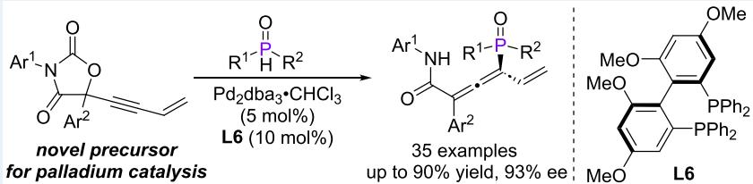
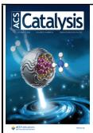
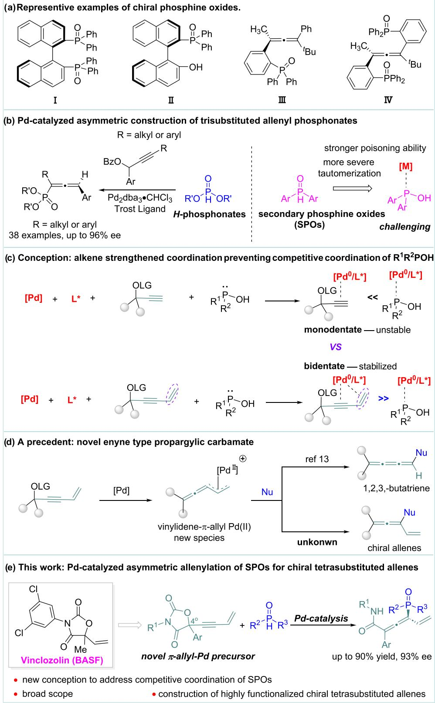
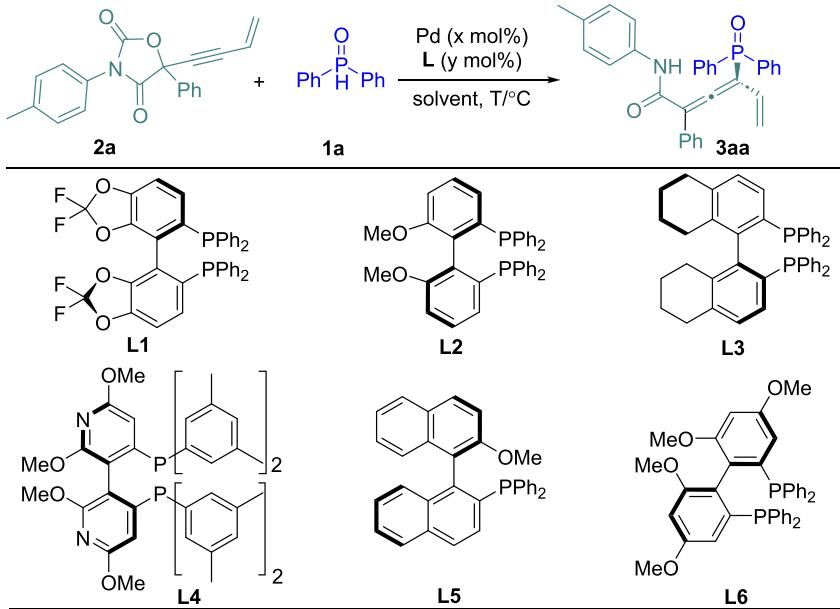
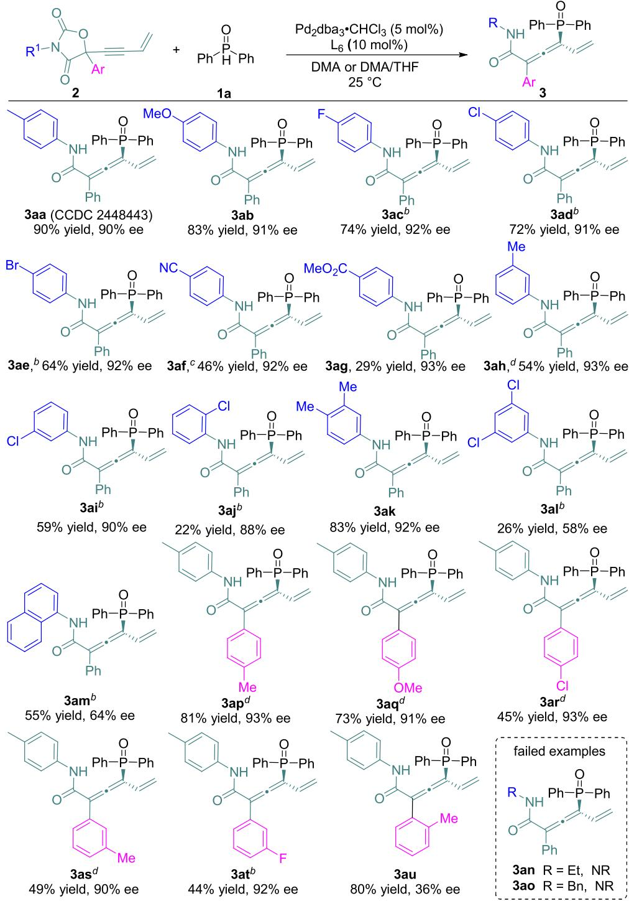
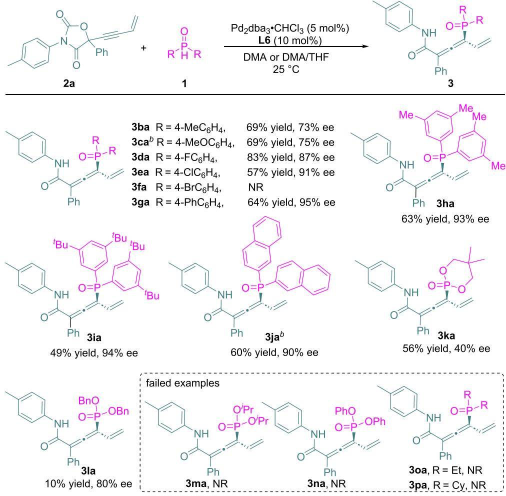
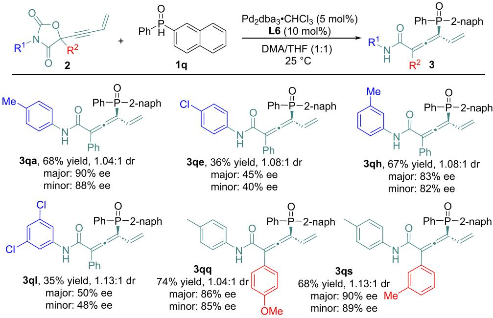
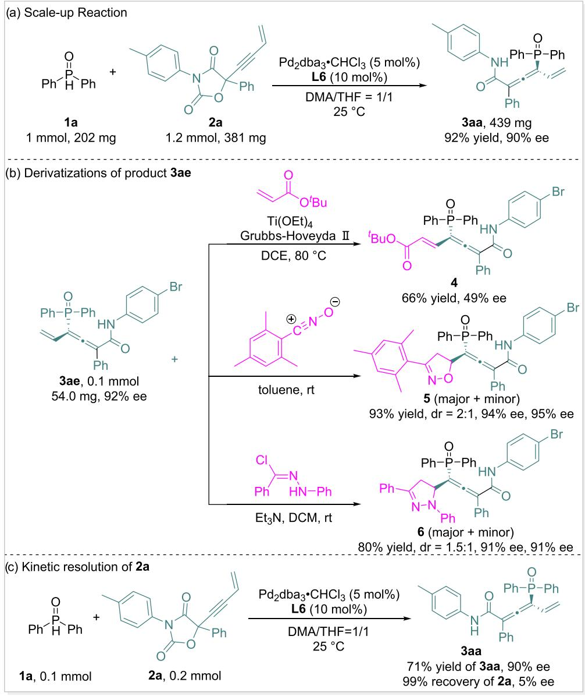
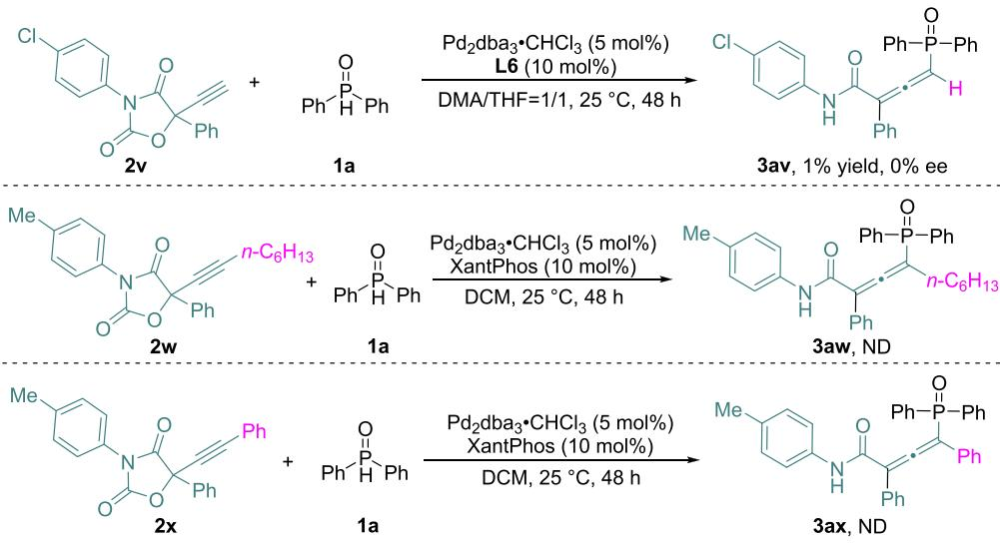
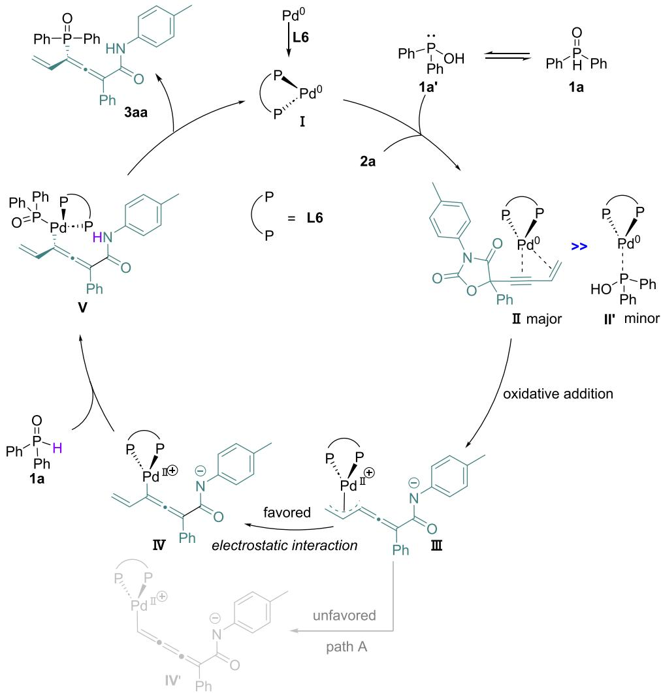

# Pd-Catalyzed Asymmetric Allenylation of Secondary Phosphine Oxides with Enyne-Type Propargylic Carbamates for the Construction of Chiral Allenyl Phosphine Oxides

Yujie Dong, Nianci Zhang, Fazhou Yang, Jinbao Wang, Bo Wang, Jun Liu, Bing Zheng,\* Cheng Zhang, \* Leijie Zhou,\* and Hongchao Guo\*

Cite This: ACS Catal. 2025, 15, 17215−17224

Read Online

ACCESS

Metrics & More

Article Recommendations

\*sı Supporting Information

ABSTRACT: Chiral allenyl phosphine oxides represent a significant kind of synthetic target with promising potential for various applications. However, explorations toward their asymmetric synthesis remain scarce, primarily due to the competitive coordination of phosphine oxides with metal catalysts. Herein, we report a Pd-catalyzed enantioselective allenylation of secondary phosphine oxide for the eficient construction of a variety of chiral allenyl phosphine oxides. The success of this reaction arises from the enhanced (bidentate form) coordination of a newly designed, fungicide-inspired enyne-type propargylic carbamate with a chiral Pd complex. This protocol features high yields and enantioselectivities, scalability, and versatile derivatization. Mechanistic studies confirmed the exclusion of a kinetic resolution pathway.

KEYWORDS: asymmetric catalysis, palladium catalysis, phosphine oxide, chiral allene, axial chirality

## ■ INTRODUCTION

Chiral allenes are privileged motifs in natural products, bioactive molecules, and functional materials.1 Consequently, recent decades have witnessed significant advances in the development of catalytic methods toward their asymmetric synthesis.2 As a result, a wide variety of chiral allenes bearing diverse functional groups could be obtained conveniently through asymmetric catalysis approaches.3 On the other hand, phosphine oxides that are incorporated within various chiral scafolds are widely used as organocatalysts and ligands for metal catalysis (Figure 1a). Related synthesis has attracted more and more attention.4,5 Despite elegant progresses that have been made in both areas, a method to access chiral allenyl phosphine oxides remains unexplored until very recently, Ma, Zhang, Qian, and Zhang jointly published the first Pdcatalyzed enantioselective allenylation of secondary phosphine oxides (SPOs) (during which we are also preparing this manuscript).6 Previously, Ma, Zhang, and Qian pioneered the asymmetric allenylation of H-phosphonates (2022), representing the sole, highly valuable example of a catalytic approach to axially chiral allenyl phosphonates.7 This breakthrough suggested that SPOs might also serve as viable substrates for the concise construction of chiral allenyl phosphine oxides via transition-metal-catalyzed asymmetric allenylation reaction. However, SPOs undergo facile tautomerization to trivalent

R1R2P−OH species more readily than H-phosphonates, leading to competitive metal coordination that suppresses the desired allenylation pathway (Figure 1b).8 To address this, several elegant strategies were developed to avoid the involvement of trivalent R1R2P−OH species. Guo presented a Ni-catalyzed O-propargylation/Horner-Mark cascade to construct chiral allenyl phosphine oxides directly.9 Meanwhile, Zhang developed a Ni-catalyzed asymmetric S 2′ functionalization of phosphines, with subsequent oxidation delivering chiral allenyl phosphine oxides.10 He reported an asymmetric synergistic Pd/Co-catalyzed hydrophosphinylation of enynes using a newly designed masked phosphinylating reagent, enabling eficient access to novel allenylic phosphine oxides with P-stereocenter.11 Despite these advances, methods for direct allenyl C(sp2)−P bond construction remain highly sought-after yet scarce, presenting a persistent synthetic challenge.

  
Figure 1. Palladium-catalyzed asymmetric allenyl C−P bond formations.

Under typical Pd-catalyzed reaction conditions, in the presence of secondary phosphine oxides (SPOs) and a propargylic precursor, the coordination of the $[ \mathrm { P d } / \mathrm { L } ^ { \ast } ]$ complex preferentially occurs with the lone pair of the trivalent $\mathrm { R } ^ { 1 } \mathrm { R } ^ { \bar { 2 } } \mathrm { P - } \bar { \mathrm { O H } }$ species rather than with the alkyne moiety. This is because the monodentate coordination of [Pd/L\*] with the π−electrons of the alkyne is comparatively less stable (Figure

1c). To address this, the introduction of a terminal alkene allows for the formation of a more stable bidentate coordination with the $[ \mathrm { P d } / \mathrm { L } ^ { \ast } ]$ complex. This suppresses the competitive coordination of R1R2P−OH, thereby enabling oxidative insertion into the propargylic substrate and leading to the formation of allenyl phosphine oxides.12 This substrate design strategy is inspired by prior work from the Ma and Guo groups, who demonstrated that a similarly designed precursor could generate a vinylidene−π−allyl palladium(II) intermediate under Pd catalysis.13 This intermediate was successfully intercepted by β-ketocarbonyl compounds to aford functionalized 1,2,3-butatriene derivatives (Figure 1d). As proposed, this unique π−allyl Pd intermediate can rearrange into a σ−π−σ form, rendering it susceptible to nucleophilic attack and enabling the synthesis of tetrasubstituted allenes. Motivated by our ongoing interest in the design and application of novel fungicide-inspired π−allyl Pd precursors particularly for the construction of tetrasubstituted axially chiral allenes, 14 we herein report a Pd-catalyzed enantioselective allenylation of SPOs. This transformation utilizes a newly designed, Vinclozolin-inspired enyne-type propargylic carbamate, providing new access to a class of highly functionalized, tetrasubstituted chiral allenes bearing allenyl amide, phosphine oxide, and alkene moieties (Figure 1e). This work difers fundamentally from pioneering Pd- or Nicatalyzed systems in two key aspects: (i) The strategic incorporation of a terminal alkene group enables eficient generation of novel, reactive chiral vinylidene-π-allyl palladium intermediates for asymmetric construction of chiral allenes and (ii) the implementation of Vinclozolin-inspired enyne-type propargylic carbamates, featuring quaternary chiral centers, enabled direct construction of tetrasubstituted chiral allenes having phosphonyl unit.

Table 1. Optimization of Asymmetric Allenylation Reaction  

<table><tr><td>entry</td><td>L</td><td>solvent</td><td>T/C</td><td> ${ \mathrm { y i e l d } } / { \% } ^ { b }$ </td><td>ee/%c</td></tr><tr><td>1</td><td>PPh3</td><td>DCM</td><td>25</td><td>NR</td><td></td></tr><tr><td>2</td><td> $\mathbf { X a n t P h o s }$ </td><td>DCM</td><td>25</td><td>78</td><td></td></tr><tr><td>3</td><td>DPEPhos</td><td>DCM</td><td>25</td><td>65</td><td></td></tr><tr><td>4</td><td>DPPE</td><td>DCM</td><td>25</td><td>NR</td><td></td></tr><tr><td>5</td><td>L1</td><td>DCM</td><td>25</td><td>84</td><td>31</td></tr><tr><td>6</td><td>L2</td><td>DCM</td><td>25</td><td>55</td><td>21</td></tr><tr><td>7</td><td>L3</td><td>DCM</td><td>25</td><td>55</td><td>-25</td></tr><tr><td>8</td><td>L4</td><td>DCM</td><td>25</td><td>20</td><td>-36</td></tr><tr><td>9</td><td>L5</td><td>DCM</td><td>25</td><td>6</td><td>21</td></tr><tr><td>10</td><td>L6</td><td>DCM</td><td>25</td><td>62</td><td>50</td></tr><tr><td>11</td><td>L6</td><td>THF</td><td>25</td><td>86</td><td>44</td></tr><tr><td>12</td><td>L6</td><td>EtOAc</td><td>25</td><td>98</td><td>27</td></tr><tr><td>13</td><td>L6</td><td>CH3OH</td><td>25</td><td>66</td><td>74</td></tr><tr><td>14</td><td>L6</td><td> $\mathrm { C H C l } _ { 3 }$ </td><td>25</td><td>13</td><td>40</td></tr><tr><td>15</td><td>L6</td><td> $\mathrm { C H } _ { 3 } \mathrm { C N }$ </td><td>25</td><td>47</td><td>78</td></tr><tr><td>16</td><td>L6</td><td> $\mathrm { C H } _ { 3 } \mathrm { C N }$ </td><td>0</td><td>15</td><td>90</td></tr><tr><td>17</td><td>L6</td><td> $\mathrm { C H } _ { 3 } \mathrm { C N }$ </td><td>-20</td><td>NR</td><td></td></tr><tr><td>18</td><td>L6</td><td>DMF</td><td>25</td><td>39</td><td>92</td></tr><tr><td>19</td><td>L6</td><td>DMA</td><td>25</td><td>54</td><td>93</td></tr><tr><td>20</td><td>L6</td><td>DMSO</td><td>25</td><td>63</td><td>88</td></tr><tr><td> $2 1 ^ { d }$ </td><td>L6</td><td>DMA</td><td>25</td><td>49</td><td>80</td></tr><tr><td>22</td><td>L6</td><td> $\mathrm { D M A } / \mathrm { E A } = 1 / 1$ </td><td>25</td><td>75</td><td>91</td></tr><tr><td>23</td><td>L6</td><td> $\mathrm { D M A } / \mathrm { T H F } = 1 / 1$ </td><td>25</td><td>90</td><td>90</td></tr></table>

aUnless otherwise stated, all reactions were carried out with 1a (0.1 mmol), 2a (0.12 mmol), $\mathrm { P d } _ { 2 } \big ( \mathrm { d } \mathsf { b } \mathsf { a } \big ) _ { 3 } { \cdot } \mathrm { C H C l } _ { 3 }$ (5 mol %), and L (10 mol %) in 1 mL of solvent at $2 5 ~ ^ { \circ } \mathrm { C }$ for 24 h. bIsolated yield. cDetermined by chiral HPLC analysis. $^ { d } \mathrm { P d } _ { 2 } ( \mathrm { d } \bar { \mathrm { b } } \mathrm { a } ) _ { 3 } { \cdot } \mathrm { C H C l } _ { 3 }$ (10 mol %) and L6 (20 mol %) were used.

Scheme 1. Scope of 5-(But-3-en-1-yn-1-yl)-oxazolidine-2,4-diones $2 ^ { a }$

  
bSolvent: DMA/THF = 2/1. cSolvent: $\mathrm { { D M A } / \mathrm { { E A } = 1 / 1 } }$ . dSolvent: DMA. aUnless otherwise stated, all reactions were performed with 1a (0.1 mmol), 2 (0.12 mmol), $\mathrm { P d } _ { 2 } \big ( \mathrm { d } { \mathsf { b a } } \big ) _ { 3 } { \bullet } \mathrm { C H } \mathrm { C l } _ { 3 }$ (5 mol %), and L6 (10 mol %) in 1 mL of solvent $\left( \mathrm { D M A } / \mathrm { T H F } = 1 / 1 \right)$ ) at $2 5 ~ ^ { \circ } \dot { \mathrm { C } }$ for $3 7 - 6 5$ h; all yields refer to isolated yield; ee was determined by chiral HPLC analysis.

## ■ RESULTS AND DISCUSSION

We initiated our study by selecting diphenylphosphine oxide 1a and 5-(but-3-en-1-yn-1-yl)-5-phenyl-3-(p-tolyl)oxazolidine-2,4-dione 2a as model substrates for the Pd-catalyzed allenylation reaction. Initial screening of racemic ligands (entries $1 { - } 4 ,$ Table 1) identified XantPhos and DPEPhos as efective, delivering the racemic product 3aa in 78 and 65% yield, respectively. Subsequent evaluation of chiral ligands (entries 5−10 in Table 1 and L7−L24 in Table S1) using $\mathrm { P d } _ { 2 } \big ( \mathrm { d } \mathsf { b } \mathsf { a } \big ) _ { 3 } { \cdot } \mathrm { C H C l } _ { 3 }$ as the catalyst revealed that ligand L6 aforded 3aa in 62% yield with 50% ee (entry 10). Solvent screening (entries 11−15), including THF, EtOAc, MeOH, $\mathrm { C H C l } _ { 3 } ,$ and $\mathbf { M e C N } ,$ identified MeCN as optimal, improving the ee to 78% albeit with a moderate yield of 47% (entry 15). Lowering the reaction temperature to $0 ~ ^ { \circ } \mathrm { C }$ further enhanced the ee to 90%, though the yield decreased significantly to 15% (entry 16), while the reaction temperature of $- 2 0 { } ^ { \circ } \mathrm { C }$ completely suppressed reactivity (entry 17). Notably, exploration of polar solvents such as DMF, DMA, and DMSO (entries 18−20) indicated that DMA is particularly efective, giving 3aa in 54% yield and 93% ee (entry 19). Increasing the catalyst and ligand loadings to 10 mol % of Pd (dba) ·CHCl and 20 mol % of L6 yielded 3aa in 49% yield with 80% ee (entry 21). Mixed solvent screening showed that the optimal solvent was a 1/1 mixture of DMA/THF, which furnished 3aa in 90% yield and 90% ee (entry 23). The absolute configuration of 3aa was unambiguously determined by a single-crystal X-ray difraction analysis.

Scheme 2. Scope of Secondary Phosphine Oxides 1a  
  
bSolvent: DMA. aUnless otherwise stated, all reactions were carried out with 1a (0.1 mmol), 2 (0.12 mmol), Pd (dba) •CHCl (5 mol %), and L6 (10 mol %) in 1 mL of solvent (DMA/THF = 1/1) at $2 5 ~ ^ { \circ } \mathrm { C }$ for 40−48 h; yields refer to isolated yield; Ee were determined by chiral HPLC analysis.

With optimized conditions established, a range of functionalized substrates 2 were evaluated (Scheme 1). Initial investigation of nitrogen substituents (R1) revealed that substrates bearing either electron-donating (Me, OMe) or electron-withdrawing groups (F, Cl, Br, CN, and COOMe) at the meta- or para-position aforded the corresponding products in moderate to high yields (3aa−3ai, 29−90%) with consistently high enantioselectivity (90−93% ee). It was observed that para-substituted electron-deficient substrates tended to exhibit lower reaction eficiency, suggesting that the electronic properties of the amide moiety play a key role in the transformation. As illustrated in the proposed mechanism, this may be attributed to the amide functioning as a base to facilitate deprotonation of the SPO substrate. Sterically demanding substrates, ortho-chlorophenyl (2j) and 1-naphthyl-substituted substrate (2m), produced product 3aj (22% yield, 88% ee) and 3am (55% yield, 64% ee) in significantly reduced yield or ee, respectively. These results indicated that steric hindrance in the substrate exerted a pronounced negative efect on the eficiency and stereocontrol of the reaction. 3,4- Dimethylphenyl substrate 2k performed well to provide product 3ak in 83% yield with 92% ee, contrasting sharply with the performance of its dichlorophenyl analogue 2l (its product, 3al, 26% yield, 58% ee). Notably, N-alkyl-substituted variants such as N-ethyl (2n) and N-benzyl (2o) substrates proved to be unreactive. Variations of Ar groups were also investigated. Similar to the situation of R1, para-substituted aromatics bearing electron-donating groups presented higher reactivity (3ap, 3aq), compared with that of the electronwithdrawing group (3ar). meta-Methylphenyl and metafluorophenyl substrates were also compatible with the reaction to deliver the corresponding products 3as and 3at in both moderate yield and high ee. However, the ortho-tolylsubstituted substrate 2u exhibited good reactivity but compromised enantioselectivity, likely due to steric constraints imposed by the ortho-methyl group.

Subsequently, we investigated the scope of secondary phosphine oxide 1 with respect to 2a. As shown in Scheme

Scheme 3. Scope of 5-(But-3-en-1-yn-1-yl)-oxazolidine-2,4-diones 2 with respect to 2-Naphthyl Phenyl Phosphine Oxide 1qa  
  
aUnless otherwise stated, all reactions were carried out with 1a (0.1 mmol), 2 (0.12 mmol), Pd (dba) ·CHCl (5 mol %), and L6 (10 mol %) in 1 mL of solvent (DMA/THF = 1/1) at $2 5 ~ ^ { \circ } \mathrm { C }$ for 21−48 h; all yields refer to isolated yield; dr was determined by 1H NMR analysis; ee was determined by chiral HPLC analysis.

2, para-substituted diarylphosphine oxides bearing electrondonating (Me, OMe) or -withdrawing (F, Cl) groups all delivered products (3ba−3ea) in moderate to high yields (57− 83%) with good enantioselectivity (73−91% ee). Unfortunately, the para-bromophenyl-substituted substrate (1f) did not give the desired product, possibly due to the competitive oxidative insertion of the Pd complex into aryl bromide. It is noteworthy that the para-biphenyl-substituted substrate 1g displayed satisfactory reactivity and stereoselectivity in this reaction, afording product 3ga in 64% yield with 95% ee. In addition, sterically encumbered substrates including bis(3,5- dimethylphenyl) (1h), bis(3,5-di-tert-butylphenyl)phosphine oxides (1i), and 2-naphthyl derivative 1j proved viable, yielding products 3ha (63%, 93% ee), 3ia (49%, 94% ee), and 3ja (60%, 90% ee) in good yields and excellent ee, respectively. Dialkylphosphine oxides, such as ethyl (1o) and cyclohexyl (1p), were found to be incompatible substrates. Phosphite substrates 1k−1n were also tested in the current protocol, which exhibited limited compatibility: only diethyl (1k) and diisopropyl phosphites (1l) aforded 3ka and 3la with diminished yields and enantioselectivities.

Building upon successful axial chirality control, we investigated whether P-chirality could be simultaneously controlled by using diarylphosphine oxides with diferent substituents (Scheme 3). Under standard reaction conditions, 2-naphthyl phenyl phosphine oxide 1q reacted with various alkenyl propargylic carbamates 2 to aford products 3qa−3qs smoothly, but with generally poor diastereoselectivities. Among these, carbamate substrates bearing electron-donating groups displayed high to excellent enantioselectivity, whereas those with electron-withdrawing groups showed marginally afected ee values.

Furthermore, a scaled-up reaction of product 3aa was performed to examine the utility of this protocol. As shown in Scheme 4a, the 1 mmol scale of the reaction proceeded smoothly, afording 3aa in 92% yield with 90% ee. Both yield and enantioselectivity remained at high levels, demonstrating feasibility for large-scale production of chiral allenyl phosphine oxides. To establish the synthetic utility of the products, their further transformations were also explored. For instance, crossmetathesis of 3ae with tert-butyl acrylate under catalysis of the Grubbs-Hoveyda II catalyst generated the tert-butoxyl estersubstituted product 4 in 66% yield with 49% ee (Scheme 4b). Subsequently, treatment of 3ae (92% ee) with nitrile oxide or N-phenylbenzohydrazonoyl chloride both underwent [3 + 2] cycloadditions eficiently (Scheme 4b), giving product 5 (93% yield, 2:1 dr, 94% and 95% ee) and product 6 (80% yield, 1.5:1 dr, 91% and 91% ee), respectively. In a mechanistic investigation, a kinetic resolution experiment of 2a produced 3aa in 71% yield with 90% ee, and the recovered 2a showed only 5% ee, revealing that no obvious kinetic resolution occurred in this process (Scheme 4c).

Subsequently, to probe the essence of the terminal alkene group in alkenyl propargylic carbamates, variants of substrate 2 were synthesized and evaluated in the current reaction. As shown in Scheme 5, under standard reaction conditions, propargylic carbamate 2v provided only a trace amount of product as a racemate. The n-hexyl- and phenyl-substituted carbamates 2w and 2x showed unreactivity, and no desired allenylation products were detected. These results suggested that the terminal alkene group of carbamate 2 played a key role in this reaction.

Based on the results of kinetic resolution experiments and substrate scope investigations of compound 2, a plausible reaction mechanism for the Pd-catalyzed allenylation was proposed (Scheme 6). Initially, the Pd(0) precursor coordinates with ligand L6 to form chiral Pd(0) complex I. This complex then engages the π-system of 2a through a stable bidentate coordination involving both the alkyne and alkene moieties, afording intermediate II. Although the tautomeric

## Scheme 4. Scale-Up Reaction, Derivatizations of Product 3ae, and Kinetic Resolution Study

## Scheme 5. Further Explorations on Variants of Substrate 2

Scheme 6. Plausible Reaction Mechanism  
  
form of 1a $\left( { \bf { 1 } } { \bf { a } } ^ { \prime } \right) _ { i }$ , a trivalent phosphorus species, could potentially coordinate with complex I to form an alternative intermediate $\mathbf { I I ^ { \prime } } ,$ this pathway is considered minor due to the lower stability of $\mathbf { I I ^ { \prime } }$ relative to that of II. Subsequently, intermediate II undergoes oxidative addition accompanied by $\mathrm { C O } _ { 2 }$ extrusion, generating the key vinylidene−π−allyl palladium intermediate III. Electrostatic attraction between the $\operatorname { P d } ( \operatorname { I I } )$ cation and the anionic nitrogen center stabilizes intermediate $\mathbf { I V } ,$ while the alternative conformation $\mathbf { I V } ^ { \prime }$ is disfavored due to an unfavorable bond distance. Finally, deprotonation of 1a by the basic nitrogen anion yields intermediate $\mathbf { V } ,$ which undergoes reductive elimination to give product 3aa and regenerate active chiral $\operatorname { P d } ( 0 )$ catalyst I.  
coordination of the enyne-type propargylic carbamates with the chiral Pd complex. This interaction is suficiently stable to outcompete the coordination of the trivalent tautomer of the $\mathrm { S P O s } ,$ ofering a promising strategy to overcome challenges associated with strongly coordinating substrates, such as pyridine-containing analogues in asymmetric Pd catalysis. Further mechanistic investigations and applications of this novel vinylidene−π−allyl palladium precursor are currently underway in our laboratory.

## ■ CONCLUSIONS

In conclusion, we have developed a novel fungicide-inspired vinylidene−π−allyl palladium precursor that enables highly enantioselective allenylation of secondary phosphine oxides (SPOs), allowing eficient construction of axially chiral allenyl phosphine oxides in high yields with satisfactory enantioselectivities. Notably, the resulting chiral allene products feature two coordinating elements and a hydrogen-bonding site, highlighting their potential as versatile candidates for use as chiral catalysts and ligands. A key factor contributing to the success of this transformation is the enhanced bidentate

## ■ METHODS

General Procedure for the Preparation of Chiral Products 3. A flame-dried 10 mL Schlenk tube was charged with secondary phosphine oxides 1 (0.1 mmol, 1.0 equiv), enynes 2 (0.12 mmol, 1.2 equiv), Pd dba ·CHCl (5 mol ${ \% } ,$ 5.2 mg), and L6 (10 mol %, 6.4 mg), and then the vial was capped. After the mixture was evacuated and backfilled with argon three times, 1 mL of overdry solvent (see Schemes 1−5 for composition) was added. The reaction mixture was allowed to stir at $2 5 ~ ^ { \circ } \mathrm { C } .$ Once the starting material was completely consumed (monitored by TLC), the reaction was quenched with $\mathrm { H } _ { 2 } \mathrm { O } .$ After the solvent was removed, the mixture was extracted with $\operatorname { E t O A c } .$ The combined organic layers were dried with ${ \mathrm { N a } } _ { 2 } { \mathrm { S O } } _ { 4 } ,$ filtered, and concentrated in vacuo. The crude material was purified by flash chromatography to aford products 3.

## ■ ASSOCIATED CONTENT

## \*sı Supporting Information

The Supporting Information is available free of charge at https://pubs.acs.org/doi/10.1021/acscatal.5c05571.

Experimental procedures, NMR spectra, HPLC chromograms, and crystal data for substrates and products (PDF)

Crystallographic data (CIF)

## Accession Codes

CCDC 2448443 contains the supplementary crystallographic data for this paper. These data can be obtained free of charge via www.ccdc.cam.ac.uk/data\_request/cif, by emailing data\_ request@ccdc.cam.ac.uk, or by contacting The Cambridge Crystallographic Data Centre, 12 Union Road, Cambridge CB2 1EZ, UK; fax: + 44 1223 336033.

## ■ AUTHOR INFORMATION

## Corresponding Authors

Bing Zheng − Department of Chemistry, China Agricultural University, Beijing 100193, P. R. China; Email: 2014026@ cau.edu.cn

Cheng Zhang − Department of Chemistry, China Agricultural University, Beijing 100193, P. R. China; orcid.org/0000- 0002-8760-8152; Email: zhangc9711@cau.edu.cn

Leijie Zhou − Department of Chemistry, China Agricultural University, Beijing 100193, P. R. China; orcid.org/0000- 0001-8245-8178; Email: ljzhou08@cau.edu.cn

Hongchao Guo − Department of Chemistry, China Agricultural University, Beijing 100193, P. R. China; orcid.org/0000-0002-7356-4283; Email: hchguo@ cau.edu.cn

## Authors

Yujie Dong − Department of Chemistry, China Agricultural University, Beijing 100193, P. R. China; Institute of Food Science and Technology, Chinese Academy of Agricultural Sciences, Beijing 100193, P. R. China

Nianci Zhang − Department of Chemistry, China Agricultural University, Beijing 100193, P. R. China

Fazhou Yang − Department of Chemistry, China Agricultural University, Beijing 100193, P. R. China

Jinbao Wang − Department of Chemistry, China Agricultural University, Beijing 100193, P. R. China

Bo Wang − Institute of Food Science and Technology, Chinese Academy of Agricultural Sciences, Beijing 100193, P. R. China

Jun Liu − Department of Chemistry, China Agricultural University, Beijing 100193, P. R. China

Complete contact information is available at: https://pubs.acs.org/10.1021/acscatal.5c05571

## Notes

The authors declare no competing financial interest.

## ■ ACKNOWLEDGMENTS

This work was supported by the National Natural Science Foundation of China (Nos. 21871293 and 22071264).

## ■ REFERENCES

(1) (a) Hoffmann-Röder, A.; Krause, N. Synthesis and properties of allenic natural products and pharmaceuticals. Angew. Chem., Int. Ed. 2004, 43, 1196−1216. (b) Rivera-Fuentes, P.; Diederich, F. Allenes in molecular materials. Angew. Chem., Int. Ed. 2012, 51, 2818−2828. (c) Krause, N. A.; Hashimi, S. K., Eds. Modern Allene Chemistry. Wiley-VCH: Weinheim, Germany, 2004.

(2) For selected reviews on synthesis of functionalized allenes, see: (a) Ogasawara, M. Catalytic Enantioselective Synthesis of Axially Chiral Allenes. Tetrahedron:Asymmetry 2009, 20, 259−271. (b) Yu, S.; Ma, S. How Easy Are the Syntheses of Allenes? Chem. Commun. 2011, 47, 5384−5418. (c) Neff, R. K.; Frantz, D. E. Recent Advances in the Catalytic Syntheses of Allenes: A Critical Assessment. ACS Catal. 2014, 4, 519−528. (d) Ye, J.; Ma, S. Conquering Three−Carbon Axial Chirality of Allenes. Org. Chem. Front. 2014, 1, 1210−1224. (e) Shirakawa, S.; Liu, S.; Kaneko, S. Organocatalyzed Asymmetric Synthesis of Axially, Planar, and Helical Chiral Compounds. Chem. - Asian J. 2016, 11, 330−341. (f) Chu, W. D.; Zhang, Y.; Wang, J. Recent Advances in Catalytic Asymmetric Synthesis of Allenes. Catal. Sci. Technol. 2017, 7, 4570−4579. (g) Huang, X.; Ma, S. Allenation of Terminal Alkynes with Aldehydes and Ketones. Acc. Chem. Res. 2019, 52, 1301−1312. (h) Fu, L.; Greßies, S.; Chen, P.; Liu, G. Recent Advances and Perspectives in Transition Metal−Catalyzed 1,4− Functionalizations of Unactivated 1,3−Enynes for the Synthesis of Allenes. Chin. J. Chem. 2020, 38, 91−100.

(3) For selected, recent examples on synthesis of functionalized allenes, see: (a) Qian, D.; Wu, L.; Lin, Z.; Sun, J. Organocatalytic Synthesis of Chiral Tetrasubstituted Allenes from Racemic Propargylic Alcohols. Nat. Commun. 2017, 8, 567−575. (b) Xu, X.; Zhang, J.; Dong, S.; Lin, L.; Lin, X.; Liu, X.; Feng, X. Nickel(ii)- Catalyzed Asymmetric Propargyl [2, 3] Wittig Rearrangement of Oxindole Derivatives: A Chiral Amplification Effect. Angew. Chem., Int. Ed. 2018, 57, 8734−8738. (c) Poulsen, P. H.; Li, Y.; Lauridsen, V. H.; Jørgensen, D. K. B.; Palazzo, T. A.; Meazza, M.; Jørgensen, K. A. Organocatalytic Formation of Chiral Trisubstituted Allenes and Chiral Furan Derivatives. Angew. Chem., Int. Ed. 2018, 57, 10661− 10665. (d) Zhu, C.; Chu, H.; Li, G.; Ma, S.; Zhang, J. Pd-Catalyzed Enantioselective Heck Reaction of Aryl Triflates and Alkynes. J. Am. Chem. Soc. 2019, 141, 19246−19251. (e) Wang, H.; Luo, H.; Zhang, Z.-M.; Zheng, W.-F.; Yin, Y.; Qian, H.; Zhang, J.; Ma, S. Pd-Catalyzed Enantioselective Syntheses of Trisubstituted Allenes via Coupling of Propargylic Benzoates with Organoboronic Acids. J. Am. Chem. Soc. 2020, 142, 9763−9771. (f) Lu, R.; Yang, T.; Chen, X.; Fan, W.; Chen, P.; Lin, Z.; Liu, G. Enantioselective Copper−Catalyzed Radical Cyanation of Propargylic C−H Bonds: Easy Access to Chiral Allenyl Nitriles. J. Am. Chem. Soc. 2021, 143, 14451−14457. (g) O’Connor, T. J. B.; Mai, K.; Nafie, J.; Liu, P.; Toste, F. D. Generation of Axially Chiral Fluoroallenes Through a Copper−Catalyzed Enantioselective β−Fluoride Elimination. J. Am. Chem. Soc. 2021, 143, 13759−13768. (h) Zhang, F.-H.; Guo, X.; Zeng, X.; Wang, Z. Asymmetric 1, 4- Functionalization of 1, 3-Enynes via Dual Photoredox and Chromium Catalysis. Nat. Commun. 2022, 13, No. 5036. (i) Tang, S.; Zhang, P.; Shao, Y.; Sun, J. Enyne Diketones as Substrate in Asymmetric Nazarov Cyclization for Construction of Chiral Allene Cyclo pentenones. Nat. Commun. 2022, 13, No. 3146. (j) Sheng, C.; Ling, Z.; Xiao, J.; Yang, K.; Xie, F.; Ma, S.; Zhang, W. Enantio-and Diastereoselective Synthesis of Chiral Tetrasubstituted α-Amino Allenoates Bearing a Vicinal All-Carbon Quaternary Stereocenter with Dual-Copper-Catalysis. Angew. Chem., Int. Ed. 2023, 62, No. e202305680. (k) Han, J.; Liu, S.; Wang, H.; Wang, J.; Qian, H.; Li, Z.; Ma, S.; Zhang, J. Pd/Xu-Phos-Catalyzed Asymmetric Elimination of Fully Substituted Enol Triflates into Axially Chiral Trisubstituted Allenes. Sci. Adv. 2023, 9, No. 1002. (l) You, C.; Shi, M.; Mi, X.; Luo, S. Asymmetric α-allylic allenylation of β- ketocarbonyls and aldehydes by synergistic Pd/chiral primary amine catalysis. Nat. Commun. 2023, 14, No. 2911. (m) Liu, G.; Yang, X.; Gu, P.; Wang, M.; Zhang, X.; Dong, X.-Q. Challenging task of Nicatalyzed highly regio-/enantioselective semihydrogenation of racemic tetrasubstituted allenes via a kinetic resolution process. J. Am. Chem.

Soc. 2024, 146, 7419−7430. (n) Zhang, J.; Luo, Y.; Zheng, E.; Huo, X.; Ma, S.; Zhang, W. Synergistic Pd/Cu-catalyzed 1, 5-double chiral inductions. J. Am. Chem. Soc. 2024, 146, 9241−9251.

(4) For selected reviews on organophosphorus compounds, see: (a) Tang, W.; Zhang, X. New chiral phosphorus ligands for enantioselective hydrogenation. Chem. Rev. 2003, 103, 3029−3070. (b) Troev, K. D. Chemistry and Application of H-Phosphonates; Elsevier Science: Amsterdam, 2006. (c) Mathey, F. Transient 2H Phospholes as Powerful Synthetic Intermediates in Organophosphorus Chemistry. Acc. Chem. Res. 2004, 37, 954−960. (d) Phosphorus Ligands in Asymmetric Catalysis: Synthesis and Applications, Vols. 1−3 (Eds.: Börner, A..), Wiley-VCH, Weinheim, 2008. (e) Benaglia, M.; Rossi, S. Chiral phosphine oxides in present-day organocatalysis. Org. Biomol. Chem. 2010, 8, 3824−3830. (f) Fernández-Pérez, H.; Etayo, P.; Panossian, A.; Vidal-Ferran, A. Phosphine-phosphinite and phosphine-phosphite ligands: Preparation and applications in asymmetric catalysis. Chem. Rev. 2011, 111, 2119−2176. (g) Zhao, D.-P.; Wang, R. Recent developments in metal catalyzed asymmetric addition of phosphorus nucleophiles. Chem. Soc. Rev. 2012, 41, 2095− 2108.

(5) (a) Nishimura, T.; Hirabayashi, S.; Yasuhara, Y.; Hayashi, T. Rhodium-catalyzed asymmetric hydroarylation of diphenylphosphinylallenes with arylboronic acids. J. Am. Chem. Soc. 2006, 128, 2556− 2557. (b) Ozawa, F.; Kubo, A.; Matsumoto, Y.; Hayashi, T.; Nishioka, E.; Yanagi, K.; Moriguchi, K. Palladium-catalyzed asymmetric arylation of 2, 3-dihydrofuran with phenyl triflate. A novel asymmetric catalysis involving a kinetic resolution process. Organometallics 1993, 12, 4188−4196. (c) Butti, P.; Rochat, R.; Sadow, A. D.; Togni, A. Palladium-Catalyzed Enantioselective Allylic Phosphination. Angew. Chem., Int. Ed. 2008, 47, 4878−4881. (d) Pu, X.; Qi, X.; Ready, J. M. Allenes in Asymmetric Catalysis: Asymmetric Ring Opening of meso-Epoxides Catalyzed by Allene-Containing Phosphine Oxides. J. Am. Chem. Soc. 2009, 131, 10364−10365. (e) Wöste, T. H.; Oestreich, M. BINAP versus BINAP (O) in Asymmetric Intermolecular Mizoroki-Heck Reactions: Substantial Effects on Selectivities. Chem. - Eur. J. 2011, 17, 11914−11918. (f) Zhang, L.; Liu, W.; Zhao, X. Carbon-Phosphorus Bond Formation by Enantioselective Palladium-Catalyzed Allylation of Diphenylphosphine Oxide. Eur. J. Org. Chem. 2014, 2014, 6846−6849. (g) Wu, C.; Zhou, J. Asymmetric Intermolecular Heck Reaction of Aryl Halides. J. Am. Chem. Soc. 2014, 136, 650− 652. (h) Liu, X.-T.; Zhang, Y.-Q.; Han, X.-Y.; Sun, S.-P.; Zhang, Q.- W. Ni-Catalyzed Asymmetric Allylation of Secondary Phosphine Oxides. J. Am. Chem. Soc. 2019, 141, 16584−16589. (i) Zhou, Y.; Li, H.; Zhu, T.; Gao, T.; Yan, P. A Highly Luminescent Chiral Tetrahedral Eu4L4(L′)4 Cage: Chirality Induction, Chirality Memory, and Circularly Polarized Luminescence. J. Am. Chem. Soc. 2019, 141, 19634−19643. (j) Zhang, Q.; Liu, X.-T.; Wu, Y.; Zhang, Q.-W. Ni-catalyzed enantioselective allylic alkylation of H-phosphinates. Org. Lett. 2021, 23, 8683−8687. (k) Escudero-Casao, M.; Licini, G.; Orlandi, M. Enantioselective α-Arylation of Ketones via a Novel Cu(I)−Bis(phosphine) Dioxide Catalytic System. J. Am. Chem. Soc. 2021, 143, 3289−3294. (l) Wu, Z.; Wang, H.; Yang, H.; Wei, L.; Hayashi, T.; Duan, W. Secondary Phosphine Sulfide-Enabled Iridium-Catalyzed Asymmetric Allylic Substitution. Angew. Chem., Int. Ed. 2022, 61, No. e202213904.

(6) Chen, Z.; Wang, H.; Du, P.; Zhao, J.; Zhang, X.; Qian, H.; Zhang, J.; Ma, S. DACH-ZYC-Phos/Pd-Catalyzed Enantioselective Allenylation of Secondary Phosphine Oxides via Ligand Relay. J. Am. Chem. Soc. 2025, 147, 24958−24968.

(7) Wang, H.; Qian, H.; Zhang, J.; Ma, S. Catalytic Asymmetric Axially Chiral Allenyl C−P Bond Formation. J. Am. Chem. Soc. 2022, 144, 12619−12626.

(8) (a) Janesko, B. G.; Fisher, H. C.; Bridle, M. J.; Montchamp, J. L. P(=O)H to P−OH Tautomerism: A Theoretical and Experimental Study. J. Org. Chem. 2015, 80, 10025−10032. (b) Gallen, A.; Riera, A.; Verdaguer, X.; Grabulosa, A. Coordination chemistry and catalysis with secondary phosphine oxides. Catal. Sci. Technol. 2019, 9, 5504− 5561.

(9) Zhang, J.; Chang, X.; Xu, X.; Wang, H.; Peng, L.; Guo, C. Nickel-catalyzed Switchable 1,3-Dienylation and Enantioselective Allenylation of Phosphine Oxides. Nat. Commun. 2022, 13, No. 7049.

(10) Wang, W.-H.; Wu, Y.; Wang, H.-T.; Qi, P.-J.; Lan, W.-N.; Zhang, Q.-W. Enantioselective Synthesis of P-stereogenic Allenylphosphines through Ni-catalysed Propargylic Substitution. Nat. Synth. 2022, 1, 738−747.

(11) Tang, M.; Yang, Z.; Han, A.; He, Z. Diastereoselective and Enantioselective Hydrophosphinylations of Conjugated Enynes, Allenes and Dienes via Synergistic Pd/Co Catalysis. Angew. Chem., Int. Ed. 2025, 64, No. e202413428.

(12) Zhang, Y.-Q.; Han, X.-Y.; Wu, Y.; Qi, P.-J.; Zhang, Q.; Zhang, Q.-W. Ni-catalyzed asymmetric hydrophosphinylation of conjugated enynes and mechanistic studies. Chem. Sci. 2022, 13, 4095−4102.

(13) Li, C.; Zhou, Z.; Li, Y.; Guo, Y.; Ma, S. Reactivity of vinylidenep-allyl palladium(II) species. Chem. Commun. 2023, 59, 3727−3730.

(14) (a) Li, K.; Zhen, S.; Wang, W.; Du, J.; Yu, S.; Wu, Y.; Guo, H. Fungicide-inspired precursors of π-allylpalladium intermediates for palladium-catalyzed decarboxylative cycloadditions. Chem. Sci. 2023, 14, 3024−3029. (b) Li, K.; Wang, L.; Zhen, S.; Zhu, L.; Yu, S.; Wu, Y.; Guo, H. Palladium-catalyzed regio- and stereoselective allylic alkylation of 5-vinyloxazolidine-2,4-diones with azlactones: synthesis of chiral (Z)-trisubstituted allylic amino acid derivatives. Org. Chem. Front. 2023, 10, 5463−5469. (c) Wang, W.; Hu, Y.; Li, K.; Xu, J.; Zhang, C.; Zhou, L.; Zhu, L.; Guo, H. Palladium-Catalyzed Allylic Alkylation Reactions of Nucleophilic Allenones: Asymmetric Allylic Alkylation, Z/E Divergent Allylic Alkylation, and [5 + 2] Annulation. ACS Catal. 2024, 14, 9940−9954. (d) Dong, Y.; Liu, J.; Li, K.; Han, S.; Liang, B.; Yang, F.; Yu, S.; Wu, Y.; Zhang, C.; Guo, H. Palladium-Catalyzed Asymmetric (3 + 2) Cycloaddition of 5-Allenyloxazolidine-2,4-Diones with Barbiturate-Derived Alkenes: Synthesis of Spirobarbiturate-γ-Lactams. Org. Lett. 2023, 25, 6328−6333. (e) Dong, Y.; Liu, J.; Ning, R.; Yang, F.; Zhang, C.; Guo, H. Pd-catalyzed sequential intramolecular annulation/intermolecular [3 + 2] cycloaddition of 5- allenyloxazolidine-2,4-diones with dipoles: synthesis of spiroheterocycles. Chem. Commun. 2024, 60, 10516−10519.