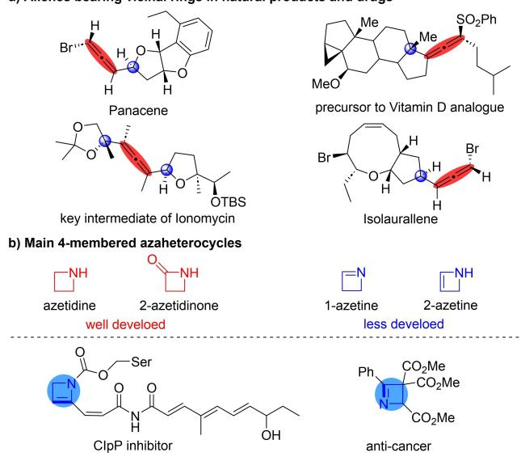
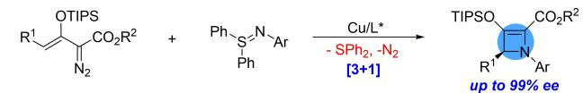
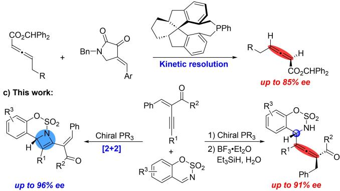
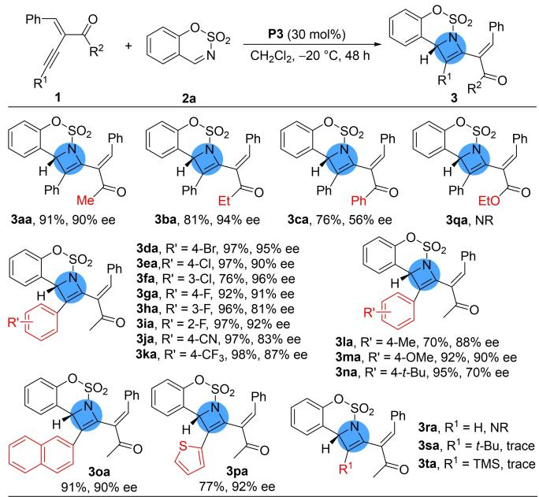
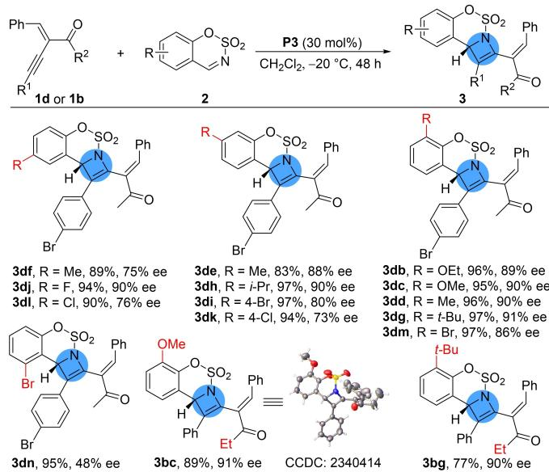
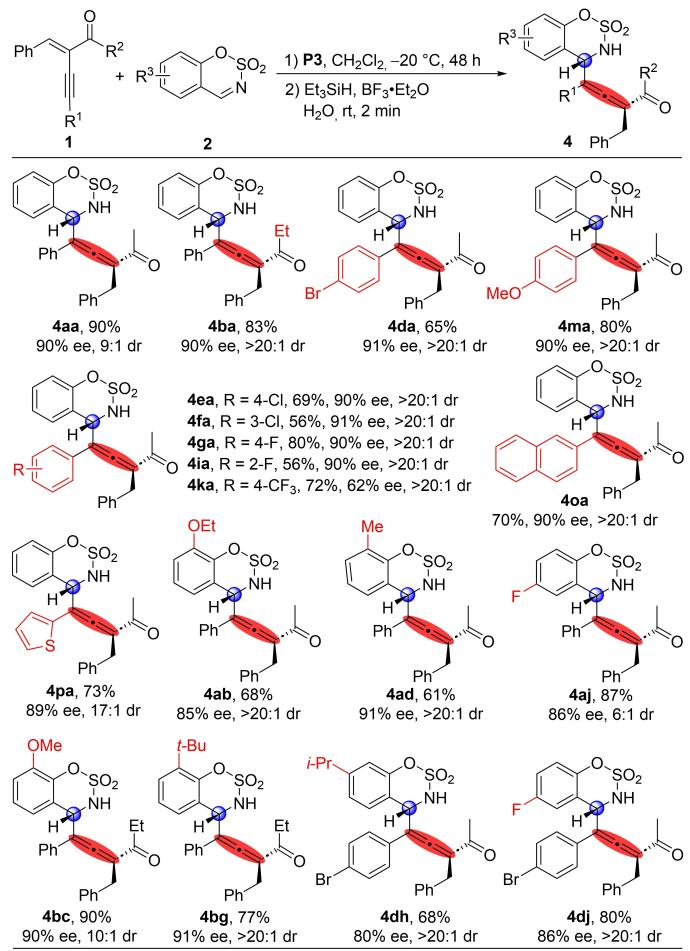
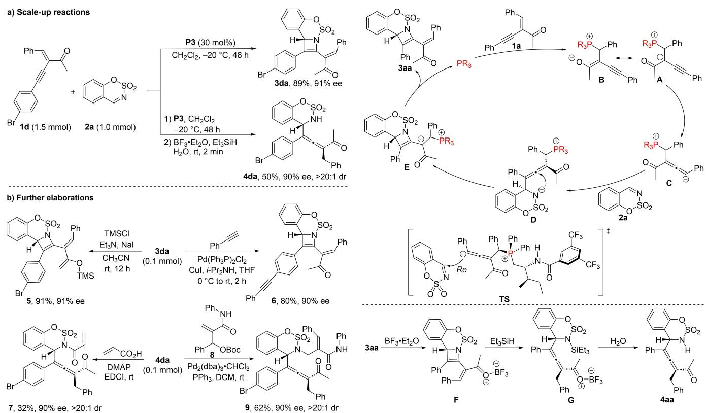
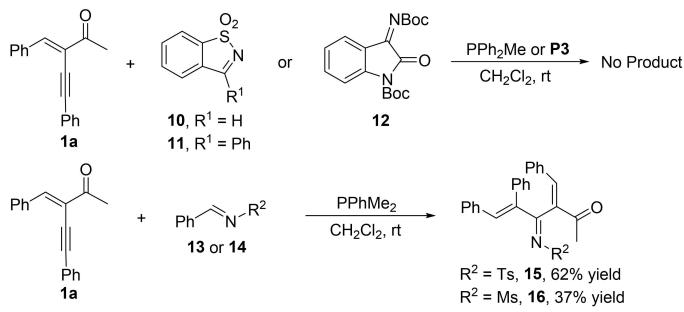
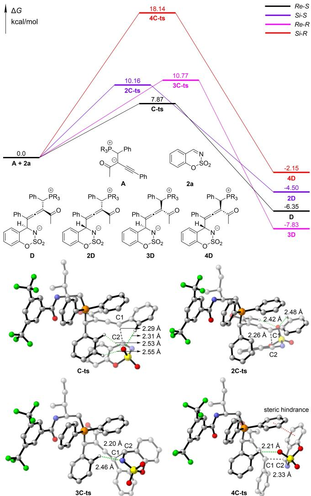

a) Allenes bearing vicinal rings in natural products and drugs

Asymmetric Catalysis

# Asymmetric Construction of Chiral 2-Azetines and Axially Chiral Tetrasubstituted Allenes Via Phosphine Catalysis

Yi Tang+, Mingxia Huang+, Jingrong Jin, Shitao Sun, Lan Wang, Yu Tan, Xiaojing Sun, and Hongchao Guo\*

Abstract: Chiral 2-azetines and allenes are highly valuable structural units in natural products and useful chemicals. However, enantioselective synthesis of both 2-azetines and allenes has been extremely challenging. Herein, we present asymmetric construction of chiral 2- azetines (70–98 % yields and up to 96% ee) through chiral phosphine-catalyzed [2+2] annulation of yneenones with sulfamate-derived cyclic imines. These 2- azetines were easily transformed into chiral allenes upon treatment with Et SiH, BF · Et O and water at rt for 2 minutes. Based on the above transformations, a concise one-pot synthetic procedure combining [2+2] annulation of yne-enones and sulfamate-derived cyclic imines under phosphine catalysis and sequential reduction/isomerization/ring-opening reaction through Et SiH, $\mathrm { B F } _ { 3 } { \cdot } \mathrm { E t } _ { 2 } \mathrm { O }$ and water was thus set up, providing axially chiral tetrasubstituted allenes in satisfactory yields and enantioselectivities (56–90% yields and up to 91% ee).

Axially chiral allenes are valuable structural units in natural products, bioactive molecules and pharmaceuticals.[1] Particularly, compounds containing both axial chirality and central chirality such as chiral allenes bearing a vicinal chiral cycles (Figure 1a) are getting more and more attention due to their presence in numerous bioactive molecules. Therefore, numerous efficient synthetic methods for chiral allenes have been developed.[2] Among them, metal-catalyzed asymmetric processes[3] and certain exquisite organocatalytic asymmetric methods[4] displayed remarkable proficiency in the production of chiral allenes. On the other hand, functionalized four-membered azaheterocycles are also widely present in bioactive molecules.[5] There are four types of four-membered azaheterocycles including azetidine and 2-azetidinone, and their unsaturated analogues such as 1-azetine and 2- azetine (Figure 1b). Significant progress has been made over the past decades for the synthesis of azetidine and 2- a) Exclusive asymmetric synthesis of chiral 2-azetines

  
Figure 1. Bioactive molecules featuring axially chiral allenes and fourmembered azaheterocycles.

b) The only synthetic example of chiral allenes via phosphine catalysis

  
Scheme 1. Strategies for asymmetric construction of chiral 2-azetine derivatives and axially chiral tetrasubstituted allenes.

azetidinone.[6] In contrast, the synthesis of 1-azetine and 2- azetine has been much less investigated[7] due to their potential 4π-electrocyclic ring opening to the corresponding more stable aza-1,3-butadienes.[8] Asymmetric construction of 2-azetine skeletons is extremely challenging. To the best of our knowledge, only one available method has been reported for the synthesis of chiral 2-azetines (Scheme 1a).[9] For this reason, it is of great importance to establish simple and efficient method to synthesize chiral 2-azetines and axially chiral allenes.

Table 1: Optimization of reaction conditions.[a]
<table><tr><td>Entry</td><td>Cat.</td><td> $\ P 5 ^ { C F _ { 3 } }$ </td><td>T (°C)</td><td>t [h]</td><td></td><td></td><td></td><td></td><td></td><td>Yield of 3 aa/4aa [%][b]</td></tr><tr><td>1</td><td></td><td></td><td>25</td><td></td><td></td><td></td><td></td><td>1</td></tr><tr><td></td><td></td><td> ${ \mathsf { C H } } _ { 2 } { \mathsf { C l } } _ { 2 }$ </td><td></td><td></td><td>12</td><td></td><td></td><td></td></tr><tr><td></td><td>PPh_{3</td><td></td><td>25</td><td></td><td></td><td></td><td></td><td>1</td></tr><tr><td></td><td> $\mathsf { P P h } _ { 2 } \mathsf { M e }$ </td><td> ${ \mathsf { C H } } _ { 2 } { \mathsf { C l } } _ { 2 }$ </td><td></td><td></td><td>12</td><td>NR 98/0</td><td></td><td></td></tr><tr><td>2</td><td>P1</td><td> $C H _ { 2 } C l _ { 2 }$ </td><td></td><td>25</td><td>12</td><td>89/0</td><td></td><td>0</td></tr><tr><td>3 4</td><td>P2</td><td> $C H _ { 2 } C l _ { 2 }$ </td><td></td><td>25</td><td>12</td><td>60/0</td><td></td><td>65</td></tr><tr><td>5</td><td>P3</td><td> $C H _ { 2 } C l _ { 2 }$ </td><td></td><td>25</td><td>12</td><td>79/0</td><td></td><td>75</td></tr><tr><td>6</td><td>P4</td><td> ${ \mathsf { C H } } _ { 2 } { \mathsf { C l } } _ { 2 }$ </td><td></td><td>25 25</td><td>12</td><td>49/0</td><td></td><td>62</td></tr><tr><td>7</td><td>P5</td><td> $C H _ { 2 } C l _ { 2 }$   $C H _ { 2 } C l _ { 2 }$ </td><td>25</td><td></td><td>12 12</td><td>49/0 48/0</td><td></td><td>0</td></tr><tr><td>8</td><td>P6 P7</td><td> $C H _ { 2 } C l _ { 2 }$ </td><td>25</td><td></td><td>12</td><td>32/0</td><td></td><td>51 35</td></tr><tr><td>9</td><td>P8</td><td> $C H _ { 2 } C l _ { 2 }$ </td><td>25</td><td></td><td>12</td><td> $\mathtt { t r a c e } / 0$ </td><td></td><td>1</td></tr><tr><td>10 11</td><td>P3</td><td>toluene</td><td>25 25</td><td></td><td>12</td><td>34/0</td><td></td><td>47</td></tr><tr><td>12</td><td>P3</td><td>THF</td><td>25</td><td></td><td>12</td><td> $\mathtt { t r a c e } / 0$ </td><td></td><td>1</td></tr><tr><td>13</td><td>P3</td><td>MeCN DCE</td><td>25</td><td></td><td>12 12</td><td>39/0 30/0</td><td></td><td>63 59</td></tr><tr><td>14</td><td>P3 P3</td><td>CHCl3</td><td>25</td><td></td><td>12</td><td>19/0</td><td></td><td>72</td></tr><tr><td>15 16</td><td>P3</td><td> $C H _ { 2 } C l _ { 2 }$ </td><td>0</td><td></td><td>24</td><td>55/0</td><td></td><td>84</td></tr><tr><td> $1 7 ^ { [ d ] }$ </td><td>P3</td><td> $C H _ { 2 } C l _ { 2 }$ </td><td></td><td>-20</td><td>48</td><td>59/0</td><td></td><td>89</td></tr><tr><td> $\rceil 8 ^ { [ { \mathsf { d } } , { \mathsf { e } } ] }$ </td><td>P3</td><td> $C H _ { 2 } C l _ { 2 }$ </td><td></td><td>-20</td><td>48</td><td>91/0</td><td></td><td>90</td></tr><tr><td> $\rceil 9 ^ { [ d , \mathsf { e } , \mathsf { f } ] }$ </td><td></td><td> $C H _ { 2 } C l _ { 2 }$ </td><td></td><td>-20</td><td>48</td><td>0/90</td><td></td><td>90</td></tr><tr><td></td><td>P3</td><td></td><td></td><td></td><td></td><td></td><td></td><td></td></tr></table>

[a] Unless noted otherwise, the reaction of 1 a (0.12 mmol), 2 a (0.10 mmol) and PR (0.02 mmol) was performed in 1 mL of solvent at 25 °C. [b] Isolated yield. [c] Determined by chiral HPLC analysis. [d] 1 a (0.15 mmol). [e] P3 (0.03 mmol). [f] After 48 h, H O (0.1 mmol), Et SiH (0.8 mmol) and BF · Et O (0.4 mmol) was added and the mixture continued to react for 2 minutes. [g] NR: no reaction.

As an important part of organocatalysis, phosphine-catalyzed reactions have drawn great attention and become an efficient tool for synthesis of valuable compounds in the past two decades.[10,11] Synthesis of allenes under phosphine catalysis are also achievable.[12] However, to the best of our knowledge, only one kinetic resolution process of racemic γ-substituted allenoates through chiral phosphine was developed for the preparation of axially chiral allenoates (up to 85% ee) (Scheme 1b).[12a] In this context, we anticipated to develop a new tool via phosphine catalysis for synthesis of chiral 2-azetines and axially chiral allenes. Due to particular reactivity, yneenones showed enormous potential as versatile building blocks for synthesis of acyclic and cyclic compounds under transition metal catalysis (Pd, Au, Rh, $\mathrm { e t c . } ) ^ { [ 1 3 ] }$ and organocatalysis $( \mathrm { N R } _ { 3 } ,$ $\mathrm { P R } _ { 3 } ) . ^ { [ 1 4 ] }$ Surprisingly, application of yne-enones in phosphine catalysis was very limited.[14f,g] We herein present an enantioselective synthesis of stable chiral 2-azetines and axially chiral tetrasubstituted allenes via phosphine-catalyzed $[ 2 + 2 ]$ annulation of yne-enones with sulfamate-derived cyclic imines (Scheme 1c).

Initially, we commenced our studies with the model reaction of yne-enone 1a and sulfamate-derived cyclic imine 2a in the presence of two classical phosphine catalysts such as $\mathrm { P P h } _ { 3 }$ and $\mathrm { P P h } _ { 2 } \mathrm { M e }$ (Table 1, entries 1–2). Although PPh did not promote the reaction due to its low nucleophilicity (entry 1), PPh Me exhibited excellent catalytic activity at $2 5 ^ { \circ } \mathrm { C } ,$ leading to the expected 2-azetine product 3aa in 98% yield (entry 2), indicating the feasibility of the reaction designed. Asymmetric variant of the topic reaction was then explored. Four commercially available chiral phosphines such as SPINOL-based chiral phosphine P1, cyclic chiral phosphine P2 and amino acid-based bifunctional chiral phosphines P3 and P4 were investigated, giving the corresponding product 3aa in 89%, 60%, 79% and 49% yields with 0%, 65%, 75% and 62% ee, respectively (entries 3–6). Due to positive capability of bifunctional chiral phosphines, we next examined this type of other four chiral phosphines P5, P6, P7 and P8. In the presence of P5, P6 and P7 (entries 7–9), this [2+2] annulation reaction gave the desired product 3aa in moderate yields (49%, 48% and 32% yields) with unsatisfactory enantioselectivities (0%, 51% and 35% ee). P8 did not promote this reaction (entry 10). With the use of P3 as the optimal catalyst, other reaction parameters such as solvent, reaction temperature, equivalent of 1a and catalyst loading were investigated. In brief, solvent screening indicated that $\mathrm { C H } _ { 2 } \mathrm { C l } _ { 2 }$ was superior in terms of yield and enantioselectivity compared to other solvents (entries 11–15). To our delight, decreasing reaction temperature to 0°C was favourable for enantioselectivity, resulting in the product with 84% ee, albeit in 55% yield (entry 16). Simultaneously increasing amount of 1a to 1.5 equiv. and further decreasing reaction temperature to $- 2 0 ^ { \circ } \mathrm { C }$ slightly improved the yield and enantioselectivity to 59% and 89% ee, respectively (entry 17). The subsequent survey on the catalyst loading showed that 30 mol% of P3 was a better choice (entry 18, 91% yield, 90% ee). Thus, the optimal reaction conditions were set as what entry 18 illustrated. Delightedly, after the starting material 2a was completely consumed, Et3SiH (8 equiv.), BF3·Et2O (4 equiv.) and H2O (1 equiv.) were added and the reaction mixture was stirred at $2 5 ^ { \circ } \mathrm { C }$ for another two minutes, producing the fascinating axially chiral tetrasubstituted allene 4aa in 90% yield with 90% ee through a one-pot procedure (entry 19).

  
Scheme 2. Substrate scope of enynes 1. Reaction conditions unless otherwise specified: 1 (0.15 mmol), 2 a (0.10 mmol) and P3 (0.03 mmol) were treated in 1 mL of ${ \mathsf { C H } } _ { 2 } { \mathsf { C l } } _ { 2 } { \mathsf { a t } } - 2 0 ^ { \circ } { \mathsf { C } }$ for 48 h; The yields refer to isolated yield; The ee values of 3 were determined by chiral HPLC analysis.

  
Scheme 3. Substrate scope of cyclic imines 2. Reaction conditions unless otherwise specified: 1 b or 1 d (0.15 mmol), 2 (0.10 mmol) and P3 (0.03 mmol) were treated in 1 mL of CH Cl at 20°C for 48 h; The yields refer to isolated yields; The ee values of 3 were determined by chiral HPLC analysis.

  
Scheme 4. Construction of axially chiral tetrasubstituted allenes. Reaction conditions: 1 (0.15 mmol), 2 (0.10 mmol) and P3 (0.03 mmol) were treated in 1 mL of CH Cl at –20°C for 48 h, then H O (0.8 mmol), Et SiH (0.8 mmol) and ${ \mathsf { B F } } _ { 3 } \cdot { \mathsf { E t } } _ { 2 } { \mathsf { O } }$ (0.8 mmol) was added and the mixture continued to react for 2 minutes; The yields refer to isolated yields; The dr values of 4 were determined by 1H NMR; The ee values of 4 were determined by chiral HPLC analysis.

  
Scheme 5. Scale-up reactions and further elaborations.

  
Scheme 6. Attempts on other electron-deficient imines  
Scheme 7. A proposed reaction mehcanism.

Under the optimal reaction conditions, the substrate scope of asymmetric [2+2] annulation was examined. As shown in Scheme 2, the reactions of yne-enones 1a–1p with sulfamatederived cyclic imine 2a proceeded smoothly to give the products 3aa–3pa in 70–98% yields with 56–96% ee. Generally, variation of substituent $\mathbf { R } ^ { 2 }$ in acyl group did not influence reactivity of yne-enones. The enantioselectivity of product 3ca decreased a lot when $\mathbf { R } ^ { 2 }$ in acyl group was phenyl. Unfortunately, when $\mathbf { R } ^ { 2 }$ was ethoxyl, the reaction did not occur under standard reaction conditions. In addition, the substrates having electron-deficient substituents on the aryl ring ${ \bf R } ^ { 1 }$ showed similar reactivity and enantioselectivities to that of those substrates bearing electronrich substituents. Strong electron-withdrawing cyano and $\mathrm { C F } _ { 3 }$ group were also well tolerated, affording the products 3ja and 3ka in high yields, albeit with slightly lower enantioselectivities. In particular, when the substituent ${ \bf R } ^ { 1 }$ on the alkynyl moiety was 2-naphthyl or 2-thienyl, the corresponding product 3oa or 3pa was obtained in high yield with excellent enantioselectivity. It was regrettable that when $\mathbf { R } ^ { 1 }$ group on the alkynyl moiety was H, alkyl or trimethylsilyl (TMS), the reaction did not work. Under phosphine catalysis, TMS-substituted substrate might underwent desilylation, thus leading to messy mixture. As for tert-butyl-substituted yne-enone 1s or the yne-enone 1r without substituent, it was difficult to form allenyl anion intermediate.

We further explored this annulation reaction of various sulfamate-derived cyclic imines 2. As shown in Scheme 3, various easily synthesized cyclic imines 2b–2n reacted smoothly with yne-enone 1d, affording the corresponding products 3db– 3dn in high yields with moderate to excellent enantioselectivities (83–98% yields, 48–91% ee). It is worth noting that the cyclic imines 2 having substituent at 8-position afforded products in higher enantioselectivities, compared with those cyclic imines bearing substituent at 6-position or 5-position (3dd vs 3df, 3dm vs 3dn). Therefore, we additionally used 1b to react with two cyclic imines 2c and $\mathbf { 2 \underline { { g } } }$ having substituent at 8-position, giving the corresponding product 3bc and 3bg in 89% and 77% yields with 91% and 90% ee, respectively. The structure and stereochemistry of 3bc (CCDC Number: 2340414, detailed in SI) were determined through single-crystal X-ray diffraction.[15]

After asymmetric $[ 2 + 2 ]$ annulation of yne-enones 1 with sulfamate-derived cyclic imines 2 was investigated, we explored asymmetric construction of axially chiral tetrasubstituted allenes.

  
Figure 2. The calculated energy profiles of four reaction pathways for the reaction of substrate 2 a and the intermediate A at the M06-2X/6- 311+ +G(d,p)/PCM(dichloromethane)//M06-2X/6-31+G(d,p)/ PCM(dichlorometh–ane) level.[16] Key interatomic distances were given in Å. Non-interacting hydrogen atoms were omitted for clarity (color Scheme: C: grey, O: red, H: white, N: blue, F: green, S: yellow, P: orange).

As shown in Scheme 4, several yne-enones 1 were examined under the optimized one-pot reaction conditions, giving the corresponding allene products 4 in 56–90% yields with moderate to high diastereo- and enantioselectivities (6:1 to >20:1 dr, 62–91% ee). In general, the yne-enones having electron-deficient substituents on the aryl ring showed similar reactivity to that of those substrates bearing electron-rich substituents. In addition, the strong electron-withdrawing CF group was well tolerated, resulting in 72% yield of product 4ka, albeit with somewhat deteriorative enantioselectivity (62% ee). When the substituent on the alkynyl moiety was 2-naphthyl or 2-thienyl, the corresponding allene products 4oa and 4pa were also obtained in 70% and 72% yields with 90% and 89% ee, respectively. We then moved on to evaluate the scope of cyclic imines 2. Several cyclic imines having different substituents were examined with yne-enone 1a, 1b or 1d as the reaction partner and the desired products 4 were obtained in 61–90% yields with 80–91% ee and 6:1 to >20:1 dr. The cyclic imines 2 bearing electron-donating groups such as 8-OEt, 8-Me, 8-OMe, 8-t-Bu and 7-i-Pr and electron-withdrawing groups such as 6-F all delivered the desired products (4ab, 4ad, 4bc, 4bg, 4dh, 4aj and 4dj) in high yields with good enantio- and diastereoselectivities. The absolute configurations of the products were determined by X-ray crystallographic analysis of the product 3bc and rac-4da (CCDC Number: 2351222, detailed in SI).[15]

Furthermore, the scale-up preparations of the products 3da and 4da were carried out. As indicated in Scheme 5a, 1.0 mmol (183 mg) of the sulfamate-derived cyclic imine 2a was reacted with the yne-enone 1d under the optimal reaction conditions to give the product 3da in 89% yield with 91% ee and product 4da in 50% yield with 90% ee and >20:1 dr, respectively. Further transformations of the product 3da and 4da were next investigated to demonstrate the utility of this method (Scheme 5b). Treatment of the product 3da with TMSCl, Et N and NaI at room temperature for 12 h produced the TMS-protected product 5 in 91% yield with 91% ee. In the presence of Pd(Ph P) Cl , CuI and phenylacetylene, the product 3da underwent a Sonogashira coupling reaction to afford the derivative 6 in 80% yield with 90% ee. The product 4da was transformed into the compound 7 in 32% yield with 90% ee and >20:1 dr through the amidation reaction. The allylation of the product 4da with the amido-tethered allylic carbonate 8 catalysed by Pd (dba) ·CHCl /PPh afforded the compound 9 in 62% yield with 90% ee and >20:1 dr.

We also tried other electron-deficient imines such as cyclic imines 10 and 11, isatin-derived ketoimine 12 and N-sulfonyl imines 13 and 14 (Scheme 6). Either no reaction occurred or the corresponding aza-1,3-butadienes 15 and 16 were formed via the 4π-electrocyclic ring opening. These results indicated that highly electron-deficient property and ring size of cyclic imine were crucial for the current annulation.

As depicted in Scheme 7, a plausible mechanism was proposed. Nucleophilic addition of phosphine catalyst to yneenone 1a afforded the zwitterionic intermediate A, which isomerized to generate the allenyl anion intermediate C. The intermediate C then attacked the sulfamate-derived cyclic imine 2a from the Re face to give the intermediate D. Subsequent intramolecular annulation yielded the intermediate E. The chiral 2-azetine product 3aa was then produced through β-elimination of the phosphine. In the one-pot reaction procedure, Lewis acid BF activated the carbonyl group of 3aa. Subsequently, sequential reduction/rearrangement/ring-opening reaction through Et SiH occurred to give the intermediate G, which was hydrolysed to produce the allene product 4aa.

To gain further insight into the stereoselectivity of the current reaction, we performed theoretical calculations. The calculated free energy profiles were shown in Figure 2. The conversion of substrate 2a into the intermediate D generated a chiral center and a chiral axis, therefore four possible reaction pathways were discussed for the reaction of 2a and the intermediate A. The Re-S pathway (Figure 2, black) was identified as the more favourable reaction pathway in view of its relatively lower reaction energy barrier (7.87 kcal/mol) than the other three competing pathways. This can be attributed to the weaker steric hindrance in the transition state structure C-ts in view of the co-presence of three strong H-bonds and shorter C1···C2 distance (2.29 Å, Figure 2) compared to the 2.33 Å in 4C-ts with only one H-bond or 2.26 Å in 2C-ts with two Hbonds. Consequently, this energetically favourable pathway resulted in the intermediate D, which dictated the configuration of the product 3aa, being consistent with the experimental observation.

In conclusion, we have achieved asymmetric construction of chiral 2-azetines and axially chiral tetrasubstituted allenes in moderate to high yields with good to excellent stereoselectivities through phosphine catalysis. Chiral phosphine-catalyzed [2+2] annulation of sulfamate-derived cyclic imines with yne-enones produced enantioenriched 2-azetine derivatives, which was treated with Et SiH, BF ·Et O and H O through a one-pot procedure to give axially chiral tetrasubstituted allenes. This new application of yne-enones in phosphine catalysis will inspire more exploration on yne-enones as a versatile acceptor for phosphine-catalysed reactions.

## Acknowledgements

This work is supported by the National Natural Science Foundation of China (Nos. 21871293 and 22071264).

## Conflict of Interest

The authors declare no conflict of interest.

## Data Availability Statement

The data that support the findings of this study are available in the supplementary material of this article.

Keywords: asymmetric catalysis · phosphine · yne-enone · 2-azetine · allene

[1] a) N. Krause, A. S. K. Hashmi, Modern Allene Chemistry, Wiley, 2004; b) A. A. Hoffmann-Röder, N. Krause, Angew. Chem. Int. Ed. 2004, 43, 1196–1216; Angew. Chem. 2004, 116, 1216–1236; c) S. Yu, S. Ma, Angew. Chem. Int. Ed. 2012, 51, 3074–3112; Angew. Chem. 2012, 124, 3128–3167; d) P. Rivera-Fuentes, F. Diederich, Angew. Chem. Int. Ed. 2012, 51, 2818– 2828; Angew. Chem. 2012, 124, 2872–2882; e) L. U. Dzhemileva, V. A. D’Yakonov, A. A. Makarov, E. K. Makarova, E. N. Andreev, U. M. Dzhemilev, J. Nat. Prod. 2020, 83, 2399–2409.

[2] For selected reviews on the synthesis of allenes, see: a) S. Yu, S. Ma, Chem. Commun. 2011, 47, 5384–5418; b) J. Ye, S. Ma, Org. Chem. Front. 2014, 1, 1210–1224; c) R. K. Neff, D. E. Frantz, ACS Catal. 2014, 4, 519–528; d) W.-D. Chu, Y. Zhang, J. Wang, Catal. Sci. Technol. 2017, 7, 4570–4579; e) X. Huang, S. Ma, Acc. Chem. Res. 2019, 52, 1301–1312; f) X. Wang, X. Chen, W. Lin, P. Li, W, Li, Adv. Synth. Catal. 2022, 364, 1212–1222; g) W. Xiao, J. Wu, Org. Chem. Front. 2022, 9, 5053–5073.

[3] For selected recent examples, see: a) W. Chu, L. Zhang, Z. Zhang, Q. Zhou, F. Mo, Y. Zhang, J. Wang, J. Am. Chem. Soc. 2016, 138, 14558–14561; b) M. Kondo, M. Omori, T. Hatanaka,

Y. Funahashi, S. Nakamura, Angew. Chem. Int. Ed. 2017, 56, 8677–8680; Angew. Chem. 2017, 129, 8803–8806; c) Y. Tang, J. Xu, J. Yang, L. Lin, X. Feng, X. Liu, Chem 2018, 4, 1658–1672; d) X. Wei, T. Wakaki, T. Itoh, H. Li, T. Yoshimura, A. Miyazaki, K. Oisaki, M. Hatanaka, Y. Shimizu, M. Kanai, Chem 2019, 5, 585–599; e) S. Song, J. Zhou, C. Fu, S. Ma, Nat. Commun. 2019, 10, 507–514; f) W.-F. Zheng, W. Zhang, C. Huang, P. Wu, H. Qian, L. Wang, Y.-L. Guo, S. Ma, Nat. Catal. 2019, 2, 997–1005; g) C. Zhu, H. Chu, G. Li, S. Ma, J. Zhang, J. Am. Chem. Soc. 2019, 141, 19246–19251; h) J. Mateos-Gil, A. Mondal, M. Castineira Reis, B. L. Feringa, Angew. Chem. Int. Ed. 2020, 59, 7823–7829; Angew. Chem. 2020, 132, 7897–7903; i) H. Wang, H. Luo, Z. Zhang, W.-F. Zheng, Y. Yin, H. Qian, J. Zhang, S. Ma, J. Am. Chem. Soc. 2020, 142, 9763–9771; j) J. Zhang, X. Huo, J. Xiao, L. Zhao, S. Ma, W. Zhang, J. Am. Chem. Soc. 2021, 143, 12622–12632; k) B. Shi, J.-B. Liu, Z.-T. Wang, L. Wang, Y. Lan, L.-Q. Lu, W.-J. Xiao, Angew. Chem. Int. Ed. 2022, 61, e202117215; Angew. Chem. 2022, 134, e202117215; l) H. Wang, H. Qian, J. Zhang, S. Ma, J. Am. Chem. Soc. 2022, 144, 12619–12626; m) F.-H. Zhang, X. Guo, X. Zeng, Z. Wang, Angew. Chem. Int. Ed. 2022, 61, e202117114; Angew. Chem. 2022, 134, e202117114; n) J. Wang, WF. Zheng, X. Zhang, H. Qian, S. Ma, Nat. Commun. 2023, 14, 7399–7411; o) S. Zhang, S. Wu, Q. Wang, S. Xu, Y. Han, C.-G. Yan, J. Zhang, L. Wang, Angew. Chem. Int. Ed. 2023, 62, e202300309; Angew. Chem. 2023, 135, e202300309; p) C. Sheng, Z. Ling, J. Xiao, K. Yang, F. Xie, S. Ma, W. Zhang, Angew. Chem. Int. Ed. 2023, 62, e202305680; Angew. Chem. 2023, 135, e202305680; q) Z. Cheng, T. Yang, C. Li, Y. Deng, F. Zhang, P. Chen, Z. Lin, S. Ma, G. Liu, J. Am. Chem. Soc. 2023, 145, 25995–26002; r) J. Han, S. Liu, H. Wang, J. Wang, H. Qian, Z. Li, S. Ma, J. Zhang, Sci. Adv. 2023, 9, eadg1002; s) W. Wang, Y. M. Hu, K. Li, J. Q. Xu, C. Zhang, L. J. Zhou, L. H. Zhu, H. Guo, ACS Catal. 2024, 14, 9940–9954; t) G. Liu, X. Yang, P. Gu, M. Wang, X. Zhang, X.-Q. Dong, J. Am. Chem. Soc. 2024, 146, 7419–7430; u) J. Zhang, Y. Luo, E. Zheng, X. Huo, S. Ma, W. Zhang, J. Am. Chem. Soc. 2024, 146, 9241–9251.

[4] For selected recent examples, see: a) W. Yao, X. Dou, S. Wen, J. Wu, J. J. Vittal, Y. Lu, Nat. Commun. 2016, 7, 13024–13031; b) Y. Jiang, A. B. Diagne, R. J. Thomson, S. E. Schaus, J. Am. Chem. Soc. 2017, 139, 1998–2005; c) P. H. Poulsen, Y. Li, V. H. Lauridsen, D. K. B. Jorgensen, T. A. Palazzo, M. Meazza, K. A. Jørgensen, Angew. Chem. Int. Ed. 2018, 57, 10661–10665; Angew. Chem. 2018, 130, 10821–10825; d) Z. G. Ma, J. L. Wei, J. B. Lin, G. J. Wang, J. Zhou, K. Chen, C. A. Fan, S. Y. Zhang, Org. Lett. 2019, 21, 2468–2472; e) A. Tap, A. Blond, V. N. Wakchaure, B. List, Angew. Chem. Int. Ed. 2016, 55, 8962–8965; Angew. Chem. 2016, 128, 9108–9111; f) D. Qian, L. Wu, Z. Lin, J. Sun, Nat. Commun. 2017, 8, 567–575; g) M. Chen, D. Qian, J. Sun, Org. Lett. 2019, 21, 8127–8131; h) L. Zhang, Y. Han, A. Huang, P. Zhang, P. Li, W. Li, Org. Lett. 2019, 21, 7415–7419; i) X. Li, J. Sun, Angew. Chem. Int. Ed. 2020, 59, 17049–17054; Angew. Chem. 2020, 132, 17197–17202; j) J. Wang, S. Zheng, S. Rajkumar, J. Xie, N. Yu, Q. Peng, X. Yang, Nat. Commun. 2020, 11, 5527–5538; k) Y. Hu, W. Shi, B. Zheng, J. Liao, W. Wang, Y. Wu, H. Guo, Angew. Chem. Int. Ed. 2020, 59, 19820–19824; Angew. Chem. 2020, 132, 19992– 19996; l) Y. Xie, X. Yang, J. Xu, H. Chai, H. Liu, J. Zhang, J. Song, Y. Gao, Z. Jin, Y. R. Chi, Angew. Chem. Int. Ed. 2021, 60, 14817–14823; Angew. Chem. 2021,133, 14943–14949; m) Z. Wang, X. Lin, X. Chen, P. Li, W. Li, Org. Chem. Front. 2021, 8, 3469–3474; n) X. Lin, B. Shen, Z. Wang, Y. Cheng, X. Chen, P. Li, P. Yu, W. Li, Org. Lett. 2022, 24, 4914–4918; o) C. Qian, T. Huang, J. Sun, P. Li, Org. Lett. 2022, 24, 6472–6476; p) Z. Yue, Y. Xia, B. Shen, C. Liu, P. Yu, P. Li, W. Li, Adv. Synth. Catal. 2024, 366, 1078–1083; q) J.-Y. Zheng, F. Wang, Y. Zhang, Z. Zheng, J.-H. Wu, X. Ren, Z. Su, W. Chen, T. Wang,

Angew. Chem. Int. Ed. 2024, 63, e202403707; Angew. Chem. 2024, 136, e202403707.

[5] a) J. F. Fisher, S. O. Meroueh, S. Mobashery, Chem. Rev. 2005, 105, 395–424; b) H. Yoda, H. Takahashi, T. Sengoku, Chapter 2, Heterocycles in Natural Product Synthesis, 1st ed, 2011; c) J. Barluenga, A. Gomez, J. Santamaria, M. Tomas, Angew. Chem. Int. Ed. 2010, 49, 1306–1308; Angew. Chem. 2010, 7, 1328–1330; d) E. J. Culp, D. Sychantha, C. Hobson, A. C. Pawlowski, G. Prehna, G. D. Wright, Nat. Microbiol. 2022, 7, 451–462.

[6] a) A. Brandi, S. Cicchi, F. M. Cordero, Chem. Rev. 2008, 108, 3988–4035; b) G. He, Y. Zhao, S. Zhang, C. Lu, G. Chen, J. Am. Chem. Soc. 2012, 134, 3–6; c) R. Sakamoto, T. Inada, S. Sakurai, K. Maruoka, Org. Lett. 2016, 18, 6252–6255; d) R. Gianatassio, J. M. Lopchuk, J. Wang, C. M. Pan, L. R. Malins, L. Prieto, T. A. Brandt, M. R. Collins, G. M. Gallego, N. W. Sach, J. E. Spangler, H. Zhu, J. Zhu, P. S. Baran, Science 2016, 351, 241–246; e) E. Kumarasamy, S. K. Kandappa, R. Raghunathan, S. Jockusch, J. Sivaguru, Angew. Chem. Int. Ed. 2017, 56, 7056–7061; Angew. Chem. 2017, 129, 7162–7167; f) A. Fawcett, A. Murtaza, C. H. U. Gregson, V. K. Aggarwal, J. Am. Chem. Soc. 2019, 141, 4573–4578; g) M. R. Becker, A. D. Richardson, C. S. Schindler, Nat. Commun. 2019, 10, 5095– 5102; h) M. R. Becker, E. R. Wearing, C. S. Schindler, Nat. Chem. 2020, 12, 898–905; i) A. D. Richardson, M. R. Becker, C. S. Schindler, Chem. Sci. 2020, 11, 7553–7561; j) K. A. Rykaczewski, M. R. Becker, M. J. Anantpur, R. C. Sausa, E. C. Johnson, J. A. Orlicki, E. J. Bukowski, J. J. Sabatini, C. S. Schindler, J. Am. Chem. Soc. 2022, 144, 19089–19096; k) J. L. Tyler, A. Noble, V. Aggarwal, Angew. Chem. Int. Ed. 2022, 61, e202214049; Angew. Chem. 2022, 134, e202214049; l) P. Franceschi, S. Cuadros, G. Goti, L. Dell’Amico, Angew. Chem. Int. Ed. 2023, 62, e202217210; Angew. Chem. 2023, 135, e202217210; m) V. Jaiswal, S. Mondal, B. Singh, V. P. Singh, J. Saha, Angew. Chem. Int. Ed. 2023, 62, e202304471; Angew. Chem. 2023, 135, e202304471; n) X. Liu, F. Zhu, M. J. Ajitha, Y. Zhang, K. W. Huang, D. Li, D. Wang, Org. Lett. 2023, 26, 225–230.

[7] For selected reviews, see: a) D. Didier, A. N. Baumann, M. Eisold, Tetrahedron Lett. 2018, 59, 3975–3987; b) T. W. Reidl, L. L. Anderson, J. Org. Chem. 2019, 8, 931–945; c) M. R. Gatazka, E. C. McFee, C. H. Ng, E. R. Wearing, C. S. Schindler, Org. Biomol. Chem. 2022, 20, 9052–9068.

[8] a) S. Mangelinckx, V. V. Speybroeck, P. Vansteenkiste, M. Waroquier, N. D. Kimpe, J. Org. Chem. 2008, 73, 5481–5488; b) N. Shindoh, K. Kitaura, Y. Takemoto, K. Takasu, J. Am. Chem. Soc. 2011, 133, 8470–8473; c) S. A. Lopez, K. N. Houk, J. Org. Chem. 2014, 79, 6189–6195.

[9] a) K. O. Marichev, K. Wang, K. Dong, N. Greco, L. A. Massey, Y. Deng, H. Arman, M. P. Doyle, Angew. Chem. Int. Ed. 2019, 58, 16188–16192; Angew. Chem. 2019, 131,16334–16338; b) K. O. Marichev, K. Dong, L. A. Massey, Y. Deng, L. D. Angelis, K. Wang, H. Arman, M. P. Doyle, Nat. Commun. 2019, 10, 5328–5337.

[10] For selected reviews, see: a) Y. Xiao, Z. Sun, H. Guo, O. Kwon, Beilstein J. Org. Chem. 2014, 10, 2089–2121; b) W. Li, J. Zhang, Chem. Soc. Rev. 2016, 45, 1657–1677; c) Y. Xiao, H. Guo, O. Kwon, Aldrichimica Acta 2016, 49, 3–27; d) T. Wang, X. Han, F. Zhong, W. Yao, Y. Lu, Acc. Chem. Res. 2016, 49, 1369–1378; e) W. Li, J. Zhang, Chem. Soc. Rev. 2016, 45, 1657– 1677; f) Y. Wei, M. Shi, Org. Chem. Front. 2017, 4, 1876–1890; g) H. Ni, W.-L. Chan, Y. Lu, Chem. Rev. 2018, 118, 9344–9411;

h) H. Guo, Y. C. Fan, Z. Sun, Y. Wu, O. Kwon, Chem. Rev. 2018, 118, 10049–10293; i) E.-Q. Li, Y. Huang, Chem. Commun. 2020, 56, 680–694; j) Y. Huang, J. Liao, W. Wang, H. Liu, H. Guo, Chem. Commun. 2020, 56, 15235–15281; k) C. Xie, A. J. Smaligo, X.-R. Song, O. Kwon, ACS Cent. Sci. 2021, 7, 536–558.

[11] For some examples, see: a) R. Na, C. Jing, Q. Xu, H. Jiang, X. Wu, J. Shi, J. Zhong, M. Wang, D. Benitez, E. Tkatchouk, W. A. Goddard III, H. Guo, O. Kwon, J. Am. Chem. Soc. 2011, 133, 13337–13348; b) L. Zhang, H. Liu, G. Qiao, Z. Hou, Y. Liu, Y. Xiao, H Guo, J. Am. Chem. Soc. 2015, 137, 4316–4319; c) W. Zhou, H. Wang, M. Tao, C.-Z. Zhu, T.-Y. Lin, J. Zhang, Chem. Sci. 2017, 8, 4660–4665; d) L. Zhou, C. Yuan, Y. Zeng, H. Liu, C. Wang, X. Gao, Q. Wang, C. Zhang, H. Guo, Chem. Sci. 2018, 9, 1831–1835; e) M. Wu, Z. Han, K. Li, J. Wu, K. Ding, Y. Lu, J. Am. Chem. Soc. 2019, 141, 16362–16373; f) J. Feng, Y. Huang, ACS Catal. 2020, 10, 3541–3547; g) M. Liu, L. Zhou, W. Shi, Y. Hu, J. Liao, Z. Duan, H. Guo, Org. Lett. 2021. 23, 7703–7707; h) C. X. A. Tan, R. Li, F. Zhang, L. Dai, N. Ullah, Y. Lu, Angew. Chem. Int. Ed. 2022, 61, e202209494; Angew. Chem. 2022, 134, e202209494; i) N. Wang, Y. Lang, J. Wang, Z. Wu, Y. Lu, Org. Lett. 2022, 24, 3712–3716; j) F. Zhang, X. Dai, L. Dai, W. Zheng, W.-L. Chan, X. Tang, X. Zhang, Y. Lu, Angew. Chem. Int. Ed. 2022, 61, e202203212; Angew. Chem. 2022, 134, e202203212; k) W. Shi, Y. Ren, H. Zhao, Y. Tang, S. Piao, B. Mao, W. Wang, Y. Wu, B. Wang, H. Guo, Org. Lett. 2022, 24, 3747–3752; l) X. He, P. Ma, Y. Tang, J. Li, S. Shen, M. J. Lear, K. N. Houk, S. Xu, Chem. Sci. 2022, 13, 12769–12775; m) Z. Duan, M. Liu, B. Zheng, Y. Tang, J. Du, L. Wang, S. Yu, Y. Wu, H. Guo, Org. Lett. 2023, 25, 3298– 3302.

[12] a) M. Wu, Z. Han, K. Li, J. Wu, K. Ding, Y. Lu, J. Am. Chem. Soc. 2019, 141, 16362–16373; b) Y. Tang, W. Shi, J. Du, Y. Ren, Y. Xiao, H. Guo, Org. Lett. 2023, 25, 8547–8552.

[13] D. Qian, J. Zhang, Acc. Chem. Res. 2020, 53, 2358–2371.

[14] For some examples, see: a) X. Yu, H. Ren, Y. Xiao, J. Zhang, Chem. Eur. J. 2008, 14, 8481–8485; b) W. Li, Y. Xiao, J. Zhang, Adv. Synth. Catal. 2009, 351, 3083–3088; c) X. Yu, B. Du, K. Wang, J. Zhang, Org. Lett. 2010, 12, 1876–1879; d) X. Yu, J. Zhang, Adv. Synth. Catal. 2011, 353, 1265–1268; e) X. Yu, J. Zhang, Chem. Eur. J. 2012, 41, 12945–12949; f) W. Li, J. Zhang, Org. Lett. 2014, 16, 162–165; g) W. Li, L. Gao, Z. Yue, J. Zhang, Adv. Synth. Catal. 2015, 357, 2651–2655.

[15] Deposition Number 2340414 (for 3bc) and 2351222 (for 4da) contain the supplementary crystallographic data for this paper. These data are provided free of charge by the joint Cambridge Crystallographic Data Centre and Fachinformationszentrum Karlsruhe Access Structures service via www.ccdc.cam.ac.uk/ structures.

[16] a) Y. Zhao, D. G. Truhlar, Theor. Chem. Acc. 2008, 120, 215– 241; b) R. Krishnan, J. S. Binkley, R. Seeger, J. A. Pople, J. Chem. Phys. 1980, 72, 650–654; c) S. Miertuš, E. Scrocco, J. Tomasi, Chem. Phys. 1981, 55, 117–129; d) W. J. Hehre, R. Ditchfield, J. A. Pople, J. Chem. Phys. 1972, 56, 2257–2261; e) P. C. Hariharan, J. A. Pople, Theor. Chim. Acta 1973, 28, 213–222.

Manuscript received: August 18, 2024   
Accepted manuscript online: November 10, 2024   
Version of record online: November 21, 2024