Enantioselective Synthesis

How to cite: Angew. Chem. Int. Ed. 2025, 64, e202413428   
doi.org/10.1002/anie.202413428

# Diastereoselective and Enantioselective Hydrophosphinylations of Conjugated Enynes, Allenes and Dienes via Synergistic Pd/Co Catalysis

Ming-Qiao Tang, Zi-Jiang Yang, Ai-Jun Han, and Zhi-Tao He\*

Abstract: Different from the reported work focusing on the construction of single P- or C-stereocenter via hydrophosphinylation of unsaturated carbon bonds, the highly diastereo- and enantioselective hydrophosphinylation reaction of allenes, conjugated enynes and 1,3- dienes is achieved via a designed Pd/Co dual catalysis and newly modified masked phosphinylating reagent. A series of allyl motifs bearing both a tertiary C- and P-stereocenter are prepared in generally good yields, >20: 1 dr, >20: 1 rr and 99% ee. The unprecedented diastereo- and enantioselective hydrophosphinylation of 1,3-enynes is established to generate skeletons containing both a P-stereocenter and a nonadjacent chiral axis. The first stereodivergent hydrophosphinylation reaction is also developed to achieve all four P-containing stereoisomers. The present protocol features the use of only 3-minutes reaction time and 0.1 % catalyst, and with the observation of up to 730 TON. A set of mechanistic studies reveal the necessity and roles of two metal catalysts and corroborate the designed synergistic process.

## Introduction

Enantioenriched organophosphorus motifs have been widely used in chiral ligand and catalyst design, medicinal and material chemistry.[1] In addition to various catalytic pathways such as 1,4-conjugate addition, allylic substitution, cross coupling, nucleophilic substitution and others,[2] the asymmetric hydrophosphinylation and hydrophosphination of unsaturated carbon-carbon bonds have emerged as a valuable and convenient route to construct these skeletons.[3–9] For example, in 2018, Dong reported the first Pd-catalyzed asymmetric hydrophosphinylation of unactivated 1,3-dienes.[4b] Wang and Li extended hydrophosphination and hydrophosphinylation to the use of allenes with high enantiocontrol.[4h,i] However, these works focus exclusively on the construction of P- or C-stereocenter and fail to provide high stereocontrol on both of them simultaneously (Scheme 1a). A few prior works tried to establish the related diastereoselective processes but generally furnished 1: 1 diastereoselectivity for the transformations.[4h,l,5b,f,8] Only an elegant work by Li and co-workers describes diastereoselective access to phosphine-functionalized olefins via Pdcatalyzed hydrophosphination of alkynes.[4i] Thus, the route to achieve diastereo- and enantioselective hydrophosphinylation and hydrophosphination reactions is still rare. Meanwhile, the asymmetric hydrofunctionalization of 1,3-enynes is a facile route to prepare enantioenriched allenes,[10,11] but related hydrophosphinylation and hydrophosphination processes remain undeveloped, neither enantioselectively nor diastereoselectively.

Stereodivergent synthesis has received much attention due to the potential to achieve all the stereoisomers of a constructed skeleton.[12] However, all the reported studies focus on the construction of C-based stereocenters, and seldomly explore the involvement of heteroatom-based stereocenter (Scheme 1b). Obviously, heteroatom-based stereodivergent synthesis represents a new direction in this area and would greatly extend the concept of stereodivergent synthesis. Therefore, stereodivergent hydrophosphinylation and hydrophosphination reaction to prepare Pinvolved chiral motifs are unknown.

Synergistic catalysis has shown great potential in controlling multiple stereocenters in the stereoselective synthesis.[13] Recently, Duan et al. reported an interesting study toward the preparation of P-stereocenter via Co-catalyzed 1,4- addition and nucleophilic substitution with racemic phosphine oxides.[14] Inspired by this work and considering the high efficiency of Pd-catalyzed asymmetric hydrofunctionalizations,[15–18] we envisioned that a synergistic Pd/Co catalytic system might provide a novel solution to this long-standing unsolved diastereoselective hydrophosphinylation to construct motifs bearing both a P- and C-stereocenter. Meanwhile, with the precise dictation of Pd and Co catalysts on related coupling partners, the stereodivergent hydrophosphinylation reaction to access all four P-containing stereoisomers might also be realized for the first time.

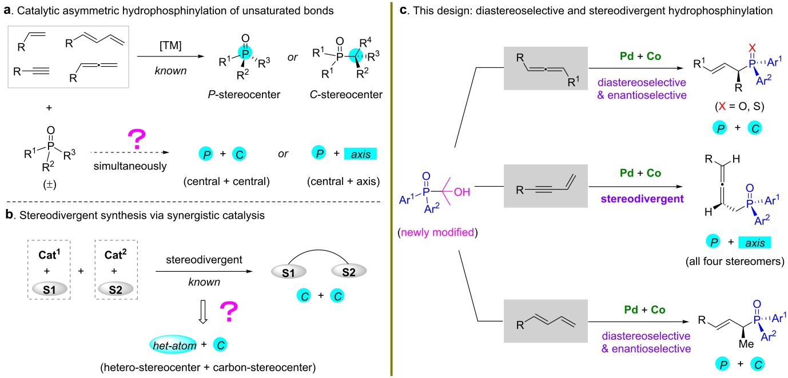  
Scheme 1. Asymmetric hydrophosphinylation of unsaturated carbon-carbon bonds and our designed diastereoselective pathway.

Herein, we describe our endeavors to establish three types of diastereo- and enantioselective hydrophosphinylation transformations via a synergistic Pd/Co catalysis (Scheme 1c). With allene and newly modified masked P(V) reagent as the substrates, the hydrophosphinylation can be realized to generate skeletons bearing both a P- and C-stereocenter. The hydrophosphinylation of 1,3-enynes is also developed to furnish motifs containing a P-stereocenter and a chiral axis. This protocol is further applied to the unprecedented diastereoselective hydrophosphinylation of conjugated diene. In addition, a stereodivergent protocol is described to access all of the stereoisomers of the constructed P-containing units.

## Results and Discussion

With this design in mind, aryloxyallene 1a and pyridyl phosphine oxide 2a-1 were selected as the electrophile and nucleophile, respectively (Table 1). When BINAP L5 was selected as the chiral ligand for Pd catalyst, a set of chiral ligands for Co metal was evaluated first. With Boxmi ligand L1 used,[19] the synergistic catalysis occurred and provided 3a in 36% yield and 60 % ee but with 1.4: 1 dr (entry 1). When a similar ligand L2 was used instead, both the reactivity and stereocontrol were increased obviously. In this case, 77% yield, 4.5:1 dr and 79 % ee for product 3 a were observed (entry 2). Other chiral ligands did not show better stereocontrol for the hydrofunctionalization process (see Supporting Information for details). Next, a group of chiral ligands instead of L5 for Pd metal was checked (entries 3–9). Among them, L10 exhibited the optimal results, furnishing 3a in 75 % yield, 11: 1 dr and 96% ee. A series of other condition evaluations including different bases and solvents were conducted. The corresponding results were summarized in the Supporting Information but all failed to provide superior effects.

Murakami et al. demonstrated that an α-hydroxyalkylphosphonate as the masked phosphonating reagent could prevent catalyst deactivation and presumably have a positive influence on reactivity and selectivity.[20] Several modified P(V) reagents 2a, 2 a-2 and 2a-3 were thus synthesized from the reaction of 2a-1 and ketones. We found that these new phosphonating reagents are actually much easier to be prepared and purified than that for 2a-1. With 2 a used instead of 2a-1 (entry 10), indeed both the diastereoselectivity and enantioselectivity of 3 a were elevated (from 11 : 1 to >20 :1 dr and 96 % to 97 % ee). Similarly, 2a-2 and 2a-3 as masked 2a-1 showed excellent stereocontrol effects and with slightly decreased yields for 3a (entries 11–12). When the reaction temperature was lowered to room temperature, 3a was achieved in the highest 71% yield, >20 :1 dr and >99 % ee (entry 13), and the conditions used in this reaction were thus determined to be the optimal conditions for the diastereoselective hydrophosphinylation process. It should be noted that, in this context, if ent-L2 was adopted instead of L2, both the diastereoselectivity and enantioselectivity of 3a decreased heavily (entry 14). This fact suggested the importance of selecting matched chiral ligands for corresponding two metal catalysts.

The scope of allene substrates was first evaluated, and the results are summarized in Scheme 2. The aryloxyallene 1 bearing substituents with diverse electronic and steric characters showed good tolerance with the hydrophosphinylation reaction. In general, around 70% yield, >20 :1 dr, >20 :1 rr and 99% ee were provided for the allyl phosphine oxide products 3. For example, the allene containing ether, thioether, free hydroxyl, aryl, ester, heteroaryl, halide, acetal and alkene units underwent the hydrofunctionalizations smoothly, providing products 3 a–3 l in moderate to good yield and excellent regio-, diastereo- and enantioselectivity. The alkoxylallene also displayed high reactivity, regioselectivity and good enantioselectivity for the transformation, but the corresponding diastereocontrol was moderate (3 m). Estradiol valerate-derived allene substrate was compatible with the reaction (3 n), indicating the potential power of the present method for late-stage modification of complex molecules. In addition, the arene containing two allene units underwent double diastereoselective hydrophosphinylation processes and was transformed into a single stereoisomer 3o. The absolute configuration of 3 e was elucidated to be (R,R)-3 e via the X-ray crystallography analyses.

Table 1: Reaction development.  
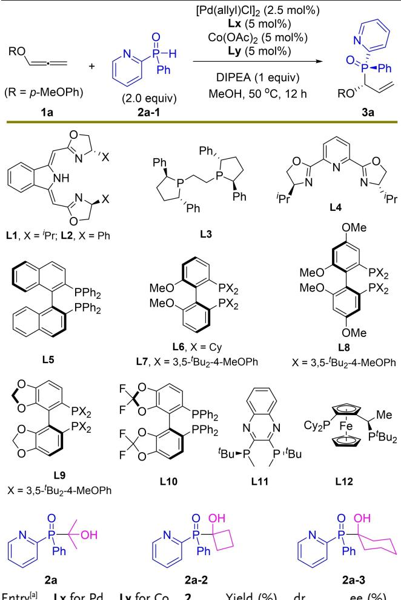

<table><tr><td>Entry[a]</td><td>Lx for Pd</td><td>Ly for Co</td><td>2</td><td>Yield (%)</td><td>dr</td><td>ee (%)</td></tr><tr><td>1</td><td>L5</td><td>L1</td><td>2a-1</td><td>36</td><td>1.4:1</td><td>60</td></tr><tr><td>2</td><td>L5</td><td>L2</td><td>2a-1</td><td>77</td><td>4.5:1</td><td>79</td></tr><tr><td>3</td><td>L6</td><td>L2</td><td>2a-1</td><td>n.d.</td><td></td><td></td></tr><tr><td>4</td><td>L7</td><td>L2</td><td>2a-1</td><td>52</td><td>1.8:1</td><td>72</td></tr><tr><td>5</td><td>L8</td><td>L2</td><td>2a-1</td><td>trace</td><td></td><td></td></tr><tr><td>6</td><td>L9</td><td>L2</td><td>2a-1</td><td>52</td><td>2.3:1</td><td>85</td></tr><tr><td>7</td><td>L10</td><td>L2</td><td>2a-1</td><td>75</td><td>11:1</td><td>96</td></tr><tr><td>8</td><td>L11</td><td>L2</td><td>2a-1</td><td>65</td><td>3.5:1</td><td>84</td></tr><tr><td>9</td><td>L12</td><td>L2</td><td>2a-1</td><td>15</td><td>1.5:1</td><td>31</td></tr><tr><td>10</td><td>L10</td><td>L2</td><td>2a</td><td>62</td><td>&gt;20:1</td><td>97</td></tr><tr><td>11</td><td>L10</td><td>L2</td><td>2a-2</td><td>44</td><td>&gt;20:1</td><td>97</td></tr><tr><td>12</td><td>L10</td><td>L2</td><td>2a-3</td><td>46</td><td>&gt;20:1</td><td>98</td></tr><tr><td> $\rceil 3 ^ { [ 6 ] }$ </td><td>L10</td><td>L2</td><td>2a</td><td>7][c]</td><td>&gt;20:1</td><td>&gt;99</td></tr><tr><td>14[b,d]</td><td>L10</td><td>L2</td><td>2a</td><td>60</td><td>2.1:1</td><td>-84</td></tr></table>

[a] The reaction was carried out at a 0.1 mmol scale. The yield and dr values were determined by 1H NMR. The ee values were determined by HPLC analyses. [b] At room temperature. [c] Isolated yield. [d] ent-L2 was used instead.

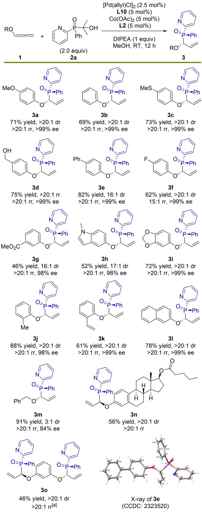  
Scheme 2. Scope of allenes for diastereoselective hydrophosphinylation. Reaction conditions: 1 (0.1 mmol), 2 a (0.2 mmol), [Pd(allyl)Cl] (2.5 mol%), L10 (5 mol%), Co(OAc) (5 mol%), L2 (5 mol %) and DIPEA (1 equiv) in MeOH stirred at room temperature for 12 h. Isolated yield. The dr and rr values were determined by 1H NMR. The ee value was determined by HPLC analysis. [a] 2 a (0.4 mmol) was used.

The scope of unsymmetric phosphine oxide nucleophiles was next checked by preparing a series of stable P(V) precursors 2. The corresponding results are summarized in Scheme 3. The substituents at different positions of pyridyl unit in the phosphine oxide 2 did not exhibit discernible influence on the reaction, generating 3p–3 s in 64–86 % yield and with generally > 20: 1 dr, >20: 1 rr and >94% ee. When the phenyl unit in the P(V) reagent was replaced by a heteroaryl or substituted aryl group, the hydrophosphinylation still proceeded smoothly, generating corresponding chiral P(V) products (3 t–3 u) in 75–85% yield and excellent stereocontrol.

Considering the high reactivity and stereocontrol in hydrophosphinylation of monosubstituted allenes, more challenging disubstituted symmetric allenes as the substrates were evaluated next (Scheme 4, top). Such a deracemization process has seldomly been reported in hydrophosphinylation area. With the use of (S)-BINAP instead of L10 as the ligand for Pd catalyst, substrate 1 underwent the enantio-

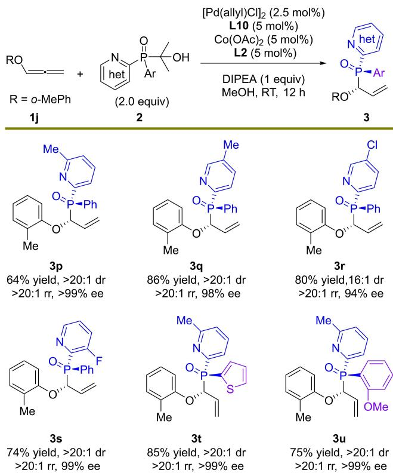  
Scheme 3. Scope of phosphine oxides for diastereoselective hydrophosphinylation. The reactions conditions were same to that described in Scheme 2. Isolated yield. The dr and rr values were determined by 1H NMR. The ee value was determined by HPLC analysis.

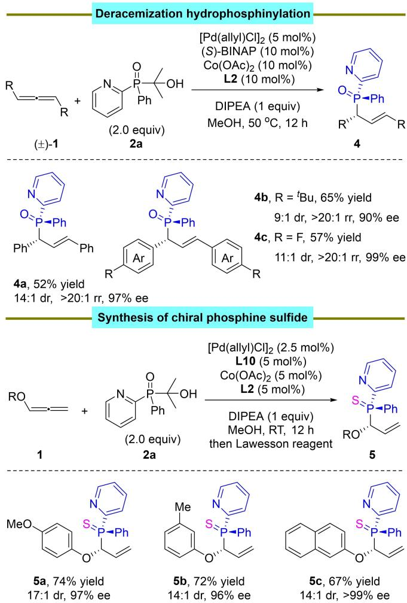  
Scheme 4. Enantioconvergent hydrophosphinylation and one-pot synthesis of phosphine sulfides. 1 (0.1 mmol) and 2 a (0.2 mmol) were adopted. Isolated yield. The dr and rr values were determined by 1H NMR. The ee value was determined by HPLC analysis.

convergent hydrophosphinylation reaction smoothly, providing 4a–4 c in moderate yield and with high diastereo-, regioand enantioselectivity. In addition, the present protocol could be extended to the construction of chiral phosphine sulfides through a one-pot diastereoselective hydrophosphinylation and sulfuration process (Scheme 4, bottom), providing a concise route to achieve the seldomly studied motifs bearing both a $ { \mathrm { P } } ^ {  { \mathrm { V } } } =  { \mathrm { S } }$ stereocenter and C-stereocenter. For example, compound 5 a was prepared in 74 % yield, 17: 1 dr and 97% ee by this strategy.

In fact, the 12-hour reaction time was not required. The diastereoselective hydrophosphinylation process could be finished in as short as 3 minutes with retained high reactivity and stereocontrol. A set of cases were tested to demonstrate this fact (Scheme 5, top). For example, the template product 3a was prepared in 3 min with 71 % yield, >20: 1 dr, >20 :1 rr and 97 % ee, comparable to that observed in standard 12 h reaction time. Other cases (3 b, 3f, 3i, 3j, 3q) with modifications on both nucleophiles and electrophiles showed similar results.

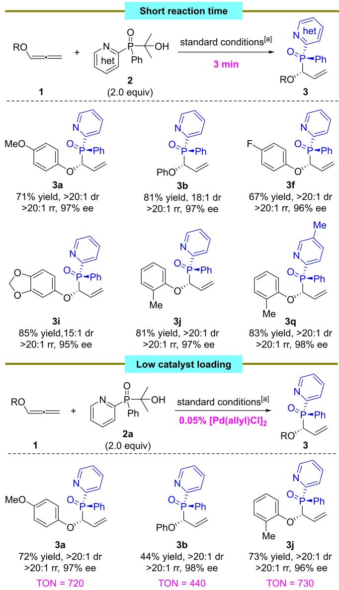  
Scheme 5. Diastereoselective hydrophosphinylation in a short reaction time and with low catalyst loading. [a] The reaction conditions were same to that described in Scheme 2, except that 3 min reaction time or 0.1 % Pd catalyst was adopted. Isolated yield. The dr and rr values were determined by 1H NMR. The ee value was determined by HPLC analysis.

Inspired by the high efficiency of the present protocol, we guessed that a low catalyst loading might still provide comparable reactivity. Indeed, when 0.05 % [Pd(allyl)Cl] was adopted under standard conditions, the hydrofunctionalization proceeded in good efficiency and excellent stereoselectivities (Scheme 5, bottom). For example, 3 a was prepared in this context with 72 % yield, > 20 : 1 dr, > 20 : 1 rr and 97% ee. The corresponding catalyst turnover number (TON) was as high as 720. To the best of our knowledge, no previous work was reported with such a high efficiency for asymmetric hydrofunctionalizations of unsaturated carboncarbon bonds. Both the short reaction time and low catalyst loading showcase the power of this method.

Although the hydrofunctionalization of 1,3-enynes has been widely studied,[10] the related hydrophosphinylation is rare. With 1,3-enyne 6 as the substrate, L8 as the chiral ligand for Pd catalyst and n-BuOH as the solvent, the corresponding diastereo- and enantioselective hydrophosphinylation reaction occurred smoothly (Scheme 6). A couple of enynes 6 bearing different substituents reacted with 2 to afford chiral allenes 7 containing a nonadjacent Pstereocenter in good yields with high diastereoselectivity, regioselectivity and enantioselectivity (7 a–7c). In addition, other heterocycle substituent instead of pyridyl group in phosphine oxide nucleophile was also compatible with the protocol. For example, thiazole-substituted phosphine oxide underwent the diastereoselective hydrophosphinylation smoothly to provide 7d in a reasonable yield and good stereoselectivities.

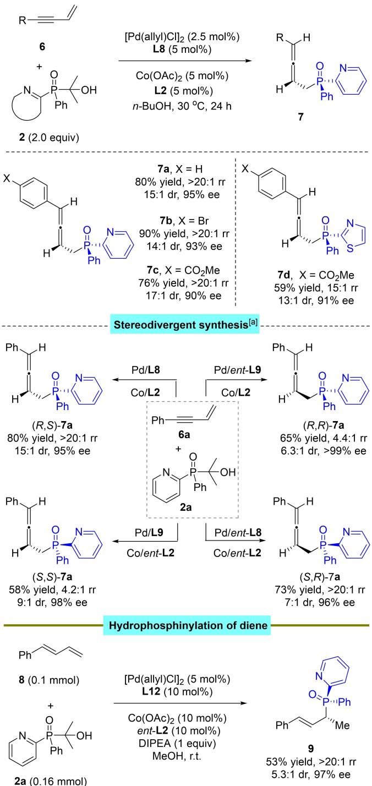  
Scheme 6. Diastereoselective and stereodivergent hydrophosphinylation of 1,3-enynes and conjugated diene. The reaction was carried out in 0.1 mmol scale with 6 (0.1 mmol) and 2 a (0.2 mmol) used as the substrates. The dr and rr values were determined by 1H NMR. The ee value was determined by HPLC analysis. [a] See Supporting Information for detailed conditions.

To further show the synthetic power of the present protocol, the unprecedented stereodivergent hydrophosphi nylation reaction was conducted (Scheme 6). All four stereoisomers of motifs bearing both a P-stereocenter and a skipped chiral axis were obtained readily by dictating the absolute configuration of the ligands ligated to corresponding metals. In this case, the DTBM-Segphos (L9) showed better stereochemical control than L8, providing (R,R)-7 a in a reasonable yield and with good stereoselectivities.

Considering the good performance for diastereoselective hydrophosphinylation of allenes and 1,3-enynes, we continued to check the feasibility of this process with relatively inert 1,3-diene as the substrate (Scheme 6, bottom). Similarly, no prior work focused on this transformation with 1,3- dienes, and only enantioselective process was reported.[4b] With L12 instead of L10 as the chiral ligand for Pd catalyst and 1.6 equiv. of 2a were used, the hydrophosphinylation reaction proceeded smoothly, providing product 9 in 53% yield, > 20 : 1 rr, 5.3 : 1 dr and 97 % ee.[21] In this case, when 2.0 equiv. of 2a were used, product 9 was observed in 40% yield, 4.9 :1 dr and 99 % ee (see Supporting Information for details). The slightly decreased reactivity in this case was presumably due to the coordination effect of excessive 2 a with Pd metal.

To highlight the reliability and practical value of the diastereoselective hydrophosphinylation reaction, a gramscale test and a series of downstream transformations were carried out (Scheme 7a). When 4 mmol of 1 a was used, the corresponding product 3a was isolated in 0.92 g in 63% yield, >20: 1 dr, >20: 1 rr and >99 % ee, comparable to that on 0.1 mmol scale. The enantioenriched phosphine oxide 3 a was smoothly transformed into phosphine sulfide 5a with Lawesson reagent. Chiral skeletons 10 and 11 were also easily prepared from 3a through hydrogenation and hydroboration-oxidation processes, respectively. In addition, the ether structure in 3a was readily released and protected by an acetyl group to generate 12. An RCM reaction enabled the preparation of 2H-chromene derivative 13 in 91% yield, >20 :1 dr and >99 % ee. As two equivalents of phosphine oxide were required to guarantee the high yield for the hydrophosphinylation, we guessed that a kinetic resolution might exist and the matched isomer of 2a would be more inclined to be consumed. Indeed, the recovered (S)-2 a from the reaction of (�)-2 a and 1a was obtained in 50 % yield and with 96 % ee and the corresponding structure was confirmed by X-ray analysis (Scheme 7b).

To probe the mechanism, we conducted control experiments first to uncover the potential role of Pd and Co metal in the reaction (Scheme 8a). Without the use of Co catalyst, the hydrophosphinylation still occurred but with moderate yield and decreased diastereo- and enantioselectivity. In this case, the observed 1.2:1 dr indicated that both configurations of racemic nucleophile 2 a could react with allyl Pd species easily without cobalt. The observed 44 % ee instead of 99% ee in the template reaction showed that the CP formation step might involve the strong interaction of two metal centers. On the other hand, no reaction occurred in the absence of Pd catalyst, which was consistent with our initial proposal that the present hydrofunctionalization process was primarily catalyzed by Pd metal, and Co metal mainly provide strengthened stereocontrol on the process.

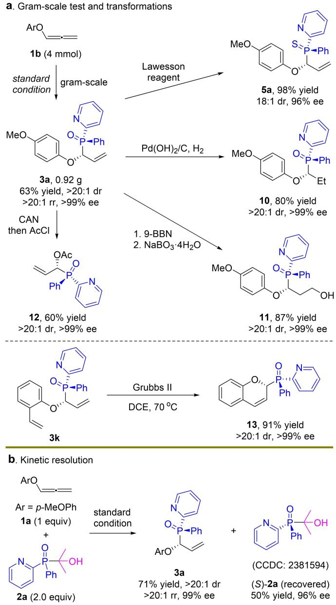  
Scheme 7. Gram-scale test, transformations and kinetic resolution.

The deuterium labelling experiments were next conducted with MeOH-d as the solvent (Scheme 8b). The corresponding product 3a–d was obtained in 65 % yield and with 94 % deuteration at the internal olefin. We also found that the proton exchange between the phosphine nucleophile 2a and MeOH was fast. In 3 min, the recovered 2a–d was observed with 92 % D at the hydroxyl group. These facts indicated that the hydrogen transferred during the hydrophosphinylation might came from the alcohol solvent or phosphine nucleophile 2a. We proposed that in the weakly basic condition, the low-valent Pd might be easily oxidized by high concentration of proton from methanol solvent to generate PdH catalyst, which would then react with allene 1 to form thermodynamically stable η3-allylPd species. However, the generation of η3-allylPd species via a ligand-to-ligand hydrogen transfer process could also be involved.[4k,17c]

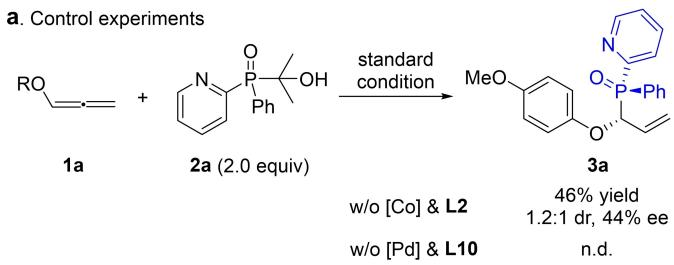

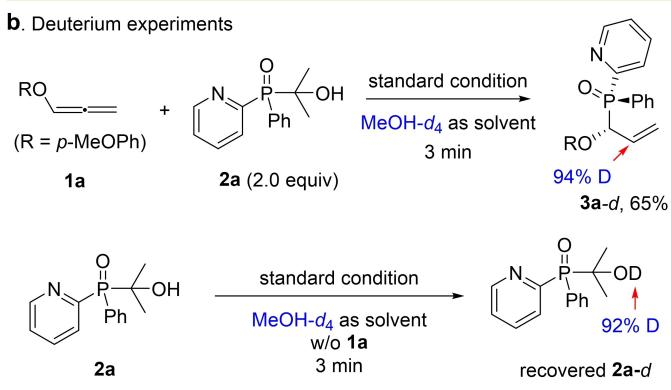

c. Crossover experiment  
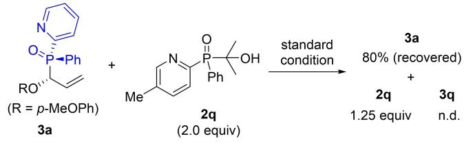

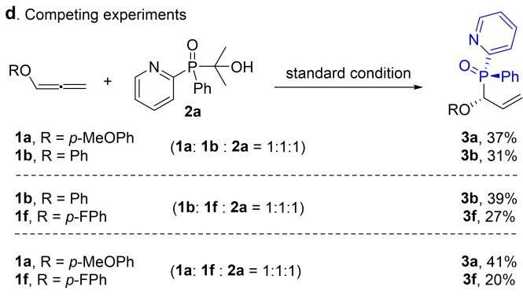

e. Proposed mechanism  
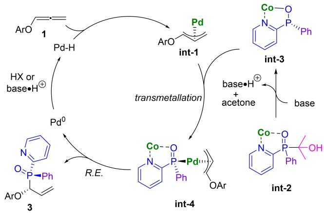  
Scheme 8. Preliminary mechanistic studies and postulated mechanism.

A crossover experiment between product 3a and another phosphine oxide nucleophile 2q was carried out (Scheme 8c). Most of two reactants were recovered along with some decomposition, and no crossover product 3q was detected, suggesting the irreversibility of CP bond formation in 3a. The high stability of allyl CP bond was in line with the prior work which pointed out that Pd P bond cleavage was difficult and might be involved in the ratelimiting step.[3j] Next, competing experiments between three sets of aryloxyallenes (1 a+1b, 1b +1f and 1a+1f) were conducted (Scheme 8d). Based on the results, it seemed that the electron-rich aryloxy units were only slightly favorable to the reaction than electron-poor ones, especially considering the large electronic difference between F and OMe units in 1 f and 1 a but comparable yields observed for 3 f and 3 a respectively. We thus deduced that the rate-limiting step in the present hydrophosphinylation might not involve obvious charge change, consistent with the neutral reductive elimination process as the rate-limiting step.[22]

Finally, when the recovered (S)-2a in Scheme 7b was used as the substrate to react with 1a under standard conditions but with Pd/ent-L10 and Co/ent-L2 as the catalysts, the enantiomer of 3a was obtained in comparable yields and stereoselectivities to that in Scheme 7b (see Supporting Information for details). This result corroborated the fact that the matched (R)-2a was selectively transformed into 3a in Scheme 7b. The same absolute configuration of P-stereocenter in the matched nucleophile (R)-2a and product 3a also suggested that the configuration of P-stereocenter would not change during the hydrophosphinylation.

Based on all these facts and prior work,[4] a possible catalytic cycle was postulated in Scheme 8e. Pd(0) might be first oxidized to form PdH species, which then reacted allene to generate allyl Pd complex int-1. Meanwhile, the Co metal coordinated with phosphine oxide 2a and then provided int-3 under base, during which the matched isomer of 2a was preferred to be coordinated. Next, a transmetallation process occurred between int-1 and int-3 to provide int-4. Finally, a reductive elimination process proceeded to generate product 3 and regenerate two metal catalysts.

## Conclusion

Three protocols have been described for the highly diastereo- and enantioselective hydrophosphinylation of allenes, 1,3-enynes and conjugated dienes via Pd/Co dual catalysis. Two types of motifs bearing both a P- and C-stereocenter or both a P-stereocenter and chiral axis are prepared in good yields and with excellent regio-, diastereo-, and enantioselectivities. A modified P(V) compound as a masked unsymmetric phosphinylating reagent is critical to the achievement of high stereoselectivities for the transformation. The unreported stereodivergent hydrophosphinylation reaction is also realized to access all four stereoisomers of phosphinylated allenes. In addition, the reaction features a very short reaction time and low catalyst loading and can be run on gram-scale, all of which make this protocol powerful and practically valuable. Preliminary mechanistic experiments elucidate the role of two catalysts and suggest the involvement of kinetic resolution and reductive elimination in the catalytic cycle.

## Acknowledgements

We acknowledge the National Natural Science Foundation of China (22071262, 22371292), Ningbo Natural Science Foundation (2023 J036), Science and Technology Commission of Shanghai Municipality (22ZR1475200), Strategic Priority Research Program of the Chinese Academy of Sciences (XDB0610000), State Key Laboratory of Organometallic Chemistry, and Shanghai Institute of Organic Chemistry for financial support. We thank professor Shengming Ma (SIOC) for valuable suggestions.

## Conflict of Interest

The authors declare no conflict of interest.

## Data Availability Statement

The data that support the findings of this study are available in the supplementary material of this article.

Keywords: Hydrophosphinylation · Diastereoselectivity · Enantioselectivity · Stereodivergent · Pd/Co

[1] a) W. Li, J. Zhang, Chem. Soc. Rev. 2016, 45, 1657–1677; b) H. Guo, Y. C. Fan, Z. Sun, Y. Wu, O. Kwon, Chem. Rev. 2018, 118, 10049–10293; c) H. Ni, W.-L. Chan, Y. Lu, Chem. Rev. 2018, 118, 9344–9411; d) G. P. Horsman, D. L. Zechel, Chem. Rev. 2017, 117, 5704–5783; e) G. Mallesham, C. Swetha, S. Niveditha, M. E. Mohanty, N. J. Babu, A. Kumar, K. Bhanuprakash, V. J. Rao, J. Mater. Chem. C 2015, 3, 1208–1224; f) S. Zhang, D. Yuan, Q. Zhang, Y. Wang, Y. Liu, J. Zhao, B. Chen, J. Mater. Chem. A 2020, 8, 10925–10934.

[2] For selected work, see: a) P. Butti, R. Rochat, A. D. Sadow, A. Togni, Angew. Chem. Int. Ed. 2008, 47, 4878–4881; b) J. Lu, J.

Ye, W.-L. Duan, Chem. Commun. 2014, 50, 698–700; c) X.-Y. Yang, J. H. Gan, Y. Li, S. A. Pullarkat, P.-H. Leung, Dalton Trans. 2015, 44, 1258–1263; d) R. Beaud, R. J. Phipps, M. J. Gaunt, J. Am. Chem. Soc. 2016, 138, 13183–13186; e) X.-T. Liu, Y.-Q. Zhang, X.-Y. Han, S.-P. Sun, Q.-W. Zhang, J. Am. Chem. Soc. 2019, 141, 16584–16589; f) Q. Dai, W. Li, Z. Li, J. Zhang, J. Am. Chem. Soc. 2019, 141, 20556–20564; g) Y.-B. Li, H. Tian, L. Yin, J. Am. Chem. Soc. 2020, 142, 20098–20106; h) W. J. Yue, J. Z. Xiao, S. Zhang, L. Yin, Angew. Chem. Int. Ed. 2020, 59, 7057–7062; i) C. Wang, K. Huang, J. Ye, W.-L. Duan, J. Am. Chem. Soc. 2021, 143, 5685–5690; j) S. Zhang, J.- Z. Xiao, Y.-B. Li, C.-Y. Shi, L. Yin, J. Am. Chem. Soc. 2021, 143, 9912–9921; k) S. Liu, Y. Tanabe, S. Kuriyama, K. Sakata, Y. Nishibayashi, Angew. Chem. Int. Ed. 2021, 60, 11231–11236; l) Q.-H. Huang, Q.-Y. Zhou, C. Yang, L. Chen, J.-P. Cheng, X. Li, Chem. Sci. 2021, 12, 4582–4587; m) S. Das, Q. Hu, A. Kondoh, M. Terada, Angew. Chem. Int. Ed. 2021, 60, 1417– 1422; n) J. M. Perez, R. Postolache, M. C. Reis, E. G. Sinnema, D. Vargova, F. de Vries, E. Otten, L. Ge, S. R. Harutyunyan, J. Am. Chem. Soc. 2021, 143, 20071–20076; o) L. Ge, S. R. Harutyunyan, Chem. Sci. 2022, 13, 1307–1312; p) H. Wang, H. Qian, J. Zhang, S. Ma, J. Am. Chem. Soc. 2022, 144, 12619– 12626; q) K. C. Forbes, E. N. Jacobsen, Science 2022, 376, 1230–1236; r) L.-L. Wang, H. Zhou, Y.-X. Cao, C. Zhang, Y.- Q. Ren, Z.-L. Li, Q.-S. Gu, X.-Y. Liu, Nat. Synth. 2023, 2, 430– 438; s) X. Li, M. Yuan, F. Chen, Z. Huang, F.-L. Qing, O. Gutierrez, L. Chu, Chem 2023, 9, 154–169; t) J. Kang, K. Ding, S.-M. Ren, B. Su, Angew. Chem. Int. Ed. 2023, 62, e202301628; u) X. B. Chen, D. Padin, C. N. Stindt, B. L. Feringa, Angew. Chem. Int. Ed. 2023, 62, e202307450; v) C. Wang, Q. Yang, Y.- H. Dai, J. Xiong, Y. Zheng, W.-L. Duan, Angew. Chem. Int. Ed. 2023, 62, e202313112; w) H. Wang, X. Wu, T. Xu, Angew. Chem. Int. Ed. 2023, 62, e202218299; x) M. Formica, T. Rogova, H. Shi, N. Sahara, B. Ferko, A. J. M. Farley, K. E. Christensen, F. Duarte, K. Yamazaki, D. J. Dixon, Nat. Chem. 2023, 15, 714–721.

[3] For reviews, see: a) Q. Xu, L.-B. Han, J. Organomet. Chem. 2011, 696, 130–140; b) D. S. Glueck, J. Org. Chem. 2020, 85, 14276–14285; c) B. T. Novas, R. Waterman, ChemCatChem 2022, 14, e202200988; d) H. Li, L. Yin, Chin. J. Org. Chem. 2022, 42, 3183–3200. For selected work on Pd-catalyzed nonasymmetric hydrophosphinylations of unsaturated bonds: e) L.-B. Han, M. Tanaka, J. Am. Chem. Soc. 1996, 118, 1571– 1572; f) L.-B. Han, R. Hua, M. Tanaka, Angew. Chem. Int. Ed. 1998, 37, 94–96; g) L.-B. Han, F. Mirzaei, C.-Q. Zhao, M. Tanaka, J. Am. Chem. Soc. 2000, 122, 5407–5408; h) F. Mirzaei, L.-B. Han, M. Tanaka, Tetrahedron Lett. 2001, 42, 297–299; i) C.-Q. Zhao, L.-B. Han, M. Tanaka, Organometallics 2000, 19, 4196–4198; j) S. Deprèle, J.-L. Montchamp, J. Am. Chem. Soc. 2002, 124, 9386–9387; k) K. Bravo-Altamirano, I. Abrunhosa-Thomas, J.-L. Montchamp, J. Org. Chem. 2008, 73, 2292– 2301; l) B. K. Alnasleh, W. M. Sherrill, M. Rubin, Org. Lett. 2008, 10, 3231–3234; m) M. Candy, S. A. L. Rousseaux, A. C. S. Román, M. Szymczyk, P. Kafarski, E. Leclerc, E. Vrancken, J.- M. Campagne, Adv. Synth. Catal. 2014, 356, 2703–2708; n) T. Chen, C.-Q. Zhao, L.-B. Han, J. Am. Chem. Soc. 2018, 140, 3139–3155.

[4] For selected Pd-catalyzed enantioselective hydrophosphinylation and hydrophosphination, see: a) A. Sadeer, Y. J. Ong, T. Kojima, C. Q. Foo, Y. Li, S. A. Pullarkat, P. H. Leung, Chem. Asian J. 2018, 13, 2829–2833; b) S.-Z. Nie, R. T. Davison, V. M. Dong, J. Am. Chem. Soc. 2018, 140, 16450–16454; c) Z. Lu, H. Zhang, Z. Yang, N. Ding, L. Meng, J. Wang, ACS Catal. 2019, 9, 1457–1463; d) Z. Yang, X. Gu, L.-B. Han, J. Wang, Chem. Sci. 2020, 11, 7451–7455; e) Q. Dai, L. Liu, Y. Qian, W. Li, J. Zhang, Angew. Chem. Int. Ed. 2020, 59, 20645–20650; f) R. H. X. Teo, H. J. Chen, Y. Li, S. A. Pullarkat, P. H. Leung,

Adv. Synth. Catal. 2020, 362, 2373–2378; g) C. Q. Foo, A. Sadeer, Y. Li, S. A. Pullarkat, P.-H. Leung, Organometallics 2021, 40, 682–692; h) Z. Yang, J. Wang, Angew. Chem. Int. Ed. 2021, 60, 27288–27292; i) D. Ji, J. Jing, X. Zhang, Y. Wang, X. Li, Chem 2022, 8, 3346–3362; j) Y. Zhang, Y. Jiang, M. Li, Z. Huang, Z. J. Wang, Chem. Catal. 2022, 2, 3163–3173; k) J. Zhou, L. Meng, S. Lin, B. Cai, J. Wang, Angew. Chem. Int. Ed. 2023, 62, e202303727; l) D. Ji, Z. Qi, X. Li, Org. Lett. 2023, 25, 5957–5962.

[5] For selected Ni-catalyzed enantioselective hydrophosphinylation and hydrophosphination, see: a) X.-T. Liu, X.-Y. Han, Y. Wu, Y.-Y. Sun, L. Gao, Z. Huang, Q.-W. Zhang, J. Am. Chem. Soc. 2021, 143, 11309–11316; b) J. Long, Y. Li, W. Zhao, G. Yin, Chem. Sci. 2022, 13, 1390–1397; c) Y. Q. Zhang, X. Y. Han, Y. Wu, P. J. Qi, Q. Zhang, Q. W. Zhang, Chem. Sci. 2022, 13, 4095–4102; d) W.-H. Wang, Y. Wu, H.-T. Wang, P.-J. Qi, W.-N. Lan, Q.-W. Zhang, Nat. Synth. 2022, 1, 738–747; e) W.- H. Wang, Y. Wu, P.-J. Qi, Q.-W. Zhang, ACS Catal. 2023, 13, 6994–7001; f) S. Duan, A. Pan, Y. Du, G. Zhu, X. Tian, H. Zhang, P. J. Walsh, X. Yang, ACS Catal. 2023, 13, 10887– 10894; g) Z. Huang, X.-T. Liu, R. Cui, Q.-W. Zhang, Org. Biomol. Chem. 2023, 21, 3096–3100; h) X.-D. Gu, K. Y. Ngai, W. Wang, B. Li, J. Wang, Chem Catal. 2024, 4, 100903.

[6] For selected Cu-catalyzed asymmetric hydrophosphination, see: a) Q. Yang, J. Zhou, J. Wang, Chem. Sci. 2023, 14, 4413– 4417; b) S. Zhang, N. Jiang, J.-Z. Xiao, G.-Q. Lin, L. Yin, Angew. Chem. Int. Ed. 2023, 62, e202218798; c) B. S. Daniels, X. Hou, S. A. Corio, L. M. Weissman, V. M. Dong, J. S. Hirschi, S. Nie, Angew. Chem. Int. Ed. 2023, 62, e202306511; d) H. Zhou, L.-W. Fan, Y.-Q. Ren, L.-L. Wang, C.-J. Yang, Q.- S. Gu, Z.-L. Li, X.-Y. Liu, Angew. Chem. Int. Ed. 2023, 62, e202218523.

[7] For selected Mn-catalyzed asymmetric hydrophosphination, see: a) R. Postolache, J. M. Perez, M. C. Reis, L. Ge, E. G. Sinnema, S. R. Harutyunyan, Org. Lett. 2023, 25, 1611–1615; b) E. G. Sinnema, T.-F. Ramspoth, R. H. Bouma, L. Ge, S. R. Harutyunyan, Angew. Chem. Int. Ed. 2024, 63, e202316785.

[8] For La-catalyzed asymmetric hydrophosphination, see: X. Lin, K. An, Q. Zhuo, M. Nishiura, X. Cong, Z. Hou, Angew. Chem. Int. Ed. 2023, 62, e202308488.

[9] For selected organocatalytic process, see: a) J. Han, J. Kim, J. Lee, Y. Kim, S. Y. Lee, J. Org. Chem. 2020, 85, 15476–15487; b) S. Kwak, J. Choi, J. Han, S. Y. Lee, ACS Catal. 2022, 12, 212–218; c) B. Cai, Y. Cui, J. Zhou, Y.-B. Wang, L. Yang, B. Tan, J. Wang, Angew. Chem. Int. Ed. 2023, 62, e202215820; d) B. Wang, Y. Liu, C. Jiang, Z. Cao, S. Cao, X. Zhao, X. Ban, Y. Yin, Z. Jiang, Angew. Chem. Int. Ed. 2023, 62, e202216605.

[10] a) N. J. Adamson, H. Jeddi, S. J. Malcolmson, J. Am. Chem. Soc. 2019, 141, 8574–8583; b) H. Tsukamoto, T. Konno, K. Ito, T. Doi, Org. Lett. 2019, 21, 6811–6814; c) S.-Q. Yang, Y.-F. Wang, W.-C. Zhao, G.-Q. Lin, Z.-T. He, J. Am. Chem. Soc. 2021, 143, 7285–7291; d) L. Li, S. Wang, P. Luo, R. Wang, Z. Wang, X. Li, Y. Deng, F. Peng, Z. Shao, Nat. Commun. 2021, 12, 5667; e) Q. Li, X. Fang, R. Pan, H. Yao, A. Lin, J. Am. Chem. Soc. 2022, 144, 11364–11376.

[11] a) S. Ma, Chem. Rev. 2005, 105, 2829–2872; b) S. Yu, S. Ma, Angew. Chem. Int. Ed. 2012, 51, 3074–3112; c) R. Blieck, M. Taillefer, F. Monnier, Chem. Rev. 2020, 120, 13545–13598.

[12] a) S. Krautwald, E. M. Carreira, J. Am. Chem. Soc. 2017, 139, 5627–5639; b) S. J. Kalita, Y.-Y. Huang, U. Schneider, Sci. Bull. 2020, 65, 1865–1868; c) X. Huo, G. Li, X. Wang, W. Zhang, Angew. Chem. Int. Ed. 2022, 61, e202210086; d) L. Wei, C. Fu, Z.-F. Wang, H.-Y. Tao, C.-J. Wang, ACS Catal. 2024, 14, 3812–3844.

[13] For selected reviews, see: a) A. E. Allen, D. W. C. MacMillan, Chem. Sci. 2012, 3, 633–658; b) H. Wu, Y.-P. He, L.-Z. Gong, Cooperative Catalysis: Designing Efficient Catalysts for Syn-

thesis, Chapter 6, Wiley-VCH, 2015; c) S. M. Inamdar, V. S. Shinde, N. T. Patil, Org. Biomol. Chem. 2015, 13, 8116–8162; d) M. M. Lorion, K. Maindan, A. R. Kapdi, L. Ackermann, Chem. Soc. Rev. 2017, 46, 7399–7420; e) U. B. Kim, D. J. Jung, H. J. Jeon, K. Rathwell, S.-g. Lee, Chem. Rev. 2020, 120, 13382–13433; f) Y. Wu, X. Huo, W. Zhang, Chem. Eur. J. 2020, 26, 4895–4916; g) S. Martínez, L. Veth, B. Lainer, P. Dydio, ACS Catal. 2021, 11, 3891–3915.

[14] Z.-H. Wu, A.-Q. Cheng, M. Yuan, Y.-X. Zhao, H.-L. Yang, L.- H. Wei, H.-Y. Wang, T. Wang, Z. Zhang, W.-L. Duan, Angew. Chem. Int. Ed. 2021, 60, 27241–27246.

[15] For reviews, see: a) G. Li, X. Huo, X. Jiang, W. Zhang, Chem. Soc. Rev. 2020, 49, 2060–2118; b) N. J. Adamson, S. J. Malcolmson, ACS Catal. 2020, 10, 1060–1076; c) C. Ma, Y.-W. Chen, Z.-T. He, Sci. Sin. Chim. 2023, 53, 474–484; d) Y.-C. Wang, J.-B. Liu, Z.-T. He, Chin. J. Org. Chem. 2023, 43, 2614– 2627.

[16] a) M. Kawatsura, J. F. Hartwig, J. Am. Chem. Soc. 2000, 122, 9546–9547; b) O. Löber, M. Kawatsura, J. F. Hartwig, J. Am. Chem. Soc. 2001, 123, 4366–4367; c) B. M. Trost, C. Jäkel, B. Plietker, J. Am. Chem. Soc. 2003, 125, 4438–4439; d) L. M. Lutete, I. Kadota, Y. Yamamoto, J. Am. Chem. Soc. 2004, 126, 1622–1623; e) B. M. Trost, J. Xie, J. D. Sieber, J. Am. Chem. Soc. 2011, 133, 20611–20622; f) N. J. Adamson, E. Hull, S. J. Malcolmson, J. Am. Chem. Soc. 2017, 139, 7180–7183; g) N. J. Adamson, K. C. E. Wilbur, S. J. Malcolmson, J. Am. Chem. Soc. 2018, 140, 2761–2764; h) S. Park, S. J. Malcolmson, ACS Catal. 2018, 8, 8468–8476; i) Y.-L. Su, L.-L. Li, X.-L. Zhou, Z.- Y. Dai, P.-S. Wang, L.-Z. Gong, Org. Lett. 2018, 20, 2403–2406; j) Q.-L. Zhang, H.-M. Yu, L.-L. Shen, T.-H. Tang, D.-F. Dong, W.-W. Chai, W.-W. Zi, J. Am. Chem. Soc. 2019, 141, 14554– 14559; k) S. Park, N. J. Adamson, S. J. Malcolmson, Chem. Sci. 2019, 10, 5176–5182; l) X. Wang, B. Wang, X. Yin, W. Yu, Y. Liao, J. Ye, M. Wang, L. Hu, J. Liao, Angew. Chem. Int. Ed. 2019, 58, 12264–12270; m) H. Yang, D. Xing, Chem. Commun. 2020, 56, 3721–3724; n) Z. Zhang, F. Xiao, H.-M. Wu, X.-Q. Dong, C.-J. Wang, Org. Lett. 2020, 22, 569–574; o) Q. Zhang, D. Dong, W. Zi, J. Am. Chem. Soc. 2020, 142, 15860–15869; p) M.-M. Li, L. Cheng, L.-J. Xiao, J.-H. Xie, Q.-L. Zhou, Angew. Chem. Int. Ed. 2021, 60, 2948–2951; q) Y.-H. Yao, H.- Y. Yang, M. Chen, F. Wu, X.-X. Xu, Z.-H. Guan, J. Am. Chem. Soc. 2021, 143, 85–91; r) H. Wang, R. Zhang, Q. Zhang, W. Zi, J. Am. Chem. Soc. 2021, 143, 10948–10962; s) A. Y. Jiu, H. S. Slocumb, C. S. Yeung, X.-H. Yang, V. M. Dong, Angew. Chem. Int. Ed. 2021, 60, 19660–19664; t) J. Han, R. Liu, Z. Lin, W. Zi, Angew. Chem. Int. Ed. 2023, 62, e202215714; u) C. You, M. Shi, X. Mi, S. Luo, Nat. Commun. 2023, 14, 2911.

[17] a) Y.-W. Chen, Y. Liu, H.-Y. Lu, G.-Q. Lin, Z.-T. He, Nat. Commun. 2021, 12, 5626; b) Y.-C. Wang, Z.-X. Xiao, M. Wang, S.-Q. Yang, J.-B. Liu, Z.-T. He, Angew. Chem. Int. Ed. 2023, 62, e202215568; c) S.-Q. Yang, A.-J. Han, Y. Liu, X.-Y. Tang, G.-Q. Lin, Z.-T. He, J. Am. Chem. Soc. 2023, 145, 3915–3925; d) X. Wang, H.-Z. Miao, G.-Q. Lin, Z.-T. He, Angew. Chem. Int. Ed. 2023, 62, e202301556; e) X.-X. Chen, H. Luo, Y.-W. Chen, Y. Liu, Z.-T. He, Angew. Chem. Int. Ed. 2023, 62, e202307628; f) M.-Q. Tang, Z.-J. Yang, Z.-T. He, Nat. Commun. 2023, 14, 6303; g) B.-Y. Xie, Z.-T. He, ACS Catal. 2024, 14, 9742–9751.

[18] For early work on Pd-catalyzed non-asymmetric hydrofunctionalizations of allenes, see: a) Y. Yamamoto, M. Al-Masum, N. Asao, J. Am. Chem. Soc. 1994, 116, 6019–6020; b) B. M. Trost, V. J. Gerusz, J. Am. Chem. Soc. 1995, 117, 5156–5157; c) Y. Yamamoto, M. Al-Masum, Synlett 1995, 969–970. For Pdcatalyzed asymmetric hydrofunctionalizations of allenes, see: d) M. Li, S. Datta, D. M. Barber, D. J. Dixon, Org. Lett. 2012, 14, 6350–6353; e) H. Zhou, Y. Wang, L. Zhang, M. Cai, S. Luo, J. Am. Chem. Soc. 2017, 139, 3631–3634; f) Z. Wu, M. Zhang,

Y. Shi, G. Huang, Org. Chem. Front. 2020, 7, 1502–1511; g) M. Zhu, Q. Zhang, W. Zi, Angew. Chem. Int. Ed. 2021, 60, 6545– 6552; h) H.-C. Lin, G. J. Knox, C. M. Pearson, C. Yang, V. Carta, T. N. Snaddon, Angew. Chem. Int. Ed. 2022, 61, e202201753; i) M. Zhu, P. Wang, Q. Zhang, W. Tang, W. Zi, Angew. Chem. Int. Ed. 2022, 61, e202207621; j) J.-H. Liu, Q. Zhou, Y. Lin, Z.-L. Wu, T. Cai, W. Wen, Y.-M. Huang, Q.-X. Guo, ACS Catal. 2023, 13, 6013–6022.

[19] a) Q.-H. Deng, H. Wadepohl, L. H. Gade, Chem. Eur. J. 2011, 17, 14922–14928; b) Q.-H. Deng, H. Wadepohl, L. H. Gade, J. Am. Chem. Soc. 2012, 134, 2946–2949; c) Q.-H. Deng, T. Bleith, H. Wadepohl, L. H. Gade, J. Am. Chem. Soc. 2013, 135, 5356–5359; d) C. K. Blasius, H. Wadepohl, L. H. Gade, Eur. J. Inorg. Chem. 2020, 2335–2342.

[20] a) C. Li, T. Yano, N. Ishida, M. Murakami, Angew. Chem. Int. Ed. 2013, 52, 9801–9804; b) M. Min, D. Kang, S. Jung, S. Hong, Adv. Synth. Catal. 2016, 358, 1296–1301; c) B. Li, M. Liu, S. U. Rehman, C. Li, J. Am. Chem. Soc. 2022, 144, 2893–2898.

[21] The stereochemistry of compound 7 and 9 were proposed based on prior work (ref [10c], [17 f]) and the present results.

[22] As slight influence of electronic character in aryloxy units was observed, a nucleophilic substitution process was not fully excluded.