pubs.acs.org/JACS

Article

# Borane/Transition Metal−Catalyzed Allenylic and Allylic Alkylation of Unactivated 2‑Alkylbenzoxazoles

Qi-Fei Liu, Qian-Qian Peng, Sheng-Shi Hao, Lu Liu, Fu-Hao Zhang, Zhu-Jun Shi, Jian-Hua Xie, Chong-Ren Ai,\* and Xiao-Chen Wang\*

Cite This: J. Am. Chem. Soc. 2025, 147, 40799−40806

Read Online

## ACCESS

Metrics & More

ABSTRACT: Asymmetric functionalization of unactivated alkylsubstituted azaarenes at the α-position of the alkyl substituent is challenging because deprotonation of the weakly acidic α-C−H bonds requires a strong base. This requirement often impedes efective enantiocontrol by chiral catalysts. As a result, the few reactions that have been reported have narrow substrate scopes. Herein, we report a method for highly diastereo- and enantioselective allenylic alkylation reactions of unactivated 2- alkylbenzoxazoles with conjugated enynes, enabled by synergistic borane/nickel catalysis. The success of this method hinges on catalytic activation of the 2-alkylbenzoxazoles by a triarylborane,

Article Recommendations

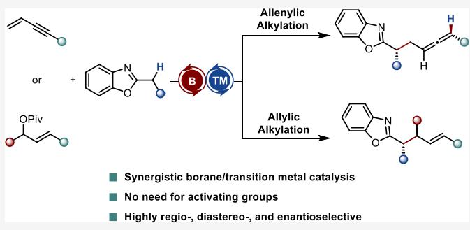  
which permits deprotonation by triethylamine and thus is crucial for achieving both high yields and diastereo- and enantioselectivities. Extending the utility of synergistic borane/transition metal catalysis, we also demonstrate that a borane/ palladium system efectively overcomes the limitations of palladium-catalyzed allylic alkylation reactions of unactivated azaarenes. In particular, previously unreactive acyclic 1,3-disubstituted allylic esters are rendered viable electrophiles, enabling the construction of products bearing two adjacent stereocenters.

## ■ INTRODUCTION

Azaarene moieties substituted with alkyl groups containing carbon stereogenic centers are common in pharmaceuticals, agrochemicals, and natural products.1 Direct functionalization of azaarenes at the α-position of a linear alkyl substituent via deprotonation with a base and electrophilic trapping of the resulting carbanion is the most straightforward strategy for constructing such structures. Although non-enantioselective variants of these reactions that aford racemic products are well developed,2 catalytic enantioselective counterparts have largely been limited to azaarenes activated by electron-withdrawing groups3−5 (Scheme 1a), which can be readily deprotonated with a relatively weak base (e.g., DBU or NEt ). In contrast, deprotonation of unactivated azaarenes requires a strong base (e.g., nBuLi or lithium bis(trimethylsilyl)amide), use of which increases not only the likelihood of uncatalyzed background reactions but also the possibility of chiral catalyst decomposition. Notably, the few successful examples of catalytic asymmetric reactions involving unactivated azaarenes have primarily been metal-catalyzed allylic alkylation reactions, typically employing metal-π-allyl electrophiles generated in situ.6 Other classes of electrophiles are rarely reported.7 To overcome these limitations and expand the range of compatible electrophiles, alternative strategies are required.

Hydrometalation of conjugated enynes has been reported to generate exo-alkylidene-metal-π-allyl electrophiles that can be coupled enantioselectively with various nucleophiles to aford structurally diverse allenes in the presence of a chiral metal catalyst (Scheme 1b).3c,8 However, reported examples of such coupling reactions are limited to relatively acidic pronucleophiles, which can be readily deprotonated by a relatively weak base to generate the corresponding nucleophile. The resulting protonated base may then shuttle the proton either to the metal catalyst, forming a metal hydride that subsequently hydrometallates the enyne,3c,8a,b,d,e or directly to the metalated enyne;8c both pathways ultimately aford the electrophile. In contrast, deprotonation of less acidic pronucleophiles requires stronger bases and generates proton-locked conjugate acids that are inefective at transferring the proton. This inhibition of electrophile formation renders unactivated alkyl-substituted azaarenes unsuitable as pronucleophiles in metal-catalyzed reactions with conjugated enynes.

Based on these analyses, we hypothesized that strategies to enhance the α-C−H acidity of unactivated alkylazaarenes would enable their deprotonation by a relatively weak base,

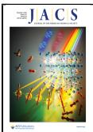

Scheme 1. Catalytic Enantioselective α-Functionalization of 2-Alkylazaarenes

(b) Asymmetric coupling of pronucleophiles with conjugated enynes  
(c) Asymmetric coupling of unactivated 2-alkylbenzoxazoles with conjugated enynes (this work)  
(a) Catalytic enantioselective α-functionalization of 2-alkylazaarenes  
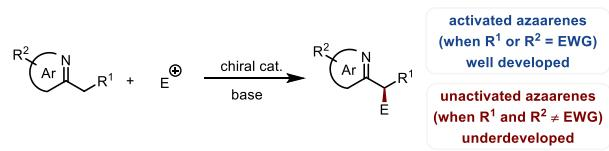

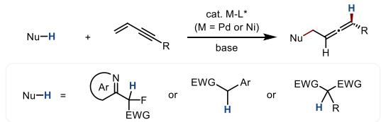

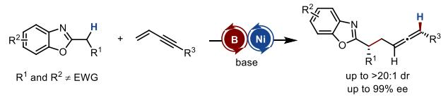

thereby allowing coupling with conjugated enynes under metal catalysis. Furthermore, employing a chiral metal catalyst could render the transformation enantioselective, thereby broadening the range of compatible electrophiles for the enantioselective α-functionalization of unactivated azaarenes. Notably, the Wasa group and our group recently developed various synthetic methods based on increasing the acidity of pronucleophiles by means of borane activation.7f,9 In $\cdot ^ { 7 \mathrm { f } , 9 }$ particular, in a prior study, our group demonstrated that a borane catalyst not only can activate azaarenes but also remains catalytically competent despite strong coordination by the nitrogen atom of the azaarene.7f This finding can be attributed to steric hindrance around the borane center, which promotes frustrated Lewis pair−type behavior.10 We thus envisioned that borane activation of azaarenes could be utilized to accomplish unprecedented allenylic alkylation reactions of unactivated azaarenes with enynes. Indeed, we herein report that the desired transformation can be achieved by using a previously unreported synergistic borane/nickel catalytic system (Scheme 1c). The reactions exhibit a broad substrate scope and high diastereo- and enantioselectivities. In addition, we found that borane activation can be used for overcoming the limitations of palladium-catalyzed asymmetric allylic alkylation reactions of azaarenes.

## ■ RESULTS AND DISCUSSION

We commenced our study with the allenylic alkylation reaction of benzoxazole 1a (1.0 equiv) with enyne 2a (1.5 equiv) (Table 1). Initial screening focused on reactions involving chiral phosphine ligands L1−L4 in the presence of triethylamine as the base and $\mathsf { B } \left( \mathrm { C } _ { 6 } \mathrm { F } _ { 5 } \right) _ { 3 } \left( \mathrm { L A } 3 \right)$ as a Lewis acid catalyst (entries 1−4). (R)-BINAP (L1) and (S)-tBu-Phox (L2) showed no activity, whereas (R,R)-Ph-BPE (L3) and JosiPhos SL-J009-1 (L4) were catalytically active. Among them, L4 provided the best outcome, afording product 3a in 36% NMR yield with a 7:1 diastereomer ratio (dr) and 97% enantiomeric excess (ee) (entry 4). Subsequent screening of boron-based Lewis acids LA1−LA4 (entries 5−7), which difer in Lewis acidity and steric bulk, in reactions with L4 as the ligand revealed that the Lewis acid’s properties markedly afected the yield and diastereoselectivity. The use of LA1, which is sterically demanding and highly acidic (acceptor number (AN) $= 8 3 . 4 \AA \AA \AA ^ { ' 1 1 }$ improved the yield from 36% (with LA3) to 69% and the dr from 7:1 to 12:1 (entry 5). LA2, which is less sterically demanding than LA3 because of the absence of ortho fluorine atoms, gave a lower yield and poorer diastereoselectivity (entry 6). LA4, which is less acidic $\mathrm { \bar { ( A N = 7 0 . 6 ) } } ^ { 9 \mathrm { c } }$ than LA3, was inactive (entry 7). The stronger Lewis acidity of LA1 may have resulted in better activation of ${ \bf 1 } \mathbf { a } ,$ and this acid’s steric bulk facilitated frustrated Lewis pair-type interactions with both 1a and trimethylamine, interactions that were important for catalytic turnover. Lowering the reaction temperature from 22 to $1 0 ~ ^ { \circ } \mathrm { C }$ and extending the reaction time from 24 to 36 h markedly enhanced both the yield and the diastereoselectivity and maintained the high ee (entry 8). Reducing the nickel catalyst loading from 10 to 5 mol % maintained the selectivity but modestly reduced the yield (entry 9). Notably, with 5 mol % of the nickel catalyst, scaling up the reaction from 0.1 to 0.2 mmol of 1a and increasing the loading of 2a to 2.0 equiv aforded 3a in 85% isolated yield with >20:1 dr and 99% ee (entry 10). Control experiments confirmed that neither the borane catalyst nor the nickel catalyst alone produced the desired product (see Supporting

Table 1. Optimization of Reaction Conditionsa  
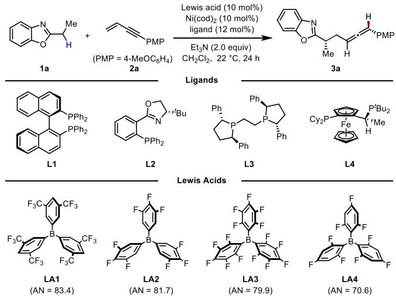

<table><tr><td>entry</td><td>ligand</td><td>Lewis acid</td><td>yield (%)</td><td>dr</td><td>ee (%)</td></tr><tr><td>1</td><td>L1</td><td>LA3</td><td>n.r.</td><td>n.a.</td><td>n.a.</td></tr><tr><td>2</td><td>L2</td><td>LA3</td><td>n.r.</td><td>n.a.</td><td>n.a.</td></tr><tr><td>3</td><td>L3</td><td>LA3</td><td>20</td><td>1:1</td><td>71</td></tr><tr><td>4</td><td>L4</td><td>LA3</td><td>36</td><td>7:1</td><td>97</td></tr><tr><td>5</td><td>L4</td><td>LA1</td><td>69</td><td>12:1</td><td>98</td></tr><tr><td>6</td><td>L4</td><td>LA2</td><td>23</td><td>4:1</td><td>96</td></tr><tr><td>7</td><td>L4</td><td>LA4</td><td>trace</td><td>n.a.</td><td>n.a.</td></tr><tr><td> $8 ^ { b }$ </td><td>L4</td><td>LA1</td><td>87</td><td>&gt;20:1</td><td>98</td></tr><tr><td> $9 ^ { b , c }$ </td><td>L4</td><td>LA1</td><td>74</td><td>&gt;20:1</td><td>98</td></tr><tr><td> $1 0 ^ { b , c , d }$ </td><td>L4</td><td>LA1</td><td>85</td><td>&gt;20:1</td><td>99</td></tr></table>

aUnless otherwise specified, all reactions were performed with 0.10 mmol of 1a, 0.15 mmol of 2a, 10 mol % $\mathrm { N i } ( \mathrm { c o d } ) _ { 2 } ,$ 12 mol % ligand, 10 mol % Lewis acid, and 0.20 mmol of $\mathrm { E t } _ { 3 } \mathrm { N }$ in 0.20 mL of $\mathrm { C H } _ { 2 } \mathrm { \bar { C } l } _ { 2 }$ at $2 2 ~ ^ { \circ } \mathrm { C }$ under $\Nu _ { 2 }$ for 24 h. Yields in entries 1−9 were based on 1H NMR analysis; entry 10 reported the isolated yield. The dr and ee values were determined by HPLC using a chiral column. Abbreviations: $\mathbf { n . r . } _ { \cdot } ,$ no reaction; n.a., not applicable. ${ } ^ { b } 1 0 \ { } ^ { \circ } \mathrm { C } ,$ 36 h. $^ c 5$ mol % $\mathrm { N i } ( \mathrm { c o d } ) _ { 2 } ,$ 6 mol % L4. d0.20 mmol of 1a, 0.40 mmol of 2a, 0.40 mmol $\mathrm { E t } _ { 3 } \mathrm { N } ,$ 0.20 mL of $\mathrm { C H } _ { 2 } \mathrm { C l } _ { 2 } .$

Table 2. Substrate Scope of Allenylic Alkylation Reactions between 2-Alkylbenzoxazoles and Enynesa  
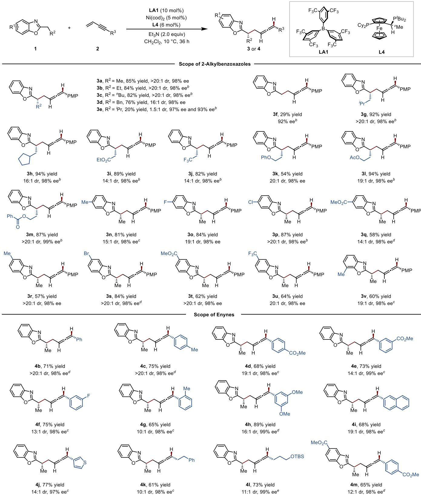  
aUnless otherwise specified, all reactions were performed with 0.20 mmol of 2-alkylbenzoxazole, 0.40 mmol of conjugated enyne, 5 mol % $\mathrm { N i } ( \mathrm { c o d } ) _ { 2 } , 6$ mol % L4, 10 mol $\gamma _ { 0 } \ \mathbf { L A l } _ { 1 }$ and 0.40 mmol of $\mathrm { E t } _ { 3 } \mathrm { N } ,$ in 0.20 mL of CH Cl at $1 0 ~ ^ { \circ } \mathrm { C }$ under $\Nu _ { 2 }$ for 36 h. Isolated yields are provided. $^ b 1 0$ mol % $\mathrm { N i } ( \mathrm { c o d } ) _ { 2 } , 1 2$ mol % ${ \bf L } 4 . \mathrm { \Lambda } ^ { c _ { 2 0 } }$ mol % LA1, 10 mol % $\mathrm { \bar { N i } } \left( \mathrm { c o d } \right) _ { 2 , }$ 12 mol % $\bar { \mathbf { L } 4 } , \bar { 2 } 2 { \mathit { \circ } } _ { \mathbf { C } . } { \mathit { d } } _ { 1 0 }$ mol % $\operatorname { N i } ( \operatorname { c o d } ) _ { 2 } ,$ 12 mol % $\mathbf { L } 4 , 2 2 \ { \overset { \circ } { \operatorname { C } } } . \ { } ^ { e } 1 0$ mol % $\mathrm { N i } ( \mathrm { c o d } ) _ { 2 } ,$ 12 mol % $\mathbf { L } 4 ,$ in 0.20 mL of $\mathrm { P h C F } _ { 3 } .$

Information), demonstrating that synergistic catalysis was essential.

Having optimized the conditions for the allenylic alkylation reaction, we investigated its substrate scope (Table 2).

Replacement of the 2-ethyl group in 1a with npropyl, npentyl, or phenethyl groups aforded products 3b−3d in good yields with excellent diastereo- and enantioselectivities. When $\mathring { R ^ { 2 } }$ was ipropyl, the increased steric bulk led to diminished reactivity and diastereoselectivity, afording product 3e in 20% yield and 1.5:1 dr, while maintaining high ee values for both diastereomers. The use of 2-methylbenzoxazole also resulted in a low yield of the desired product (3f, 29%) along with a dialkylation byproduct in 10% yield (not shown in Table 2). In contrast, when the ipropyl or cyclopentyl group was positioned one carbon further along the alkyl chain, the reactions proceeded smoothly to give 3g and 3h in high yields. Furthermore, 2-alkyl chains bearing terminal ester, trifluoromethyl, phenoxy, acetoxy, or benzoyloxy substituent were well tolerated, afording products 3i−3m in 54−94% yields with excellent diastereo- and enantioselectivities (up to >20:1 dr and 99% ee). The diastereo- and enantioselectivity remained high across a range of benzoxazoles bearing diverse aryl ring substituents at various positions (3n−3v). Notably, benzoxazoles bearing ester substituents (1q and 1t) failed to furnish the corresponding products (3q and 3t) under conditions without LA1, indicating that the ester group could not provide the same activation as the borane catalyst. Aryl-substituted enynes bearing various electron-donating or electron-withdrawing groups at the ortho, meta, or para position of the benzene ring were compatible with the reaction conditions; products 4b−4h were obtained in 65−89% yields with high diastereo- and enantioselectivities. 2-Naphthyl-, 3- thienyl-, and alkyl-substituted enynes also underwent the reaction, afording target products 4i−4l with high diastereoand enantioselectivities. The absolute configuration of 4m was determined by X-ray crystallography of a single crystal. The scope of this reaction is presently confined to benzoxazoles (see the Supporting Information for incompatible heteroarenes).

The allenylic alkylation reaction was readily scaled up: the reaction of 1a (5.0 mmol) with 2l (10.0 mmol) aforded 4l in 84% yield with 11:1 dr and 99% ee (Scheme 2). Desilylation of 4l with tetrabutylammonium fluoride provided 5 in 82% yield. Subsequent gold-catalyzed intramolecular cyclization3c,12 of 5 via hydroxyl attack on the allene furnished 6 in 78% yield as the E-olefin exclusively, with retention of both dr and ee. In contrast, N-iodosuccinimide-mediated cyclization13 of 5 gave 7 in 90% yield with the Z-olefin as the major isomer $\left( Z / E \right. =$ 6.3:1), also with retention of dr and ee.

Scheme 2. Gram-Scale and Subsequent Reactions  
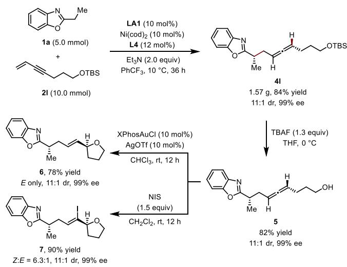

On the basis of literature precedents,8c,9 we propose that these reactions proceed by a mechanism involving the interconnected catalytic cycles shown in Scheme 3. In the

## Scheme 3. Proposed Mechanism

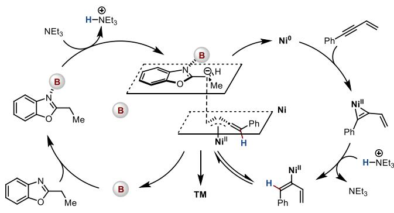

boron cycle, the borane catalyst enhances the acidity of the α- C−H bonds of the 2-alkylbenzoxazole by coordinating to the nitrogen atom. Subsequent deprotonation by triethylamine gives a borane-ligated carbanion (or aza-enolate),14 which acts as a nucleophile in the coupling reaction. In the nickel cycle, the alkyne moiety undergoes oxidative addition to Ni(0) to generate a three-membered Ni(II)−olefin ring,8c which is subsequently protonated by the conjugate acid of the base to furnish a vinylnickel species. This species undergoes a rapid σ−π rearrangement to generate the key exo-alkylidene-Ni(II)- π-allyl electrophile. Outer-sphere attack by the nucleophile on the electrophile gives the product,15 simultaneously regenerating the borane and nickel catalysts.

Inspired by the success of synergistic borane/nickel catalysis of allenylic alkylation reactions of unactivated 2-alkylbenzoxazoles, we explored the applicability of catalytic systems involving borane and other transition metals to asymmetric allylic alkylation reactions of unactivated azaarenes, which remain challenging, particularly for the construction of products with two adjacent stereogenic centers. To date, only two examples of the formation of compounds with vicinal stereocenters have been reported,6a,b both of which are restricted to cyclic allylic esters�likely because the steric hindrance associated with acyclic systems decreases their reactivity. We hypothesized we could overcome this challenge of poor reactivity of acyclic allylic esters by tuning the borane catalyst.

Through optimization of the reaction conditions (see Supporting Information), we found that a borane/palladium system eficiently catalyzed asymmetric allylation of 2- alkylbenzoxazoles with racemic 1,3-disubstituted acyclic allylic pivalates to form products with vicinal stereocenters (Table 3). The optimal conditions employed LA4 (10 mol %), an in situ−generated Pd catalyst from [Pd(allyl)Cl] (5 mol %) and L5 (10 mol %), Barton’s base (1.5 equiv), Triethylbromosilane (TESBr, 1.5 equiv) as an additive, and $\mathrm { P h C F } _ { 3 }$ as solvent, with the reaction carried out at $4 0 ~ ^ { \circ } \mathrm { C }$ for 24 h under nitrogen.

Under these conditions, a wide range of racemic, acyclic 1- methyl-3-aryl-substituted allylic pivalates 8 bearing diverse functionality�including an ester; a pinacolboryl, alkynyl, or methoxy group; or one or more halogen atoms�reacted smoothly with 2-propylbenzoxazole, delivering products 9a− 9h in high yields with excellent diastereo- and enantioselectiv-

## Table 3. Substrate Scope of Allylation Reactions between 2-Alkylbenzoxazoles and Allylic Pivalatesa

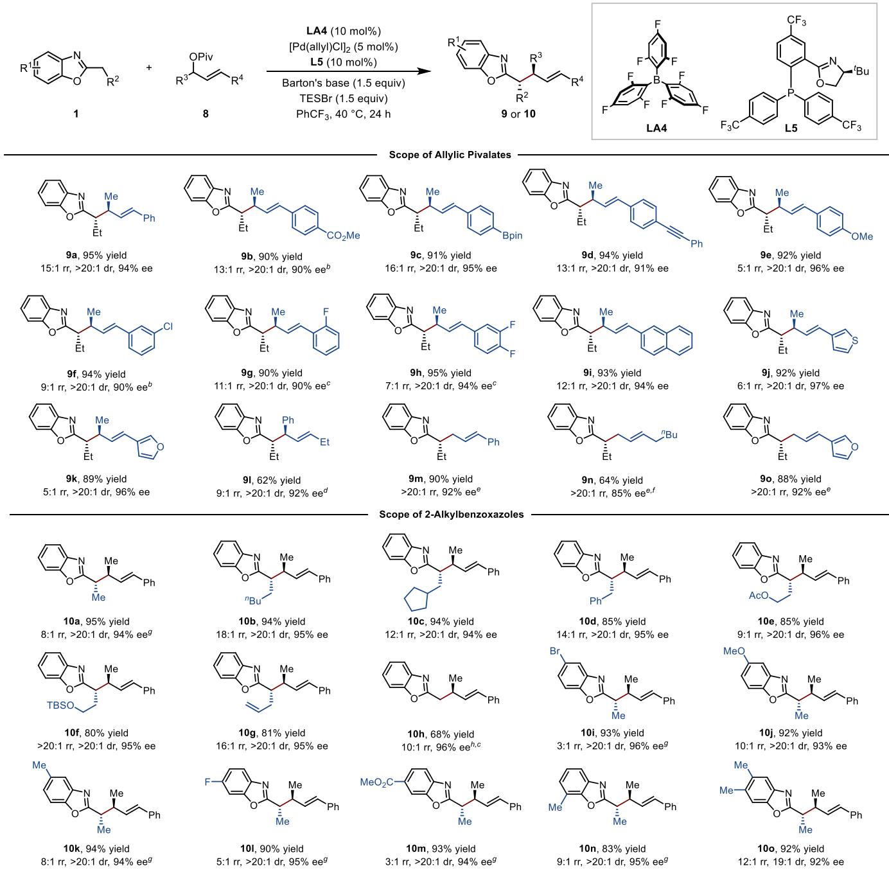  
aUnless otherwise specified, all reactions were performed with 0.20 mmol of 2-alkylbenzoxazole 1, 0.25 mmol of allylic pivalate 8, 5 mol % [Pd(allyl)Cl] , 10 mol % L5, 10 mol % LA4, 0.30 mmol of Barton’s base, and 0.30 mmol of TESBr in 1.0 mL of $\mathrm { P h C F } _ { 3 } \mathrm { a t } 4 0 { } ^ { \circ } \mathrm { C }$ under $\Nu _ { 2 }$ for 24 h. Isolated yields are provided. bReaction temperature, $1 5 ~ ^ { \circ } \mathrm { C } . ~ ^ { c } 1 0$ mol % L10 (see Supporting Information). $^ { d } 1 0$ mol % L14 (see Supporting Information). e10 mol % L2. f0.40 mmol of allylic pivalate, 0.40 mmol of Barton’s base, and 0.40 mmol of TESBr $\mathrm { a t } - 2 0 { \ } ^ { \circ } \mathrm { C } . { \ } ^ { g } 2 . 0$ mL of PhCF . h0.40 mmol of allylic pivalate, 0.40 mmol of Barton’s base, and 0.40 mmol of TESBr.

ities (≥20:1 dr, ≥90% ee) and 5:1−16:1 regioisomer ratios (rr). The absolute configuration of 9a was determined by X-ray crystallography of a single crystal. The minor regioisomer was formed via addition of the nucleophile to the benzylic position of a Pd(II)-π-allyl species. Moreover, the aryl group of 8 could be a 2-naphthyl (9i), 3-thienyl (9j), or 3-furyl (9k) group without markedly afecting the yield or selectivities. Interestingly, when a 1-ethyl-3-phenyl-substitued allylic pivalate was used, addition at the benzylic position predominated, giving 9l as the main regioisomer. Additionally, monosubstituted allylic pivalates gave only linear products (9m−9o) with one stereocenter.

Reactions of 1-methyl-3-phenyl-substituted allylic pivalate (8a) with 2-alkylbenzoxazoles bearing an ethyl or nhexyl group or a functionalized linear alkyl group aforded corresponding products 10a−10g in 80−95% yields with high regioselectivity $\left( 8 \colon 1 \quad \mathrm { t o } \quad > 2 0       { : } 1 \quad \mathrm { r r } \right)$ , diastereoselectivity (>20:1 dr), and enantioselectivity (≥94% ee). Notably, when the 2-alkyl substituent was a methyl group, 10h was obtained in 68% yield with 10:1 rr and 96% ee under modified reaction conditions. Furthermore, substrates with an electron-donating or electron-withdrawing substituent on the benzene ring of the benzoxazole were tolerated, giving corresponding products 10i−10o.

Notably, the use of TESBr was crucial to the success of these allylic alkylation reactions; in the absence of this additive, the yield of 9a was only 5% in otherwise identical conditions. Furthermore, using 1.0 equiv of LA4 without TESBr resulted in a 60% yield of 9a (see Supporting Information). Gas chromatography−mass spectrometry revealed that the standard reaction conditions aforded a considerable amount of TESOPiv. Because the pivalate anion coordinates more strongly than bromide to the borane catalyst, owing to the better interaction of the oxygen 2p lone pair with the empty boron 2p orbital, TESBr may enhance catalyst turnover by scavenging the pivalate anion after product formation.

## ■ CONCLUSIONS

In conclusion, we used synergistic borane/transition metal catalysis to overcome the challenges posed by asymmetric functionalization of unactivated alkylazaarenes at the α- position of the alkyl substituent. This strategy allowed us to achieve the first examples of coupling reactions between unactivated 2-alkylbenzoxazoles and conjugated enynes, which were promoted by a borane/nickel catalytic system and aforded previously elusive compounds with 1,3-nonadjacent stereocenters. Moreover, diastereo- and enantioselective asymmetric allylic alkylation reactions of unactivated 2- alkylbenzoxazoles with acyclic 1,3-disubstituted allylic esters were achieved with a borane/palladium system. A key element of both transformations is the use of fluorinated triarylboranes, which enable base-mediated deprotonation of otherwise poorly acidic α-C−H bonds under mild conditions. The method has a broad substrate scope, allowing reactions of diverse 2- alkylbenzoxazoles and electrophiles (>60 examples). Our work not only provides powerful solutions for accessing complex chiral architectures bearing multiple stereocenters from readily available precursors but also establishes synergistic borane/transition metal catalysis as a versatile strategy for asymmetric functionalization reactions.

## ■ ASSOCIATED CONTENT

## \*sı Supporting Information

The Supporting Information is available free of charge at https://pubs.acs.org/doi/10.1021/jacs.5c13835.

Experimental details, compound characterization data, HPLC chromatograms, DFT calculations, and NMR spectra (PDF)

## Accession Codes

CCDC 2409963 and 2479536 contains the supplementary crystallographic data for this paper. These data can be obtained free of charge via www.ccdc.cam.ac.uk/data\_request/cif, or by emailing data\_request@ccdc.cam.ac.uk, or by contacting The Cambridge Crystallographic Data Centre, 12 Union Road, Cambridge CB2 1EZ, UK; fax: +44 1223 336033.

## ■ AUTHOR INFORMATION

## Corresponding Authors

Chong-Ren Ai − State Key Laboratory and Institute of Elemento-Organic Chemistry, Haihe Laboratory of Sustainable Chemical Transformations, Frontiers Science Center for New Organic Matter, College of Chemistry,

Nankai University, Tianjin 300071, China; Email: chongrenai2016@163.com

Xiao-Chen Wang − State Key Laboratory and Institute of Elemento-Organic Chemistry, Haihe Laboratory of Sustainable Chemical Transformations, Frontiers Science Center for New Organic Matter, College of Chemistry, Nankai University, Tianjin 300071, China; orcid.org/ 0000-0001-5863-0804; Email: xcwang@nankai.edu.cn

## Authors

Qi-Fei Liu − State Key Laboratory and Institute of Elemento-Organic Chemistry, Haihe Laboratory of Sustainable Chemical Transformations, Frontiers Science Center for New Organic Matter, College of Chemistry, Nankai University, Tianjin 300071, China

Qian-Qian Peng − State Key Laboratory and Institute of Elemento-Organic Chemistry, Haihe Laboratory of Sustainable Chemical Transformations, Frontiers Science Center for New Organic Matter, College of Chemistry, Nankai University, Tianjin 300071, China

Sheng-Shi Hao − State Key Laboratory and Institute of Elemento-Organic Chemistry, Haihe Laboratory of Sustainable Chemical Transformations, Frontiers Science Center for New Organic Matter, College of Chemistry, Nankai University, Tianjin 300071, China

Lu Liu − State Key Laboratory and Institute of Elemento-Organic Chemistry, Haihe Laboratory of Sustainable Chemical Transformations, Frontiers Science Center for New Organic Matter, College of Chemistry, Nankai University, Tianjin 300071, China

Fu-Hao Zhang − State Key Laboratory and Institute of Elemento-Organic Chemistry, Haihe Laboratory of Sustainable Chemical Transformations, Frontiers Science Center for New Organic Matter, College of Chemistry, Nankai University, Tianjin 300071, China

Zhu-Jun Shi − State Key Laboratory and Institute of Elemento-Organic Chemistry, Haihe Laboratory of Sustainable Chemical Transformations, Frontiers Science Center for New Organic Matter, College of Chemistry, Nankai University, Tianjin 300071, China

Jian-Hua Xie − State Key Laboratory and Institute of Elemento-Organic Chemistry, Haihe Laboratory of Sustainable Chemical Transformations, Frontiers Science Center for New Organic Matter, College of Chemistry, Nankai University, Tianjin 300071, China; orcid.org/ 0000-0003-3907-2530

Complete contact information is available at: https://pubs.acs.org/10.1021/jacs.5c13835

## Notes

The authors declare no competing financial interest.

## ■ ACKNOWLEDGMENTS

We thank the National Natural Science Foundation of China (22221002, 22371141, 22188101), the National Key R&D Program of China (2021YFA1500200), the Haihe Laboratory of Sustainable Chemical Transformations, the Frontiers Science Center for New Organic Matter at Nankai University (63181206), and the Tencent Foundation via the Xplorer Award for financial support.

## ■ REFERENCES

(1) (a) Vitaku, E.; Smith, D. T.; Njardarson, J. T. Analysis of the Structural Diversity, Substitution Patterns, and Frequency of Nitrogen Heterocycles among U.S. FDA Approved Pharmaceuticals. J. Med. Chem. 2014, 57, 10257−10274. (b) Demmer, C. S.; Bunch, L. Benzoxazoles and Oxazolopyridines in Medicinal Chemistry Studies. Eur. J. Med. Chem. 2015, 97, 778−785. (c) Lamberth, C. Oxazole and Isoxazole Chemistry in Crop Protection. J. Heterocycl. Chem. 2018, 55, 2035−2045. (d) Marshall, C. M.; Federice, J. G.; Bell, C. N.; Cox, P. B.; Njardarson, J. T. An Update on the Nitrogen Heterocycle Compositions and Properties of U.S. FDA-Approved Pharmaceuticals (2013−2023). J. Med. Chem. 2024, 67, 11622−11655.

(2) (a) Qian, B.; Guo, S.; Shao, J.; Zhu, Q.; Yang, L.; Xia, C.; Huang, H. Palladium-Catalyzed Benzylic Addition of 2-Methyl Azaarenes to N-Sulfonyl Aldimines via C-H Bond Activation. J. Am. Chem. Soc. 2010, 132, 3650−3651. (b) Taber, D. F.; Guo, P.; Pirnot, M. T. Conjugate Addition of Lithiated Methyl Pyridines to Enones. J. Org. Chem. 2010, 75, 5737−5739. (c) Suzuki, H.; Igarashi, R.; Yamashita, Y.; Kobayashi, S. Catalytic Direct-type 1,4-Addition Reactions of Alkylazaarenes. Angew. Chem., Int. Ed. 2017, 56, 4520−4524. (d) Zhai, D.-D.; Zhang, X.-Y.; Liu, Y.-F.; Zheng, L.; Guan, B.-T. Potassium Amide-Catalyzed Benzylic C-H Bond Addition of Alkylpyridines to Styrenes. Angew. Chem., Int. Ed. 2018, 57, 1650− 1653. (e) Yamashita, Y.; Suzuki, H.; Sato, I.; Hirata, T.; Kobayashi, S. Catalytic Direct-Type Addition Reactions of Alkylarenes with Imines and Alkenes. Angew. Chem., Int. Ed. 2018, 57, 6896−6900. (f) Liu, Y.- F.; Zhai, D.-D.; Zhang, X.-Y.; Guan, B.-T. Potassium-Zincate-Catalyzed Benzylic C-H Bond Addition of Diarylmethanes to Styrenes. Angew. Chem., Int. Ed. 2018, 57, 8245−8249. (g) Takimoto, M.; Liu, M.; Nishiura, M.; Hou, Z. Regioselective Benzylic C-H Alumination and Further Functionalization of 2-Alkylpyridines by Yttrium Catalyst. ACS Catal. 2022, 12, 13792−13804.

(3) For enantioselective reactions of 2-alkylazaarenes activated by electron-withdrawing groups, see: (a) Vera, S.; Liu, Y.; Marigo, M.; Escudero-Adán, E. C.; Melchiorre, P. Asymmetric Michael Addition of Nitrobenzyl Pyridines to Enals via Iminium Catalysis. Synlett 2011, 2011, 489−494. (b) Fallan, C.; Lam, H. W. Enantioselective Nickel-Catalyzed Michael Additions of Azaarylacetates and Acetamides to Nitroalkenes. Chem.�Eur. J. 2012, 18, 11214−11218. (c) Chen, Q.; Zhu, T.; Majhi, P. K.; Mou, C.; Chai, H.; Zhang, J.; Zhuo, S.; Chi, Y. R. Carbene-Catalyzed Enantioselective Oxidative Coupling of Enals and Di(hetero)arylmethanes. Chem. Sci. 2018, 9, 8711−8715. (d) Yang, S.-Q.; Wang, Y.-F.; Zhao, W.-C.; Lin, G.-Q.; He, Z.-T. Stereodivergent Synthesis of Tertiary Fluoride-Tethered Allenes via Copper and Palladium Dual Catalysis. J. Am. Chem. Soc. 2021, 143, 7285−7291. (e) Kim, S.; Jeung, S.; Lee, S. Y. Stereodivergent Conjugate Addition between Iminium and α-Azaaryl α-Fluoroenolate Intermediates by Synergistic Amine and Lewis Acid Catalysis. ACS Catal. 2023, 13, 13838−13845. (f) Tian, $\mathrm { K } . \mathrm { \Omega }$ Chang, $\mathrm { X . } ;$ Xiao, L.; Dong, X.-Q.; Wang, C.-J. Stereodivergent Synthesis of α-Fluoro α- Azaaryl γ-Butyrolactones via Cooperative Copper and Iridium Catalysis. Fundam. Res. 2024, 4, 77−85. (g) Tian, K.; Jin, $\mathrm { Z . j }$ Liu, X.-L.; He, L.; Liu, H.-F.; Yu, P.-K.; Chang, $\mathrm { X . } ;$ Dong, ${ \mathrm { X . ^ { - } C . ; } }$ Wang, C.- J. Stereodivergent Assembly of δ-Valerolactones with an Azaarene-Containing Quaternary Stereocenter Enabled by Cu/Ru Relay Catalysis. Chem. Sci. 2025, 16, 1233−1240. (h) Qiu, $\mathrm { Y . } _ { \mathrm { i } }$ Thomas, V. C. J. X.; Fantoni, T.; Chen, R.; Jiang, X.; He, Z. T.; Butcher, T. W.; Nomura, D. $\mathrm { K } . \mathrm { \Omega }$ Hartwig, J. F. Convergent Synthesis and Protein Binding of Vicinal Difluorides by Stereodivergent C-C Bond Formation. Chem 2024, 10, 3709−3721. (i) Liu, ${ \mathrm { R } } _ { \mathrm { { \dot { \rho } } } }$ Zhang, Q.; Lin, $\mathrm { Z . j }$ Snaddon, T. N.; Zi, W. Modular Access to Fluorinated Quaternary Stereocenters via Palladium/Lewis Base Synergistic Catalysis. Angew. Chem., Int. Ed. 2025, 64, No. e202504121.

(4) For enantioselective reactions of 2-alkylpyridine N-oxides activated by electron-withdrawing groups, see: (a) Izquierdo, J.; Landa, $\mathbf { A } . ;$ Bastida, I.; LópezOiarbidePalomo, R. M. C.; Oiarbide, M.; Palomo, C. Base-Catalyzed Asymmetric α-Functionalization of 2- (Cyanomethyl)azaarene N-Oxides Leading to Quaternary Stereocenters. J. Am. Chem. Soc. 2016, 138, 3282−3285. (b) Bastida, I.;

Segundo, M. S.; Lopez, R.; Palomo, C. Strategy for Stereoselective Metal-free α-Functionalization of 2-Azaaryl Acetates with N-Boc Imines. Chem.�Eur. J. 2017, 23, 13332−13336. (c) Hu, $\mathrm { Q . } ;$ Kondoh, A.; Terada, M. Enantioselective Direct Mannich-type Reactions of 2- Benzylpyridine N-Oxides Catalyzed by Chiral Bis(guanidino)- iminophosphorane Organosuperbase. Chem. Sci. 2018, 9, 4348−4351.

(5) For enantioselective reactions of 2-alkylbenzoxazoles activated by electron-withdrawing groups, see: (a) Best, D.; Kujawa, S.; Lam, H. W. Diastereo- and Enantioselective Pd(II)-Catalyzed Additions of 2- Alkylazaarenes to N-Boc Imines and Nitroalkenes. J. Am. Chem. Soc. 2012, 134, 18193−18196. (b) Meazza, M.; Light, M. E.; Mazzanti, A.; Rios, R. Synergistic Catalysis: cis-Cyclopropanation of Benzoxazoles. Chem. Sci. 2016, 7, 984−988. (c) Greenhalgh, M. D.; Qu, S.; Slawin, A. M. Z.; Smith, A. D. Multiple Roles of Aryloxide Leaving Groups in Enantioselective Annulations Employing $\alpha , \beta \cdot$ -Unsaturated Acyl Ammonium Catalysis. Chem. Sci. 2018, 9, 4909−4918. (d) Jiang, X.; Boehm, P.; Hartwig, J. F. Stereodivergent Allylation of Azaaryl Acetamides and Acetates by Synergistic Iridium and Copper Catalysis. J. Am. Chem. Soc. 2018, 140, 1239−1242. (e) Wang, Y.; Wang, K.; Cao, W.; Liu, X.; Feng, X. Diastereo- and Enantioselective 1,6- Conjugate Addition of 2-Azaarylacetamides to para-Quinone Methides. Org. Lett. 2019, 21, 6063−6067. (f) He, Z.-T.; Jiang, X.; Hartwig, J. F. Stereodivergent Construction of Tertiary Fluorides in Vicinal Stereogenic Pairs by Allylic Substitution with Iridium and Copper Catalysts. J. Am. Chem. Soc. 2019, 141, 13066−13073. (g) Chang, X.; Zhang, J.; Cheng, X.; Lv, X.; Guo, C. Ni/Cu Dual-Catalyzed Propargylation for the Stereodivergent Synthesis of Methohexital. Adv. Sci. 2024, 11, 2406764.

(6) For asymmetric allylic alkylation reactions of unactivated 2- alkylazaarenes, see: (a) Trost, B. M.; Thaisrivongs, D. A. Strategy for Employing Unstabilized Nucleophiles in Palladium-Catalyzed Asymmetric Allylic Alkylations. J. Am. Chem. Soc. 2008, 130, 14092−14093. (b) Trost, B. M.; Thaisrivongs, D. A. Palladium-Catalyzed Regio-, Diastereo-, and Enantioselective Benzylic Allylation of 2-Substituted Pyridines. J. Am. Chem. Soc. 2009, 131, 12056−12057. (c) Trost, B. M.; Thaisrivongs, D. A.; Hartwig, J. Palladium-Catalyzed Asymmetric Allylic Alkylations of Polynitrogen-Containing Aromatic Heterocycles. J. Am. Chem. Soc. 2011, 133, 12439−12441. (d) Sha, S.-C.; Jiang, H.; Mao, J.; Bellomo, A.; Jeong, S. A.; Walsh, P. J. Nickel-Catalyzed Allylic Alkylation with Diarylmethane Pronucleophiles: Reaction Development and Mechanistic Insights. Angew. Chem., Int. Ed. 2016, 55, 1070−1074. (e) Liu, X.-J.; You, S.-L. Enantioselective Iridium-Catalyzed Allylic Substitution with 2-Methylpyridines. Angew. Chem., Int. Ed. 2017, 56, 4002−4005. (f) Murakami, R.; Sano, K.; Iwai, T.; Taniguchi, T.; Monde, K.; Sawamura, M. Palladium-Catalyzed Asymmetric $\mathrm { C } \left( \mathrm { s p } ^ { 3 } \right)$ -H Allylation of 2-Alkylpyridines. Angew. Chem., Int. Ed. 2018, 57, 9465−9469. (g) Liu, X.-J.; Zhang, W.-Y.; Zheng, C.; You, S.-L. Iridium-catalyzed asymmetric allylic substitution of methyl azaarenes. Angew. Chem., Int. Ed. 2022, 61, No. e202200164.

(7) For other types of enantioselective reactions of unactivated 2- alkylazaarenes, see: (a) Luo, Y.; Teng, H.-L.; Nishiura, M.; Hou, Z. Asymmetric Yttrium-Catalyzed C(sp3)-H Addition of 2-Methyl Azaarenes to Cyclopropenes. Angew. Chem., Int. Ed. 2017, 56, 9207−9210. (b) Meazza, M.; Tur, F.; Hammer, N.; Jørgensen, K. A. Synergistic Diastereo- and Enantioselective Functionalization of Unactivated Alkyl Quinolines with $\alpha { , } \beta { \cdot }$ Unsaturated Aldehydes. Angew. Chem., Int. Ed. 2017, 56, 1634−1638. (c) Gladfelder, J. J.; Ghosh, $S . ;$ Podunavac, M.; Cook, A. $\mathrm { W . } \mathrm { \Sigma }$ Ma, $\mathrm { Y . } _ { \mathrm { j } }$ Woltornist, R. A.; Keresztes, I.; Hayton, T. $\mathrm { W . } ;$ Collum, D. B.; Zakarian, A. Enantioselective Alkylation of 2-Alkylpyridines Controlled by Organolithium Aggregation. J. Am. Chem. Soc. 2019, 141, 15024− 15028. (d) Ma, D.; Zhang, $\mathrm { Z . j }$ Chen, M.; Lin, Z.; Sun, J. Organocatalytic Enantioselective Functionalization of Unactivated Indole C(sp3)-H Bonds. Angew. Chem., Int. Ed. 2019, 58, 15916− 15921. (e) Rai, $\mathrm { P . ; }$ Waiba, S.; Maji, K.; Sahoo, D.; Maji, B. Cooperative Lewis Acid Catalysis for the Enantioselective C(sp3)-H Bond Functionalizations of 2-Alkyl Azaarenes. Org. Lett. 2021, 23, 8888−8893. (f) Li, $\mathrm { D } . ;$ Ning, L.; Luo, $\mathrm { Q . ; }$ Wang, S.; Feng, X.; Dong, S. C-H Alkylation of Pyridines with Olefins Catalyzed by Imidazolin-2-

iminato-Ligated Rare-Earth Alkyl Complexes. Sci. China: Chem. 2023, 66, 1804−1813. (g) Ai, C.-R.; Liu, L.; Wang, X.-C. Borane-Catalyzed Enantioselective α-Alkylation of Unactivated 2-Alkylbenzoxazoles with Electron-Deficient Olefins. J. Am. Chem. Soc. 2024, 146, 24663−24669.

(8) (a) Adamson, N. J.; Jeddi, H.; Malcolmson, S. J. Preparation of Chiral Allenes through Pd-Catalyzed Intermolecular Hydroamination of Conjugated Enynes: Enantioselective Synthesis Enabled by Catalyst Design. J. Am. Chem. Soc. 2019, 141, 8574−8583. (b) Tsukamoto, H.; Konno, T.; Ito, K.; Doi, T. Palladium(0)- Lithium Iodide Cocatalyzed Asymmetric Hydroalkylation of Conjugated Enynes with Pronucleophiles Leading to 1,3-Disubstituted Allenes. Org. Lett. 2019, 21, 6811−6814. (c) Zhang, Y.; Yang, J.; Ruan, Y.-L.; Liao, L.; Ma, C.; Xue, X.-S.; Yu, J.-S. Nickel-Catalysed Asymmetric Hydromonofluoromethylation of 1,3-Enynes for Enantioselective Construction of Monofluoromethyl-Tethered Chiral Allenes. Chem. Sci. 2023, 14, 12676−12683. (d) You, C.; Shi, M.; Mi, X.; Luo, S. Asymmetric α-Allylic Allenylation of β-Ketocarbonyls and Aldehydes by Synergistic Pd/Chiral Primary Amine Catalysis. Nat. Commun. 2023, 14, 2911. (e) Li, S.; Yuan, K.; Zhang, G.; Guo, R. Recent Advances in the Synthesis of Chiral Allenes via Asymmetric 1,4-Difunctionalization of 1,3-Enynes. Eur. J. Org Chem. 2024, 27, No. e202301316.

(9) (a) Shang, M.; Cao, M.; Wang, Q.; Wasa, M. Enantioselective Direct Mannich-Type Reactions Catalyzed by Frustrated Lewis Acid/ Brønsted Base Complexes. Angew. Chem., Int. Ed. 2017, 56, 13338− 13341. (b) Cao, M.; Yesilcimen, A.; Wasa, M. Enantioselective Conia-Ene-Type Cyclizations of Alkynyl Ketones through Cooperative Action of B(C F ) , N-Alkylamine and a Zn-Based Catalyst. J. Am. Chem. Soc. 2019, 141, 4199−4203. (c) Tian, J.-J.; Liu, N.; Liu, Q.-F.; Sun, W.; Wang, X.-C. Borane-Catalyzed Direct Asymmetric Vinylogous Mannich Reactions of Acyclic α,β-Unsaturated Ketones. J. Am. Chem. Soc. 2021, 143, 3054−3059. (d) Luo, H.; Zhang, M.; Xing, Z.- Q.; Wang, X.-C. Enantioselective Vinylogous Addition of Enones to Allenes Enabled by Synergistic Borane/Palladium Catalysis. J. Am. Chem. Soc. 2025, 147, 104−110.

(10) (a) Stephan, D. W. The Broadening Reach of Frustrated Lewis Pair Chemistry. Science 2016, 354, aaf7229. (b) Lam, J.; Szkop, K. M.; Mosaferi, E.; Stephan, D. W. FLP Catalysis: Main Group Hydrogenations of Organic Unsaturated Substrates. Chem. Soc. Rev. 2019, 48, 3592−3612. (c) Berger, S. M.; Ferger, M.; Marder, T. B. Synthetic Approaches to Triarylboranes from 1885 to 2020. Chem.�Eur. J. 2021, 27, 7043−7058. (d) Carden, J. L.; Dasgupta, A.; Melen, R. L. Halogenated Triarylboranes: Synthesis, Properties and Applications in Catalysis. Chem. Soc. Rev. 2020, 49, 1706−1725. (e) Feng, X.; Meng, W.; Du, H. Asymmetric Catalysis with FLPs. Chem. Soc. Rev. 2023, 52, 8580−8598. (f) Pramanik, M.; Guerzoni, M. G.; Richards, E.; Melen, R. L. Recent Advances in Asymmetric Catalysis Using p-Block Elements. Angew. Chem., Int. Ed. 2024, 63, No. e202316461.

(11) Acceptor numbers, which quantify Lewis acidity, were determined by means of the Gutmann-Beckett method; see: (a) Gutmann, V. Solvent Effects on the Reactivities of Organometallic Compounds. Coord. Chem. Rev. 1976, 18, 225−255. (b) Beckett, M. A.; Strickland, G. C.; Holland, J. R.; Sukumar Varma, K. A Convenient N.M.R. Method for the Measurement of Lewis Acidity at Boron Centres: Correlation of Reaction Rates of Lewis Acid Initiated Epoxide Polymerizations with Lewis Acidity. Polymer 1996, 37, 4629−4631. (c) Welch, G. C.; Cabrera, L.; Chase, P. A.; Hollink, E.; Masuda, J. D.; Wei, P.; Stephan, D. W. Tuning Lewis Acidity Using the Reactivity of “Frustrated Lewis Pairs”: Facile Formation of Phosphine-Boranes and Cationic Phosphonium-Boranes. Dalton Trans. 2007, 3407−3414. (d) Ashley, A. E.; Herrington, T. J.; Wildgoose, G. G.; Zaher, H.; Thompson, A. L.; Rees, N. H.; Krämer, T.; O’Hare, D. Separating Electrophilicity and Lewis Acidity: The Synthesis, Characterization, and Electrochemistry of the Electron Deficient Tris(aryl)boranes B(C F ) (C Cl ) (n = 1−3). J. Am. Chem. Soc. 2011, 133, 14727−14740.

(12) Zhou, J.; Fu, C.; Ma, S. Gold-Catalyzed Stereoselective Cycloisomerization of Allenoic Acids for Two Types of Common Natural γ-Butyrolactones. Nat. Commun. 2018, 9, 1654.

(13) Lü, B.; Jiang, X.; Fu, C.; Ma, S. Highly Regio- and Stereoselective Cyclic Iodoetherification of 4,5-Alkadienols. An Efficient Preparation of 2-(1’(Z)-Iodoalkenyl)tetrahydrofurans. J. Org. Chem. 2009, 74, 438−441.

(14) When benzoxazole 1a, LA1, and NEt were combined in a 1:1:1 molar ratio in CDCl , an aza-enolate was not detected by 1H NMR spectroscopy, suggesting that a borane-ligated carbanion is perhaps a more stable intermediate.

(15) The schematic illustration of the relative positions and orientations of the nucleophile and electrophile in this addition step was deduced from the absolute configuration of the product and further corroborated by density functional theory (DFT) calculations. The calculations indicate that the steric bulk of ligand L4 and the borane catalyst plays a dominant role in controlling the diastereo- and enantioselectivity.

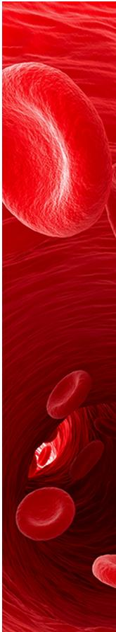

CAS BIOFINDER DISCOVERY PLATFORMTM

# CAS BIOFINDER HELPS YOU FIND YOUR NEXT BREAKTHROUGH FASTER

Navigate pathways, targets, and diseases with precision

Explore CAS BioFinder