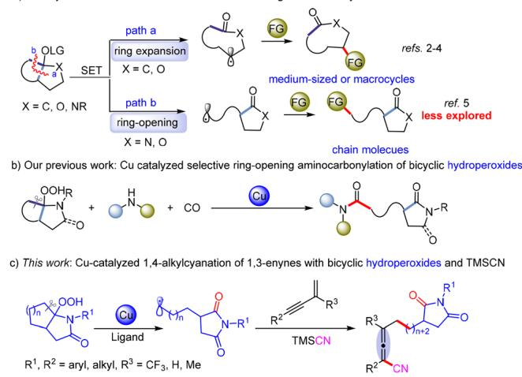
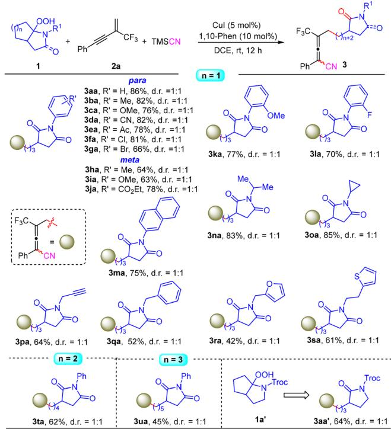
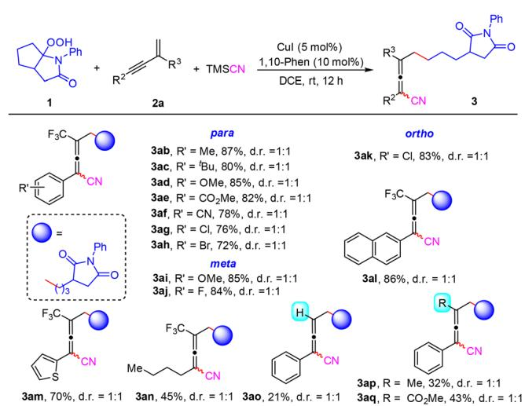
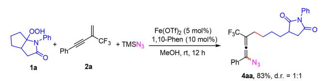
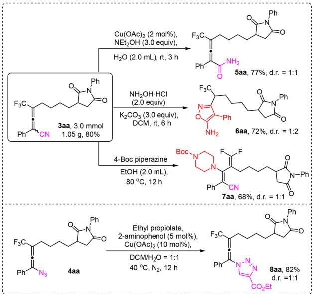
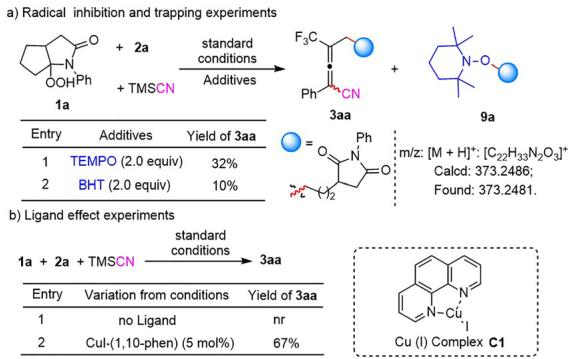
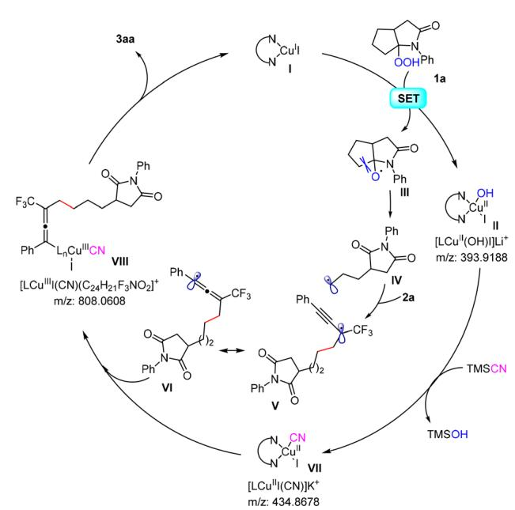

COMMUNICATION

View Article Online View Journal | View Issue

Check for updates

Cite this: Chem. Commun., 2025, 61, 15246

Received 10th July 2025, Accepted 28th August 2025

DOI: 10.1039/d5cc03900b

# Copper-catalyzed 1,4-alkylcyanation of CF -containing 1,3-enynes: alkoxy radical-mediated selective cleavage of fused azabicycles

Jun-Lin Lu, Hong-Fei Liu, Ying-Xin Shui, Qi-Chao Shan, Xin-Hua Duan \* and Li-Na Guo \*

rsc.li/chemcomm

A copper-catalyzed 1,4-alkylcyanation of $\mathsf { C F } _ { 3 } .$ -containing 1,3-enynes with bicyclic hydroperoxides and TMSCN is described. In this cascade, the alkyl source originates from selective cleavage of a C–C bond in the fused bicyclic skeletons, enabling the successful introduction of a succinimide fragment into tetrasubstituted allenes. This reaction is characterized by mild conditions, broad substrate scope, excellent functional group tolerance, and ease of large-scale synthesis and product derivatization.

In recent years, radical-mediated C–C bond cleavage of unstrained aliphatic carbocycles has emerged as a powerful platform for the formation of various chemical bonds. Significant progress has been made in the alkoxy-radical mediated ringopening of monocarbocycles, which enables the successful introduction of ketoalkyl fragments into various compounds.1 In contrast, the alkoxy radical-induced C–C bond cleavage of fused bicyclic skeletons remains less developed, even though there were pioneering reports in the 1980s (Scheme $1 \mathrm { a } ) . ^ { 2 }$ In particular, the selective cleavage of fused bicyclic skeletons remains a significant yet relatively less explored area. Recently, Zuo’s group reported an elegant photoinduced Ce-catalyzed aerobic oxidative ring expansion of hemiketal alcohols (tautomer mixture) to carbonyl-containing macrolatones via a ligandto-metal charge transfer (LMCT) strategy.3 Our group has developed several abundant metal-catalyzed ring expansion/ cross-coupling cascades of hemiketal hydroperoxides, yielding a range of site-specific functionalized macrolactones.4 Remarkably, by adjusting the substituents on the bicyclic skeletons, 5a we achieved an unexpected Cu-catalyzed ring-opening/aminocarbonylation cascade, yielding amides that contain a g-lactam or succinimide fragment instead (Scheme 1b).5b DFT calculations revealed that the regioselective ring-opening is thermodynamically and kinetically favorable, due to the formation of a stable g-lactam or succinimide fragment and an unstrained alkyl radical. These intriguing findings motivated us to explore new radical alkylation reactions, with the aim of incorporating these functionalized alkyl moieties into diverse molecules.

  
Scheme 1 Alkoxy radical-mediated selective cleavage of fused bicycles (a–c).

Radical-mediated multicomponent reactions represent an eficient strategy for the rapid assembly of complex molecules from simple starting materials, characterized by mild reaction conditions, high step-economy and superior bond formation eficiency. In this field, 1,3-enynes have been extensively used as versatile linkage bridges.6 A variety of three-component functionalization reactions of 1,3-enynes have been developed including 1,2-functionalization,7 1,4-functionalization,8 and 3,4-functionalization.9 Among these, the radical-mediated 1,4- difunctionalization of 1,3-enynes has gradually emerged as an important and powerful strategy for the synthesis of polysubstituted allenes.10 In particular, the copper-catalyzed 1,4- alkylcyanation of $^ { 1 , 3 \cdot }$ -enynes provides an eficient method for the rapid synthesis of CN-functionalized tetrasubstituted allenes. A range of alkyl radical precursors, including alkyl diacyl hydroperoxides,11 cyclobutanone oxime esters,12 alkyl N-hydroxyphthalimide esters,13 and others14 have been successfully applied for this cascade. In addition, Wu’s group and our group have reported the four-component 1,4-alkylcarbonylation reaction of $^ { 1 , 3 \cdot }$ -enynes, providing a straightforward approach to complex allenyl ketones.15 Given the significance and versatile reactivity of allenes, we attempt to integrate our selective C–C bond cleavage, ring-opening findings with the 1,4-alkylcyanation of 1,3-enynes (Scheme 1c). Herein, we disclose a coppercatalyzed 1,4-alkylcyanation cascade of $\mathrm { C F } _ { 3 }$ -contaning 1,3-enynes using fused azabicyclic hydroperoxides and TMSCN. This protocol provides efficient access to succinimide-containing tetrasubstituted allenes, which are otherwise inaccessible by conventional methods.

To achieve this goal, we selected the reaction of fused bicyclic hydroperoxide 1a, $\mathrm { C F } _ { 3 } \cdot$ -containing 1,3-enyne 2a and TMSCN as a model reaction to identify the optimal reaction conditions under copper catalysis (for details, see Table S1 in the SI). We found that the three-component reaction proceeded successfully in the presence of CuI (5 mol%), and 1,10-phenanthroline (1,10-Phen, L1, 10 mol%) in DCE at room temperature, yielding the desired product 3aa in a 74% yield after 12 h. Other Cu(I) and Cu(II) salts were then examined for this transformation, and CuI still showed the best catalytic activity (entries 1–6). Solvent screening indicated that THF also afforded a satisfactory yield of 3aa, yet DCE remained the optimal solvent (entries 7–10). Sequentially, various bidentate and tridentate nitrogen ligands, including $^ { 5 , 6 - }$ dimethyl-1,10-phen (L2), 4,40-di-tert-butyl-2,20-bipyridine (dtbpy, L3) and $2 , 2 ^ { \prime } { : } 6 ^ { \prime } , 2 ^ { \prime \prime . }$ -terpyridine (L4) were tested. Among these, the tridentate ligand was totally ineffective, while the simple 1,10- Phen remained the most efficient (entries 11–13). Increasing the amounts of 1a and TMSCN to 2.0 equiv. further enhanced the yield of 3aa to 86% (entry 14). Finally, control experiments confirmed that both the Cu catalyst and the ligand were essential for the success of this transformation (not shown).

With the optimal conditions in hand, the substrate scope of fused bicyclic hydroperoxides 1 was first evaluated using $^ { 1 , 3 - }$ enyne 2a and TMSCN as coupling partners (Scheme 2). It was found that N-aryl hydroperoxides bearing electron-donating or -withdrawing groups on the aromatic ring (at the para, meta or ortho positions) participated eficiently in this transformation, yielding the desired products 3ba–3la in good yields. Notably, a wide range of functional groups, including ether (3ca, 3ka), cyano (3da), acetyl (3ea), halogen (3ga), and ester (3ja) groups were well tolerated in this reaction. The N-(2-naphthyl) substrate also reacted smoothly, producing the allene 3ma in a 75% yield. Besides N-aryl hydroperoxides, N-alkyl and N-benzyl substituted hydroperoxides were also found to be effective in this reaction, yielding the desired products 3na–3sa in moderate to good yields. Functional groups such as cyclopropyl (3oa), alkynyl (3pa), furyl (3ra) and thienyl (3sa) groups were all compatible with this reaction. Furthermore, the reaction was not limited to bicyclo[3.3.0] hydroperoxides; bicyclo[4.3.0] and [5.3.0] hydroperoxides also yielded the expected products 3ta and 3ua, albeit with somewhat lower yields. Notably, when bicyclic hydroperoxide $\mathbf { 1 } \mathbf { a } ^ { \prime }$ was subjected to the reaction, a regioselective C–C bond cleavage occurred, producing the ring-opening product 3aa0 in a 64% yield. The result is different from the oxo-bicyclic analogues in our previous report.14

  
Scheme 2 Scope of bicyclic hydroperoxides. Reaction conditions: 1 (0.40 mmol, 2.0 equiv.), 2a (0.20 mmol, 1.0 equiv.), CuI (5 mol %), 1,10- Phen (10 mol %) and TMSCN (0.40 mmol, 2.0 equiv.) in DCE (1.5 mL) at room temperature for 12 h under $\mathsf { N } _ { 2 } ,$ isolated yields. d.r. ratios were determined by $^ { 1 3 } \mathsf { C }$ NMR spectra or HPLC analysis.

Then, the generality and limitations of 1,3-enynes were investigated using 1a as the alkylation reagent (Scheme 3). 1,3-Enynes bearing aryl, heteroaryl and alkyl substituents in the alkyne moiety reacted eficiently with 1a and TMSCN, furnishing the desired products 3ab–3an in good yields. Both electronic and steric effects of substituents on the aromatic ring did not show a significant impact on the reaction efficiency. Additionally, synthetically useful functional groups such as ester (3ae), cyano (3af) and bromo (3ah) were all compatible with this catalytic system. When the trifluoromethyl group on the 1,3-enyne was replaced by a hydrogen atom, a methyl group and a methyl ester group, the corresponding products 3ao, 3ap and 3aq were successfully obtained, but with noticeably reduced yields. This decrease in yield might be due to a polarity mismatch. The alkyl radicals generated by the carbon–carbon bond cleavage are nucleophilic, and thus, electron-deficient $\operatorname { C F } _ { 3 } \cdot$ -containing $^ { 1 , 3 - }$ enynes exhibited better reactivity than electron-rich 1,3-enynes. Remarkably, when $\mathrm { T M S N } _ { 3 }$ was used instead of TMSCN as the nucleophile, the 1,4-alkylazidation of $\mathrm { C F } _ { 3 } .$ -containing 1,3-enyne proceeded smoothly under iron catalysis (Scheme 4), yielding the expected product 4aa in a satisfactory yield (83%).

  
Scheme 3 Substrate scope of 1,3-enynes. Reaction conditions: 1 (0.40 mmol, 2.0 equiv.), 2a (0.20 mmol, 1.0 equiv.), CuI (5 mol %), 1,10- Phen (10 mol %) and TMSCN (0.40 mmol, 2.0 equiv.) in DCE (1.5 mL) at room temperature for 12 h under $\mathsf { N } _ { 2 } ,$ , isolated yields. d.r. ratios were determined by $^ { 1 3 } \mathsf { C }$ NMR spectra or HPLC analysis.

To further demonstrate the application potential of this reaction, a gram-scale amplification experiment was carried out (Scheme 5). When the model reaction was scaled up to 3.0 mmol, the target product 3aa could be obtained in an 80% yield (1.05 g). Subsequently, various derivatizations of 3aa were explored. The hydrolysis of the cyano group in allene 3aa was successfully achieved using a copper-catalyzed system, yielding the 2,3-dienamide 5aa in a 77% yield. Under alkaline conditions, allene 3aa could undergo a nucleophilic cyclization reaction with hydroxylamine hydrochloride, afording the isoxazole 6aa in a 72% yield. Moreover, using 4-Boc piperazine as the nucleophile, the gem-difluorodiene 7aa was obtained in a satisfactory yield through a nucleophilic addition followed by a defluorination process. Finally, the derivatization of azide-containing allene 4aa was explored. Satisfactorily, it could undergo a copper-catalyzed [3+2] cycloaddition click reaction with ethyl propiolate eficiently, yielding the triazole-substituted allene 8aa in an 82% yield.

  
Scheme 4 1,4-Alkylazidation of ${ \mathsf { C F } } _ { 3 } .$ -containing 1,3-enyne.

  
Scheme 5 Gram-scale synthesis and derivatizations of the products.

  
Scheme 6 Mechanism studies (a and b).

To shed light on the reaction mechanism, radical inhibition and trapping experiments were first performed (Scheme 6a). When 2.0 equiv. of TEMPO or BHT, well known radical scavengers, were added to the model reaction, the yield of 3aa was significantly reduced. Additionally, the alkyl-TEMPO adduct 9a could be detected by HRMS. These results indicated that a radical pathway is likely involved in this transformation. Furthermore, control experiments indicate that the Cu(I) complex C1 is a key active species in the catalytic cycle of this reaction (Scheme 6b).

Based on the above experimental results and literature,11–13 a possible reaction mechanism was proposed. As shown in Scheme $^ { 7 , }$ the reaction begins with the single-electron reduction of the fused bicyclic hydroperoxide 1a by the Cu(I) complex I formed in situ, yielding the radical intermediate III and the Cu(II) species II. Subsequently, the alkoxy radical III undergoes a selective b-scission to give the ring-opening, relatively stable alkyl radical IV. Intermediate IV is captured by the CF -1,3-enyne 2a to form a propargyl radical species V, which resonates to produce the allenyl radical VI. Meanwhile, the Cu(II) species II undergoes a ligand exchange with TMSCN to yield the key intermediate VII. The interaction of intermediates VI and VII forms a Cu(III) species VIII. Finally, reductive elimination of Cu(III) species VIII gives the target product 3aa and regenerates the Cu(I) complex I. Fortunately, all relevant copper complexes can be detected by HRMS.

  
Scheme 7 Proposed mechanism.

In summary, we have developed a copper-catalyzed 1,4- alkylcyanation of 1,3-enynes with bicyclic hydroperoxides and TMSCN. In this cascade, the bicyclic hydroperoxides serve as a functionalized alkyl source via an alkoxy radical-mediated selective b-scission, enabling the introduction of a succinimide fragment into polysubstituted allenes. This method has significant advantages, including mild reaction conditions, excellent functional group tolerance, and ease of large-scale synthesis and product derivatization. Additionally, this cascade can be extended to the 1,4-alkylazidation of 1,3-enynes. This work not only enriches the diverse synthesis of functionalized allenes but also provides a good example of selective C–C bond cleavage in bicyclic skeletons.

We thank the National Natural Science Foundation of China (22171220) and the Fundamental Research Funds for the Central Universities (xtr072022003). We also thank Miss Zhou, Miss Feng, and Miss Bai at the Instrument Analysis Center of Xi’an Jiaotong University for their assistance with NMR and HRMS analysis.

## Conflicts of interest

There are no conflicts to declare.

## Data availability

The data supporting this article have been included as part of the SI. All experimental data, spectra, and detailed experimental procedures are available in the SI. See DOI: https:// doi.org/10.1039/d5cc03900b

## Notes and references

1 (a) X. Wu and C. Zhu, Chem. Rec., 2018, 18, 587; (b) L. Chang, Q. An, L. Duan, K. Feng and Z. Zuo, Chem. Rev., 2022, 122, 2429; (c) E. Tsui, H. Wang and R. R. Knowles, Chem. Sci., 2020, 11, 11124; (d) X. Wu

and C. Zhu, Chem. Commun., 2019, 55, 9747; (e) K. Jia and Y. Chen, Chem. Commun., 2018, 54, 6105.

2 (a) S. L. Schreiber, J. Am. Chem. Soc., 1980, 102, 6163; (b) A. L. J. Beckwith, R. Kazlauskas and M. R. Syner-Lyons,J. Org. Chem., 1983, 48, 4718; (c) S. L. Schreiber, T. Sammakia, B. Hulin and G. Schulte, J. Am. Chem. Soc., 1986, 108, 2106; (d) G. H. Posner, K. S. Webb, E. Asirvatham, S. S. Jew and A. Degl’Innocenti, J. Am. Chem. Soc., 1988, 110, 4754; G. H. Posner, M. A. Hatcher and W. A. Maio, Org. Lett., 2005, 7, 4301; G. H. Posner, M. A. Hatcher and W. A. Maio, Tetrahedron, 2016, 72, 6025; (e) R. Ren, H. Zhao, L. Huan and C. Zhu, Angew. Chem., Int. Ed., 2015, 54, 12692; (f) H. Zhao, X. Fan, J. Yu and C. Zhu, J. Am. Chem. Soc., 2015, 137, 3490.

3 J. Du, X. Yang, X. Wang, Q. An, X. He, H. Pan and Z. Zuo, Angew. Chem., Int. Ed., 2021, 60, 5370.

4 (a) S. Liu, P. Ma, L. Zhang, S. Shen, H. J. Miao, L. Liu, K. N. Houk, X.-H. Duan and L.-N. Guo, Chem. Sci., 2023, 14, 5220; (b) T. Y. Zhang, Y. Wu, S. Liu, J. Q. Tao, X. Yang, X. Q. Wang, X.-H. Duan and L.-N. Guo, Org. Lett., 2023, 25, 4329; (c) H. J. Miao, J. H. Zhang, S. Liu, W. H. Wang, X. Yang, X.-H. Duan and L.-N. Guo, Org. Lett., 2023, 25, 5563; (d) J. Q. Tao, S. Liu, T. Y. Zhang, H. Xin, X. Yang, X.-H. Duan and L.-N. Guo, Chin. Chem. Lett., 2024, 35, 109263.

5 (a) M. Wang, M. Li, S. Yang, X.-S. Xue, X. Wu and C. Zhu, Nat. Commun., 2020, 11, 672; (b) Q.-C. Shan, Y. Zhao, Y. Wu, H.-F. Liu, X.-H. Duan and L.-N. Guo, Sci. China: Chem., 2024, 67, 3798.

6 For some recent reviews, see: (a) Q. Dherbassy, S. Manna, F. J. T. Talbot, W. Prasitwatcharakorn, G. J. P. Perry and D. J. Procter, Chem. Sci., 2020, 11, 11380; (b) X. Bao, J. Ren, Y. Yang, X. Ye, B. Wang and H. Wang, Org. Biomol. Chem., 2020, 18, 7977; (c) S. Li, K. Yuan, G. Zhang and R. Guo, Eur. J. Org. Chem., 2024, 27, e202301316.

7 F. Wang, D. Wang, Y. Zhou, L. Liang, R. Lu, P. Chen, Z. Lin and G. Liu, Angew. Chem., Int. Ed., 2018, 57, 7140.

8 (a) L. Fu, S. Greßies, P. Chen and G. Liu, Chin.J. Chem., 2020, 38, 91; (b) Y. Li and H. Bao, Chem. Sci., 2022, 13, 8491.

9 (a) F. Sun, J. Ni, G.-J. Cheng and X. Fang, Chem. – Eur. J., 2020, 26, 5956; (b) Z. Guo, H. Wen, G. Liu and Z. Huang, Org. Lett., 2021, 23, 2375; (c) H. Hou, B. Zhou, J. Wang, D. Zhao, D. Sun, X. Chen, Y. Han, C. Yan, Y. Shi and S. Zhu, Org. Lett., 2021, 23, 2981.

10 Some recent examples: (a) C. Ye, Y. Li, X. Zhu, S. Hu, D. Yuan and H. Bao, Chem. Sci., 2019, 10, 3632; (b) K.-F. Zhang, K.-J. Bian, C. Li, J. Sheng, Y. Li and X. Wang, Angew. Chem., Int. Ed., 2019, 58, 5069; (c) L. Chen, C. Lin, S. Zhang, X. Zhang, J. Zhang, L. Xing, Y. Guo, J. Feng, J. Gao and D. Du, ACS Catal., 2021, 11, 13363; (d) Y. Chen, K. Zhu, Q. Huang and Y. Lu, Chem. Sci., 2021, 12, 13564; (e) W. Liu, C. Liu, M. Wang and W. Kong, ACS Catal., 2022, 12, 10207; ( f ) H. Lei, B. Wang, Y. Yang, S. Fan, S. Wang and X. Wei, Org. Lett., 2024, 26, 7688; (g) Y. Lv, W. Pu, L. Zhang, D. Li, L. He, L. Dai, Y. Zhou, S. Zhao, F. Chen and J.-L. Zhan, J. Org. Chem., 2025, 90, 1478.

11 (a) X. Zhu, W. Deng, M. Chiou, C. Ye, W. Jian, Y. Zeng, Y. Jiao, L. Ge, Y. Li, X. Zhang and H. Bao, J. Am. Chem. Soc., 2019, 141, 548; (b) Y. Zeng, M.-F. Chiou, X. Zhu, J. Cao, D. Lv, W. Jian, Y. Li, X. Zhang and H. Bao, J. Am. Chem. Soc., 2020, 142, 18014.

12 Y. Song, C. Fu and S. Ma, ACS Catal., 2021, 11, 10007.

13 (a) Y. Chen, J. Wang and Y. Lu, Chem. Sci., 2021, 12, 11316; (b) K. Peng, Y.-S. Cao, Q. Wang, Z. Xia, Y. Chen, Y. Lu and G.-J. Deng, ACS Catal., 2024, 14, 14048.

14 (a) Y.-C. Zhao, J.-L. Wang, Z. Zhang, X.-S. Li, Z.-J. Niu and X.-Y. Liu, J. Org. Chem., 2021, 86, 18056; (b) Z. Yang, X. Xu, B. He, Y. Meng and Y. Zhao, Org. Lett., 2024, 26, 10576; (c) Y. Pu, S. Ding, H. Zhao, Q. Xue, H. Zhang, X. Xie, Y. Shang and J. Wang, Org. Lett., 2024, 26, 1834.

15 (a) C. Kuai, B. Teng and X. Wu, Angew. Chem., Int. Ed., 2024, 63, e202318257; (b) Q.-C. Shan, Y. Zhao, S.-T. Wang, H.-F. Liu, X.-H. Duan and L.-N. Guo, ACS Catal., 2024, 14, 2144; (c) Y. Zhao, Q.-C. Shan, H. Xin, P. Gao, X. Yang, X.-H. Duan and L.-N. Guo, Sci. China Chem., 2024, 67, 2029.