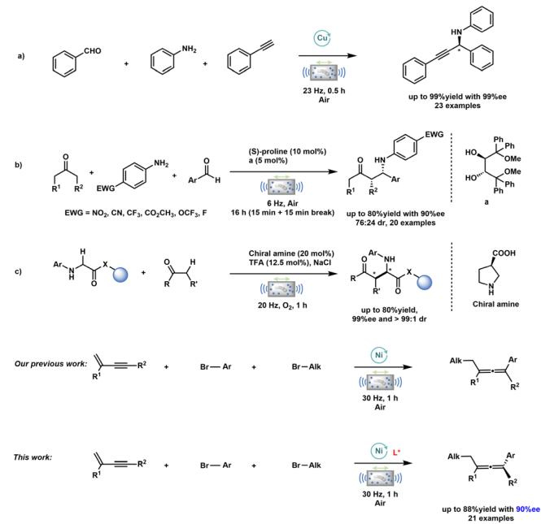
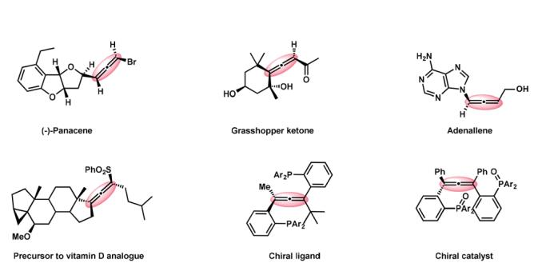
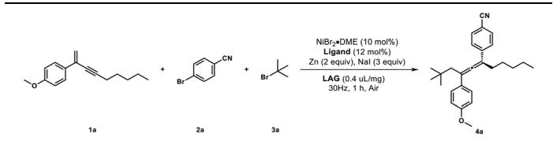
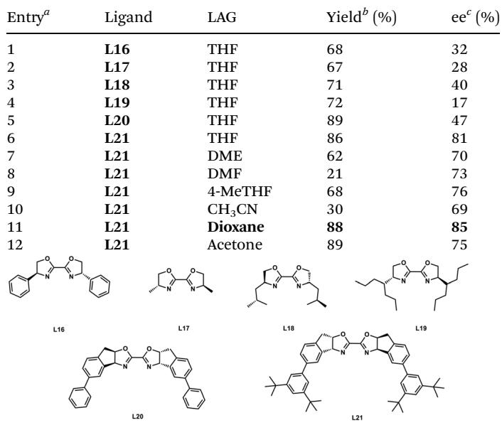
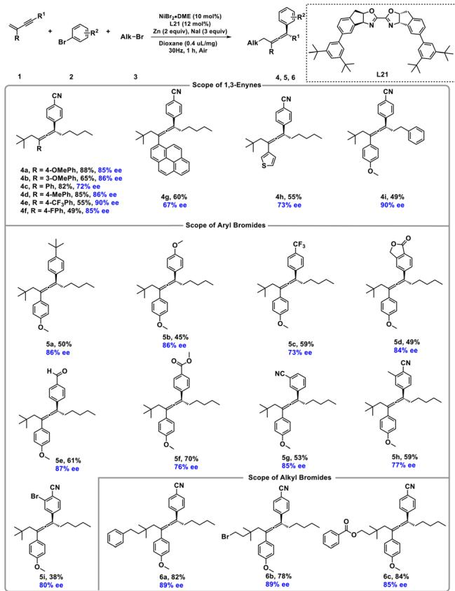
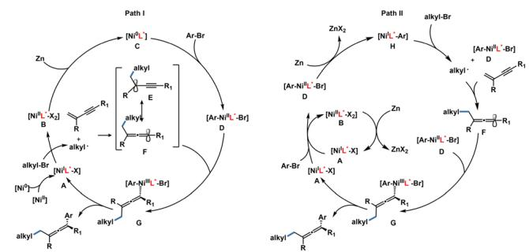

COMMUNICATION

View Article Online View Journal | View Issue

Check for updates

Cite this: Org Biomol Chem , 2025, 23, 7401

Received 19th May 2025, Accepted 7th July 2025

DOI: 10.1039/d5ob00829h

# Ball-milling-mediated remote asymmetric reductive coupling in air†

Hao Lei,a,b,c Yufang Yang,d Jiajia Sun,d Shu Fan,e Xiaofeng Wei, \*‡d Siyuan Wang,\*c Hai-Shu Lin\*c and Yan Kang\*f

rsc.li/obc

Dicarbofunctionalization reactions of unsaturated systems via radical relay strategies are crucial for the eficient synthesis of complex molecules. Mechanochemical synthesis ofers a compelling alternative to traditional solvent-based methods, providing advantages such as straightforward operation, shorter reaction times, minimal solvent use, and simplified workup. Although racemic two- and three-component solid-state cross-coupling reactions have seen significant advancements, the development of their catalytic asymmetric counterparts remains notably limited. In this study, we report a mechanochemical protocol for an asymmetric three-component radical reductive coupling reaction. Leveraging this approach, we successfully synthesized the target products in yields ranging from moderate to excellent (49%–88%) and achieved enantioselectivities of up to 90%. Notably, this is the first reported example of a nickel-catalyzed asymmetric reductive cross-coupling reaction under mechanochemical conditions, thereby expanding the frontiers of asymmetric synthesis within the realm of mechanochemistry.

## Introduction

Mechanochemistry, which directly harnesses mechanical energy to drive chemical reactions,1 ofers unique synthetic opportunities by circumventing issues related to solubility. This approach has unlocked new chemical reactivities2–6 and selectivity,7,8 enabling diverse transformations. Classical organic reactions such as Buchwald–Harting,9,10 Negishi coupling,11 Friedel–Crafts,12 Suzuki–Miyaura13–16 and cross-electrophile coupling17 have been successfully adapted to mechanochemical conditions. However, the application of ball milling in asymmetric organic synthesis remains limited, with previous eforts focused primarily on condensation, addition and substitution reactions.18 For instance, Su and colleagues demonstrated a Cu(II)-pybox catalyzed asymmetric threecomponent reaction under ball-milling conditions, showcasing the recovery and reuse of the chiral catalytic system19 (Fig. 1a). Similarly, a ball-milling-enabled asymmetric three-component Mannich reaction highlighted the method’s potential to accelerate reactions and eficiently control enantioselectivity20 (Fig. 1b). Additionally, a mechanochemical asymmetric crossdehydrogenative coupling reaction provided a green and eficient approach for the rapid synthesis of chiral α-alkyl α-amino acids21 (Fig. 1c). In our previous work, we established a nickel-catalyzed 1,4-alkylarylation of 1,3-enynes under mechanochemical conditions, providing a versatile route for synthesizing tetrasubstituted allenes22 (Fig. 1).

Chiral allenes, featuring a cumulative diene system within their structures, exhibit axial chirality in the presence of diferent substituents at the two termini. Notably, axial chiral allenes exist widely in natural products and bioactive molecules. Meanwhile, they also serve as dynamic synthons and catalysts, significantly broadening the scope of organic synthesis23,24 (Fig. 2). Thus, the synthesis of axially chiral and optically active allenes with multi-substituted stereocenters has become the focus of modern organic chemistry.

Over the past decade, significant progress has been made in the synthesis of optically active, axially chiral allenes featuring polysubstituted stereocenters, further expanding the synthetic toolbox for such complex molecular architectures.25–30 Despite significant advances, the construction of a single chiral tetrasubstituted allene center remains a formidable challenge in asymmetric synthesis.31–35 Building on our previous work on the synthesis of tetrasubstituted allenes, we envisioned a strategy to achieve single chiral center formation through the structural modulation of chiral ligands. This breakthrough extends the scope of mechanochemistry into the realm of asymmetric nickel-catalyzed reductive coupling, ofering new opportunities for exploration and innovation in this emerging field.

  
Fig. 1 Utilization of ball milling in asymmetric organic synthesis.

  
Fig. 2 Selected examples of natural products, bioactive molecules and synthetic catalysts containing chiral allenes.

## Results and discussion

All mechanochemical reactions were conducted in a Retsch MM500 mill (stainless-steel milling jar; 30 Hz; stainless-steel balls). As a proof of concept, we began the exploration of the reaction using 1,3-enyne (1a) and selected the commercially available 4-bromobenzonitrile 2a and tert-butyl bromide 3a as the model substrates. These were added, along with other additives, into a 1.5 mL stainless-steel milling jar containing one grinding ball (stainless steel, diameter: 5.0 mm) under ambient air conditions. Based on our previous work and the reported literature,22,36 our study commenced with the investigation of several ligands with diferent skeletons. To our disappointment, no desired product 4a was detected in the presence of ligands L1–L10 and both starting materials remained unreacted (Table S1, entries 1–10†). We then explored the performance of other chiral bisphosphine ligands, chiral monooxazoline ligands and chiral BOX ligands (Table S1†). The use of L20 greatly improved the reactivity and aforded 4a in 89% yield with 47% ee (Table 1, entry 5). Afterward, structural modifications of ligand L20 led to the development of L21. It was found that L21 could significantly enhance the enantiomeric excess (ee) value of 4a, albeit with a certain degree of reduction in the yield (Table 1, entry 6). Subsequent investigations into the liquid-assisted grinding (LAG, Table S1, entries 21–36†) efect confirmed that solvent polarity and structure significantly influence both reaction yield and enantioselectivity (ee). Dioxane aforded the highest yield (88%) and enantioselectivity (85% ee). Acetone provided the maximum yield (89%) but with a lower ee (75%). Moderatepolarity solvents tetrahydrofuran (THF) and 2-methyltetrahydrofuran (4-MeTHF) gave yields of 86% (81% ee) and 68% (76% ee), respectively. High-polarity solvents dimethylformamide (DMF), acetonitrile $( \mathrm { C H } _ { 3 } \mathbf { C N } ) ,$ and methanol (MeOH) resulted in significantly reduced yields (21%, 30%, 43%) while maintaining ee values between 69% and 74%. Low-polarity solvents (cyclohexane, toluene, trifluorotoluene $\left( \mathrm { C F } _ { 3 } \mathrm { P h } \right) )$ and water produced no detectable product. Dichloromethane (DCM) and methyl tert-butyl ether (MTBE) performed poorly, afording 12% (63% ee) and 19% (83% ee) yields, respectively. Ethyl acetate (EA), 1,2-dimethoxyethane (DME), and tetrahydropyran (THP) showed intermediate results, afording 55% (78% ee), 62% (70% ee), and 55% (79% ee) yields. Notably, the polarity and molecular structure of LAG emerged as core factors governing yield and ee. Moderatepolarity solvents with adaptive structures were critical for achieving eficient conversion and excellent chiral control, as evidenced by the dioxane-mediated results. Subsequent comparison with traditional solution reactions revealed no significant variation in ee values, whereas the product yield obtained from the 24 hour reaction at 1 M concentration was notably lower than that obtained from the 1 hour ball milling reaction (Table S1, entries 26 and 37–40†). This highlights that ball milling can significantly accelerate the reaction process. No significant change in ee values was observed when the additives were changed (Table S2†).

Table 1 Optimization of ligands and LAGs  

  
a The reactions were carried out with 0.2 mmol 4-bromobenzonitrile in a stainless-steel ball-milling jar (1.5 mL) with a stainless-steel ball (5 mm). b Isolated yield. c The ee values were determined by HPLC analysis.

Upon the establishment of the optimized reaction conditions, we initiated an exploration into the substrate scope of 1,3-enynes applicable to the 1,4-alkylarylation reaction (Fig. 3). The alkene C2-aryl substituent demonstrated excellent tolerance, regardless of its electronic nature (neutral, electron-withdrawing, or electron-donating). Under standard conditions, these substrates aforded tetrasubstituted allenes (4a–4h) in 49–88% yields with 67–90% ee. Notably, the consistently high stereoselectivities across electronically diverse substrates suggest that the reaction mechanism is relatively insensitive to both steric and electronic efects at this position. When the linear alkane on $\mathbf { R } ^ { 1 }$ of 1,3-enyne (4a) was replaced with a sterically hindered group, the resulting allene product (4i) was obtained in moderate yield (49%) with good enantioselectivities (90% ee), presumably due to steric hindrance. Next, we evaluated the scope of aryl bromides in this protocol. When the cyano group was replaced with other functional groups, it was found that tert-butyl, methoxy, trifluoromethyl, ester, formyl, meta-cyano, and para- and meta-polysubstituted groups were compatible under the standard conditions (5a–5i, with yields of 38–70% and 73–87% ee). Additionally, various tertalkyl bromides bearing aryl, primary alkyl bromide or ester substituents delivered the corresponding products in excellent yields (6a–6c, 78–84%) with good enantioselectivities (85–89% ee).

Based on our previous results and literature reports,22,37,38 two plausible mechanisms are proposed, as outlined in Fig. 4. Path I: the reaction begins with the formation of a $\mathrm { N i } ^ { \mathrm { I } }$ species [NiIL\*X] (A). This species reacts with the tertiary alkyl bromide via a single electron transfer (SET) pathway to produce $\big [ \mathrm { N i } ^ { \mathrm { I I } } \mathrm { L } ^ { \ast } \mathrm { X } _ { 2 } \big ]$ (B). Simultaneously, the generated tertiary alkyl radical undergoes radical addition with 1,3-enyne to form the propargyl radical E, which tautomerizes to yield the allenyl radical F. Complex B is reduced by zinc to generate the nickel (0) complex $[ \mathrm { N i } ^ { 0 } \mathbf { L } ^ { \ast } ]$ (C), which then undergoes oxidative addition with aryl bromide to form the $\mathbf { N i } ^ { \mathrm { { I I } } }$ complex $\begin{array} { r } { \big [ \mathbf { A r - N i } ^ { \mathrm { { I I } } } \mathbf { L } ^ { \ast . } } \end{array}$ Br] (D). The combination of D and F produces the key chiral intermediate $\mathbf { N i } ^ { \mathrm { I I I } }$ complex G. Finally, the reductive elimination of G yields the chiral allene product and regenerates [NiIL\*X] (A). Path II: a bimolecular oxidative addition of [NiIL\*X] (A) with aryl bromides initiates the reaction to provide D, wherein complex A is regenerated by the reduction of nickel(II) complex B with zinc. Thereafter, reduction of D with zinc afords the aryl-nickel(I) complex (H), which reacts with tertiary alkyl bromide via a SET pathway to produce D and the tertiary alkyl radical. As before, alkyl radical F is generated from 1,3-enyne and the tertiary alkyl radical. Combination of D and F provides the pivotal chiral intermediate G. Finally, reductive elimination of G afords the chiral product and regenerates A. These mechanistic insights highlight the role of chiral ligands in controlling the reactions of chiral key intermediates and chiral products, further validating the proposed catalytic cycle.

  
Fig. 3 Substrate scope of 1,3-enynes, aryl bromides and tertiary alkyl bromides. Reaction conditions: under an air atmosphere, 1 (0.15 mmol), 2 (0.10 mmol), 3 (0.25 mmol), ${ \mathsf { N i B r } } _ { 2 } { \cdot } { \mathsf { D M E } }$ (10 mol%), L21 (12 mol%), Zn (2.0 equiv.), NaI (3.0 equiv.) and dioxane (0.4 µL mg−1) were placed in a ball milling vessel (stainless, 1.5 mL) loaded with one grinding ball (stainless, diameter: 5.0 mm). Subsequently, the vessel was closed and placed in the ball mill (Retsch MM500, 30 Hz, 1.0 h). Isolated yields are reported. The ee values were determined by HPLC analysis.

  
Fig. 4 Proposed mechanistic pathway.

## Conclusions

In summary, we have developed an eficient synthetic route for asymmetric tetrasubstituted allenes, demonstrating the successful application of mechanochemistry in asymmetric nickel-catalyzed reductive coupling reactions. This study is the first report of an asymmetric three-component nickel-catalyzed reductive coupling reaction using ball-milling techniques. While the enantioselectivities obtained represent significant progress for this challenging transformation, ongoing eforts are focused on further optimization of ee values through ligand design and reaction engineering. Overall, this innovative mechanochemical protocol provides a more eficient and practical approach for asymmetric radical reductive coupling, with significant potential for a wide range of applications in organic synthesis.

## Author contributions

Hao Lei: investigation; conceptualization; methodology; and writing – original draft. Yufang Yang: methodology. Jiajia Sun: methodology. Shu Fan: methodology. Xiaofeng Wei: formal analysis; supervision; and writing – review & editing. Siyuan Wang: investigation; methodology; and project administration. Hai-Shu Lin: project administration and writing – review & editing. Yan Kang: conceptualization; project administration; supervision; and writing – review & editing.

## Conflicts of interest

There are no conflicts to declare.

## Data availability

The data supporting this article have been included as part of the ESI.†

## Acknowledgement

We thank the Natural Science Foundation of Top Talent of SZTU (grant No. GDRC202122), Featured Innovation Foundation of Ordinary Higher Education Institutions of Guangdong Province (grant No.2021KTSCX112), High-Level Introduction Plan of Shaanxi Province (71240000000111), Natural Science Foundation of Shaanxi Province (2022JM-085, 2022JQ-121), the start-up funds from Xi’an Jiaotong University (XJTU).

## References

1 S. L. James, C. J. Adams, C. Bolm, D. Braga, P. Collier, T. Friscic, F. Grepioni, K. D. M. Harris, G. Hyett, W. Jones, A. Krebs, J. Mack, L. Maini, A. G. Orpen, I. P. Parkin, W. C. Shearouse, J. W. Steed and D. C. Waddell, Chem. Soc. Rev., 2012, 41, 413–447; S. L. James, C. J. Adams, C. Bolm, D. Braga, P. Collier, T. Friscic, F. Grepioni, K. D. M. Harris, G. Hyett, W. Jones, A. Krebs, J. Mack, L. Maini, A. G. Orpen,

2 J.-L. Do, C. Mottillo, D. Tan, V. Štrukil and T. Friščić, J. Am. Chem. Soc., 2015, 137, 2476–2479.

3 R. Takahashi, T. Seo, K. Kubota and H. Ito, ACS Catal., 2021, 11, 14803–14810.

4 P. Gao, J. L. Jiang, S. Maeda, K. Kubota and H. Ito, Angew. Chem., Int. Ed., 2022, 61, e202207118.

5 E. Juaristi and C. G. Avila-Ortiz, Synthesis, 2023, 2439–2459.

6 S. S. Chen, C. Y. Fan, Z. J. Xu, M. Y. Pei, J. M. Wang, J. Y. Zhang, Y. L. Zhang, J. Y. Li, J. L. Lu, C. Peng and X. F. Wei, Nat. Commun., 2024, 15, 769.

7 J. G. Hernandez and C. Bolm, J. Org. Chem., 2017, 82, 4007–4019.

8 J. L. Howard, M. C. Brand and D. L. Browne, Angew. Chem., Int. Ed., 2018, 57, 16104–16108.

9 Q. L. Shao, Z. J. Jiang and W. K. Su, Tetrahedron Lett., 2018, 59, 2277–2280.

10 Q. Cao, W. I. Nicholson, A. C. Jones and D. L. Browne, Org. Biomol. Chem., 2019, 17, 1722–1726.

11 Q. Cao, J. L. Howard, E. Wheatley and D. L. Browne, Angew. Chem., Int. Ed., 2018, 57, 11339–11343.

12 M. Đud, A. Briš, I. Jušinski, D. Gracin and D. Margetić, BeilsteinJ. Org. Chem., 2019, 15, 1313–1320.

13 Z. J. Jiang, Z. H. Li, J. B. Yu and W. K. Su, J. Org. Chem., 2016, 81, 10049–10055.

14 T. Seo, T. Ishiyama, K. Kubota and H. Ito, Chem. Sci., 2019, 10, 8202–8210.

15 G. Báti, D. Csókás, T. Yong, S. M. Tam, R. R. S. Shi, R. D. Webster, I. Pápai, F. García and M. C. Stuparu, Angew. Chem., Int. Ed., 2020, 59, 21620–21626.

16 T. Seo, K. Kubota and H. Ito, J. Am. Chem. Soc., 2020, 142, 9884–9889.

17 A. C. Jones, M. T. J. Williams, L. C. Morrill and D. L. Browne, ACS Catal., 2022, 12, 13681–13689.

18 I. N. Egorov, S. Santra, D. S. Kopchuk, I. S. Kovalev, G. V. Zyryanov, A. Majee, B. C. Ranu, V. L. Rusinov and O. N. Chupakhin, Green Chem., 2020, 22, 302–315.

19 Z. H. Li, Z. J. Jiang and W. K. Su, Green Chem., 2015, 17, 2330–2334.

20 X. Hu, K. Li and H. Yu, Org. Biomol. Chem., 2023, 21, 6348– 6355.

21 J. Yu, H. Chen, Z. Zhang, Y. Fang, T. Ying and W. Su, Green Chem., 2024, 26, 6570–6577.

22 H. Lei, B. B. Wang, Y. F. Yang, S. Fan, S. Y. Wang and X. F. Wei, Org. Lett., 2024, 26, 7688–7694.

23 P. Rivera-Fuentes and F. Diederich, Angew. Chem., Int. Ed., 2012, 51, 2818–2828.

24 B. Alcaide and P. Almendros, Chem. Soc. Rev., 2014, 43, 2886–2887.

25 T. Hashimoto, K. Sakata, F. Tamakuni, M. J. Dutton and K. Maruoka, Nat. Chem., 2013, 5, 240–244.

26 C. T. Mbofana and S. J. Miller, J. Am. Chem. Soc., 2014, 136, 3285–3292.

27 G. Wang, X. H. Liu, Y. S. Chen, J. Yang, J. Li, L. L. Lin and X. M. Feng, ACS Catal., 2016, 6, 2482–2486.

28 A. Tap, A. Blond, V. N. Wakchaure and B. List, Angew. Chem., Int. Ed., 2016, 55, 8962–8965.

29 Y. Hu, W. Shi, B. Zheng, J. Liao, W. Wang, Y. Wu and H. Guo, Angew. Chem., Int. Ed., 2020, 59, 19820–19824.

30 Y. Y. Zhang, J. Wu, L. C. Ning, Q. P. Chen, X. M. Feng and X. H. Liu, Sci. China: Chem., 2023, 66, 526–533.

31 X. Wang, X. L. Chen, W. Lin, P. F. Li and W. J. Li, Adv. Synth. Catal., 2022, 364, 1212–1222.

32 W. F. Zheng, W. L. Zhang, C. F. Huang, P. L. Wu, H. Qian, L. Wang, Y. L. Guo and S. Ma, Nat. Catal., 2019, 2, 997– 1005.

33 Y. Liao, X. Yin, X. Wang, W. Yu, D. Fang, L. Hu, M. Wang and J. Liao, Angew. Chem., Int. Ed., 2019, 59, 1176–1180.

34 X. G. Li and J. W. Sun, Angew. Chem., Int. Ed., 2020, 59, 17049–17054.

35 X. Y. Dong, T. Y. Zhan, S. P. Jiang, X. D. Liu, L. Ye, Z. L. Li, Q. S. Gu and X. Y. Liu, Angew. Chem., Int. Ed., 2020, 60, 2160–2164.

36 J. Z. Du, A. Y. Liu, W. Zhang, S. Luo, H. Q. Yao and Y. L. He, ACS Catal., 2024, 14, 13940–13946.

37 C. Y. Fan, B. B. Wang, T. L. Wu, Q. C. Kang, H. S. Wang, J. J. Sun and X. F. Wei, Cell Rep. Phys. Sci., 2024, 5, 101831.

38 Y. Z. Li, N. Rao, L. An, X. L. Wan, Y. X. Zhang and X. G. Zhang, Nat. Commun., 2022, 13, 5539.