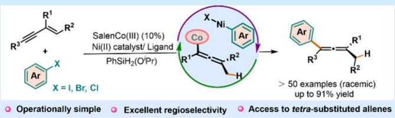
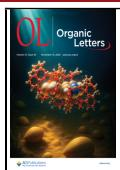
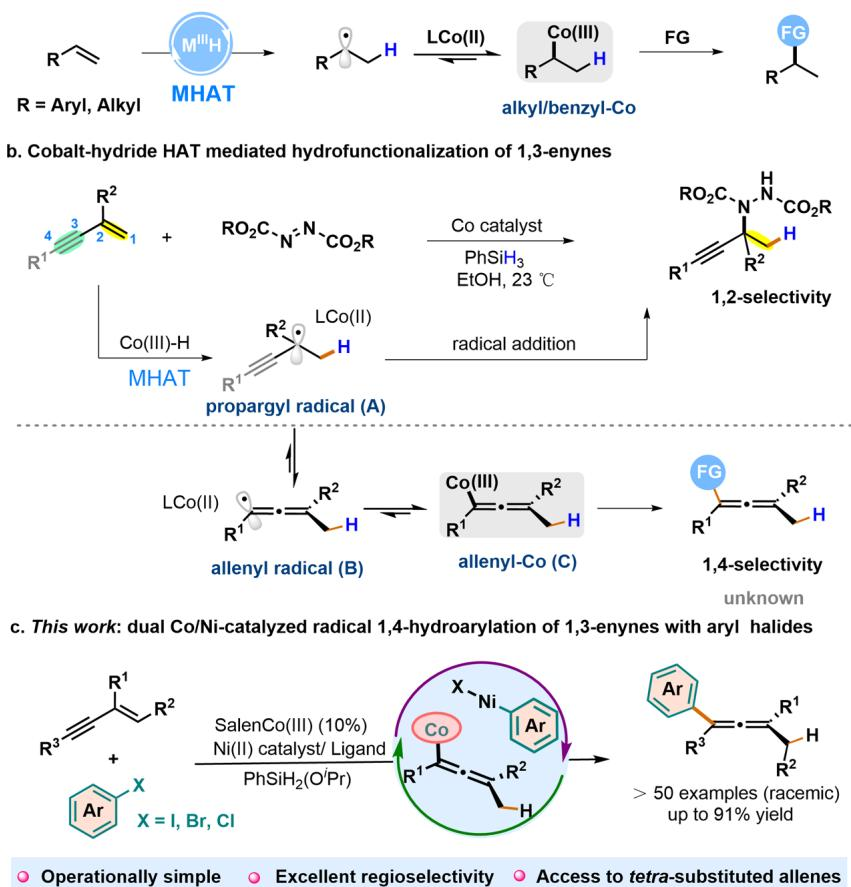
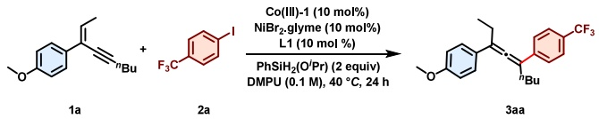
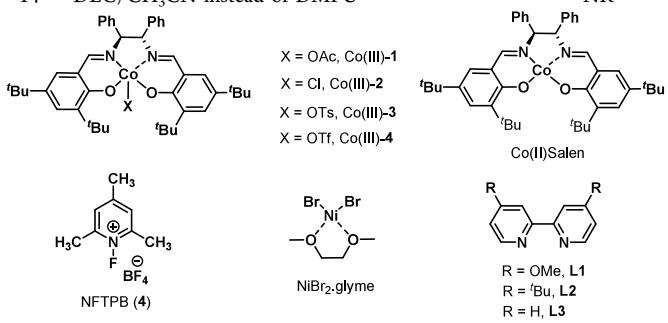
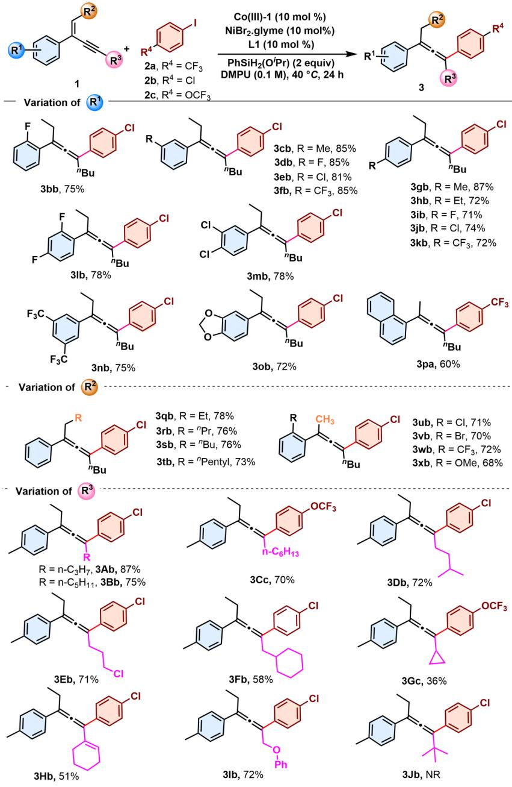
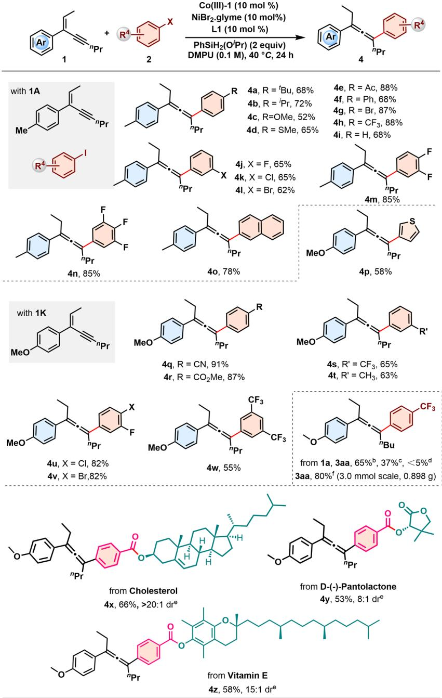
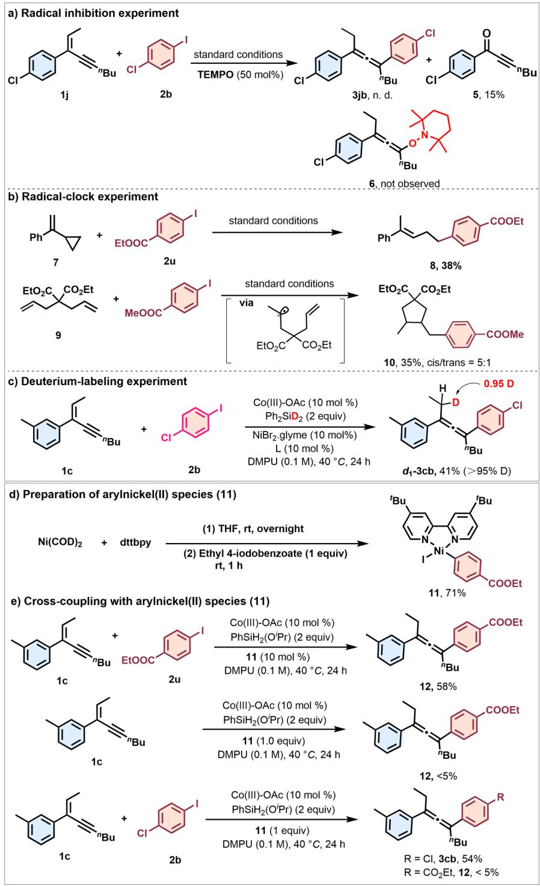
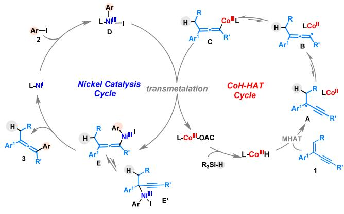

pubs.acs.org/OrgLett

Letter

# Dual-Co/Ni-Catalyzed Radical Hydroarylation of 1,3-Enynes: Selective Access to Tetrasubstituted Allenes

Qi Meng, Ting Yin, Zhimeng Song, Dongliang Zhang, Ge Zhang,\* and Qian Zhang

Cite This: Org. Lett. 2025, 27, 12434−12441

Read Online

## ACCESS

Metrics & More

ABSTRACT: Metal hydride hydrogen atom transfer (MHAT) has emerged as a powerful strategy for alkene hydrofunctionalization, ofering exceptional control over regio- and chemoselectivity. However, conventional MHAT reactions with 1,3-enynes remain limited to the 1,2-addition pathway. Herein, we report a regioselective 1,4-hydroarylation of 1,3-enynes with various aryl halides enabled by dual cobalt and nickel catalysis. This

Article Recommendations

  
transformation proceeds through cobalt(III)-H-mediated HAT to the 1,3-enynes, followed by nickel-catalyzed cross-coupling with aryl halides, delivering a wide range of tetrasubstituted allenes in good to excellent yields. This work expands the scope of Co(III)H-mediated radical hydrofunctionalization reactions and ofers a modular strategy for constructing valuable, highly substituted allene building blocks.

H ydrofunctionalization of unsaturated hydrocarbons con- stitutes one of the most crucial reactions in organic synthesis, which allows for the conversion of simple olefins or alkynes into more complex and diverse compounds, thus facilitating the development of novel materials, pharmaceuticals, and various other valuable products.1,2 In particular, the first-row transition-metal (e.g., Fe, Mn and Co)-catalyzed metal-hydride hydrogen atom transfer (MHAT) reactions serve as a highly chemoselective means for Markovnikov hydrofunctionalization of alkenes and have witnessed remarkable progress.3 Intermediate carbon-centered radicals derived from MHAT exhibit versatile reactivity, with recent advances highlighting their synthetic potential and mechanistic versatility, including participation in classical radical transformations (e.g., atom/group transfer and addition to unsaturated bonds)4,5 as well as subsequent oxidation or reduction to However, in contrast to the well-developed hydrofunctional ization of simple styrene and unactivated alkenes, MHATinitiated hydrofunctionalization of 1,3-enynes�versatile synthons featuring both alkenyl and alkynyl moieties�remains elusive and underexplored.9 Such dificulty is unsurprising, given the inherent challenges associated with the regiochemical complexity, multiple possibilities, and potential overreactions that exist as competing pathways that hinder the achievement of high regioselectivity.10 Seminal work by Carreira demonstrated that cobalt(III)-hydride-initiated MHAT enables selective hydrohydrazination of enynes, in which the propargyl radical A generated in situ was directly addition to azodicarboxylates, delivering a series of propargylic hydrazines in useful yields (Scheme 1b).9 Despite recently there have been relevant attempts to test the feasibility of enyne in MHAT reactions, successful functionalization has thus far been confined to the 1,2-addition paradigm with alkynyl retention.7c In contrast, direct 1,4-hydrofunctionalization�a highly desirable route to synthetically valuable allene derivatives11 remains underexplored.

Recent works including our own have unveiled MHATmediated hydrofunctionalizations of 1,3-dienes, in which a regioselective 1,2- or 1,4-hydrofunctionalization can be achieved through selective hydrogen-atom transfer from the cobalt hydride species.12 Inspired by these studies and due to our continuous interest in Co(III)H-catalyzed radical reactions,8,12d we questioned whether a propargylic radical could be merged with Co(III)-H catalysis to enable 1,4-hydroarylation of enynes. We envisioned that MHAT from Co(III)- H would initiate formation of propargyl radical/cobalt(II) pairs, followed by isomerization to generate an allenylcobalt-(III) intermediate C (Scheme 1a right), which can be intercepted by catalytic organometal species such as catalytic organonickel species, that would enable direct 1,4-hydrofunctionalization of 1,3-enynes to yield multisubstituted allenes (Scheme 1b bottom). Successfully accomplishing this process would expand the utilization of organocobalt to analogous allenyl-Co(III) intermediates, significantly less explored in cobalt-catalyzed MHAT transformation. Notably, the Shenvi group creatively developed a Ni/Co(II)-catalyzed reductive coupling hydroarylation of unactivated terminal alkenes through an unprecedented radical alkyl-Co(III) to nickel direct transmetalation.6a,13 Herein, we reported the first investigation of cobalt-hydride HAT initiated radical 1,4-hydroarylation of 1,3-enynes with aryl halides via dual Co/Ni catalysis (Scheme 1c). This reaction provides an eficient and straightforward approach to synthesize valuable allenes featuring four diferent functional group moieties in good to excellent yields.

Scheme 1. Catalytic 1,4-Hydrofunctionalization of $^ { 1 , 3 \mathrm { - } }$ -Enynes via MHAT  

We commenced this study by choosing 1-methoxy-4-(non-2-en-4-yn-3-yl)benzene (1a) and p-trifluoromethyl iodobenzene (2a) as substrates. Pleasingly, under optimized conditions using CoIII(Salen) complex [Co(III)-1] as catalyst, NiBr · glyme and 4-methoxyl-substituted bpy (L1) as cocatalyst, and PhSiH (OiPr) as the hydride source in DMPU at 40 ${ } ^ { \circ } \mathrm { C } ,$ the desired allene 3aa was obtained in 93% yield (entry 1, Table 1). Control experiments established the critical roles of each reaction component (entries 2−4). Notably, no product was observed in the absence of silanes, demonstrating their essential function in facilitating Co(III)-mediated MHAT reactions and potentially generating catalytically active Ni−H species (entry 4). Based on the previous works reported by Shenvi,6a we employed NFTPB (4) as an extra oxidant in combination with catalytic Co(II)Salen complex, which efectively facilitates the conversion of Co(II) to Co(III) and sustains the cobalt catalytic $\mathrm { c y c l e } , ^ { 7 }$ afording the desired product 3aa in 65% yield (entry 5). In comparison, the direct use of the Co(III)Salen complex is more efective and can avoid the requirement for stoichiometric oxidants. Other silanes, such as TMDSO and $\mathrm { P h } S \mathrm { i H } _ { 3 } ,$ were also efective in facilitating the reaction, albeit with decreased yields (entries $^ { 6 , }$ 7). Switching the Co(III)-1 to its analogue Co(III)-3 or

Co(III)-4 also gave allene 3aa in 35−42% yield, but the utilization of Co(III)-2 failed to deliver 3aa (entries 8, 9). The use of other nickel catalysts and ligands in place of NiBr · glyme/L1 gave acceptable results (entries 10−13). When employing other solvents, such as CH CN and DCE, all failed to deliver the desired product (entry 14).

With the optimized reaction conditions in hand, we next investigated the scope of allene synthesis with respect to the substituents (R1−R3) on enynes (Scheme 2). As for the substituent R1 on the aryl moiety, the method was suitable for installing various electron-donating and electron-withdrawing substituents, including methoxy, alkyl, fluoro, chloro, and trifluoromethyl, all of which were conveniently transformed to the expected tetrasubstituted allene products 3bb−3kb in good to excellent yields. The process was not detrimentally influenced by the position (o-, m-, p-) of the substituent on the phenyl ring; even ortho-substitution, which was regarded as having a certain steric hindrance, can deliver the expected products with outstanding yields. Similarly, the reaction of disubstituted aryl (for 3lb−3nb) as well as electron-rich arene (for 3ob) and naphthalene (for 3pa) substituted 1,3-enynes also proceeded smoothly to aford allenes in good yields. In addition, the present transformation was not disturbed by the substituent $\mathrm { R } ^ { 2 }$ tethered to the alkene moiety. It was shown that a variety of enynes having an internal substituent $\mathbb { R } ^ { 2 }$ on the alkene motif, providing desired products 3qb−3tb in 73−78% yields. Besides the R2-substituted internal alkenes, employing a terminal alkene moiety also performed well (see 3ub−3xb). As for $\mathbb { R } ^ { 3 }$ tethered on the alkynyl moiety, alkyl groups with diferent lengths (for 3Ab−3Db), functionalized primary alkyl groups (for 3Eb and 3Fb), and sterically bulkier cycloalkyl groups (for 3Gc) and cyclohexenyl (3Hb) as well as ether (3Ib) groups could be installed, delivering the corresponding tetrasubstituted allenes in moderate to good yields. The tertbutyl-substituted 1,3-enyne failed to yield 3Jb, likely due to excessive steric hindrance.

Table 1. Optimization of the Reaction Conditions
<table><tr><td rowspan="2"></td><td rowspan="2"></td><td></td></tr><tr><td></td></tr><tr><td>entry</td><td>variation of reaction conditions</td><td>yield (%)ª</td></tr><tr><td>1</td><td>none</td><td>93 (89)b</td></tr><tr><td>2</td><td> $\mathbf { w } / \mathbf { o } \ \lbrack \mathbf { C o } \rbrack - \mathbf { 1 }$ </td><td>28 n.d.</td></tr><tr><td>3</td><td> $\mathbf { w } / \mathbf { o } \ N i \mathbf { B r } _ { 2 } . \mathbf { g } \mathrm { l y m e / { L 1 } }$ </td><td>n.d.</td></tr><tr><td>4 5c</td><td> $\mathbf { w } / { \circ } \mathrm { \ P h S i H _ { 2 } } ( \mathrm { O ^ { ' } P r } )$  With 20% Co(II)Salen and 0.5 equiv of NFTPB instead</td><td>65</td></tr><tr><td></td><td>of 10% Co(Salan)-OAc</td><td></td></tr><tr><td>6</td><td>TMDSO instead of PhSiH2(OiPr)</td><td>40</td></tr><tr><td>7</td><td>PhSiH3 instead of PhSiH2(OiPr)</td><td>19</td></tr><tr><td>8</td><td>With [Co]-2 instead of [Co]-1</td><td>trace</td></tr><tr><td>9</td><td>With [Co]-3 or [Co]-4</td><td>35-42 59</td></tr><tr><td>10</td><td>NiCl2·glyme instead of NiBr2·glyme</td><td>35</td></tr><tr><td>11</td><td>NiBr2 instead of NiBr2·glyme</td><td></td></tr><tr><td>12</td><td>With L2 instead of L-1</td><td>85</td></tr><tr><td>13</td><td>With L3 instead of L-1</td><td>55</td></tr></table>

  
aUnless otherwise noted, the reactions were carried out using 1,3- enkyne 1a (0.1 mmol), p-trifluoromethyl iodobenzene 1b (0.3 mmol, 3 equiv), PhSiH (OiPr) (0.2 mmol, 2.0 equiv), Co(Salan) (10 mol %), NiBr .glyme (10 mol %), and 4,4′-dimethoxy-2,2′-bipyridine (10 mol %) in 1.0 mL of dry DMPU at 40 °C for 24 h. Yield of 3aa as determined by 19F NMR with benzotrifluoride as an internal standard. bIsolated yield. cCo(II)Salen catalyst (20 mol %) was used. DMPU = N,N′-dimethylpropyleneurea. $\mathrm { T M D S O } ~ = ~ 1 , 1 , 3 , 3$ -tetramethyldisiloxane.

The reaction scope was then extended to various aryl electrophilic reagents (Scheme 3). A wide array of aryl iodides, including those with electron-donating or electron-withdrawing groups, underwent smooth coupling with 1,3-enyne to deliver allene products 4a−4i in good to excellent yields. Substrates with multiple fluorine substituents (4m, 4n), heteroaryl iodides (4o, 4p), and diverse meta- or disubstituted arenes including electron-deficient 3,5-bis(trifluoromethyl)- iodobenzene (4j−4l, 4s−4w) all reacted smoothly to deliver products in high yields. For broader synthetic interests, 4-CNand 4-COOMe-substituted iodobenzenes were also viable to deliver the corresponding allene products 4q and 4r with yields of 91% and 87%, respectively. In contrast, an alkyl iodide failed to couple and led to only partial oxidation of 1,3-enyne. Substrate evaluation beyond aryl iodides revealed that bromo and chloro arenes were also viable coupling partners, afording 3aa in 65% and 37% yield, respectively, whereas aryl triflates failed to react. Furthermore, the synthetic utility was demonstrated on a 3.0 mmol scale, delivering 3aa in 80% yield. Moreover, some bioactive molecules, such as cholesterol, D-(−)-pantolactone, and structurally more complicated vitamin E-derivated aryl iodides were conveniently transformed to the corresponding allene products 4x−4z in good yields, which demonstrated that this method would be suitable for late-stage functionalization of complicated molecules.

A series of experiments were performed to probe the reaction mechanism (Scheme 4). First, the introduction of a stoichiometric amount of $^ { 2 , 2 , 6 , 6 }$ -tetramethylpiperidine-1-oxyl (TEMPO) significantly attenuated the transformation, while no TEMPO-trapped product 6 was detected (Scheme 4a). In contrast, a “radical-clock” experiment with (2- vinylcyclopropyl)benzene 7 led to ring-opened product 8 in 38% yield (Scheme 4b). In addition, diene 9 underwent cyclization to give product 10 with 35% yield and 5:1 dr (Scheme 4b). These phenomena reveal a radical mechanism, which was further corroborated by the detection of a minor coupling byproduct derived from propargyl radical and allenyl radicals (see SI for details). A deuterium labeling experiment using $\mathrm { P h } _ { 2 } \mathrm { S i D } _ { 2 } \left( > 9 5 \% \mathrm { D } \right)$ aforded $d _ { \mathrm { 1 } } ^ { \mathrm { ~ ~ } }$ -3cb with 0.95 D exclusive incorporation at the alkene terminus, confirming the silane as the hydrogen source and supporting a CoH-mediated MHAT pathway (Scheme 4c).

To identify the active organometallic species in this crosscoupling process, the isolable nickel(II) oxidative addition intermediate 11 was synthesized (Scheme 4d) and evaluated in control experiments.14 When complex 11 was employed as the nickel precatalyst in the reaction of 1,3-enyne (1c) with ethyl 4-iodobenzoate (2u) under standard conditions, allene 12 was obtained in 58% yield (Scheme 4e, eq 1). In contrast, a stoichiometric reaction of 11 with 1c in the absence of aryl iodide aforded only trace amounts of 12 (<5% yield, eq 2). Interestingly, when an additional 1.5 equiv of 4-chloroiodobenzene (2b) was employed as the coupling reagent, it was found that the 4-chloroaryl-substituted allene 3cb was obtained in 54% yield, but still with only 5% of product 12 originated from the “precatalyst” 11 (Scheme 4e, eq 3). The low yield of product 12 seems insuficient to support an arylnickel(II) species as a feasible intermediate in the catalytic cycle, and the mechanism that directs trapping of the propargyl/allenyl radical derived from MHAT by an arylnickel(II) species to form Ni(III) species followed by reductive elimination to form coupled products can be excluded (the aryl iodide was not consumed).15 Meanwhile, in the absence of an oxidative agent, the continuous production of Co−H is also halted. Theoretically, at most, 10% of the C−C coupling products will be formed. These results further encouraged us to consider that Ni(II) complex 11 might transform into an active Ni catalyst (e.g., Ni(I)) to prompt the reaction to occur.

Based upon collective mechanistic studies and previous related literature,6−17 a plausible reaction mechanism is proposed in Scheme 5. The catalytic cycle begins with the in situ formation of a cobalt hydride complex [Co(III)H] via transmetalation of a SalenCo(III) catalyst with silane. Then, a Co(III)H-mediated MHAT to the 1,3-enyne (1) generates the propargyl radical A, which equilibrates with the allenyl radical B and is trapped by Co(II) to form a metastable allenyl cobalt(III) species $\mathbf { C } ,$ more accurately described as an equilibrium of a cage-pair.3,17 In the nickel catalytic cycle,

## Scheme 2. Substrate Scope of 1,3-Enynea

  
aReactions were performed using 0.1 mmol of 1, 0.3 mmol of 2, 2.0 equiv $\mathrm { P h S i H } _ { 2 } \mathrm { ( O ^ { { \it i } } P r ) }$ , 10 mol % $\mathrm { C o } \big ( \mathrm { S a l a n } \big ) { - } { \bf 1 } ,$ 10 mol % NiBr .glyme, and 10 mol % 4,4′-dimethoxy-2,2′-bipyridine in 1.0 mL of dry DMPU at $4 0 ~ ^ { \circ } \mathrm { C }$ for 24 h.

the NiBr ·glyme/L1 catalyst initially generates the catalytically active LNi(I) species, which undergoes oxidative addition with aryl iodide 2 to aford LNi(III) intermediate D. Based on recent work by Shenvi,6a,13 a ligand transfer from allenyl cobalt(III) C to the Ni(III) complex D is proposed to occur via electron transfer/ligand transfer between the Co(III)/ Ni(III) organometallic pair within a solvent cage,13 yielding the key allenyl nickel(III) intermediate E and regenerating the Co(III) catalyst. Finally, reductive elimination of the Ar− Ni(III) E species delivers the C−C cross-coupling allene products and regenerates Ni(I), thus closing the catalytic cycle. Considering the isomerization between propargylic- and allenyl-metal species, a possible reduction elimination pathway originating from the propargylic-Ni(III)-Ar species $\mathbf { E } ^ { \prime }$ cannot be ruled out at present.

## ■ CONCLUSION

In summary, we have developed an eficient MHAT-mediated 1,4-hydroarylation of 1,3-enynes with aryl halides via synergistic cobalt/nickel catalysis. This MHAT-mediated protocol provides direct access to diverse tetrasubstituted allenes in high yields. These allene products serve as versatile synthetic platforms for further elaboration through alkene functionalization. This work expands the arsenal of MHAT reactions by merging Co−H-mediated MHAT with Nicatalyzed cross-coupling, ofering a novel strategy for allene synthesis. Studies on the mechanism and development of enantioselective variants are currently underway.

Scheme 3. Substrate Scope of Aryl Iodides  

aReactions were performed using 0.1 mmol of 1, 0.3 mmol of 2, 2.0 equiv of PhSi $\mathbf { f } _ { 2 } ( \mathbf { O } ^ { i } \mathbf { P r } )$ , 10 mol % $\mathrm { { C o } } ( \mathrm { { S a l a n } ) { - } \mathbf { 1 } }$ , 10 mol % NiBr ·glyme, and 10 mol % $^ { 4 , 4 ^ { \prime } }$ -dimethoxy-2,2′-bipyridine in 1.0 mL of dry DMPU at $4 0 { } ^ { \circ } \bar { \mathrm { C } }$ for 24 h. bUsing 1-bromo-4-(trifluoromethyl)benzene instead of 2a. cUsing 1-chloro-4-(trifluoromethyl)benzene instead of 2a. dUsing phenyl trifluoromethanesulfonate instead of 2a. eThe dr was determined by 1H NMR spectroscopy of the crude compounds. fThe reaction was conducted on a 3.0 mmol scale.

## ■ ASSOCIATED CONTENT

## Data Availability Statement

The data underlying this study are available in the published article and its Supporting Information.

## \*sı Supporting Information

The Supporting Information is available free of charge at https://pubs.acs.org/doi/10.1021/acs.orglett.5c03596.

Experimental procedures, NMR spectra, and analytical data for the products (PDF)

## ■ AUTHOR INFORMATION

## Corresponding Author

Ge Zhang − Jilin Province Key Laboratory of Organic Functional Molecular Design & Synthesis, Department of Chemistry, Northeast Normal University, Changchun 130024, China; orcid.org/0000-0002-4904-3330; Email: zhangg492@nenu.edu.cn

## Authors

Qi Meng − Jilin Province Key Laboratory of Organic Functional Molecular Design & Synthesis, Department of

Scheme 4. Mechanistic Studies  

Chemistry, Northeast Normal University, Changchun 130024, China

Chemistry, Northeast Normal University, Changchun 130024, China

Qian Zhang − Jilin Province Key Laboratory of Organic Functional Molecular Design & Synthesis, Department of Chemistry, Northeast Normal University, Changchun 130024, China; State Key Laboratory of Organometallic Chemistry, Shanghai Institute of Organic Chemistry, Chinese Academy of Sciences, Shanghai 200032, China; orcid.org/ 0000-0002-3136-841X

Complete contact information is available at: https://pubs.acs.org/10.1021/acs.orglett.5c03596

Scheme 5. Proposed Mechanism  

## Notes

The authors declare no competing financial interest.

## ■ ACKNOWLEDGMENTS

We thank the National Key R&D Program of China (2024YFA1509704), the National Natural Science Foundation of China (22171043 and 22193012), and the Fundamental Research Funds for the Central Universities Program for generous financial support.

## ■ REFERENCES

(1) Beletskaya, I. P.; Nájera, C.; Yus, M. Catalysis and regioselectivity in hydrofunctionalization reactions of unsaturated carbon bonds. Part II. Hydroamination. Russ. Chem. Rev. 2020, 89, 1074−1114.

(2) For reviews, see: (a) Chen, J.; Guo, J.; Lu, Z. Recent Advances in Hydrometallation of Alkenes and Alkynes via the First Row Transition Metal Catalysis. Chin. J. Chem. 2018, 36, 1075−1109.

(b) Li, Y.; Lu, X.; Fu, Y. Recent Advances in Cobalt-Catalyzed Regioor Stereo selective Hydrofunctionalization of Alkenes and Alkynes. CCS Chem. 2024, 6, 1130−1156.

(3) (a) Crossley, S. W. M.; Obradors, C.; Martinez, R. M.; Shenvi, R. A. Mn-, Fe-, and Co-Catalyzed Radical Hydrofunctionalizations of Olefins. Chem. Rev. 2016, 116, 8912−9000. (b) Zhang, G.; Zhang, Q. Cobalt-catalyzed HAT reaction for asymmetric hydrofunctionalization of alkenes and nucleophiles. Chem. Catal 2023, 3, 100526.

(4) For selected examples, please see: (a) Waser, J.; Nambu, H.; Carreira, E. M. Cobalt-catalyzed hydroazidation of olefins: convenient access to alkyl azides. J. Am. Chem. Soc. 2005, 127, 8294. (b) Gaspar, B.; Carreira, E. M. Mild Cobalt-Catalyzed Hydrocyanation of Olefins with Tosyl Cyanide. Angew. Chem., Int. Ed. 2007, 46, 4519−4522. (c) Shigehisa, H.; Nishi, E.; Fujisawa, M.; Hiroya, K. Cobalt-Catalyzed Hydrofluorination of Unactivated Olefins: A Radical Approach of Fluorine Transfer. Org. Lett. 2013, 15, 5158−5161.

(5) For selected examples, please see: (a) Lo, J. C.; Cui, J.; Yabe, Y.; Pan, C.-M.; Baran, P. S. Functionalized olefin cross-coupling to construct carbon−−carbon bonds. Nature 2014, 516, 343−348. (b) Li, G.; Kuo, J. L.; Han, A.; Abuyuan, J. M.; Young, L. C.; Norton, J. R.; Palmer, J. H. Radical Isomerization and Cycloisomerization Initiated by H• Transfer. J. Am. Chem. Soc. 2016, 138, 7698−7704. (c) Matos, J. L. M.; Vasquez-Cespedes, S.; Gu, J.; Oguma, T.; Shenvi, R. A. Branch-Selective Addition of Unactivated Olefins into Imines and Aldehydes. J. Am. Chem. Soc. 2018, 140, 16976−16981. (d) Shen, X.; Chen, X.; Chen, J.; Sun, Y.; Cheng, Z.; Lu, Z. Ligand-promoted cobalt-catalyzed radical hydroamination of alkenes. Nat. Commun. 2020, 11, 783. (e) Zhang, B.; He, J.; Li, Y.; Song, T.; Fang, Y.; Li, C. Cobalt-Catalyzed Markovnikov-Selective Radical Hydroacylation of Unactivated Alkenes with Acylphosphonates. J. Am. Chem. Soc. 2021, 143, 4955−4961. (f) Huang, M.; Daniliuc, C. G.; Studer, A. Iron-

catalysed radical Markovnikov hydroamidation of complex alkenes. Nat. Synth 2025, 4, 1001−1008.

(6) (a) Green, S. A.; Matos, J. L.; Yagi, A.; Shenvi, R. A. Branch-Selective Hydroarylation: Iodoarene-Olefin Cross-Coupling. J. Am. Chem. Soc. 2016, 138, 12779−12782. (b) Green, S. A.; Huffman, T. R.; McCourt, R. O.; Puyl, V.; Shenvi, R. A. Hydroalkylation of Olefins To Form Quaternary Carbons. J. Am. Chem. Soc. 2019, 141, 7709− 7714. (c) Song, L.; Fu, N.; Ernst, B. G.; Lee, W. H.; Frederick, M. O.; DiStasio Jr, R. A.; Lin, S. Dual electrocatalysis enables enantioselective hydrocyanation of conjugated alkenes. Nat. Chem. 2020, 12, 747− 754.

(7) For selected examples, please see: (a) Shigehisa, H.; Aoki, T.; Yamaguchi, S.; Shimizu, N.; Hiroya, K. Hydroalkoxylation of Unactivated Olefins with Carbon Radicals and Carbocation Species as Key Intermediates. J. Am. Chem. Soc. 2013, 135, 10306−10309. (b) Zhou, X.-L.; Yang, F.; Sun, H.-L.; Yin, Y.-N.; Ye, W.-T.; Zhu, R. Cobalt-Catalyzed Intermolecular Hydrofunctionalization of Alkenes: Evidence for a Bimetallic Pathway. J. Am. Chem. Soc. 2019, 141, 7250−7255. (c) Discolo, C. A.; Touney, E. E.; Pronin, S. V. Catalytic Asymmetric Radical-Polar Crossover Hydroalkoxylation. J. Am. Chem. Soc. 2019, 141, 17527−17532. (d) Nakagawa, M.; Matsuki, Y.; Nagao, K.; Ohmiya, H. A Triple Photoredox/Cobalt/Brønsted Acid Catalysis Enabling Markovnikov Hydroalkoxylation of Unactivated Alkenes. J. Am. Chem. Soc. 2022, 144, 7953−7959. (e) Lindner, H.; Amberg, W. M.; Carreira, E. M.; et al. Photo- and Cobalt-Catalyzed Synthesis of Heterocycles via Cycloisomerization of Unactivated Olefins. Angew. Chem., Int. Ed. 2024, 63, No. e202319515. (f) Si, Y.; Liu, Y.; Zhou, F.; Fang, L.; Wu, K.; Luan, Y.-X.; Chen, L.; Tang, P. Cobalt-Catalyzed Enantioselective Hydrotrifluoromethoxylation of Aromatic Alkenes. Angew. Chem., Int. Ed. 2025, 64, No. e202501680.

(8) (a) Qin, T.; Lv, G.; Meng, Q.; Zhang, G.; Xiong, T.; Zhang, Q. Cobalt-Catalyzed Radical Hydroamination of Alkenes with N-Fluorobenzenesulfonimides. Angew. Chem., Int. Ed. 2021, 60, 25949−25957. (b) Qin, T.; Lv, G.; Miao, H.; Guan, M.; Xu, C.; Zhang, G.; Xiong, T.; Zhang, Q. Cobalt-Catalyzed Asymmetric Alkylation of (Hetero)Arenes with Styrenes. Angew. Chem., Int. Ed. 2022, 61, No. e202201967. (c) Miao, H.; Guan, M.; Xiong, T.; Zhang, G.; Zhang, Q. Cobalt-Catalyzed Enantioselective Hydroamination of Arylalkenes with Secondary Amines. Angew. Chem., Int. Ed. 2023, 62, No. e202213913. (d) Meng, Q.; Qin, T.; Miao, H.; Zhang, G.; Zhang, Q. Cobalt(III) hydride HAT mediated enantioselective intramolecular hydroamination access to chiral pyrrolidines. Sci. China Chem. 2024, 67, 2002−2008. (e) Guan, M.; Zhu, L.; Wang, Y.; Zhang, G.; Miao, H.; Chen, B.; Zhang, Q. Cobaltcatalyzed enantioselective hydroetherification of alkenes and symmetric 1,3-diketones. Chem. Catal. 2024, 4, 101126. (f) Guan, M.; Yin, T.; Wang, Y.; Miao, H.; Zhang, G.; Zhang, Q. Cobalt Hydride-Catalyzed Hydroalkynylation of Alkenes with Alkynyl Trifluoroborates. ACS Catal. 2024, 14, 9294−9301. (g) Guan, M.; Wang, Y.; Yin, T.; Gao, Z.; Miao, H.; Zhang, G.; Xiong, T.; Zhang, Q. Cobalthydride catalyzed enantioselective hydroalkenylation of styrenes with alkenyl trifluoroborate salts. CCS Chem. 2025, 7, 765−775.

(9) (a) Waser, J.; González-Gómez, J. C.; Nambu, H.; Huber, P.; Carreira, E. M. Cobalt-Catalyzed Hydrohydrazination of Dienes and Enynes: Access to Allylic and Propargylic Hydrazides. Org. Lett. 2005, 7, 4249−4252. (b) Waser, J.; Gaspar, B.; Nambu, H.; Carreira, E. M. Hydrazines and Azides via the Metal-Catalyzed Hydrohydrazination and Hydroazidation of Olefins. J. Am. Chem. Soc. 2006, 128, 11693− 11712.

(10) (a) Fu, L.; Greβies, S.; Chen, P.; Liu, G. Recent Advances and Perspectives in Transition Metal-Catalyzed 1,4-Functionalizations of Unactivated 1,3-Enynes for the Synthesis of Allenes. Chin. J. Chem. 2020, 38, 91−100. For 4,1-hydrofunctionalization of 1,3-enynes, see: (b) Adamson, N. J.; Jeddi, H.; Malcolmson, S. J. Preparation of Chiral Allenes through Pd-Catalyzed Intermolecular Hydroamination of Conjugated Enynes: Enantioselective Synthesis Enabled by Catalyst Design. J. Am. Chem. Soc. 2019, 141, 8574−8583. (c) Yang, S.-Q.; Wang, Y.-F.; Zhao, W.-C.; Lin, G.-Q.; He, Z.-T. Stereodivergent

Synthesis of Tertiary Fluoride-Tethered Allenes via Copper and Palladium Dual Catalysis. J. Am. Chem. Soc. 2021, 143, 7285−7291.

(11) Krause, N.; Hashmi, A. S. K. Modern Allene Chemistry; Wiley− VCH: 2004.

(12) (a) Qin, J.; Barday, M.; Jana, S.; Sanosa, N.; Funes-Ardoiz, I.; Teskey, C. J. Photoinduced Cobalt Catalysis for the Reductive Coupling of Pyridines and Dienes Enabled by Paired Single-Electron Transfer. Angew. Chem., Int. Ed. 2023, 62, No. e202310639. (b) Mayerhofer, V. J.; Lippolis, M.; Teskey, C. J. Dual-Catalysed Intermolecular Reductive Coupling of Dienes and Ketones. Angew. Chem., Int. Ed. 2024, 63, No. e202314870. (c) Zhu, C.-F.; Tian, Y.; Mai, J.-J.; Shi, M.; Dong, X.; Shen, D.; Shen, M.-H.; Xu, H.-D. Cobalt-Catalyzed Synthesis of Alkenyl Heterocycles via Regioselective Intramolecular 1,4-Hydrofunctionalization of Dienes. Org. Lett. 2024, 26, 8260−8266. (d) Wang, Y.; Miao, J.; Dong, H.; Zhang, D.; Chen, B.; Guan, M.; Zhang, G.; Zhang, Q. A Photo- and Cobalt-Catalyzed Highly Selective and Divergent Hydrofunctionalization of 1,3-Dienes with Phenols. Chem. Sci. 2025, 16, 5640−5650. (e) Chen, B.; Song, Z.; Chen, Y.; Yan, X.; Zhang, G.; Zhang, Q. Photoredox/ Cobalt Dual-Catalyzed Regioselective Hydroalkoxylation of 1,3- Dienes with Alcohols. Org. Chem. Front. 2025, DOI: 10.1039/ D5QO00777A.

(13) Shevick, S. L.; Obradors, C.; Shenvi, R. A. Mechanistic Interrogation of Co/Ni-Dual Catalyzed Hydroarylation. J. Am. Chem. Soc. 2018, 140, 12056−12068.

(14) Du, X.; Cheng-Sanchez, I.; Nevado, C. Dual Nickel/ Photoredox-Catalyzed Asymmetric Carbosulfonylation of Alkenes. J. Am. Chem. Soc. 2023, 145, 12532−12540.

(15) (a) Ackerman, L. K. G.; Anka-Lufford, L. L.; Naodovic, M.; Weix, D. J. Cobalt co-catalysis for cross-electrophile coupling: diarylmethanes from benzyl mesylates and aryl halides. Chem. Sci. 2015, 6, 1115. (b) Hofstra, J. L.; Cherney, A. H.; Ordner, C. M.; Reisman, S. E. Synthesis of Enantioenriched Allylic Silanes via Nickel-Catalyzed Reductive Cross-Coupling. J. Am. Chem. Soc. 2018, 140, 139−142. (c) Schley, N. D.; Fu, G. C. Nickel-Catalyzed Negishi Arylations of Propargylic Bromides: A Mechanistic Investigation. J. Am. Chem. Soc. 2014, 136, 16588−16593.

(16) (a) Yang, P.-F.; Shu, W. Orthogonal Access to α-/β-Branched/ Linear Aliphatic Amines by Catalyst-Tuned Regiodivergent Hydroalkylations. Angew. Chem., Int. Ed. 2022, 61, No. e202208018. (b) Li, P.; Kou, G.; Feng, T.; Wang, M.; Qiu, Y. Electrochemical NiH-Catalyzed C(sp3)-C(sp3) Coupling of Alkyl Halides and Alkyl Alkenes. Angew. Chem., Int. Ed. 2023, 62, No. e202311941. (c) Hu, D.-D.; Gao, Q.; Dai, J.-C.; Cui, R.; Li, Y.-B.; Li, Y.-M.; Zhou, X.-G.; Bian, K.-J.; Wu, B.-B.; Zhang, K.-F.; Wang, X.-S.; Li, Y. Visible-lightinduced, autopromoted nickel-catalyzed three-component arylsulfonation of 1,3-enynes and mechanistic insights. Sci. China Chem. 2022, 65, 753−761.

(17) Eisenberg, D. C.; Norton, J. R. Hydrogen-Atom Transfer Reactions of Transition-Metal Hydrides. Isr. J. Chem. 1991, 31, 55− 66.