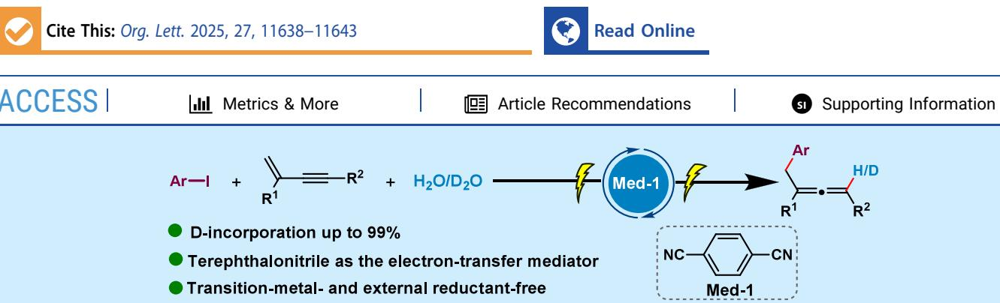
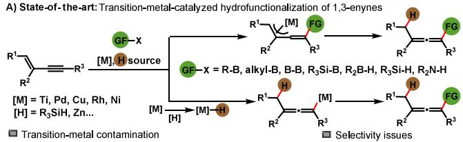
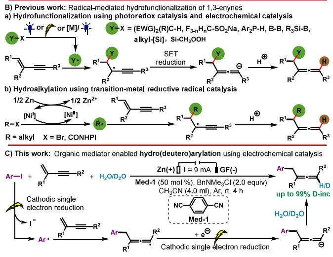
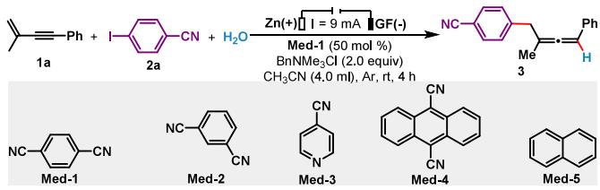
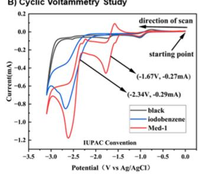
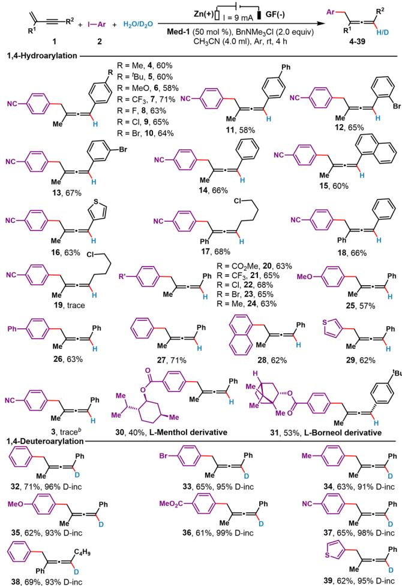
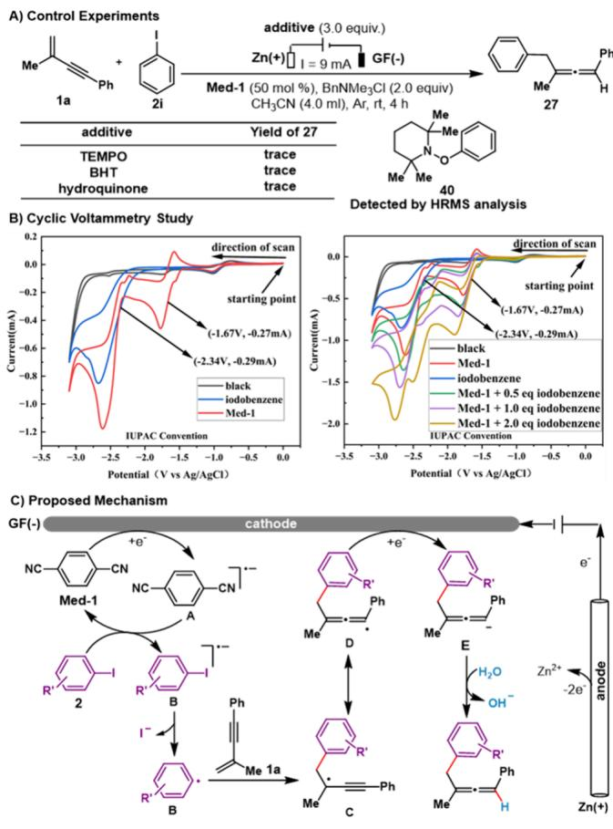

pubs.acs.org/OrgLett

Letter

# Electroreductive 1,4-Hydro(deutero)arylation of 1,3-Enynes Enabled by Terephthalonitrile: Entry to Trisubstituted Allenes

Boxiong Yang, Ming Hu, Chao Hu,\* Fu-Jin Sun,\* and Jin-Heng Li\*

  
ABSTRACT: An electroreduction method for regioselective 1,4-hydro(deutero)arylation of 1,3-enynes with aryl iodides and H O or D O has been developed, delivering diverse aryl-functionalized trisubstituted allenes under mild, transition-metal-free, and external reductant-free conditions. Upon the activation of terephthalonitrile as the organic electron transfer mediator, the protocol enables the formation of aryl radicals via single-electron transfer (SET) reduction with aryl iodides. The protocol shows a broad substrate scope with a good functional group compatibility and allows deuterium labeling using D O with up to 99% Dincorporation. Mechanistic studies support a cathodic radical anion−single electron reduction−cathodic radical polar crossover relay pathway, ofering a sustainable approach to access trisubstituted allenes.

systems remains a central pursuit in modern synthetic chemistry, ofering strategic routes to construct value-added architectures from simple and readily available precursors. Among these systems, 1,3-enynes, which are composed of conjugated alkene and alkyne moieties, serve as highly versatile synthons for the construction of complex molecules in synthesis.1−3 In particular, the 1,4-hydrofunctionalization of 1,3-enynes has emerged as a powerful strategy for the direct construction of diverse functionalized allenes,3−7 which are privileged structural motifs widely found in natural products, pharmaceuticals, and functional materials and are highly reactive synthetic intermediates.8 Conventionally, 1,3-enyne 1,4-hydrofunctionalization approaches, such as hydrosilylation, hydroborylation, hydroamination, and hydrocarbonylation, have predominantly relied on the transition-metal catalysts, such as palladium, rhodium, copper, and nickel (Scheme 1A).3,4 While these methods have achieved remarkable levels of reactivity and selectivity, they often require the use of highly expensive transition metals and stoichiometric external reductants and/or may generate toxic byproducts. Recently, radical-mediated 1,3-enyne 1,4-hydrofunctionalizations have been extensively developed, providing access to a wide range of functionalized allenes (Scheme 1B).6,7 These reactions typically proceed through photoredox, electrochemical, or nickel reductive catalysis to generate radicals, followed by radical addition to the enyne, single-electron reduction, and subsequent protonation. For example, the 1,4-hydroalkylation of $^ { 1 , 3 }$ -enynes with alkyl bromides or alkyl N-hydroxyphthalimide (CONHPI) esters involves single-electron transfer (SET) reduction of the alkyl halide by Ni(0) or Ni(I), generating alkyl radicals that furnish trisubstituted allenes via a nickel-catalyzed reductive radical−polar crossover (RPC) pathway (Scheme 1B-b).7 Despite that radical-mediated 1,4- hydrofunctionalizations such as hydroborylation, hydro-(deutero)silylation, hydrofluoromethylation, and hydrophosphinylation have been well established, the 1,4-hydroarylation of 1,3-enynes to access highly valuable aryl-substituted allenes, to the best of our knowledge, remains unexplored.6 Additionally, the pursuit of greener alternatives continues to drive the development of transition-metal-free radical chemistry, which opens new avenues for modular allene synthesis, while overcoming key limitations of traditional metal-catalyzed protocols in terms of sustainability, cost, and functional group compatibility.

Driven by this goal, we initiated our investigation into the hydroarylation of 1,3-enynes with aryl halides under electrochemical conditions (Scheme 1C). Our strategy centers on the electroreductive generation of aryl radicals via cathodic singleelectron transfer (SET) from aryl halides, facilitated by organic thereby avoiding the need for metal catalysts. We surmised that the in situ generated aryl radicals would undergo selective addition to the distal (alkene) carbon of 1,3-enyne, forming a short-lived allenyl radical intermediate. A subsequent SET reduction and protonation of this intermediate would then deliver the desired allenes with high regioselectivity. Beyond avoiding transition metals, this mediated electrolysis strategy ofers several key advantages: it circumvents the high reduction potential of aryl halides, enabling aryl radical generation under mild electrochemical conditions, and prevents degradation of sensitive functional groups often observed under high voltage. Additionally, water can serve as a benign and abundant proton source, and the method is readily adaptable to use low-cost and commercially available D O as a deuterium donor, enabling the eficient synthesis of deuterium-labeled allenes�molecules of growing 18 value in pharmaceutical, metabolic, and mechanistic studies.

Scheme 1. Hydrofunctionalization of 1,3-Enynes  

We commenced our study by evaluating optimal conditions for 1,4-hydroarylation using (3-methylbut-3-en-1-yn-1-yl)- benzene 1a and 4-iodobenzonitrile 2a as the model substrates (Table 1). After extensive optimization, we identified efective conditions that involve a combination of an organic electron transfer mediator terephalonitrile Med-1, H O (50 equiv) as the proton source, benzyltrimethylammonium chloride (BnNMe Cl) as the supporting electrolyte, and MeCN as the medium in an undivided cell equipped with a zinc cathode and a graphite felt (GF) anode at 9 mA constant current, afording the desired allene product 3 in a 65% isolated yield (entry 1). The results show that the constant current, mediator Med-1, and BnNMe Cl electrolyte are essential for the reaction success, as no desired 1,4-hydroarylation reaction occurred when lacking each (entries 2, 7, and 13). Replacement of Med-1 by other organic mediators Meds-2− 5 resulted in significantly lower yields or no formation of the desired product (entries 3−5), further underscoring the importance of mediator structures. Reducing the Med-1 loading to 10 mol % led to a decreased yield (entry 6). Other electrolytes, such as BnNEt Cl, Et NCl, and ${ } ^ { n } \mathbf { B u } _ { 4 } \mathbf { N C l } ,$ led to inferior results (entries 8−10). The combination of a zinc cathode and graphite felt anode along with a constant current of 9 mA proved optimal, and other electrode materials or current settings reduced eficiency (entries 11−15). Among examinations of the solvent efect (such as MeCN, DMF, and DCM), the results revealed that MeCN was found to be the best solvent option (entries 1 and 16). Delightedly, the reaction could be handled with a scale up to 1 mmol 1a, providing 3 in good yield (entry 17).

Table 1. Screening of the Optimal Reaction Conditionsa  

<table><tr><td>entry</td><td>variation from the standard conditions</td><td>yield (%)</td></tr><tr><td>1</td><td>none</td><td>65</td></tr><tr><td>2</td><td>without Med-1</td><td>0</td></tr><tr><td>3</td><td>using Med-2</td><td>21</td></tr><tr><td>4</td><td>using Med-3</td><td>28</td></tr><tr><td>5</td><td>using Med-4 or Med-5</td><td>trace</td></tr><tr><td>6</td><td>with 10 mol % Med-1</td><td>38</td></tr><tr><td>7</td><td>without BnNMe2Cl</td><td>0</td></tr><tr><td>8</td><td>BnNEt2Cl instead of BnNMe3Cl</td><td>41</td></tr><tr><td>9</td><td>&quot;Bu4NCl instead of BnNMe2Cl</td><td>50</td></tr><tr><td>10</td><td> $\mathrm { E t _ { 4 } N B F _ { 4 } }$  instead of BnNMe2Cl</td><td>39</td></tr><tr><td>11</td><td>using Zn(+)/C rod (−)</td><td>53</td></tr><tr><td>12</td><td>using Zn(+)/Pt(−)</td><td>36</td></tr><tr><td>13</td><td>without current</td><td>0</td></tr><tr><td>14</td><td>6 mA instead of 9 mA</td><td>54</td></tr><tr><td>15</td><td>12 mA instead of 9 mA</td><td>65</td></tr><tr><td>16</td><td>DMF or DCM instead of DMF</td><td>trace</td></tr><tr><td>17b</td><td>none</td><td>60</td></tr></table>

aStandard reaction conditions: undivided cell, zinc flake anode (15 × 30 × 0.1 mm), GF cathode $\left( 1 5 \times 3 0 \times 0 . 2 \right.$ mm), constant current = 9 mA, 1a (0.2 mmol), 2a (0.3 mmol; 1.5 equiv), H O (50 equiv), Med-1 (50 mol %), BnNMe Cl (2 equiv), MeCN (4 mL), argon, and room temperature. GF = graphite felt. Med = mediator. b1a (1 mmol). See the Supporting Information for details.

After the optimized reaction conditions were established, the substrate scope of this electrochemical 1,3-enyne 1,4-hydro-(deutero)arylation protocol was assessed by reaction of a diverse array of 1,3-enynes 1 with aryl halides 2 in the presence of H O under the optimized conditions (Table 2). Initially, various structurally and electronically varied 4-aryl-substituted 1,3-enynes, including electron-rich and electron-deficient arylsubstituted ones, were examined and showed high reactivity for this electrochemical 1,3-enyne 1,4-hydroarylation, afording allenes 4−18 in moderate to good yields. A wide range of functionalities, including Me, tBu, MeO, $\mathrm { C F } _ { 3 } , \mathrm { F } , \mathrm { C l } ,$ , and Br, on the aryl ring at the terminal alkyne were well tolerated (4−13). Especially, halo groups such as F, Cl, and Br remained intact during the hydroarylation process, thereby ofing highly reactive potential handles for further derivatizations. Notably, 4-aryl 1,3-enynes bearing a Br group at the para, meta, and ortho position, respectively, underwent the 1,4-hydroarylation smoothly, afording 10 and 12−13 in good yields. The results indicated that the steric hindrance did not afect the reaction, and the reaction might be applicable to aryl bromides. Indeed, attempts to execute the 1,4-hydroarylation of 1,3-enyne 1a and 4-bromobenzonitrile failed. Extended aromatic systems such as biphenyl, naphthalene, and thiophene, containing 1,3-enynes, were also compatible for furnishing allenes 11 and 15−16 in 58−63% yields. Interestingly, 4-alkyl 1,3-enyne was a suitable substrate, giving 17 in a good yield. The $^ { 2 , 4 }$ -diaryl-substituted $^ { 1 , 3 \cdot }$ -enyne was well tolerated, afording the product in good yield (18), whereas the 2,4-dialkyl analogue gave no product (19).

Table 2. Scope of 1,3-Enynes (1) and Aryl Halides (2)a  
  
aReaction conditions: Undivided cell, zinc flake anode $\left( 1 5 \times 3 0 \times 0 . 1 \right.$ mm), GF cathode (15 ×30 × 0.2 mm), constant current = 9 mA, 1 (0.2 mmol), 2 (0.3 mmol; 1.5 equiv), H O (50 equiv), Med-1 (50 mol %), BnNMe Cl (2 equiv), MeCN (4 mL), argon, and room temperature. $\boldsymbol { ^ { b } 4 - } \mathrm { C N C } _ { 6 } \mathrm { H } _ { 4 } \mathrm { B i }$ (0.2 mmol).

Next, the scope of aryl halides was investigated in the presence of (3-methylbut-3-en-1-yn-1-yl)benzene 1a, $\mathrm { H } _ { 2 } \mathrm { O } ,$ Med-1, and BnNMe Cl (20−31). The reaction demonstrated excellent functional group compatibility: a wide range of electron-deficient and electron-rich aryl iodides bearing a functionality, such as CO Me, $\mathrm { C F } _ { 3 } ,$ Cl, Br, Me, MeO, and $\operatorname { P h } ,$ on the aryl ring eficiently manipulated $^ { 1 , 4 }$ -hydroarylation with 1,3-enyne ${ \bf 1 } \mathbf { a } ,$ afording 20−26 in moderate to good yields. Electron-neutral iodobenzene also accommodated this $^ { 1 , 4 - }$ hydroarylation (27). Fortunately, aryl iodides possessing important naphthalene and thiophene functionalities were found to be compatible with the optimized conditions, giving allenes 28−29 in good yields. The regioselectivity and functional group tolerance of the protocol were further demonstrated by the successful 1,4-hydroarylation of $^ { 1 , 3 - }$ enynes with a methanol L-moiety (30) or an L-borneo-derived aryl iodide (31), underscoring the applicability of this method to construct complex and biologically relevant molecules.

Encouraged by these results, we further extended this electroreductive strategy to 1,4-deuteroarylation of $^ { 1 , 3 }$ -enynes using terephalonitrile Med-1 as the organic electron transfer mediator $( 3 2 - 3 9 ) . ^ { 1 0 }$ An array of aryl iodides, including $\mathrm { C } _ { 6 } \mathrm { H } _ { 5 } \mathrm { I } ,$ $\scriptstyle 4 - \mathrm { B r C } _ { 6 } \mathrm { H } _ { 4 } \mathrm { I } ,$ $\mathrm { 4 - M e C _ { 6 } H _ { 4 } I }$ $4 \mathrm { - } \dot { \mathrm { M e O C } _ { 6 } \mathrm { H _ { 4 } I , 4 \mathrm { - } C O _ { 2 } M e C _ { 6 } H _ { 4 } I } } ,$ 4- $\mathrm { C N C } _ { 6 } \mathrm { H } _ { 4 } \mathrm { \dot { I } } ,$ and 3-iodothiophene, were competent to operate the 1,4-deuteroarylation of $^ { 1 , 3 }$ -enyne ${ \bf 1 } \mathbf { a } ,$ delivering the corresponding deuterium-labeled allenes 32−37 and 39 in good yields with high deuterium incorporation (91−99% D). Gratifyingly, aliphatic 1,3-enyne also accommodated this 1,4- deuteroarylation, afording the deuterium-labeled allene 38 in 69% yield with 93% deuterium incorporation.

To gain further insight into the reaction mechanism, a series of control mechanistic experiments were carried out (Scheme 2). The addition of radical scavengers such as TEMPO, BHT,

## Scheme 2. Control Experiments, Cyclic Voltammetry Study, and Possible Reaction Mechanism

and hydroquinone completely suppressed allene formation, suggesting the involvement of radical intermediates in the $^ { 1 , 4 - }$ hydroaryl process. Furthermore, the phenyl radical, generated from iodobenzene, was successfully trapped by TEMPO, and the corresponding adduct 40 was detected by high-resolution mass spectrometry (HRMS), providing direct evidence for aryl radical formation (Scheme 2A). Cyclic voltammetry (CV) studies revealed that the reduction potential of iodobenzene is significantly more negative than that of Med-1, indicating that Med-1 is preferentially reduced at the cathode (Scheme 2B).7

Furthermore, a continuous increase in the catalytic current of Med-1 was observed upon the addition of iodobenzene, consistent with a single-electron transfer (SET) process from the reduction form of Med-1 (dicyanobenzene radical anion) to the aryl iodide (Scheme 2B).

Based on these observations and the precedent literature,1−7,9 a plausible mechanism was proposed as illustrated in Scheme 2C. Initially, terephthalonitrile Med-1 undergoes SET reduction at the cathode to generate the terephthalonitrile radical anion intermediate $\mathbf { A . } ^ { 9 }$ This activated species A then operates SET reduction with aryl iodide 2 to generate the aryl iodide radical anion intermediate B, followed by the C−I bond cleavage to aford the aryl radical C. Chemoselectivity addition of the aryl radical C across the $\mathrm { C } { = } \mathrm { C }$ bond of 1,3-enyne 1 gives rise to the formation of the propargyl radical C and then the allene radical intermediate $\mathbf { D } . ^ { 6 , 7 , 1 1 }$ Cathodic SET reduction of the intermediate D delivers the allene carbanion intermediate $\mathbf { D } . ^ { 5 }$ Finally, protonation of intermediate D with $_ { \mathrm { H } _ { 2 } \mathrm { O } }$ furnishes the desired allene product and the OH− ion, species, which upon protonation by water, furnish the final allene product.

In summary, we have developed a transition-metal-free electrochemical strategy for the regioselective electroreductive 1,4-hydro(deutero)arylation of 1,3-enynes with aryl iodides and $\mathrm { \dot { H } } _ { 2 } \mathrm { O } / \mathrm { D } _ { 2 } \mathrm { O } .$ , enabling eficient access to trisubstituted allenes under mild conditions. The use of an organic redox mediator overcomes the high reduction potential of aryl halides, facilitating aryl radical formation via SET reduction. The protocol features a broad substrate scope and a high functional group tolerance, which is compatible with $\mathrm { D } _ { 2 } \mathrm { O } ,$ allowing for the synthesis of deuterium-labeled allenes. Mechanistic studies support a cathodic radical anion single electron-reduction cathodic radical polar crossover relay pathway, highlighting the potential utilities of this sustainable and versatile protocol.

## ■ ASSOCIATED CONTENT

## Data Availability Statement

The data underlying this study are available in the published article and its Supporting Information.

## \*sı Supporting Information

The Supporting Information is available free of charge at https://pubs.acs.org/doi/10.1021/acs.orglett.5c03768.

General experimental procedures, characterization details, and NMR spectra (PDF)

## ■ AUTHOR INFORMATION

## Corresponding Authors

Chao Hu − State Key Laboratory of Advanced Optical Polymer and Manufacturing Technology, Qingdao Key Laboratory of Biomacromolecular Drug Discovery and Development, College of Chemical Engineering, Qingdao University of Science and Technology, Qingdao 266042, China; Email: chaohu232@outlook.com

Fu-Jin Sun − State Key Laboratory of Advanced Optical Polymer and Manufacturing Technology, Qingdao Key Laboratory of Biomacromolecular Drug Discovery and Development, College of Chemical Engineering, Qingdao University of Science and Technology, Qingdao 266042, China; Email: sunfujin@qust.edu.cn

Jin-Heng Li − State Key Laboratory of Advanced Optical Polymer and Manufacturing Technology, Qingdao Key Laboratory of Biomacromolecular Drug Discovery and Development, College of Chemical Engineering, Qingdao University of Science and Technology, Qingdao 266042, China; School of Chemistry and Chemical Engineering, Henan Normal University, Xinxiang, Henan 453007, China; State Key Laboratory of Applied Organic Chemistry, Lanzhou University, Lanzhou 730000, China; orcid.org/ 0000-0001-7215-7152; Email: jhli@hnu.edu.cn

## Authors

Boxiong Yang − State Key Laboratory of Advanced Optical Polymer and Manufacturing Technology, Qingdao Key Laboratory of Biomacromolecular Drug Discovery and Development, College of Chemical Engineering, Qingdao University of Science and Technology, Qingdao 266042, China

Ming Hu − State Key Laboratory of Advanced Optical Polymer and Manufacturing Technology, Qingdao Key Laboratory of Biomacromolecular Drug Discovery and Development, College of Chemical Engineering, Qingdao University of Science and Technology, Qingdao 266042, China; orcid.org/0000-0002-3053-0905

Complete contact information is available at: https://pubs.acs.org/10.1021/acs.orglett.5c03768

## Notes

The authors declare no competing financial interest.

## ■ ACKNOWLEDGMENTS

We thank the National Natural Science Foundation of China (No. 22271245), the Natural Science Foundation of Shandong Province of China (No. 2025HWYQ-064), and the Open Research Fund of School of Chemistry and Chemical Engineering, Henan Normal University (No. 2021ZD01), for financial support.

## ■ REFERENCES

(1) For reviews and representative papers, see: (a) Fu, L.; Greßies, S.; Chen, P.; Liu, G. Recent Advances and Perspectives in Transition Metal-Catalyzed 1,4-Functionalizations of Unactivated 1, 3-Enynes for the Synthesis of Allenes. Chin. J. Chem. 2020, 38, 91−100. (b) Dherbassy, $\mathrm { Q . ; }$ Manna, S.; Talbot, F. J.; Prasitwatcharakorn, W.; Perry, G. J.; Procter, D. J. Copper-catalyzed functionalization of enynes. Chem. Sci. 2020, 11, 11380−11393. (c) Li, L.; Wang, S.; Jakhar, $\mathbf { A } . ;$ Shao, Z. Pd-Catalyzed Functionalization of 1,3-Enynes via Alkylene-π-Allylpalladium Intermediates. Green Synth. Catal. 2023, 4, 124−134. (d) Li, S.; Yuan, K.; Zhang, $\mathrm { G } . ;$ Guo, R. Recent Advances in the Synthesis of Chiral Allenes via Asymmetric 1,4-Difunctionalization of 1,3-Enynes. Eur. J. Org. Chem. 2024, 27, No. e202301316. (e) Sun, L.; Sun, K. Recent Progress on the Difunctionalization Reaction of 1,3-Enynes. Chin. J. Org. Chem. 2025, DOI: 10.6023/ cjoc202502004.

(2) For representative papers on 1,3-enyne 1,4-difunctionalization, see: (a) Zhu, X.; Deng, W.; Chiou, M.-F.; Ye, C.; Jian, W.; Zeng, Y.; Jiao, Y.; Ge, L.; Li, Y.; Zhang, $\mathrm { X . } ;$ Bao, H. Copper-Catalyzed Radical 1,4-Difunctionalization of 1,3-Enynes with Alkyl Diacyl Peroxides and N-Fluorobenzenesulfonimide. J. Am. Chem. Soc. 2019, 141, 548−559. (b) Wang, $\mathrm { F } _ { \cdot } \mathrm { \mathrm { \mathrm { j } } }$ Wang, D.; Zhou, Y.; Liang, L.; Lu, R.; Chen, P.; Lin, Z.; Liu, G. Divergent Synthesis of CF -Substituted Allenyl Nitriles by Ligand-Controlled Radical 1,2- and 1,4-Addition to 1,3-Enynes. Angew. Chem., Int. Ed. 2018, 57, 7140−7145. (c) Zhu, X.; Deng, W.; Chiou, M.-F.; Ye, C.; Jian, W.; Zeng, Y.; Jiao, Y.; Ge, L.; Li, Y.; Zhang,

X.; Bao, H. Copper-Catalyzed Radical 1,4-Difunctionalization of 1,3- Enynes with Alkyl Diacyl Peroxides and N-Fluorobenzenesulfonimide. J. Am. Chem. Soc. 2019, 141, 548−559. (d) Chen, Y.; Wang, J.; Lu, Y. Decarboxylative 1,4-Carbocyanation of 1,3-Enynes to Access Tetra-Substituted Allenes via Copper/Photoredox Dual Catalysis. Chem. Sci. 2021, 12, 11316−11321. (e) Xu, T.; Wu, S.; Zhang, Q.-N.; Wu, Y.; Hu, M.; Li, J.-H. Dual Photoredox/Nickel-Catalyzed 1,4-Sulfonylar ylation of 1,3-Enynes with Sulfinate Salts and Aryl Halides: Entry into Tetrasubstituted Allenes. Org. Lett. 2021, 23, 8455−8459. (f) Cheng, C.; Lv, G.-F.; Wu, S.; Li, Y.; Li, J.-H. Nickel Photocatalyzed Reductive 1,4-Dicarbofunctionalization of 1,3-Enynes with N-Methylamines and Organohalides Enabled by Site-Selective C(sp3)−H Functionalization. Org. Lett. 2023, 25, 4236−4240. (g) Chen, H.; Zhu, C.; Yue, H.; Rueping, M. Group 14 Elements Hetero-Difunctionalizations via Nickel-Catalyzed Electroreduc-tive Cross-Coupling. Angew. Chem., Int. Ed. 2023, 62, No. e202306498. (h) Yang, L.; Zeng, L.; Zhu, Y.; Wang, Q.; Li, J. Copper-Catalyzed Photoredox 1,4-Amidocyanation of 1, 3-Enynes with N-Amidopyridin-1-ium Salts and TMSCN: Facile Access to α-Amido Allenyl Nitriles. Chin. Chem. Lett. 2024, 35, 109685. (i) Wu, Q.; Li, X.; Lv, J.; Shi, Y.; Yang, D. Photoredox/ Copper Dual-Catalyzed Regioselective 1,4-Arylcyanation of 1,3- Enynes for Multifunctionalized Allenyl Nitriles. Org. Lett. 2025, 27, 7703−7708. and references cited therein

(3) (a) Li, Y.; Bao, H. Radical Transformations for Allene Synthesis. Chem. Sci. 2022, 13, 8491−8506. (b) Liu, X.; Jiao, C.; Cui, S.; Liu, Q.; Zhang, X.; Zhang, G. Recent Advances in Nickel-Catalyzed Synthesis of Allenes: New Insights and Perspectives. ChemCatChem. 2023, 15, No. e202300601. (c) Singh, J.; Saxena, B.; Sharma, A. Visible light promoted synthesis of allenes. Catal. Sci. Technol. 2024, 14, 5143− 5160. (d) Chang, H.; Wang, R.; Wang, Y.-M. Asymmetric Synthesis of Propargylic and Allenic Silanes, Germanes, and Stannanes. Chem. Asian J. 2025, 20, No. e00105. (e) Gan, L.; Wan, X.; Pang, Y.; Zou, Y.; Deng, Y.-H.; Shao, Z. Catalytic Asymmetric Synthesis and Synthetic Application of Heteroatom-substituted Axially Chiral Allenes. Org. Chem. Front. 2025, 12, 1001−1064. (f) Xiao, B.-Y.; Huang, W.; Zhang, F.-H. Recent Advances in the Formation and Transformation of Propargyl Radical. Eur. J. Org. Chem. 2025, 28, No. e202500302.

(4) For representative papers on transition-metal-catalyzed 1,3- enyne 1,4-hydrofunctionalization, see: (a) Han, J.-W.; Tokunaga, N.; Hayashi, T. Palladium-Catalyzed Asymmetric Hydrosilylation of 4- Substituted 1-Buten-3-ynes. Catalytic Asymmetric Synthesis of Axially Chiral Allenylsilanes. J. Am. Chem. Soc. 2001, 123, 12915−12916. (b) Nishimura, T.; Makino, H.; Nagaosa, M.; Hayashi, T. Rhodium-Catalyzed Enantioselective 1,6-Addition of Arylboronic Acids to Enyn-amides: Asymmetric Synthesis of Axially Chiral Allenylsilanes. J. Am. Chem. Soc. 2010, 132, 12865−12867. (c) Wang, M.; Liu, Z.-L.; Zhang, X.; Tian, P.-P.; Xu, Y.-H.; Loh, T.-P. Synthesis of Highly Substituted Racemic and Enantioenriched Allenylsilanes via Copper-Catalyzed Hydrosilylation of (Z)-2-Alken-4-ynoates with Silylboronate. J. Am. Chem. Soc. 2015, 137, 14830−14833. (d) Yao, Q.; Liao, Y.; Lin, L.; Lin, X.; Ji, J.; Liu, X.; Feng, X. Efficient Synthesis of Chiral Trisubstituted 1,2-Allenyl Ketones by Catalytic Asymmetric Conjugate Addition of Malonic Esters to Enynes. Angew. Chem., Int. Ed. 2016, 55, 1859−1863. (e) Huang, Y.; del Pozo, J.; Torker, S.; Hoveyda, A. H. Enantioselective Synthesis of Trisubstituted Allenyl− B(pin) Compounds by Phosphine−Cu-Catalyzed 1,3-Enyne Hydroboration. Insights Regarding Stereochemical Integrity of Cu−Allenyl Intermediates. J. Am. Chem. Soc. 2018, 140, 2643−2655. (f) Adamson, N. J.; Jeddi, H.; Malcolmson, S. J. Preparation of Chiral Allenes through Pd−Catalyzed Intermolecular Hydroamination of Conjugated Enynes: Enantioselective Synthesis Enabled by Catalyst Design. J. Am. Chem. Soc. 2019, 141, 8574−8583. (g) Yang, C.; Liu, Z.-L.; Dai, D.-T.; Li, Q.; Ma, W.-W.; Zhao, M.; Xu, Y.-H. Catalytic Asymmetric Conjugate Protosilylation and Protoborylation of 2- Trifluoromethyl Enynes for Synthesis of Functionalized Allenes. Org. Lett. 2020, 22, 1360−1367. (h) Eaton, M.; Dai, Y.; Wang, Z.; Li, B.; Lamine, W.; Miqueu, K.; Liu, S.-Y. Synthesis of Allenes by Hydroalkylation of 1, 3-Enynes with Ketones Enabled by Cooperative

Catalysis. J. Am. Chem. Soc. 2023, 145, 21638−21645. (i) Jin, C.; He, X.; Chen, S.; Guo, Z.; Lan, Y.; Shen, X. Axial Chirality Reversal and Enantioselective Access to Si-Stereogenic Silylallene. Chem. 2023, 9, 2956−2970.

(5) For representative papers on organocatalytic 1,3-enyne 1,4- hydrofunctionalization, see: (a) Yu, X.; Ren, H.; Xiao, Y.; Zhang, J. Efficient Assembly of Allenes, 1,3-Dienes, and 4H-Pyrans by Catalytic Regioselective Nucleophilic Addition to Electron-Deficient 1,3- Conjugated Enynes. Chem. Eur. J. 2008, 14, 8481−8485. (b) Qian, H.; Yu, X.; Zhang, J.; Sun, J. Organocatalytic Enantioselective Synthesis of 2,3-Allenoates by Intermolecular Addition of Nitroalkanes to Activated Enynes. J. Am. Chem. Soc. 2013, 135, 18020− 18023. (c) Poulsen, P. H.; Li, Y.; Lauridsen, V. H.; Jørgensen, D. K. B.; Palazzo, T. A.; Meazza, M.; Jørgensen, K. A. Organocatalytic Formation of Chiral Trisubstituted Allenes and Chiral Furan Derivatives. Angew. Chem., Int. Ed. 2018, 57, 10661−10665. (d) Wang, J.; Zheng, S.; Rajkumar, S.; Xie, J.; Yu, N.; Peng, Q.; Yang, X. Chiral Phosphoric Acid-Catalyzed Stereodivergent Synthesis of Trisubstituted Allenes and Computational Mechanistic studies. Nat. Commun. 2020, 11, 5527.

(6) For papers on radical-mediated 1,3-enyne hydrofunctionalization, see: (a) Lei, W.; Liu, Y.; Fang, Y.; Li, Y.; Du, C.; Fang, J. Modular Access to 1,2-Allenyl Ketones Based on a Photoredox-Catalysed Radical-Polar Crossover Process. Org. Biomol. Chem. 2021, 19, 8502−8506. (b) Zhu, C.; Chen, H.; Yue, H.; Rueping, M. Electrochemical Chemo- and Regioselective Arylalkylation, Dialkylation and Hydro(deutero)alkylation of 1,3-enynes. Nat. Synth. 2023, 2, 1068−1081. (c) Hou, H.; Pan, Y.; Sun, Y.; Han, Y.; Yan, C.; Shi, Y.; Zhu, S. Visible-Light Photoredox Catalyzed Regioselective 1,4- Hydroalkylation of 1,3-Enyne. Chem. Eur. J. 2023, 29, No. e202301633. (d) Zhang, G.; Tan, W.; Zhang, D.; Wang, K.; Gao, P.; Wang, S.; Liu, S.-L.; Chen, F. Regioselective Hydro-(deutero)silylation of 1,3-Enynes Enabled by Photoredox/Nickel Dual Catalysis. Org. Lett. 2024, 26, 536−541. (e) Cao, Q.; Li, M.-M.; Mao, X.; Zhou, Q.-Q.; Ding, W. Visible-Light-Induced Regioselective Radical-Polar Crossover 1,4-Hydrophosphinylation of 1,3-Enynes: Access to Trisubstituted Allenes Bearing a Phosphine Oxide Group. Org. Lett. 2024, 26, 4678−4683. (f) Sun, Y.; Pan, Y.; Chen, X.; Yu, H.; Han, Y.; Sun, Q.; Hou, H.; Zhu, S. Visible-Light Photoredox-Catalyzed Radical-Polar Crossover 1, 4-Hydrofluoromethylation of 1,3-Enynes. Org. Lett. 2024, 26, 10399−10403. (g) Zhang, J.-L.; Xiong, J.-X.; Fei, L.-Q.; Cui, F.-H.; Li, S.-H.; Tang, H.-T.; Xie, Y.-Z.; Pan, Y.-M. Electrochemically mediated synthesis of trifluoromethylallenes. Org. Chem. Front. 2024, 11, 3485−3490. (h) Yang, J.-S.; Wang, X.-Y.; Li, Y.-Y.; Zhang, F.-M.; Zhang, X.-M.; Tu, Y.-Q. Catalytic Asymmetric 1,4-Hydrocarbonation of 1,3-Enynes via Photoredox/Cobalt/ Chromium Triple Catalysis. Angew. Chem., Int. Ed. 2025, 64, No. e202420563.

(7) For papers on transition-metal-catalyzed reductive radical 1,3- enyne hydrofunctionalization, see: (a) Lei, W.; Liu, H.; Li, Y.; Fang, Y. Nickel-Catalysed SET-Reduction-Based Access to Functionalized Allenes via 1,4-Carbohydrogenation of 1,3-Enynes with Alkyl Bromides. Org. Chem. Front. 2022, 9, 3862−3868. (b) Liu, H.; Lei, W.; Li, Y.; Fang, Y. Diversified Access to Di- and Trisubstituted Allenes via Nickel-Catalysed Reactions of 1,3-Enynes withAlkyl N-Hydroxyphthalimide Esters. Chem. Commun. 2023, 59, 1825−1828. (c) Hossain, A.; Anderson, R. L.; Zhang, C. S.; Chen, P.-J.; Fu, G. C. Nickel-Catalyzed Enantioconvergent and Diastereoselective Allenylation of Alkyl Electrophiles: Simultaneous Control of Central and Axial Chirality. J. Am. Chem. Soc. 2024, 146, 7173−7177.

(8) (a) Hoffmann-Roder, A.; Krause, N. Synthesis and Properties of Allenic Natural Products and Pharmaceuticals. Angew. Chem., Int. Ed. 2004, 43, 1196−1216. (b) Ma, S. Electrophilic Addition and Cyclization Reactions of Allenes. Acc. Chem. Res. 2009, 42, 1679− 1688. (c) Krause, N.; Winter, C. Gold-Catalyzed Nucleophilic Cyclization of Functionalized Allenes: A Powerful Access to Carboand Heterocycles. Chem. Rev. 2011, 111, 1994−2009. (d) Rivera-Fuentes, P.; Diederich, F. Allenes in Molecular Materials. Angew. Chem., Int. Ed. 2012, 51, 2818−2828. (e) Yu, S.; Ma, S. Allenes in

Catalytic Asymmetric Synthesis and Natural Product Syntheses. Angew. Chem., Int. Ed. 2012, 51, 3074−3112. (f) Alonso, J. M.; Almendros, P. Highlighting the Rich Chemistry of the Allenone Moiety. Adv. Synth. Catal. 2023, 365, 1332−1384.

(9) For selected reviews and papers, see: (a) Tong, S.; Li, K.; Ouyang, X.; Song, R.; Li, J. Recent advances in the radical-mediated decyanative alkylation of cyano(hetero)arene. Green Synth. Catal. 2021, 2, 145−155. (b) Zeng, W.; Wang, Y.; Peng, C.; Qiu, Y. Organo-Mediator Enabled Electrochemical Transformations. Chem. Soc. Rev. 2025, 54, 4468−4501. (c) McNally, A.; Prier, C. K.; MacMillan, D. W. C. Discovery of an α-Amino C−H Arylation Reaction Using the Strategy of Accelerated Serendipity. Science 2011, 334, 1114−1117.

(d) Ma, Y.; Yao, X.; Zhang, L.; Ni, P.; Cheng, R.; Ye, J. Direct Arylation of α-Amino C(sp3)-H Bonds by Convergent Paired Electrolysis. Angew. Chem., Int. Ed. 2019, 58, 16548−16552.

(e) Zhang, S.; Li, L.; Li, X.; Zhang, J.; Xu, K.; Li, G.; Findlater, M. Electroreductive 4-Pyridylation of Electron-deficient Alkenes with Assistance of Ni(acac) . Org. Lett. 2020, 22, 3570−3575. (f) Zeng, L.; Qin, J.-H.; Lv, G.-F.; Hu, M.; Sun, Q.; Ouyang, X.-H.; He, D.-L.; Li, J.-H. Electrophotocatalytic Reductive 1,2-Diarylation of Alkenes with Aryl Halides and Cyanoaromatics. Chin. J. Chem. 2023, 41, 1921− 1930. (g) Zeng, L.; Ren, H.-Z.; Lv, G.-F.; Ouyang, X.-H.; He, D.-L.; Li, J.-H. Electroreductive Remote C(sp3)-H Arylation of Aliphatic Ethers with Cyanoarenes toward α-(Hetero)aryl Ethers. Org. Lett. 2024, 26, 2440−2444. (h) Yang, L.-F.; Zeng, L.; Liu, Y.-L.; Hu, M.; Li, J.-H. Photoreductive 1,4-Dicarbofunctionalization of 1, 3-Enynes with Organoiodides and Cyanoarenes via Halogen-Atom Transfer. Org. Lett. 2024, 26, 7661−7666. and references cited therein

(10) (a) Li, N.; Li, Y.; Wu, X.; Zhu, C.; Xie, J. Radical Deuteration. Chem. Soc. Rev. 2022, 51, 6291−6306. (b) Pirali, T.; Serafini, M.; Cargnin, S.; Genazzani, A. A. Applications of Deuterium in Medicinal Chemistry. J. Med. Chem. 2019, 62, 5276−5297.

(11) Wille, U. Radical Cascades Initiated by Intermolecular Radical Addition to Alkynes and Related Triple Bond Systems. Chem. Rev. 2013, 113, 813−853.