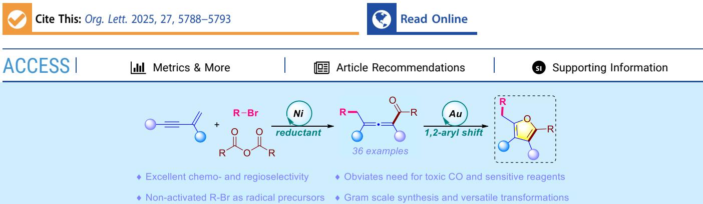
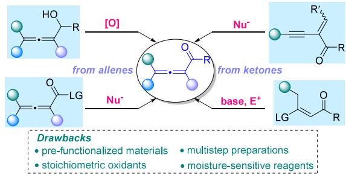
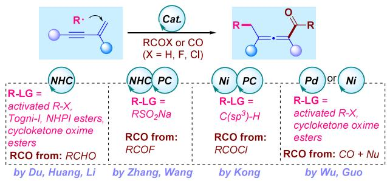
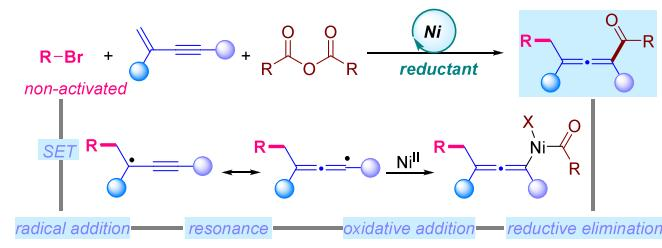
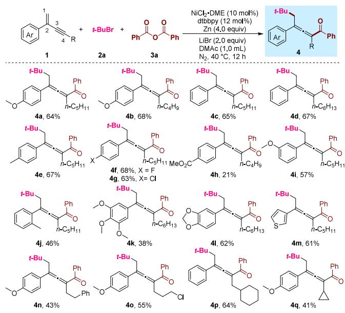
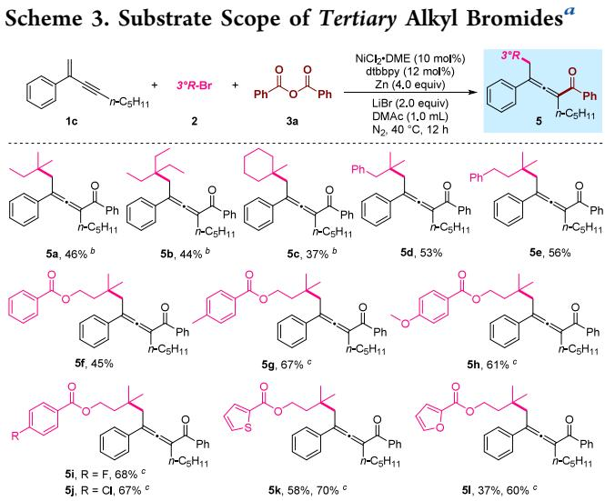
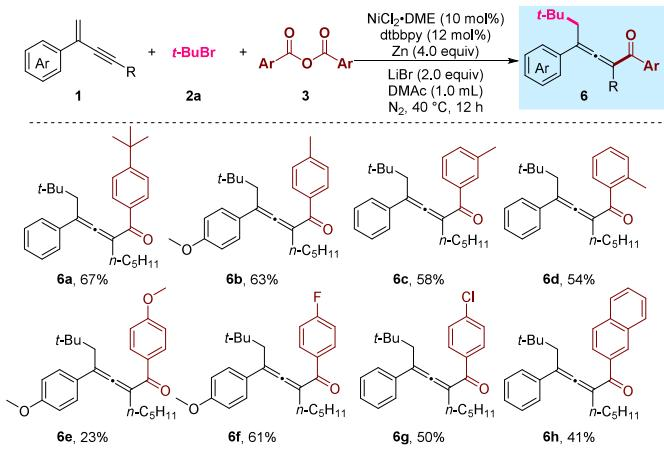
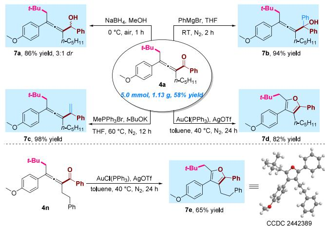
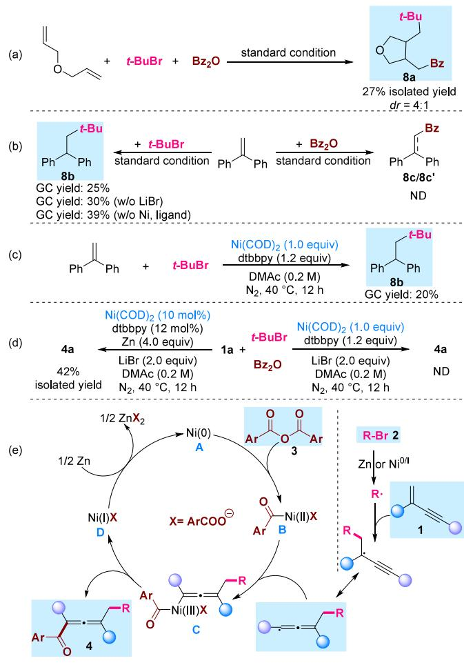

# Nickel-Catalyzed Reductive 1,4-Alkylacylation of 1,3-Enynes Enabling Synthesis of Allenyl Ketones

Quanyuan Wang, Keyi Peng, Xiangyuan Yao, Yuezhou Yuan, Ya Chen,\* and Guo-Jun Deng\*

  
ABSTRACT: A nickel-catalyzed reductive 1,4-alkylacylation of 1,3-enynes has been established using nonactivated tertiary alkyl bromides and aromatic anhydrides as dual electrophiles. This protocol enables eficient assembly of tetrasubstituted allenyl ketones with high chemo- and regioselectivity. Mechanistic insights reveal the radical relay process involving the synergistic interactions of nickel and zinc. The allenyl ketone products serve as modular building blocks, particularly for constructing fully carbon-substituted furans via Au-catalyzed cycloisomerization with selective 1,2-aryl migration, enhancing the synthetic practicality.

and bioactive molecules,1 has emerged as a versatile synthon in synthetic chemistry due to its unique combination of allenyl and carbonyl moieties.2 This structural motif demonstrates remarkable utility in diverse high-value transformations, including nucleophilic additions,3 cycloadditions,4 and cycloisomerization reactions,5 particularly for constructing polysubstituted furans.6 Despite its synthetic utility, traditional approaches rely either on stepwise functionalization of preformed allenes (e.g., oxidation of allenols or nucleophilic additions to allenyl esters) or on carbonyl allenylation using highly prefunctionalized substrates such as α-alkynyl/β- chlorovinyl ketones,7 which demand multistep preparations and face challenges in functional group compatibility. Moreover, these methods frequently require stoichiometric oxidants or moisture-sensitive organometallic reagents yet remain inefective for constructing fully substituted allenyl ketones (Scheme 1a). To overcome these synthetic limitations, a onepot strategy that can simultaneously introduce both the allenyl and ketocarbonyl units from simple starting materials is urgently needed.

Recent years have witnessed significant advances in radicalmediated 1,4-difunctionalization of 1,3-enynes,8 enabling eficient access to multisubstituted allenes bearing cyano, aryl,10 alkynyl,11 and halo groups.12 In contrast, the catalytic synthesis of allenyl ketones via radical 1,4-difunctionalization of 1,3-enynes remains underdeveloped (Scheme 1b). Notable research by Du, Huang and Li demonstrated NHC-catalyzed 1,4-alkylacylation through allenyl-ketyl radical cross-coupling, albeit limited to activated radical precursors like alkyl halides, redox ester, ring-strained oxime esters and Togni reagent due to NHC’s constrained reducing power. Subsequent work by Zhang and Wang achieved 1,4-sulfonylacylation and fluoroalkylative acylation with sulfinates and acyl fluorides via NHC/photoredox dual catalysis.14 Concurrently, Kong’s group achieved 1,4-alkylacylation via synergistic photocatalyzed hydrogen atom transfer (HAT) and nickel catalysis,15 though requiring large excesses of saturated hydrocarbons as radical precursors. Most recently, Wu and Guo independently established palladium- and nickel-catalyzed four-component 1,4-alkylcarbonylation using the CO insertion strategy.16 Despite these remarkable advances, it is still desirable to explore modular strategies enabling the eficient assembly of structurally diverse, fully substituted allenyl ketones from bench-stable feedstocks.

The nickel-catalyzed reductive coupling paradigm has driven transformative advances in alkene/alkyne difunctionalization, 17 with recent extensions to 1,3-enynes demonstrating exceptional site selectivity. Notably, Rueping’s and our independent studies established electrochemical and photochemical 1,4- alkylarylation of 1,3-enynes through a synergistic merger of nonactivated alkyl bromides as bench-stable precursors. Following these seminal works, subsequent contributions from Hong, He and Wei further advanced this paradigm. 19

Scheme 1. Synthesis of Allenyl Ketones  
(a) Traditional strategy: sequential introduction of allenyl and carbonyl units  

(b) Radical-based strategy: concurrent installation of both allenyl and carbonyl units  

(c) This work: nickel-catalyzed 1,4-alkylacylation of 1,3-enynes via reductive coupling  

Capitalizing on these developments and driven by our persistent interest in difunctionalization of 1,3-enynes,20 we hypothesized that multicomponent reductive cross-electrophile reactions could be a good strategy to realize 1,4-alkylacylation of 1,3-enynes from readily accessible materials with straightforward operational procedures. Key challenges lay in controlling chemo-/regioselectivity amidst competing pathways (twocomponent couplings, hydroalkylation, and 1,2-/3,4-difunctionalization). Herein, we disclose a nickel-catalyzed reductive 1,4-alkylacylation of 1,3-enynes using nonactivated tertiary alkyl bromides and acid anhydrides, delivering tetrasubstituted allenyl ketones with high eficiency and selectivity (Scheme 1c).

The model reaction employing 1,3-enyne (1a), tert-butyl bromide (2a) and benzoic anhydride (3a) as substrates was systematically investigated to establish optimal conditions. Following evaluation of reaction solvents, catalysts, and additives (see the Supporting Information for details), the desired product 4a was successfully obtained in 51% isolated yield under the conditions: NiBr ·DME (10 mol %) as catalyst, dtbbpy (12 mol %) as ligand, zinc powder (4.0 equiv) as reducing agent, LiBr (2.0 equiv) as additive in DMAc under nitrogen atmosphere at $4 0 ~ ^ { \circ } \mathrm { C }$ for 12 h (Table 1, entry 1). Control experiments revealed the essential roles of four critical components: nickel catalyst, ligand, reductant, and additive (entries 2−4). Subsequent additives further screening demonstrated that while NaBr, LiCl and MgCl could partially substitute LiBr, these alternatives provided diminished yields (42−46%) (entry 5). Ligand evaluation showed the indispensable role of the dtbbpy ligand, as substitutions with phenanthroline or triphenylphosphine resulted in drastic yield reductions (entry 6). Intriguingly, catalyst optimization studies identified $\mathrm { N i C l } _ { 2 } { \cdot } \mathrm { D M E }$ as the most efective catalyst, achieving 64% yield compared to significantly lower eficiencies with NiBr , NiCl or NiI (22−49%) (entries 7−8). Furthermore, alternative reductants (Mn, Mg, or Fe powder) proved to be completely inefective, highlighting the unique efectiveness of zinc powder in facilitating this transformation (entry 9).

Table 1. Optimization of Reaction Conditionsa
<table><tr><td>1a</td><td>n-C{H11 + t-BuBr + Bz2O 2a 3a</td><td>NiBr2•DME (10 mol%) dtbbpy (12 mol%) Zn (4.0 equiv) LiBr (2.0 equiv) DMAc (1.0 mL)</td><td>t-Bu, 0 Ph n-C5H11 4a</td></tr><tr><td>entry 1</td><td>variation from standard conditions</td><td>N2, 40 °C, 12 h</td><td>yield (%)b</td></tr><tr><td>2</td><td>none w/o [Ni] or Zn</td><td></td><td>51</td></tr><tr><td>3</td><td>w/o ligand</td><td></td><td>ND 16</td></tr><tr><td>4</td><td>w/o LiBr</td><td></td><td>12</td></tr><tr><td>5</td><td> $\mathrm { N a B r , \ L i C l , \mathrm { M g C l _ { 2 } } }$ </td><td>instead of LiBr</td><td>42, 45, 46</td></tr><tr><td>6</td><td> $1 , 1 0 \mathrm { - P h e n } , \ \mathrm { P P h } _ { 3 }$ </td><td>instead of dtbbpy</td><td>28, trace</td></tr><tr><td>7</td><td> $\mathbf { N i C l } _ { 2 } { \cdot } \mathbf { D M E }$  as catalyst</td><td></td><td>64</td></tr><tr><td>8</td><td> $\mathrm { N i B r } _ { 2 } , \mathrm { N i C l } _ { 2 } , \mathrm { N i I } _ { 2 }$ </td><td></td><td></td></tr><tr><td>9</td><td>Mn, Mg, Fe instead of Zn</td><td>as catalyst</td><td>22-49</td></tr><tr><td></td><td>ªConditions: 1a (0.2 mmol), 2a (0.4 mmol), 3a (0.4 mmol), [Ni] (10</td><td></td><td>trace, trace, ND</td></tr></table>

Building upon the optimized conditions, we subsequently explored the structural versatility of 1,3-enynes in this catalytic system (Scheme 2). Initial investigations focused on the electronic efects of C-2 aryl substituents, revealing that substrates containing para-substituted electron-donating groups and electron-withdrawing halogens all underwent smooth transformation to aford products 4a-4g with comparable eficiencies (63−68% yield). However, upon replacement of the ester group, the reaction led to a decreased yield (4h), accompanied by the formation of a certain amount of hydroalkylation byproducts. Further examination of steric influences demonstrated that meta- or ortho-substituted substrates with methoxy or methyl groups (4i-4j) maintained satisfactory reactivity, indicating remarkable tolerance toward steric hindrance in this catalytic protocol. Notably, the extension of the C-2 aryl group to 3,4,5-trimethoxyphenyl (4k) led to a diminished yield. When heterocyclic systems, such as 1,3-benzodioxolyl and thiophene, were applied, the desired products were obtained with moderate yields (4l-4m). Studies on C-4 substituents showed efective compatibility with both linear alkyl chains (4n, 4o) and branched alkyl groups (4p, 4q), delivering the target products in acceptable yields. However, the reaction proved intolerant to extreme steric bulk, as evidenced by complete inhibition with tert-butyl or trimethylsilyl substituents, ascribed to the inaccessibility of the metal catalytic center.

Scheme 2. Substrate Scope of 1,3-Enynesa  
  
aConditions: 1 (0.2 mmol), 2a (0.4 mmol), 3a (0.4 mmol), NiCl · DME (10 mol %), dtbbpy (12 mol %), Zn (4.0 equiv), LiBr (2.0 equiv) and DMAc (1.0 mL) at 40 °C under $\Nu _ { 2 }$ for 12 h.

Subsequently, scope exploration of tertiary alkyl bromides was conducted under the optimized conditions (Scheme 3).

  
aConditions: 1c (0.2 mmol), 2 (0.4 mmol), 3a (0.4 mmol), NiCl · DME (10 mol %), dtbbpy (12 mol %), Zn (4.0 equiv), LiBr (2.0 equiv) and DMAc (1.0 mL) at 40 °C under $\Nu _ { 2 }$ for 12 h. b2 (0.8 mmol). c1c (0.4 mmol), 2 (0.2 mmol).

The systematic evaluation revealed that short-chain aliphatic tertiary alkyl bromides (5a-5b) and the cyclohexyl-substituted analogue (5c) led to obviously decreased yields, attributed to competing β-hydride elimination pathways. Pleasingly, increasing the equivalents of these substrates significantly enhanced the yields to synthetically useful levels. Tertiary alkyl bromides bearing benzyl and phenethyl groups at the central carbon maintained moderate reactivity, delivering the corresponding products 5d and 5e in 53% and 56% yields, respectively. Significantly, the protocol exhibited exceptional tolerance toward aryl-carboxylic-acid-derived tertiary alkyl bromides (5f-5l). Electronic modulation with electron-donating (Me, OMe) and -withdrawing (F, Cl) substituents aforded products 5f-5j in 45−68% yields. Of particular note, heterocyclic integration with thiophene (5k, 70% yield) or furan (5l, 60% yield) achieved good eficiency, further confirming the broad substrate generality of this methodology.

Furthermore, the substrate generality of aromatic anhydrides was also examined (Scheme 4). Regarding electronic efects, para-substituted benzene rings bearing electron-donating alkyl groups (tert-butyl, methyl; 6a-6b) and electron-withdrawing halogens (F, Cl; 6f-6g) could all be eficiently converted into desired products with 50−67% yields. Intriguingly, the methoxy-substituted analogue displayed a drastic yield reduction (6e), which was attributed to the competitive hydroalkylation pathway. Further investigation revealed that the substitution position of substituents on the benzene ring exhibited no significant influence on the eficiency. Both metaand orthomethyl substituents delivered comparable yields (6c-6d). Notably, extension to polycyclic systems also proved feasible. The target product 6h was obtained in moderate yield when the naphthalene-derived substrate was employed. In contrast, replacing aromatic anhydrides with aliphatic anhydrides, such as propionic or isobutyric anhydrides, led to only trace amounts of the target allenone compounds, as evidenced by GC-MS analysis.

Scheme 4. Substrate Scope of Aromatic Anhydridesa  
  
aConditions: 1 (0.2 mmol), 2a (0.4 mmol), 3 (0.4 mmol), NiCl · DME (10 mol %), dtbbpy (12 mol %), Zn (4.0 equiv), LiBr (2.0 equiv) and DMAc (1.0 mL) at $4 0 ~ ^ { \circ } \mathrm { C }$ under $\Nu _ { 2 }$ for 12 h.

The scalability of this methodology was confirmed through a gram-scale synthesis of model product 4a, which retained a 58% yield (5.0 mmol scale, Scheme 5). To showcase the synthetic versatility, a series of derivatization studies of allenyl ketones were conducted. Chemoselective reduction with NaBH under mild conditions cleanly aforded secondary alcohol 7a (86%) without compromising the allene integrity.

Scheme 5. Scale-up Reactions and Synthetic Applications  

Grignard addition (PhMgBr) eficiently constructed congested tertiary alcohol 7b in 94% yield. Notably, Wittig olefination successfully achieved conjugated extension of the allene skeleton, delivering vinyl-substituted allenyl derivative 7c with a near-quantitative yield. The gold-catalyzed cycloisomerization with selective 1,2-aryl migration demonstrated significant synthetic value, enabling eficient access to tetrasubstituted furans (7d and 7e)�privileged scafolds in heterocyclic chemistry.5 The structure of compound 7e was unambiguously confirmed by X-ray crystallography.

A series of control experiments were conducted to clarify the reaction mechanism. Radical clock studies employing allyl ether as a probe substrate aforded cyclized product 8a in 27% yield, confirming radical intermediacy through characteristic ring-closing pathways (Scheme 6a). Subsequent trapping nickel complex (Scheme 6c). Furthermore, the model reaction employing 10 mol % Ni(COD) as a catalyst aforded product 4a with 42% isolated yield, whereas no product was observed with stoichiometric Ni(COD) in the absence of zinc powder (Scheme 6d). These observations indicate that Ni(0) preferentially undergoes irreversible oxidative addition with benzoic anhydride,21 forming a thermodynamically stable Ni(II)-benzoyl complex that deactivates alkyl bromide activation, thereby interrupting the catalytic cycle.

Scheme 6. Mechanistic Studies and Proposed Catalytic Cycle  
  
studies with 1,1-diphenylethylene selectively captured tertbutyl radicals (8b, 25% GC yield), while control experiments with benzoic anhydride revealed no detectable benzoyl radical adducts (8c/8c′), establishing the involvement of alkyl radical species (Scheme 6b). Notably, tert-butyl radical generation persisted without LiBr (8b, 30% GC yield), excluding LiBr’s participation in radical initiation. Removing the nickel catalyst and ligand unexpectedly enhanced the formation of 8b (39% GC yield), demonstrating that zinc-mediated reductive cleavage of the C−Br bond serves as the predominant radical source. However, we could not exclude the competent reductive cleavage of tert-butyl bromide with a low-valence

Based on the above mechanistic evidence and precedent literature,22 a plausible catalytic cycle is proposed in Scheme 6e. Initiation involves Zn-mediated reduction, generating active Ni(0) species A, which engages in oxidative addition with benzoic anhydride 3 to form Ni(II)-acyl complex B. Concurrently, tert-butyl bromide 2 undergoes single-electron transfer (SET) mediated by zinc or low-valent nickel species, liberating a tertiary alkyl radical that participates in regioselective Giese addition to 1,3-enyne 1. The resultant propargyl radical undergoes rapid allenyl radical equilibration via resonance stabilization. The allenyl radical interception by Ni(II)-acyl complex B produces Ni(III) intermediate C, which undergoes facile reductive elimination to deliver allenyl ketone 4, while generating Ni(I) species D. Finally, Zn-mediated single-electron reduction regenerates Ni(0) catalyst A, thereby completing the catalytic cycle.

In summary, we have reported a nickel-catalyzed reductive cross-electrophile coupling strategy enabling 1,4-alkylacylation of 1,3-enynes with nonactivated tertiary alkyl bromides and aromatic anhydrides. This operationally simple method features high chemoselectivity and precise regiocontrol while circumventing conventional dependencies on moisture-sensitive organometallic reagents or toxic CO gas. Preliminary mechanistic studies reveal a synergistic nickel−zinc catalytic cycle involving radical generation from alkyl bromides and the oxidative addition of anhydrides. The protocol demonstrates gram-scale compatibility and a good functional group tolerance. Strategic derivatizations of the allenyl ketone products, including gold-catalyzed cycloisomerization with selective 1,2-aryl migration, enable the streamlined synthesis of fully carbon-substituted furans.

## ■ ASSOCIATED CONTENT

## Data Availability Statement

The data underlying this study are available in the published article and its Supporting Information.

## \*sı Supporting Information

The Supporting Information is available free of charge at https://pubs.acs.org/doi/10.1021/acs.orglett.5c01567.

Experimental procedures, condition optimizations, detailed mechanistic studies, characterization data, single crystal data, and NMR spectra for new products (PDF)

## Accession Codes

Deposition Number 2442389 contains the supplementary crystallographic data for this paper. These data can be obtained free of charge via the joint Cambridge Crystallographic Data Centre (CCDC) and Fachinformationszentrum Karlsruhe Access Structures service.

## ■ AUTHOR INFORMATION

## Corresponding Authors

Ya Chen − Key Laboratory for Green Organic Synthesis and Application of Hunan Province, Key Laboratory of Environmentally Friendly Chemistry and Application of Ministry of Education, College of Chemistry, Xiangtan University, Hunan, Xiangtan 411105, China; orcid.org/ 0000-0002-0728-1963; Email: ychen@xtu.edu.cn

Guo-Jun Deng − Key Laboratory for Green Organic Synthesis and Application of Hunan Province, Key Laboratory of Environmentally Friendly Chemistry and Application of Ministry of Education, College of Chemistry, Xiangtan University, Hunan, Xiangtan 411105, China; orcid.org/ 0000-0003-2759-0314; Email: gjdeng@xtu.edu.cn

## Authors

Quanyuan Wang − Key Laboratory for Green Organic Synthesis and Application of Hunan Province, Key Laboratory of Environmentally Friendly Chemistry and Application of Ministry of Education, College of Chemistry, Xiangtan University, Hunan, Xiangtan 411105, China

Keyi Peng − Key Laboratory for Green Organic Synthesis and Application of Hunan Province, Key Laboratory of Environmentally Friendly Chemistry and Application of Ministry of Education, College of Chemistry, Xiangtan University, Hunan, Xiangtan 411105, China

Xiangyuan Yao − Key Laboratory for Green Organic Synthesis and Application of Hunan Province, Key Laboratory of Environmentally Friendly Chemistry and Application of Ministry of Education, College of Chemistry, Xiangtan University, Hunan, Xiangtan 411105, China

Yuezhou Yuan − Key Laboratory for Green Organic Synthesis and Application of Hunan Province, Key Laboratory of Environmentally Friendly Chemistry and Application of Ministry of Education, College of Chemistry, Xiangtan University, Hunan, Xiangtan 411105, China

Complete contact information is available at: https://pubs.acs.org/10.1021/acs.orglett.5c01567

## Notes

The authors declare no competing financial interest.

## ■ ACKNOWLEDGMENTS

Financial supports from the National Natural Science Foundation of China (Nos. 22301256 and 22271244), the Hunan Provincial Natural Science Foundation of China (2023JJ40618), the Hunan Provincial Innovation Foundation for Postgraduate (CX20230644) and the National College Student Innovation Training Program Project (S2024105- 30034) are gratefully acknowledged.

## ■ REFERENCES

(1) (a) Hoffmann-Röder, A.; Krause, N. Synthesis and Properties of Allenic Natural Products and Pharmaceuticals. Angew. Chem., Int. Ed. 2004, 43, 1196−1216. (b) Yu, S.; Ma, S. Allenes in Catalytic Asymmetric Synthesis and Natural Product Syntheses. Angew. Chem., Int. Ed. 2012, 51, 3074−3112.

(2) (a) Ye, J.; Ma, S. Palladium-Catalyzed Cyclization Reactions of Allenes in the Presence of Unsaturated Carbon−Carbon Bonds. Acc. Chem. Res. 2014, 47, 989−1000. (b) Fan, X.; He, Y.; Zhang, X. Recent Advances in the Reactions of 1,2-Allenic Ketones and α-Allenic Alcohols. Chem. Rec. 2016, 16, 1635−1646.

(3) (a) Ma, S.; Yin, S.; Li, L.; Tao, F. K CO -Catalyzed Michael Addition−lactonization Reaction of 1,2-Allenyl Ketones with Electron-Withdrawing Group Substituted Acetates. An Efficient Synthesis of α-Pyrone Derivatives. Org. Lett. 2002, 4, 505−507. (b) Zhang, X.; Jia, X.; Fang, L.; Liu, N.; Wang, J.; Fan, X. Tandem Reactions of 1,2-Allenic Ketones Leading to Substituted Benzenes and α,β-Unsaturated Nitriles. Org. Lett. 2011, 13, 5024−5027. (c) Tian, M.; He, Y.; Zhang, X.; Fan, X. Synthesis of Pyrazolo[5,1-a]Isoindoles and Pyrazolo[5,1-a]Isoindole-3-Carboxamides through One-Pot Cascade Reactions of 1-(2-Bromophenyl)Buta-2,3-Dien-1-Ones with Isocyanide and Hydrazine or Acetohydrazide. J. Org. Chem. 2015, 80, 7447−7455.

(4) (a) Fragkiadakis, M.; Kidonakis, M.; Zorba, L.; Stratakis, M. Synthesis of 3-Keto Pyridines from the Conjugated Allenone − Alkynylamine Oxidative Cyclization Catalyzed by Supported Au Nanoparticles. Adv. Synth. Catal. 2020, 362, 964−968. (b) Zhang, S.; Xie, R.; Tang, A.; Chen, P.; Zhao, Z.; Miao, M.; Ren, H. Gold(I)- Catalyzed [8 + 4] Cycloaddition of 1,4-All-Carbon Dipoles with Tropone. Org. Lett. 2020, 22, 3056−3061.

(5) (a) Sromek, A. W.; Rubina, M.; Gevorgyan, V. 1,2-Halogen Migration in Haloallenyl Ketones: Regiodivergent Synthesis of Halofurans. J. Am. Chem. Soc. 2005, 127, 10500−10501. (b) Dudnik, A. S.; Sromek, A. W.; Rubina, M.; Kim, J. T.; Kel’i, A. V.; Gevorgyan, V. Metal-Catalyzed 1,2-Shift of Diverse Migrating Groups in Allenyl Systems as a New Paradigm toward Densely Functionalized Heterocycles. J. Am. Chem. Soc. 2008, 130, 1440−1452. (c) Dudnik, A. S.; Xia, Y.; Li, Y.; Gevorgyan, V. Computation-Guided Development of Au-Catalyzed Cycloisomerizations Proceeding via 1,2-Si or 1,2-H Migrations: Regiodivergent Synthesis of Silylfurans. J. Am. Chem. Soc. 2010, 132, 7645−7655.

(6) Brown, R. C. D. Developments in Furan Syntheses. Angew. Chem., Int. Ed. 2005, 44, 850−852.

(7) Alonso, J. M.; Almendros, P. Highlighting the Rich Chemistry of the Allenone Moiety. Adv. Synth. Catal. 2023, 365, 1332−1384.

(8) (a) Fu, L.; Greßies, S.; Chen, P.; Liu, G. Recent Advances and Perspectives in Transition Metal-Catalyzed 1,4-Functionalizations of Unactivated 1,3-Enynes for the Synthesis of Allenes. Chin. J. Chem. 2020, 38, 91−100. (b) Li, Y.; Bao, H. Radical Transformations for Allene Synthesis. Chem. Sci. 2022, 13, 8491−8506. (c) Li, S.; Yuan, K.; Zhang, G.; Guo, R. Recent Advances in the Synthesis of Chiral Allenes via Asymmetric 1,4-difunctionalization of 1,3-enynes. Eur. J. Org. Chem. 2024, 27, No. e202301316. (d) Singh, J.; Saxena, B.; Sharma, A. Visible Light Promoted Synthesis of Allenes. Catal. Sci. Technol. 2024, 14, 5143−5160. (e) Wang, P.-Z.; Chen, J.-R.; Xiao, W.-J. Emerging Trends in Copper-Promoted Radical-Involved C−O Bond Formations. J. Am. Chem. Soc. 2023, 145, 17527−17550. (f) Jin, C.; He, X.; Chen, S.; Guo, Z.; Lan, Y.; Shen, X. Axial Chirality Reversal and Enantioselective Access to Si-Stereogenic Silylallene. Chem. 2023, 9, 2956−2970.

(9) (a) Wang, F.; Wang, D.; Zhou, Y.; Liang, L.; Lu, R.; Chen, P.; Lin, Z.; Liu, G. Divergent Synthesis of CF -Substituted Allenyl Nitriles by Ligand-Controlled Radical 1,2- and 1,4-Addition to 1,3- Enynes. Angew. Chem., Int. Ed. 2018, 57, 7140−7145. (b) Zhu, X.; Deng, W.; Chiou, M.-F.; Ye, C.; Jian, W.; Zeng, Y.; Jiao, Y.; Ge, L.; Li, Y.; Zhang, X.; Bao, H. Copper-Catalyzed Radical 1,4-Difunctionalization of 1,3-Enynes with Alkyl Diacyl Peroxides and N -Fluorobenzenesulfonimide. J. Am. Chem. Soc. 2019, 141, 548−559. (c) Zeng, Y.; Chiou, M.-F.; Zhu, X.; Cao, J.; Lv, D.; Jian, W.; Li, Y.; Zhang, X.; Bao, H. Copper-Catalyzed Enantioselective Radical 1,4-Difunctionalization of 1,3-Enynes. J. Am. Chem. Soc. 2020, 142, 18014−18021. (d) Chen, Y.; Wang, J.; Lu, Y. Decarboxylative 1,4-Carbocyanation of 1,3-Enynes to Access Tetra-Substituted Allenes via Copper/Photoredox Dual Catalysis. Chem. Sci. 2021, 12, 11316−11321. (e) Pu, Y.; Ding, S.; Zhao, H.; Xue, Q.; Zhang, H.; Xie, X.; Shang, Y.; Wang, J. Three-Component Synthesis of Multiple Functionalized Allenes via Copper/ Photoredox Dual Catalyzed 1,4-Alkylcyanation of 1,3-Enynes. Org. Lett. 2024, 26, 1834−1839.

(10) (a) Ye, C.; Li, Y.; Zhu, X.; Hu, S.; Yuan, D.; Bao, H. Copper-Catalyzed 1,4-Alkylarylation of 1,3-Enynes with Masked Alkyl

Electrophiles. Chem. Sci. 2019, 10, 3632−3636. (b) Zhang, K.; Bian, K.; Li, C.; Sheng, J.; Li, Y.; Wang, X. Nickel-Catalyzed Carbofluoroalkylation of 1,3-Enynes to Access Structurally Diverse Fluoroalkylated Allenes. Angew. Chem., Int. Ed. 2019, 58, 5069−5074.

(e) Yang, L.-F.; Zeng, L.; Liu, Y.-L.; Hu, M.; Li, J.-H. Photoreductive 1,4-Dicarbofunctionalization of 1,3-Enynes with Organoiodides and Cyanoarenes via Halogen-Atom Transfer. Org. Lett. 2024, 26, 7661− 7666. (f) Wang, P.; Zhang, Z.; Jiang, M.; Chen, J.; Xiao, W. A General Copper-Box System for the Asymmetric Arylative Functionalization of Benzylic, Propargylic or Allenylic Radicals. Angew. Chem., Int. Ed. 2024, 63, No. e202411469.

(11) Dong, X.; Zhan, T.; Jiang, S.; Liu, X.; Ye, L.; Li, Z.; Gu, Q.; Liu, X. Copper-Catalyzed Asymmetric Coupling of Allenyl Radicals with Terminal Alkynes to Access Tetrasubstituted Allenes. Angew. Chem., Int. Ed. 2021, 60, 2160−2164.

(b) Zhang, Q.; Muhammad, M. T.; Chiou, M.-F.; Jiao, Y.; Bao, H.; Li, Y. 1,4-Fluoroamination of 1,3-Enynes en Route to Fluorinated Allenes. Org. Lett. 2020, 22, 5261−5265. (c) Huang, J.; Jia, Y.; Li, X.; Duan, J.; Jiang, Z.-X.; Yang, Z. Halotrifluoromethylation of 1,3- Enynes: Access to Tetrasubstituted Allenes. Org. Lett. 2021, 23, 2314−2319. (d) Wang, L.; Qin, W. Copper-Initiated Regiodivergent Chloropentafluorosulfanylation of 1,3-Enynes under Substrate Control. Org. Lett. 2024, 26, 5049−5054.

(13) (a) Chen, L.; Lin, C.; Zhang, S.; Zhang, X.; Zhang, J.; Xing, L.; Guo, Y.; Feng, J.; Gao, J.; Du, D. 1,4-Alkylcarbonylation of 1,3-Enynes to Access Tetra-Substituted Allenyl Ketones via an NHC-Catalyzed Radical Relay. ACS Catal. 2021, 11, 13363−13373. (b) Cai, Y.; Chen, J.; Huang, Y. N-Heterocyclic Carbene-Catalyzed 1,4-Alkylacylation of 1,3-Enynes. Org. Lett. 2021, 23, 9251−9255. (c) Liu, Y.-Q.; Li, Q.-Z.; Kou, X.-X.; Zeng, R.; Qi, T.; Zhang, X.; Peng, C.; Han, B.; Li, J.-L. Radical Acylalkylation of 1,3-Enynes to Access Allenic Ketones via N-Heterocyclic Carbene Organocatalysis. J. Org. Chem. 2022, 87, 5229− 5241. (d) Chen, L.; Wang, J.; Lin, C.; Zhu, Y.; Du, D. CF Br as a Source for Difluoroolefination of 1,3-Enynes via N-Heterocyclic Carbene Catalysis. Org. Lett. 2022, 24, 7047−7051.

(14) (a) Wang, L.; Ma, R.; Sun, J.; Zheng, G.; Zhang, Q. NHC and Visible Light-Mediated Photoredox Co-Catalyzed 1,4-Sulfonylacylation of 1,3-Enynes for Tetrasubstituted Allenyl Ketones. Chem. Sci. 2022, 13, 3169−3175. (b) Xia, J.; Ma, R.; Wang, L.; Sun, J.; Zheng, G.; Zhang, Q. NHC and Photoredox Catalysis Dual-Catalyzed 1,4- Mono-/Di-Fluoromethylative Acylation of 1,3-Enynes. Org. Chem. Front. 2024, 11, 3089−3099. (c) Tian, S.; Chen, N.; Cheng, K.; Wang, Q. Radical Acylfluoroalkylation of 1,3-Enynes via N-Heterocyclic Carbene/Photoredox Cooperative Catalysis. Org. Lett. 2024, 26, 4351−4355.

(15) Liu, W.; Liu, C.; Wang, M.; Kong, W. Modular Synthesis of Multifunctionalized CF -Allenes through Selective Activation of Saturated Hydrocarbons. ACS Catal. 2022, 12, 10207−10221.

(16) (a) Kuai, C.; Teng, B.; Wu, X. Palladium-Catalyzed Carbonylative Multicomponent Fluoroalkylation of 1,3-Enynes: Concise Construction of Diverse Cyclic Compounds. Angew. Chem., Int. Ed. 2024, 63, No. e202318257. (b) Shan, Q.-C.; Zhao, Y.; Wang, S.-T.; Liu, H.-F.; Duan, X.-H.; Guo, L.-N. Nickel-Catalyzed Modular Four-Component 1,4-Alkylcarbonylation of 1,3-Enynes to Tetra-Substituted CF -Allenyl Ketones. ACS Catal. 2024, 14, 2144−2150. (c) Zhao, Y.; Shan, Q.-C.; Xin, H.; Gao, P.; Yang, X.; Duan, X.-H.; Guo, L.-N. Nickel-Catalyzed Carbonylative Four-Component 1,4- Dicarbofunctionalization of 1,3-Enynes. Sci. China. Chem. 2024, 67, 2029−2038. (d) Teng, B.-H.; Kuai, C.-S.; Zhao, Y.; Wu, X.-F. Nickel-Catalyzed Multicomponent 1,4-Fluoroalkylcarbonylation of 1,3-

Enynes to Access Allenyl Ketones. Tetrahedron 2024, 157, No. 133965.

(17) (a) García-Domínguez, A.; Li, Z.; Nevado, C. Nickel-Catalyzed Reductive Dicarbofunctionalization of Alkenes. J. Am. Chem. Soc. 2017, 139, 6835−6838. (b) Zhao, X.; Tu, H.-Y.; Guo, L.; Zhu, S.; Qing, F.-L.; Chu, L. Intermolecular Selective Carboacylation of Alkenes via Nickel-Catalyzed Reductive Radical Relay. Nat. Commun. 2018, 9, 3488. (c) Wang, L.; Wang, C. Nickel-Catalyzed Three-Component Reductive Alkylacylation of Electron-Deficient Activated Alkenes. Org. Lett. 2020, 22, 8829−8835. (d) Xi, X.; Chen, Y.; Yuan, W. Nickel-Catalyzed Three-Component Alkylacylation of Alkenes Enabled by a Photoactive Electron Donor-Acceptor Complex. Org. Lett. 2022, 24, 3938−3943. (e) Zhang, Z.-Z.; Lei, J.-J.; Zhang, X.-H.; Zhang, X.-G.; Tu, H.-Y. Ni-Catalyzed Reductive Fluoroalkylacylation of Alkynes for the Steroselective Synthesis of Fluoroalkylated Enones. Org. Lett. 2022, 24, 6192−6196. (f) Lin, Z.; Hu, W.; Zhang, L.; Wang, C. Nickel-Catalyzed Asymmetric Cross-Electrophile trans-Aryl-Benzylation of α-Naphthyl Propargylic Alcohols. ACS Catal. 2023, 13, 6795−6803. (g) Chen, S.; He, X.; Jin, C.; Zhang, W.; Yang, Y.; Liu, S.; Lan, Y.; Houk, K. N.; Shen, X. Nickel-Catalyzed Cross-Redistribution between Hydrosilanes and Silacyclobutanes. Angew. Chem., Int. Ed. 2022, 61, No. e202213431.

(18) (a) Zhu, C.; Chen, H.; Yue, H.; Rueping, M. Electrochemical Chemo- and Regioselective Arylalkylation, Dialkylation and Hydro-(Deutero)Alkylation of 1,3-Enynes. Nat. Synth. 2023, 2, 1068−1081.

(b) Wang, Q.; Chen, Y.; Peng, K.; Li, Y.; Cheng, L.; Deng, G.-J. Three-Component Cross-Electrophile 1,4-Alkylarylation of 1,3- Enynes by Merging Nickel and Photoredox Catalysis. Org. Lett. 2023, 25, 8889−8894.

(19) (a) Jeon, J. H.; Kim, G. H.; Lee, H. S.; Kim, D. H.; Lee, S.; Choe, W.; Jung, B.; Rohde, J.-U.; Hong, S. Y. Chemo- and Regioselective Nickel-Catalyzed Reductive 1,4-Alkylarylation of 1,3- Enynes through an L NiAr Intermediate. ACS Catal. 2024, 14, 8996−9007. (b) Lei, H.; Wang, B.; Yang, Y.; Fan, S.; Wang, S.; Wei, X. Ball-Milling-Enabled Nickel-Catalyzed Reductive 1,4-Alkylarylation of 1,3-Enynes under an Air Atmosphere. Org. Lett. 2024, 26, 7688− 7694. (c) Du, J.; Liu, A.; Zhang, W.; Luo, S.; Yao, H.; He, Y. Enantioand Regioselective Ni-Catalyzed Radical Relay 1,4-Arylalkylation of 1,3-Enynes to Access Chiral Tetrasubstituted Allenes. ACS Catal. 2024, 14, 13940−13946.

(20) (a) Chen, Y.; Wang, Q.; Peng, K.; Cheng, L.; She, Z.; Deng, G. Copper/Photoredox-Catalyzed Regioselective 1,4-Addition to 1,3- Enynes : A Convenient Access to Perfluoroalkylated Allenes. Chin. J. Chem. 2024, 42, 2023−2028. (b) Peng, K.; Cao, Y.-S.; Wang, Q.; Xia, Z.; Chen, Y.; Lu, Y.; Deng, G.-J. Metallaphotoredox Synthesis of Axially Chiral Tetrasubstituted Allenes through Regio- and Enantioselective 1,4-Carbocyanation of 1,3-Enynes. ACS Catal. 2024, 14, 14048−14057.

(21) Yin, H.; Zhao, C.; You, H.; Lin, K.; Gong, H. Mild Ketone Formation via Ni-Catalyzed Reductive Coupling of Unactivated Alkyl Halides with Acid Anhydrides. Chem. Commun. 2012, 48, 7034−7036.

(22) (a) Giese, B. Formation of C-C Bonds by Addition of Free Radicals to Alkenes. Angew. Chem., Int. Ed. 1983, 22, 753−764. (b) Guijarro, A.; Rosenberg, D. M.; Rieke, R. D. The Reaction of Active Zinc with Organic Bromides. J. Am. Chem. Soc. 1999, 121, 4155−4167. (c) Jia, X.; Zhang, X.; Qian, Q.; Gong, H. Alkyl-Aryl Ketone Synthesis via Nickel-Catalyzed Reductive Coupling of Alkyl Halides with Aryl Acids and Anhydrides. Chem. Commun. 2015, 51, 10302−10305.