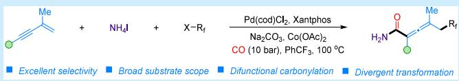
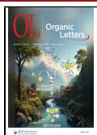
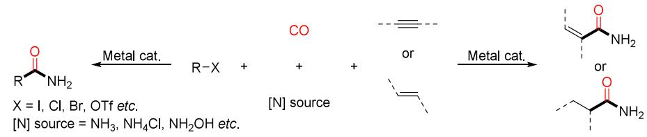
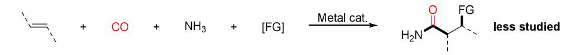
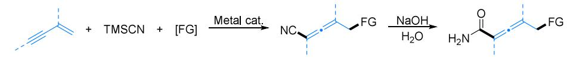
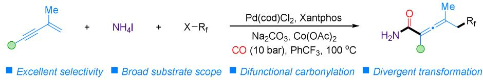
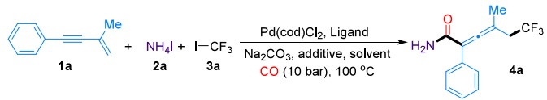
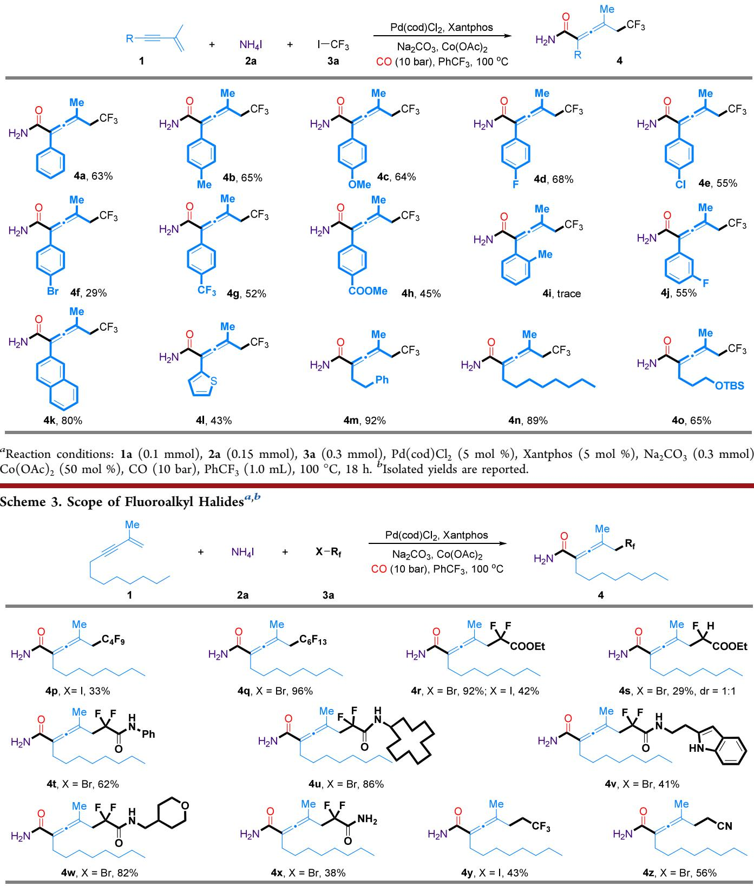
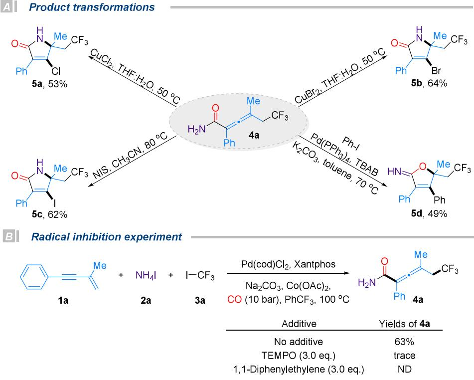
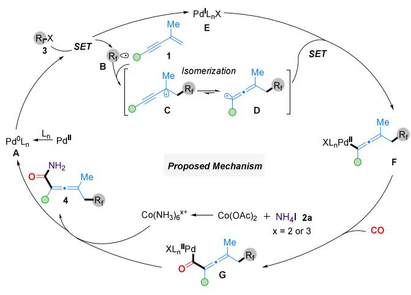

pubs.acs.org/OrgLett

Letter

# Palladium-Catalyzed Carbonylative Fluoroalkylation of 1,3-Enynes to Access Allenyl Primary Amides

Chang-Sheng Kuai, Ru-Han A, Zhi-Peng Bao, and Xiao-Feng Wu\*

Cite This: Org. Lett. 2025, 27, 9807−9813

Read Online

## ACCESS

Metrics & More

ABSTRACT: A palladium-catalyzed difunctional fluoroalkylative carbonylation of 1,3-enynes with fluoroalkyl halides and ammonium iodide has been developed, providing rapid access to fluoroalkylated allenyl primary amides with a broad substrate scope, high chemo- and regioselectivity, and good functional group tolerance.

P rimary amines, as structurally simple yet functionally diverse nitrogen-containing compounds, are widely distributed in natural products, pharmaceuticals, agrochemicals, and functional materials.1 They not only play pivotal roles within molecular architectures but also serve as key intermediates in multistep organic synthesis.2 Accordingly, the development of eficient, selective, and broadly applicable methods for the synthesis of primary amines is of great significance across the fields of organic synthesis, biomedical research, and materials science.

Among the various synthetic strategies, transition-metalcatalyzed carbonylation reactions have emerged as exceptionally powerful tools, ofering one of the most direct and eficient methods for the construction of primary amides because of their high atom economy and excellent functional group compatibility. For example, early studies primarily employed aryl (pseudo)halides as electrophiles in Heck-type carbonylation reactions, leading to the development of various synthetic methods for aryl primary amides (Scheme 1A).3 Subsequently, elegant work by the groups of Huang,4 Liu,5 and others6 not only expanded the scope to include the hydroamidation of alkenes and alkynes but also circumvented the use of weakly coordinating, highly corrosive, and hazardous gaseous ammonia by employing surrogate ammonia sources, thereby enabling eficient access to a broad range of alkyl and allyl primary amides (Scheme 1A).

Despite these advances, most of these strategies remain inherently limited to monofunctionalization, typically afording structurally simple products. Such limitations restrict the eficient construction of molecular complexity and functional diversity in a single transformation. To overcome these challenges, multicomponent difunctional carbonylation reactions have attracted a growing interest. These reactions enable the simultaneous installation of two distinct functional groups in a single step, providing a highly atom- and step-economical approach to structurally complex and functionally rich molecules. In this context, both Beller’s group7 and our own8 have independently developed difunctional carbonylation

Article Recommendations

\*sı Supporting Information

strategies for alkenes, enabling the eficient synthesis of structurally diverse alkyl primary amides and thereby demonstrating the feasibility and synthetic potential of this approach (Scheme 1B). However, most reported examples have predominantly focused on the formation of secondary and tertiary amides, while the direct synthesis of primary amides has remained relatively underexplored. In addition, the substrate scope has been largely limited to simple alkyl frameworks, highlighting the urgent need for more general and functionally enriched carbonylation strategies capable of constructing structurally complex and diverse primary amide scafolds.

On the other hand, allenes are versatile and reactive intermediates widely present in natural products, pharmaceuticals, and functional materials.9 The integration of allene scafolds with primary amide groups within a single molecular framework not only expands the structural diversity of nitrogen-containing allenes but also provides valuable platforms for drug discovery, molecular probes, and functional materials (Scheme 1C). To date, the synthesis of allenyl primary amides has predominantly relied on a two-step sequence involving difunctional cyanation of 1,3-enynes followed by hydrolysis.10 Although efective, this approach sufers from poor atom economy and step ineficiency, failing to meet the growing demand for streamlined and sustainable synthetic methods. Therefore, the development of one-step difunctional carbonylation protocols that directly assemble allenyl primary amides remains a highly desirable yet unmet challenge.

Scheme 1. Catalytic Carbonylation Strategies for the Synthesis of Primary Amides

ÀMonofunctional carbonylation for the synthesis of primary amides.

BIDifunctional carbonylation for the synthesis of primary amides.

CIClassical two-steps synthesis of allenyl primary amides.

DI This work: Difunctional carbonylation to allenyl primary amides.

  
Table 1. Optimization of the Reaction Conditionsa

Building on our continued interest in carbonylation chemistry,11 we herein report a palladium-catalyzed difunctional carbonylation of 1,3-enynes that enables the eficient one-step construction of allenyl primary amides from readily available substrates under mild conditions (Scheme 1D). Notably, the concurrent incorporation of a fluoroalkyl group into the allenyl primary amide framework not only significantly enhances the electronic properties and lipophilicity of the products but also improves their metabolic stability and pharmacokinetic profiles, further expanding the application potential of allenyl primary amides in fields such as medicine and materials science.

At the outset, we initiated our investigation using 1,3-enyne 1a, ammonium iodide (2a), and trifluoroiodomethane (3a) as model substrates (Table 1). The reaction was carried out under 10 bar CO at $1 0 0 ~ ^ { \circ } \mathrm { C } ,$ employing $\mathrm { P d } ( \mathrm { c o d } ) \mathrm { C l } _ { 2 }$ as the catalyst precursor, cobalt(II) acetate as an additive, and ${ \bf N a } _ { 2 } { \bf C O } _ { 3 }$ as the base with trifluorotoluene as the solvent. We first examined the influence of ligands on the reaction outcome (Table 1, entries 1−8). Under monodentate phosphine conditions, the use of triphenylphosphine delivered the desired product 4a in 4% yield (Table 1, entry 2). Although the eficiency was low, this result validated the feasibility of the proposed reaction strategy. Encouraged by this initial success, we next evaluated a series of bidentate phosphine ligands, focusing on the impact of their bite angles on the catalytic activity. Notably, BINAP, dppe, dppp, and dppf failed to promote the transformation (Table 1, entries 3−6). In sharp contrast, Xantphos proved to be highly efective, afording the target product in 64% yield (Table 1, entry 8). These findings underscore the critical role of ligand geometry in facilitating the tandem difunctional carbonylation process. We next investigated the influence of Lewis acid additives on the reaction outcome. In the absence of cobalt(II) acetate, the reaction yield sharply decreased to 33% (Table 1, entry 9), indicating its promoting role in the transformation. We then screened other types of Lewis acidic metal salts, including CuBr , MgCl , Fe(OTf) , and $\mathrm { C e C l } _ { 3 }$ (Table 1, entries 10−13).

<table><tr><td colspan="2"></td><td colspan="2"></td><td></td><td></td></tr><tr><td>entry</td><td>ligand</td><td colspan="2">additive</td><td>solvent</td><td>yield of 4a (%)b</td></tr><tr><td>1 2</td><td> $\mathrm { P C } _ { \mathbf { \nabla } y _ { 3 } }$ </td><td colspan="2"> ${ \mathrm { C o } } ( { \mathrm { O A c } } ) _ { 2 }$ </td><td> $\mathrm { P h C F } _ { 3 }$ </td><td>ND</td></tr><tr><td></td><td>PPh3</td><td colspan="2"> ${ \mathrm { C o } } ( { \mathrm { O A c } } ) _ { 2 }$ </td><td> $\mathrm { P h C F } _ { 3 }$ </td><td>4</td></tr><tr><td>3</td><td>BINAP</td><td colspan="2">Co(OAc)₂</td><td> $\mathrm { P h C F } _ { 3 }$ </td><td>ND</td></tr><tr><td>4</td><td>DPPE</td><td colspan="2">Co(OAc)₂</td><td> $\mathrm { P h C F } _ { 3 }$ </td><td>ND</td></tr><tr><td>5</td><td>DPPP</td><td colspan="2">Co(OAc)₂</td><td> $\mathrm { P h C F } _ { 3 }$ </td><td>ND</td></tr><tr><td>6</td><td>DPPF</td><td colspan="2">Co(OAc)₂</td><td> $\mathrm { P h C F } _ { 3 }$ </td><td>ND</td></tr><tr><td>7</td><td>Dpephos</td><td colspan="2"> ${ \mathrm { C o } } ( { \mathrm { O A c } } ) _ { 2 }$ </td><td> $\mathrm { P h C F } _ { 3 }$ </td><td>5</td></tr><tr><td>8</td><td>Xantphos</td><td colspan="2"> ${ \mathrm { C o } } ( { \mathrm { O A c } } ) _ { 2 }$ </td><td> $\mathrm { P h C F } _ { 3 }$ </td><td>64</td></tr><tr><td>9</td><td>Xantphos</td><td colspan="2">一</td><td> $\mathrm { P h C F } _ { 3 }$ </td><td>33</td></tr><tr><td>10</td><td>Xantphos</td><td colspan="2"> $\mathrm { C u B r } _ { 2 }$ </td><td> $\mathrm { P h C F } _ { 3 }$ </td><td>ND</td></tr><tr><td>11</td><td>Xantphos</td><td colspan="2"> $\mathbf { M g C l } _ { 2 }$ </td><td> $\mathrm { P h C F } _ { 3 }$ </td><td>52</td></tr><tr><td>12</td><td>Xantphos</td><td colspan="2"> $\mathrm { F e } ( \mathrm { O T f } ) _ { 3 }$ </td><td> $\mathrm { P h C F } _ { 3 }$ </td><td>58</td></tr><tr><td>13</td><td>Xantphos</td><td colspan="2"> $\mathrm { C e C l } _ { 3 }$ </td><td> $\mathrm { P h C F } _ { 3 }$ </td><td>28</td></tr><tr><td>14</td><td>Xantphos</td><td colspan="2"> ${ \mathrm { C o } } ( { \mathrm { O A c } } ) _ { 2 }$ </td><td> $\mathrm { P h C F } _ { 3 }$ </td><td>55c</td></tr><tr><td>15</td><td>Xantphos</td><td colspan="2"> ${ \mathrm { C o } } ( { \mathrm { O A c } } ) _ { 2 }$ </td><td> $\mathrm { P h C F } _ { 3 }$ </td><td> $6 0 ^ { d }$ </td></tr><tr><td>16</td><td>Xantphos</td><td colspan="2"> ${ \mathrm { C o } } ( { \mathrm { O A c } } ) _ { 2 }$ </td><td>toluene</td><td>53</td></tr><tr><td>17</td><td>Xantphos</td><td colspan="2">Co(OAc)₂</td><td>DCE</td><td>39</td></tr><tr><td>18</td><td>Xantphos</td><td colspan="2">Co(OAc)₂</td><td>THF</td><td>16</td></tr><tr><td>19</td><td>Xantphos</td><td colspan="2">Co(OAc)₂</td><td>DMF</td><td>ND</td></tr><tr><td>20</td><td>Xantphos</td><td colspan="2">Co(OAc)₂</td><td>DMSO</td><td>ND</td></tr></table>

aReaction conditions: 1a (0.1 mmol), 2a (0.15 mmol), 3a (0.3 mmol), Pd(cod)Cl (5 mol %), ligand (10 mol % for mono-P; 5 mol % for bis-P), Na CO (0.3 mmol), additive (50 mol %), CO (10 bar), PhCF3 (1.0 mL), 100 °C, 18 h. bDetermined by GC using nhexadecane as the internal standard. cCo(OAc) (10 mol %). $^ { d } { \mathrm { C o } } ( { \mathrm { O A c } } ) _ { 2 }$ (100 mol %).

Scheme 2. Scope of 1,3-Enynesa,b  
  
aReaction conditions: 1a (0.1 mmol), 2a (0.15 mmol), 3a (0.3 mmol), $\mathrm { P d } ( \mathrm { c o d } ) \mathrm { C l } _ { 2 }$ (5 mol %), Xantphos (5 mol %), ${ \bf N a } _ { 2 } { \bf C O } _ { 3 }$ (0.3 mmol), ${ \mathrm { C o } } ( { \mathrm { O A c } } ) _ { 2 }$ (50 mol %), CO (10 bar), PhCF (1.0 mL), 100 °C, 18 h. bIsolated yields are reported.

However, under standard conditions, ${ \mathrm { C o } } ( { \mathrm { O A c } } ) _ { 2 }$ consistently exhibited superior activity, outperforming all other additives tested. Subsequently, we examined the efect of ${ \mathrm { C o } } ( { \mathrm { O A c } } ) _ { 2 }$ loading on the reaction eficiency. Varying the amount of this

  
Scheme 4. Product Transformations and Mechanistic Studies

AI Product transformations

additive, either increasing or decreasing from the standard, failed to further enhance the yield (Table 1, entries 14 and 15). Finally, we evaluated the impact of the solvent polarity on the reaction eficiency. A clear trend was observed, wherein increasing solvent polarity led to diminished reactivity. Among the solvents tested, trifluorotoluene proved to be optimal, outperforming other nonpolar solvents (Table 1, entries 16−20). With regard to the amine source, $\mathrm { N H _ { 4 } C l , }$ $( \mathrm { N H } _ { 4 } ) _ { 2 } \mathrm { C O } _ { 3 } ,$ and $\mathrm { N H } _ { 4 } \mathrm { H C O } _ { 3 }$ were also tested but led to low or no desired amide product.

To evaluate the generality of this palladium-catalyzed tandem difunctional carbonylation reaction, we next examined the substrate scope of 1,3-enynes under the optimized catalytic conditions (Scheme 2). We began by exploring a series of arylsubstituted 1,3-enynes bearing a range of electronic and steric substituents. Enynes bearing electron-donating groups such as Me and OMe, halogens (F, Cl, and Br), and electronwithdrawing groups, including trifluoromethyl and ester groups, were well-tolerated, afording the corresponding allenyl primary amides in moderate to good yields (4a−4h). Notably, the bromo-substituted aryl enyne delivered the desired product in a slightly reduced yield of 29% (4f), which may be attributed to undesired side reactions such as oxidative addition of the aryl−Br bond under the palladium-catalyzed conditions. In contrast, enynes bearing ortho substituents such as a methyl group furnished only trace amounts of product, likely due to steric hindrance destabilizing the key allenylpalladium intermediate and impeding the catalytic cycle. A m-fluorosubstituted enyne exhibited good reactivity, furnishing the target product in 55% yield (4j). Enynes bearing extended aromatic systems, such as a naphthyl group, also participated eficiently in the transformation, afording the product in 80% yield (4k). Moreover, the reaction was compatible with heteroaryl systems, as demonstrated by the successful trans formation of a thiophenyl-substituted 1,3-enyne into the corresponding product (4l). Encouraged by these results, we further explored alkyl-substituted 1,3-enynes, including substrates with linear alkyl chains such as phenylpropyl and octyl groups as well as ones bearing heteroatom-based functional groups, such as a silyl ether (OTBS). Gratifyingly, all of these substrates underwent smooth conversion under the standard conditions, afording the corresponding fluoroalkylated allenyl primary amides in synthetically useful to high yields (4m−4o). These results underscore the broad functional group tolerance and synthetic applicability of this catalytic system. However, no desired product could be detected when the methyl group at the 2-position of the enyne was replaced with $\mathsf { a } - \mathrm { C F } _ { 3 }$ or Ph group.

We further investigated the scope of the fluoroalkyl halides in this transformation (Scheme 3). In the examination of perfluoroalkyl halides, we observed that iodides were significantly less reactive than their bromide counterparts $( 4 p , ~ 4 9 )$ , likely due to the generation rate of fluoroalkyl radicals, which afects the overall eficiency and compatibility of the reaction. This trend was further supported by the results obtained with bromodifluoroacetate and iododifluoroacetate, which gave the corresponding product 4r in 92% and 42% yield, respectively. When the number of fluorine atoms was reduced, as in the case of monofluoroacetate, the reaction yield dropped sharply to 29%, highlighting the essential role of fluorine atoms in stabilizing the generated fluoroalkyl radicals (4s). Next, we examined the applicability of bromodifluoroacetamide derivatives bearing reactive N−H functionalities. A variety of such substrates, including those bearing aryl, alkyl, heterocyclic, and even primary amide groups, were found to be compatible with the catalytic system, afording the desired products in good yields (4t−4x). Notably, 2-iodo-1,1,1- trifluoropropane and bromoacetonitrile, bearing an additional methylene unit, also underwent smooth transformation under the standard conditions, furnishing the corresponding allenyl primary amide products 4y and 4z in 43% and 56% yield, respectively.

To further highlight the synthetic utility and diversification potential of this strategy, a series of representative downstream transformations of the highly reactive allenyl primary amide intermediate were conducted, as depicted in Scheme $4 \mathrm { A } .$ The multifunctional nature of this scafold enables straightforward access to structurally complex and value-added heterocycles under mild conditions. For example, compound 4a underwent eficient intramolecular cyclization in the presence of stoichiometric amounts of $\mathrm { C u C l } _ { 2 }$ and CuBr2 in aqueous tetrahydrofuran, furnishing the corresponding halogenated pyrrol-2-ones 5a and 5b in good yields. Similarly, treatment with N-iodosuccinimide (NIS) provided the corresponding iodo analogue 5c in 62% yield. These alkenyl halides, bearing synthetically versatile C−X bonds, serve as ideal precursors for further derivatization through classical cross-coupling reactions, expanding the molecular complexity in a modular fashion. Notably, under palladium catalysis, the allenyl primary amide underwent direct coupling with iodobenzene to furnish the iminolactone product 5d, further highlighting the broad applicability and modular nature of this transformation platform.

To gain insight into the reaction mechanism of this difunctional fluoroalkylative carbonylation for the synthesis of allenyl primary amides, radical inhibition studies were conducted (Scheme 4B). When the standard reaction was carried out in the presence of the radical scavenger TEMPO, only trace amounts of the desired product were detected, indicating that the reaction was significantly inhibited. Moreover, the addition of 1,1-diphenylethylene completely inhibited product formation. These observations strongly suggest that the transformation proceeds through a radicalmediated pathway.

Based on mechanistic studies and relevant literature precedents,12 a plausible catalytic cycle is proposed as depicted in Scheme 5. At the initial stage, the $\mathrm { P d } ^ { \mathrm { I I } }$ precatalyst is reduced allenyl radical D. The $\mathrm { P d ^ { I } L } _ { n } \mathrm { X }$ species E then traps allenyl radical D to form $\mathrm { P d ^ { I I } - a l l e n y l }$ complex F, which undergoes carbon monoxide insertion to yield acylpalladium intermediate G. Under basic conditions, ammonium iodide (2a) might react with ${ \mathrm { C o } } ( { \mathrm { O A c } } ) _ { 2 }$ to give ${ \mathfrak { a } } \ \mathbf { C o } \bigl ( \mathbf { N H } _ { 3 } \bigr ) _ { 6 } { } ^ { x + }$ complex $( x = 2$ or 3) with various anions, which then attacks intermediate $\mathbf { G } ,$ followed by reductive elimination to aford the allenyl primary amide product 4a. Concurrently, the ${ \mathrm { P d } } ^ { 0 } \mathrm { L } _ { n }$ catalytic species is regenerated, thus completing the catalytic cycle.

Scheme 5. Proposed Mechanism  
  
in situ to the active ${ \mathrm { P d } } ^ { 0 } \mathrm { L } _ { n }$ species A under ligand assistance. Subsequently, the ${ \mathrm { P d } } ^ { 0 } \mathrm { L } _ { n }$ complex A undergoes single-electron transfer (SET) with the fluoroalkyl halide $( \mathrm { R } _ { \mathrm { f } } - \mathrm { X } , \ 3 ) ,$ generating fluoroalkyl radical B and $\operatorname { \dot { P } d ^ { I } L } _ { n } X$ species E. The resulting fluoroalkyl radical B rapidly adds to the $^ { 1 , 3 \cdot }$ -enyne (1), forming propargyl radical intermediate $\mathbf { C } ,$ which then undergoes fast radical isomerization to aford the more stable

In summary, we have developed a palladium-catalyzed difunctional fluoroalkylative carbonylation of 1,3-enynes that enables the eficient, modular, and one-step synthesis of fluoroalkyl-substituted allenyl primary amides from readily accessible starting materials. This transformation features a broad substrate scope, excellent functional group tolerance, and high chemo- and regioselectivity under mild conditions. The resulting fluoroalkylated allenyl primary amides are valuable scafolds with great potential for drug discovery and functional material development.

## ■ ASSOCIATED CONTENT

## Data Availability Statement

The data underlying this study are available in the published article and its Supporting Information.

## \*sı Supporting Information

The Supporting Information is available free of charge at https://pubs.acs.org/doi/10.1021/acs.orglett.5c03213.

Experimental details, characterization data, and NMR spectra (PDF)

## ■ AUTHOR INFORMATION

## Corresponding Author

Xiao-Feng Wu − Dalian National Laboratory for Clean Energy, Dalian Institute of Chemical Physics, Chinese Academy of Sciences, Dalian 116023, China; University of Chinese Academy of Sciences, Beijing 100049, China; Leibniz-Institut für Katalyse e. V., 18059 Rostock, Germany; orcid.org/0000-0001-6622-3328; Email: xwu2020@ dicp.ac.cn

## Authors

Chang-Sheng Kuai − Dalian National Laboratory for Clean Energy, Dalian Institute of Chemical Physics, Chinese Academy of Sciences, Dalian 116023, China; University of Chinese Academy of Sciences, Beijing 100049, China

Ru-Han A − Dalian National Laboratory for Clean Energy, Dalian Institute of Chemical Physics, Chinese Academy of Sciences, Dalian 116023, China; Leibniz-Institut für Katalyse e. $V _ { \cdot } ,$ 18059 Rostock, Germany

Zhi-Peng Bao − Dalian National Laboratory for Clean Energy, Dalian Institute of Chemical Physics, Chinese Academy of Sciences, Dalian 116023, China; Leibniz-Institut für Katalyse e. $V _ { \cdot } ,$ 18059 Rostock, Germany

Complete contact information is available at: https://pubs.acs.org/10.1021/acs.orglett.5c03213

## Notes

The authors declare no competing financial interest.

## ■ ACKNOWLEDGMENTS

We thank the National Key R&D Program of China (2023YFA1507500) and DICP for financial support.

## ■ REFERENCES

(1) (a) Bray, B. L. Large-scale manufacture of peptide therapeutics by chemical synthesis. Nat. Rev. Drug Discovery 2003, 2, 587−593. (b) Allen, C. L.; Williams, J. M. J. Metal-catalysed approaches to amide bond formation. Chem. Soc. Rev. 2011, 40, 3405−3415. (c) Pattabiraman, V. R.; Bode, J. W. Rethinking amide bond synthesis. Nature 2011, 480, 471−479. (d) de Figueiredo, R. M.; Suppo, J.-S.; Campagne, J.-M. Nonclassical Routes for Amide Bond Formation. Chem. Rev. 2016, 116, 12029−12122. (e) Wang, Q.; Su, Y.; Li, L.; Huang, H. Transition-metal catalysed C−N bond activation. Chem. Soc. Rev. 2016, 45, 1257−1272. (f) Cai, S.; Zhang, H.; Huang, H. Transition-Metal-Catalyzed Hydroaminocarbonylations of Alkenes and Alkynes. Trends Chem. 2021, 3, 218−230.

(2) (a) Jenkins, S. S. The Grignard Reaction in the Synthesis of Ketones. I. A New Method of Preparing Desoxybenzoins. J. Am. Chem. Soc. 1933, 55, 703−706. (b) Ruck, R. T.; Bergman, R. G. Zirconium-Mediated Conversion of Amides to Nitriles: A Surprising Additive Effect. Angew. Chem., Int. Ed. 2004, 43, 5375−5377. (c) Gooßen, L. J.; Salih, K. S. M.; Blanchot, M. Synthesis of Secondary Enamides by Ruthenium-Catalyzed Selective Addition of Amides to Terminal Alkynes. Angew. Chem., Int. Ed. 2008, 47, 8492− 8495. (d) Valeur, E.; Bradley, M. Amide bond formation: beyond the myth of coupling reagents. Chem. Soc. Rev. 2009, 38, 606−631.

(3) (a) Morera, E.; Ortar, G. A palladium-catalyzed carbonylative route to primary amides. Tetrahedron Lett. 1998, 39, 2835−2838. (b) Wu, X.; Wannberg, J.; Larhed, M. Hydroxylamine as an ammonia equivalent in microwave-enhanced aminocarbonylations. Tetrahedron 2006, 62, 4665−4670. (c) Wu, X.-F.; Neumann, H.; Beller, M. Development of a Second Generation Palladium Catalyst System for the Aminocarbonylation of Aryl Halides with CO and Ammonia. Chem.�Asian J. 2010, 5, 2168−2172. (d) Wu, X.-F.; Neumann, H.; Beller, M. Selective Palladium-Catalyzed Aminocarbonylation of Aryl Halides with CO and Ammonia. Chem.�Eur. J. 2010, 16, 9750− 9753. (e) Nielsen, D. U.; Taaning, R. H.; Lindhardt, A. T.; Gøgsig, T. M.; Skrydstrup, T. Palladium-Catalyzed Approach to Primary Amides Using Nongaseous Precursors. Org. Lett. 2011, 13, 4454−4457. (f) Alsabeh, P. G.; Stradiotto, M.; Neumann, H.; Beller, M. Aminocarbonylation of (Hetero)aryl Bromides with Ammonia and Amines using a Palladium/DalPhos Catalyst System. Adv. Synth. Catal. 2012, 354, 3065−3070. (g) Wu, X.-F.; Neumann, H.; Beller, M. A. General Palladium-Catalyzed Aminocarbonylation of Phenols to Primary Benzamides via In Situ Generation of Aryl Nonaflates. Chem.�Eur. J. 2012, 18, 419−422. (h) Mane, R. S.; Bhanage, B. M. Pd/C-catalyzed facile synthesis of primary aromatic amides by aminocarbonylation of aryl iodides using ammonia surrogates. RSC Adv. 2015, 5, 76122−76127. (i) Suresh, A. S.; Baburajan, P.; Ahmed, M. Synthesis of primary amides by aminocarbonylation of aryl/hetero halides using non-gaseous NH and CO sources. Tetrahedron Lett. 2015, 56, 4864−4867. (j) Suzuka, T.; Sueyoshi, H.; Ogihara, K. Recyclable Polymer-Supported Terpyridine−Palladium Complex for the Tandem Aminocarbonylation of Aryl Iodides to Primary Amides in Water Using NaN as Ammonia Equivalent Catalysts. Catalysts 2017, 7, No. 107. (k) Wang, D.-L.; Liu, H.; Yang, D.; Wang, P.; Lu, Y.; Liu, Y. Aminocarbonylation of Aryl Halides to Produce Primary Amides by Using NH4HCO3 Dually as Ammonia Surrogate and Base. ChemCatChem 2017, 9, 4206−4211.

(4) (a) Gao, B.; Zhang, G.; Zhou, X.; Huang, H. Palladium-catalyzed regiodivergent hydroaminocarbonylation of alkenes to primary amides with ammonium chloride. Chem. Sci. 2018, 9, 380−386. (b) Ji, X.; Gao, B.; Zhou, X.; Liu, Z.; Huang, H. Palladium-Catalyzed Regioselective Hydroaminocarbonylation of Alkynes to α,β-Unsaturated Primary Amides with Ammonium Chloride. J. Org. Chem. 2018, 83, 10134−10141.

(5) (a) Wang, D.-L.; Guo, W.-D.; Zhou, Q.; Liu, L.; Lu, Y.; Liu, Y. Hydroaminocarbonylation of Alkynes to Produce Primary α,β- Unsaturated Amides Using NH4HCO3 Dually as Ammonia Surrogate and Brønsted Acid Additive. ChemCatChem 2018, 10, 4264−4268. (b) Wang, P.; Liu, L.; Luo, Z.; Zhou, Q.; Lu, Y.; Xia, F.; Liu, Y. Combination of transition metal Rh-catalysis and tautomeric catalysis through a bi-functional ligand for one-pot tandem methoxycarbonylation-aminolysis of olefins towards primary amides. J. Catal. 2018, 361, 230−237.

(6) (a) Sargent, B. T.; Alexanian, E. J. Cobalt-Catalyzed Aminocarbonylation of Alkyl Tosylates: Stereospecific Synthesis of Amides. Angew. Chem., Int. Ed. 2019, 58, 9533−9536. (b) Huang, Z.; Tang, J.; Jiang, X.; Xie, T.; Zhang, M.; Lan, D.; Pi, S.; Tan, Z.; Yi, B.; Li, Y. Iron-catalyzed hydroaminocarbonylation of alkynes: Selective and efficient synthesis of primary α,β-unsaturated amides. Chin. Chem. Lett. 2022, 33, 4842−4845. (c) Wang, L.-C.; Chen, B.; Wu, X.-F. Cobalt-Catalyzed Direct Aminocarbonylation of Ethers: Efficient Access to α-Amide Substituted Ether Derivatives. Angew. Chem., Int. Ed. 2022, 61, No. e202203797. (d) Faculak, M. S.; Veatch, A. M.; Alexanian, E. J. Cobalt-catalyzed synthesis of amides from alkenes and amines promoted by light. Science 2024, 383, 77−81. (e) Yang, P.; Zhao, Y.-H.; Brockmann, T.; Liu, Y.-K.; Wu, X.-F. Cobalt-catalyzed hydroaminocarbonylation of C-C σ bond of bicyclo[1.1.0]butanes toward cyclobutanecarboxamides. Cell Rep. Phys. Sci. 2025, 6, No. 102346.

(7) Wang, Y.; Wang, P.; Neumann, H.; Beller, M. Cobalt-Catalyzed Multicomponent Carbonylation of Olefins: Efficient Synthesis of β- Perfluoroalkyl Imides, Amides, and Esters. ACS Catal. 2023, 13, 6744−6753.

(8) (a) Wu, F.-P.; Yuan, Y.; Wu, X.-F. Copper-Catalyzed 1,2- Trifluoromethylation Carbonylation of Unactivated Alkenes: Efficient Access to β-Trifluoromethylated Aliphatic Carboxylic Acid Derivatives. Angew. Chem., Int. Ed. 2021, 60, 25787−25792. (b) Wang, L.- C.; Chen, B.; Zhang, Y.; Wu, X.-F. Nickel-Catalyzed Four-Component Carbonylation of Ethers and Olefins: Direct Access to γ-Oxy Esters and Amides. Angew. Chem., Int. Ed. 2022, 61, No. e202207970. (c) Zhang, Y.; Yuan, Y.; Geng, H.-Q.; Xu, J.-X.; Wu, X.-F. Visible light-induced perfluoroalkylative carbonylation of unactivated alkenes. J. Catal. 2022, 413, 214−220.

(9) (a) Hoffmann-Röder, A.; Krause, N. Synthesis and Properties of Allenic Natural Products and Pharmaceuticals. Angew. Chem., Int. Ed. 2004, 43, 1196−1216. (b) Ma, S. Some Typical Advances in the Synthetic Applications of Allenes. Chem. Rev. 2005, 105, 2829−2872. (c) Xu, D.; Drahl, M. A.; Williams, L. J. Toward an integrated route to the vernonia allenes and related sesquiterpenoids. Beilstein J. Org. Chem. 2011, 7, 937−943. (d) Rivera-Fuentes, P.; Diederich, F. Allenes in Molecular Materials. Angew. Chem., Int. Ed. 2012, 51, 2818−2828. (e) Yu, S.; Ma, S. Allenes in Catalytic Asymmetric Synthesis and Natural Product Syntheses. Angew. Chem., Int. Ed. 2012, 51, 3074−3112. (f) Ye, J.; Ma, S. Palladium-Catalyzed Cyclization Reactions of Allenes in the Presence of Unsaturated Carbon—Carbon Bonds. Acc. Chem. Res. 2014, 47, 989−1000.

(10) (a) Zhu, X.; Deng, W.; Chiou, M.-F.; Ye, C.; Jian, W.; Zeng, Y.; Jiao, Y.; Ge, L.; Li, Y.; Zhang, X.; Bao, H. Copper-Catalyzed Radical 1,4-Difunctionalization of 1,3-Enynes with Alkyl Diacyl Peroxides and N-Fluorobenzenesulfonimide. J. Am. Chem. Soc. 2019, 141, 548−559. (b) Liu, Q.; Zheng, J.; Zhang, X.; Ma, S. Photo and copper dual catalysis for allene syntheses from propargylic derivatives via oneelectron process. Nat. Commun. 2022, 13, No. 3302. (c) Peng, K.; Cao, Y.-S.; Wang, Q.; Xia, Z.; Chen, Y.; Lu, Y.; Deng, G.-J. Metallaphotoredox Synthesis of Axially Chiral Tetrasubstituted Allenes through Regio- and Enantioselective 1,4-Carbocyanation of 1,3-Enynes. ACS Catal. 2024, 14, 14048−14057. (d) Wei, Y.; Wang, Z.; Wang, K.; Qiu, J.-K.; Wang, Z.; Li, H.; Duan, X.; Guo, K.; Bao, X.; Wu, X. Copper-Catalyzed Radical Allene C(sp2)−H Cyanation. Angew. Chem., Int. Ed. 2024, 63, No. e202317132. (e) Wang, P.-Z.; Zhang, Z.; Jiang, M.; Chen, J.-R.; Xiao, W.-J. A General Copper-Box System for the Asymmetric Arylative Functionalization of Benzylic, Propargylic or Allenylic Radicals. Angew. Chem., Int. Ed. 2024, 63,

No. e202411469. (f) Chen, Y.; Wang, Q.; Peng, K.; Cheng, L.; She, Z.; Deng, G.-J. Copper/Photoredox-Catalyzed Regioselective 1,4- Addition to 1,3-Enynes: A Convenient Access to Perfluoroalkylated Allenes. Chin. J. Chem. 2024, 42, 2023−2028. (g) Wang, Q.; Peng, K.; Yao, X.; Yuan, Y.; Chen, Y.; Deng, G.-J. Nickel-Catalyzed Reductive 1,4-Alkylacylation of 1,3-Enynes Enabling Synthesis of Allenyl Ketones. Org. Lett. 2025, 27, 5788−5793.

(11) (a) Peng, J.-B.; Geng, H.-Q.; Wu, X.-F. The Chemistry of CO: Carbonylation. Chem 2019, 5, 526−552. (b) Peng, J.-B.; Wu, F.-P.; Wu, X.-F. First-Row Transition-Metal-Catalyzed Carbonylative Transformations of Carbon Electrophiles. Chem. Rev. 2019, 119, 2090− 2127. (c) Kuai, C.-S.; Teng, B.-H.; An, D.-L.; Zhao, Y.; Wu, X.-F. Palladium-Catalyzed Regioselective Carbonylation of 2-Trifluoromethyl-1,3-enynes to Multisubstituted Conjugated Dienes. Org. Lett. 2023, 25, 682−687. (d) Kuai, C.-S.; Wang, Y.; Yang, T.; Wu, X.-F. Multimodal Precise Control Over Multiselective Carbonylation of 1,3-Enynes. J. Am. Chem. Soc. 2025, 147, 7950−7964. (e) Kuai, C.-S.; Yuan, Y.; Wu, X.-F. Emerging trends in CO carbonylation. Chem 2025, 11, No. 102503.

(12) (a) Zhang, K.-F.; Bian, K.-J.; Li, C.; Sheng, J.; Li, Y.; Wang, X.- S. Nickel-Catalyzed Carbofluoroalkylation of 1,3-Enynes to Access Structurally Diverse Fluoroalkylated Allenes. Angew. Chem., Int. Ed. 2019, 58, 5069−5074. (b) Dong, X.-Y.; Zhan, T.-Y.; Jiang, S.-P.; Liu, X.-D.; Ye, L.; Li, Z.-L.; Gu, Q.-S.; Liu, X.-Y. Copper-Catalyzed Asymmetric Coupling of Allenyl Radicals with Terminal Alkynes to Access Tetrasubstituted Allenes. Angew. Chem., Int. Ed. 2021, 60, 2160−2164. (c) Bao, Z.-P.; Zhang, Y.; Wu, X.-F. Palladium-catalyzed difluoroalkylative carbonylation of styrenes toward difluoropentanedioates. Chem. Sci. 2022, 13, 9387−9391. (d) Bao, Z.-P.; Wu, X.-F. Palladium-Catalyzed Direct Carbonylation of Bromoacetonitrile to Synthesize 2-Cyano-N-acetamide and 2-Cyanoacetate Compounds. Angew. Chem., Int. Ed. 2023, 62, No. e202301671. (e) Kuai, C.-S.; Teng, B.-H.; Wu, X.-F. Palladium-Catalyzed Carbonylative Multicomponent Fluoroalkylation of 1,3-Enynes: Concise Construction of Diverse Cyclic Compounds. Angew. Chem., Int. Ed. 2024, 63, No. e202318257.