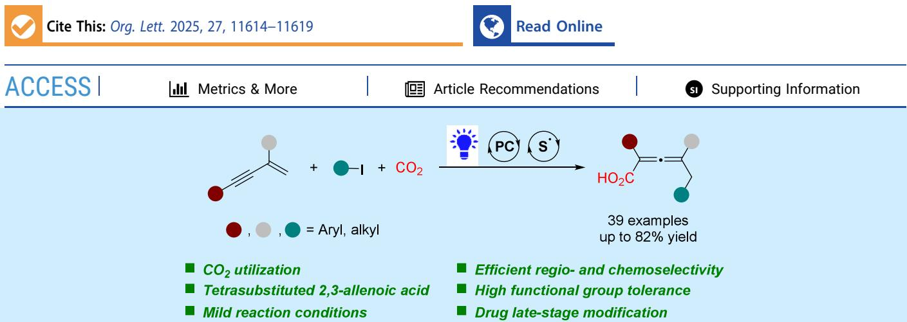
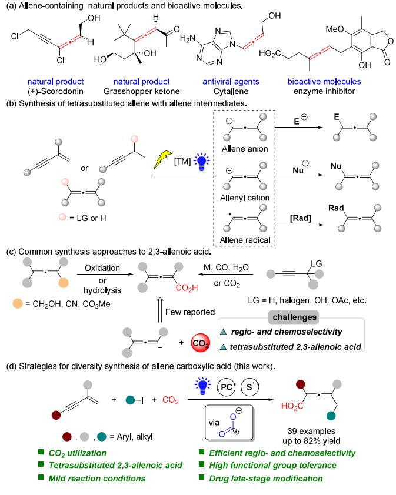
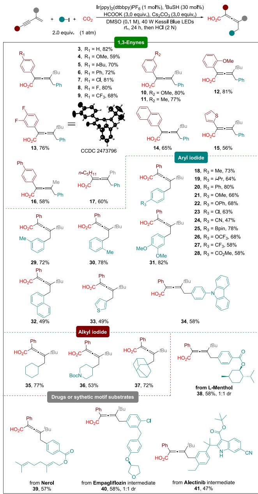
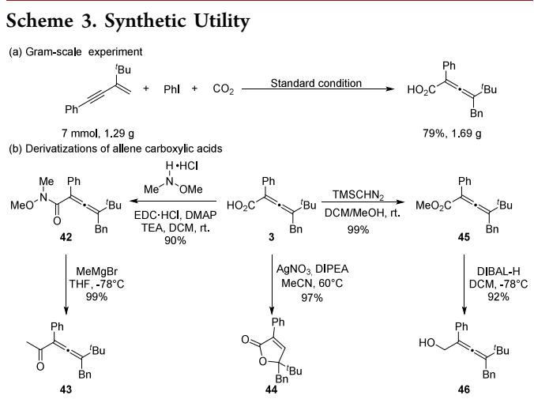
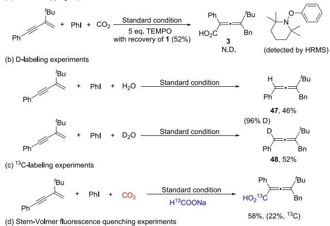
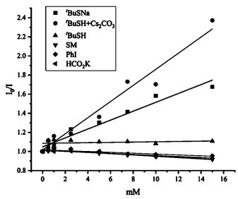
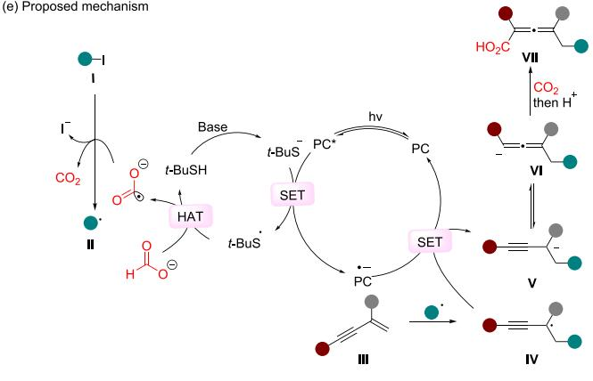

pubs.acs.org/OrgLett

Letter

# Photocatalytic 1,4-Carbocarboxylation of 1,3-Enynes with ${ \mathsf { C O } } _ { 2 }$

Dong-Sen Duan,§ Fu Cheng,§ Li−Ru Chen, Ke-Yang Yu, Yu He, Chi Wang, Wen Bao, Dao-Yong Zhu,\* and Shao-Hua Wang\*

  
ABSTRACT: Herein, we report a photocatalytic regioselective 1,4-carbocarboxylation of 1,3-enynes with $\mathrm { C O } _ { 2 }$ enabled by a thiolmediated hydrogen atom transfer (HAT) and formate cooperative mechanism. This strategy uses formate and $\mathrm { C O } _ { 2 }$ as synergistic carbon sources, to deliver a diverse array of aryl-, heteroaryl-, and alkyl-functionalized tetrasubstituted allene carboxylic acids. The reaction exhibits broad substrate scope across electronically and sterically varied enynes and iodides, and facilitates late-stage functionalization of bioactive molecules. Gram-scale synthesis and derivatization experiments further demonstrate its synthetic utility.

Allenes, characterized by their unique cumulated diene system, are widely found in natural products and bioactive molecules (Scheme $^ { \mathrm { 1 a ) , } }$ 1 and represent highly versatile building blocks in modern organic synthesis and drug design. The radical-mediated approach has emerged as a key strategy for allene synthesis, providing eficient, diverse, and controllable routes to these structures. Its notable advantages include facilitating multifunctionalization and enabling the construction of complex molecular architectures.2 Recent advances have established several efective methods for generating allene intermediates, such as 1,4-additions to 1,3- enynes, 2a,3 activation of propargylic derivatives via leaving groups,2a,b,3a,4 and HAT from preformed allenes5 have been efectively employed to generate allene intermediates (Scheme 1b). The resulting intermediates exhibit broad reactivity, engaging with electrophiles, nucleophiles, and radical coupling partners, thus providing eficient pathways to tetrasubstituted allenes and significantly promoting the synthesis and application of allene-derived compounds.

Among these, multifunctionalized tetrasubstituted 2,3- allenoic acids are of particular interest due to their axially chiral scafolds and notable bioactivity, demonstrating considerable potential in medicinal chemistry and functional materials.6 The carboxylic acid group not only enhances bioavailability but also provides a versatile handle for further derivatization, attracting broad attention from synthetic chemists.1a,7 Conventional synthetic routes to such compounds typically involve the oxidation of allenols or hydrolysis of allene nitriles and esters (Scheme 1c),8 which often sufer from drawbacks including multistep sequences and poor atom economy. Earlier strategies relied on stoichiometric metal reagents to generate allenyl metal intermediates, followed by carboxylation with $\mathrm { C O } _ { 2 } . ^ { 9 }$ Although transition-metal-catalyzed carbonylative reactions using CO allow the introduction of carboxylic acid groups, these methods require high-pressure conditions and expensive metal catalysts.6,10

More recently, electrocatalytic approaches have been developed for the conversion of propargylic derivatives with $\mathrm { C O } _ { 2 }$ into 2,3-allenoic acids under mild conditions.4a,b However, these methods are currently limited to the synthesis of monofunctionalized products. Therefore, the eficient construction of multifunctionalized tetrasubstituted allenoic acids remains a significant and unresolved challenge in synthetic chemistry.

Carbon dioxide, serving as a renewable and abundant C1 synthon, ofers a direct route to high-value carboxylic acids in alignment with green chemistry principles.11 Nevertheless, its high thermodynamic stability and kinetic inertness present substantial challenges for catalytic carboxylation. In this context, photocatalytic carboxylation has emerged as a promising strategy for activating simple substrates, owing to its operational simplicity, sustainability, and cost eficiency.12 Of particular note is the photochemical generation of highly reactive carbon dioxide radical anions (CO •−), which has attracted considerable attention for driving eficient carboxylation reactions under mild conditions.13

Scheme 1. Literature Reports and Our Work  

Inspired by our group’s previous achievements in $\mathrm { C O } _ { 2 }$ 2functionalization,14 we sought to develop a method for synthesizing bifunctionalized tetrasubstituted allene carboxylic acids via the regioselective 1,4-difunctionalization of 1,3- enynes. To overcome the persistent challenge of competitive radical 1,2-additions in such transformations,2a,3a,15 we designed a dual-role photocatalytic system. This approach employs thiol as a HAT catalyst, along with formate acting both as a precursor for $\mathrm { C O } _ { 2 } ^ { \bullet - }$ radicals and an auxiliary carbon source. By engaging a broad range of aryl, heteroaryl, and alkyl iodides, this strategy enables highly selective access to diverse difunctionalized tetrasubstituted 2,3-allenoic acids.

To validate our hypothesis, we employed enyne 1 as the model substrate to investigate the 1,4-carbocarboxylation of 1,3-enynes (Table 1). Systematic optimization of the reaction conditions

revealed that employing $\mathrm { I r } ( \mathsf { p p y } ) _ { 2 } ( \mathrm { d t b b p y } ) \mathrm { P F } _ { 6 }$ as the photocatalyst, tert-butyl thiol as the hydrogen atom transfer (HAT) catalyst, cesium carbonate as the base, and potassium formate as the reductant aforded the target allene carboxylic acid 3 in 82% isolated yield with excellent chemoselectivity (entry 1; see Supporting Information (SI) for detailed optimization). The reaction did not proceed in the absence of blue light irradiation (entry 2), other control experiments confirmed the necessity of all components as omitting photocatalyst, thiol, formate, or base abolished product generation (entry 3). Experiments conducted under a $\Nu _ { 2 }$ atmosphere in the absence of $\mathrm { C O } _ { 2 }$ resulted in a significant decrease in product yield (Entry 4), clearly demonstrating that gaseous $\mathrm { C O } _ { 2 }$ is an essential component of the reaction. Increasing the equivalent amount of formate had limited efect on yield improvement (see SI), indicating that formate primarily functions as a reductant, with only minor and ineficient contribution as a carbon source. Substitution of Ir(ppy) (dtbbpy)PF with 4DPAIPN diminished the yield to 52% (entry 5), while other Ir-photocatalysts exhibited lower eficiency (entry 6). Evaluation of alternative HAT catalysts revealed reduced yields with DABCO (73%) (entry 7). Comprehensive screening of alternative formates, bases, and solvents uniformly resulted in diminished yields (entries 8−10). Other radical precursors, namely both bromobenzene and potassium benzotrifluoroborate, exhibited markedly reduced reactivity compared to iodobenzene, resulting in substantial recovery of starting material. (entries 11−12).

Table 1. Reaction Condition Optimization
<table><tr><td colspan="2">Bu + Phl +</td><td>Ir(ppy)₂(dtbbpy)PF6, &#x27;BuSH HCOOK, Cs2CO3, DMSO (0.1 M) CO2 40 W Kessil Blue LEDs</td><td>Ph Bu HO2C</td></tr><tr><td>Ph 1</td><td>2 (1 atm)</td><td>r.t., 24 h, then HCI (2 N)</td><td>Ph 3</td></tr><tr><td>Entry</td><td></td><td>variation from the above conditions</td><td>yield (%)b</td></tr><tr><td>1 2</td><td>none</td><td></td><td>88 (82) N.D.</td></tr><tr><td>3</td><td>In dark w/o PC/tBuSH/HCO2K</td><td></td><td>N.D.</td></tr><tr><td>4</td><td> $\mathrm { w / o ~ C O _ { 2 } ~ ( N _ { 2 } }$ </td><td>atmosphere)</td><td>31</td></tr><tr><td>5</td><td></td><td>4DPAIPN instead of Ir(ppy)₂(dtbbpy)PF6</td><td>52</td></tr><tr><td>6</td><td></td><td>fac-Ir(ppy)3 instead of Ir(ppy)₂(dtbbpy)PF6</td><td>N.D.</td></tr><tr><td>7</td><td>DABCO instead of tBuSH</td><td></td><td>73</td></tr><tr><td>8</td><td> $_ \mathrm { H C O } _ { 2 } \mathrm { C s }$  instead of</td><td> $_ \mathrm { H C O } _ { 2 } \mathrm { K }$ </td><td>73</td></tr><tr><td>9</td><td> ${ \mathrm { K } } _ { 2 } { \mathrm { C O } } _ { 3 }$  instead of</td><td></td><td></td></tr><tr><td></td><td>DMF instead of DMSO</td><td> $\mathrm { C s } _ { 2 } \mathrm { C O } _ { 3 }$ </td><td>67</td></tr><tr><td>10</td><td>PhBr instead of PhI</td><td></td><td>24</td></tr><tr><td>11</td><td></td><td></td><td>53</td></tr><tr><td>12</td><td>PhBF3K instead of PhI</td><td></td><td>20</td></tr></table>

aReaction conditions: 1 (0.2 mmol), 2 (0.4 mmol), 1 atm $\mathrm { C O } _ { 2 } ,$ Ir(ppy) (dtbbpy)PF (1 mol %), tBuSH (0.1 mmol), HCOOK (0.6 mmol), Cs CO (0.6 mmol), DMSO (2 mL), irradiation with 40 W Kessil Blue LEDs at room temperature (rt) for 24 h, then 2 N HCl. bYields were determined by 1H NMR using dibromomethane as an internal standard, and the isolated yield was given in parentheses.

After carefully screening various reaction parameters, the substrate scope of the 1,4-carbocarboxylation reaction involving 1,3-enynes and iodides was systematically investigated under the optimized conditions (Scheme 2). Enyne substrates bearing electron-donating (methoxy, tert-butyl), neutral (phenyl), and electron- withdrawing (fluoro, chloro, trifluoromethyl) groups all aforded the desired products in moderate to good yields (B), with no significant diference in reactivity observed (3-9). Both ortho- and meta-substituted enynes provided comparable yields (10−12). Difluorosubstituted, fused-ring and heterocyclic enynes were also smoothly converted (13−15). Furthermore, the structure of product 13 was unambiguously determined by X-ray difraction analysis (CCDC 2473796). In addition to tertbutyl-substituted enynes, methyl-substituted enynes were also compatible with this reaction, providing the desired product in moderate yield (16). Furthermore, alkyl-substituted enynes underwent analogous transformation to aford the target product in 60% yield (17).

Scheme 2. Substrate Scope Investigation  

To further broaden the scope of this methodology, we explored the applicability of iodides bearing diverse substituents and substitution patterns. Evaluation of the substrate scope revealed excellent compatibility with aryl iodides containing neutral (methyl, isopropyl, phenyl), electrondonating (methoxy, phenoxy), and electron-withdrawing (chloro, cyano, boronate ester, trifluoromethoxy, trifluoromethyl, ester) groups (18−28, 47%−80%). Nevertheless, strongly electron-withdrawing substituents led to markedly diminished reaction eficiency, as reflected in substantially lower yields (24, 27). Aryl iodides with ortho or meta substituents and disubstituted aryl iodides both maintained good yields (29−31), indicating high tolerance to steric hindrance. Fused-ring iodides (32), sulfur-containing heterocyclic iodides (33), and nitrogen- containing heterocyclic iodides (34) all aforded moderate yields, demonstrating good heteroatom compatibility. In addition to aryl iodides, the methodology was successfully extended to alkyl iodides, as exemplified by the eficient conversion of secondary iodocyclohexane (35), N-Boc-4-iodopiperidine (36), and tertiaryiodoadamantane (37). In contrast, primary alkyl halides exhibited limited reactivity under the current conditions. The method exhibited excellent applicability for the late-stage modification of complex molecules, as iodinated derivatives of L- Menthol, Nerol, Empagliflozin intermediate, and Alectinib intermediate all provided the target carboxylated products in moderate yields (38−41), highlighting its utility for the latestage functionalization of bioactive molecules.

To evaluate the synthetic potential of this reaction, enyne 1 was subjected to gram-scale conditions (7 mmol), afording the allene carboxylic acid product 3 in 79% isolated yield (1.69 g) (Scheme 3a). Serving as a versatile synthetic building block

(Scheme 3b), 3 reacted with methoxy methylamine hydrochloride to furnish Weinreb amide 42 in 90% yield. Subsequent treatment of 42 with methylmagnesium bromide generated allenone 43. Silver nitrate- catalyzed cyclization of 3 proceeded to give furanone 44, featuring an all-carbon quaternary center in 97% yield. Furthermore, 3 underwent one-step esterification with TMSCHN to deliver allenoate 45 in 99% yield, which was conveniently converted to allenol 46 via diisobutylaluminum hydride (DIBAL-H) reduction.

To elucidate the reaction mechanism, $^ { 2 , 2 , 6 , 6 }$ -tetramethylpiperidin-1-oxyl (TEMPO) as a radical scavenger was introduced into the standard reaction system (Scheme 4a). The reaction was completely suppressed with 52% recovery of substrate $^ { 1 , }$ and the TEMPO adduct was detected by HRMS, suggesting a potential radical pathway. When the reaction was conducted under $\Nu _ { 2 }$ atmosphere with added $\mathrm { H } _ { 2 } \mathrm { O } ,$ allene product 47 was obtained in 46% isolated yield. Employing $\mathrm { D } _ { 2 } \mathrm { O }$ aforded deuterated product 48 in 52% yield with 96% deuterium incorporation (Scheme 4b), directly confirming the existence of an allene carbanion intermediate. To elucidate the carboxyl source, $\mathrm { H } ^ { 1 3 } \mathrm { C O O N a }$ was employed as a tracer, and 22% $^ { 1 3 } \mathrm { \dot { C } }$ incorporation was observed at the carboxyl group of the product, indicating that formate also serves as a carbon source for carboxylation (Scheme 4c). Additionally, Stern−Volmer quenching experiments (Scheme 4d) further demonstrated that thiolate efectively quenches the excited state of the photocatalyst.

Based on these results and literature evidence,13a,m a plausible reaction mechanism is proposed (Scheme 4e). Photoexcitation of photocatalyst PC generates excited-state $\mathrm { P C ^ { * } }$ , which undergoes single-electron reduction quenching by

## Scheme 4. Control Experiments and Proposed Mechanism

thiolate to produce reduced $\mathrm { P C } ^ { \bullet - }$ and a thiyl radical. This thiyl radical then activates formate via hydrogen atom transfer (HAT), yielding the key reactive species $\bar { \mathrm { C O } } _ { 2 } ^ { \bullet - }$ . Subsequent reduction of iodide I by $\mathrm { C O } _ { 2 } ^ { \bullet - }$ forms carbon radical II, which adds to enyne III afording propargyl radical $\mathbf { I V } ,$ followed by reduction (via $\mathrm { P C } ^ { \bullet - }$ or $\mathrm { C O } _ { 2 } ^ { \bullet - } )$ to a carbanion intermediate V. Isomerization of $\mathbf { V }$ generates allene carbanion VI and carboxylation with $\mathrm { C O } _ { 2 } ,$ final protonation delivers product VII.

In summary, we have developed an eficient photocatalytic $^ { 1 , 4 \cdot }$ -carbocarboxylation of 1,3-enynes with $\mathrm { C O } _ { 2 }$ to construct tetrasubstituted $^ { 2 , 3 \cdot }$ -allenoic acids under mild conditions. Key to this strategy is the synergistic combination of thiol HAT catalysis and formate, which concurrently generates reactive $\mathrm { C O } _ { 2 } ^ { \bullet - }$ radicals. The method exhibits exceptional functional group tolerance and substrate generality, accommodating diverse (hetero)aryl and alkyl iodides, and enabling late-stage modification of pharmaceuticals. This work establishes a sustainable approach to valuable allene carboxylic acid architectures using formate and $\mathrm { C O } _ { 2 }$ as synergistic carbon sources.

## ■ ASSOCIATED CONTENT

## Data Availability Statement

The data underlying this study are available in the published article and its Supporting Information.

## \*sı Supporting Information

The Supporting Information is available free of charge at https://pubs.acs.org/doi/10.1021/acs.orglett.5c03750.

Experimental procedures, spectra for all new compounds (PDF)

## Accession Codes

Deposition Number 2473796 contains the supplementary crystallographic data for this paper. These data can be obtained free of charge via the joint Cambridge Crystallographic Data Centre (CCDC) and Fachinformationszentrum Karlsruhe Access Structures service.

## ■ AUTHOR INFORMATION

## Corresponding Authors

Shao-Hua Wang − School of Pharmacy and State Key Laboratory of Natural Product Chemistry, Lanzhou University, Lanzhou 730000, People’s Republic of China; orcid.org/0000-0002-4347-8245; Email: wangshh@ lzu.edu.cn

Dao-Yong Zhu − School of Pharmacy and State Key Laboratory of Natural Product Chemistry, Lanzhou University, Lanzhou 730000, People’s Republic of China; orcid.org/0000-0001-7094-8700; Email: zhudy@ lzu.edu.cn

## Authors

Dong-Sen Duan − School of Pharmacy and State Key Laboratory of Natural Product Chemistry, Lanzhou University, Lanzhou 730000, People’s Republic of China

Fu Cheng − School of Pharmacy and State Key Laboratory of Natural Product Chemistry, Lanzhou University, Lanzhou 730000, People’s Republic of China

Li−Ru Chen − School of Pharmacy and State Key Laboratory of Natural Product Chemistry, Lanzhou University, Lanzhou 730000, People’s Republic of China

Ke-Yang Yu − School of Pharmacy and State Key Laboratory of Natural Product Chemistry, Lanzhou University, Lanzhou 730000, People’s Republic of China

Yu He − School of Pharmacy and State Key Laboratory of Natural Product Chemistry, Lanzhou University, Lanzhou 730000, People’s Republic of China

Chi Wang − School of Pharmacy and State Key Laboratory of Natural Product Chemistry, Lanzhou University, Lanzhou 730000, People’s Republic of China

Wen Bao − School of Pharmacy and State Key Laboratory of Natural Product Chemistry, Lanzhou University, Lanzhou 730000, People’s Republic of China

Complete contact information is available at: https://pubs.acs.org/10.1021/acs.orglett.5c03750

## Author Contributions

$^ { \ S } \mathrm { D . } s . \mathrm { D . }$ . and $\mathrm { F . C . }$ contributed equally to this work. Notes

The authors declare no competing financial interest.

## ■ ACKNOWLEDGMENTS

This project was supported by the National Key R&D Program of China (No. 2023YFA1506404), the NSFC (22401123), the Science and Technology Program of Gansu Province (23ZDFA003, 23JRRA1144, 23JRRA1028, 23CXGA0043, 24JRRA941, 24ZDFA003), the Lanzhou science and technology planning project (2023-QN-18, 2023-1-17, 2024-1-17), the Fundamental Research Funds for the Central Universities (lzujbky-2023-ct02, lzujbky-2023-pd08, lzujbky-2024-14, 2025CXZX-106).

## ■ REFERENCES

(1) For selected examples of utilization for allenes: (a) Ma, S. Electrophilic Addition and Cyclization Reactions of Allenes. Acc. Chem. Res. 2009, 42, 1679−1688. (b) Rivera-Fuentes, P.; Diederich, F. Allenes in Molecular Materials. Angew. Chem., Int. Ed. 2012, 51, 2818−2828. (c) Hoffmann-Röder, A.; Krause, N. Synthesis and Properties of Allenic Natural Products and Pharmaceuticals. Angew. Chem., Int. Ed. 2004, 43, 1196−1216. (d) Alonso, J. M.; Almendros, P. Deciphering the Chameleonic Chemistry of Allenols: Breaking the Taboo of a Onetime Esoteric Functionality. Chem. Rev. 2021, 121, 4193−4252.

(2) (a) Li, Y.; Bao, H. Radical Transformations for Allene Synthesis. Chem. Sci. 2022, 13, 8491−8506. (b) Xiao, B.-Y.; Huang, W.; Zhang, F.-H. Recent Advances in the Formation and Transformation of Propargyl Radical. Eur. J. Org. Chem. 2025, 28, No. e202500302. (c) Yi, R.; Li, Q.; Xie, L.-Y.; Wei, W.-T. Radical Functionalization of Allenes. Chem. Commun. 2025, 61, 6426−6438.

(3) (a) Singh, J.; Saxena, B.; Sharma, A. Visible Light Promoted Synthesis of Allenes. Catal. Sci. Technol. 2024, 14, 5143−5160. (b) Du, J.; Liu, A.; Zhang, W.; Luo, S.; Yao, H.; He, Y. Enantio- and Regioselective Ni-Catalyzed Radical Relay 1,4-Arylalkylation of 1,3- Enynes to Access Chiral Tetrasubstituted Allenes. ACS Catal. 2024, 14, 13940−13946. (c) Li, S.; Yuan, K.; Zhang, G.; Guo, R. Recent Advances in the Synthesis of Chiral Allenes via Asymmetric 1,4- Difunctionalization of 1,3-Enynes. Eur. J. Org. Chem. 2024, 27, No. e202301316.

(4) (a) Zhong, Y.; Jiang, M.; Yang, D.; Feng, N.; Sun, Y.; Wang, H.; Zhou, F. Nickel-Catalyzed Electrochemical Carboxylation of Propargylic Esters with CO to 2,3-Allenoic Acids. Chin. Chem. Lett. 2025, 36, 111169. (b) Qin, J.-H.; Xiong, Z.-Q.; Cheng, C.; Hu, M.; Li, J.-H. Electroreductive Carboxylation of Propargylic Acetates with $\mathrm { C O } _ { 2 } { \mathrm { : } }$ Access to Tetrasubstituted 2,3-Allenoates. Org. Lett. 2023, 25, 9176− 9180. (c) Li, W.; Zhou, L. Synthesis of Tetrasubstituted Allenes via Visible-Light-Promoted Radical 1,3-Difunctionalization of Alkynyl Diazo Compounds. Org. Lett. 2022, 24, 3976−3981. (d) Liu, Q.; Zheng, J.; Zhang, X.; Ma, S. Photo and Copper Dual Catalysis for Allene Synthesis from Propargylic Derivatives via a One-Electron Process. Nat. Commun. 2022, 13, 3302. (e) Lu, F.-D.; Shu, Z.-C.; He, G.-F.; Bai, J.-C.; Lu, L.-Q.; Xiao, W.-J. Photoinduced C−O Bond Cleavage for Copper-Catalyzed Allenyl Radical Cyanation. Org. Chem. Front. 2022, 9, 5259−5263. (f) Zhou, Z.-Z.; Zhai, X.-F.; Xia, K.-J.; Song, X.-R.; Ding, H.; Tian, W.-F.; Zhang, S.-L.; Liang, Y.-M.; Xiao, Q. Photoredox/Nickel Dual-Catalyzed Deaminative Cross-Electrophile Coupling for Allenylic Alkylation with Non-activated Alkyl Katritzky Salts. Org. Chem. Front. 2024, 11, 5685−5694. (g) Zhang, A.; Yang, H.; Yao, Y.; Sun, J.; Sun, S. Visible-Light-Catalyzed Regioselective 1,4-Carbon/Carboxylation of 1,3-Enynes with Malonates and CO toward 2,3-Allenoic Acids. Org. Lett. 2025, 27, 9465− 9470.

(5) (a) Cheng, Z.; Yang, T.; Li, C.; Deng, Y.; Zhang, F.; Chen, P.; Lin, Z.; Ma, S.; Liu, G. Site-Selective sp2 C−H Cyanation of Allenes via Copper-Catalyzed Radical Relay. J. Am. Chem. Soc. 2023, 145, 25995−26002. (b) Cheng, Z.; Zhang, J.; Li, C.; Li, X.; Chen, P.; Liu, G. Copper-Catalyzed sp2 C−H Arylation and Alkynylation of Allenes via Hydrogen Atom Abstraction. J. Am. Chem. Soc. 2024, 146, 24689− 24698. (c) Duan, X.; Jin, Q.; Wang, K.; Sun, Y.; Wei, Y.; Wang, Z.;

Qiu, J.-K.; Guo, K.; Bao, X.; Wu, X. Copper-Catalyzed Site-Selective C(sp2)−H Alkynylation of Allenes. ACS Cataly 2024, 14, 13219− 13226. (d) Lv, D.; Zhu, X.; Bao, H. Copper-Catalyzed Enantioselective Radical Cyanation of Allenic C(sp2)−H Bonds to Access Triand Tetrasubstituted Chiral Allenes. ACS Catal. 2025, 15, 7741− 7748. (e) Chen, J.-Q.; Zhu, G.; Wu, J. Direct C(sp2)−H Activation of Allenes via Hydrogen-Atom Transfer (HAT) in Organic Synthesis. Org. Chem. Front. 2024, 11, 2108−2111.

(6) Yao, Y.; Zhu, G.; Chen, Q.; Qian, H.; Ma, S. Efficient Synthesis of Tetrasubstituted 2,3-Allenoates and Preliminary Studies on Bioactivities. Org. Chem. Front. 2019, 6, 304−308.

(7) For selected examples of applications for 2,3-allenoic acids: (a) Ma, S. Transition Metal-Catalyzed/Mediated Reaction of Allenes with a Nucleophilic Functionality Connected to the α-Carbon Atom. Acc. Chem. Res. 2003, 36, 701−712. (b) Shi, Y.; Fu, C.; Zheng, J.; Ma, S. Photocatalytic Chemoselective Cyclic Oxysulfonylation of 2,3- Allenoic Acids. Org. Lett. 2024, 26, 5182−5186. (c) Fan, J.; Wu, X.; Fu, C.; Ma, S. [Cp\*RhCl2]2 Catalyzed Three-Component Coupling Cyclization of 2,3-Allenoic Acids with 2,3-Allenols in the Presence of Cu(OAc) ·H O. Org. Chem. Front. 2023, 10, 3776−3780. (d) Yu, Q.; Ma, S. Copper-Catalyzed Cyclic Oxytrifluoromethylation of 2,3- Allenoic Acids to Trifluoromethylated Butenolides. Chem.�Eur. J. 2013, 19, 13304−13308.

(8) (a) Ferre, E.; Gil, G.; Bertrand, M.; Le Petit, J. Microbial Transformations: A Stereoselective Pathway to Oxidize Allenic Alcohols. Appl. Microbiol. Biotechnol. 1985, 21, 258−266. (b) Ao, Y.-F.; Wang, D.-X.; Zhao, L.; Wang, M.-X. Biotransformations of Racemic 2,3-Allenenitriles in Biphasic Systems: Synthesis and Transformations of Enantioenriched Axially Chiral 2,3-Allenoic Acids and Their Derivatives. J. Org. Chem. 2014, 79, 3103−3110.

(9) (a) Miao, B.; Li, G.; Ma, S. The Renaissance of an Old Problem: Highly Regioselective Carboxylation of 2-Alkynyl Bromides with Carbon Dioxide. Chem.�Eur. J. 2015, 21, 17224−17228. (b) Biellmann, J.-F.; Ducep, J.-B. Allylic and Benzylic Carbanions Substituted by Heteroatoms. Organic Reactions, 2005; pp 1−456.

(10) (a) Arzoumanian, H.; Cochini, F.; Nuel, D.; Petrignani, J. F.; Rosas, N. Mono- and Dicarboxylation of α-Haloalkynes Catalyzed by Nickel Cyanide under Phase-Transfer Conditions. Organometallics 1992, 11, 493−495. (b) Zheng, W.-F.; Zhang, W.; Huang, J.; Yu, Y.; Qian, H.; Ma, S. 2,3-Allenoic Acids via Palladium-Catalyzed Carboxylation of Propargylic Alcohols. Org. Chem. Front. 2018, 5, 1900−1904. (c) Zheng, W.-F.; Zhang, W.; Huang, C.; Wu, P.; Qian, H.; Wang, L.; Guo, Y.-L.; Ma, S. Tetrasubstituted Allenes via the Palladium-Catalyzed Kinetic Resolution of Propargylic Alcohols Using a Supporting Ligand. Nat. Catal. 2019, 2, 997−1005. (d) Wang, J.; Zheng, W.-F.; Li, Y.; Guo, Y.-L.; Qian, H.; Ma, S. Pd((R)-DTBM-SEGphos)Cl -Catalyzed Kinetic Resolution of Tertiary Propargylic Alcohols. Org. Chem. Front. 2024, 11, 2477−2484.

(11) (a) Ballatore, C.; Huryn, D. M.; Smith, A. B. Carboxylic Acid (Bio)Isosteres in Drug Design. ChemMedChem. 2013, 8, 385−395. (b) He, L.-N.; Wang, J.-Q.; Wang, J.-L. Carbon Dioxide Chemistry: Examples and Challenges in Chemical Utilization of Carbon Dioxide. Pure Appl. Chem. 2009, 81, 2069−2080. (c) Dabral, S.; Schaub, T. The Use of Carbon Dioxide CO as a Building Block in Organic Synthesis from an Industrial Perspective. Adv. Synth. Catal. 2019, 361, 223−246.

(12) For selected examples of photocatalytic carboxylation with CO : (a) He, X.; Qiu, L.-Q.; Wang, W.-J.; Chen, K.-H.; He, L.-N. Photocarboxylation with CO : An Appealing and Sustainable Strategy for CO Fixation. Green Chem. 2020, 22, 7301−7320. (b) Cao, Y.; He, X.; Wang, N.; Li, H. R.; He, L. N. Photochemical and Electrochemical Carbon Dioxide Utilization with Organic Compounds. Chin. J. Chem. 2018, 36, 644−659. (c) Pradhan, S.; Roy, S.; Sahoo, B.; Chatterjee, I. Utilization of CO Feedstock for Organic Synthesis by Visible-Light Photoredox Catalysis. Chem.�Eur. J. 2021, 27, 2254−2269. (d) Cai, B.; Cheo, H. W.; Liu, T.; Wu, J. Light-Promoted Organic Transformations Utilizing Carbon-Based Gas Molecules as Feedstocks. Angew. Chem., Int. Ed. 2021, 60, 18950− 18980. (e) Hou, J.; Li, J.-S.; Wu, J. Recent Development of Light-

Mediated Carboxylation Using CO as the Feedstock. Asian J. Org. Chem. 2018, 7, 1439−1447. (f) Fan, Z.; Zhang, Z.; Xi, C. Light-Mediated Carboxylation Using Carbon Dioxide. ChemSusChem 2020, 13, 6201−6218. (g) Cheng, P.; Yang, H.; Lin, J.; Yao, Y.; Sun, S. Thiolate-Promoted Carbo/Carboxylation or Thio/Carboxylation of Unsaturated Carbon−Carbon Bonds with CO . Org. Lett. 2025, 27, 7685−7690. (h) Yang, H.; Yang, Q.; Yao, Y.; Gu, P.; Sun, J.; Sun, S. Visible-Light-Promoted Cascade Carboxylation/Arylation of Unactivated Alkenes with CO for the Synthesis of Carboxylated Indole-Fused Heterocycles. Org. Lett. 2024, 26, 6341−6346.

$$
\mathrm { C O } _ { 2 }
$$

$$
\mathrm { X . ^ { - } Y . } ;
$$

$$
\mathrm { B } . { \mathrm { ; } }
$$

$$
\mathrm { B . ^ { - } C . ; }
$$

(t) Zhou, C.; Wang, X.; Yang, L.; Fu, L.; Li, G. Visible-Light-Driven Regioselective Carbocarboxylation of 1,3-Dienes with Organic Halides and CO . Green Chem. 2022, 24, 6100−6107. (u) Hou, J.; Huang, Y.; Li, H.; Wan, Y.; Shao, Y.; Zhan, L.; Wang, D.; Li, B. Recent Advances in the Application of Carbon Dioxide Radical Anion. Chin. J. Org. Chem. 2024, 44, 3117−3135. (v) Majhi, J.; Molander, G. A. Recent Discovery, Development, and Synthetic Applications of Formic Acid Salts in Photochemistry. Angew. Chem., Int. Ed. 2024, 63, No. e202311853. (w) Fu, M.-C.; Wang, J.-X.; Ge, W.; Du, F.-M.; Fu, Y. Dual Nickel/Photoredox Catalyzed Carboxylation of C(sp2)−Halides with Formate. Org. Chem. Front. 2022, 10, 35−41. (x) Zhao, T.-T.; Zhang, X.-G.; He, W.-B.; Xu, P.-F. A Novel Approach for Synthesizing α-Amino Acids via Formate Mediated Hydrogen Transfer Using a Carbon Source. Green Chem. 2023, 25, 8539−8543. (y) Yuan, T.; Wu, Z.; Zhai, S.; Wang, R.; Wu, S.; Cheng, J.; Zheng, M.; Wang, X. Photosynthetic Fixation of CO in Alkenes by Heterogeneous Photoredox Catalysis with Visible Light. Angew. Chem., Int. Ed. 2023, 62, No. e202304861.

(14) (a) Duan, D.-S.; Ma, Y.; Liu, Y.-B.; Cheng, F.; Zhu, D.-Y.; Wang, S.-H. Visible Light-Induced Decarbon-Carboxylation of Activated Alkenes by Carbon Dioxide. Chin. J. Org. Chem. 2024, 44, 1675−1685. (b) Zhou, Y.-J.; Kong, Q.; Zhu, D.-Y.; Wang, S.-H. Synthesis of N-Arylpyrrolidines Using CO as C1 Source. Chin. J. Org. Chem. 2024, 44, 3185−3197.

(15) (a) Dherbassy, Q.; Manna, S.; Talbot, F. J. T.; Prasitwatcharakorn, W.; Perry, G. J. P.; Procter, D. J. Copper-Catalyzed Functionalization of Enynes. Chem. Sci. 2020, 11, 11380− 11393. (b) Fu, L.; Greßies, S.; Chen, P.; Liu, G. Recent Advances and Perspectives in Transition Metal-Catalyzed 1,4-Functionalizations of Unactivated 1,3-Enynes for the Synthesis of Allenes. Chin. J. Chem. 2020, 38, 91−100. (c) Nguyen, T. T. Organocatalytic Synthesis of Axially Chiral Tetrasubstituted Allenes. Org. Biomol. Chem. 2023, 21, 252−272.