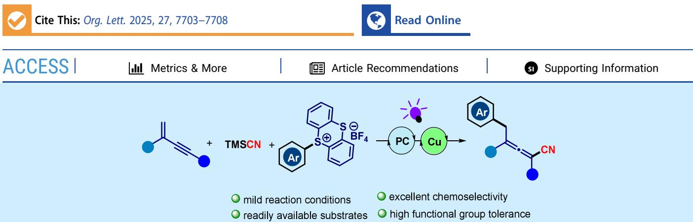
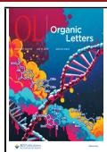
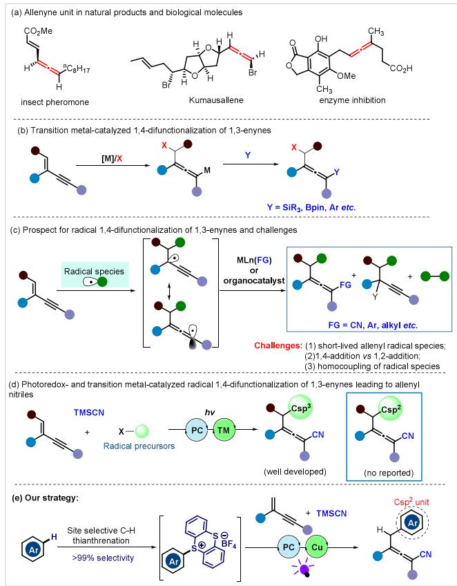
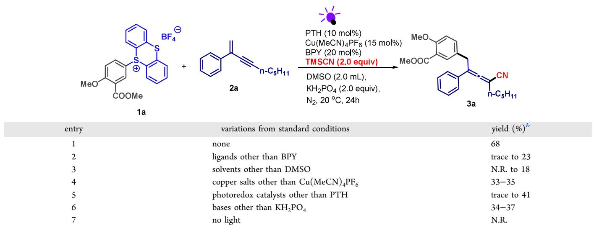
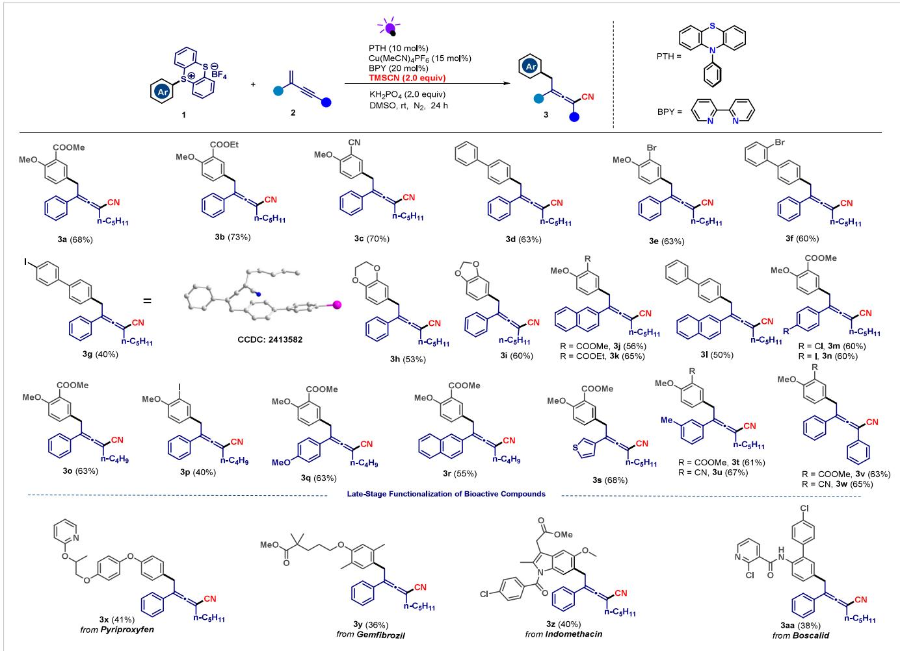
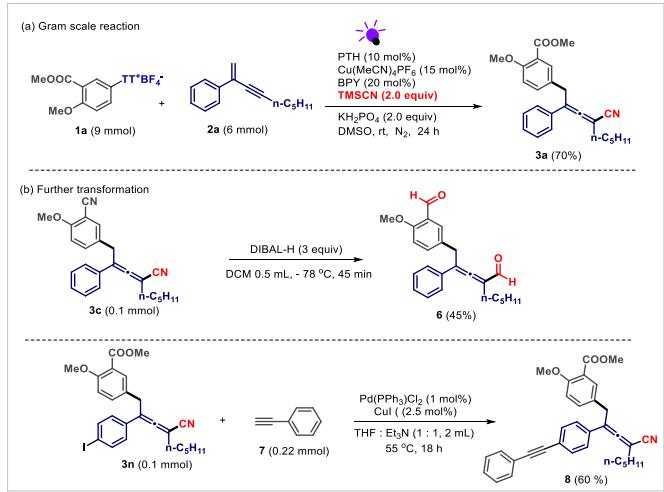
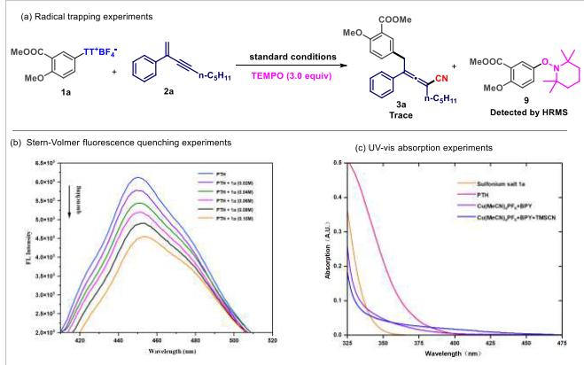
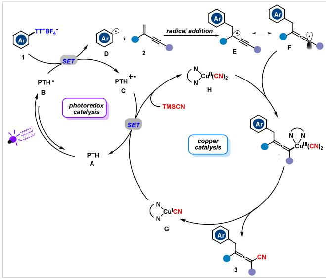

pubs.acs.org/OrgLett

Letter

# Photoredox/Copper Dual-Catalyzed Regioselective 1,4- Arylcyanation of 1,3-Enynes for Multifunctionalized Allenyl Nitriles

Qilong Wu, Xufeng Li, Jian Lv, Yongjia Shi, and Daoshan Yang\*

  
ABSTRACT: A copper/photoredox dual-catalysis-enabled 1,4-arylcyanation of 1,3-enynes to aford tetrasubstituted allenyl nitriles was initially developed. The reaction features good reaction generality and high reaction regioselectivity, providing facile access to multifunctionalized allenyl nitriles. This strategy achieves the construction of aryl-containing tetrasubstituted allenyl nitriles via indirect arene C−H functionalization. It also serves as an important complement to thianthrenium salt chemistry.

A s an important class of molecules, allenes find widespread (Scheme 1a).1 Additionally, they play crucial roles in synthetic chemistry and drug design.2 Therefore, chemists have been making persistent eforts to synthesize functionalized allenes including nucleophilic substitutions,3 prototropic isomerization of alkynes,4 sigmatropic rearrangement of propargylic molecules,5 and other elegant methods.6 Despite the success of these methods, the unavailability of prefunctionalized starting materials has limited their wide applications. In recent years, conjugated 1,3-enynes have increasingly been considered as key synthons for creating multisubstituted allenes, which is achieved through 1,4-addition to bring in two functional groups at the same time.7 In this context, transition-metalcatalyzed 1,4-difunctionalization of 1,3-enynes through allenyl ionic intermediates is well developed (Scheme 1b).8 Radicalinduced $^ { 1 , 4 }$ -difunctionalization of $^ { 1 , 3 \cdot }$ -enynes can generate highly reactive and unusual short-lived allenyl radical intermediates, which can easily form allenyl cations or allenyl anions through oxidation or reduction pathways. In this regard, 1,4-difunctionalization of $^ { 1 , 3 \cdot }$ -enynes using a metallic radical catalysis strategy has emerged as a reliable robust approach toward functionalized allenes.9 Very recently, a number of elegant synthetic methods have been developed by Ma, 10 Wu,11 Liu,12 Bao,13 and other groups.14 In these reactions, allenyl radicals were obtained via radical addition to the C�C double bond in 1,3-enynes and subsequent isomerization. The reactive allyl radicals reacted with the metal-FG (functional group) species, generating metal-allenyl intermediates that underwent reductive elimination to give the allenes (Scheme 1c). Although impressive success and breakthroughs have been achieved in this field, there are still challenges in controlling the regio- and chemoselectivities of multicomponent catalytic systems through the free radical approaches.

Organic reactions promoted by visible light are regarded as some of the best green methods.15 Very recently, significant progress has been made in the synthesis of multifunctionalized allenyl nitriles through free radical 1,4-difunctionalization of 1,3-alkynals under photoredox/transition metal catalysis conditions. In these works, the radical precursors are mainly limited to $\mathrm { C _ { \mathrm { s p } ^ { 3 } } }$ sources (Scheme 1d).16 Literature surveys indicated that 1,4-arylcyanation of 1,3-enynes to aford tetrasubstituted allenyl nitriles has not been reported thus far. The reason might be the lack of appropriate sources of aryl radicals and efective catalytic systems. Recently, thianthrenium salts have been widely employed as aryl radical precursors in diverse organic transformations.17 Based on the excellent work reported previously and the continuous interest of our group in visible light photoredox catalysis and transition metal catalysis might ofer a general strategy for synthesizing multifunctionalized allenyl nitriles through radical-type 1,4-difunctionalization of $^ { 1 , 3 \cdot }$ enynes (Scheme 1e).

Scheme 1. Background and Our Strategy  

At the outset of our investigation, 1,3-enyne 2a, aryl thianthrenium salt 1a, and TMSCN were chosen as the model substrates to optimize the reaction conditions, including the ligands, solvents, catalysts, bases, and photoredox catalysts. As shown in Table 1, after a series of systematic screenings of reaction parameters, a 1,4-arylcyanation reaction was achieved to deliver the expected multifunctionalized allenyl nitrile 3a in 68% yield using photoredox/copper dual catalytic systems (entry 1). Results of our experiments revealed that other nitrogen ligands led to decreased yields of 3a (entry 2, see the SI for more details). Replacing DMSO with other solvents, including MeCN and DMA, was less eficient (entry 3, see the SI for more details). Compared to other copper salts, such as Cu(MeCN) BF and CuBr, $\mathrm { C u ( M e C N ) _ { 4 } \hat { P } \hat { F } _ { 6 } }$ was the best choice for this transformation (entry $^ { 4 , }$ see the SI for more details). Some commercially available photocatalysts such as fac-Ir(ppy) , 4-CzIPN, eosin $\mathrm { Y , }$ and PTH were tested under irradiation of various light source, and the combination of PTH and 390 nm wavelength exhibited the highest reaction activity (entry $^ { 5 , }$ see the SI for more details). Next, we employed other bases instead of ${ \mathrm { K H } } _ { 2 } { \mathrm { P O } } _ { 4 } ,$ and the eficiency of the reaction did not improve (entry $^ { 6 , }$ see the SI for more details). Control experiments proved that light irradiation is indispensable for this reaction (entry 7).

After obtaining the optimum reaction conditions, we investigate the synthetic potential of this photoredox/copper catalyzed strategy for the synthesis of tetrasubstituted allenyl nitriles (Scheme 2). First, various aryl thianthrenium salts were examined, and either electron-donating or electron-withdrawing groups on the aromatic ring were all compatible with this protocol, giving the desired products in moderate to good yield (3a−3i). The structures of the products can be confirmed through single-crystal X-ray difraction (3g). Additionally, the heterocycle-containing aryl thianthrenium salts smoothly converted to the corresponding products in moderate yields (3h and 3i). A series of functional groups, including methoxyl, ester, cyano, a C−Cl bond, and a C−Br bond, were tolerated, which could aford an opportunity for further modifications. Unfortunately, using alkenyl or alkyl thianthrenium salts could not provide the corresponding products (see SI for more details). Next, we turned our attention to test the functional groups tolerance contained in 1,3-enyne. For the C4-alkyl substituted substrates, we fixed the alkyl chain to ${ \mathrm { C } } _ { 5 } { \mathrm { H } } _ { 1 1 }$ or $\mathrm { C _ { 4 } H _ { 9 } }$ while testing an array of C2-aryl substituents. The results show that when the naphthyl group was located at the C2 position, the yield slightly decreased (3j−3l and 3r). In addition, diverse functional groups such as electron-withdrawing groups (Cl and I) and electron-donating group (OMe) were all tolerated under the standard conditions. To our delight, when the C2 position was changed to thiophene, the desired product could also be obtained in good yield (3s). Unfortunately, when we changed the alkyl chain to $\mathrm { C } _ { 6 } \mathrm { H } _ { 1 3 } ,$ no desired product was observed (see SI for more details). Finally, numerous biologically active compounds, including pyriproxyfen, gemfibrozil, indomethacin, and boscalid, were well tolerated under the standard conditions and furnished the corresponding late stage-modified products (3x− 3aa).

Table 1. Optimization of Reaction Conditions  

<table><tr><td>entry</td><td>variations from standard conditions</td><td>yield (%)b</td></tr><tr><td>1</td><td>none</td><td>68</td></tr><tr><td>2</td><td>ligands other than BPY</td><td>trace to 23</td></tr><tr><td>3</td><td>solvents other than DMSO</td><td>N.R. to 18</td></tr><tr><td>4</td><td>copper salts other than Cu(MeCN)4PF6</td><td>33-35</td></tr><tr><td>5</td><td>photoredox catalysts other than PTH</td><td>trace to 41</td></tr><tr><td>6</td><td>bases other than KH2PO₄</td><td>34-37</td></tr><tr><td>7</td><td>no light</td><td>N.R.</td></tr></table>

aReaction conditions: 1a (0.3 mmol, 1.5 equiv), 2a (0.2 mmol), TMSCN (0.4 mmol, 2.0 equiv), base (0.4 mmol, 2.0 equiv), photocatalyst (10 mol %), copper salt (15 mol %), ligand (20 mol %), and solvent (2.0 mL) at 20 $^ \circ \mathrm { C }$ under irradiation with a 15 W purple LED (390 nm) for 24 h. bIsolated yield. N.R. = no reaction.

Scheme 2. Substrate Scope of Intermolecular 1,4-Arylcyanation of 1,3-Enynesa  
  
aReaction conditions: 1 (0.3 mmol, 1.5 equiv), 2 (0.2 mmol), TMSCN (0.4 mmol, 2.0 equiv), ${ \mathrm { K H } } _ { 2 } { \mathrm { P O } } _ { 4 }$ (0.4 mmol, 2.0 equiv), PTH (10 mol %), $\mathrm { C u } ( \mathrm { M e C N } ) _ { 4 } \mathrm { P F } _ { 6 }$ (15 mol %), BPY (20 mol %), and DMSO (2.0 mL) at 20 °C under irradiation with a 15 W purple LED (390 nm) for 24 h.

We carried out a gram-scale reaction to demonstrate the synthetic applicability of our method. As shown in Scheme 3a, the reaction proceeded smoothly and gave 3a in 70% isolated yield under irradiation of two 390 nm LEDs (15 W), thereby indicating that this photochemical protocol is easy to scale up. To further demonstrate the practicability of the current method, the derivatization transformations of the obtained allenyl nitriles were conducted. As shown in Scheme 3b, the cyano group in product 3c could be transferred to the aldehyde group at $- 7 8 ~ ^ { \circ } C$ with 3 equiv of DIBAL-H. Additionally, treatment of 3n with phenylacetylene 7 provided the coupling product 8 in 60% yield through a palladium-catalyzed Sonogashira coupling reaction.

To gain an understanding of the mechanism, a series of control experiments were conducted. As shown in Scheme 4a,

## Scheme 3. Synthetic Applications

the model reaction was completely inhibited by adding 3.0 equiv of the radical scavenger (2,2,6,6-tetramethylpiperidin-1- yl)oxidanyl (TEMPO), and the TEMPO-captured 9 was detected by HRMS analysis. These results indicated that the aryl radical might be the key species in the current conversion process. Furthermore, Stern−Volmer fluorescence quenching experiments were conducted by mixing a solution of aryl thianthrenium salt 1a and PTH (Scheme 4b). When the aryl thianthrenium salt 1a was added in a quantitative manner, the fluorescence of the excited-state PTH gradually decreased, which proved that the PTH could be efectively quenched by aryl thianthrenium salts. Furthermore, UV−vis spectroscopy was also employed to determine the photoactive species involved in the current conversion process. The absorption of reaction components thianthrenium salt 1a, PTH, Cu-$( \mathrm { M e C N } ) _ { 4 } \mathrm { P F } _ { 6 } ^ { - } + \mathrm { B P Y } ,$ and $\mathrm { C u ( M e C N ) _ { 4 } P F _ { 6 } ~ + ~ \Delta B P Y ~ + ~ }$ TMSCN were measured. As shown in Scheme 4c, only PTH showed an absorption band around the wavelength of the purple LED, thereby suggesting that PTH might serve as a photoredox catalyst during the process. Furthermore, cyclic voltammetry was used to determine the reduction potential of 1a in DMSO $\left( E _ { \mathrm { p } } = - 1 . 5 1 \mathrm { ~ V ~ v s ~ S C E } \right)$ , as well as the redox potential of of PTH $( E _ { 1 / 2 } ^ { \mathrm { o x * } } ~ = ~ - 2 . 1 0$ V vs SCE),19 which indicated that the excited PTH could easily reduce the aryl thianthrenium salt 1a (see the SI for details).

Scheme 4. Investigations of the Reaction Mechanism  

Based on the above experimental results, a hypothetical mechanism is depicted in Scheme 5. Excitation of photocatalyst PTH A leads to the active state B, which undergoes single electron transfer with the aryl thianthrenium salts 1 to produce the corresponding aryl radical D. Subsequently, the aryl radical adds to 1,3-enyne to form propargyl radical E, and its resonance structure is allenyl radical F. Subsequently, the allenyl radical F is trapped by $\mathrm { \dot { L } C u } ^ { \mathrm { I I } } ( \mathrm { C N } ) _ { 2 }$ H to produce the allenyl- $\boldsymbol { \cdot } \boldsymbol { \mathrm { C u } } ^ { \mathrm { I I I } }$ species I. Species I undergoes a reduction elimination reaction to generate a tetrasubstituted allenyl nitrile product 3, while simultaneously regenerating CuI species G.

Scheme 5. Plausible Mechanism  

In conclusion, we have successfully demonstrated the first photoredox/copper dual-catalysis-promoted 1,4-arylcyanation of 1,3-enynes for the synthesis of multifunctionalized allenyl nitriles using thianthrenium salts as aryl radical precursors. The reaction features exceptional regio- and chemoselectivities, mild reaction conditions, and broad functional-group tolerance and provides an eficient route to the synthesis of arylcontaining allenyl nitriles in a single step. Mechanistic studies indicate that aryl thianthrenium salts serve as aryl radical precursors and will inspire new opportunities for the design of radical-mediated multicomponent reactions. Further applications of this method and the catalytic asymmetric synthesis of optically active allenyl nitriles are currently underway.

## ■ ASSOCIATED CONTENT

## Data Availability Statement

The data underlying this study are available in the published article and its Supporting Information.

## \*sı Supporting Information

The Supporting Information is available free of charge at https://pubs.acs.org/doi/10.1021/acs.orglett.5c02449.

General experimental procedures, characterization data, and copies of 1H NMR and 13C NMR spectra for the products (PDF)

## Accession Codes

Deposition Number 2413582 contains the supplementary crystallographic data for this paper. These data can be obtained free of charge via the joint Cambridge Crystallographic Data Centre (CCDC) and Fachinformationszentrum Karlsruhe Access Structures service.

## ■ AUTHOR INFORMATION

## Corresponding Author

Daoshan Yang − College of Chemistry and Molecular Engineering, Qingdao University of Science and Technology, Qingdao, Shandong 266042, P. R. China; National Engineering Research Center of Low-Carbon Processing and Utilization of Forest Biomass, Nanjing Forestry University, Nanjing, Jiangsu 210037, China; orcid.org/0000-0002- 3047-5416; Email: yangdaoshan@tsinghua.org.cn

## Authors

Qilong Wu − College of Chemistry and Molecular Engineering, Qingdao University of Science and Technology, Qingdao, Shandong 266042, P. R. China

Xufeng Li − Zhejiang Wansheng Co., Ltd., Linhai, Zhejiang 317000, P. R. China

Jian Lv − College of Chemistry and Molecular Engineering, Qingdao University of Science and Technology, Qingdao, Shandong 266042, P. R. China; orcid.org/0000-0001- 7641-5411

Yongjia Shi − College of Chemistry and Molecular Engineering, Qingdao University of Science and Technology, Qingdao, Shandong 266042, P. R. China

Complete contact information is available at: https://pubs.acs.org/10.1021/acs.orglett.5c02449

## Notes

The authors declare no competing financial interest.

## ■ ACKNOWLEDGMENTS

We acknowledge financial support from the National Natural Science Foundation of China (22271170), the Taishan Scholars Program of Shandong Province (Grant No. tsqn202408197), and the Natural Science Foundation of Shandong Province (No. ZR2024QB154).

## ■ REFERENCES

(1) (a) Hoffmann-Roder, A.; Krause, N. Synthesis and Properties of Allenic Natural Products and Pharmaceuticals. Angew. Chem., Int. Ed. 2004, 43, 1196−1216. (b) Ma, S. Some Typical Advances in the Synthetic Applications of Allenes. Chem. Rev. 2005, 105, 2829−2872.

(2) (a) Ye, J.; Ma, S. Palladium-Catalyzed Cyclization Reactions of Allenes in the Presence of Unsaturated Carbon-Carbon Bonds. Acc. Chem. Res. 2014, 47, 989−1000. (b) Holmes, M.; Schwartz, L. A.; Krische, M. J. Intermolecular Metal-Catalyzed Reductive Coupling of Dienes, Allenes, and Enynes with Carbonyl Compounds and Imines. Chem. Rev. 2018, 118, 6026−6052.

(3) (a) Rona, P.; Crabbe, P. Novel synthesis of substituted allenes. J. Am. Chem. Soc. 1969, 91, 3289−3292. (b) Ma, S.; Negishi, E.-i. Palladium-Catalyzed Cyclization of. omega.-Haloallenes. A New General Route to Common, Medium, and Large Ring Compounds via Cyclic Carbopalladation. J. Am. Chem. Soc. 1995, 117, 6345−6357. (c) Ito, H.; Sasaki, Y.; Sawamura, M. Copper(I)-Catalyzed Substitution of Propargylic Carbonates with Diboron: Selective Synthesis of Multisubstituted Allenylboronates. J. Am. Chem. Soc. 2008, 130, 15774−15775. (d) Li, J.; Kong, W.; Fu, C.; Ma, S. An Efficient CuCN-Catalyzed Synthesis of Optically Active 2,3-Allenols from Optically Active 1-Substituted 4-Chloro-2-butyn-1-ols. J. Org. Chem. 2009, 74, 5104−5106.

(4) (a) Jacobs, T. L.; Akawie, R.; Cooper, R. G. Rearrangements Involving 1-Pentyne, 2-Pentyne and 1,2-Pentadiene1. J. Am. Chem. Soc. 1951, 73, 1273−1276. (b) Liu, H.; Leow, D.; Huang, K.-W.; Tan, C.-H. Enantioselective Synthesis of Chiral Allenoates by Guanidine-Catalyzed Isomerization of 3-Alkynoates. J. Am. Chem. Soc. 2009, 131, 7212−7213.

(5) (a) Fang, Z.; Zhou, C.; Fu, C.; Ma, S. Studies on highly regioand stereoselective hydration of 1,2-allenylic sulfoxides. Org. Biomol. Chem. 2010, 8, 4554−4561. (b) Schwier, T.; Sromek, A. W.; Yap, D. M. L.; Chernyak, D.; Gevorgyan, V. Mechanistically Diverse Copper-, Silver-, and Gold-Catalyzed Acyloxy and Phosphatyloxy Migrations: Efficient Synthesis of Heterocycles via Cascade Migration/Cycloisomerization Approach. J. Am. Chem. Soc. 2007, 129, 9868−9878. (c) Ma, M.; Peng, L.; Li, C.; Zhang, X.; Wang, J. Highly Stereoselective [2,3]-Sigmatropic Rearrangement of Sulfur Ylide Generated through Cu(I) Carbene and Sulfides. J. Am. Chem. Soc. 2005, 127, 15016−15017.

(6) (a) Chen, G.; Ma, S. Enantioselective Halocyclization Reactions for the Synthesis of Chiral Cyclic Compounds. Angew. Chem., Int. Ed. 2010, 49, 8306−8308. (b) Xiao, Y.; Zhang, J. Tetrasubstituted allenes by Pd0-catalyzed three-component tandem Michael addition/crosscoupling reaction. Chem. Commun. 2010, 46, 752−754. (c) Zhang, W.; Zheng, S.; Liu, N.; Werness, J. B.; Guzei, I. A.; Tang, W. Enantioselective Bromolactonization of Conjugated (Z)-Enynes. J. Am. Chem. Soc. 2010, 132, 3664−3665. (d) Tomida, Y.; Nagaki, A.; Yoshida, J.-i. Asymmetric Carbolithiation of Conjugated Enynes: A Flow Microreactor Enables the Use of Configurationally Unstable Intermediates before They Epimerize. J. Am. Chem. Soc. 2011, 133, 3744−3747. (e) Dong, X.-Y.; Zhan, T.-Y.; Jiang, S.-P.; Liu, X.-D.; Ye, L.; Li, Z.-L.; Gu, Q.-S.; Liu, X.-Y. Copper-Catalyzed Asymmetric Coupling of Allenyl Radicals with Terminal Alkynes to Access

Tetrasubstituted Allenes. Angew. Chem., Int. Ed. 2021, 60, 2160− 2164.

(7) For selected examples, see: (a) Lu, F.-D.; Lu, L.-Q.; He, G.-F.; Bai, J.-C.; Xiao, W.-J. Enantioselective Radical Carbocyanation of 1,3- Dienes via Photocatalytic Generation of Allylcopper Complexes. J. Am. Chem. Soc. 2021, 143, 4168−4173. (b) Poulsen, P. H.; Li, Y.; Lauridsen, V. H.; Jørgensen, D. K. B.; Palazzo, T. A.; Meazza, M.; Jørgensen, K. A. Organocatalytic Formation of Chiral Trisubstituted Allenes and Chiral Furan Derivatives. Angew. Chem., Int. Ed. 2018, 57, 10661−10665. (c) Yao, Q.; Liao, Y.; Lin, L.; Lin, X.; Ji, J.; Liu, X.; Feng, X. Efficient Synthesis of Chiral Trisubstituted 1,2-Allenyl Ketones by Catalytic Asymmetric Conjugate Addition of Malonic Esters to Enynes. Angew. Chem., Int. Ed. 2016, 55, 1859−1863.

(g) Tang, S.; Zhang, P.; Shao, Y.; Sun, J. Enyne diketones as substrate in asymmetric Nazarov cyclization for construction of chiral allene cyclopentenones. Nat. Commun. 2022, 13, 3146. (h) Yang, Z.; Wang, S.; Jiang, M.; Li, G.; Li, L.; Peng, F.; Shao, Z. One stone three birds: Ni-catalyzed asymmetric allenylic substitution of allenic ethers, hydroalkylation of 1,3-enynes and double alkylation of enynyl ethers. Chin. Chem. Lett. 2024, 35, No. 109518.

(9) (a) Muresan, M.; Subramanian, H.; Sibi, M. P.; Green, J. R. Propargyl Radicals in Organic Synthesis. Eur. J. Org. Chem. 2021, 2021, 3359−3375. (b) Fu, L.; Greßies, S.; Chen, P.; Liu, G. Recent Advances and Perspectives in Transition Metal-Catalyzed 1,4- Functionalizations of Unactivated 1,3-Enynes for the Synthesis of Allenes. Chin. J. Chem. 2020, 38, 91−100. (c) Li, Y.; Bao, H. Radical transformations for allene synthesis. Chem. Sci. 2022, 13, 8491−8506.

(d) Li, L.; Wang, S.; Jakhar, A.; Shao, Z. Pd-catalyzed functionalization of 1,3-enynes via alkylene-π-allylpalladium intermediates. Green Synth. Catal. 2023, 4, 124−134.

(10) Song, Y.; Fu, C.; Ma, S. Copper-Catalyzed Syntheses of Multiple Functionalizatized Allenes via Three-Component Reaction of Enynes. ACS Catal. 2021, 11, 10007−10013.

(11) He, F.-S.; Bao, P.; Yu, F.; Zeng, L.-H.; Deng, W.-P.; Wu, J. Copper-Catalyzed Regioselective 1,4-Selenosulfonylation of 1,3- Enynes to Access Cyanoalkylsulfonylated Allenes. Org. Lett. 2021, 23, 7472−7476.

(12) Wang, F.; Wang, D.; Zhou, Y.; Liang, L.; Lu, R.; Chen, P.; Lin, Z.; Liu, G. Divergent Synthesis of CF -Substituted Allenyl Nitriles by Ligand-Controlled Radical 1,2- and 1,4-Addition to 1,3-Enynes. Angew. Chem., Int. Ed. 2018, 57, 7140−7145.

(13) (a) Zeng, Y.; Chiou, M.-F.; Zhu, X.; Cao, J.; Lv, D.; Jian, W.; Li, Y.; Zhang, X.; Bao, H. Copper-Catalyzed Enantioselective Radical 1,4- Difunctionalization of 1,3-Enynes. J. Am. Chem. Soc. 2020, 142, 18014−18021. (b) Zhu, X.; Deng, W.; Chiou, M.-F.; Ye, C.; Jian, W.; Zeng, Y.; Jiao, Y.; Ge, L.; Li, Y.; Zhang, X.; Bao, H. Copper-Catalyzed Radical 1,4-Difunctionalization of 1,3-Enynes with Alkyl Diacyl Peroxides and N-Fluorobenzenesulfonimide. J. Am. Chem. Soc. 2019, 141, 548−559.

(14) For selected examples, see: (a) Cheng, C.; Lv, G.-F.; Wu, S.; Li, Y.; Li, J.-H. Nickel Photocatalyzed Reductive 1,4-Dicarbofunctionalization of 1,3-Enynes with N-Methylamines and Organohalides

Enabled by Site-Selective C(sp3)−H Functionalization. Org. Lett. 2023, 25, 4236−4240. (b) Li, S.; Yang, W.; Shi, J.; Dan, T.; Han, Y.; Cao, Z.-C.; Yang, M. Synthesis of Trifluoromethyl-Substituted Allenols via Catalytic Trifluoromethylbenzoxylation of 1,3-Enynes. ACS Catal. 2023, 13, 2142−2148. (c) Lv, Y.; Han, W.; Pu, W.; Xie, J.; Wang, A.; Zhang, M.; Wang, J.; Lai, J. Copper-catalyzed regioselective 1,4-sulfonylcyanation of 1,3-enynes with sulfonyl chlorides and TMSCN. Org. Chem. Front. 2022, 9, 3775−3780. (d) Chen, Y.; Zhu, K.; Huang, Q.; Lu, Y. Regiodivergent sulfonylarylation of 1,3- enynes via nickel/photoredox dual catalysis. Chem. Sci. 2021, 12, 13564−13571.

(15) (a) Prier, C. K.; Rankic, D. A.; MacMillan, D. W. C. Visible Light Photoredox Catalysis with Transition Metal Complexes: Applications in Organic Synthesis. Chem. Rev. 2013, 113, 5322− 5363. (b) Yoon, T. P.; Ischay, M. A.; Du, J. Visible light photocatalysis as a greener approach to photochemical synthesis. Nat. Chem. 2010, 2, 527−532. (c) Yuan, X.-Y.; Wang, C.-C.; Yu, B. Recent advances in FeCl -photocatalyzed organic reactions via hydrogen-atom transfer. Chin. Chem. Lett. 2024, 35, No. 109517. (d) Hou, J.-C.; Cai, W.; Ji, H.-T.; Ou, L.-J.; He, W.-M. Recent advances in semi-heterogenous photocatalysis in organic synthesis. Chin. Chem. Lett. 2025, 36, No. 110469. (e) Yu, X.-Y.; Chen, J.-R.; Xiao, W.-J. Visible Light-Driven Radical-Mediated C−C Bond Cleavage/Functionalization in Organic Synthesis. Chem. Rev. 2021, 121, 506−561. (f) Meng, N.; Lv, Y.; Liu, Q.; Liu, R.; Zhao, X.; Wei, W. Visible-light-induced threecomponent reaction of quinoxalin-2(1H)-ones, alkenes and CF SO Na leading to 3-trifluoroalkylated quinoxalin-2(1H)-ones. Chin. Chem. Lett. 2021, 32, 258−262. (g) Lu, Y.-H.; Wu, C.; Hou, J.- C.; Wu, Z.-L.; Zhou, M.-H.; Huang, X.-J.; He, W.-M. Ferrocene-Mediated Photocatalytic Annulation of N-Sulfonyl Ketimines. ACS Catal. 2023, 13, 13071−13076.

(16) (a) Huang, H.-M.; Bellotti, P.; Daniliuc, C. G.; Glorius, F. Radical Carbonyl Propargylation by Dual Catalysis. Angew. Chem., Int. Ed. 2021, 60, 2464−2471. (b) Chen, Y.; Wang, J.; Lu, Y. Decarboxylative 1,4-carbocyanation of 1,3-enynes to access tetrasubstituted allenes via copper/photoredox dual catalysis. Chem. Sci. 2021, 12, 11316−11321. (c) Pu, Y.; Ding, S.; Zhao, H.; Xue, Q.; Zhang, H.; Xie, X.; Shang, Y.; Wang, J. Three-Component Synthesis of Multiple Functionalized Allenes via Copper/Photoredox Dual Catalyzed 1,4-Alkylcyanation of 1,3-Enynes. Org. Lett. 2024, 26, 1834−1839. (d) Yang, Z.-X.; Xu, X.-C.; He, B.-W.; Meng, Y.-X.; Zhao, Y.-L. Dual Photoredox/Copper-Catalyzed Three-Component Alkylcyanation of Alkenes and 1,4-Alkylcyanation of 1,3-Enynes Employing Sulfoxonium Ylides as the Carbon Radical Precursors. Org. Lett. 2024, 26, 10576−10582. (e) Peng, K.; Cao, Y.-S.; Wang, Q.; Xia, Z.; Chen, Y.; Lu, Y.; Deng, G.-J. Metallaphotoredox Synthesis of Axially Chiral Tetrasubstituted Allenes through Regio- and Enantioselective 1,4-Carbocyanation of 1,3-Enynes. ACS Catal. 2024, 14, 14048−14057. (f) Chen, Y.; Wanga, Q.; Penga, K.; Chenga, L.; Shea, Z.; Deng, G.-J. Copper/Photoredox-Catalyzed Regioselective 1,4-Addition to 1,3-Enynes: A Convenient Access to Perfluoroalkylated Allenes. Chin. J. Chem. 2024, 42, 2023−2028. (g) Wang, Y.; Liu, S.; Huang, Y. Photoredox/copper-catalyzed gem difluoroalkylation-cyanation of 1,3-enynes. Org. Biomol. Chem. 2024, 22, 4895−4900.

(17) For selected examples, see: (a) Berger, F.; Plutschack, M. B.; Riegger, J.; Yu, W.; Speicher, S.; Ho, M.; Frank, N.; Ritter, T. Siteselective and versatile aromatic C−H functionalization by thianthrenation. Nature. 2019, 567, 223−228. (b) Aukland, M. H.; Šiauciulis, ̌ M.; West, A.; Perry, G. J. P.; Procter, D. J. Metal-free photoredox catalysed formal C−H/C−H coupling of arenes enabled by interrupted Pummerer activation. Nat. Catal. 2020, 3, 163−169. (c) Chen, C.; Wang, Z.-J.; Lu, H.; Zhao, Y.; Shi, Z. Generation of non-stabilized alkyl radicals from thianthrenium salts for C−B and C−C bond formation. Nat. Commun. 2021, 12, 4526. (d) Lu, Y.; Liu, Q.; Wang, Z.-X.; Chen, X.-Y. Alkynyl Sulfonium Salts Can Be Employed as Chalcogen-Bonding Catalysts and Generate Alkynyl Radicals under Blue-Light Irradiation. Angew. Chem., Int. Ed. 2022, 61, No. e202116071. (e) Sun, K.; Shi, A.; Liu, Y.; Chen, X.; Xiang, P.;

Wang, X.; Qu, L.; Yu, B. A general electron donor−acceptor complex for photoactivation of arenes via thianthrenation. Chem. Sci. 2022, 13, 5659−5666. (f) Liu, M.-S.; Du, H.-W.; Shu, W. Metal-free allylic C− H nitrogenation, oxygenation, and carbonation of alkenes by thianthrenation. Chem. Sci. 2022, 13, 1003−1008. (g) Chen, X.-Y.; Wu, Y.; Wang, P. Recent Advances in Thianthrenation/Phenoxathiination Enabled Site-Selective Functionalization of Arenes. Synthesis. 2022, 54, 3928−3940. (h) Zhang, M.; Liu, L.; Wang, B.; Yang, Y.; Liu, Y.; Wang, Z.; Wang, Q. Direct Synthesis of Sulfonamides via Synergetic Photoredox and Copper Catalysis. ACS Catal. 2023, 13, 11580−11588. (i) Chen, X.-Y.; Kuang, X.; Wu, Y.; Zhou, J.; Wang, P. Thianthrene Radical Cation as a Transient SET Mediator: Photoinduced Thiocyanation and Selenocyanation of Arylthianthrenium Salts. Chin. J. Chem. 2023, 41, 1979−1986. (j) Lin, Z.-H.; Yao, Y.-F.; Zhang, C.-P. Deuteration of Arylthianthren-5-ium Salts in CD OD. Org. Lett. 2022, 24, 8417−8422.

(18) (a) Xu, H.; Li, X.; Wang, Y.; Song, X.; Shi, Y.; Lv, J.; Yang, D. Arylthianthrenium Salts as the Aryl Sources: Visible Light/Copper Catalysis-Enabled Intermolecular Azidosulfonylation of Alkenes. Org. Lett. 2024, 26, 1845−1850. (b) Wu, Q.; Li, X.; Ma, J.; Shi, Y.; Lv, J.; Yang, D. Arylcyanation of Styrenes by Photoactive Electron Donor− Acceptor Complexes/Copper Catalysis. Org. Lett. 2024, 26, 7949− 7955.

(19) Ando, H.; Takamura, H.; Kadota, I.; Tanaka, K. Strongly reducing helical phenothiazines as recyclable organophotoredox catalysts. Chem. Commun. 2024, 60, 4765−4768.