pubs.acs.org/OrgLett

Letter

# Visible-Light-Catalyzed Regioselective 1,4-Carbon/Carboxylation of 1,3-Enynes with Malonates and ${ \mathsf { C O } } _ { 2 }$ toward 2,3-Allenoic Acids

Aolong Zhang, Han Yang, Yang Yao, Jianwei Sun, and Song Sun\*

Cite This: Org. Lett. 2025, 27, 9465−9470

ACCESS

Metrics & More

$$
\left( \mathbf { C O } _ { 2 } \right)
$$

Article Recommendations

\*sı Supporting Information

$$
\mathrm { C O } _ { 2 } ,
$$

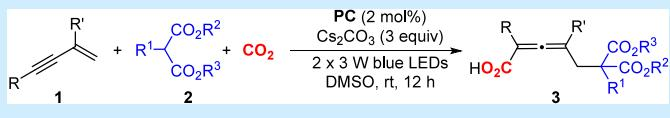

carboxylation of 1,3-enynes has remained unknown. Herein, we report the first visible-light-promoted 1,4-carbon/carboxylation of 1,3-enynes with malonates and $\mathrm { C O } _ { 2 } ,$ leading to a series of valuable tetrasubstituted 2,3-allenoic acids with high eficiency. This new methodology features good functional group compatibility, ease of scale-up, and facile transformations. Mechanistic investigations indicate that successive single-electron transfer (SSET) reduction is involved to generate the key allenoic anion intermediate.

llenes are important structural motifs found in various natural products, bioactive pharmaceuticals, as well as   
functional molecules, such as lcariside, kumausellene, (+)-scor  
odonim, and (−)-panacene (Figure 1).1 They can also serve as

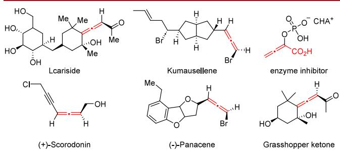  
Figure 1. Representative examples of allenoic natural products and pharmaceuticals.  
Scheme 1. Typical Routes for the Synthesis of $^ { 2 , 3 - }$ Allenoates

valuable intermediates and catalysts/ligands for a range of organic transformations.2 Among them, 2,3-allenoic acids are of particular interest owing to their versatile reactivities,3 such as the Morita−Baylis−Hillman reactions,3d−f rearrangements,3g cyclization reactions, 3h−j and other transformations. Consequently, substantial eforts have been devoted to their synthesis.4 Conventionally, allenoic acids could be synthesized via the Wittig reaction of ketenes with phosphorus ylides followed by hydrolysis, although this method sufered from a poor atom economy (Scheme 1a).5 Recently, transition-metalcatalyzed functionalization of propargylic alcohols and their derivatives emerged as a practical method for the synthesis of 2,3-allenoates.6 For example, Ma and co-workers pioneered an elegant palladium-catalyzed coupling reaction of 3-alkoxycarbonyl propargylic carbonates and boronic acids toward diverse tetrasubstituted 2,3-allenoates (Scheme 1b).7 Furthermore, transition-metal-catalyzed carbonylation of propargylic alcohol

(1) Witting reaction

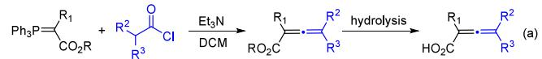

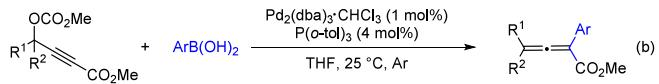

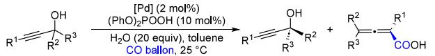

(c)

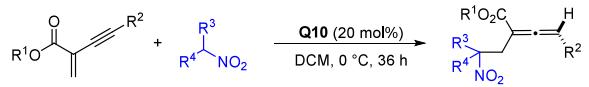

(d)

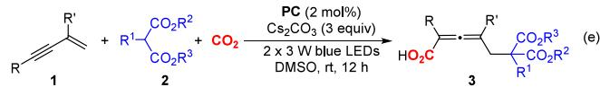

derivatives, using CO as the carbonyl source, provides an alternative eficient route to $^ { 2 , 3 \cdot }$ -allenoic acids (Scheme $\mathrm { 1 c ) . ^ { 8 } }$ Alternatively, organocatalytic nucleophilic addition of various nucleophiles to electron-deficient $^ { 1 , 3 \cdot }$ conjugated enynes can also furnish 2,3-allenoic acids with a good atom economy (Scheme 1d).9 Despite these great achievements, the development of additional robust approaches for convenient access to $^ { 2 , 3 }$ -allenoic acids from readily available materials remains in high demand.

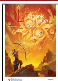

Carbon dioxide (CO ) has emerged as an environmentally benign and renewable C1 feedstock in the synthesis of various value-added fine chemicals, owing to its natural abundance, cost-efectiveness, and low toxicity.10 Among the diverse $\mathrm { C O } _ { 2 }$ transformations, the carboxylation reactions stand as one of the most convenient routes toward carboxylic acids.11 In this field, carboxylation of unsaturated hydrocarbons with CO is most attractive, as it avoids the use of halides or moisture-sensitive organometallic reagents.12 For example, Martin and coworkers,13 Yu and co-workers,14 Wu and co-workers,15 Xi and co-workers,16 and we17 have developed a series of practical visible-light-driven carboxylation reactions of alkenes with $\mathrm { C O } _ { 2 } ,$ enabling the synthesis of diverse functionalized and structurally tunable aliphatic carboxylic acids through judicious selection of radical precursors. Furthermore, transition-metalcatalyzed or base-promoted difunctionalization of alkynes with $\mathrm { C O } _ { 2 }$ also represents an efective route to furnish diverse acrylic acids.18 For example, Wu and co-workers reported a novel route for the synthesis of lactones or acrylic acids by iridium/ cobalt co-catalyzed hydro- or carbocarboxylation of alkynes with $\mathrm { C O } _ { 2 } . ^ { 1 9 }$ Additionally, Hong and Zhan independently reported the visible-light-promoted α-aminoalkyl- or phosphono-carboxylation of allenes with $\mathrm { C O } _ { 2 } ,$ leading to a series of $\beta _ { - }$ functionalized allylic carboxylic acids with good eficiency. 20 However, to the best of our knowledge, the carboxylation of $^ { 1 , 3 \cdot }$ -enynes with $\mathrm { C O } _ { 2 }$ remains unreported to date. In view of the high value of allenoic acids and in continuation of our interest in the $\mathrm { C O } _ { 2 }$ chemistry,21 we envisioned the photocatalytic carboxylation of $^ { 1 , 3 \cdot }$ -enynes with malonates and $\mathrm { C O } _ { 2 } ,$ leading to allenoic acids in one step (Scheme 1d).

Initially, (3-methylbut-3-en-1-yn-1-yl)benzene 1a and dimethyl malonate 2a were employed as the model substrates to test our hypothesis. When the reaction of 1a with 2a and $\mathrm { C O } _ { 2 }$ in DMSO was conducted under irradiation of $2 \times 3$ W blue LEDs with PC1 as the catalyst and ${ \mathrm { C s } } _ { 2 } { \mathrm { C O } } _ { 3 }$ as the base. Delightedly, desired product 3aa could be isolated in 33% yield (Table 1, entry 1). Encouraged by this preliminary result, we screened other parameters. First, some common photocatalysts were tested, and the results indicated that PC4 gave the best result, afording 3aa in 80% yield (entries 1−4). Additionally, the solvent also showed an obvious efect. In DMF, 3aa was obtained in a 67% yield (entry 5). However, the reaction in NMP and MeCN aforded only 3aa in 45 and 50% yields, respectively (entries 6 and 7). Common bases were also screened. ${ \mathrm { N a } } _ { 2 } { \mathrm { C O } } _ { 3 } ,$ tBuOK, $\mathrm { K } _ { 2 } \mathrm { C O } _ { 3 } ,$ and ${ \mathrm { K } } _ { 3 } { \mathrm { P O } } _ { 4 }$ all resulted in inferior results than $\mathrm { C s } _ { 2 } \mathrm { C O } _ { 3 }$ (entries 8−11 vs 4). Furthermore, variation of the ratio of 1a/2a to 1:2 or 2:1 showed no improvement (entries 12 and 13 vs 4). Lowering the catalyst loading to 1 mol % resulted in a diminished yield (59%, entry 14). Finally, control experiments demonstrated that the catalyst, light, base, and $\bar { \mathrm { C O } } _ { 2 }$ were all essential to the success (entry 15).

Next, we investigated the reaction scope. First, a series of $^ { 1 , 3 \cdot }$ -enynes smoothly reacted with dimethyl malonate 2a and $\mathrm { C O } _ { 2 }$ under the optimized conditions, afording the desired products with good eficiency (Scheme 2). It was found that the electronic nature of the substituents at the para position of the phenyl ring had no obvious efect. Substrates bearing electron-donating groups, such as Me (1b), Et (1c), OMe (1e), tBu (1e), and Ph (1f), and the one bearing electronwithdrawing groups, such as fluoro (1g), chloro (1h), bromo (1i), cyano (1j), and trifluoromethyl (1k), aforded 3ba−3ka in 73−80% yields. Additionally, those with m-methyl (1l), mchloro (1m), m-bromo (1n), o-methyl (1o), and o-chloro (1p) all worked well, leading to the desired products 3la−3pa in 58−81% yields, indicating that steric hindrance had no obvious efect. Furthermore, 2-naphthyl- (1q) and 2-thienyl- (1r) substituted 1,3-enynes also aforded the desired products 3qa and 3ra in 82 and 71% yields, respectively. It is noteworthy that substitutions at the 3 position had a profound influence, as no desired product 3sa could be detected when 1s was employed. Delightedly, 1,3-enynes substituted with 3-tBu (1t), $3 { \mathrm { - } } \bar { \mathrm { C H } } _ { 2 } \mathrm { \bar { C H } } _ { 2 } \mathrm { \bar { O A c } } \ \mathrm { ( 1 u ) }$ , and cyclopropyl (1w) were employed, and the desired 3ta, 3ua, and 3wa could be isolated in 74, 65, and 80% yields, respectively. However, 3-phenyl analogous 1v could furnish only 3va in 25% yield. Particularly, cyclic 1,3- enynes 1x−1z were also good reaction candidates to deliver the desired products 3xa−3za. Additionally, when non-1-en-3- yn-2-ylbenzene 1A was employed, 3Aa could be obtained in 18% yield. Unfortunately, cinnamoyl-containing substrate 1B only resulted in a messy mixture with trace product detected. However, the one bearing an estrone motif 1C was amenable to the reaction conditions, furnishing 3Ca in 34% yield.

Table 1. Evaluation of Conditionsa
<table><tr><td></td><td></td><td>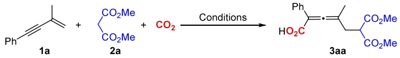</td><td></td><td></td></tr><tr><td>entry</td><td>catalyst</td><td>base</td><td>solvent</td><td>3aa yield (%)</td></tr><tr><td>1</td><td>PC1</td><td> $\mathrm { C s } _ { 2 } \mathrm { C O } _ { 3 }$ </td><td>DMSO</td><td>33</td></tr><tr><td>2</td><td>PC2</td><td> $\mathrm { C s } _ { 2 } \mathrm { C O } _ { 3 }$ </td><td>DMSO</td><td>trace</td></tr><tr><td>3</td><td>PC3</td><td> ${ \mathrm { C s } } _ { 2 } { \mathrm { C O } } _ { 3 }$ </td><td>DMSO</td><td>24</td></tr><tr><td>4</td><td>PC4</td><td> $\mathrm { C s } _ { 2 } \mathrm { C O } _ { 3 }$ </td><td>DMSO</td><td>80</td></tr><tr><td>5</td><td>PC4</td><td> ${ \mathrm { C s } } _ { 2 } { \mathrm { C O } } _ { 3 }$ </td><td>DMF</td><td>67</td></tr><tr><td>6</td><td>PC4</td><td> ${ \mathrm { C s } } _ { 2 } { \mathrm { C O } } _ { 3 }$ </td><td>NMP</td><td>45</td></tr><tr><td>7</td><td>PC4</td><td> $\mathrm { C s } _ { 2 } \mathrm { C O } _ { 3 }$ </td><td>MeCN</td><td>50</td></tr><tr><td>8</td><td>PC4</td><td> ${ \mathrm { N a } } _ { 2 } { \mathrm { C O } } _ { 3 }$ </td><td>DMSO</td><td>48</td></tr><tr><td>9</td><td>PC4</td><td> $\mathrm { { ^ { t } B u O K } }$ </td><td>DMSO</td><td>61</td></tr><tr><td>10</td><td>PC4</td><td> ${ \mathrm { K } } _ { 2 } { \mathrm { C O } } _ { 3 }$ </td><td>DMSO</td><td>66</td></tr><tr><td> $1 1$ </td><td>PC4</td><td> ${ \mathrm { K } } _ { 3 } { \mathrm { P O } } _ { 4 }$ </td><td>DMSO</td><td>46</td></tr><tr><td> $1 2 ^ { b }$ </td><td>PC4</td><td> $\mathrm { C s } _ { 2 } \mathrm { C O } _ { 3 }$ </td><td>DMSO</td><td>71</td></tr><tr><td> $1 3 ^ { c }$ </td><td>PC4</td><td> $\mathrm { C s } _ { 2 } \mathrm { C O } _ { 3 }$ </td><td>DMSO</td><td>68</td></tr><tr><td> $1 4 ^ { d }$ </td><td>PC4</td><td> ${ \mathrm { C s } } _ { 2 } { \mathrm { C O } } _ { 3 }$ </td><td>DMSO</td><td>59</td></tr><tr><td> $1 5 ^ { e }$ </td><td>PC5</td><td> $\mathrm { C s } _ { 2 } \mathrm { C O } _ { 3 }$ </td><td>DMSO</td><td>0</td></tr></table>

aReaction conditions: 1a (0.1 mmol), 2a (0.11 mmol), base (0.3 mmol), CO (1 atm), and solvent (1 mL), for 12 h, in a sealed Schlenk tube, irradiated by $2 \times 3$ W blue LEDs, unless otherwise noted. b1a (0.1 mmol) and 2a (0.2 mmol). c1a (0.2 mmol) and 2a (0.1 mmol). dPhotocatalyst (1 mol %). eWithout a catalyst, light, base, or $\mathrm { C O } _ { 2 } ;$ PC1, fac-Ir(ppy) ; PC2, 4CzIPN ; PC3, Ir[dF(CF )- ppy] $\mathrm { \vert } _ { 2 } ( \mathrm { d t b b p y ) } { \cdot } \mathrm { P F } _ { 6 } ;$ and $\mathbf { P C 4 } , \mathbf { I r } ( \mathbf { p p y } ) _ { 2 } ( \mathrm { d t b } \mathbf { b p y } ) { \cdot } \mathbf { P F } _ { 6 } .$

The scope of malonates was also investigated. A series of malonates bearing diferent substitutions reacted smoothly with 1a and $\mathrm { C O } _ { 2 }$ (Scheme 3). For example, a range of malonate derivatives with diferent alkyl groups, including ethyl (1b), nPr (1c), iPr (1d), nBu (1e), tBu (1f), and benzyl (1g), were all compatible, afording the desired products 3ab−3ag in moderate to good yields (58−76%). Furthermore, unsymmetrical malonates 2h and 2i also worked well to furnish the desired products 3ah and 3ai in 58 and 57% yields with a

## Scheme 2. Scope of 1,3- Enynes

Scheme 3. Scope of Malonates  
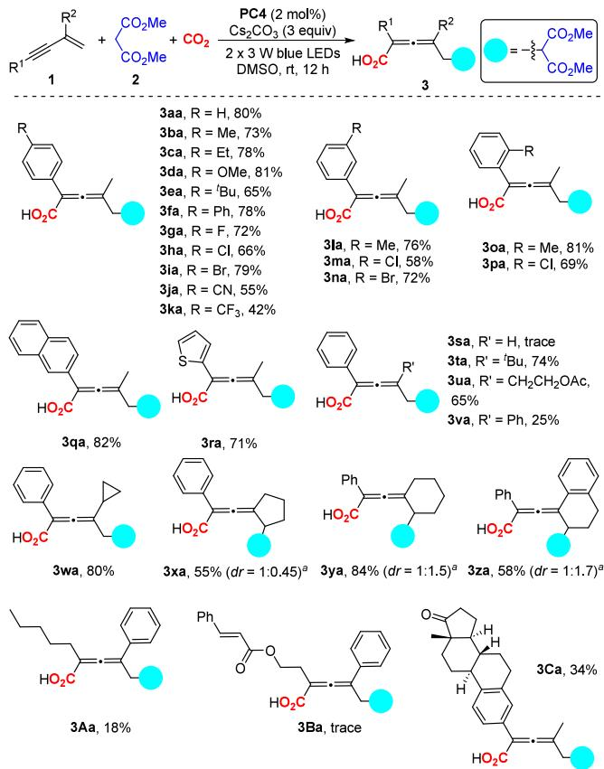  
Reaction Conditions: 1 (0.2 mmol), 2a (0.22 mmol), Ir-(ppy) (dtbbpy)·PF (0.004 mmol), $\mathrm { C s } _ { 2 } \mathrm { C O } _ { 3 }$ (0.6 mmol, 3 equiv), DMSO (2 mL), and CO (1 atm), for 12 h, in a sealed Schlenk tube, irradiated by $2 \times 3 \mathrm { ~ W ~ }$ blue LEDs, unless otherwise noted. aDetermined by 1H NMR.

diastereomeric ratio (dr) of 1:1. Particularly, the substrate scope of malonates could be further expanded to substituted dimethyl ones. For example, those bearing ethyl (2j), benzyl (2k), allylic (2l), methyl ester (2m), propargyl (2n), and ester (2o) were all good reaction candidates to aford the desired products $3 \mathbf { j a } - 3 \mathbf { o a }$ . Notably, the unsaturated bonds of the dimethyl malonates (2l and 2n) remained intact, providing opportunities for further derivatization. Additionally, malonates derived from natural alcohols were also compatible, yielding the desired 2,3-allenoic acids (3ap−3ar).

Then, some essential control experiments were conducted to investigate the possible reaction mechanism. As shown in Scheme 4, the reaction of 1a and 2o was conducted with the addition of an excess of $\mathrm { D } _ { 2 } \mathrm { O }$ (30 equiv). As excepted, the deuterated product D-3ao was isolated in 49% yield with more than 95% D at the allenyl position, indicating the generation of the allenyl carbanion (Scheme 4a). Upon addition of 3 equiv of TEMPO, the reaction was almost inhibited, with the detection of the radical adduct IM-A by HRMS (see Figure S4 of the Supporting Information for details), thus consistent with a radical pathway (Scheme 4b). Particularly, the luminescence quenching experiments indicated that this reaction was initiated by reductive quenching of photoexited Ir-$\mathrm { ( p p y ) } _ { 2 } ( \mathrm { d t b b p y ) } { \cdot } \mathrm { P F } _ { 6 }$ by the cesium salt of malonates (see Figure S5 of the Supporting Information for details). Finally, a light on/of experiment indicated that continuous light irradiation was essential to the success (see Figure S6 of the Supporting Information for details).

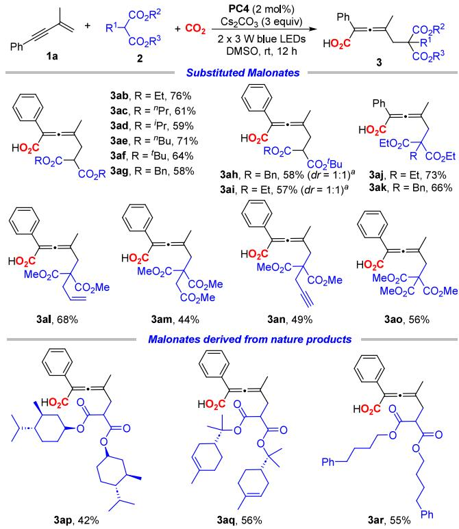  
Reaction Conditions: 1a (0.2 mmol), 2 (0.22 mmol), Ir-$\mathrm { ( p p y ) } _ { 2 } ( \mathrm { d t b b p y ) } { \cdot } \mathrm { P F } _ { 6 }$ (0.004 mmol), $\mathrm { C s } _ { 2 } \mathrm { C O } _ { 3 }$ (0.6 mmol, 3 equiv), DMSO (2 mL), and CO (1 atm), for $^ { 1 2 \mathrm { ~ h } , }$ in a sealed Schlenk tube, irradiated by $2 \times 3 \mathrm { ~ W ~ }$ blue LEDs, unless otherwise noted. aDetermined by 1H NMR.

To demonstrate the utility of this method, a 1 mmol reaction of 1a with 2a and $\mathrm { C O } _ { 2 }$ was conducted under the slightly modified conditions, leading to the desired product 3aa in 77% yield (Scheme 4c). Then, further transformations of 3aa were also conducted. First, a CuCl-catalyzed annulation of 3aa proceeded smoothly, delivering the cycloaddition product 4 in 76% yield (Scheme 4d). Furthermore, a cyclization reaction of 3aa catalyzed by PdCl in the presence of allyl bromide aforded allyl furanone 5 in 70% yield (Scheme 4e). Treatment of 3aa with N-iodosuccinimide (NIS) furnished iodo-lactone 6 in 31% yield (Scheme 4f). Additionally, the amination of 3aa with methyl glycinate hydrochloride led to amide 7 in 53% yield (Scheme 4g). Alternatively, amination of 3aa with benzylamine, followed by the treatment of the obtained amide with NIS, aforded iodo-lactam 8 in 51% yield (Scheme 4h).

Based on these results and the literature, 22 a mechanism is proposed in Scheme 5. Photocatalyst $\mathrm { I r } \left( \mathrm { p p y } \right) _ { 2 } \left( \mathrm { d t b b p y } \right) \cdot \mathrm { P F } _ { 6 }$ is excited by the irradiation of blue LEDs. Meanwhile, malonate 2 is deprotonated by ${ \mathrm { C s } } _ { 2 } { \mathrm { C O } } _ { 3 }$ to give its cesium salt A. Then, reductive quenching of photoexcited $\operatorname { I r } ( \operatorname { p p y } ) _ { 2 } ( \operatorname { d t b b p y } ) { \cdot } \operatorname { P F } _ { 6 } { \mathrm { ~ b y } }$ intermediate A forms radical species B and reduced photocatalyst $\mathrm { P C ^ { \bullet \mathrm { \cdot } } } ^ { \mathrm { \cdot } }$ Then, radical addition of B to 1,3-enyne 1 afords radical C. SET reduction of C by $\mathrm { P C ^ { \bullet \mathrm { ~ - ~ } } }$ forms its anion counterpart D and regenerates $\mathrm { I r } ( \mathrm { p p y } ) _ { 2 } ( \mathrm { d t b b p y } ) { \cdot } \mathrm { P F } _ { 6 } .$ . Intermediate C undergoes tautomerization to form allenoic carbanion D, which then undergoes nucleophilic addition to

Scheme 4. Mechanism Studies and Derivatizations  
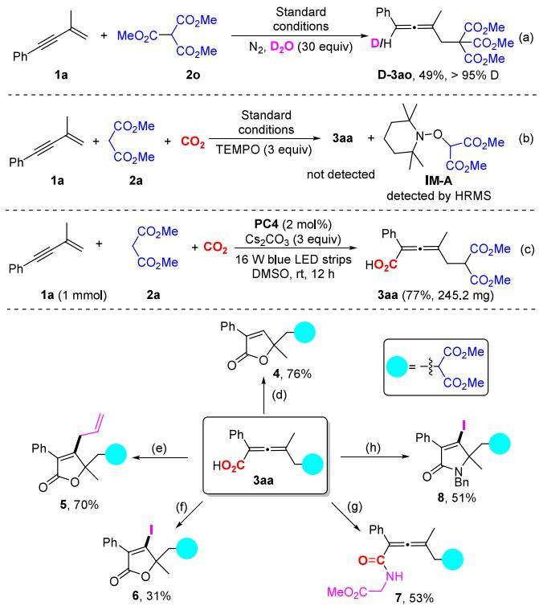  
Reaction Conditions: (d) CuCl (4 mol %), MeOH, 60 °C (Oil Bath), 1 h; (e) PdCl (2 mol %), Allyl Bromide (6 equiv), 50 °C (Oil Bath), 24 h; (f) NIS (1.2 equiv), MeCN; (g) EDCI·HCl (1.3 equiv), Et N (1.3 equiv), DMAP (10 mol %), Glycine Methyl Ester Hydrochloride (1.5 equiv); and (h) Amidation with BnNH as Described in Reaction g, Followed by Reaction with NIS.

Scheme 5. Proposed Mechanism  
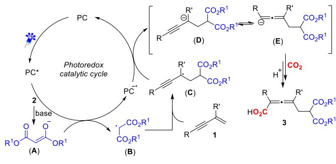

CO . Subsequent acidification with aqueous HCl yields carboxylic acid 3.

In conclusion, we have developed the first visible-lightpromoted 1,4-carbon/carboxylation of 1,3-enynes with malonates and $\mathrm { C O } _ { 2 } ,$ leading to a series of valuable tetrasubstituted 2,3-allenoic acids in good yields. This new methodology features good functional group tolerance, ease of scale-up, and facile transformations. Mechanistic investigations indicate that successive single-electron transfer (SSET) reduction is likely involved, with the allenoic anion serving as a key intermediate.

## ■ ASSOCIATED CONTENT

## Data Availability Statement

The data underlying this study are available in the published article and its Supporting Information.

## \*sı Supporting Information

The Supporting Information is available free of charge at https://pubs.acs.org/doi/10.1021/acs.orglett.5c02893.

Experimental procedures, product characterization data, and spectra (PDF)

## ■ AUTHOR INFORMATION

## Corresponding Author

Song Sun − Advanced Catalysis and Green Manufacturing Collaborative Innovation Center, School of Petrochemical Engineering, Changzhou University, Changzhou 213164, China; orcid.org/0000-0002-9974-6456;

Email: sunsong@cczu.edu.cn

## Authors

Aolong Zhang − Advanced Catalysis and Green Manufacturing Collaborative Innovation Center, School of Petrochemical Engineering, Changzhou University, Changzhou 213164, China

Han Yang − Advanced Catalysis and Green Manufacturing Collaborative Innovation Center, School of Petrochemical Engineering, Changzhou University, Changzhou 213164, China

Yang Yao − Advanced Catalysis and Green Manufacturing Collaborative Innovation Center, School of Petrochemical Engineering, Changzhou University, Changzhou 213164, China

Jianwei Sun − Department of Chemistry, Hong Kong University of Science and Technology, Kowloon, Hong Kong Special Administrative Region of China; orcid.org/0000- 0002-2470-1077

Complete contact information is available at: https://pubs.acs.org/10.1021/acs.orglett.5c02893

## Author Contributions

This work was conducted by Aolong Zhang, written by Song Sun, and polished by Jianwei Sun. Han Yang and Yang Yao helped with the sample testing. All authors have given approval to the final version of the manuscript.

## Funding

The authors thank the National Local Joint Engineering Laboratory to Functional Adsorption Material Technology for the Environmental Protection (SDGC2125) for financial support.

## Notes

The authors declare no competing financial interest.

## ■ ACKNOWLEDGMENTS

The authors also thank the Analysis and Testing Center, NERC Biomass of Changzhou University, for the assistance in NMR testing.

## ■ REFERENCES

(1) (a) Lv, D.; Zhu, X.; Bao, H. Copper-Catalyzed Enantioselective Radical Cyanation of Allenic C(sp2)−H Bonds to Access Tri- and Tetrasubstituted Chiral Allenes. ACS Catal. 2025, 15, 7741. (b) Duan, X.; Jin, $\mathrm { Q . } ;$ Wang, K.; Sun, $\mathrm { Y . } _ { \mathrm { i } }$ Wei, $\mathrm { Y . } _ { \mathrm { j } }$ Wang, $\mathrm { Z . j }$ Qiu, J.-K.; Guo, K.; Bao, $\mathrm { X . } ;$ Wu, X. Copper-Catalyzed Site-Selective C(sp2)−H Alkynylation of Allenes. ACS Catal. 2024, 14, 13219. (c) Du, J.; Liu, A.; Zhang, W.; Luo, S.; Yao, H.; He, Y. Enantio- and Regioselective Ni-Catalyzed Radical Relay 1,4-Arylalkylation of 1,3-

Enynes to Access Chiral Tetrasubstituted Allenes. ACS Catal. 2024, 14, 13940. (d) Rivera-Fuentes, $\mathrm { P . } \mathrm { , }$ Diederich, F. Allenes in Molecular Materials. Angew. Chem., Int. Ed. 2012, 51, 2818. (e) Yu, S.; Ma, S. Allenes in Catalytic Asymmetric Synthesis and Natural Product Syntheses. Angew. Chem., Int. Ed. 2012, 51, 3074. (f) Hoffmann-Röder, A.; Krause, N. Synthesis and Properties of Allenic Natural Products and Pharmaceuticals. Angew. Chem., Int. Ed. 2004, 43, 1196.

(2) (a) Wu, Q.; Zhang, $\mathrm { Z . j }$ Chong, $\mathrm { Q . } ;$ Meng, F. Photoredox/ Cobalt-Catalyzed Chemo-, Regio-, Diastereo- and Enantioselective Reductive Coupling of 1,1-Disubstituted Allenes and Cyclobutenes. Angew. Chem., Int. Ed. 2025, 64, No. e202416524. (b) Wu, H.; Pan, Q.; Grill, J.; Johansson, M. J.; Qiu, Y.; Backvall, J.-E. Palladium-Catalyzed Oxidative Allene−Allene Cross-Coupling. J. Am. Chem. Soc. 2025, 147, 4338. (c) Ma, S. Some Typical Advances in the Synthetic Applications of Allenes. Chem. Rev. 2005, 105, 2829. (d) Zhao, J.; Xu, Y. Asymmetric Synthesis of Chiral Allenes. In Axially Chiral Compounds: Asymmetric Synthesis an Applications; Tan, B., Ed.; Wiley-VCH: Weinheim, Germany, 2021; Chapter $^ { 6 , }$ pp 141−172, DOI: 10.1002/9783527825172.ch6.

(3) (a) Ma, S. Transition Metal-Catalyzed/Mediated Reaction of Allenes with a Nucleophilic Functionality Connected to the α-Carbon Atom. Acc. Chem. Res. 2003, 36, 701. (b) Ma, S. Electrophilic Addition and Cyclization Reactions of Allenes. Acc. Chem. Res. 2009, 42, 1679. (c) Ye, J.; Ma, S. Palladium-Catalyzed Cyclization Reactions of Allenes in the Presence of Unsaturated Carbon−Carbon Bonds. Acc. Chem. Res. 2014, 47, 989. (d) Cowen, B. J.; Saunders, L. B.; Miller, S. J. Pyridylalanine (Pal)-Peptide Catalyzed Enantioselective Allenoate Additions to N-Acyl Imines. J. Am. Chem. Soc. 2009, 131, 6105. (e) Wang, G.; Liu, $\mathrm { X . } ;$ Chen, $\mathrm { Y . } _ { \mathrm { j } }$ Yang, J.; Li, J.; Lin, L.; Feng, X. Diastereoselective and Enantioselective Alleno-aldol Reaction of Allenoates with Isatins to Synthesis of Carbinol Allenoates Catalyzed by Gold. ACS Catal. 2016, 6, 2482. (f) Hashimoto, T.; Sakata, K.; Tamakuni, $\mathrm { F . ; }$ Dutton, M. J.; Maruoka, K. Phase-transfer-catalysed asymmetric synthesis of tetrasubstituted allenes. Nat. Chem. 2013, 5, 240. $( \mathbf { g } )$ Lambert, T. H.; MacMillan, D. W. C. Development of a New Lewis Acid-Catalyzed [3,3]-Sigmatropic Rearrangement: The Allenoate-Claisen Rearrangement. J. Am. Chem. Soc. 2002, 124, 13646. (h) Shi, $\mathrm { Y . } _ { \mathrm { j } }$ Fu, C.; Zheng, J.; Ma, S. Photocatalytic Chemoselective Cyclic Oxysulfonylation of 2,3-Allenoic Acids. Org. Lett. 2024, 26, 5182. (i) Yu, Q.; Ma, S. Copper-Catalyzed Cyclic Oxytrifluoromethylation of 2,3-Allenoic Acids to Trifluoromethylated Butenolides. Chem. - Eur. J. 2013, 19, 13304. (j) Chai, G.; Qiu, Y.; Fu, C.; Ma, S. Efficient Assembly of Chromone Skeleton from 2,3-Allenoic Acids and Benzynes. Org. Lett. 2011, 13, 5196.

(4) (a) Zheng, W.-F.; Zhang, W.; Huang, $\mathrm { C . } \mathrm { \mathrm { ; } }$ Wu, P.; Qian, H.; Wang, L.; Guo, Y.-L.; Ma, S. Tetrasubstituted allenes via the palladium-catalysed kinetic resolution of propargylic alcohols using a supporting ligand. Nat. Catal. 2019, 2, 997. (b) Tap, $\mathbf { A } . ;$ Blond, $\mathbf { A . } _ { \mathrm { j } }$ Wakchaure, V. $\mathrm { N . } ;$ List, B. Chiral Allenes via Alkynylogous Mukaiyama Aldol Reaction. Angew. Chem., Int. Ed. 2016, 55, 8962. (c) Tang, Y.; Chen, $\mathrm { Q . } ;$ Liu, $\mathrm { X . } ;$ Wang, $\mathrm { G } . ;$ Lin, L.; Feng, X. Direct Synthesis of Chiral Allenoates from the Asymmetric C−H Insertion of α-Diazoesters into Terminal Alkynes. Angew. Chem., Int. Ed. 2015, 54, 9512. (d) Yang, $\mathrm { Y .  – L . } ;$ Zhang, $\mathrm { Z . j }$ Zhang, X.-N.; Wang, $\mathrm { D } . ;$ Wei, Y.; Shi, M. Lewis base-catalyzed reactions of cyclopropenones: novel synthesis of mono- or multi-substituted allenic esters. Chem. Commun. 2014, 50, 115. (e) Crouch, I. T.; Neff, R. $\mathrm { K } . \mathrm { \Omega }$ Frantz, D. E. Pd-Catalyzed Asymmetric β-Hydride Elimination en Route to Chiral Allenes. J. Am. Chem. Soc. 2013, 135, 4970. (f) Liu, H.; Leow, D.; Huang, K.-W.; Tan, C.-H. Enantioselective Synthesis of Chiral Allenoates by Guanidine-Catalyzed Isomerization of 3-Alkynoates. J. Am. Chem. Soc. 2009, 131, 7212. (g) Xu, B.; Hammond, G. B. Thermodynamically Favored Aldol Reaction of Propargyl or Allenyl Esters: Regioselective Synthesis of Carbinol Allenoates. Angew. Chem., Int. Ed. 2008, 47, 689.

(5) (a) Li, C.; Wang, X.; Sun, X.; Tang, Y.; Zheng, J.; Xu, $\mathrm { Z . j }$ Zhou, $\mathrm { Y . } _ { \mathrm { \cdot } }$ Dai, L. Iron Porphyrin-Catalyzed Olefination of Ketenes with Diazoacetate for the Enantioselective Synthesis of Allenes. J. Am. Chem. Soc. 2007, 129, 1494. (b) Li, C.-Y.; Sun, X.-L.; Jing, $\mathrm { Q . ; }$ Tang,

Y. Enantioselective synthesis of allenic esters via an ylide route. Chem. Commun. 2006, 2980. (c) Marshall, J. A.; Wolf, M. $\mathbf { A } . ;$ Wallace, E. M. Synthetic Routes to Allenic Acids and Esters and Their Stereospecific Conversion to Butenolides. J. Org. Chem. 1997, 62, 367. (d) Marshall, J. A.; Robinson, E. D.; Zapata, A. [2,3] Wittig rearrangement of nonracemic propargyl ethers leading to allenes of high stereochemical integrity. J. Org. Chem. 1989, 54, 5854. (e) Lang, R. W.; Hansen, H.-J. Eine einfache Allencarbonsaureester-Synthese ̈ mittels der Wittig-Reaktion. Helvetica Chimica Acta 1980, 63, 438.

(6) Qin, J.-H.; Xiong, Z.-Q.; Cheng, C.; Hu, M.; Li, J.-H. Electroreductive Carboxylation of Propargylic Acetates with CO : Access to Tetrasubstituted 2,3-Allenoates. Org. Lett. 2023, 25, 9176.

(7) Yao, Y.; Zhu, G.; Chen, $\mathrm { Q . } ;$ Qian, H.; Ma, S. Efficient synthesis of tetrasubstituted 2,3-allenoates and preliminary studies on bioactivities. Org. Chem. Front. 2019, 6, 304.

(8) (a) Wang, J.; Zheng, W.-F.; Li, Y.; Guo, Y.-L.; Qian, H.; Ma, S. Pd((R)-DTBM-SEGphos)Cl -catalyzed kinetic resolution of tertiary propargylic alcohols. Org. Chem. Front. 2024, 11, 2477. (b) Zheng, W.-F.; Zhang, $\mathrm { W . } \mathrm { \Sigma }$ Huang, J.; Yu, Y.; Qian, H.; Ma, S. 2,3-Allenoic acids via palladium-catalyzed carboxylation of propargylic alcohols. Org. Chem. Front. 2018, 5, 1900. (c) Wang, Y.; Zhang, W.; Ma, S. A Room-Temperature Catalytic Asymmetric Synthesis of Allenes with ECNU-Phos. J. Am. Chem. Soc. 2013, 135, 11517.

(9) (a) Yu, X.; Ren, H.; Xiao, Y.; Zhang, J. Efficient Assembly of Allenes, 1,3-Dienes, and 4H-Pyrans by Catalytic Regioselective Nucleophilic Addition to Electron-Deficient 1,3-Conjugated Enynes. Chem. - Eur. J. 2008, 14, 8481. (b) Qian, H.; Yu, X.; Zhang, J.; Sun, J. Organocatalytic Enantioselective Synthesis of 2,3-Allenoates by Intermolecular Addition of Nitroalkanes to Activated Enynes. J. Am. Chem. Soc. 2013, 135, 18020.

(10) (a) Sun, G.-Q.; Liao, L.-L.; Ran, C.-K.; Ye, J.-H.; Yu, D.-G. Recent Advances in Electrochemical Carboxylation with CO . Acc. Chem. Res. 2024, 57, 2728. (b) He, M.; Sun, $\mathrm { Y . } _ { \mathrm { j } }$ Han, B. Green Carbon Science: Efficient Carbon Resource Processing, Utilization, and Recycling towards Carbon Neutrality. Angew. Chem., Int. Ed. 2022, 61, No. e202112835. (c) Ye, J.-H.; Ju, T.; Huang, H.; Liao, L.- L.; Yu, D.-G. Radical Carboxylative Cyclizations and Carboxylations with CO . Acc. Chem. Res. 2021, 54, 2518. (d) Tortajada, A.; Börjesson, M.; Martin, R. Nickel-Catalyzed Reductive Carboxylation and Amidation Reactions. Acc. Chem. Res. 2021, 54, 3941. (e) Zhang, Z.; Ye, J.-H.; Ju, $\mathrm { T . } _ { \mathrm { j } }$ Liao, L.-L.; Huang, H.; Gui, Y.-Y.; Zhou, W.-J.; Yu, D.-G. Visible Light-Driven Catalytic Reductive Carboxylation with $\mathrm { C O } _ { 2 } .$ ACS Catal. 2020, 10, 10871. (f) Zhou, C.; Li, M.; Yu, J.-T.; Sun, S.; Cheng, J. Recent Progress in the Carboxylation/Cyclization Reactions Using Carbon Dioxide as the C1 Source. Chin. J. Org. Chem. 2020, 40, 2221. (g) Wang, S.; Xi, C. Recent advances in nucleophile-triggered CO -incorporated cyclization leading to heterocycles. Chem. Soc. Rev. 2019, 48, 382. (h) Yu, B.; He, L.-N. Upgrading Carbon Dioxide by Incorporation into Heterocycles. ChemSusChem 2015, 8, 52.

(11) (a) Liu, Y.; Xue, G.-H.; He, Z.; Yue, J.-P.; Pan, M.; Song, L.; Zhang, W.; Ye, J.-H.; Yu, D.-G. Visible-Light Photoredox-Catalyzed Direct Carboxylation of Tertiary C(sp3)−H Bonds with $\mathrm { C O } _ { 2 } \colon$ Facile Synthesis of All-Carbon Quaternary Carboxylic Acids. J. Am. Chem. Soc. 2024, 146, 28350−28359. (b) Davies, $\mathrm { J } . \mathrm { \mathrm { ; } }$ Lyonnet, J. R.; Carvalho, B.; Sahoo, B.; Day, C. S.; Juliá-Hernández, $\mathrm { F . } \mathrm { \mathrm { ; } }$ Duan, $\mathrm { Y . } _ { \mathrm { j } }$ Velasco-Rubio, $\mathrm { \acute { A } } . \mathrm { \acute { \Omega } }$ Obst, M.; Norrby, P.-O.; Hopmann, K. H.; Martin, R. Kinetically-Controlled Ni-Catalyzed Direct Carboxylation of Unactivated Secondary Alkyl Bromides without Chain Walking. J. Am. Chem. Soc. 2024, 146, 1753−1759. (c) Sun, $\mathrm { G . ^ { - } C . } ;$ Yu, P.; Zhang, W.; Zhang, W.; Wang, Y.; Liao, L.-L.; Zhang, Z.; Li, L.; Lu, $\mathrm { Z . j }$ Yu, D.- $\mathrm { G } . ;$ Lin, S. Electrochemical reactor dictates site selectivity in Nheteroarene carboxylations. Nature 2023, 615, 67. (d) Yuan, P.-F.; Yang, Z.; Zhang, S.-S.; Zhu, C.-M.; Yang, X.-L.; Meng, Q.-Y. Deconstructive Carboxylation of Activated Alkenes with Carbon Dioxide. Angew. Chem., Int. Ed. 2024, 63, No. e202313030. (e) Song, L.; Wang, W.; Yue, J.-P.; Jiang, Y.-X.; Wei, M.-K.; Zhang, H.-P.; Yan, $S . { - } S . ;$ Liao, L.-L.; Yu, D.-G. Visible-Light Photocatalytic Di- and Hydro-Carboxylation of Unactivated Alkenes with $\mathrm { C O } _ { 2 } .$ Nat. Catal.

2022, 5, 832. (f) Wang, Y.; Tang, S.; Yang, G.; Wang, S.; Ma, D.; Qiu, Y. Electrocarboxylation of Aryl Epoxides with CO for the Facile and Selective Synthesis of β-Hydroxy Acids. Angew. Chem., Int. Ed. 2022, 61, No. e202207746.

(12) (a) He, R.-D.; Lu, Y. Proximal and Remote Hydrocarboxylation of Alkenes with Carbon Dioxide Enabled by Nickel-Catalyzed Hydrogen Atom Transfer. Angew. Chem., Int. Ed. 2025, 64, No. e202424790. (b) Zhou, Li; Li, L.; Zhang, S.; Kuang, X.-K.; Zhou, Y.-Y.; Tang, Y. J. Am. Chem. Soc. 2024, 146, 18823. (c) Zhang, W.; Chen, Z.; Jiang, Y.-X.; Liao, L.-L.; Wang, W.; Ye, J.-H.; Yu, D.-G. Arylcarboxylation of unactivated alkenes with CO via visible-light photoredox catalysis. Nat. Commun. 2023, 14, 3529. (d) Fan, Z.; Chen, S.; Zou, S.; Xi, C. Direct C−C Bond Formation of Allylic Alcohols with CO toward Carboxylic Acids by Photoredox/Nickel Dual Catalysis. ACS Catal. 2022, 12, 2781. (e) Xiong, W.; Shi, F.; Cheng, R.; Zhu, B.; Wang, L.; Chen, P.; Lou, H.; Wu, W.; Qi, C.; Lei, M.; Jiang, H. ACS Catal. 2020, 10, 7968.

(13) (a) Lyonnet, J. R.; Velasco-Rubio, Á.; Abrams, R.; Phan, H.; Mühlfenzl, K.; Chen, X.; Cerveri, A.; Correia, J. T. M.; Paixao,̃ M. W.; Elmore, C. S.; Martin, R. Photocatalytic Multicomponent Carboxylation of Olefins and Sulfinate Salts with 13CO . ACS Catal. 2024, 14, 18633. (b) Yatham, V. R.; Shen, Y.; Martin, R. Catalytic Intermolecular Dicarbofunctionalization of Styrenes with CO and Radical Precursors. Angew. Chem., Int. Ed. 2017, 56, 10915.

(14) (a) Xu, J.-C.; Yue, J.-P.; Pan, M.; Chen, Y.-C.; Wang, W.; Zhou, X.; Zhang, W.; Ye, J.-H.; Yu, D.-G. Metallaphotoredox-catalyzed alkynylcarboxylation of alkenes with CO and alkynes for expedient access to β-alkynyl acids. Nat. Commun. 2025, 16, 1850. (b) Yue, J.- P.; Xu, J.-C.; Luo, H.-T.; Chen, X.-W.; Song, H.-X.; Deng, Y.; Yuan, L.; Ye, J.-H.; Yu, D.-G. Metallaphotoredox-enabled aminocarboxylation of alkenes with CO . Nat. Catal. 2023, 6, 959. (c) Liao, L.-L.; Cao, G.-M.; Jiang, Y.-X.; Jin, X.-H.; Hu, X.-L.; Chruma, J. J.; Sun, G.- Q.; Gui, Y.-Y.; Yu, D.-G. α-Amino Acids and Peptides as Bifunctional Reagents: Carbocarboxylation of Activated Alkenes via Recycling CO . J. Am. Chem. Soc. 2021, 143, 2812. (d) Song, L.; Fu, D.-M.; Chen, L.; Jiang, Y.-X.; Ye, J.-H.; Zhu, L.; Lan, Y.; Fu, Q.; Yu, D.-G. Visible-Light Photoredox-Catalyzed Remote Difunctionalizing Carboxylation of Unactivated Alkenes with CO . Angew. Chem., Int. Ed. 2020, 59, 21121. (e) Fu, Q.; Bo, Z.-Y.; Ye, J.-H.; Ju, T.; Huang, H.; Liao, L.-L.; Yu, D.-G. Transition metal-free phosphonocarboxylation of alkenes with carbon dioxide via visible-light photoredox catalysis. Nat. Commun. 2019, 10, 3592.

(15) Hou, J.; Ee, A.; Cao, H.; Ong, H.-W.; Xu, J.-H.; Wu, J. Visible-Light-Mediated Metal-Free Difunctionalization of Alkenes with CO and Silanes or C(sp3)−H Alkanes. Angew.Chem., Int. Ed. 2018, 57, 17220.

(16) (a) Yi, Y.; Fan, Z.; Xi, C. Photoredox-catalyzed intermolecular dearomative trifluoromethylcarboxylation of indoles and heteroanalogues with CO and fluorinated radical precursors. Green Chem. 2022, 24, 7894. (b) Hang, W.; Liang, N.; Liu, Y.; Xi, C. Cobalt-Catalyzed Highly Regioselective Three-ComponentArylcarboxylation of Acrylate with Aryl Bromides andCarbon Dioxide. ChemSusChem 2021, 14, 4941. (c) Zhang, B.; Yi, Y.; Wu, Z.-Q.; Chen, C.; Xi, C. Photoredox-catalyzed dicarbofunctionalization of styrenes with amines and CO : a convenient access to γ-amino acids. Green Chem. 2020, 22, 5961.

(17) (a) Yang, H.; Yao, Y.; Yang, Q.; Yao, Y.; Sun, J.; Sun, S. Visible Light Photoredox-Catalyzed Formyl/Carboxylation of Activated Alkenes with Glyoxylic Acid Acetals and CO . Org. Lett. 2024, 26, 4194. (b) Zhang, A.; Yang, H.; Cheng, P.; Yao, Y.; Sun, S. Visible Light Photoredox-Catalyzed Carbon/Carboxylation of Alkenes with Malonates and CO . Chin. J. Org. Chem. 2024, 44, 3159. (c) Gao, W.; Yang, Q.; Yang, H.; Yao, Y.; Bai, J.; Sun, J.; Sun, S. Visible-Light Photoredox-Catalyzed Intermolecular α-Aminomethyl/Carboxylative Dearomatization of Indoles with CO and α-Aminoalkyl Radical Precursors. Org. Lett. 2024, 26, 467. (d) Bai, J.; Li, M.; Zhou, C.; Sha, Y.; Cheng, J.; Sun, J.; Sun, S. Visible-light Photoredox-Catalyzed Dicarbofunctionalization of Styrenes with Oxime Esters and $\mathrm { C O } _ { 2 } { \mathrm { : } }$ Multicomponent Reactions toward Cyanocarboxylic Acids and γ-Keto

Acids. Org. Lett. 2021, 23, 9654. (e) Zhou, C.; Li, M.; Sun, J.; Cheng, J.; Sun, S. Photoredox-Catalyzed α-Aminomethyl-Carboxylation of Styrenes with Sodium Glycinates: Synthesis of γ-Amino Acids and γ- Lactams. Org. Lett. 2021, 23, 2895.

(18) (a) Li, C.; Chen, X.-W.; Liao, L.-L.; Gui, Y.-Y.; Yang, J.-W.; Zhang, S.; Yue, J.-P.; Zhou, X.; Ye, J.-H.; Lan, Y.; Yu, D.-G. Nickel-Catalyzed Atroposelective Carbo-Carboxylation of Alkynes with CO : En Route to Axially Chiral Carboxylic Acids. Angew. Chem., Int. Ed. 2025, 64, No. e202413305. (b) Miao, B.; Li, S.; Li, G.; Ma, S. Cyclic Anti-Azacarboxylation of 2-Alkynylanilines with Carbon Dioxide. Org. Lett. 2016, 18, 2556−2559. (c) Wang, X.; Nakajima, M.; Martin, R. Ni-Catalyzed Regioselective Hydrocarboxylation of Alkynes with CO by Using Simple Alcohols as Proton Sources. J. Am. Chem. Soc. 2015, 137, 8924.

(19) Hou, J.; Ee, A.; Feng, W.; Xu, J.-H.; Zhao, Y.; Wu, J. Visible-Light-Driven Alkyne Hydro-/Carbocarboxylation Using CO via Iridium/Cobalt Dual Catalysis for Divergent Heterocycle Synthesis. J. Am. Chem. Soc. 2018, 140, 5257.

(20) (a) Zeng, J.-H.; Du, D.-T.; Liu, B.-E.; Zhang, Z.-Q.; Zhan, Z.-P. Photoredox-Catalyzed Phosphonocarboxylation of Allenes with Phosphine Oxides and CO . J. Org. Chem. 2023, 88, 14789. (b) Hahm, H.; Baek, D.; Kim, D.; Park, S.; Ryoo, J. Y.; Hong, S. Photoredox-Catalyzed α-Aminoalkylcarboxylation of Allenes with CO . Org. Lett. 2021, 23, 3879.

(21) (a) Yang, H.; Yang, Q.; Yao, Y.; Gu, P.; Sun, J.; Sun, S. Visible-Light-Promoted Cascade Carboxylation/Arylation of Unactivated Alkenes with CO for the Synthesis of Carboxylated Indole-Fused Heterocycles. Org. Lett. 2024, 26, 6341. (b) Yao, Y.; Bai, J.; Cheng, P.; Yang, H.; Sun, J.; Sun, S. Base-promoted cascade 5-exo-dig annulation/carboxylation of o-(1-alkynyl)benzenesulfonamides with CO : divergent synthesis of mono- or gem-dicarboxylic esters. Chem. Commun. 2024, 60, 14850. (c) Sun, S.; Yu, J.-T.; Jiang, Y.; Cheng, J. Cs CO -Promoted Carboxylation of N-Tosylhydrazones with Carbon Dioxide toward α-Arylacrylic Acids. J. Org. Chem. 2015, 80, 2855.

(22) (a) Sun, Y.; Pan, Y.; Chen, X.; Yu, H.; Han, Y.; Sun, Q.; Hou, H.; Zhu, S. Visible-Light Photoredox-Catalyzed Radical-Polar Crossover 1,4-Hydrofluoromethylation of 1,3-Enynes. Org. Lett. 2024, 26, 10399. (b) Cao, Q.; Li, M.-M.; Mao, X.; Zhou, Q.-Q.; Ding, W. Visible-Light-Induced Regioselective Radical-Polar Crossover 1,4- Hydrophosphinylation of 1,3-Enynes: Access to Trisubstituted Allenes Bearing a Phosphine Oxide Group. Org. Lett. 2024, 26, 4678. (c) Hou, H.; Pan, Y.; Sun, Y.; Han, Y.; Yan, C.; Shi, Y.; Zhu, S. Visible-Light Photoredox Catalyzed Regioselective 1,4-Hydroalkylation of 1,3-Enyne. Chem. - Eur. J. 2023, 29, No. e202301633. (d) Lei, W.; Liu, H.; Li, Y.; Fang, Y. Nickel-catalysed SET-reduction-based access to functionalized allenes via 1,4-carbohydrogenation of 1,3- enynes with alkyl bromides. Org. Chem. Front. 2022, 9, 3862. (e) Liu, H.; Lei, W.; Li, Y.; Fang, Y. Diversified access to di- and trisubstituted allenes via nickel-catalysed reactions of 1,3-enynes with alkyl Nhydroxyphthalimide esters. Chem. Commun. 2023, 59, 1825.