Electrochemistry

How to cite: Angew. Chem. Int. Ed. 2025, 64, e202508369   
doi.org/10.1002/anie.202508369

# Electrochemical Allene C─H Functionalization via Carbanion Sampling

Jiayi Feng+, Yuhang Xia+, Mingyu Shen, Junwei Wang, Weigang Fan, Sheng Zhang,\* and Man-Bo Li\*

Abstract: Functionalization of C─H bonds represents a direct and practical avenue to upgrade simple organic molecules to value-added products, whereas the reaction selectivity is largely governed by the acidity and bond dissociation energy (BDE) of C─H bonds. Developing a novel strategy to break these constraints is highly desirable, as it would open a new horizon for conventionally challenging molecules. Herein, we disclosed a carbanion sampling strategy that enables unconventional selectivity in the allene C(sp2)─H functionalization harnessing chromium-catalyzed hydrogen evolution. The electrochemical protocol provides in situ access to diverse allene carbanions and facilitates a dynamic carbanion sampling process to give thermodynamically unfavored products. 1,3-Disubstituted allenes were precisely functionalized at the less acidic and stronger C(sp2)─H site to yield abnormal site-selective allene products, while the 1,1- substituted allenes proceeded isomerization to deliver functionalized alkynes. All of the products presented in this work are unprecedented and exhibit remarkable versatility in late-stage derivatization. The superiority of the carbanion sampling strategy was demonstrated in the convergent synthesis of functionalized allenes from alkyne or mixed substrates. More importantly, we conducted a series of density functional theory (DFT) calculations and control experiments to rationalize the unconventional selectivity.

## Introduction

Electrochemical hydrogen evolution reaction (HER)[1–5] is one of the most pivotal transformations that converts the energy from electricity into hydrogen fuel. Adapting this endergonic transformation (-G > 0) for synthetic applications[6–9] provides new opportunities to overcome thermodynamic limitations in conventional methodologies. Specifically, HER catalysis can be employed for the reductive cleavage of C─H bonds into hydrogen and carbanions via electricity input. We recently harnessed this strategy[10–12] to develop a series of electrochemical protocols for C─H functionalization.[13–17] Theoretically, converting C─H into carbanions is a thermodynamic uphill process, which could enable a distinctive selectivity mechanism and open up an avenue for conventionally inaccessible products. The traditional methods for generating carbanions from inactivated C─H bonds often require harsh conditions, such as highly reactive organic bases and multistep procedures. Since carbanion formation and subsequent functionalization occur as discrete steps, selectivity is predominantly dictated by C─H acidity (Figure 1a). In sharp contrast, HER catalysis provides a mild, in situ protocol for generating diversified carbanion intermediates from C─H substrates in the presence of functionalization reagents (Figure 1b). This one-pot approach allows precise control over carbanion generation through both the hydrogen evolution and subsequent functionalization steps. Inspired by the seminal work on radical sampling,[18,19] we hypothesized that HER catalysis could serve as an ideal platform for the carbanion sampling, which would break conventional C─H acidity constraints and enable unconventional selectivity patterns in C─H functionalization.

Allenes, with an orthogonal diene topology, are versatile building blocks[20–23] are widely prevalent in the natural products and pharmaceuticals. Direct C─H functionalization of allenes[24–29] has garnered tremendous attention from synthetic community, as it offers a straightforward route to structurally diverse allenes or alkynes via in situ isomerization. However, the development of such transformations has been largely plagued by the challenges related to chemoand site-selectivity (Figure 1c). For instance, the reactive π bond of allene favors hydrofunctionalization[30–40] over direct C─H functionalization. Moreover, the similarity of multiple allene C(sp2)─H and the competing reactivity of allylic C(sp3)─H bonds pose significant site-selectivity issue. Very recently, ionic[11,26] and radical[28,29] protocols have been elegantly unveiled to discriminate the reaction sites based on the acidity[11] or bond dissociation energy (BDE)[29] of C─H bonds. These studies reveal that the alkyl adjacent C─H bonds (γ-site) of 1,3-disubstituted allene are more reactive than that of aromatic ones (α-site), with both acidity and BDE analyses consistently supporting this trend (Figure 1c). On the flip side, these intrinsic properties exhibit a great obstacle to achieving reverse site selectivity in allene functionalization. In this context, we envisaged that HER catalysis might provide a general solution to break the inherent limitations through a carbanion sampling strategy.

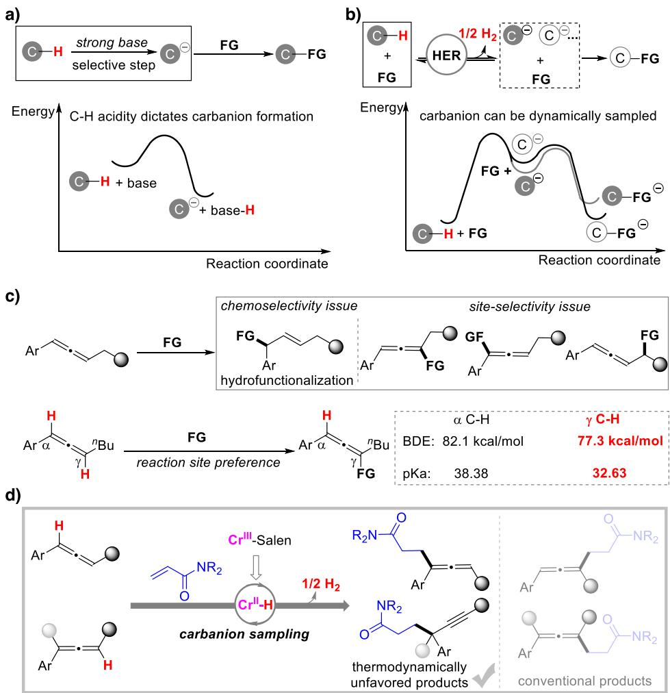  
Figure 1. Selectivity mechanism forming carbanions and allene C─H functionalization. a) Conventional approaches for carbanion generation. b) Carbanion sampling enabled by HER catalysis. c) Challenges and selectivity in the allene C─H functionalization. d) This work.

The implementation of the electrochemical carbanion sampling strategy in allene functionalization faces two primary challenges: a) the inherently low reactivity of allene $\mathrm { C } ( \mathrm { s p } ^ { 2 } ) \mathrm { - H }$ bonds; b) the undesired chemoselectivity generating hydrofunctionalization products. Inspired by literature reports demonstrating chromium’s ability to intercept radicals,[41–46] we proposed using a chromium Salen as HER catalyst to address the reactivity and chemoselectivity issues through chromium-mediated hydrogen atom interception. Additionally, acrylamide, a weak electrophile but synthetically useful, was employed as a functionalization reagent to react with allene carbanions in the transformation. With the robust chromium HER catalyst, the site selectivity of 1,3- disubstituted allene functionalization has been readily steered toward unconventional α C─H site, affording thermodynamically unstable products (Figure 1d). More importantly, the robustness of the carbanion sampling strategy was demonstrated in the isomerized functionalization of 1,1-substituted type allenes, thereby providing a route to alkynes containing quaternary carbon centers. We further highlighted the superiority of this strategy through the convergent synthesis of functionalized allene products from various alkynes or even mixture starting materials.

## Results and Discussion

We commenced our study by employing 1,3-disubstituted allene (1a) and acrylamide (2a) as pilot substrates (Table 1). Initially, organic bases were tested in the allene C─H functionalization. While n-butyllithium (nBuLi) yielded a mixture of regioisomers $( r r \sim 1 / 1 )$ of products 3a and 3a- (Entry 1), lithium diisopropylamide (LDA) led to a complex mixture of byproducts with no detectable formation of the desired product (Entry 2), demonstrating the challenges associated with the reaction selectivity and reactivity. Subsequently, we performed the reaction under direct electrolysis by using ${ } ^ { n } \mathbf { B u } _ { 4 } \mathbf { N B F } _ { 4 }$ as an electrolyte, N,N-dimethylformamide (DMF) as solvent, and graphite felt (GF) and nickel plate as anode and cathode, respectively. In the absence of a catalyst, a trace of desired product 3a was delivered via carbanion sampling, although the hydrofunctionalization product 4a was determined as the major product (Entry 3). There are two possible pathways forming product 4a, either via the reductive coupling of 1a and 2a, or through the further hydrogenation of 3a on the cathode. To suppress these side reactions, we introduced the combinations of base additive $\mathrm { C s } _ { 2 } \mathrm { C O } _ { 3 }$ and various HER catalysts to promote the HER of 1a (Entries 4– 6). To our delight, the Salen- $\mathbf { \nabla \cdot } \mathrm { C r ^ { I I I } }$ cat 2 was found to be more efficient than the previously reported cobalt HER catalyst[10] cat 1 (Entry 5 vs. Entry 6), affording the desired product 3a with excellent site- $( r r > 1 5 / 1 )$ and chemoselectivity (>15/1). We attributed the superior performance of cat 2 to its ability to preferentially intercept the hydrogen atoms generated in situ during the HER of 1a, thereby preventing the undesired hydrogenation of 3a. Varying the ligand structure of Salen-$\dot { \mathrm { C r } } ^ { \mathrm { I I I } }$ catalysts did not improve the yield or selectivity (Entries 7 and 8). The optimal amino acid cobalt catalysts cat 5-cat 6 from our previous report[11] also led to mixed products of 3a and 4a (Entries 9 and 10), highlighting the superiority of the chromium catalytic protocol. Replacing DMF with a weak acid $\mathrm { ( p } K _ { a } \sim 4 0 . $ , see Table S2) solvent N,N-dimethylacetamide (DMA) led to deteriorated regioselectivity (3/1, Entry 11), presumably due to interference with the carbanion sampling process by DMA carbanions. Conducting the reaction in an undivided cell confirmed that the desired product was formed via cathodic reduction (Entry 12). The control experiment without electricity completely halted the reaction, underscoring the necessity of electrolysis (Entry 13). Notably, the thermodynamically unfavorable regioselectivity of product 3a was evidenced by the gradual enrichment of regioisomer 3a- observed in the isolated 3a samples over several weeks at ambient temperature (Figure S27). DFT calculation also verified the product 3a is more energetic than its regioisomer 3a- $( \Delta G = + 4 . 0 5 \mathrm { k c a l m o l ^ { - 1 } } )$ .

Table 1: Optimization of the functionalization 1,3-disubstituted allene with acrylamide.a)  
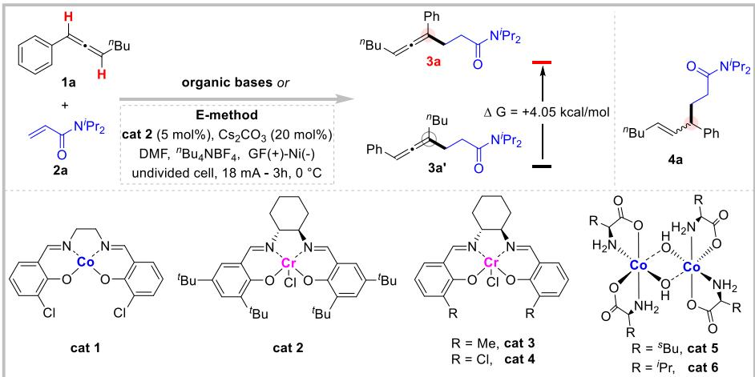

<table><tr><td>Entry</td><td>Reaction conditions</td><td> $3 a / 3 a ^ { \prime } { } ^ { \mathrm { b } ) }$ </td><td> $3 a / 4 a ^ { \mathrm { b } ) }$ </td><td>Yield (%)c)</td></tr><tr><td>1</td><td> $^ n { \sf B u l i } \left( 3 \sf { e q u i v } \right) , \sf T H F , - 2 0 ^ { \circ } { \sf C }$ </td><td>1/1</td><td> ${ \mathsf { n } } . { \mathsf { d } } .$ </td><td>41%</td></tr><tr><td>2</td><td> $\mathsf { L D A } ( 3 \mathsf { e q u i v } ) , \mathsf { T H F } , - 2 0 \mathsf { \Omega ^ { \circ } C }$ </td><td> ${ \mathsf { n } } . { \mathsf { d } } .$ </td><td> ${ \mathsf { n } } . { \mathsf { d } } .$ </td><td>0</td></tr><tr><td>3</td><td>No cat 2 and  ${ \mathsf { C s } } _ { 2 } { \mathsf { C O } } _ { 3 }$  in E-method</td><td> ${ \mathsf { n } } . { \mathsf { d } } .$ </td><td> $1 / 3$ </td><td>44%</td></tr><tr><td>4</td><td>No cat 2 in E-method</td><td> ${ \mathsf { n } } . { \mathsf { d } } .$ </td><td> $5 / 1$ </td><td>44%</td></tr><tr><td>5</td><td>E-method</td><td> $> 1 5 / 1$ </td><td> ${ > } 7 5 / 1$ </td><td>84%</td></tr><tr><td>6</td><td>cat 1 used to replace cat 2 in E-method</td><td> $> 1 5 / 1$ </td><td> $8 / 1$ </td><td>61%</td></tr><tr><td>7</td><td>cat 3 used to replace cat 2 in E-method</td><td> $1 1 / 1$ </td><td> ${ > } 7 5 / 1$ </td><td>55%</td></tr><tr><td>8</td><td>cat 4 used to replace cat 2 in E-method</td><td> $1 1 / 1$ </td><td> ${ > } 7 5 / 1$ </td><td>58%</td></tr><tr><td>9</td><td>cat 5 used to replace cat 2 in E-method</td><td> ${ \mathsf { n } } . { \mathsf { d } } .$ </td><td> $1 / 1$ </td><td>61%</td></tr><tr><td>10</td><td>cat 6 used to replace cat 2 in E-method</td><td> ${ \mathsf { n } } . { \mathsf { d } } .$ </td><td> $1 / 1$ </td><td>58%</td></tr><tr><td>11</td><td>DMA used to replace DMF in E-method</td><td> $3 / 1$ </td><td> $> 7 5 / 7$ </td><td>38%</td></tr><tr><td>12</td><td>Using divided cell in E-methodd)</td><td> $> 1 5 / 1$ </td><td> ${ > } 7 5 / 1$ </td><td>51%</td></tr><tr><td>13</td><td>No electricity in E-method</td><td> ${ \mathsf { n } } . { \mathsf { d } } .$ </td><td>n.d.</td><td>0</td></tr></table>

a) Electrolysis conditions (E-method): 1a (1.5 mmol), 2a (0.5 mmol), cat 2 (5 mol%), Cs CO (20 mol%), nBu NBF (1.0 mmol), DMF (10 mL), graphite felt anode, nickel plate cathode, undivided cell, CCE 18 mA, 3 h (4.0 F mol−1), 0 °C. b) Determined by 1H NMR. c) Isolated yield. d) The desired product was detected in the cathodic chamber.

With the established carbanion sampling strategy, we proceeded to explore the substrate generality of the electrochemical functionalization of 1,3-disubstituted allenes (Scheme 1). First, we investigated the electronic effects by employing para-substituted allenes (3b–3l), finding that electron-deficient substrates were slightly favored in terms of both yield and site selectivity. Remarkably, the protocol demonstrated exceptional tolerance for various redoxsensitive groups, such as amine (3m), thioether (3n–3o), and iodine (3p). Second, we extended the reaction to the allenes bearing fused rings (3q–3r, 3w) and heterocycles (3s–3v), all of which proved compatible, selectively yielding α-C─H functionalized products. While an electron-rich thiophene substrate exhibited lower site selectivity (3v), the pharmaceutical adapalene-derived allene (3w) was precisely functionalized at the α-C─H site. Third, variations in the substitution pattern had a little impact on the reaction yield and selectivity (3x–3y). Additionally, the robustness of the carbanion sampling strategy was highlighted by the successful functionalization of allenes with diverse alkyl moieties (3z– 3af). In particular, the cyclohexyl group (3ad), which shares a nearly identical geometric structure with the phenyl ring, largely maintained selectivity for the α-C─H site. Moreover, the cyclopropyl ring remained intact during the reaction, supporting the involvement of an ionic pathway. Finally, we examined the scope of activated alkenes (3ag–3al). More reactive substrates such as N,N-dimethylacrylamide (3ag) and tert-butyl acrylate (3al) led to slightly lower regioselectivity compared to the model substrate 2a, further validating the carbanion sampling process. Importantly, a chiral acrylamide substrate produced the corresponding product 3aj with high diastereoselectivity (dr > 15/1).

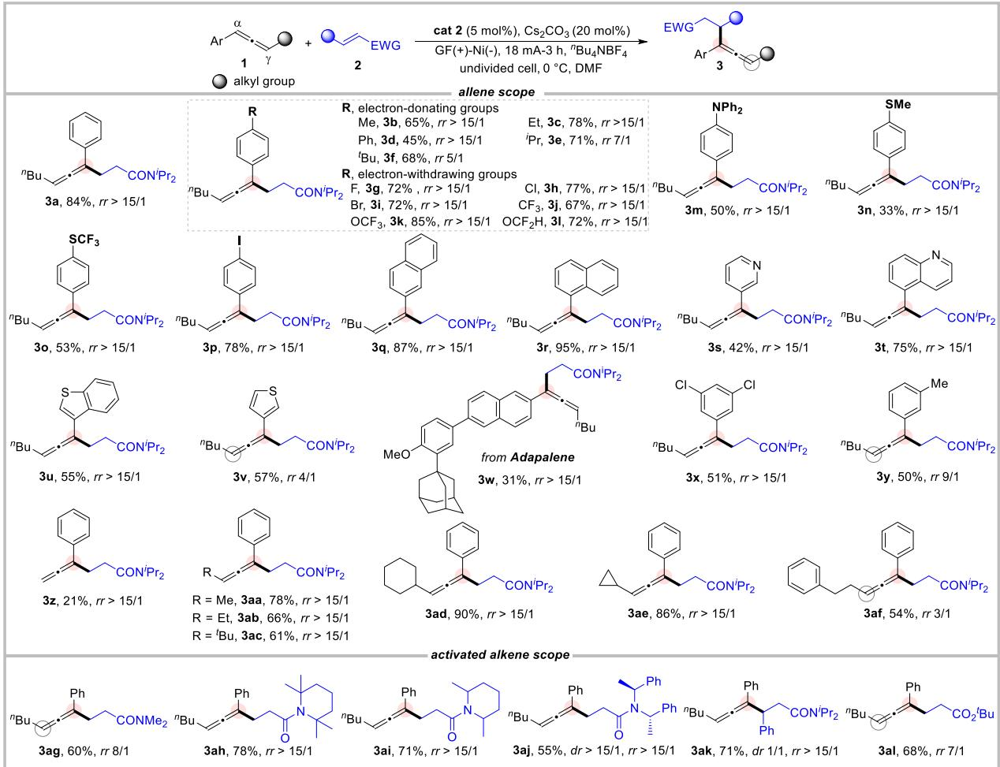  
Scheme 1. Generality of the electrochemical functionalization of 1,3-disubstituted allenes. Reaction conditions: 1 (1.5 mmol), 2 (0.5 mmol), cat 2 (5 mol%), Cs CO (20 mol%), nBu NBF (1.0 mmol), DMF (10 mL), graphite felt anode, nickel plate cathode, undivided cell, CCE 18 mA, 3 h (4.0 F mol−1), 0 °C. The percentages listed for each product correspond to the isolated yields.

To further illustrate the robustness of the electrochemical protocol, we applied the optimized conditions to a broad range of 1,1-substituted allenes (Scheme 2). Surprisingly, an isomerized terminal alkyne product 5a[47,48] was exclusively generated from 3-phenylbuta-1,2-diene (1a-) via carbanion sampling. It is worth mentioning that this product is thermodynamically disfavored compared to the conventional allene product 5a-, with a Gibbs free energy difference of 4.01 kcal mol−1 (Figure S54). Encouraged by this result, variation on the aryl ring (5c–5o) was next evaluated. Most of the alkyne products were readily obtained in good to excellent yields (up to 91%), whereas strongly electron-withdrawing (5j) or -donating groups (5m) led to lower yields. We then explored the influence of steric hindrance by employing 1,1-disubstituted allenes with different R1 groups (5p–5v). It was found that the bulky groups, including cyclopropyl (5s), cyclohexyl (5u), and bridged-ring (5v), were feasible to produce the alkyne products, albeit with lower yields. Notably, the absence of radical-initiated ring expansion products in the case of 5s ruled out a potential radical pathway in the reaction. Additionally, we extended our protocol to trisubstituted allenes (5w–5an), and the chemoselectivity for alkyne formation has been maintained. In general, the reaction performance was marginally affected by variations in aryl rings and alkyl groups, enabling an unprecedented platform for the quaternary carbon-centered products. Trisubstituted allene with a phenyl R2 group proved to be a suitable substrate, and the product 5x was furnished with an abnormal preference for the more hindered α-site.

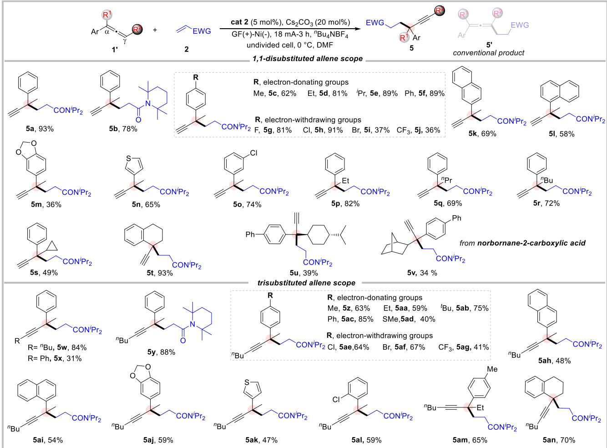  
Scheme 2. Generality of the electrochemical functionalization of 1,1-substituted allenes. Reaction conditions: 1- (1.5 mmol), 2 (0.5 mmol), cat 2 (5 mol%), Cs CO (20 mol%), nBu NBF (1.0 mmol), DMF (10 mL), graphite felt anode, nickel plate cathode, undivided cell, CCE 18 mA, 3 h (4.0 F mol−1), 0 °C. The percentages listed for each product correspond to the isolated yields.

The synthetic utility of the present protocol was demonstrated through a gram-scale reaction and the late-stage functionalization of products (Figure 2a). Even with reduced catalyst loading (2 mol%), the preparative reaction proceeded smoothly to give the desired product 5a in excellent yield (90%). The synthetic versatility of 5a was further explored in a range of transformations, including Sonogashira coupling,[49] Glaser coupling,[50] and copper-catalyzed azidealkyne cycloaddition (CuAAC)[51] reaction. Corresponding products 5x, 6, and 7 were readily accessed in good yields (75%–87%). Besides, divergent hydrogenation protocols employing Lindlar catalyst and Pd/C catalyst were utilized to derivatize 5x, producing products 8 and 9, respectively. Next, we sought to evaluate the superiority of the carbanion sampling strategy by convergent synthesis of 3z and 3aa (Figure 2b,c). The isomers of allene (1z), such as 3-phenyl-1-propyne (10) and 1-phenylpropyne (11), were subjected to the optimal conditions (Figure 2b). As expected, the product 3z was uniformly observed via carbanion sampling. Moreover, a mixture of substrates 10, 11, and 1z also led to the selective formation of 3z. Similarly, product 3aa was readily accessed from 1-phenyl-1-butyne (12) or a mixed sample of 12 and 1aa (Figure 2c).

To better understand the catalytic role of Salen-CrIII cat 2, we conducted a series of cyclic voltammetry (CV) experiments. Initially, the cyclic voltammograms of substrates were recorded (Figure 3a). Comparable peaks around 3.0 V were detected for both acrylamide 2a and allenes substrates (1a, 1a-), authenticating that the reductive coupling between acrylamide and allene (to form byproduct 4a) should be dominant in the absence of the HER catalyst. Meanwhile, weak but discernible waves at 2.34 and 2.53 V were respectively assigned to the hydrogen adsorption behavior of 1a and 1a-, which would give rise to allene carbanions and the ultimately desired products (3a, 5a). Subsequently, we probed interaction between cat 2 and substrates through titration CV experiments. As shown in Figure 3b, two cathodic couples of cat 2 were observed at 1.78 and 2.40 V, corresponding to the redox processes of $\mathrm { C r } ^ { \mathrm { I I I I I } }$ and $\mathrm { C r } ^ { \mathrm { I I / I } }$ , respectively. Upon the addition of 1a, the peak of $\mathrm { C r } ^ { \mathrm { I I / I } }$ was shifted positively (from 2.40 to 2.30 V) and eventually overlapped with hydrogen adsorption peak of 1a, demonstrating a collaborated reduction process involving 1a and 2a; the hydrogen atom reduced from 1a is intercepted by $\mathrm { C r ^ { I I } }$ species to give a $\mathrm { C r ^ { I I } { - } H }$ intermediate via further single-electron reduction. A similar positive shift was observed for 1,1-disubstituted allene 1a- (Figure 3c), accompanied by a significant catalytic current suggesting the catalytic role of cat 2 in promoting the HER of the allene 1a-. In contrast, acrylamide had a negligible effect on the cathodic behavior of cat 2 (Figure 3d). Additionally, we detected a substantial amount of hydrogen byproduct (Figure S42) during the electrochemical C─H functionalization of allene. Collectively, Salen-CrIII cat 2 has a proposed role to selectively promote the HER of allene substrates via a rapid intercepting hydrogen atom.

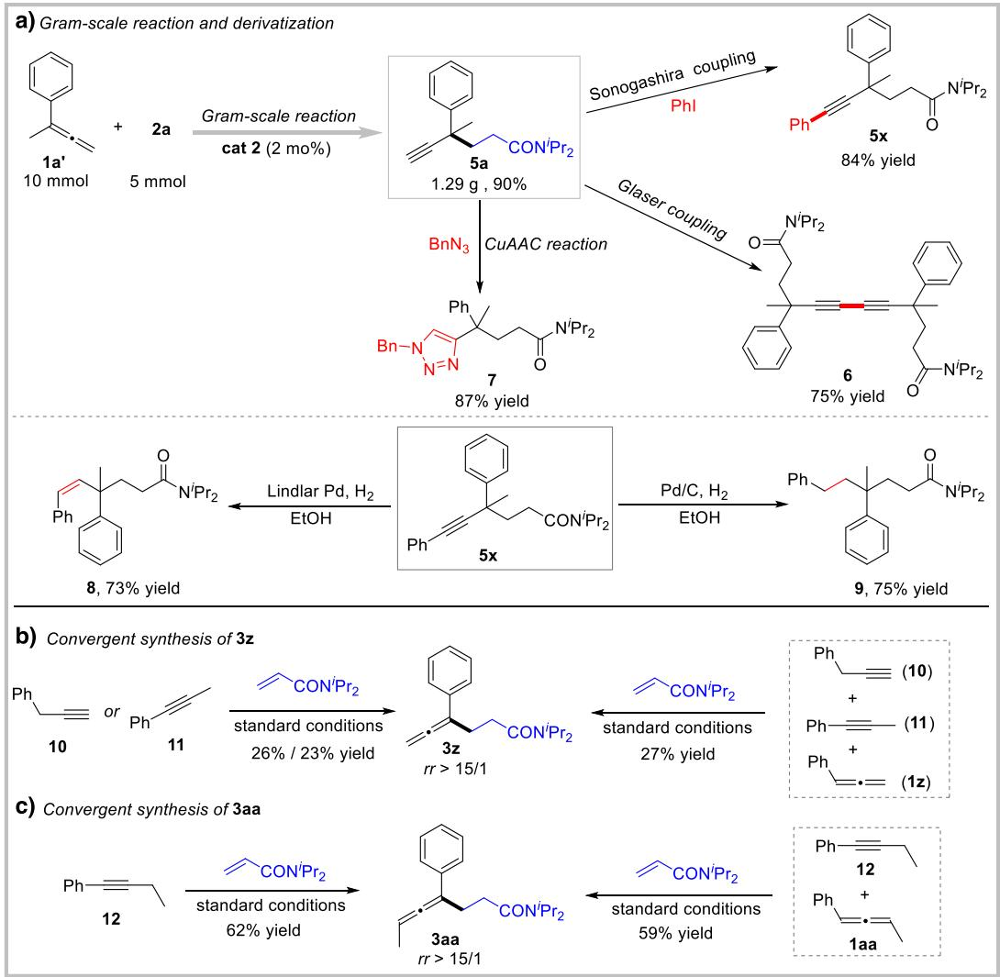  
Figure 2. Synthetic utility and superiority of the electrochemical carbanion sampling. a) Gram-scale reaction and the derivatization of products. b) Convergent synthesis of 3z. c) Convergent synthesis of 3aa.

To further elucidate the reaction mechanism, various control experiments were elaborated (Figure 3e–h). We clarified the reaction pathway through both radical suppression and deuterium incorporation experiments. The introduction of excess radical scavengers had only a marginal effect on the yields of 3a and 5a (Figure 3e), whereas deuterium water led to diminished yields but substantial deuterium in the acidic sites of products (Figure 3f). These collective results strongly support a mechanism involving various carbanion intermediates. Given the rapid deuterium/proton exchange observed, parallel competing experiments[52] were performed to identify the rate-determining step (RDS) in both reactions of 1,3- and 1,1-disubstituted allenes (Figure 3g). Obvious kinetic isotope effects (KIE) were detected in both cases, confirming that the cleavage of allene C(sp2)─H bond is the RDS. Furthermore, we shed light on the origin of site selectivity by the time-dependent investigation (Figure 3h). The observed decrease in site selectivity over time provides compelling evidence for a carbanion sampling mechanism in this transformation.

To rationalize the unconventional selectivity driven by carbanion sampling, DFT calculations were conducted. As depicted in Figure 4a, two carbanions, A-1 and A-2, arising from 1a exhibit distinct reactivities. The unconventional carbanion A-1 is more energic (8.9 kcal mol−1) and reactive than A-2, which leads to lower energy barrier (8.3 vs. 11.0 kcal mol−1) in the reaction with 2a. Although the carbanion adduct IM2(3a) is higher in energy compared to its regioisomer IM2(3a-), the subsequent proton exchange[53] of IM2(3a)

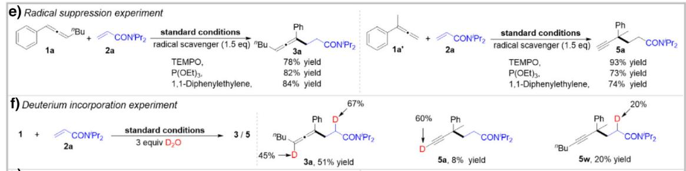

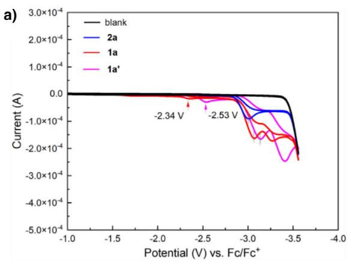

b)  
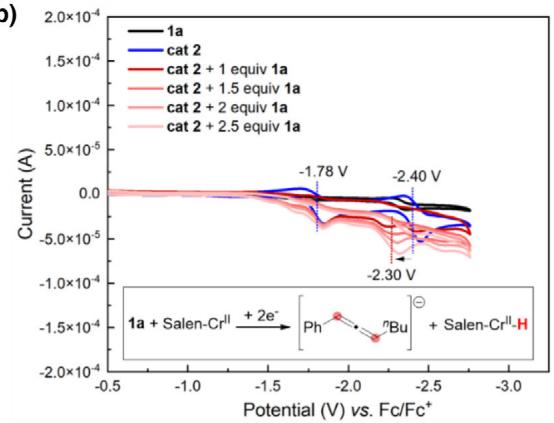

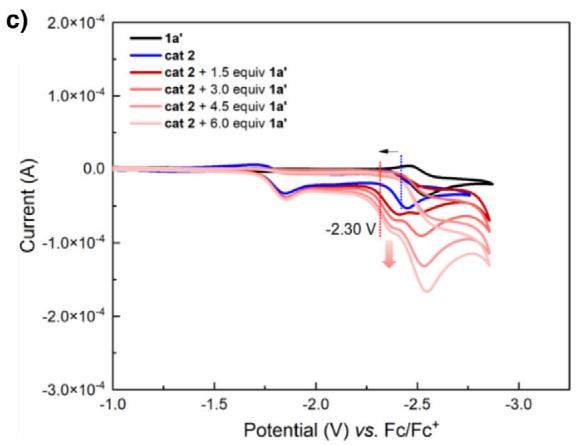

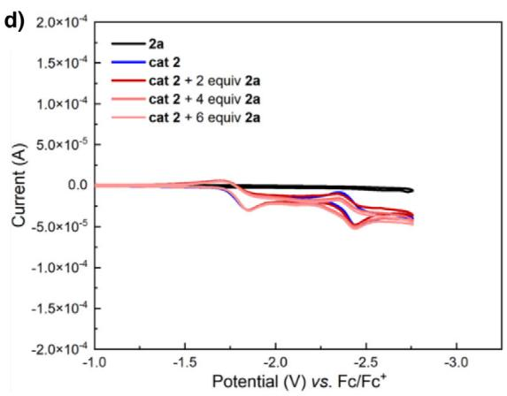

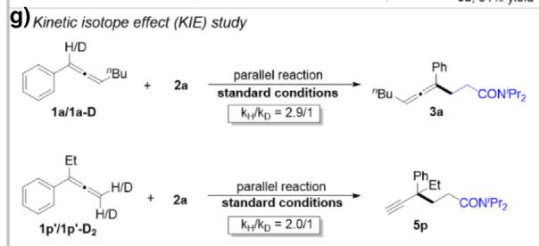

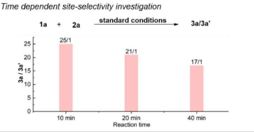  
Figure 3. Mechanism investigation. a) Cyclic voltammograms of substrates 1a, ${ \bf { l a } } ^ { \prime } ,$ , and 2a. b) Cyclic voltammograms of 1a and cat 2. c) Cyclic voltammograms of 1a- and cat 2. d) Cyclic voltammograms of 2a and cat 2. e) Radical suppression experiment. f) Deuterium incorporation experiment. g) Kinetic isotope efect (KIE) study. h) Time-dependent site-selectivity investigation.

delivers more stable allene carbanion B-1, as confirmed by the deuterium incorporation experiments. Further $\mathsf { p } K _ { z }$ calculations reveal that the $\mathsf { s p } ^ { 2 }$ C─H bond of the allene (33.4) is more acidic than the α C─H bond of the amide (38.8) in product 3a (Table S2), supporting the feasibility of the proton exchange. Collectively, the formation of the abnormal regioisomer 3a is governed by both the kinetic sampling of carbanion A-1 and the thermodynamic control of carbanion adduct B-1. Furthermore, the selectivity toward the unconventional alkyne product (Figure 4b) is also attributed to the high stability of its alkyne carbanion (B--1) and the lower activation energy (for the details of calculations and arrow-pushing mechanism, see Figures S56–S58).

Based on these experimental observations and related mechanism reports,[1,2,8–11] two plausible reaction pathways involving heterolytic and homolytic HER were proposed (Figure 4c,d). For the heterolytic HER pathway (Figure 4c), the $\mathrm { { S a l e n - C r ^ { I I I } } }$ catalyst cat 2 is first reduced to $\mathrm { S a l e n \mathrm { - } C r ^ { I I } }$ (Int-I) under cathodic electrolysis. Simultaneously, a proton dissociated from allene 1a is reduced to an adsorbed hydrogen atom $( \mathrm { M } \mathrm { - } \mathrm { H } ^ { \ast } )$ on the cathode. Owing to the excellent radicalintercepting ability of $\mathrm { C r ^ { I I } }$ species, Int-I rapidly combines with hydrogen atom to form a $\mathrm { C r ^ { I I I } { - } H }$ intermediate (Int-II). Under further cathodic reduction, more reactive $\mathrm { C r ^ { I I } { - } H }$ (Int-III) was delivered, which deprotonates the allene substrate 1a to release $\mathrm { H } _ { 2 }$ and carbanions A-1 and A-2. In the presence of electrophile 2a, the in situ formed A-1 and A-2 are precisely sampled under kinetic and thermodynamic control to yield the unconventional product 3a. Given the low bond dissociation energy (BDE  60 kcal mol−1)[54] and hydricity $\left( \Delta G _ { \mathrm { H } } ^ { \cdot } \sim 5 7 \right.$ kcal mol $^ { - 1 } ) ^ { [ 5 5 , 5 6 ] }$ reported for $\mathrm { C r ^ { I I } { - } H }$ species, an alternative homolytic HER pathway might also be feasible (Figure 4d). In this pathway, cat 2 could undergo a sequential electron transfer to give a Salen- $C \mathrm { r } ^ { \mathrm { I } }$ intermediate (Int-IV), as the allene 1a- ( 2.53 V) is less reducible than cat $2 \ \mathrm { ( C r ^ { I I I } }$ $- 2 . 4 0 \mathrm { V } )$ . Low-valent CrI species readily reacts with a proton from 1a- to yield $\mathrm { C r ^ { I I I } { - } H }$ (Int-II), which is then reduced to $\mathrm { C r ^ { I I } { - } H }$ (Int-III) at a more accessible potential ( 2.30 V). Finally, bimolecular homolytic cleavage of Int-III leads to hydrogen evolution and regenerates Int-IV. Meanwhile, the resonant isomers of carbanion A- are sampled by 2a to give a thermodynamically stable carbanion B--1, thereby affording product 5a.

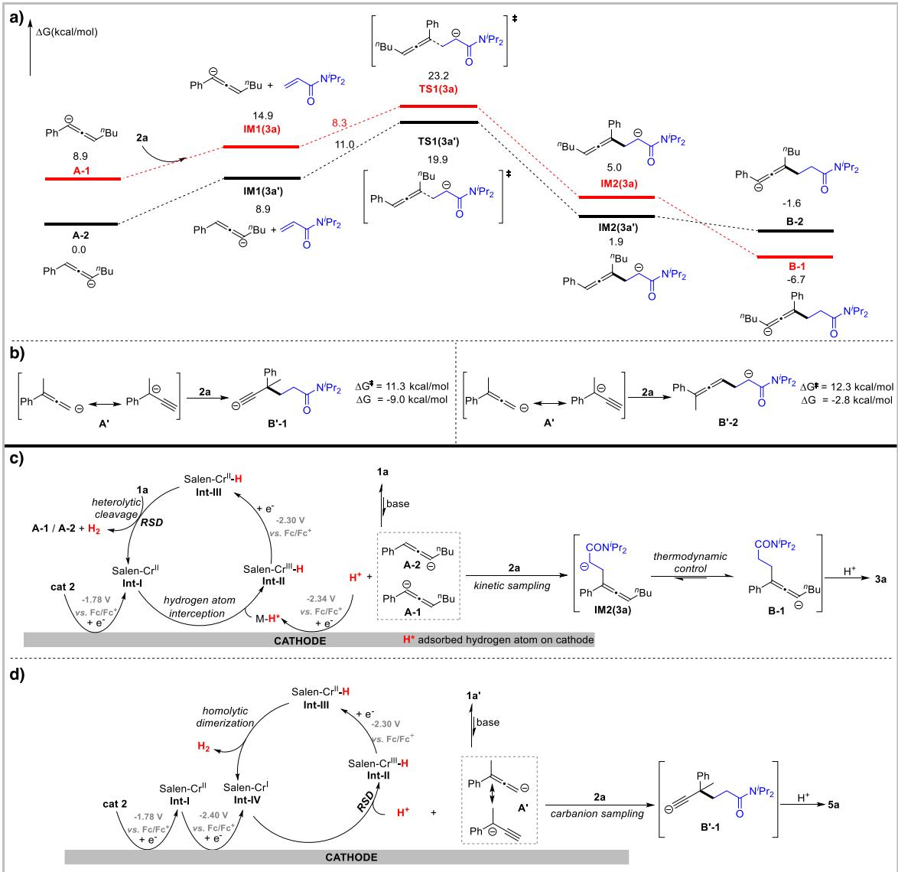  
Figure 4. a) Gibbs free energy profile calculated for the reaction between 1,3-disubstituted allene carbanions with 2a. b) The activation energy and Gibbs free energy in the reaction of 1,1-disubstituted allene anion with 2a. c) Proposed reaction mechanism involving heterolytic HER pathway. d) Proposed reaction mechanism involving homolytic HER pathway.

## Conclusion

In conclusion, we have developed an electrochemical carbanion sampling strategy for the functionalization of allene C─H bonds via chromium-catalyzed HER. This strategy drives the transformation to proceed with unconventional site-selectivity, which is not constrained by the inherent acidity or strength of the C─H bonds. Moreover, the chromium HER catalyst effectively suppressed undesired hydrofunctionalization of allenes to afford diverse access to thermodynamically disfavored allene and alkyne products. Through DFT calculations and control experiments, we demonstrated that the unconventional selectivity observed in this transformation is dictated by the combined kinetic and thermodynamic sampling of carbanion intermediates. The potential of the electrochemical carbanion sampling strategy in new transformation discovery and complex product synthesis has been extensively explored in our laboratory.

## Acknowledgements

The authors are grateful to the National Natural Science Foundation of China (22422101, 22371002, 92061110, and 21702113) and the Anhui Provincial Natural Science Foundation (2308085Y14) for their financial support.

## Conflict ofInterests

The authors declare no conflict of interest.

## Data Availability Statement

The data that support the findings of this study are available in the Supporting Information of this article.

Keywords: Allene C─H functionalization • Carbanion sampling • Chromium catalysis • Electroreduction

[1] S. C. Marinescu, J. R. Winkler, H. B. Gray, Proc. Natl. Acad. Sci. USA 2012, 109, 15127–15131.

[2] J. R. McKone, S. C. Marinescu, B. S. Brunschwig, J. R. Winkler, H. B. Gray, Chem. Sci. 2014, 5, 865–878.

[3] Y. Zheng, Y. Jiao, M. Jaroniec, S. Z. Qiao, Angew. Chem. Int. Ed. 2015, 54, 52–65.

[4] N. Queyriaux, R. T. Jane, J. Massin, V. Artero, M. Chavarot-Kerlidou, Coord. Chem. Rev. 2015, 304–305, 3–19.

[5] G. Zhao, K. Rui, S. X. Dou, W. Sun, Adv. Funct. Mater. 2018, 28, 1803291.

[6] S. Zhang, M.-B. Li, Tetrahedron Chem. 2024, 11, 100080.

[7] J. Derosa, P. Garrido-Barros, M. Li, J. C. Peters, J. Am. Chem. Soc. 2022, 144, 20118–20125.

[8] S. Gnaim, A. Bauer, H.-J. Zhang, L. Chen, C. Gannett, C. A. Malapit, D. E. Hill, D. Vogt, T. Tang, R. A. Daley, W. Hao, R. Zeng, M. Quertenmont, W. D. Beck, E. Kandahari, J. C. Vantourout, P.-G. Echeverria, H. D. Abruna, D. G. Blackmond, S. D. Minteer, S. E. Reisman, M. S. Sigman, P. S. Baran, Nature 2022, 605, 687–695.

[9] X. Wu, C. N. Gannett, J. Liu, R. Zeng, L. F. T. Novaes, H. Wang, H. D. Abruña, S. Lin, J. Am. Chem. Soc. 2022, 144, 17783–17791.

[10] S. Zhang, Y. Liang, K. Liu, X. Zhan, W. Fan, M.-B. Li, M. Findlater, J. Am. Chem. Soc. 2023, 145, 14143–14154.

[11] Y. Liang, J. Feng, H. Li, X. Wang, Y. Zhang, W. Fan, S. Zhang, M.-B. Li, Angew. Chem. Int. Ed. 2024, 63, e202400938.

[12] K. Liu, M. Lei, X. Li, X. Zhang, Y. Zhang, W. Fan, M.-B. Li, S. Zhang, Nat. Commun. 2024, 15, 2897.

[13] M. Yan, Y. Kawamata, P. S. Baran, Chem. Rev. 2017, 117, 13230– 13319.

[14] Y. Yuan, A. Lei, Acc. Chem. Res. 2019, 52, 3309–3324.

[15] P. Xiong, H.-C. Xu, Acc. Chem. Res. 2025, 58, 299–311.

[16] K.-J. Jiao, Y.-K. Xing, Q.-L. Yang, H. Qiu, T.-S. Mei, Acc. Chem. Res. 2020, 53, 300–310.

[17] P. Li, Y. Wang, H. Zhao, Y. Qiu, Acc. Chem. Res. 2025, 58, 113– 129.

[18] K. Chen, Q. Zeng, L. Xie, Z. Xue, J. Wang, Y. Xu, Nature 2023, 620, 1007–1012.

[19] M. Wang, Y. Huang, P. Hu, Science 2024, 383, 537–544.

[20] S. Ma, Acc. Chem. Res. 2003, 36, 701–712.

[21] A. Hoffmann-Röder, N. Krause, Angew. Chem. Int. Ed. 2004, 43, 1196–1216.

[22] S. Ma, Chem. Rev. 2005, 105, 2829–2872.

[23] J. M. Alonso, P. Almendros, Chem. Rev. 2021, 121, 4193– 4252.

[24] R. Zeng, S. Wu, C. Fu, S. Ma, J. Am. Chem. Soc. 2013, 135, 18284–18287.

[25] G. Zhang, T. Xiong, Z. Wang, G. Xu, X. Wang, Q. Zhang, Angew. Chem. Int. Ed. 2015, 54, 12649–12653.

[26] Y. Wang, S. G. Scrivener, X.-D. Zuo, R. Wang, P. N. Palermo, E. Murphy, A. C. Durham, Y.-M. Wang, J. Am. Chem. Soc. 2021, 143, 14998–15004.

[27] B. S. Schreib, M. Son, F. A. Aouane, M.-H. Baik, E. M. Carreira, J. Am. Chem. Soc. 2021, 143, 21705–21712.

[28] Z. Cheng, J. Zhang, C. Li, X. Li, P. Chen, G. Liu, J. Am. Chem. Soc. 2024, 146, 24689–24698.

[29] X. Duan, Q. Jin, K. Wang, Y. Sun, Y. Wei, Z. Wang, J.-K. Qiu, K. Guo, X. Bao, X. Wu, ACS Catal. 2024, 14, 13219–13226.

[30] J. Moran, A. Preetz, R. A. Mesch, M. J. Krische, Nat. Chem. 2011, 3, 287–290.

[31] M. Holmes, L. A. Schwartz, M. J. Krische, Chem. Rev. 2018, 118, 6026–6052.

[32] R. Blieck, M. Taillefer, F. Monnier, Chem. Rev. 2020, 120, 13545– 13598.

[33] R. Y. Liu, S. L. Buchwald, Acc. Chem. Res. 2020, 53, 1229–1243.

[34] P. Li, E. Zheng, G. Li, Y. Luo, X. Huo, S. Ma, W. Zhang, Science 2024, 385, 972–979.

[35] J.-J. Chen, M.-H. Guan, P. He, M.-Y. Huang, X.-Y. Zhang, S.-F. Zhu, Nat. Catal. 2025, 8, 178–186.

[36] W. Xu, X. Cong, K. An, S.-J. Lou, Z. Li, M. Nishiura, T. Murahashi, Z. Hou, Angew. Chem. Int. Ed. 2022, 61, e202210624.

[37] T. H. Meyer, J. C. A. Oliveira, S. C. Sau, N. W. J. Ang, L. Ackermann, ACS Catal. 2018, 8, 9140–9147.

[38] M.-X. He, Y. Yao, C.-Z. Ai, Z.-Y. Mo, Y.-Z. Wu, Q. Zhou, Y.-M. Pan, H.-T. Tang, Org. Chem. Front. 2022, 9, 781–787.

[39] C.-L. Ding, J.-S. Zhong, H. Yan, K.-Y. Ye, Synthesis 2024, 56, 1687–1694.

[40] K. S. Lee, F. Barbieri, E. Casali, E. T. Marris, G. Zanoni, J. M. Schomaker, J. Am. Chem. Soc. 2025, 147, 318–330.

[41] Y. Katayama, H. Mitsunuma, M. Kanai, Synthesis 2022, 54, 1684.

[42] J. L. Schwarz, F. Schäfers, A. Tlahuext-Aca, L. Lückemeier, F. Glorius, J. Am. Chem. Soc. 2018, 140, 12705–12709.

[43] J. L. M. Matos, S. Vásquez-Céspedes, J. Gu, T. Oguma, R. A. Shenvi, J. Am. Chem. Soc. 2018, 140, 16976–16981.

[44] S. Tanabe, H. Mitsunuma, M. Kanai, J. Am. Chem. Soc. 2020, 142, 12374–12381.

[45] Y. Gao, B. Jiang, N. C. Friede, A. C. Hunter, D. G. Boucher, S. D. Minteer, M. S. Sigman, S. E. Reisman, P. S. Baran, J. Am. Chem. Soc. 2024, 146, 4872–4882.

[46] H. Shen, L. Yang, M. Xu, Z. Shi, K. Gao, X. Xia, Z. Wang, Angew. Chem. Int. Ed. 2025, 64, e202413198.

[47] Z.-X. Wang, Y. Xu, R. Gilmour, Nat. Commun. 2024, 15, 5770.

[48] J. Zhou, Z. Zhao, S. Mori, K. Yamamoto, N. Shibata, Chem. Sci. 2024, 15, 5113–5122.

[49] K. Sonogashira, Y. Tohda, N. Hagihara, Tetrahedron Lett. 1975, 16, 4467–4470.

[50] C. Glaser, Ber. Dtsch. Chem. Ges. 1869, 2, 422–424.

[51] H. C. Kolb, M. G. Finn, K. B. Sharpless, Angew. Chem. Int. Ed. 2001, 40, 2004–2021.

[52] E. M. Simmons, J. F. Hartwig, Angew. Chem. Int. Ed. 2012, 51, 3066–3072.

[53] Y. Wang, P.-J. Cai, Z.-X. Yu, J. Org. Chem. 2017, 82, 4604–4612.

[54] Y. Hu, A. P. Shaw, D. P. Estes, J. R. Norton, Chem. Rev. 2016, 116, 8427–8462.

[55] E. F. van der Eide, M. L. Helm, E. D. Walter, R. M. Bullock, Inorg. Chem. 2013, 52, 1591–1603.

[56] E. S. Wiedner, M. B. Chambers, C. L. Pitman, R. M. Bullock, A. J. M. Miller, A. M. Appel, Chem. Rev. 2016, 116, 8655–8692.

Manuscript received: April 15, 2025

Revised manuscript received: May 28, 2025

Accepted manuscript online: May 29, 2025

Version of record online: June 05, 2025