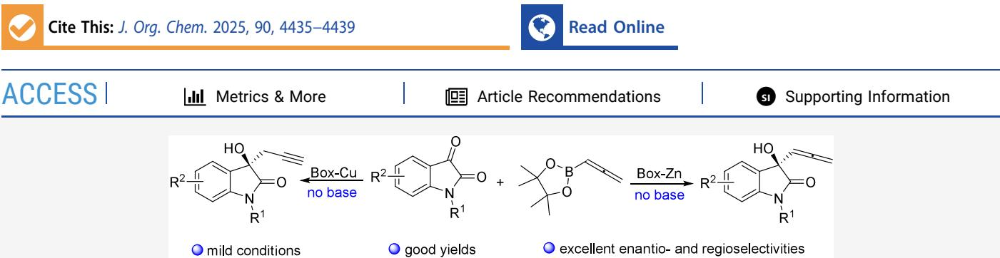
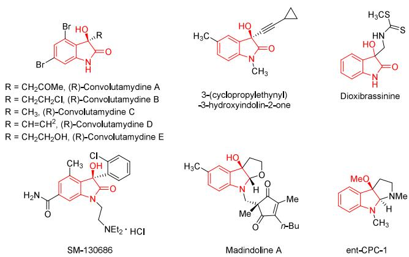
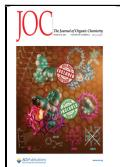
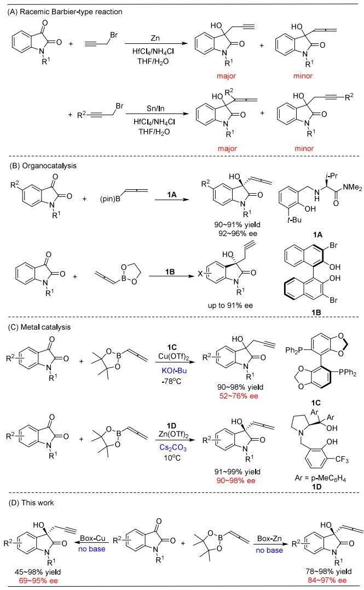
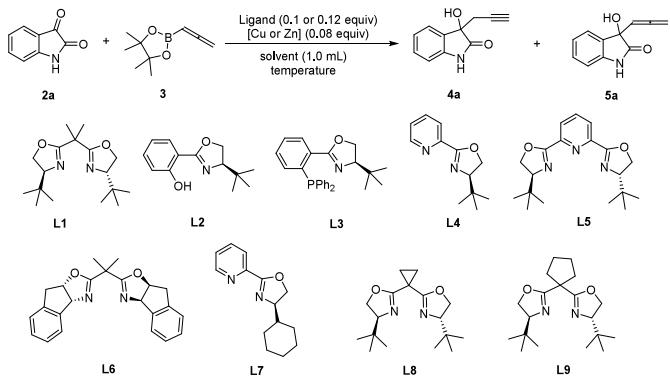
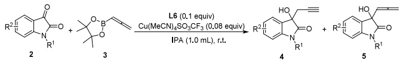
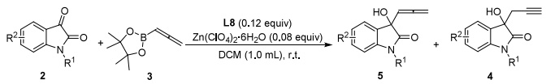
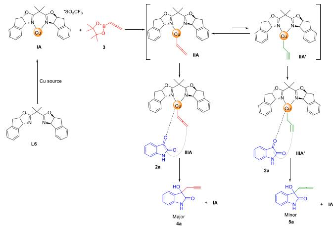
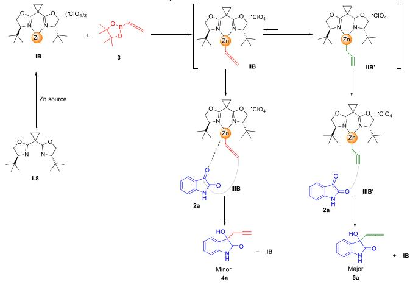
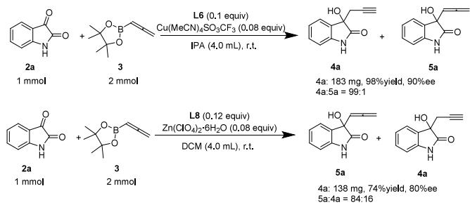

# Enantioselective Propargylation and Allenylation of Isatins Using Chiral Box-Copper/Zinc Catalysts

Ni Zhao, Shuai-Ru Cheng, Hui-Juan Ma, Wei-Wei Zhang, Guo-rong Ma, and Pei Wang\*

  
ABSTRACT: A method for the asymmetric propargylation and allenylation of isatins catalyzed using chiral Box-copper/zinc catalysts is described. By modulation of the metal and solvent, a series of chiral 3-hydroxy-3-propargyl-2-oxindoles and 3-hydroxy-3- allenyl-2-oxindoles are selectively synthesized in good yields with excellent enantio- and regioselectivities.

C hiral 3-hydroxy-2-oxindoles are the core structural unitsof numerous biologically active natural products and drug intermediates (Figure 1). For instance, convolutamydine

  
Figure 1. Representative biologically active products synthesized via chiral 3-hydroxy-2-oxindoles.

A−E exhibit potential antinociceptive1 and anticancer activity,2 3-(cyclopropylethynyl)-3-hydroxyindolin-2-one acts as an HIV-1 reverse transcriptase inhibitor,3 dioxibrassinine serves as a phytoalexin with antifungal activity,4 SM-130688 is a novel madindoline A acts as an antiosteoporosis agent,6 and ent-CPC-1 is a newly discovered tryptamine-derived dimeric alkaloid from the seeds and rinds of Chimonanthus praecox f. concolor.7 On the other hand, 3-hydroxy-3-propargyl-2-oxindoles and 3-hydroxy-3- allenyl-2-oxindoles are synthons of many important structures,8 particularly for synthesizing diverse substituted 2,5-dihydrofurans.9 Consequently, these compounds have garnered significant attention from synthetic chemists, and asymmetric synthesis of chiral indole and oxindole derivatives remains a focal point of current research.10

The Barbier-type reaction is one of the most common methods for forming carbon−carbon bonds between propargyl bromide and isatins through the addition of diferent metals (such as Zn, Sn, In, etc.). To selectively obtain propargyl or allenyl alcohols, diferent metals are required in a Barbier-type reaction, because propargylmetals can undergo a metallotropic rearrangement (Scheme 1A).11

To our knowledge, asymmetric syntheses of 3-hydroxy-3- propargyl-2-oxindoles and 3-hydroxy-3-allenyl-2-oxindoles are relatively scarce. In terms of organocatalysis, Hoveyda and coworkers catalyzed the asymmetric addition reaction between isatins and allenylboronic acid pinacol ester to achieve 3- hydroxy-3-allenyl-2-oxindoles using simple organic molecule 1A,12 and chiral $3 , 3 ^ { \prime } { \cdot } \mathrm { B r } _ { 2 } { \mathrm { - B I N O L } }$ 1B was proved to be an efective catalyst to synthesize chiral 3-hydroxy-3-propargyl-2- oxindoles (Scheme 1B).13 In terms of metal catalysis, a complex of (S)-SEGPHOS 1C and copper(II) triflate efectively catalyzes the reaction between isatins and allenylboronic acid pinacol ester to aford chiral 3-hydroxy-3- propargyl-2-oxindoles with moderate to good enantioselectivobtained using a complex of proline-derived ligand 1D and zinc triflate (Scheme 1C).15

Herein, we successfully achieved the enantioselective propargylation and allenylation of isatins using commercially

## Scheme 1. Catalytic Propargylation and Allenylation of Isatins

available bisoxazoline ligands. By simply adjusting the metal catalyst and solvent, we selectively obtained 3-hydroxy-3- propargyl-2-oxindoles and 3-hydroxy-3-allenyl-2-oxindoles with good yields, excellent enantio- and regioselectivities, without the need for a base (Scheme 1D).

We initiated our investigation by propargylication of isatin with allenylborate using the L−Cu complex. First, we examined six diferent commercially available ligands L1−L6 using Cu(MeCN) BF as a copper source in DCM and found that bisoxazoline ligand L6 was the most eficient ligand, which can selectively synthesize propargyl alcohol 4a (Table 1, entries 1−6). Subsequently, various copper salts were screened, and the experimental results indicated poor enantioselectivity when $\mathrm { C u } ( \bar { \mathrm { C O O C H } } _ { 3 } ) _ { 2 } ,$ CuBr and CuBr were used (entries 8− 9 and 12). Although $\mathrm { C u } ( \mathrm { S O } _ { 3 } \mathrm { C F } _ { 3 } ) _ { 2 }$ yielded products with good regio- and enantioselectivities, the conversion rate remained unsatisfactory (entry 7). $\mathrm { C u ( M e C N ) } _ { 4 } S \mathrm { O } _ { 3 } C \mathrm { F } _ { 3 }$ was identified as the optimal copper source, yielding excellent results in terms of both yield and selectivity (entry 10). The use of isopropyl alcohol (IPA) as a solvent led to a slight improvement in conversion and enantioselectivity (Supporting Information). Surprisingly, allenyl alcohol was aforded as the major product when copper salt is replaced with zinc salt. Subsequently, we optimized the conditions for the zinc-catalyzed allenyl alcohol formation. Our findings indicated that commercially available bisoxazoline ligand L8 was the most efective ligand (entries 13−19), while $\mathrm { Z n ( C l O _ { 4 } ) _ { 2 } { \cdot } 6 H _ { 2 } O }$ served as the superior zinc source (entries 20−23). Detailed optimization of other reaction parameters, including solvents, temperature, ligand, and metal salt loadings, is provided in the Supporting Information. Additionally, the addition of bases such as KOtBu or $\mathrm { C s } _ { 2 } \mathrm { C O } _ { 3 }$ was found to be detrimental to the reaction.

Table 1. Optimization of the Reaction Conditionsa  

<table><tr><td>Entry</td><td> $\operatorname { L i g a n d } / [ \operatorname { C u } \ \mathrm { o r } \ \mathrm { Z n } ]$ </td><td> $\mathbf { 4 a } { : } 5 \mathbf { a } ^ { b }$ </td><td>Conversion (%)</td><td>ee (%)</td></tr><tr><td>1</td><td> $\mathrm { L 1 / C u ( M e C N ) _ { 4 } B F _ { 4 } }$ </td><td>96:4</td><td>38</td><td>4</td></tr><tr><td>2</td><td> $\mathrm { L } 2 / \mathrm { C u } ( \mathrm { M e C N } ) _ { 4 } \mathrm { B F } _ { 4 }$ </td><td>94:6</td><td>66</td><td>5</td></tr><tr><td>3</td><td> $\mathbf { L 3 } / \mathbf { C u } ( \mathbf { M e C N } ) _ { 4 } \mathbf { B F } _ { 4 }$ </td><td>92:8</td><td>74</td><td>16</td></tr><tr><td>4</td><td> $\mathrm { L 4 / C u ( M e C N ) _ { 4 } B F _ { 4 } }$ </td><td>97:3</td><td>96</td><td>64</td></tr><tr><td>5</td><td> $\mathbf { L 5 } / \mathbf { C u } ( \mathbf { M e C N } ) _ { 4 } \mathbf { B F } _ { 4 }$ </td><td>92:8</td><td>62</td><td>34</td></tr><tr><td>6</td><td> $\mathbf { L 6 } / \mathbf { C u } ( \mathbf { M e C N } ) _ { 4 } \mathbf { B F } _ { 4 }$ </td><td>97:3</td><td>56</td><td>89</td></tr><tr><td>7</td><td> ${ \bf L 6 } / \mathrm { C u } ( \mathrm { S O } _ { 3 } \mathrm { C F } _ { 3 } ) _ { 2 }$ </td><td>99:1</td><td>65</td><td>90</td></tr><tr><td>8</td><td> $\mathbf { L 6 } / \mathrm { C u } ( \mathrm { C O O C H } _ { 3 } ) _ { 2 }$ </td><td>95:5</td><td>85</td><td>25</td></tr><tr><td>9</td><td> ${ \mathbf { L } } 6 / { \mathbf { C } } { \mathbf { u } } { \mathbf { B } } { \mathbf { r } } _ { 2 }$ </td><td>70:30</td><td>18</td><td>11</td></tr><tr><td>10</td><td> $\mathbf { L 6 } / \mathrm { C u } ( \mathrm { M e C N } ) _ { 4 } \mathrm { S O } _ { 3 } \mathrm { C F } _ { 3 }$ </td><td>99:1</td><td>97</td><td>90</td></tr><tr><td>11</td><td> $\mathbf { L 6 } / \mathrm { C u } \ ( \mathrm { M e C N } ) _ { 4 } \mathrm { P F } _ { 6 }$ </td><td>92:8</td><td>68</td><td>91</td></tr><tr><td>12</td><td> $\mathbf { L 6 } / \mathbf { C u B r }$ </td><td>94:6</td><td>81</td><td>23</td></tr><tr><td>13</td><td> $\mathrm { \bf L 1 } / \mathrm { Z n } \big ( \mathrm { B F } _ { 4 } \big ) _ { 2 } { \cdot } \mathrm { x H } _ { 2 } \mathrm { O }$ </td><td>6:94</td><td>100</td><td>66</td></tr><tr><td>14</td><td> $\mathrm { { \bf L } } 3 / \mathrm { Z n } \big ( \mathrm { B F } _ { 4 } \big ) _ { 2 } { \cdot } \mathrm { { \bf x } H } _ { 2 } \mathrm { O }$ </td><td>9:91</td><td>100</td><td>15</td></tr><tr><td>15</td><td> $\mathrm { \mathbf { L } } 4 / \mathrm { Z n } \big ( \mathrm { B F } _ { 4 } \big ) _ { 2 } { \cdot } \mathrm { x H } _ { 2 } \mathrm { O }$ </td><td>5:95</td><td>95</td><td>18</td></tr><tr><td>16</td><td> ${ \bf L 6 } / \mathrm { Z n } \big ( \mathrm { B F } _ { 4 } \big ) _ { 2 } { \cdot } { \bf x } \mathrm { H } _ { 2 } \mathrm { O }$ </td><td>20:80</td><td>100</td><td>23</td></tr><tr><td>17</td><td> $\mathrm { { L 7 / Z n ( B F _ { 4 } ) _ { 2 } { \cdot } x H _ { 2 } O } }$ </td><td>30:70</td><td>100</td><td>1</td></tr><tr><td>18</td><td> $\mathrm { { \bf L 8 } / Z n ( B F _ { 4 } ) _ { 2 } { \cdot } x H _ { 2 } O }$ </td><td>3:97</td><td>100</td><td>91</td></tr><tr><td>19</td><td> $\mathbf { L 9 } / \mathrm { Z n } \big ( \mathrm { B F } _ { 4 } \big ) _ { 2 } { \cdot } \mathbf { x } \mathrm { H } _ { 2 } \mathbf { O }$ </td><td>6:94</td><td>100</td><td>91</td></tr><tr><td>20</td><td> $\mathrm { { \bf L 8 } / Z n ( C F _ { 3 } S O _ { 3 } ) _ { 2 } }$ </td><td>45:55</td><td>100</td><td>90</td></tr><tr><td>21</td><td> $\mathrm { \bf L 8 } / \mathrm { Z n } ( \mathrm { C l O } _ { 4 } ) _ { 2 } { \cdot } 6 \mathrm { H } _ { 2 } \mathrm { O }$ </td><td>4:96</td><td>100</td><td>93</td></tr><tr><td>22</td><td> $\mathbf { L 8 } / \mathrm { Z n } ( \mathrm { C H _ { 3 } C O O } ) _ { 2 }$ </td><td>15:85</td><td>100</td><td>1</td></tr><tr><td>23</td><td> $\mathbf { L 8 } / \mathrm { Z n C l _ { 2 } }$ </td><td>4:96</td><td>47</td><td>3</td></tr></table>

aUnless noted otherwise, reactions were performed with 2a (0.25 mmol, 1.0 equiv), 3 (0.05 mmol, 2.0 equiv), ligand (0.025 or 0.03 mmol, 0.1 or 0.12 equiv), [Cu or Zn] (0.02 mmol, 0.08 equiv) in DCM (1.0 mL) under an argon atmosphere. bThe ratios of 4a to 5a were measured by chiral HPLC analysis. cThe resulting conversion was measured by chiral HPLC analysis.

With the optimal reaction conditions in hand, a variety of isatins with diferent electronic and steric properties were surveyed to study the applied range of the developed methodology (Table 2). This approach proved to be suitable for both protected and unprotected isatins. For unprotected isatins, whatever their electronic nature, the presence of substituents at the C4, C5, C6, and C7 positions on the aromatic ring could be used to obtain propargyl alcohols 4a−j with moderate to excellent yields and enantioselectivities (entries 1−10).

Table 2. Substrate Scope for Enantioselective Propargylation
<table><tr><td colspan="3"></td><td>Yield ee</td><td></td><td></td></tr><tr><td>Entry 1 H</td><td> $\mathbb { R } ^ { 1 }$   $\mathrm { R } ^ { 2 }$ </td><td>Product</td><td>(%)b 98</td><td>(%)</td><td>Selectivity 4:5</td></tr><tr><td>2</td><td>H</td><td>H 4-F</td><td>4a 4b</td><td>91 88</td><td>99:1</td></tr><tr><td>3 H</td><td>5-Cl</td><td></td><td>97 49</td><td>86</td><td>99:1</td></tr><tr><td>4 H</td><td>5-Me</td><td>4c</td><td>74</td><td>90</td><td>&gt;99:1</td></tr><tr><td>5 H</td><td>6-Cl</td><td>4d 4e</td><td>45</td><td>80</td><td>99:1</td></tr><tr><td>H</td><td>7-F</td><td>4f</td><td>97</td><td>87</td><td>98:2</td></tr><tr><td>6</td><td>H 7-Cl</td><td></td><td>88</td><td>84</td><td>99:1</td></tr><tr><td>7</td><td>7-Br</td><td>4g</td><td></td><td></td><td>99:1</td></tr><tr><td>8 H</td><td></td><td>4h</td><td>86</td><td>85</td><td>99:1</td></tr><tr><td>9 H</td><td> $\mathrm { 7 - C F } _ { 3 }$ </td><td>4i</td><td>86</td><td>80</td><td>99:1</td></tr><tr><td>10 H</td><td>7-Me</td><td>4j</td><td>50</td><td>72</td><td>98:2</td></tr><tr><td>11 H</td><td>5,6-F</td><td>4k</td><td>93</td><td>84</td><td>97:3</td></tr><tr><td>12 H</td><td></td><td>4-Cl, 5-F 41</td><td>78</td><td>69</td><td>&gt;99:1</td></tr><tr><td>13</td><td>1-Ph H</td><td>4m</td><td>82</td><td>92</td><td>98:2</td></tr><tr><td>14</td><td>1-CH2Ph H</td><td>4n</td><td>61</td><td>91</td><td>98:2</td></tr><tr><td>15</td><td>1-Me H</td><td>40</td><td>85</td><td>95</td><td>&gt;99:1</td></tr><tr><td>16</td><td>1-Me 5-F</td><td>4p</td><td>89</td><td>90</td><td>99:1</td></tr><tr><td>17</td><td>1-Me 5-Br</td><td>4q</td><td>98</td><td>87</td><td>99:1</td></tr></table>

aUnless noted otherwise, the resulting homopropargyl alcohols was produced under the corresponding optimal conditions. bThe yield was the isolated yield. cThe ratios were measured by chiral HPLC analysis.

Notably, electron-withdrawing groups at the C7 position resulted in particularly good yields and ee values (entries 6−9). When 7-methylisatin was used as a substrate, the yield and ee value significantly decreased, which may be due to the electronic properties of the methyl group (entry 10). For disubstituted isatins, 5,6-difluoroisatin gave the target product with a higher yield and ee value, whereas 4-chloro-5- fluoroisatin exhibited the lowest enantioselectivity (69% ee) (entries 11−12). Substitution at the N1 position with methyl, phenyl, or benzyl groups gave better enantioselectivity, and a methyl substituent at N1 position gave the best result with an ee up to 95% (entries 13−15). Similarly, 5-substituted methylisatins also furnished good results (entries 16−17). Fortunately, high regioselectivities were obtained in all cases.

Various substituted isatins were then reacted with allenyl boronate 3 under the optimized conditions (Table 3). Regardless of the presence or absence of a protecting group on the N atom of isatin, the reaction proceeded smoothly to aford the allenyl alcohols 5a−q in excellent yields and selectivities. Isatins bearing electron-withdrawing groups such as F, Cl, Br, and $\mathrm { C F } _ { 3 }$ at the C4, C5, C6 and C7 positions delivered allenyl products 5 in high yields with high enantioselectivities and good regioselectivities (entries $2 - 3 ,$ 5−9). However, when methyl groups were present at the C5 and C7 positions of isatin, both the yield and regioselectivity decreased (entries 4 and 10). The reaction was also efective for disubstituted isatin. 5,7-Dibromoisatin yielded the target product 5k in high yield with excellent enantioselectivity and regioselectivity (entry 11). The presence of a protecting group on the N atom of isatin had a minimal impact on yield and selectivity, as evidenced by the excellent results obtained with 1-acetylisatin, 1-phenylisatin, 1-benzylisatin, and 1-methylisatin (entries 12−15). Gratifyingly, when electron-withdrawing groups (F and Br) were introduced on the 1-methylisatin, the desired product was obtained in 97% yield with 95%−96% ee.

Table 3. Substrate Scope for Enantioselective Allenylationa
<table><tr><td colspan="3"></td></tr><tr><td>Entry  $\mathbb { R } ^ { 1 }$ </td><td>R²</td><td>Product</td><td>Yield (%)b (%)</td><td>ee Selectivity c 5:4</td></tr><tr><td>1 2</td><td>H H</td><td>5a</td><td>90</td><td>93 96:4</td></tr><tr><td>H</td><td>4-F</td><td>5b</td><td>97</td><td>84 94:6</td></tr><tr><td>3 H</td><td>5-Cl</td><td>5c</td><td>94</td><td>93 93:7</td></tr><tr><td>4 H</td><td>5-Me</td><td>5d</td><td>78</td><td>92 95:5</td></tr><tr><td>5 H</td><td>6-Cl</td><td>5e</td><td>83</td><td>92 93:7</td></tr><tr><td>6 H</td><td>7-F</td><td>5f</td><td>97 92</td><td>96:4</td></tr><tr><td>7 H</td><td>7-Cl</td><td>5g</td><td>96</td><td>95 95:5</td></tr><tr><td>8 H</td><td>7-Br</td><td>5h</td><td>98 96</td><td>96:4</td></tr><tr><td>9 H</td><td> $\mathrm { 7 - C F _ { 3 } }$ </td><td>5i</td><td>96 96</td><td>98:2</td></tr><tr><td>10 H</td><td>7-Me</td><td>5j</td><td>95 92</td><td>82:18</td></tr><tr><td>11 H</td><td> ${ 5 , 7 - \mathrm { B r } }$ </td><td>5k</td><td>90 96</td><td>98:2</td></tr><tr><td>12 1-Ac</td><td>H</td><td>51</td><td>94 96</td><td>99:1</td></tr><tr><td>13 1-Ph</td><td>H</td><td>5m</td><td>96 95</td><td>98:2</td></tr><tr><td>14</td><td> $1 \mathrm { - C H _ { 2 } P h }$  H</td><td>5n</td><td>97 95</td><td>97:3</td></tr><tr><td>15 1-Me</td><td>H</td><td>50</td><td>97 97</td><td>98:2</td></tr><tr><td>16 1-Me</td><td>5-F</td><td></td><td>97 95</td><td>94:6</td></tr><tr><td></td><td></td><td>5p</td><td></td><td></td></tr><tr><td>17 1-Me</td><td>5-Br</td><td> ${ \bf 5 9 }$ </td><td>97</td><td>96 96:4</td></tr></table>

aUnless noted otherwise, the resulting homopropargyl alcohols was produced under the corresponding optimal conditions. bThe yield was the isolated yield. cThe ratios were measured by chiral HPLC analysis.

According to previous literature reports,16 a probable mechanism is illustrated in Scheme 2. Initially, a metal− boron exchange reaction occurs between allenylboronic acid pinacol esters and IA/IB, forming propargyl spieces IIA and IIB. Due to the low energy barrier for isomerization between IIA and its isomer IIA′, rapid isomerization can occur. The addition reaction between IIA′ and 2a proceeds more rapidly, leading to the formation of propargyl alcohol product 4a. In contrast, IIB does not undergo significant isomerization and complexes with istain 2a to form intermediate IIIB. Subsequently, the zinc-propargyl complex attack of the carbonyl group isolates 2a from the Re-face. This hypothesis is supported by 1H NMR data (see Figure S1 and Figure S2 in the Supporting Information).

To demonstrate the practical utility of the method, the reaction was conducted on 1 mmol scale (Scheme 3). For the copper-catalyzed propargylization reaction, propargyl alcohol 4a was aforded with 98% yield and 90% ee (4a:5a = 99:1). Unfortunately, for zinc-catalyzed allenylation reactions, both the yield and selectivity were reduced (74% yield, 80% ee, 5a:4a = 84:16), which may be attributed to the poor solubility of the reaction intermediates.

In summary, we have developed a mild protocol for the propargylation and allenylation of isatin derivatives using a commercially available organoboron reagent under Box-Cu/Zn catalysis. The reaction conditions are well-tolerated by both protected and unprotected isatins, yielding a series of propargyl and allenyl tertiary alcohols in moderate to high yields with excellent enantio- and regioselectivities. Notably, the ee value of propargyl alcohol reached 95%, surpassing that of the SEGPHOS-Cu(II) catalytic system reported previously. The

## Scheme 2. Proposed Mechanism

(a) Enantioselective propargylation

(b) Enantioselective allenylation  

Scheme 3. Larger Scale Reactionsa,b

  
aThe yield was the isolated yield. bThe ratios were measured by chiral HPLC analysis.

ee value of allenyl alcohol is comparable to literature reports, but our methodology ofers the advantage of using a commercially available ligand without the need for a base.

## ■ ASSOCIATED CONTENT

## Data Availability Statement

The data underlying this study are available in the published article and its Supporting Information.

## \*sı Supporting Information

The Supporting Information is available free of charge at https://pubs.acs.org/doi/10.1021/acs.joc.4c02850.

Experimental procedures, including compound characterization data, and product spectra (PDF)

## ■ AUTHOR INFORMATION

## Corresponding Author

Pei Wang − School ofBasic Medical Sciences, Ningxia Medical University, Yinchuan 750004, China; orcid.org/0009- 0000-5075-3869; Email: wangp17@nxmu.edu.cn

## Authors

Ni Zhao − School of Basic Medical Sciences, Ningxia Medical University, Yinchuan 750004, China

Shuai-Ru Cheng − Department School of Pharmacy, Ningxia Medical University, Yinchuan 750004, China

Hui-Juan Ma − Shandong NHU Pharmaceutical Co., LTD, Weifang, Shandong 261021, China

Wei-Wei Zhang − School of Basic Medical Sciences, Ningxia Medical University, Yinchuan 750004, China

Guo-rong Ma − School of Basic Medical Sciences, Ningxia Medical University, Yinchuan 750004, China

Complete contact information is available at: https://pubs.acs.org/10.1021/acs.joc.4c02850

## Notes

The authors declare no competing financial interest.

## ■ ACKNOWLEDGMENTS

This work was supported by Natural Science Foundation of Ningxia, Grant/Award Number: 2024AAC03245, the Higher Education Scientific Research Project of Ningxia, Grant/Award Number: NYG2024121.

## ■ REFERENCES

(1) (a) Luppi, G.; Monari, M.; Correa, R. J.; de A. Violante, F.; Pinto, A. C.; Kaptein, B.; Broxterman, Q. B.; Garden, S. J.; Tomasini, C. The first total synthesis of (R)-convolutamydine A. Tetrahedron. 2006, 62, 12017. (b) Nakamura, S.; Hara, N.; Nakashima, H.; Kubo, K.; Shibata, N.; Toru, T. Enantioselective Synthesis of (R)- Convolutamydine A with New N-Heteroarylsulfonylprolinamides. Chem.�Eur. J. 2008, 14, 8079. (c) Guo, J.-T.; Zhang, B.-Q.; Luo, Y.; Guan, Z.; He, Y.-H. Highly Enantioselective Synthesis of (R)-3-Alkyl-3-hydroxyindolin-2-ones Including Natural Product (R)-Convolutamydine A Catalyzed by A Primary Amine. Asian J. Org. Chem. 2017, 6, 605. (d) Figueiredo, G. S. M.; Zardo, R. S.; Silva, B. V.; Violante, F. A.; Pinto, A. C.; Fernandes, P. D. Convolutamydine A and synthetic analogues have antinociceptive properties in mice. Pharmacol. Biochem. Be. 2013, 103, 431.

(2) (a) Prathima, P. S.; Rajesh, P.; Rao, V. J.; Kailash, U. S.; Sridhar, B.; Rao, M. M. On water expedient synthesis of 3-indolyl-3-hydroxy oxindole derivatives and their anticancer activity in vitro. Eur. J. Med. Chem. 2014, 84, 155. (b) Hara, N.; Nakamura, S.; Shibata, N.; Toru, T. First Enantioselective Synthesis of (R)-Convolutamydine B and E with N-(Heteroarenesulfonyl)prolinamides. Chem.�Eur. J. 2009, 15, 6790. (c) Nakamura, T.; Shirokawa, $\mathrm { S } . \mathrm { ; }$ Hosokawa, $S . ;$ Nakazaki, A.; Kobayashi, S. Enantioselective Total Synthesis of Convolutamydines B and E. Org. Lett. 2006, 8, 677.

(3) (a) Boechat, N.; Kover, W. B.; Bongertz, V.; Bastos, M. M.; Romeiro, N. $\mathrm { C . } \mathrm { \mathrm { ; } }$ Azevedo, M. L. G.; Wollinger, W. Design, Synthesis and Pharmacological Evaluation of HIV-1 Reverse Transcriptase Inhibition of New Indolin-2-Ones. Med. Chem. 2007, 3, 533. (b) Dhara, K.; Kapat, $\mathbf { A . } ;$ Ghosh, T.; Dash, J. Transition-MetalFree Terminal Alkyne Addition to Isatins. Synthesis. 2016, 48, 4260.

(4) (a) Pedras, M. S. C.; Minic, Z. The phytoalexins brassilexin and camalexin inhibit cyclobrassinin hydrolase, a unique enzyme from the fungal pathogen Alternaria brassicicola. Bioorgan. Med. Chem. 2014, 22, 459. (b) Hrishikesh, D. V.; Annadate, R. A.; Pansare, S. V. Synthesis and Evaluation of N-Diaminophosphoryl Aminothioureas as Bifunctional Catalysts for Vinylogous Aldol Reactions of Isatins and 2(3H)-Furanones. ACS Omega. 2023, 8, 3190.

(5) (a) Tokunaga, T.; Hume, W. E.; Umezome, T.; Okazaki, K.; Ueki, Y.; Kumagai, K.; Hourai, S.; Nagamine, J.; Seki, H.; Taiji, M.; Noguchi, H.; Nagata, R. Oxindole Derivatives as Orally Active Potent Growth Hormone Secretagogues. J. Med. Chem. 2001, 44, 4641.

(b) Tomita, D.; Yamatsugu, K.; Kanai, M.; Shibasaki, M. Enantioselective Synthesis of SM-130686 Based on the Development of Asymmetric Cu(I)F Catalysis To Access 2-Oxindoles Containing a Tetrasubstituted Carbon. J. Am. Chem. Soc. 2009, 131, 6946. (c) Zhang, Z.; Zheng, W.; Antilla, J. C. Highly Enantioselective Catalytic Benzoyloxylation of 3-Aryloxindoles Using Chiral VAPOL Calcium Phosphate. Angew. Chem., Int. Ed. 2011, 50, 1135. (d) Tokunaga, T.; Hume, W. E.; Umezome, T.; Okazaki, K.; Ueki, Y.; Kumagai, K.; Hourai, S.; Nagamine, J.; Seki, H.; Taiji, M.; Noguchi, H.; Nagata, R. Oxindole Derivatives as Orally Active Potent Growth Hormone Secretagogues. J. Med. Chem. 2001, 44, 4641.

(6) (a) Yamamoto, D.; Sunazuka, T.; Hirose, T.; Kojima, N.; Kaji, E.; Omura, S. Design, synthesis, and biological activities of madindoline analogues. Bioorg. Med. Chem. Lett. 2006, 16, 2807. (b) Shimizu, K.; Tomita, M.; Fuhshuku; Sugai, T.; Shoji, M. Formal synthesis of (+)-madindoline A, a potent IL-6 inhibitor, utilizing enzymatic discrimination of quaternary carbon. Nat. Prod Commun. 2013, 8, 897.

(7) Cao, Z.-Y.; Zhou, F.; Zhou, J. Development of Synthetic Methodologies via Catalytic Enantioselective Synthesis of 3,3- Disubstituted Oxindoles. Acc. Chem. Res. 2018, 51, 1443.

(8) (a) Alcaide, B.; Almendros, P.; Cembellín, S.; Martínez del Campo, T. Acid-Catalyzed Synthesis of α,β-Disubstituted Conjugated Enones by a Meyer−Schuster-Type Rearrangement in Allenols. Adv. Synth. Catal. 2015, 357, 1070. (b) Alcaide, B.; Almendros, P.; Luna, A.; Prieto, N. Direct FeX -Based Stereocontrolled Access to (Z)-3- Alkenyl-Oxindoles from Allenols. J. Org. Chem. 2012, 77, 11388.

(9) (a) Alcaide, B.; Almendros, P.; Gonzalez, A. M.; Luna, A.; Martinez-Ramirez, S. Palladium Nanoparticles in Water: A Reusable Catalytic System for the Cycloetherification or Benzannulation of α- Allenols. Adv. Synth. Catal. 2016, 358, 2000. (b) Alcaide, B.; Almendros, P.; Campo, T. M.; Carrascosa, R. Pd II-Catalyzed Domino Heterocyclization/Cross-Coupling of α-Allenols and α- Allenic Esters: Efficient Preparation of Functionalized Buta-1,3-dienyl Dihydrofurans. Chem. Asian. J. 2008, 3, 1140. (c) Alcaide, B.; Almendros, P.; RodrÍguez-Acebes, R. Pd-Cu Bimetallic Catalyzed Domino Cyclization of α-Allenols Followed by a Coupling Reaction: New Sequence Leading to Functionalized Spirolactams. Chem.�Eur. J. 2005, 11, 5708. (d) Alcaide, B.; Almendros, P.; RodrÍguez-Acebes, R. Efficient Entry to Diversely Functionalized Spirocyclic Oxindoles from Isatins through Carbonyl-Addition/Cyclization Reaction Sequences. J. Org. Chem. 2006, 71, 2346. (e) Nangunuri, B. G.; Shirke, R. P.; Kim, M. Metal-free synthesis of dihydrofuran derivatives as anti-vicinal amino alcohol isosteres. Org. Biomol. Chem. 2023, 21, 960.

(10) (a) Zhang, J.-Y.; Chen, J.-Y.; Gao, C.-H.; Yu, L.; Ni, S.-F.; Tan, W.; Shi, F. Asymmetric (4+n) Cycloadditions of Indolyldimethanols for the Synthesis of Enantioenriched Indole-Fused Rings. Angew. Chem., Int. Ed. 2023, 62, No. e202305450. (b) Li, T.; Liu, S.; Wu, S.; Cheng, Q.; Chen, Q.; Jiao, Y.; Zhang, Y.; Shi, F. Catalytic asymmetric (3 + 3) cycloaddition between different 2-indolylmethanols. Sci. China Chem. 2024, 67, 2629. (c) Liu, S.-J.; Li, T.-Z.; Wang, N.-Y.; Cheng, Q.; Jiao, Y.; Zhang, Y.-C.; Shi, F. Catalytic asymmetric formal (2 + 3) cycloaddition involving methyl-substituted 2-indolylmethanols. Org. Chem. Front. 2024, 11, 4812.

(11) Alcaide, B.; Almendros, P.; Rodríguez-Acebes, R. Metal-Mediated Entry to Functionalized 3-Substituted 3-Hydroxyindolin-2- ones via Regiocontrolled Carbonylallylation, Bromoallylation, 1,3-

Butadien-2-ylation, Propargylation, or Allenylation Reactions of Isatins in Aqueous Media. J. Org. Chem. 2005, 70, 3198.

(12) Silverio, D. L.; Torker, S.; Pilyugina, T.; Vieira, E. M.; Snapper, M. L.; Haeffner, F.; Hoveyda, A. H. Simple organic molecules as catalysts for enantioselective synthesis of amines and alcohols. Nature. 2013, 494, 216.

(13) Braire, J.; Macé, A.; Zaier, R.; Cordier, M.; Vidal, J.; Lalli, C.; Martel, A.; Carreaux, F. Catalytic Enantioselective Allylboration and Related Reactions of Isatins Promoted by Chiral BINOLs: Scope and Mechanistic Studies. J. Org. Chem. 2023, 88, 1469.

(14) Gupta, N.; Tak, R.; Nazish, M.; Jakhar, A.; Khan, N. H.; Kureshy, R. I. Copper(II) Triflate Catalyzed Regioselective and Enantioselective Propargylation of Isatin Derivatives by Using Allenylboronic Acid Pinacol Ester. Eur. J. Org. Chem. 2018, 2018, 1384.

(15) Li, K.; Sun, X.; Zhao, S.; Li, T.; Zha, Z.; Wang, Z. Zn-Catalyzed enantioselective allylation and allenylation of isatins by virtue of a proline-derived chiral ligand. Chem. Commun. 2022, 58, 2156.

(16) (a) Yamashita, Y.; Cui, Y.; Xie, P.; Kobayashi, S. Zinc Amide Catalyzed Regioselective Allenylation and Propargylation of Ketones with Allenyl Boronate. Org. Lett. 2015, 17, 6042−6045. (b) Fandrick, D. R.; Saha, J.; Fandrick, K. R.; Sanyal, S.; Ogikubo, J.; Lee, H.; Roschangar, F.; Song, J. J.; Senanayake, C. H. Zinc-catalyzed allenylations of aldehydes and ketones. Org. Lett. 2011, 13, 5616− 5619.