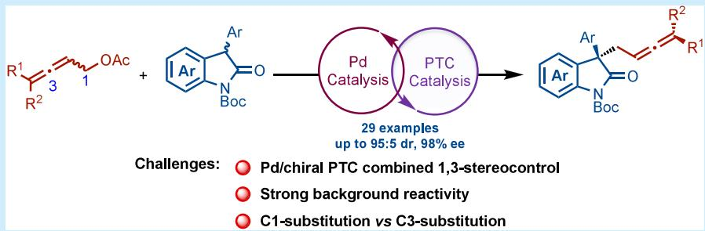
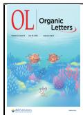
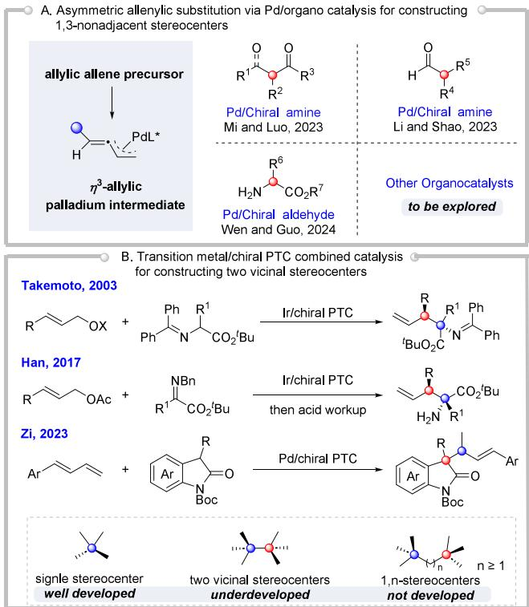
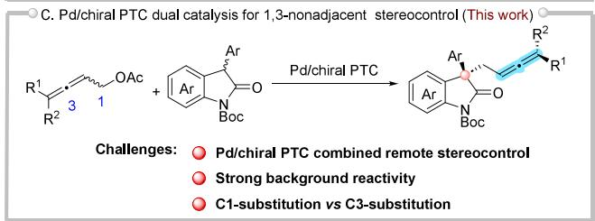
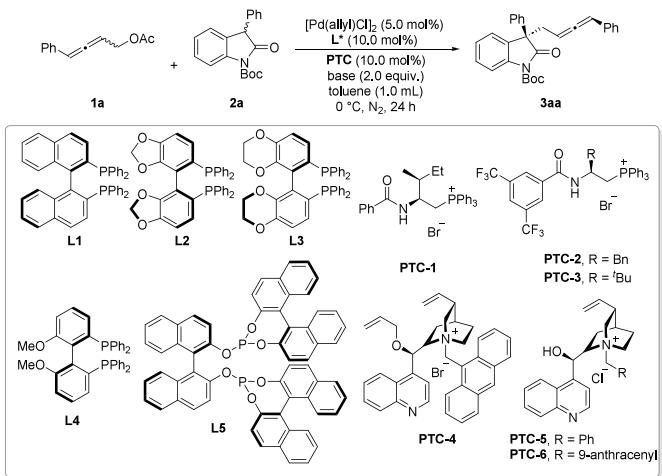
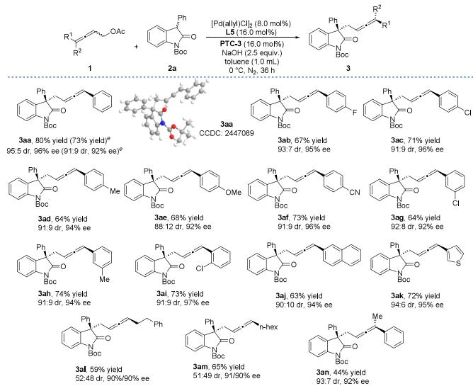
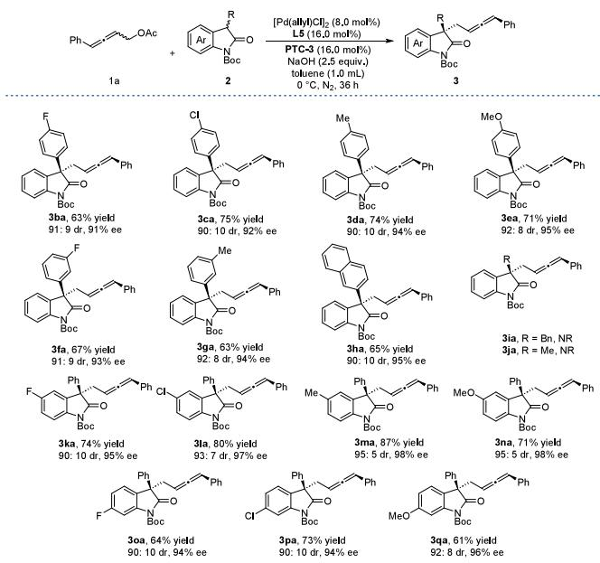
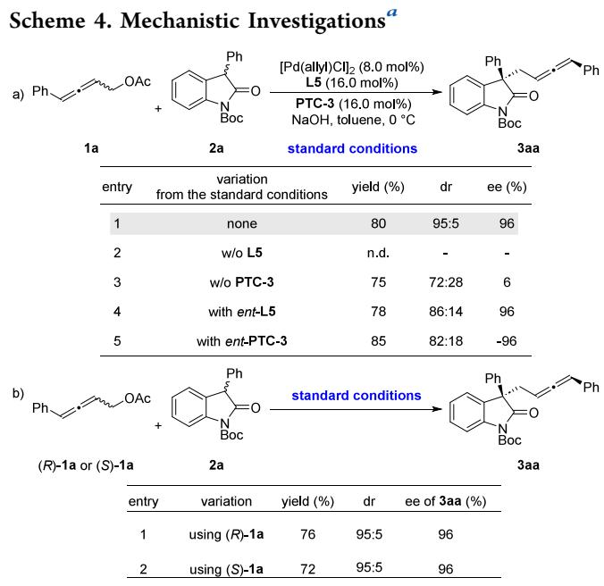
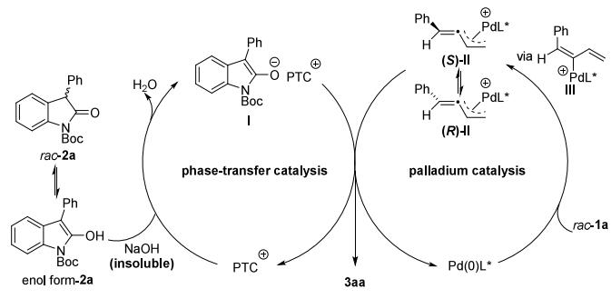

pubs.acs.org/OrgLett

Letter

# 1,3-Stereocontrol in Stereoconvergent Allenylic Alkylation Enabled by Palladium and Chiral Phase-Transfer Cooperative Catalysis

Hongbo Qi,\* Wenhua Wu, and Dan-Xing Wu

Cite This: Org. Lett. 2025, 27, 8045−8051

ACCESS

Metrics & More

Article Recommendations

\*sı Supporting Information

  
ABSTRACT: A stereoconvergent allenylic alkylation of allenyl acetates with oxindoles has been established by palladium and chiral phase-transfer cooperative catalysis, allowing for an eficient construction of 1,3-nonadjacent stereogenic elements featuring both central and axial chirality. The noncovalent interactions of PTC create a chiral environment for nucleophilic attack on $\eta ^ { 3 } \mathrm { - }$ allylpalladium intermediates. Mechanistic investigations reveal that the Pd/PTC synergistic action and matched chirality are both critical for stereocontrol, while PTC primarily determines the stereoselectivity. Notably, this work represents the first successful implementation of Pd/chiral PTC dual catalysis for 1,3-nonadjacent stereocontrol, thereby enriching the synthetic toolbox for constructing challenging remote stereocenters.

Asymmetric catalysis stands at the forefront of modern organic synthesis, enabling the stereocontrolled assembly of enantioenriched molecules vital to pharmaceuticals, agrochemicals, and functional materials.1 The prevalence of multiple stereogenic elements in bioactive molecules2 has made stereoselective construction a long-standing research focus in organic synthesis.3 Despite remarkable advances in vicinal stereocenter construction, the precise control of nonadjacent stereocenters remains a persistent challenge.4 Three interrelated factors contribute to this synthetic challenge:5 (i) the flexible transition state emerges as a critical barrier to reliable remote stereocontrol; (ii) asymmetric induction eficiency declines with greater stereocenter separation; and (iii) nonadjacent stereocenter formation produces ≥4 stereoisomers, increasing synthetic complexity.

Chiral allenes represent a privileged class of structural motifs found in natural products, bioactive molecules and functional materials.6 Consequently, the design of eficient synthetic routes to chiral allenes has become a major objective in organic synthesis, and significant advances have recently been achieved in the field of constructing single allenyl axial chirality. Transition-metal-catalyzed asymmetric allenylic alkylation represents a powerful strategy for the stereoselective construction of enantioenriched allene derivatives with precise stereocontrol.7d,8,9 Notably, allenyl axial chirality with vicinal central chirality could be controllably installed using transitionmetal-catalyzed.8g,10 However, the simultaneous control of remote stereocenters featuring both allenyl axial chirality and central chirality remains limited,8i,j,9 despite the fact that such scafolds play a significant role in medicinal chemistry and synthetic chemistry.11 In 2023, two distinct Pd/chiral amine dual catalyst systems were independently developed by Mi and Luo9e and Li and Shao9b for allylic allenylation reactions of β- ketocarbonyl and aldehyde, respectively, enabling the 1,3- nonadjacent stereocenters with allenyl axial chirality and central chirality to be stereoselectively controlled. Subsequently, Wen and Guo described a Pd/chiral aldehyde cooperatively catalyzed asymmetric allenylic alkylation of unprotected amino acid esters, providing an eficient access to these valuable scafolds (Scheme 1a).9f Beyond metal/ organocatalytic approaches, bimetallic catalysis has proven highly efective for precise stereocontrol in constructing these scafolds, as demonstrated by Zhang and Ma8j,9g and $\mathrm { H e } ^ { \mathrm { \tiny { 9 h } } }$ and $\operatorname { L i n . } ^ { 9 }$

Chiral PTCs are important type of organocatalysts and have grown to be indispensable tools for asymmetric synthesis, uniquely enabling stereocontrol of anionic nucleophiles via well-defined ion-pair interactions.12 Notably, this system faces heightened background reactivity relative to classical organocatalysts. Additionally, PTC systems feature a single activation site, specifically a chiral cationic center that mediates ionic interactions, restricting the simultaneous activation of both reaction partners. This limitation prompted developing PTCbased dual catalytic systems with secondary activation modes, significantly broadening synthetic applications.13 Since the Pd/ chiral PTC-catalyzed asymmetric allylic alkylation of Schif bases reported by Gong14a and Takemoto,14b transition metal/ chiral PTC combined catalysis has emerged as a highly promising strategy in asymmetric catalysis.15 However, such catalytic systems have rarely been applied to simultaneously and stereoselectively construct 1,3-nonadjacent stereocenters (Scheme 1b). We herein report a Pd/chiral PTC-catalyzed enantioselective allenylic alkylation, simultaneously creating allenyl axial chirality and all-carbon quaternary stereocenters with excellent enantioselectivity and diastereoselectivity (Scheme 1c).

Scheme 1. Strategies for the Formation of Multiple Stereocenters via Transition Metal/Organo Dual Catalysis  

We initiated a systematic study of the Pd/chiral PTCcatalyzed asymmetric allenylic alkylation using racemic allenylic acetate 1a and oxindole 2a as model substrates (Table 1). Several commercially available ligands (L1−L4) were evaluated in the presence of an L-isoleucine-derived quaternary phosphonium salt (PTC-1). While these systems could deliver the desired allylic allenylation product 3aa, both the enantioselectivity and diastereoselectivity proved unsatisfactory (entries 1−4). The observed suboptimal stereocontrol may be attributed to competing background reactivity mediated by a single Pd/ligand catalytic cycle. Inspired by findings from Takemoto14b and Zi,15f the deliberate use of electronically more deficeint phosphite ligand L5 would be able to slow down the competing monocatalytic process. Remarkably, this approach not only substantially enhanced enantioselectivity but also significantly improved diastereoselectivity, albeit at the expense of the reaction yield (entry 5). Subsequently, screening of various phase-transfer catalysts (PTCs) identified PTC-3 as the optimal, demonstrating remarkable enhancement in the yield, diastereoselectivity, and enantioselectivity. These results strongly suggest a synergistic catalytic efect between ligands L5 and PTC-3, as evidenced by comparative evaluation of diferent PTC systems (entry 7). Base optimization (entries 11−15) identified NaOH as critical for maximizing both reactivity and selectivity in the L5/PTC-3 system, achieving peak performance (entry 14). Systematic optimization of other reaction parameters, including catalyst loading, base stoichiometry, and reaction time, found that increased yields and slightly improved stereoselectivity were obtained upon using slightly increased amounts of the palladium catalyst and chiral PTC (entries 16 and 17).

Table 1. Optimization of Reaction Conditionsa  

<table><tr><td>entry</td><td>L*</td><td>PTC</td><td>base</td><td>yield (%)b</td><td>drc</td><td>ee (%)d</td></tr><tr><td>1</td><td>L1</td><td>PTC-1</td><td>KOAc</td><td>65</td><td>65:35</td><td>44</td></tr><tr><td>2</td><td>L2</td><td>PTC-1</td><td>KOAc</td><td>80</td><td>63:37</td><td>68</td></tr><tr><td>3</td><td>L3</td><td>PTC-1</td><td>KOAc</td><td>84</td><td>64:36</td><td>58</td></tr><tr><td>4</td><td>L4</td><td>PTC-1</td><td>KOAc</td><td>93</td><td>66:34</td><td>66</td></tr><tr><td>5</td><td>L5</td><td>PTC-1</td><td>KOAc</td><td>27</td><td>70:30</td><td>72</td></tr><tr><td>6</td><td>L5</td><td>PTC-2</td><td>KOAc</td><td>34</td><td>62:38</td><td>18</td></tr><tr><td>7</td><td>L5</td><td>PTC-3</td><td>KOAc</td><td>51</td><td>84:16</td><td>94</td></tr><tr><td>8</td><td>L5</td><td>PTC-4</td><td>KOAc</td><td>12</td><td>83:17</td><td>11</td></tr><tr><td>9</td><td>L5</td><td>PTC-5</td><td>KOAc</td><td>33</td><td>60:40</td><td>56</td></tr><tr><td>10</td><td>L5</td><td>PTC-6</td><td> ${ \mathrm { K O A c } }$ </td><td>&lt;10</td><td>67:33</td><td>70</td></tr><tr><td>11</td><td>L5</td><td>PTC-3</td><td> ${ \mathrm { N a } } _ { 2 } { \mathrm { C O } } _ { 3 }$ </td><td>45</td><td>86:14</td><td>92</td></tr><tr><td>12</td><td>L5</td><td>PTC-3</td><td> ${ \mathrm { K } } _ { 2 } { \mathrm { C O } } _ { 3 }$ </td><td>57</td><td>85:15</td><td>93</td></tr><tr><td>13</td><td>L5</td><td>PTC-3</td><td> ${ \mathrm { K } } _ { 3 } { \mathrm { P O } } _ { 4 }$ </td><td>51</td><td>86:14</td><td>89</td></tr><tr><td>14</td><td>L5</td><td>PTC-3</td><td>NaOH</td><td>65</td><td>93:7</td><td>95</td></tr><tr><td>15</td><td>L5</td><td>PTC-3</td><td>KOH</td><td>55</td><td>67:33</td><td>58</td></tr><tr><td> $1 6 ^ { e }$ </td><td>L5</td><td>PTC-3</td><td>NaOH</td><td>74</td><td>93:7</td><td>95</td></tr><tr><td> $1 7 ^ { e , f }$ </td><td>L5</td><td>PTC-3</td><td>NaOH</td><td>80</td><td>95:5</td><td>96</td></tr></table>

aReaction conditions: 1a (0.09 mmol, 1.5 equiv), 2a (0.06 mmol, 1.0 equiv), [Pd(allyl)Cl] (5.0 mol %), ligand (10.0 mol %), PTC (10.0 mol %), base (2.0 equiv), and toluene (1.0 mL) at 0 °C for 24 h under a nitrogen atmosphere. bIsolated yields were based on 2a. cThe diastereomeric ratio (dr) of 3aa was determined by1H NMR spectroscopy. dThe enantiomeric excess (ee) of the major diastereomer of 3aa was determined by chiral HPLC. e2.5 equiv of NaOH was used. f[Pd(allyl)Cl] (8.0 mol %), L5 (16.0 mol %) and PTC-3 (16.0 mol %) for 36 h were used.

With the optimized reaction conditions in hand, we next explored the substrate generality of the Pd/chiral PTCcatalyzed asymmetric allenyl alkylation reaction. We first examined the scope of allenyl acetates 1 (Scheme 2). The

## Scheme 2. Scope of the Allenylic Acetatesa−d

  
aReaction conditions: 1 (0.09 mmol, 1.5 equiv), 2a (0.06 mmol, 1.0 equiv), [Pd(allyl)Cl] (8.0 mol %), L5 (16.0 mol %), PTC-3 (16.0 mol %), NaOH (2.5 equiv), and toluene (1.0 mL) at 0 °C for 36 h under a nitrogen atmosphere. bIsolated yields were based on 2a. cThe diastereomeric ratio (dr) of 3 was determined by 1H NMR spectroscopy. $d _ { \mathrm { T h e } }$ enantiomeric excess (ee) of the major diastereomer of 3 was determined by chiral HPLC. ePerformed on 1.0 mmol scale.

presence of a fluoro, chloro, and methyl group on the benzene ring at the para- position could smoothly provide the products 3ab−3ad in good yields and excellent stereoselectivities (dr >91:9, >94% ee). However, a highly electron-donating substituent is detrimental to the reaction rate and stereoselectivity as exemplified by the 4-OMe-substituted substrate, which delivered the product 3ae in moderate yield and eroded diastereoselectivity (dr 88:12). Gratifyingly, the good isolated yield and stereoselectivities were secured for target product 3af when a substrate possessing an electron-withdrawing group (−CN) at the para- position of the benzene ring was employed. The substitution pattern of the aromatic ring significantly influenced the outcomes. As a result, the substituent (−Cl, −Me) at either the meta or ortho position underwent reaction smoothly, yielding products 3ag−3ai with good stereoselectivity (dr >91:9, >92% ee). A 2-naphthylsubstituted allenic acetate (2j) proved compatible, furnishing 3aj in 63% yield with 90:10 dr and 94% ee. The protocol also accommodated the heteroaryl allenic substrates. For example, the thiophene-functionalized substrate participated in the reaction to aford 3ak in 70% yield with excellent stereo selectivity (dr 94:6, 95% ee). For alkyl substituted substrates, linear alkyl allenic acetates were reactive substrates, leading to 3al and 3am in acceptable yields (59−65%) and high enantioselectivities (ee >90%), but diastereoselectivity was rather poor. Trisubstituted allenyl acetate 2n could participate in the reaction with excellent enantioselectivity (>92% ee), but gave moderate yield. The absolute configuration of 3aa was unambiguously determined by single-crystal X-ray analysis. Notably, the reaction scalability was confirmed through a 1.0 mmol scale preparation of 3aa.

We next evaluated the reaction scope with respect to oxindoles 2 (Scheme 3). The catalytic system demonstrated a

  
aReaction conditions: 1a (0.09 mmol, 1.5 equiv), 2 (0.06 mmol, 1.0 equiv), [Pd(allyl)Cl] (8.0 mol %), L5 (16.0 mol %), PTC-3 (16.0 mol %), NaOH (2.5 equiv), and toluene (1.0 mL) at $0 ~ ^ { \circ } \mathrm { C }$ for 36 h under a nitrogen atmosphere. bIsolated yields were based on 2. cThe diastereomeric ratio (dr) of 3 was determined by 1H NMR spectroscopy. dThe enantiomeric excess (ee) of the major diastereomer of 3 was determined by chiral HPLC.

broad tolerance for diverse electronic perturbations at the para-position of the C3-aryl group. Both electron-withdrawing $\mathsf { \bar { ( - F , - C l ) } }$ and electron-donating $\left( - \mathbf { M } \mathbf { e } , \mathbf { - O M e } \right)$ substituents participated in the reaction, smoothly, afording the products 3ba−3ea in good yields and stereoselectivities (dr >90:10, >91% ee). The method proved equally efective for metasubstituted C3-aryl oxindoles. Either chloro or methyl substituted substrate delivered the products 3fa and 3ga in good yields and excellent stereoselectivity (dr >91:9, ee >93%). Expansion to larger aromatic systems was also successful, as shown in the case with the 2-naphthyl substrate, which furnished 3ha in 65% yield with 90:10 dr and 95% ee. However, the system showed clear limitations with alkyl substituents at C3. Neither methyl nor benzyl substituted oxindoles generated target products 3ia and 3ja, likely due to the diminished acidity of the C3−H bond in alkyl-substituted substrates. The protocol exhibited excellent compatibility with C5-substituted oxindoles. Halogenated substrates (3ka and 3la) underwent the reaction with excellent stereocontrol (dr >90:10, >95% ee), while electron-rich variants (3ma and 3na)

achieved even better results (95:5 dr, 98% ee). Similarly, C6- substituted oxindoles bearing a fluoro (3oa), chloro (3pa), or methoxy (3qa) group performed admirably, providing products with good enantioselectivity (>94% ee).

To elucidate the reaction pathway, a series of mechanistic investigations were conducted (Scheme 4). First, some related

  
aThe ee for both (R)-1a and (S)-1a was 93%.

control experiments were performed (Scheme 4a). No product formation occurred in the absence of the chiral ligand (Scheme 4a, entry 2), confirming its essential role in this transformation. Omitting chiral PTC yielded almost racemic 3aa (ee <10%) with poor diastereocontrol (Scheme 4a, entry 3). The result underscores the dual role of chiral PTC in both phase-transfer activation and enantioselective nucleophile delivery. Configuration inversion of either L5 or PTC-3 significantly eroded diastereoselectivity (Scheme 4a, entries 4 and 5), demonstrating that chiral complementarity between the phosphine ligand and phase-transfer catalyst is essential for optimal stereocontrol in this dual catalytic system. This matched/mismatched phenomenon suggests cooperative transition-state organization involving both chiral elements. Notably, ent-PTC-3 generated products with inverted enantiomeric excess (ee) values. These observations collectively demonstrate that the phase tranfer catalyst serves as the primary determinant of the stereoselectivity in this transformation. To probe potential kinetic resolution efects, the reaction was performed by using enantiomerically pure (R)- and (S)-1a as substrates (Scheme 4b). Intriguingly, both enantiomers eficiently underwent the asymmetric alkylation, afording the products with the same configuration, in similar yields and with identical enantioselectivity. This observation suggests that the quick racemization allows both substrate enantiomers of 1a to be funneled into a single product stereoisomer, leading to the enantioconvergent nature.

The proposed mechanism involves two catalytic cycles, as illustrated in Scheme 5. In the PTC cycle, PTC+ transfers the base OH- from the solid base to the organic phase. The enol form of 2a undergoes deprotonation by the base, generating a tightly associated nucleophilic ion pair (I) with PTC+, along with one equivalent of water. In the pal-ladium catalysis cycle, oxidative addition of Pd(0) to ra-cemic allene 1a to form both η3-allylpalladium interme-diate (R)-II and (S)-II, which rapidly equilibrates via $\eta ^ { 1 } .$ -allylpalladium intermediate III. The (S)-II intermediate is kinetically favored over its (R)-II counterpart for nucleo-philic attack by the chiral ion pair I. This preferential re-activity pathway enables the highly stereoselective in-termolecular asymmetric remote alkenylation, ultimately leading to the formation of product 3aa with excellent stereocontrol. In summary, we have established a stereoconvergent enantioselective allenylic alkylation of oxindoles with allenyl acetates enabled by cooperative catalysis of the chiral palladium complex and phase-transfer catalyst (PTC), leading to the highly stereoselective construction of 1,3-nonadjacent stereogenic elements featuring both central and axial chirality. The key to successful stereocontrol is the use of PTC’s noncovalent interactions to establish a chiral environment for the stereoselective nucleophilic addition to the η3-allylpalladium intermediates. Mechanistic studies reveal that the synergistic cooperation between the palladium catalyst and PTC, along with their matched chirality, plays a critical role in enabling excellent reaction performance (Scheme 5). This work significantly expands the scope of PTC applications in metal/organo cocatalysis. We anticipate that this strategy will provide a general platform for the stereoselective construction of remotely functionalized chiral centers in more challenging contexts.

Scheme 5. Proposed Mechanism  

## ■ ASSOCIATED CONTENT

## Data Availability Statement

The data underlying this study are available in the published article and its online Supporting Information.

## \*sı Supporting Information

The Supporting Information is available free of charge at https://pubs.acs.org/doi/10.1021/acs.orglett.5c02416.

Experimental procedures, characterization data and Copies of 1H, 13C NMR and 19F NMR spectra for all new compounds and crystallographic data for compound 3aa. (PDF)

## Accession Codes

Deposition Number 2447089 contains the supplementary crystallographic data for this paper. These data can be obtained free of charge via the joint Cambridge Crystallographic Data Centre (CCDC) and Fachinformationszentrum Karlsruhe Access Structures service.

## ■ AUTHOR INFORMATION

## Corresponding Author

Hongbo Qi − Hefei National Laboratory for Physical Sciences at the Microscale and Department of Chemistry, University of Science and Technology of China, Hefei 230026, China; orcid.org/0009-0006-8163-3089; Email: qihongbo@ ustc.edu.cn

## Authors

Wenhua Wu − Hefei National Laboratory for Physical Sciences at the Microscale and Department of Chemistry, University of Science and Technology of China, Hefei 230026, China

Dan-Xing Wu − Hefei National Laboratory for Physical Sciences at the Microscale and Department of Chemistry, University of Science and Technology of China, Hefei 230026, China

Complete contact information is available at: https://pubs.acs.org/10.1021/acs.orglett.5c02416

## Notes

The authors declare no competing financial interest.

## ■ ACKNOWLEDGMENTS

We are grateful for financial support from National Key R&D Program of China (2023YFA1506700).

## ■ REFERENCES

(1) (a) Caldwell, J. The Importance of Stereochemistry in Drug Action and Disposition. J. Clin. Pharmacol. 1992, 32, 925−929. (b) Noyori, R. Asymmetric Catalysis: Science and Opportunities (Nobel Lecture). Angew. Chem., Int. Ed. 2002, 41, 2008−2022. (c) Rentsch, K. M. The Importance of Stereoselective Determination of Drugs in the Clinical Laboratory. J. Biochem. Biophys. Methods 2002, 54, 1−9.

(2) (a) Newman, D. J.; Cragg, G. M. Natural Products as Sources of New Drugs over the Last 25 Years. J. Nat. Prod. 2007, 70, 461−477. (b) Enquist, J. A., Jr; Stoltz, B. M. The Total Synthesis of (−)-Cyanthiwigin F by Means of Double Catalytic Enantioselective Alkylation. Nature 2008, 453, 1228−1231. (c) Li, J. W. H.; Vederas, J. C. Drug Discovery and Natural Products: End of an Era or an Endless Frontier? Science 2009, 325, 161−165. (d) Tong, S.; Limouni, A.; Wang, Q.; Wang, M.-X.; Zhu, J. Catalytic Enantioselective Double Carbopalladation/C−H Functionalization with Statistical Amplification of Product Enantiopurity: A Convertible Linker Approach. Angew. Chem., Int. Ed. 2017, 56, 14192−14196. (e) Newman, D. J.; Cragg, G. M. Natural Products as Sources of New Drugs over the Nearly Four Decades from 01/1981 to 09/2019. J. Nat. Prod. 2020, 83, 770−803.

(3) Gaucherand, A.; Yen-Pon, E.; Domain, A.; Bourhis, A.; Rodriguez, J.; Bonne, D. Enantioselective Synthesis of Molecules with Multiple Stereogenic Elements. Chem. Soc. Rev. 2024, 53, 11165−11206.

(4) (a) Fu, J.; Huo, X.; Li, B.; Zhang, W. Cooperative Bimetallic Catalysis in Asymmetric Allylic Substitution. Org. Biomol. Chem. 2017, 15, 9747−9759. (b) Kim, U. B.; Jung, D. J.; Jeon, H. J.; Rathwell, K.; Lee, S.-g. Synergistic Dual Transition Metal Catalysis. Chem. Rev. 2020, 120, 13382−13433. (c) Martínez, S.; Veth, L.; Lainer, B.; Dydio, P. Challenges and Opportunities in Multicatalysis. ACS Catal. 2021, 11, 3891−3915. (d) Wright, T. B.; Evans, P. A. Catalytic Enantioselective Alkylation of Prochiral Enolates. Chem. Rev. 2021, 121, 9196−9242. (e) Wei, L.; Wang, C.-J. Asymmetric Transformations Enabled by Synergistic Dual Transition-Metal Catalysis. Chem. Catal. 2023, 3, 100455. (f) Ji, C.-L.; Zou, X.-Z.; Gao, D.-W.

Catalytic Asymmetric Construction of Nonadjacent Stereoelements. Angew. Chem., Int. Ed. 2025, 64, No. e202504224.

(5) (a) Sailes, H.; Whiting, A. The Control of Remote Asymmetric Centres via Reduction of Acyclic Carbonyl Functions. J. Chem. Soc., Perkin Trans. 2000, 1, 1785−1805. (b) Mikami, K.; Shimizu, M.; Zhang, H.-C.; Maryanoff, B. E. Acyclic Stereocontrol between Remote Atom Centers via Intramolecular and Intermolecular Stereo-Communication. Tetrahedron 2001, 57, 2917−2951. (c) Clayden, J. Transmission of Stereochemical Information over Nanometre Distances in Chemical Reactions. Chem. Soc. Rev. 2009, 38, 817−829.

(6) (a) Hoffmann-Röder, A.; Krause, N. Synthesis and Properties of Allenic Natural Products and Pharmaceuticals. Angew. Chem., Int. Ed. 2004, 43, 1196−1216. (b) Ma, S. Some Typical Advances in the Synthetic Applications of Allenes. Chem. Rev. 2005, 105, 2829−2872. (c) Rivera-Fuentes, P.; Diederich, F. Allenes in Molecular Materials. Angew. Chem., Int. Ed. 2012, 51, 2818−2828. (d) Yu, S.; Ma, S. Allenes in Catalytic Asymmetric Synthesis and Natural Product Syntheses. Angew. Chem., Int. Ed. 2012, 51, 3074−3112.

(7) (a) Neff, R. K.; Frantz, D. E. Recent Advances in the Catalytic Syntheses of Allenes: A Critical Assessment. ACS Catal. 2014, 4, 519−528. (b) Huang, X.; Ma, S. Allenation of Terminal Alkynes with Aldehydes and Ketones. Acc. Chem. Res. 2019, 52, 1301−1312. (c) Fu, L.; Greßies, S.; Chen, P.; Liu, G. Recent Advances and Perspectives in Transition Metal-Catalyzed 1,4-Functionalizations of Unactivated 1,3-Enynes for the Synthesis of Allenes. Chin. J. Chem. 2020, 38, 91−100. (d) Song, S.; Ma, S. Highly Selective Nucleophilic 4-Aryl-2,3-allenylation of Malonates. Chin. J. Chem. 2020, 38, 1233− 1238. (e) Wang, H.; Luo, H.; Zhang, Z.-M.; Zheng, W.-F.; Yin, Y.; Qian, H.; Zhang, J.; Ma, S. Pd-Catalyzed Enantioselective Syntheses of Trisubstituted Allenes via Coupling of Propargylic Benzoates with Organoboronic Acids. J. Am. Chem. Soc. 2020, 142, 9763−9771. (f) Wang, H.; Qian, H.; Zhang, J.; Ma, S. Catalytic Asymmetric Axially Chiral Allenyl C−P Bond Formation. J. Am. Chem. Soc. 2022, 144, 12619−12626. (g) Wu, G.; Yao, Y.; Li, G.; Zhang, X.; Qian, H.; Ma, S. Enantioselective Allenation of Terminal Alkynes Catalyzed by Copper Halides of Mixed Oxidation States and Its Application to the Total Synthesis of Scorodonin. Angew. Chem., Int. Ed. 2022, 61, No. e202112427.

(8) (a) Ogasawara, M.; Ikeda, H.; Nagano, T.; Hayashi, T. Palladium-Catalyzed Asymmetric Synthesis of Axially Chiral Allenes: A Synergistic Effect of Dibenzalacetone on High Enantioselectivity. J. Am. Chem. Soc. 2001, 123, 2089−2090. (b) Imada, Y.; Ueno, K.; Kutsuwa, K.; Murahashi, S.-I. Palladium-Catalyzed Asymmetric Alkylation of 2,3-Alkadienyl Phosphates. Synthesis of Optically Active 2-(2,3-Alkadienyl)malonates. Chem. Lett. 2002, 31, 140−141. (c) Ogasawara, M.; Ueyama, K.; Nagano, T.; Mizuhata, Y.; Hayashi, T. Palladium-Catalyzed Asymmetric Synthesis of Axially Chiral (Allenylmethyl)silanes and Chirality Transfer to Stereogenic Carbon Centers in S ‘ Reactions. Org. Lett. 2003, 5, 217−219. (d) Trost, B. M.; Fandrick, D. R.; Dinh, D. C. Dynamic Kinetic Asymmetric Allylic Alkylations of Allenes. J. Am. Chem. Soc. 2005, 127, 14186−14187. (e) Nemoto, T.; Kanematsu, M.; Tamura, S.; Hamada, Y. Palladium-Catalyzed Asymmetric Allylic Alkylation of 2,3-Allenyl Acetates Using a Chiral Diaminophosphine Oxide. Adv. Synth. Catal. 2009, 351, 1773−1778. (f) Li, Q.; Fu, C.; Ma, S. Catalytic Asymmetric Allenylation of Malonates with the Generation of Central Chirality. Angew. Chem., Int. Ed. 2012, 51, 11783−11786. (g) Dai, J.; Duan, X.; Zhou, J.; Fu, C.; Ma, S. Catalytic Enantioselective Simultaneous Control of Axial Chirality and Central Chirality in Allenes. Chin. J. Chem. 2018, 36, 387−391. (h) Song, S.; Zhou, J.; Fu, C.; Ma, S. Catalytic Enantioselective Construction of Axial Chirality in 1,3-Disubstituted Allenes. Nature Commun. 2019, 10, 507. (i) Trost, B. M.; Schultz, J. E.; Chang, T.; Maduabum, M. R. Chemo-, Regio-, Diastereo-, and Enantioselective Palladium Allylic Alkylation of 1,3-Dioxaboroles as Synthetic Equivalents of α- Hydroxyketones. J. Am. Chem. Soc. 2019, 141, 9521−9526. (j) Zhang, J.; Huo, X.; Xiao, J.; Zhao, L.; Ma, S.; Zhang, W. Enantioand Diastereodivergent Construction of 1,3-Nonadjacent Stereocenters Bearing Axial and Central Chirality through Synergistic Pd/

Cu Catalysis. J. Am. Chem. Soc. 2021, 143, 12622−12632. (k) Cui, Y.; Zhai, Y.; Xiao, J.; Li, C.; Zheng, W.-F.; Huang, C.; Wu, G.; Qin, A.; Lin, J.; Liu, Q.; Wang, H.; Wu, P.; Xu, H.; Zheng, Y.; Ma, S. Chirality Memory of α-Methylene-π-Allyl Iridium Species. Chem. Sci. 2021, 12, 11831−11838. (l) Zhang, Y.; Zhang, X.; Ma, S. Stretchable Chiral Pockets for Palladium-Catalyzed Highly Chemo- and Enantioselective allenylation. Nature Commun. 2021, 12, 2416. (m) Zhao, L.; Luo, Y.; Xiao, J.; Huo, X.; Ma, S.; Zhang, W. Stereodivergent Synthesis of Allenes with α,β-Adjacent Central Chiralities Empowered by Synergistic Pd/Cu Catalysis. Angew. Chem., Int. Ed. 2023, 62, No. e202218146.

(9) (a) Yang, S.-Q.; Wang, Y.-F.; Zhao, W.-C.; Lin, G.-Q.; He, Z.-T. Stereodivergent Synthesis of Tertiary Fluoride-Tethered Allenes via Copper and Palladium Dual Catalysis. J. Am. Chem. Soc. 2021, 143, 7285−7291. (b) Dai, J.; Li, L.; Ye, R.; Wang, S.; Wang, Y.; Peng, F.; Shao, Z. Construction of Acyclic All-Carbon Quaternary Stereocenters and 1,3-Nonadjacent Stereoelements via Organo/Metal Dual Catalyzed Asymmetric Allenylic Substitution of Aldehydes. Angew. Chem., Int. Ed. 2023, 62, No. e202300756. (c) Liu, L.-X.; Huang, W.- J.; Yu, C.-B.; Zhou, Y.-G. Palladium-catalyzed stereoselective construction of chiral allenes bearing nonadjacent axial and two central chirality. Org. Biomol. Chem. 2023, 21, 8516−8520. (d) Xue, A.; Wei, X.; Huang, Y.; Qu, J.; Wang, B. Palladium-Catalyzed Stereoselective Construction of 1,3-Stereocenters Displaying Axial and Central Chirality via Asymmetric Alkylations. Molecules 2023, 28, 2927. (e) You, C.; Shi, M.; Mi, X.; Luo, S. Asymmetric α-allylic allenylation of β-ketocarbonyls and aldehydes by synergistic Pd/chiral primary amine catalysis. Nature Commun. 2023, 14, 2911. (f) Zhang, H.; Wen, W.; Lu, Z.-X.; Wu, Z.-L.; Cai, T.; Guo, Q.-X. Core Structure-Oriented Asymmetric α-Allenylic Alkylation of Amino Acid Esters Enabled by Chiral Aldehyde/Palladium Catalysis. Org. Lett. 2024, 26, 153−159. (g) Zhang, J.; Luo, Y.; Zheng, E.; Huo, X.; Ma, S.; Zhang, W. Synergistic Pd/Cu-Catalyzed 1,5-Double Chiral Inductions. J. Am. Chem. Soc. 2024, 146, 9241−9251. (h) Tang, M.-Q.; Yang, Z.-J.; Han, A.-J.; He, Z.-T. Diastereoselective and Enantioselective Hydrophosphinylations of Conjugated Enynes, Allenes and Dienes via Synergistic Pd/Co Catalysis. Angew. Chem., Int. Ed. 2025, 64, No. e202413428.

(10) (a) Yao, Q.; Liao, Y.; Lin, L.; Lin, X.; Ji, J.; Liu, X.; Feng, X. Efficient Synthesis of Chiral Trisubstituted 1,2-Allenyl Ketones by Catalytic Asymmetric Conjugate Addition of Malonic Esters to Enynes. Angew. Chem., Int. Ed. 2016, 55, 1859−1863. (b) Tang, Y.; Xu, J.; Yang, J.; Lin, L.; Feng, X.; Liu, X. Asymmetric Three-Component Reaction for the Synthesis of Tetrasubstituted Allenoates via Allenoate-Copper Intermediates. Chem. 2018, 4, 1658−1672. (c) He, C.-Y.; Tan, Y.-X.; Wang, X.; Ding, R.; Wang, Y.-F.; Wang, F.; Gao, D.; Tian, P.; Lin, G.-Q. Copper(I)-Catalyzed Diastereo- and Enantio-Selective Construction of Optically Pure Exocyclic Allenes. Nature Commun. 2020, 11, 4293. (d) Law, C.; Kativhu, E.; Wang, J.; Morken, J. P. Diastereo- and Enantioselective 1,4-Difunctionalization of Borylenynes by Catalytic Conjunctive Cross-Coupling. Angew. Chem., Int. Ed. 2020, 59, 10311−10315. (e) Zhong, F.; Xue, Q.-Y.; Yin, L. Construction of Chiral 2,3-Allenols through a Copper(I)- Catalyzed Asymmetric Direct Alkynylogous Aldol Reaction. Angew. Chem., Int. Ed. 2020, 59, 1562−1566. (f) Loui, H. J.; Schneider, C. Cooperative Palladium/Brønsted Acid Catalysis toward the Highly Enantioselective Allenylation of β-Keto Esters. Org. Lett. 2022, 24, 1496−1501. (g) Shi, B.; Liu, J.-B.; Wang, Z.-T.; Wang, L.; Lan, Y.; Lu, L.-Q.; Xiao, W.-J. Synthesis of Chiral Endocyclic Allenes by Palladium-Catalyzed Asymmetric Annulation Followed by Cope Rearrangement. Angew. Chem., Int. Ed. 2022, 61, No. e202117215. (h) Zhang, F.-H.; Guo, X.; Zeng, X.; Wang, Z. Catalytic Enantioconvergent Allenylation of Aldehydes with Propargyl Halides. Angew. Chem., Int. Ed. 2022, 61, No. e202117114. (i) Sheng, C.; Ling, Z.; Xiao, J.; Yang, K.; Xie, F.; Ma, S.; Zhang, W. Enantio- and Diastereoselective Synthesis of Chiral Tetrasubstituted α-Amino Allenoates Bearing a Vicinal All-Carbon Quaternary Stereocenter with Dual-Copper-Catalysis. Angew. Chem., Int. Ed. 2023, 62, No. e202305680. (j) Zhang, Y.; Wu, J.; Ning, L.; Chen, Q.; Feng,

X.; Liu, X. Enantioselective Synthesis of Tetrasubstituted Allenes via Addition/Arylation Tandem Reaction of 2-Activated 1,3-Enynes. Sci. China Chem. 2023, 66, 526−533. (k) Wen, Y.-H.; Liu, M.; Wang, Y.- H.; Gong, Q.-W.; Li, S.; Song, J.; Gong, L.-Z. Remote Enantioselective ϵ-Alkylation of Copper Ethynylallenylidenes: Precise Control of Central and Axial Chirality. Angew. Chem., Int. Ed. 2025, 64, No. e202416089.

(11) (a) Sydnes, L. K. Allenes from Cyclopropanes and Their Use in Organic SynthesisRecent Developments. Chem. Rev. 2003, 103, 1133−1150. (b) Wei, L.-l.; Xiong, H.; Hsung, R. P. The Emergence of Allenamides in Organic Synthesis. Acc. Chem. Res. 2003, 36, 773− 782. (c) Lu, T.; Lu, Z.; Ma, Z.-X.; Zhang, Y.; Hsung, R. P. Allenamides: A Powerful and Versatile Building Block in Organic Synthesis. Chem. Rev. 2013, 113, 4862−4904.

(12) (a) Lygo, B.; Andrews, B. I. Asymmetric Phase-Transfer Catalysis Utilizing Chiral Quaternary Ammonium Salts: Asymmetric Alkylation of Glycine Imines. Acc. Chem. Res. 2004, 37, 518−525. (b) Hashimoto, T.; Maruoka, K. Recent Development and Application of Chiral Phase-Transfer Catalysts. Chem. Rev. 2007, 107, 5656−5682. (c) Ooi, T.; Maruoka, K. Recent Advances in Asymmetric Phase-Transfer Catalysis. Angew. Chem., Int. Ed. 2007, 46, 4222−4266. (d) Brak, K.; Jacobsen, E. N. Asymmetric Ion-Pairing Catalysis. Angew. Chem., Int. Ed. 2013, 52, 534−561. (e) Shirakawa, S.; Maruoka, K. Recent Developments in Asymmetric Phase-Transfer Reactions. Angew. Chem., Int. Ed. 2013, 52, 4312−4348. (f) Kaneko, S.; Kumatabara, Y.; Shirakawa, S. A New Generation of Chiral Phase-Transfer Catalysts. Org. Biomol. Chem. 2016, 14, 5367−5376. (g) Zong, L.; Tan, C.-H. Phase-Transfer and Ion-Pairing Catalysis of Pentanidiums and Bisguanidiniums. Acc. Chem. Res. 2017, 50, 842− 856. (h) Albanese, D. C. M.; Penso, M. New Trends in Asymmetric Phase Transfer Catalysis. Eur. J. Org. Chem. 2023, 26, No. e202300224. (i) Lee, H.-J.; Maruoka, K. Asymmetric phasetransfer catalysis. Nat. Rev. Chem. 2024, 8, 851−869.

(13) (a) Lian, M.; Li, Z.; Cai, Y.; Meng, Q.; Gao, Z. Enantioselective Photooxygenation of β-Keto Esters by Chiral Phase-Transfer Catalysis using Molecular Oxygen. Chem. − Asian J. 2012, 7, 2019−2023. (b) Woźniak, Ł.; Murphy, J. J.; Melchiorre, P. Photo-organocatalytic Enantioselective Perfluoroalkylation of β-Ketoesters. J. Am. Chem. Soc. 2015, 137, 5678−5681. (c) Wang, Y.; Yin, H.; Tang, X.; Wu, Y.; Meng, Q.; Gao, Z. A Series of Cinchona-Derived N-Oxide Phase-Transfer Catalysts: Application to the Photo-Organocatalytic Enantioselective α-Hydroxylation of β-Dicarbonyl Compounds. J. Org. Chem. 2016, 81, 7042−7050. (d) Wang, Y.; Zheng, Z.; Lian, M.; Yin, H.; Zhao, J.; Meng, Q.; Gao, Z. Photo-Organocatalytic Enantioselective α-Hydroxylation of β-Keto Esters and β-Keto Amides with Oxygen under Phase Transfer Catalysis. Green Chem. 2016, 18, 5493−5499. (e) Ye, B.; Zhao, J.; Zhao, K.; McKenna, J. M.; Toste, F. D. Chiral Diaryliodonium Phosphate Enables Light Driven Diastereoselective α-C(sp3)−H Acetalization. J. Am. Chem. Soc. 2018, 140, 8350−8356. (f) Tang, X.-F.; Zhao, J.-N.; Wu, Y.-F.; Feng, S.-H.; Yang, F.; Yu, Z.-Y.; Meng, Q.-W. Visible-Light-Driven Enantioselective Aerobic Oxidation of β-Dicarbonyl Compounds Catalyzed by Cinchona-Derived Phase Transfer Catalysts in Batch and Semi-Flow. Adv. Synth. Catal. 2019, 361, 5245−5252. (g) Tang, X.-F.; Zhao, J.- N.; Wu, Y.-F.; Zheng, Z.-H.; Feng, S.-H.; Yu, Z.-Y.; Liu, G.-Z.; Meng, Q.-W. Enantioselective Photooxygenation of β-Dicarbonyl Compounds in Batch and Flow Photomicroreactors. Org. Biomol. Chem. 2019, 17, 7938−7942. (h) Ye, X.; Tan, C.-H. Enantioselective Transition Metal Catalysis Directed by Chiral Cations. Chem. Sci. 2021, 12, 533−539. (i) Wang, Y.; Wang, S.; Liu, J.; Lian, M.; Chen, Y.; Wang, K.; Zhang, Y.; Zhang, T.; Fang, L. Visible Light-Promoted Enantioselective Aerobic Oxidation of Pyrazolones by Phase Transfer Catalysis. Green Synth. Catal. 2022, 3, 102−109.

(14) (a) Chen, G.; Deng, Y.; Gong, L.; Mi, A.; Cui, X.; Jiang, Y.; Choi, M. C. K.; Chan, A. S. C. Palladium-Catalyzed Allylic Alkylation of Tert-butyl(diphenylmethylene)-glycinate with Simple Allyl Esters under Chiral Phase Transfer Conditions. Tetrahedron: Asymmetry 2001, 12, 1567−1571. (b) Nakoji, M.; Kanayama, T.; Okino, T.; Takemoto, Y. Chiral Phosphine-Free Pd-Mediated Asymmetric

Allylation of Prochiral Enolate with a Chiral Phase-Transfer Catalyst. Org. Lett. 2001, 3, 3329−3331.

(15) (a) Kanayama, T.; Yoshida, K.; Miyabe, H.; Kimachi, T.; Takemoto, Y. Synthesis of β-Substituted α-Amino Acids with Use of Iridium-Catalyzed Asymmetric Allylic Substitution. J. Org. Chem. 2003, 68, 6197−6201. (b) Kanayama, T.; Yoshida, K.; Miyabe, H.; Takemoto, Y. Enantio- and Diastereoselective Ir-Catalyzed Allylic Substitutions for Asymmetric Synthesis of Amino Acid Derivatives. Angew. Chem., Int. Ed. 2003, 42, 2054−2056. (c) Su, Y.-L.; Li, Y.-H.; Chen, Y.-G.; Han, Z.-Y. Ir/PTC Cooperatively Catalyzed Asymmetric Umpolung Allylation of α-Imino Ester Enabled Synthesis of α- Quaternary Amino Acid Derivatives Bearing Two Vicinal Stereocenters. Chem. Commun. 2017, 53, 1985−1988. (d) Paria, S.; Lee, H.- J.; Maruoka, K. Enantioselective Alkynylation of Isatin Derivatives Using a Chiral Phase-Transfer/Transition-Metal Hybrid Catalyst System. ACS Catal. 2019, 9, 2395−2399. (e) Ran, G.-Y.; Yang, X.-X.; Yue, J.-F.; Du, W.; Chen, Y.-C. Asymmetric Allylic Alkylation with Deconjugated Carbonyl Compounds: Direct Vinylogous Umpolung Strategy. Angew. Chem., Int. Ed. 2019, 58, 9210−9214. (f) Han, J.; Liu, R.; Lin, Z.; Zi, W. Stereodivergent Construction of ${ \mathrm { C s p } } ^ { 3 } { \mathrm { - C s p } } ^ { 3 }$ Bonds Bearing Vicinal Stereocenters by Synergistic Palladium and Phase-Transfer Catalysis. Angew. Chem., Int. Ed. 2023, 62, No. e202215714. (g) Guo, C.; Dong, Y.; Wang, Y.; Du, X.; Ma, R.; Tan, C.-H.; Luan, X.; Ren, J. Enantioselective Synthesis of Chiral Acyclic Nitriles Containing α-All-Carbon Quaternary Stereocenters via Synergistic Palladium andPhase-Transfer Catalysis. ACS Catal. 2024, 14, 18841− 18850.