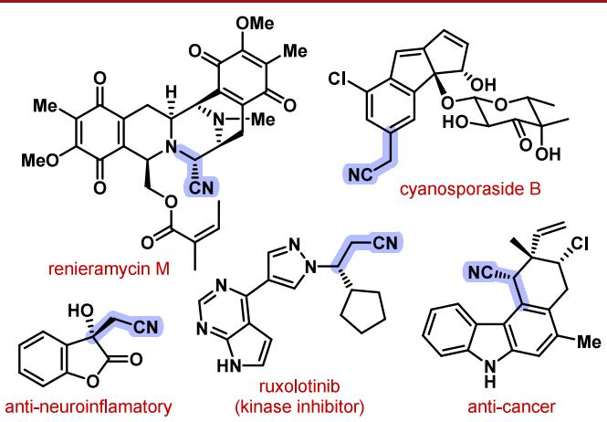
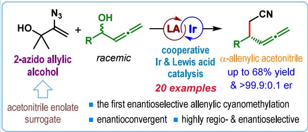
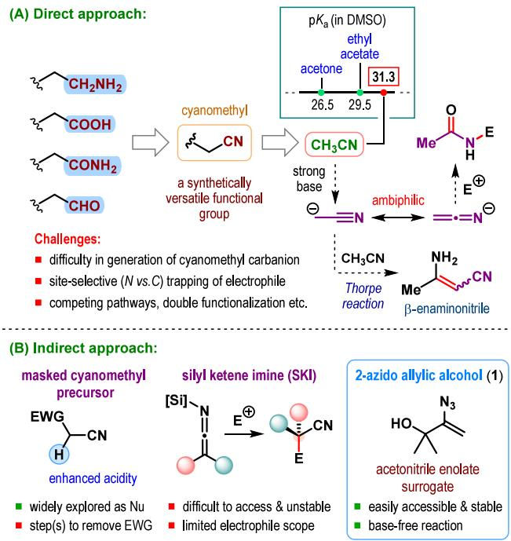
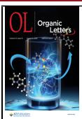
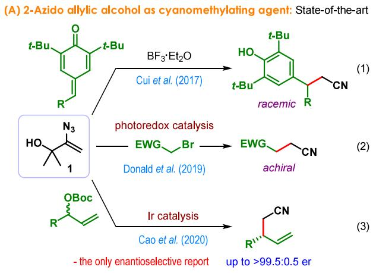
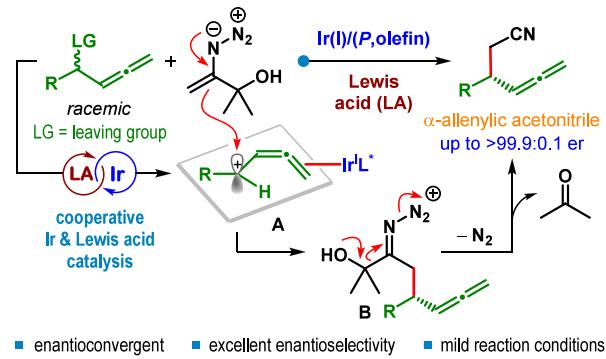
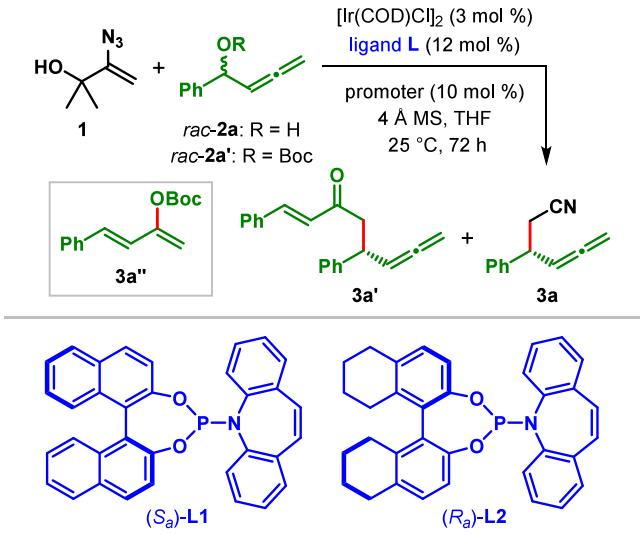
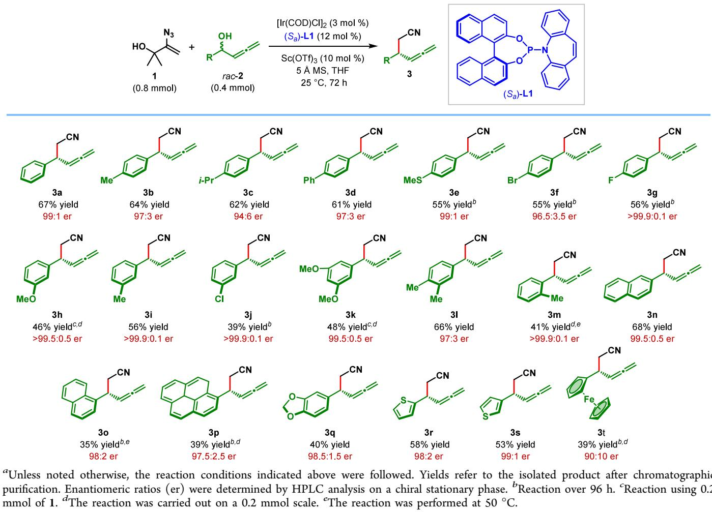
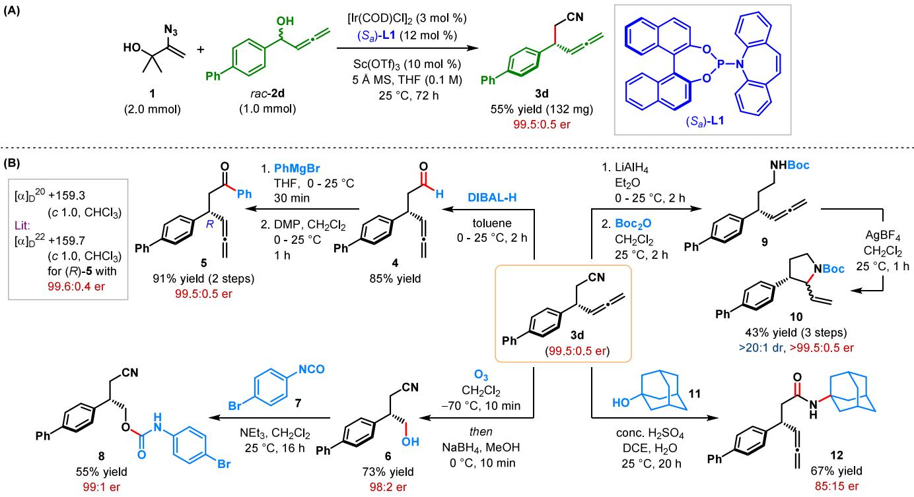

pubs.acs.org/OrgLett

# Iridium-Catalyzed Enantioselective Allenylic Cyanomethylation

Aditya Chakrabarty and Santanu Mukherjee\*

Cite This: Org. Lett. 2025, 27, 8752−8757

Metrics & More

ACCESS

ABSTRACT: The poor acidity of acetonitrile restricted its utility as a C2 synthon of a cyanomethyl group for incorporation into organic compounds. We now employed a 2-azido allylic alcohol as an acetonitrile enolate surrogate for the first enantioselective allenylic cyanomethylation. This mild and base-free protocol utilizes cooperative iridium and Lewis acid catalysis for the activation of branched allenylic alcohols to deliver α-allenylic acetonitriles in moderate to good yields with excellent enantioselectivity.

T he ubiquitous occurrence of the cyanomethyl groupacross a diverse array of bioactive molecules and natural

Figure 1. Natural products and bioactive compounds containing the cyanomethyl group.  
  
Article Recommendations

its introduction to organic compounds.1 While acetonitrile appears to be the most obvious choice, its use as the precursor of cyanomethyl carbanion comes with serious synthetic hurdles (Scheme 1A).2

Read Online

The attenuated acidity of the α-protons of acetonitrile compared to carbonyls (pK of CH CN of ∼31.3 in DMSO)3 makes it relatively dificult to deprotonate, and thus, it remains inert toward electrophiles. In fact, the inertness of acetonitrile is a reason for its choice as a solvent in many chemical reactions. Although acetonitrile can be deprotonated using a strong base, the “hardness” and ambiphilic nature of the corresponding cyanomethyl anion makes its selective application as a carbon nucleophile challenging.4

Among other pathways, the base-mediated dimerization of acetonitrile to β-enaminonitrile, called the Thorpe reaction

\*sı Supporting Information

Scheme 1. Direct and Indirect Approaches for the Incorporation of the Cyanomethyl Group  

(Scheme 1A),5 is known to compete with the direct addition of the acetonitrile carbanion to a chosen electrophile. An attempted Pd-catalyzed allylic alkylation of acetonitrile by

Received: June 30, 2025   
Revised: July 18, 2025   
Accepted: July 21, 2025   
Published: July 24, 2025

Ding, Hou, and co-workers resulted in α-allylation of β- enaminonitrile through the intervention of the Thorpe reaction.6 While α-cyanoacetates have been utilized as masked cyanomethyl precursors due to the enhanced acidity of its α- proton, it adds an extra step to remove the carboxylate group in the overall cyanomethylation sequence (Scheme 1B).7 Despite other notable advancements (e.g., silyl ketene imines as a cyanomethyl carbanion equivalent), only a handful of enantioselective transformations have been reported.8

Shibasaki and co-workers developed a general strategy for activating alkyl nitriles through a cooperative combination of Lewis acid with Brønsted base catalysis and accomplished enantioselective addition to a series of electrophiles.9 In a recent study, Li et al. demonstrated a synergistic Rh and silane catalysis strategy to tame the reactivity of the cyanomethyl anion for enantioselective allylic substitution.10

Taking a completely diferent approach to overcome the challenges associated with the direct use of a cyanomethyl carbanion, Cui et al. in 2017 introduced 2-azido allylic alcohol 1 as an acetonitrile enolate surrogate (Scheme 1B).11 This stable and easily accessible vinyl azide promises wide applicability due to its apparent compatibility with a variety of catalytic conditions for reactions proceeding under ionic or radical pathways (Scheme 2A, eqs 1 and 2).11,12 To date, the only application of 1 in an enantioselective transformation is reported by Cao et al. in Ir-catalyzed allylic substitution (Scheme 2A, eq 3).13

With our interest in vinyl azides14 as a surrogate of amide or ketone enolates, we applied them as a nucleophile in Ircatalyzed enantioselective allylic15 and allenylic substitution

Scheme 2. Cyanomethylation Using 2-Azido Allylic Alcohol as an Acetonitrile Enolate Surrogate

(B) This work: Ir-Catalyzed enantioselective allenylic cyanomethylation  

reactions.16 As a part of this research program, we wondered whether a similar catalytic concept could be extended to 2- azido allylic alcohol (1) for achieving enantioselective allenylic cyanomethylation. To the best of our knowledge, no α- allenylation of alkyl nitriles (allenylic cyanoalkylation) has ever been reported, let alone an enantioselective variant. Herein, we present the first catalytic enantioselective allenylic cyanomethylation. 17

Although the Ir-catalyzed allenylic substitution reaction was first introduced by the Takeuchi group in 2004,18 its enantioselective variant was not known until the seminal development by Carreira et al. through the application of their Ir(I)/(phosphoramidite,olefin) complex.19 We envisioned the interception of η2-Ir(I)-bound allenylic carbocation intermediate A, proposed to be generated from a branched allenylic electrophile under cooperative Ir(I) and Lewis acid catalysis,19,20 with 2-azido allylic alcohol 1 (Scheme 2B). The resulting α-allenylic iminodiazonium intermediate B was expected to spontaneously extrude nitrogen and acetone to generate α-allenylic acetonitrile.

To validate our catalytic hypothesis, we began our investigation with the model reaction between 2-azido allylic alcohol 1 and 1-phenyl allenyl alcohol 2a (Table 1). When the reaction was carried out in THF at $5 0 ~ ^ { \circ } \mathrm { C }$ using 6 mol % of an in situ generated Ir complex derived from [Ir(COD)Cl] and Carreira’s (P,olefin) ligand (S )-L1,21 in the presence of 10 mol % $\csc ( \operatorname { O T f } ) _ { 3 }$ as the Lewis acidic promoter and 4 Å MS, the desired α-allenylic acetonitrile 3a was formed in 34% yield along with the homocoupled product 3a′ as a 1:1 inseparable mixture (entry 1). Despite the low yield, the high enantiomeric ratio (er) of 3a in this reaction was encouraging and called for further optimization. We have recently disclosed the homocoupling reaction of allenylic alcohols under divergent cooperative catalysis and shown it to proceed through the intermediacy of a cross-dienol intermediate generated via a 1,3- hydroxy transposition of allenylic alcohol.22 We wondered whether the generation of cross-dienol could be avoided by replacing allenylic alcohol with allenylic carbonate 2a′. A reaction with 1.5 equiv of 2a′ under similar conditions aforded a slightly improved ratio of 3a over 3a′ (entry 2). A careful investigation revealed the formation of stable 4-phenyl 1,3- butadien-2-ol-carbonate (3a″) via [3,3]-sigmatropic rearrangement of 2a′ in this reaction. Although the use of 2.5 equiv of 2a′ improved the yield of 3a to 45%, a considerable amount of the homocoupled product was observed (entry 3). When the reaction was carried out at an ambient temperature in the presence of 2 equiv of allenylic alcohol 2a, α-allenylic acetonitrile 3a was isolated in 53% yield with 99:1 er and an improved 3a to 3a′ ratio (5.5:1) (entry 4). Changing the desiccant to 5 Å MS further enhanced the 3a/3a′ ratio, even though it was at the cost of the yield (entry 5). Considering the low nucleophilicity of 2-azido allylic alcohol 1 compared to the in situ generated cross-dienol, we anticipated that maintaining a low concentration of allenylic alcohols could be beneficial. Accordingly, when 2a was employed as the limiting substrate, the desired α-allenylic acetonitrile 3a was obtained almost exclusively (23:1 3a/3a′) and isolated in 61% yield with 99.8:0.2 er (entry 6). (R )-H -BINOL-derived (P,olefin) L2 instead of (S )-L1 aforded ent-3a in a poor yield with reduced er (entry 7), which shows the importance of the BINOL backbone in the (P,olefin) ligand for high yield and enantioselectivity. A slightly better reaction profile was observed using 5 Å MS as the desiccant when 3a was formed exclusively in 65% yield with excellent er (entry 9).

Table 1. Optimization of Reaction Parametersa  

<table><tr><td colspan="3"></td><td colspan="2">yield (%)</td><td rowspan="2">er of 3aº</td></tr><tr><td>entry</td><td>1/2</td><td>promoter</td><td> $3 \mathbf { a } ^ { b }$ </td><td> ${ 3 \mathbf { a } } / { 3 \mathbf { a } ^ { \prime } }$ </td></tr><tr><td> $1 ^ { d }$ </td><td>1:1.5</td><td>Sc(OTf)3</td><td>34</td><td>1:1</td><td>99:1</td></tr><tr><td> $2 ^ { d , e }$ </td><td>1:1.5</td><td>Sc(OTf)3</td><td>30</td><td>1.7:1</td><td>n.d.</td></tr><tr><td> $3 ^ { d , f }$ </td><td>1:2.5</td><td>Sc(OTf)3</td><td>45</td><td>4.1:1</td><td>98.5:1.5</td></tr><tr><td>4</td><td>1:2</td><td>Sc(OTf)₃</td><td>(53)</td><td>5.5:1</td><td>99:1</td></tr><tr><td> $5 ^ { g }$ </td><td>1:2</td><td>Sc(OTf)3</td><td>42</td><td>10.5:1</td><td>99:1</td></tr><tr><td>6</td><td>2:1</td><td>Sc(OTf){3</td><td>(61)</td><td>23:1</td><td>99.8:0.2</td></tr><tr><td> $7 ^ { h }$ </td><td>2:1</td><td>Sc(OTf)3</td><td>28</td><td>n.d.</td><td>5.5:94.5</td></tr><tr><td> $8 ^ { i }$ </td><td>2:1</td><td>Sc(OTf)3</td><td>(62)</td><td>&gt;25:1</td><td>99.5:0.5</td></tr><tr><td> $9 ^ { g , i }$ </td><td>2:1</td><td>Sc(OTf){3</td><td>(65)</td><td>&gt;25:1</td><td>99.6:0.4</td></tr><tr><td>10</td><td>2:1</td><td>In(OTf)3</td><td>35</td><td>n.d.</td><td>98:2</td></tr><tr><td>11</td><td>2:1</td><td>Yb(OTf)₃</td><td>30</td><td>n.d.</td><td>97:3</td></tr><tr><td>12</td><td>2:1</td><td>Bi(OTf)3</td><td>21</td><td>n.d.</td><td>n.d.</td></tr><tr><td> $1 3 ^ { j }$ </td><td>2:1</td><td>Sc(OTf)3</td><td>55</td><td>5.5:1</td><td>99:1</td></tr><tr><td> $1 4 ^ { k }$ </td><td>2:1</td><td>Sc(OTf)₃</td><td>67</td><td>&gt;25:1</td><td>99.5:0.5</td></tr></table>

aUnless stated otherwise, the reactions were carried out on a 0.1 mmol scale using 2a as the allenylic electrophile. bYields were determined by 1H NMR spectroscopy with mesitylene as the internal standard. Isolated yields after chromatographic purification are shown in parentheses. cEnantiomeric ratios (er) were determined by HPLC analysis on a chiral stationary phase. dReaction at $5 0 ~ ^ { \circ } \mathrm { C } .$ eReaction with 1.5 equiv of 2a′.fReaction with 2.5 equiv of 2a′. gReaction in the presence of 100 mg of 5 Å MS. hReaction using $\left( R _ { \mathrm { a } } \right)$ -L2. iReaction on a 0.2 mmol scale. jReaction using 20 mol $\% \ S c \bar { ( } \mathrm { O T f } ) _ { 3 } .$ kReaction on a 0.4 mmol scale using 400 mg of 5 Å MS.

Eforts toward enhancing the yield of 3a further by varying Lewis acidic promoters were inefective (entries 10−12). Increasing promoter loading to 20 mol % resulted in a poorer ${ \bf 3 a } / { \bf 3 a ^ { \prime } }$ ratio (entry 13). The eficacy of the reaction remained unaltered when the reaction was carried out on a 0.4 mmol scale (entry 9 vs entry 14).

Having optimized the reaction conditions, we set out to showcase the generality of this enantioselective allenylation of 2-azido allylic alcohol 1. As shown in Table 2, allenylic alcohols bearing electron-rich as well as electron-deficient 1-aryl substituents were well-accommodated, and the corresponding α-allenylic acetonitriles (3a−3p) were obtained in moderate to good yields and generally with excellent enantioselectivity. Consistent with the proposed involvement of the allenylic carbocation (A in Scheme 2B) in this reaction,19 allenylic alcohols containing an electron-rich aryl group generally resulted in products with higher yields compared to those bearing electron-deficient aryl substituents. Para- or meta substituted aryl rings on allenylic alcohol were found to be better suited in this reaction compared to the ortho-substituted ones. In the latter case, the products were obtained in lower yields, although excellent enantioselectivity was maintained. A low yield of 3m is in agreement with the lesser stability of the corresponding allenylic carbocationic intermediate as well as slow nucleophilic attack of 1, leading to faster decomposition of allenylic alcohol 2m. Allenylic alcohols containing a disubstituted electron-rich aryl group (2k and 2l) aforded the products (3k and 3l) in moderate to good yields with high er. Allenylic alcohols 2n−2p with polyaromatic substituents delivered the products (3n−3p) in moderate yield while maintaining outstanding enantioselectivities.

Allenylic alcohols substituted with heterocycles, such as 1,3- benzodioxolane (2q) and diferently substituted thienyls (2r and 2s), are compatible with our reaction conditions. However, the corresponding products $\left( 3 \mathbf { q } - 3 \mathbf { s } \right)$ were obtained in relatively low yields. Ferrocene-substituted allenylic alcohol 2t provided the α-allenylic acetonitrile in only 39% yield with 90:10 er. The lower enantioselectivity points toward the competing background reaction, likely due to the ease of formation and higher stability of the ferrocene-substituted free allenylic carbocation.23 Aliphatic allenylic alcohols failed to participate in this allenylic cyanomethylation reaction, presumably due to the lower stability of the corresponding allenylic carbocation, which is a limitation of this catalyst system. It is noted that the formation of no other side products could be detected in any of these cases. The low yield of the product in certain cases (3o−3q) can be attributed to the decomposition of allenylic alcohol under Lewis acidic conditions.

To showcase the scalability of our protocol, a reaction between 2-azido allylic alcohol 1 and allenylic alcohol 2d was carried out on a 1.0 mmol scale under our optimized reaction conditions (Scheme 3A). The desired product 3d was isolated in 55% yield with 99.5:0.5 er. The synthetic utility of α- allenylic acetonitriles was illustrated through several synthetic transformations involving 3d (Scheme 3B). Selective reduction of the cyano group in 3d with DIBAL-H at $0 ~ ^ { \circ } \mathrm { C }$ aforded α- allenylic acetaldehyde 4 in 85% yield. This two-step process represents the first formal α-allenylation of acetaldehyde. The addition of the phenyl Grignard reagent to 4 followed by oxidation of the resulting unpurified secondary alcohol (with 1:1 dr) led to the formation of α-allenylic acetophenone 5 in 91% yield over two steps with 99.5:0.5 er. The absolute configuration of 5 was ascertained to be R by comparing its specific rotation to that of a sample obtained through α- allenylation of vinyl azide as a ketone enolate surrogate.16 The absolute configuration of other α-allenylic acetonitriles shown in Table 2 was tentatively assigned as the same by analogy.

Reductive ozonolysis of 3d resulted in primary alcohol $\mathbf { 6 , }$ which was protected as carbamate 8. Reduction of 3d with $\mathrm { L i A l H } _ { 4 }$ and Boc protection aforded N-Boc bis-homoallenylic amine 9, which was subjected to Ag-catalyzed cyclization: 2,3- disubtituted pyrrolidine 10 was obtained as a single diastereomer in 43% yield over three steps with excellent enantioselectivity.24 No erosion of the enantiopurity was observed in any of these reaction sequences. The Ritter reaction of 3d with 1-adamantanol (11) furnished Nadamantyl α-allenylic amide 12 in 67% yield.25 However, 12

Table 2. Substrate Scopea  

## Scheme 3. (A) Scale-Up Synthesis and (B) Synthetic Elaboration of α-Allenylic Acetonitrile 3d

was isolated with considerably reduced enantiopurity, likely due to the highly acidic conditions required for this reaction. Nonetheless, this two-step functionalization provides an alternative approach for the enantioselective synthesis of Nalkyl-substituted α-allenylic amides.

In summary, we have developed the first catalytic enantioselective allenylic cyanomethylation using 2-azido allylic alcohol as acetonitrile enolate surrogate.17 This transformation proceeds through the cooperative activation of branched allenylic alcohol by an $\mathrm { I r } \big ( \mathrm { I } \big ) / \bar { \big ( } P , \mathrm { o l e f i n \big ) }$ complex and Lewis acidic $\dot { \mathrm { S c } } ( \mathrm { O T f } ) _ { 3 }$ and delivers α-allenylic acetonitriles in moderate to good yields with outstanding enantioselectivity. Easy accessibility of the substrates, base-free reaction conditions, and ambient temperature are some of the practical advantages of our protocol. Eforts toward the utilization of this acetonitrile enolate surrogate in other catalytic enantioselective transformations are currently underway in our laboratory.

## ■ ASSOCIATED CONTENT

## Data Availability Statement

The data underlying this study are available in the published article and its online Supporting Information.

## \*sı Supporting Information

The Supporting Information is available free of charge at https://pubs.acs.org/doi/10.1021/acs.orglett.5c02686.

Experimental details and characterization data (PDF)

## ■ AUTHOR INFORMATION

## Corresponding Author

Santanu Mukherjee − Department of Organic Chemistry, Indian Institute of Science, Bangalore 560012, India; orcid.org/0000-0001-9651-6228; Email: sm@iisc.ac.in

## Author

Aditya Chakrabarty − Department of Organic Chemistry, Indian Institute of Science, Bangalore 560012, India; orcid.org/0000-0003-3470-069X

Complete contact information is available at: https://pubs.acs.org/10.1021/acs.orglett.5c02686

## Notes

The authors declare no competing financial interest.

## ■ ACKNOWLEDGMENTS

The authors gratefully acknowledge financial support from the Science and Engineering Research Board (SERB) in the form of the Science and Technology Award for Research (SERB− STAR) (Grant STR/2021/000009) and a Core Research Grant (Grant CRG/2020/000176). A.C. thanks the Ministry of Education, Government of India, for the doctoral fellowships through the Prime Minister’s Research Fellowship (PMRF) scheme. High-resolution mass spectra (HR-MS) were recorded on equipment procured under the Department of Science and Technology (DST)−FIST Grant (Grant SR/ FST/CS II-040/2015).

## ■ REFERENCES

(1) (a) Scotti, C.; Barlow, J. W. Natural Products Containing the Nitrile Functional Group and Their Biological Activities. Nat. Prod. Commun. 2022, 17, 1934578X221099973. (b) Fleming, F. F.; Yao, L.;

Ravikumar, P. C.; Funk, L.; Shook, B. C. Nitrile-Containing Pharmaceuticals: Efficacious Roles of the Nitrile Pharmacophore. J. Med. Chem. 2010, 53, 7902−7917. (c) Fleming, F. Nitrile-Containing Natural Products. Nat. Prod. Rep. 1999, 16, 597−606.

(2) López, R.; Palomo, C. Cyanoalkylation: Alkylnitriles in Catalytic C-C Bond-Forming Reactions. Angew. Chem., Int. Ed. 2015, 54, 13170−13184.

(3) Bordwell, F. G. Equilibrium Acidities in Dimethyl Sulfoxide Solution. Acc. Chem. Res. 1988, 21, 456−463.

(4) Tom, M.-J.; Evans, P. A. Regioselective and Stereospecific Rhodium-Catalyzed Allylic Cyanomethylation with an Acetonitrile Equivalent: Construction of Acyclic β-Quaternary Stereogenic Nitriles. J. Am. Chem. Soc. 2020, 142, 11957−11961.

(5) Baron, H.; Remfry, F. G. P.; Thorpe, J. F. The Formation and Reactions of Imino-Compounds. Part I. Condensation of Ethyl Cyanoacetate with its Sodium Derivative. J. Chem. Soc., Trans. 1904, 85, 1726−1761.

(6) Bai, D.-C.; Liu, X.-Y.; Li, H.; Ding, C.-H.; Hou, X.-L. Tandem Thorpe Reaction/Palladium Catalyzed Asymmetric Allylic Alkylation: Access to Chiral β-enaminonitriles with Excellent Enantioselectivity. Chem. Asian. J. 2017, 12, 212−215.

(7) (a) Matsunami, A.; Takizawa, K.; Sugano, S.; Yano, Y.; Sato, H.; Takeuchi, R. Synthesis of Chiral Homoallylic Nitriles by Iridium-Catalyzed Allylation of Cyanoacetates. J. Org. Chem. 2018, 83, 12239−12246. (b) Trost, B. M.; Miller, J. R.; Hoffman, C. M., Jr. A Highly Enantio- and Diastereoselective Molybdenum-Catalyzed Asymmetric Allylic Alkylation of Cyanoesters. J. Am. Chem. Soc. 2011, 133, 8165−8167. (c) Förster, S.; Helmchen, G. Stereoselective Synthesis of a Lactam Analogue of Brefeldin C. Synlett 2008, 2008, 831−836.

14865. (e) Mermerian, A. H.; Fu, G. C. Nucleophile-Catalyzed Asymmetric Acylations of Silyl Ketene Imines: Application to the Enantioselective Synthesis of Verapamil. Angew. Chem., Int. Ed. 2005, 44, 949−952.

(9) Kumagai, N.; Shibasaki, M. A Thirst for Enantioselectivity in Catalytic Addition of Alkylnitriles. Chem. Lett. 2019, 48, 1322−1327.

(10) Sun, M.; Wei, L.; Li, C. Regio- and Enantioselective Allylic Cyanomethylation by Synergistic Rhodium and Silane Catalysis. J. Am. Chem. Soc. 2023, 145, 3897−3902.

(11) Lin, C.; Shen, Y.; Huang, B.; Liu, Y.; Cui, S. Synthesis of Amides and Nitriles from Vinyl Azides and p-Quinone Methides. J. Org. Chem. 2017, 82, 3950−3956.

(12) Donald, J. R.; Berrell, S. L. Radical Cyanomethylation via Vinyl Azide Cascade-Fragmentation. Chem. Sci. 2019, 10, 5832−5836.

(13) Han, M.; Yang, M.; Wu, R.; Li, Y.; Jia, T.; Gao, Y.; Ni, H.-L.; Hu, P.; Wang, B.-Q.; Cao, P. Highly Enantioselective Iridium-Catalyzed Coupling Reaction of Vinyl Azides and Racemic Allylic Carbonates. J. Am. Chem. Soc. 2020, 142, 13398−13405.

(14) (a) Nakanishi, T.; Kikuchi, J.; Kaga, A.; Chiba, S.; Terada, M. One-Pot Synthesis of Enantioenriched β-Amino Secondary Amides via an Enantioselective [4 + 2] Cycloaddition Reaction of Vinyl Azides with N-Acyl Imines Catalyzed by a Chiral Brønsted Acid. Chem. - Eur. J. 2020, 26, 8230−8234. (b) Hayashi, H.; Kaga, A.; Chiba, S. Application of Vinyl Azides in Chemical Synthesis: A Recent Update. J. Org. Chem. 2017, 82, 11981−11989. (c) Zhang, F.-L.; Zhu, X.; Chiba, S. Tf NH-Catalyzed Amide Synthesis from Vinyl Azides and Alcohols. Org. Lett. 2015, 17, 3138−3141. (d) Zhang, F.-L.;

Wang, Y.-F.; Lonca, G. H.; Zhu, X.; Chiba, S. Amide Synthesis by Nucleophilic Attack of Vinyl Azides. Angew. Chem., Int. Ed. 2014, 53, 4390−4394.

(15) Chakrabarty, A.; Mukherjee, S. Iridium-Catalyzed Enantioselective α-Allylic Alkylation of Amides Using Vinyl Azide as Amide Enolate Surrogate. Org. Lett. 2020, 22, 7752−7756.

(16) Chakrabarty, A.; Mukherjee, S. Iridium-Catalyzed Enantioselective and Chemodivergent Allenylic Alkylation of Vinyl Azides for the Synthesis of α-Allenylic Amides and Ketones. Angew. Chem., Int. Ed. 2022, 61, No. e202115821.

(17) An earlier version of this manuscript was deposited to ChemRxiv on May 22, 2025. Chakrabarty, A.; Mukherjee, S. Catalytic Enantioselective α-Allenylation of Acetonitrile. ChemRxiv 2025, DOI: 10.26434/chemrxiv-2025-j5p4h.

(18) Kezuka, S.; Kanemoto, K.; Takeuchi, R. Iridium Complex-Catalyzed Method for the Construction of a Quaternary Carbon Center a to Allene. Tetrahedron Lett. 2004, 45, 6403−6406.

(19) Petrone, D. A.; Isomura, M.; Franzoni, I.; Rössler, S. L.; Carreira, E. M. Allenylic Carbonates in Enantioselective Iridium-Catalyzed Alkylations. J. Am. Chem. Soc. 2018, 140, 4697−4704.

(20) Isomura, M.; Petrone, D. A.; Carreira, E. M. Coordination-Induced Stereocontrol over Carbocations: Asymmetric Reductive Deoxygenation of Racemic Tertiary Alcohols. J. Am. Chem. Soc. 2019, 141, 4738−4748.

(21) Rössler, S. L.; Krautwald, S.; Carreira, E. M. Study of Intermediates in Iridium−(Phosphoramidite,Olefin)-Catalyzed Enantioselective Allylic Substitution. J. Am. Chem. Soc. 2017, 139, 3603− 3606.

(22) Chakrabarty, A.; Chatterjee, R.; Mukherjee, S. Enantioselective Redox-Neutls through Divergent Cooperative Catalysis. ChemRxiv 2025, DOI: 10.26434/chemrxiv-2025-fvz0q.

(23) Goodman, H.; Mei, L.; Gianetti, T. L. Molecular Orbital Insights of Transition Metal-Stabilized Carbocations. Front. Chem. 2019, 7, 365.

(24) Gallagher, T.; Jones, S. W.; Mahon, M. F.; Molloy, K. C. Stereoselectivity in Electrophile-Mediated Cyclisations. Ag-Catalysed Synthesis of Disubstituted Pyrrolidines; Crystal Structure of cis-5- Phenyl-N-tosylpyrrolidin-2-ylmethyl 4-Bromobenzoate. J. Chem. Soc., Perkin Trans. 1991, 1, 2193−2198.

(25) Olah, G. A.; Balaram Gupta, B. G. Synthetic Methods and Reactions. 86. Novel Synthesis of N-(1-Adamantyl)amides from Adamantane. J. Org. Chem. 1980, 45, 3532−3533.