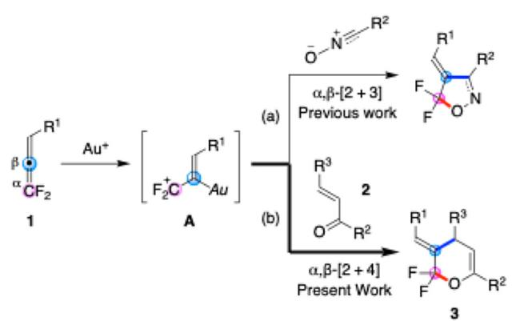
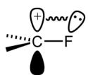
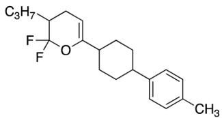
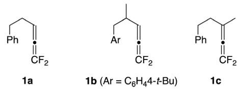
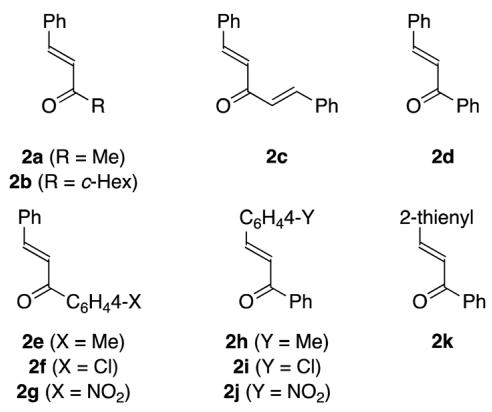
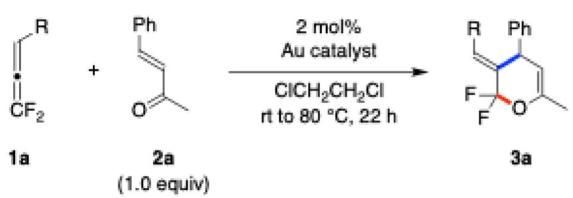
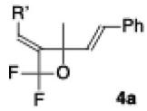
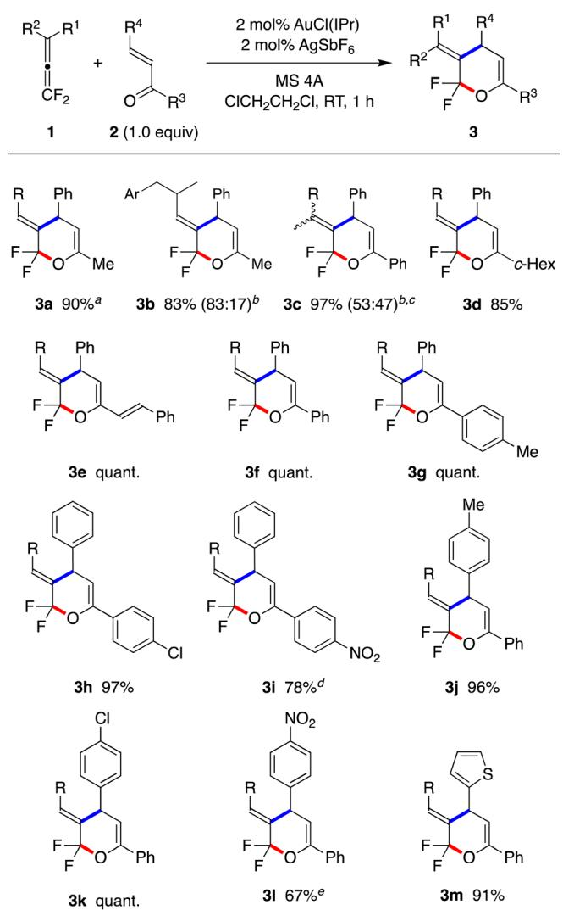
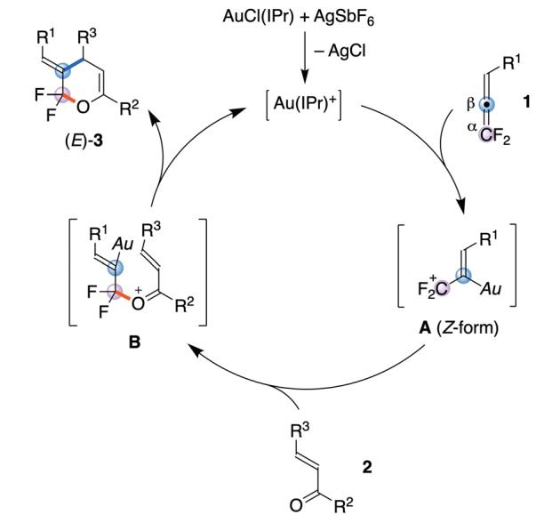
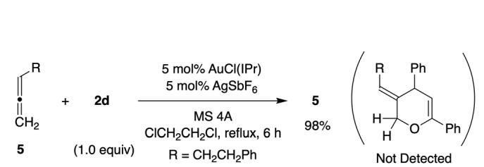

COMMUNICATION

View Article Online View Journal | View Issue

Check for updates

Cite this: Chem. Commun., 2025, 61, 4563

Received 19th December 2024, Accepted 15th February 2025

DOI: 10.1039/d4cc06642a

# Gold(I)-catalysed [2+4] cycloaddition of 1,1-difluoroallenes with conjugated enones: synthesis of ring-difluorinated dihydro-2H-pyrans†

Daisuke Miyazaki,a Reo Eto,a Junji Ichikawa b and Kohei Fuchibe \*a

rsc.li/chemcomm

1,1-Difluoroallenes underwent regioselective [2+4] cycloaddition with a,b-unsaturated ketones (enones) in the presence of an AuCl(IPr)– AgSbF catalyst. b-Aurated, charge-localized difluoroallylic carbocations, formed from 1,1-difluoroallenes and the cationic Au catalyst, were stabilised by the two fluorine substituents. This facilitated a-selective nucleophilic attack by the enone oxygen, followed by sixmembered ring closure, leading to the formation of ring-difluorinated dihydro-2H-pyrans with (E)-alkylidene groups in high yields.

1,1-Difluoroallenes $[ \mathbf { R } ( \mathbf { R } ^ { \prime } ) \mathbf { C } { \mathrm { = } } \mathbf { C } { \mathrm { = } } \mathbf { C } \mathbf { F } _ { 2 } ] ,$ characterised by two fluorine substituents on a cumulated diene framework, have emerged as highly versatile synthetic building blocks for both cyclic and acyclic organofluorine compounds.1,2 The unique properties of the fluorine substituents,3 combined with the reactive nature of the allene scafold,4 enable pathways to valuable fluorinated targets. Over the past decade, the synthetic potential of 1,1-difluoroallenes has been extensively explored, particularly through metal-catalysed or -promoted additions and substitutions. For instance, additions involving carbon and heteroatom6 nucleophiles have facilitated the synthesis of diverse difluorovinylic and difluoroallylic compounds, while substitutions have yielded monofluoroallenes.2c,7 Moreover, the intramolecular versions of these additions and substitutions allowed the construction of difluoromethylated8 and fluorinated9 naphthalene nuclei.

In contrast, the cycloadditions of 1,1-difluoroallenes have been restricted to the pioneering studies of metal-free reactions by Dolbier2a,10 and have since remained underdeveloped, except for a Mo(CO) -catalyed reaction by Hammond.11 In recent years, our research has focused on the metal-catalysed cycloaddition of 1,1-difluoroallenes, leading to the discovery of a gold-catalysed [2+3] cycloaddition with 1,3-dipolar compounds, such as nitrile- or imine oxides, to construct fivemembered ring structures (Scheme 1a).12 This reaction proceeds through aurated difluoroallylic cations A with a Z configuration,6a where the positive charge is localised owing to the unique a-carbocation stabilising efect of the fluorine substituents (Fig. 1).3 The CF cations A were regioselectively attacked by the oxygen6a of nitrile or imine oxides. The resulting adducts then underwent ring closure at the aurated carbon, leading to the formation of ring-fluorinated isoxazole derivatives (a,b-[2+3] cycloaddition).

  
Scheme 1 Gold-catalysed [2+3] and [2+4] cycloadditions of 1,1- difluoroallenes: past studies and recent advances.

Recognising the potential of 1,1-difluoroallene cycloadditions for constructing ring-fluorinated heterocycles, we shifted our focus towards synthesising six-membered ring-fluorinated heterocycles using a,b-unsaturated ketones in a [2+4] cycloaddition of difluoroallenes (Scheme 1b).13,14 We hypothesised that treating 1,1-difluoroallenes with enones in the presence of a gold(I) catalyst would promote the a-selective nucleophilic attack of the enone oxygen,6a yielding the corresponding adducts. Subsequent ring closure at the b-carbon of the enone moiety could regio- and stereoselectively generate 3-alkylidene-2,2-difluoro-3,4-dihydro-2H-pyrans 3 $\left( \alpha , \beta - \left[ 2 + 4 \right] \right.$ cycloaddition). Notably, difluorodihydro-2H-pyrans have applications as (i) liquid crystal materials $( \mathrm { F i g } . \ 2 ) ^ { 1 5 }$ and as antiulcer agents.16,17 (ii) Products 3 would act as key intermediates with an allylic difluoride moiety in the construction of ring-fluorinated pyran systems via $\mathbf { S } _ { \mathbf { N } } 2 ^ { \prime } – \mathbf { \mathrm { t y p e } }$ reactions.18

  
Fig. 1 a-Carbocation stabilising efect of fluorine substituent.

We initiated our investigation using difluoroallene 1a and trans-benzalacetone (2a, Fig. 3) as model substrates (Table 1). First, using 2 mol% of AuCl and $\mathbf { A u C l } _ { 3 }$ as Au(I) and Au(III) catalysts, respectively, produced 2,2-difluoro-3,4-dihydro-2Hpyran 3a in 6% and 5% yields at the reflux temperature of $^ { 1 , 2 \mathrm { - } }$ dichloroethane, both in an E-selective manner (entries 1 and 2). When a cationic $\mathrm { \ A u C l { ( P P h _ { 3 } ) } \mathrm { - A g S b F _ { 6 } \left( 1 : 1 \right) } }$ catalyst was used, the starting material 1a was consumed, yielding 3a in 10% yield (entry 3). Notably, the yield of 3a considerably improved upon using an AuCl(IPr)– ${ \cdot } \mathbf { A g } \mathbf { S } \mathbf { b } \mathbf { F } _ { 6 }$ catalyst in the presence of molecular sieves 4A [IPr = 1,3-bis(2,6-diisopropylphenyl)imidazol-2-ylidene; entry 4], where the desired 3a was obtained in 86% yield at room temperature.19 Of note, the [2+2] cycloadduct 4a was not observed during the optimisation.

  
Fig. 2 Beneficial ring-fluorinated dihydro-2H-pyran.

(A)1,1-Difluoroallenes

(B) Conjugated Enones

  
Fig. 3 List of substrates.

Table 1 Optimisation of metal catalysts in [2+4] cycloaddition of 1,1- difluoroallene 1a with enone 2a  

<table><tr><td>Entry</td><td>Catalyst</td><td> $3 ^ { a } \ ( \% )$ </td><td> $\mathbf { 1 } \mathbf { a } ^ { a , b } \left( \% \right)$ </td></tr><tr><td>1</td><td>AuCl</td><td>6</td><td>34</td></tr><tr><td>2</td><td> $\mathbf { A u C l } _ { 3 }$ </td><td>5</td><td>26</td></tr><tr><td>3</td><td> $\mathrm { \ A u C l { \left( P P h _ { 3 } \right) } \mathrm { - A g S b F _ { 6 } \left( 1 : 1 \right) } }$ </td><td>10</td><td>nd</td></tr><tr><td> $\bar { 4 } ^ { c , d }$ </td><td> $\mathrm { A u C l ( I P r ) { \ - } \mathrm { A g S b F } } _ { 6 } \left( 1 : 1 \right)$ </td><td>86</td><td>nd</td></tr></table>

R = CH CH Ph. nd = not detected by $^ { 1 9 } \mathrm { F }$ NMR. $^ { a \ 1 9 } \mathrm { F }$ NMR yield based on an internal standard ${ \mathrm { P h C F } } _ { 3 } . { \mathrm { ~ } } ^ { b }$ Recovery. c rt, 1 h. d The reaction was performed in the presence of MS 4A.

A survey of solvents, using chalcone (2d) as the enone, identified 1,2-dichloroethane as the most efective solvent (Table 2). When 1a was reacted with 2d in the presence of an AuCl(IPr)–AgSbF catalyst in toluene, 3f was obtained in 3% yield (entry 1). Performing the reaction in hexane increased the yield of 3f to 52% (entry 2). Although the reaction reached completion in dichloromethane, it had poor reproducibility (entry 3), whereas in 1,2-dichloroethane, it achieved a quantitative yield (entry 4). When the reaction was performed in ether, THF and DMF, the starting difluoroallene 1a was recovered in yields of 24–72% (entries 5–7).

The [2+4] cycloaddition of difluoroallenes with enones 2 enabled the synthesis of (E)-3-alkylidene- $^ { - 2 , 2 }$ -difluorodihydro-2H-pyrans 3 as single isomers (Table 3). Starting with the benchmark allene 1a, the reaction produced 3a in 90% isolated yield. Similarly, difluoroallenes 1b and 1c reacted with enones 2a and 2d, yielding the corresponding ring-fluorinated difluoro(dihydro)pyrans 3b and 3c in 83% and 97% yields, respectively. Enones 2b and 2c, featuring a secondary alkyl group and an alkenyl group as $\mathbf { R } ^ { 3 } ,$ , respectively, underwent reactions with difluoroallene 1a to aford 3d and 3e in

Table 2 Optimisation of solvents in [2+4] cycloaddition of 1,1- difluoroallene 1a with enone 2d
<table><tr><td>Entry</td><td>Solvent</td><td>Conditions</td><td>3fª (%)</td><td> ${ \bf 1 } \mathbf { a } ^ { a , b }$  (%)</td></tr><tr><td>1</td><td>Toluene</td><td>rt to 80 °C, 6 h</td><td>3</td><td>81</td></tr><tr><td>2</td><td>Hexane</td><td>rt to reflux, 19 h</td><td>52</td><td>28</td></tr><tr><td>3</td><td>CH2Cl₂</td><td>rt, 2 h</td><td>3-90</td><td>nd</td></tr><tr><td>4</td><td>ClCH2CH2Cl</td><td>rt, 1 h</td><td>Quant.</td><td>nd</td></tr><tr><td>5</td><td>Et2O</td><td>rt, 20 h</td><td>3</td><td>72</td></tr><tr><td>6</td><td>THF</td><td>rt to reflux, 20 h</td><td>nd</td><td>39</td></tr><tr><td>7</td><td>DMF</td><td>rt to 80  ${ } ^ { \mathrm { { \circ } } } \mathrm { { C } } ,$  19 h</td><td>nd</td><td>24</td></tr></table>

nd = not detected by $^ { 1 9 } \mathrm { F }$ NMR. Conditions: 1a (1.0 equiv.), 2d (1.0 equiv.), 2 mol% $\mathsf { A u C l } ( \mathsf { P P h } _ { 3 } ) ,$ , 2 mol% $\mathrm { \bf A g S b F _ { 6 } } ,$ MS 4A (530 mg/1a 1 mmol). ${ } ^ { a \ 1 9 } \mathrm { F }$ NMR yield based on an internal standard PhC ${ \mathrm { : } } \mathrm { F } _ { 3 } . { \mathrm { } } ^ { b }$ Recovery.

Table 3 Synthesis of (E)-3-alkylidene-2,2-difluorodihydro-2H-pyrans 3a

  
Isolated yield. ${ \bf R } \ = \ { \bf C } { \bf H } _ { 2 } { \bf C } { \bf H } _ { 2 } { \bf P } { \bf h } .$ $\mathrm { \bf A r } \ = \ \mathrm { \bf C } _ { 6 } \mathrm { \bf H } _ { 4 } 4 \mathrm { - \it { t } { - B u } . } ^ { \mathrm { \Delta } a }$ Table 1, entry 4. b Diastereomer ratio in parentheses. $^ c 5$ mol% AuCl(IPr), 5 mol% $\mathrm { \bf A g S b F _ { 6 } . \Lambda ^ { d } C H _ { 2 } C l _ { 2 } }$ was used as a solvent. e RT to 80 1C, 5 h.

85% and quantitative yields. In addition to the alkylated and alkenylated ${ \bf 2 a - c , }$ arylated enones ${ \bf 2 d - g , }$ including those with electron-donating and electron-withdrawing groups on the aromatic rings $\left( \mathbf { R } ^ { 3 } \right. = \mathbf { \mathrm { P h } } ,$ ${ \mathrm { C } } _ { 6 } { \mathrm { H } } _ { 4 } 4 { - } { \mathrm { M e } } ,$ , C H 4-Cl, C H 4-NO ) reacted with 1a to produce 3f–i in yields ranging from 78% to quantitative.

Additionally, conjugated enones with various substituents at the b-position (R4, 2h–j) reacted with difluoroallene 1a to yield the corresponding products 3j–l in 67% to quantitative yields as single diastereomers regarding the exo-alkylidene moiety.20 A hetaryl-substituted difluoro(dihydro)pyran, such as 3m, was synthesised from the corresponding 2-thienyl enone 2k in 91% yield.

The proposed catalytic cycle for the a,b-selective [2+4] cycloaddition is depicted in Scheme 2. Initially, difluoroallenes 1 are activated by the AuCl(IPr)– ${ \cdot } \mathrm { A g } \mathrm { S } \mathrm { b } \mathrm { F } _ { 6 }$ catalyst, generating the Z-form of the aurated, charge-localised difluoroallylic cations $\mathbf { A } _ { \cdot } ^ { 6 a }$ As expected from our former results,6a nucleophilic attack by the oxygen atom of enones 2 occurs regioselectively at the carbon a to the fluorine substituents, forming intermediate adducts B. Finally, ring closure of B proceeds to yield the $\alpha , \beta { - } [ 2 { + } 4 ]$ cycloadducts (E)-3, maintaining the configuration of the allylic cations A. The cationic Au catalyst is regenerated to complete the catalytic cycle.

  
Scheme 2 Plausible catalytic cycle of a,b-selective [2+4] cycloaddition of 1,1-difluoroallenes 1 with enones 2.

  
Scheme 3 Control experiment with nonfluorinated allene 5.

Nonfluorinated allene 5 did not react with chalcone (2d) in the presence of the same AuCl(IPr)–AgSbF catalyst, leading to a 98% recovery of the starting 5 even at the reflux temperature of 1,2-dichloroethane (Scheme 3). Thus, the a-carbocation stabilising effect of the fluorine substituents contributed greatly to the generation of the key allylic cations, i.e. A, thereby facilitating the synthesis of the ring-difluorinated dihydro-2H-pyrans.

In summary, the [2+4] cycloaddition of 1,1-difluoroallenes and conjugated enones successfully yielded ring-difluorinated oxygen heterocycles. In the presence of a cationic gold(I) catalyst, the reaction proceeded with regio- and stereoselectivities for both the difluoroallenes and enones, resulting in the formation of six-membered products, (E)-3-alkylidene-2,2- difluoro-3,4-dihydro-2H-pyrans, in good to excellent yields.

This research was financially supported by JSPS KAKENHI Grant Number JP22H02071 (J. I.) in Grant-in-Aid for Scientific Research (B) and JSPS KAKENHI Grant Number JP20K21186 (J. I.) in Grant-in-Aid for Challenging Research (Exploratory). This work was also supported by JSPS KAKENHI Grant Number JP20K05486 (K. F.) in Grant-in-Aid for Scientific Research (C). The authors appreciate the financial support from Iketani

Science and Technology Foundation. We acknowledge TOSOH FINECHEM CORPORATION for the generous gift of $\mathrm { C F } _ { 3 } \mathrm { C H } _ { 2 } \mathrm { I }$

## Data availability

The data supporting this article have been included as part of the ESI.†

## Conflicts of interest

There are no conflicts to declare.

## Notes and references

1 (a) K. Fuchibe and J. Ichikawa, Science ofSynthesis Knowledge Updates 2014 ed. B. M. Nielsen, N. Krause, I. Marek, E. Schaumann and T. Wirth, Georg Thieme, Stuttgart, 2014, Vol. 2, pp. 217–231; (b) K. Fuchibe and J. Ichikawa, Org. Synth., 2022, 99, 113; (c) K. Sathish, S. Jain, N. Sihag and M. R. Yadav, Org. Biomol. Chem., 2024, 22, 8078.

2 For preparation of 1,1-difluoroallenes, see: (a) W. R. DolbierJr, C. R. Burkholder and C. A. Piedrahita, J. Fluorine Chem., 1982, 20, 637; (b) H. Lu, H. B. Friedrich and D. J. Burton,J. Fluorine Chem., 1995, 75, 83; (c) M. Mae, J. A. Hong, B. Xu and G. B. Hammond, Org. Lett., 2006, 8, 479; (d) K. Oh, K. Fuchibe, M. Yokota and J. Ichikawa, Synthesis, 2012, 857; (e) K. Hirotaki and T. Hanamoto, Org. Lett., 2013, 15, 1226; ( f ) K. Fuchibe, M. Abe, K. Oh and J. Ichikawa, Org. Synth., 2016, 93, 352.

3 (a) B. E. Smart, Organofluorine Chemistry, Principles and Commercial Applications, Plenum Press, New York, 1994, pp. 55–88; (b) K. Uneyama, Organofluorine Chemistry ed. K. Uneyama, Blackwell Publishing, Oxford, 2006, pp. 1–100; (c) J.-P. Be´gue´ and D. Bonnet-Delpon, Bioorganic and Medicinal Chemistry ofFluorine, Wiley, Hoboken, 2008, pp. 1–22.

4 (a) H. F. Schuster and G. M. Coppola, Allenes in Organic Synthesis, John Wiley and Sons, Hoboken, 1984; (b) M. Allene, in Chemistry, ed. N. Krause and A. S. K. Hashmi, Wiley-VCH Verlag GmbH & Co. KGaA, Weinheim, 2004; (c) Comprehensive Organic Synthesis, ed. P. Knochel and G. A. Molander, Additions to and Substitutions at C–C P Bonds, Elsevier, Amsterdam, 2014, vol. 4.

5 (a) K. Fuchibe, M. Ueda, M. Yokota and J. Ichikawa, Chem. Lett., 2012, 41, 1619; (b) W. Li, C. Wang, M. Xiao and L.-J. Cheng, Org. Lett., 2024, 26, 525.

6 (a) K. Fuchibe, M. Abe, M. Sasaki and J. Ichikawa,J. Fluorine Chem., 2020, 232, 109452; (b) X. Han, Y. Zhao, Z. Shi and M. Wang, Tetrahedron. Chem., 2022, 3, 100023; (c) Y.-Y. Li and B. Gao, Org. Lett., 2023, 25, 2756.

7 (a) Y. You, J. Hu and T. Wu, Org. Lett., 2023, 25, 4546; (b) Y. Tan, K. Chen, J. Hu, S. Lin and T. Wu, Eur.J. Org. Chem., 2023, e202300869.

8 K. Fuchibe, S. Watanabe, G. Takao and J. Ichikawa, Org. Biomol. Chem., 2019, 17, 5047.

9 (a) K. Fuchibe, Y. Mayumi, N. Zhao, S. Watanabe, M. Yokota and J. Ichikawa, Angew. Chem., Int. Ed., 2013, 52, 7825; (b) K. Fuchibe, Y. Mayumi, M. Yokota, H. Aihara and J. Ichikawa, Bull. Chem. Soc. Jpn., 2014, 87, 942.

10 (a) W. R. DolbierJr, C. R. Burkholder and W. R. Winchester, J. Org. Chem., 1984, 49, 1518; (b) W. R. DolbierJr and C. R. Burkholder, Isr. J. Chem., 1985, 26, 115; (c) W. R. DolbierJr and G. E. Wicks, J. Am. Chem. Soc., 1985, 107, 3626; (d) W. R. DolbierJr, Acc. Chem. Res., 1991, 24, 63.

11 Q. Shen and G. B. Hammond, J. Am. Chem. Soc., 2002, 124, 6534.

12 K. Fuchibe, K. Sakon, K. Suto, R. Eto, S. Nakazono and J. Ichikawa, Org. Lett., 2023, 25, 7258.

13 For reviews on cycloadditions of nonfluorinated allenes, see: (a) S. Ma, Chem. Rev., 2005, 105, 2829; (b) M. E. Muratore, A. Homs, C. Obradors and A. M. Echavarren, Chem. – Asian J., 2014, 9, 3066.

14 For [2+4] cycloadditions of nonfluorinated allenes with dienes, see in particular: (a) P. Mauleon, R. M. Zeldin, A. Z. Gonzalez and F. D. Toste, J. Am. Chem. Soc., 2009, 131, 6348; (b) I. Alonso, B. Trillo, F. Lo´pez, S. Montserrat, G. Ujaque, L. Castedo, A. Lledo´s and J. L. Mascaren˜as, J. Am. Chem. Soc., 2009, 131, 13020; (c) H. Faustino, F. Lo´pez, L. Castedo and J. L. Mascaren˜as, Chem. Sci., 2011, 2, 633; (d) J. Francos, F. Grande-Carmona, H. Faustino, J. Iglesias-Sigu¨enza, E. Dı´ez, I. Alonso, R. Ferna´ndez, J. M. Lassaletta, F. Lo´pez and J. L. Mascaren˜as, J. Am. Chem. Soc., 2012, 134, 14322; (e) F. Lopez and J. L. Mascaren˜as, Chem. Soc. Rev., 2014, 43, 2904; (f) J. L. Mascaren˜as, I. Varela and F. Lopez, Acc. Chem. Res., 2019, 52, 465.

15 Y. Haseba, K. Miyazawa, Y. Kubo and E. Nakagawa, Chisso Petrochemical Corporation, Kokai Tokkyo Koho, 2002, P2002–121190.

16 D. Pauluth, A. Taugerbeck, A. Jansen, D. Maillard, B. Kretschmer and H. Wurziger, Merck Patent G. m. b. H., 2007, DE102005062098.

17 For the limited synthesis of 2,2-difluoropyrans with a single ring system, see: ref. 15. For the syntheses of 2,2-difluorobenzopyrans, see: J. Li, C. Xu, N. Wei and M. Wang,J. Org. Chem., 2017, 82, 11348; ref. 16.

18 J.-D. Hamel and J.-F. Paquin, Chem. Commun., 2018, 54, 10224.

19 MS 4A was used to prevent the hydrolysis of 1,1-difluoroallenes 1 and difluoro(dihydro)pyrans 3. For example, when the reaction was performed in the absence of MS 4A, the yield of 3a decreased to 77%, based on 19F NMR analysis.

20 Homo- and heteronuclear NOE experiments indicate an E geometry for the alkylidene moiety in 3l (and those in other products 3), which was also observed in our previous systems in ref. 6a and 12.