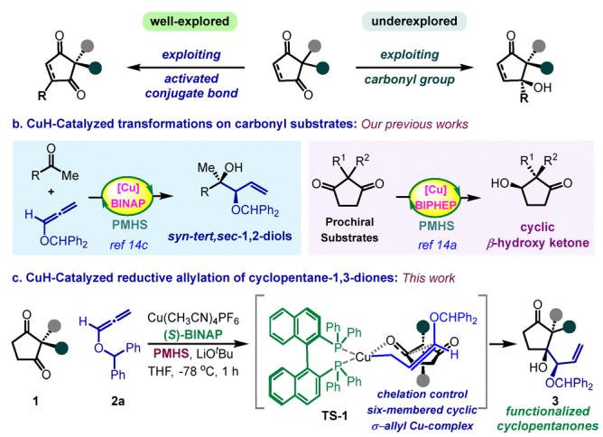
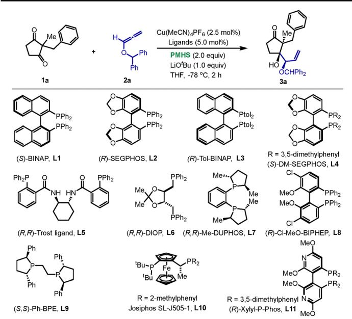
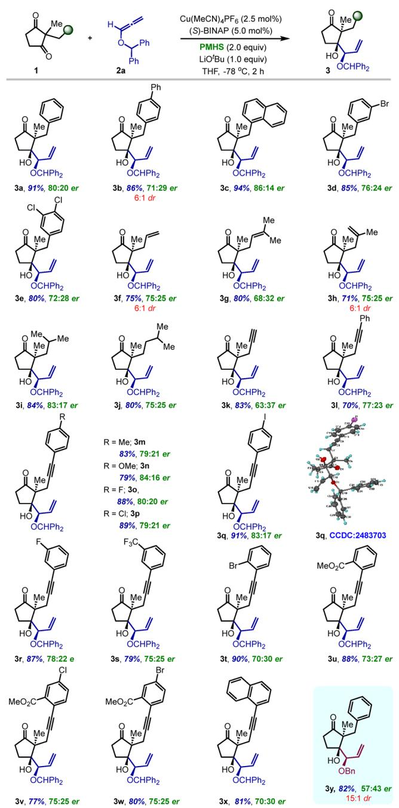
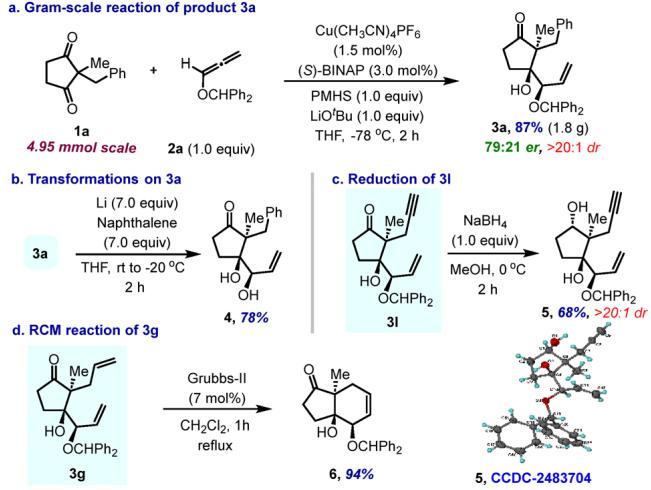
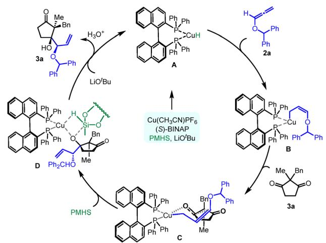

Check for updates

Cite this: Chem. Commun., 2025, 61, 19108

Received 19th September 2025, Accepted 27th October 2025

DOI: 10.1039/d5cc05400a

rsc.li/chemcomm

COMMUNICATION

View Article Online View Journal | View Issue

# CuH-catalyzed stereoselective desymmetrization of prochiral cyclopentane-1,3-diones via alkoxyallylation

Sundaram Maurya,†ab Vaibhav B. Patil,†a G. Raghu Ramudu,ab Virendra S. Amrutkar,a Yash G. Mendapara,a Jagadeesh Babu Nanubolu bc and Rambabu Chegondi ab

We report a CuH-catalyzed enantioselective desymmetrization of prochiral 2,2-disubstituted cyclopentane-1,3-diones through reductive alkoxyallylation. This strategy exploits the carbonyl group, an underexplored reactivity mode for the desymmetrization of cyclopentane-1,3-diones, constructing complex chiral carbocycles from simple symmetric diketones. This eficient, atom-economic transformation delivers functionalized cyclopentanones, bearing three consecutive stereocenters, including two quaternary carbons in a single operation. The protocol exhibits broad substrate scope, high diastereoselectivity, and moderate to good enantioselectivity.

The allylation of carbonyl compounds using allylmetal reagents to synthesize tertiary homoallylic alcohols has been extensively studied and developed over the past several decades.1 Furthermore, the use of chiral catalysts in allylations allows for precise control over the stereochemistry of the resulting products.2 Despite several advances, the application of such strategies to ketones remains challenging due to their lower reactivity compared to aldehydes.3 Traditional allylmetal reagents used for ketone allylations4–9 are often harsh and sensitive, used in stoichiometric amounts, leading to challenges in chemoselectivity, exothermicity, and enantioselectivity, which restrict their suitability for large-scale applications. Nonetheless, the emergence of transition-metal catalyzed in situgenerated allylmetal nucleophiles from allene, 1,3-diene or alkyne pronucleophiles for carbonyl allylation has emerged as a mild, versatile, and highly effective strategy that eliminates the need for generating stoichiometric metal waste, a concept originally developed by Krische.10 In particular, allylation of ketones using the cost-effective CuH-catalysis has proven to be a powerful approach, enabling the coupling of ketones with diverse allyl pronucleophiles.11 In this approach, allenes and diene-derived nucleophiles serve as allyl anion equivalents in combination with a silyl hydride reductant, enabling the synthesis of homoallylic alcohols in high enantio- and diastereoselectivity. Notable contributions to advancements in this area have been made by Buchwald,11a,12a–d Sieber,12e–h and others,12i commonly using various substituted allenes to afford highly-functionalized chiral homoallylic alcohols and amines. However, achieving enantioselective allylation under these conditions presents significant challenges, viz., alkene isomerization in the presence of base and the risk of direct reduction of any ketone moiety in the substrate caused by the highly reactive CuH-complex.13 Building upon our prior work in Cu-catalyzed transformations,14 we developed CuH-catalyzed allylation of ketones using alkoxyallenes15 to access highly functionalized syn-tert,sec-1,2-diols with excellent yields and stereoselectivity (Scheme 1b).14c

Desymmetrization, a privileged strategy in organic synthesis, enables the conversion of symmetric, often readily available scafolds into complex, chiral architectures with high stereoselectivity in a single step. Our group also developed a cost-efective and eficient enantioselective CuH-catalyzed desymmetrization of cyclopentane-1,3-diones (Scheme 1b).14a Notably, the desymmetrization of cyclic 1,3-diones via substitutions on the carbocyclic ring via conjugate additions, cycloaddition, C(sp2)–H functionalizations, etc., has been studied in detail so far.16 In contrast, fewer desymmetrization reports exist on exploiting the carbonyl group (Scheme 1a).17 Motivated by our interest in the desymmetrization of cyclic 1,3-diones,16d,18 we report the first enantioselective CuH-catalyzed reductive alkoxyallylation of 2,2-disubstituted cyclopentane-1,3-diones generating highly-functionalized pentacycles (Scheme 1c). This reaction probably proceeds through the formation of a kinetically favorable ‘open’ Z-selective s-allylcopper complex14c undergoing coupling with the cyclic 1,3-dione via a sixmembered cyclic allylcopper complex TS-1. This economical method provides highly functionalized cyclopentanones a. Strategies for intermolecular desymmetrization of cyclic 1.3-diones: An overview

Scheme 1 CuH-catalyzed carbonyl allylation of cyclic 1,3-diones.

containing three contiguous stereocentres: two quaternary carbon centers, including an all-carbon quaternary carbon center, in high yields and moderate to high enantiomeric ratios (er). The additional allylic group provides an excellent functional handle for further transformations. Notably, the direct reduction of any ketone moiety in the substrate or the product was not observed. Enantioselective intermolecular nucleophilic addition to ketones adjacent to a bulky quaternary stereogenic center poses significant challenges and has not been reported to date. Additionally, the desymmetrization of cyclic 1,3-diones via the Cu-catalyzed enantioselective reductive carbonyl allylation has also not yet been explored to the best of our knowledge.

The initial studies commenced with optimization of the reductive allylation of 1a as our model substrate with alkoxyallene 2a (Table 1). The reaction proceeded in the presence of a $\mathrm { C u ( M e C N ) _ { 4 } P F _ { 6 } }$ catalyst, (S)-BINAP L1 as the chiral ligand, PMHS as the hydride source, and LiOtBu as the base at -78 1C for 2 h (entry 1). The allylation compound 3a was formed in 91% yield with an enantioselectivity of 80 : 20 and a high diastereomeric ratio (dr) of 420 : 1. Subsequently, various BINAP, BIPHEP and other ligands (L2–L11) were examined for improving the yield and enantioselectivity (entries 2–11). Disappointingly, none of the other ligands were as effective as the simple BINAP ligand L1, and different levels of loss in yields and stereoselectivity were observed. Further screenings with solvents, hydride sources and Cu-catalysts were performed, which did not provide improved results (see the SI).

After determining the suitable reaction parameters, the generality of this reductive allylation was initially probed with various substituents at the prochiral center of cyclopentane-1,3- dione (Table 2). The substrates with biphenyl and naphthyl substituents were compatible with the allylation reaction with good to high diastereoselectivity and high yields (3b and 3c). Electron-withdrawing 3-bromo-, and 3,4-dichlorobenzyl substituents underwent the allylation reaction smoothly to provide the corresponding products 3d and 3e, respectively, in high yields and diastereoselectivity. Substrates with diferent allylic groups at the quaternary center were compatible with the allylation reaction providing good yields and good to excellent diastereoselectivities (3f–3h). Interestingly, aliphatic substrates were also tolerated in the reaction. The bulky alkyl-substituted cyclic 1,3-diones transformed smoothly with high diastereoselectivity (3i and 3j). Remarkably, our protocol is also tolerated with various propargyl groups, which despite possessing a potentially competitive alkyne moiety, selectively undergo allylation in high yields and diastereoselectivities. Initially, a propargyl group at the quaternary center was examined, and delightfully, the product 3k was formed in 83% yield. The para-substituted electronrich and deficient aryl-rings at the alkyne group were also welltolerated for this reaction (3l–3q) with high yields and diastereoselectivities. The relative stereochemistry of the product 3q was confirmed with single crystal X-ray analysis.19 The stereochemistry of all the other analogues was assumed by analogy. Similarly, the electron-withdrawing fluoro and trifluoromethyl groups at the meta-position, and ortho-bromo groups were also tolerated for this protocol in good yields (3r–3t). The reaction of substrates with the aryl ring containing methyl ester on the

Table 1 Optimization of the reaction conditionsabcd  

<table><tr><td>Entry</td><td>Ligand</td><td>Yield [%]</td><td>er</td><td>dr</td></tr><tr><td>1</td><td>(S)-BINAP, L1</td><td>91</td><td>80:20</td><td>&gt;20:1</td></tr><tr><td>2</td><td>(R)-SEGPHOS, L2</td><td>68</td><td>30:70</td><td>6:3:1</td></tr><tr><td>3</td><td>(R)-Tol-BINAP, L3</td><td>78</td><td>80:20</td><td>4:1</td></tr><tr><td>4</td><td>(S)-DM-SEGPHOS, L4</td><td>42</td><td>68:32</td><td>4:4:1</td></tr><tr><td>5</td><td>(R,R)-Trost ligand, L5</td><td>31</td><td>60:40</td><td>4:1</td></tr><tr><td>6</td><td>(R,R)-DIOP, L6</td><td>一</td><td></td><td>一</td></tr><tr><td>7</td><td>(R,R)-Me-DUPHOS, L7</td><td>19</td><td>55:45</td><td>1:1</td></tr><tr><td>8</td><td>(R)-Cl-MeO-BIPHEP, L8</td><td>77</td><td>75:25</td><td>15:1</td></tr><tr><td>9</td><td>(S,S)-Ph-BPE, L9</td><td>89</td><td>80:20</td><td>15:1</td></tr><tr><td>10</td><td>Josiphos SL-J505-1, L10</td><td>21</td><td>58:42</td><td>2:2:1</td></tr><tr><td>11</td><td>(R)-Xylyl-P-Phos, L11</td><td>39</td><td>63:37</td><td>1:1</td></tr></table>

a Reaction conditions: 1a (73 mg, 0.36 mmol), 2a (80 mg, 0.36 mmol), Cu(CH CN) PF (3.3 mg, 2.5 mol%), (S)-BINAP (11.0 mg, 5.0 mol%), LiOtBu (0.72 mL, 0.72 mmol, 1.0 M THF solution), and PMHS (97 mL, 0.72 mmol) in THF (3 mL, 0.15 M). b Isolated yields. c Enantiomeric ratio (er) was determined by HPLC analysis. d Diastereomeric ratio (dr) determined using 1H-NMR analysis of the reaction mixture.

## Table 2 Substrate scope for cyclopentane-1,3-dionesa,b,c,d

a Reaction conditions: 1 (0.36 mmol), 2a (80 mg, 0.36 mmol), Cu(CH CN) PF (3.3 mg, 2.5 mol%), (S)-BINAP (11.0 mg, 5.0 mol%), LiOtBu (0.72 mL, 0.72 mmol, 1.0 M THF solution), PMHS (97 mL, 0.72 mmol) in THF (3 mL, 0.15 M). b Isolated yields. c Enantiomeric ratio (er) was determined by HPLC analysis. d Unless otherwise noted, dr is 420 : 1, as determined using 1H-NMR analysis of the reaction mixture.

ortho-position with halogen groups at the para-position also delivered the allylation products (3u–3w) efficiently, with good diastereoselectivities. On replacing phenyl with an a-naphthyl group, the product 3x was formed in 81% yield, however, with moderate enantioselectivity of 70 : 30. It is noteworthy that decreasing the steric bulk of the oxyallene protection from benzhydryl to a benzyl group led to poor yield and the stereoselectivity of the product 3y, which could be attributed to lack of p–p stacking interactions with the BINAP-Cu-complex.14d The allylation of 2-benzyl-2-methylcyclohexane-1,3-dione did not afford the desired product (see SI), likely due to the absence of ring strain that facilitates electrophilic activation and enhances the Lewis basicity of the carbonyl group in cyclopentane-1,3- diones.20

  
Scheme 2 Gram-scale reaction and synthetic utility.

Following the elaborate study on the substrate scope, the synthetic utility of the allylation strategy was demonstrated with 4.95 mmol of 1a in the presence of 1.0 equiv. of allene 2a under reduced catalyst loading, providing the desired product 3a in 87% yield (1.8 g) with 79 : 21 er and 420 : 1 dr. The facile deprotection of the benzhydryl group on allylation product 3a led to product 4 in 78% yield.

Compound 3l was subjected to NaBH reduction, resulting in the cyclic 1,3-diol product 5 with 420 : 1 dr. The relative stereochemistry of the product 5 was confirmed with single crystal X-ray analysis.19 The ring-closing metathesis on allylation product 3g using Grubbs 2nd generation catalyst provided Hajos–Parrish–Eder–Sauer–Wiechert-type ketone 6, which represents a C–D ring system of cardiac steroids (Scheme 2).

  
Scheme 3 Plausible catalytic cycle.

Based on the literature reports21 and our previous observations,14a,c,d the probable mechanistic cycle of Cu(I)-catalyzed reductive coupling of alkoxyallene with cyclic 1,3-diones has been proposed in Scheme 3. Firstly, a copper-hydride complex A generates in situ from the copper-salt, bisphosphine ligand, LiOtBu, and PMHS. The alkoxyallene 2a undergoes addition of a BINAP-CuH-complex, providing a transient, kinetically favorable ‘open’ Z-selective s-allyl Cu complex $\mathbf { B } , ^ { 1 4 c }$ to readily undergo nucleophilic addition to 1a through a closed sixmembered cyclic transition state C, to generate the Cu–oxide complex D. Lastly, metathesis of complex D with PMHS regenerates the CuH-complex A, while lithium exchange and acidic workup releases the product 3a.

In summary, this work describes the stereoselective CuHcatalyzed reductive allylation of 2,2-disubstituted cyclopentane-1,3-diones. This method provides highly functionalized pentacyclic products containing three contiguous stereocentres, with two quaternary carbon centers, including an all-carbon quaternary carbon center. The reaction proceeds well with diverse substrates in good to high yields and high diastereoselectivities. A scale-up reaction along with further elaborations on the products was conducted to demonstrate the utility of the method.

S. M., V. B. P., G. R., V. S. A. and Y. G. M. conducted the experiments and HPLC analysis; J. B. N. conducted the single X-ray crystallographic analysis; R. C. designed and supervised the project and wrote the manuscript with the assistance of co-authors.

We gratefully acknowledge the ANRF-SERB Core Research Grant (CRG/2022/001419), SERB-STAR Award (STR/2022/000007) and CSIR-IICT for financial support. All the authors thank UGC and CSIR, New Delhi for the research fellowships. IICT Communication No. for this manuscript is IICT/Pubs./2025/192.

## Conflicts of interest

There are no conflicts to declare.

## Data availability

The data supporting this article have been included as part of the supplementary information (SI). Supplementary information is available. See DOI: https://doi.org/10.1039/d5cc05400a.

CCDC 2483703 (3q) and 2483704 (5) contain the supplementary crystallographic data for this paper.19a,b

## Notes and references

1 (a) E. M. Carreira, et al., Classics in Stereoselective Synthesis, Wiley-VCH, Weinheim, Germany, 2009, pp. 153–185; (b) A. V. R. Rao, et al., Tetrahedron, 1989, 45, 7031–7040; (c) M. Yus, et al., Chem. Rev., 2011, 111, 7774–7854.

2 (a) P. S. Wang, et al., Synthesis, 2018, 956–967; (b) D. M. Sedgwick, et al., Synthesis, 2018, 1935–1957; (c) K. Spielmann, et al., Chem. Soc. Rev., 2018, 47, 1159–1173; (d) M. Holmes, et al., Chem. Rev., 2018, 118, 6026–6052; (e) R. J. Morrison, et al.,J. Am. Chem. Soc., 2020, 142, 436–447.

3 (a) R. W. Hofmann, et al., Chem. Ber., 1990, 123, 145–152; (b) S. E. Denmark, et al., Chem. Rev., 2003, 103, 2763–2794.

4 (a) V. Grignard, Compt. Rend., 1900, 130, 1322–1325; (b) J. A. Read, et al., J. Org. Chem., 2017, 82, 2300–2305; (c) N. D. Bartolo, et al., J. Org. Chem., 2018, 83, 10197–10206.

5 A. E. Cervera-Padrell, et al., Org. Process Res. Dev., 2012, 16, 901–914.

6 For examples of ketone allylation using stoichiometric quantities of chiral allylmetal reagents, see: (a) T. R. Wu, et al., Org. Lett., 2004, 6, 2701–2704; (b) E. Canales, et al., J. Am. Chem. Soc., 2005, 127, 11572–11573; (c) N. Z. Burns, et al., Angew. Chem., Int. Ed., 2006, 45, 3811–3813.

7 For selected reviews on stereoselective allylation to carbonyl compounds, see: (a) V. Nair, et al., Tetrahedron, 2004, 60, 1959–1982; (b) M. Hatano, et al., Synthesis, 2008, 1647–1675; (c) Z.-L. Shen, et al., Chem. Rev., 2013, 113, 271–401; (d) H.-X. Huo, et al., Org. Chem. Front., 2014, 1, 303–320.

8 For catalytic, asymmetric addition of allylboron nucleophiles to ketones, see: (a) D. W. Robbins, et al., Angew. Chem., Int. Ed., 2016, 55, 9610–9614; (b) K. Lee, et al., Nat. Chem., 2016, 8, 768–777; (c) K. Nicholson, et al., ACS Catal., 2022, 12, 10887– 10893.

9 For catalytic, asymmetric allyl halide insertion on ketones using stoichiometric metal reductants, see: (a) X.-R. Huang, et al., Adv. Synth. Catal., 2009, 351, 3089–3095; (b) R.-Y. Chen, et al., Adv. Synth. Catal., 2015, 357, 961–966.

10 For recent reviews on allylations using allyl pronucleophiles, see: (a) R. S. Doerksen, et al., Angew. Chem., Int. Ed., 2019, 58, 14055–14064; (b) C. C. Meyer, et al., Chem. Rev., 2020, 120, 3721–3748; (c) M. Xiang, et al., Chem. – Eur.J., 2021, 27, 13107–13116; (d) C. G. Santana, et al., ACS Catal., 2021, 11, 5572–5585.

11 (a) R. Y. Liu, et al., Acc. Chem. Res., 2020, 53, 1229–1243; (b) S. Collins, et al., Chem. Commun., 2023, 59, 10087–10100; (c) P. Mei, et al., Chem. Soc. Rev., 2024, 53, 6735–6778.

12 For contributions by Buchwald, see: (a) E. Y. Tsai, et al.,J. Am. Chem. Soc., 2018, 140, 2007–2011; (b) C. Li, et al., J. Am. Chem. Soc., 2019, 141, 5062–5070; (c) R. Y. Liu, et al., J. Am. Chem. Soc., 2019, 141, 2251–2256; (d) S. Feng, et al., J. Am. Chem. Soc., 2021, 143, 4935–4941, for contributions by Sieber, see: (e) S. L. Gargaro, et al., Org. Lett., 2019, 21, 9753–9758; (f) R. K. Klake, et al., Org. Lett., 2021, 23, 6444–6449; (g) D. B. Ho, et al.,J. Org. Chem., 2022, 87, 2142–2153; (h) S. Collins, et al., Org. Lett., 2023, 25, 1425–1430; for recent publication, see: (i) M. Xu, et al., Angew. Chem., Int. Ed., 2023, 62, e202311540.

13 J. S. Bandar, et al., J. Am. Chem. Soc., 2016, 138, 5821–5824.

14 (a) V. B. Patil, et al., Org. Lett., 2022, 24, 8233–8238; (b) S. B. Jadhav, et al., Nat. Commun., 2022, 13, 854; (c) N. Navaneetha, et al., Chem. Sci., 2024, 15, 20379–20387; (d) S. Maurya, et al., Angew. Chem., Int. Ed., 2025, 64, e202420106.

15 For the earliest reports on catalytic enantioselective carbonyl alkoxyallylation, see: (a) S. B. Han, et al., J. Am. Chem. Soc., 2010, 132, 1760–1761; (b) M. Xiang, et al., J. Am. Chem. Soc., 2021, 143, 8849–8854.

16 (a) J. M. Carr, et al., Tetrahedron, 2008, 64, 2897–2905; (b) M. S. Manna, et al., Org. Biomol. Chem., 2015, 13, 18–24; (c) T. Das, ChemistrySelect, 2020, 5, 14484–14509; (d) R. Chegondi, et al., Asian J. Org. Chem., 2021, 10, 1267–1281; (e) P. Xu, et al., Nat. Synth., 2023, 2, 1020–1036.

17 B. M. Bocknack, et al., Proc. Natl. Acad. Sci. U. S. A., 2004, 101, 5421–5424.

18 (a) K. K. Gollapelli, et al., Chem. Sci., 2016, 7, 4748–4753; (b) V. B. Patil, et al., Chem. Commun., 2021, 57, 5574–5577; (c) A. Donthoju, et al., Org. Lett., 2023, 25, 7589–7594.

19 (a) CCDC 2483703: Experimental Crystal Structure Determination, 2025, DOI: 10.5517/ccdc.csd.cc2pchg1; (b) CCDC 2483704: Experimental Crystal Structure Determination, 2025, DOI: 10.5517/ ccdc.csd.cc2pchh2.

20 N. P. Staford, et al., ACS Catal., 2022, 10, 6172–6179.

21 R. Y. Liu, et al., Acc. Chem. Res., 2020, 53, 1229–1243.