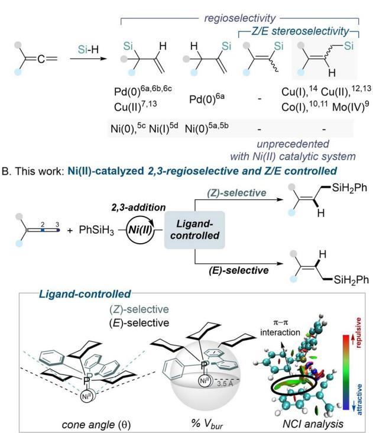
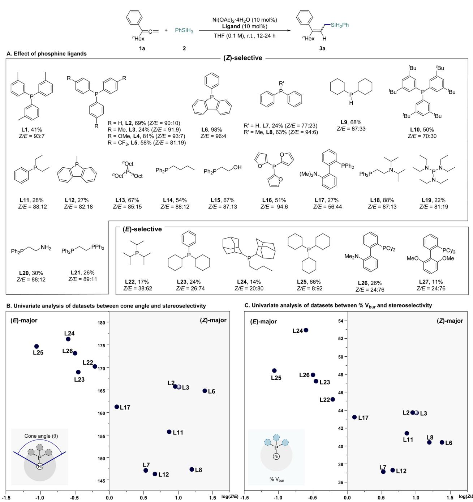
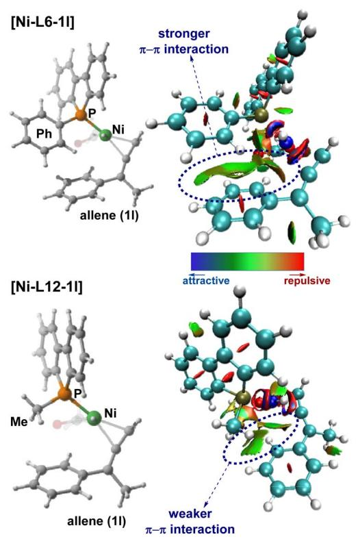
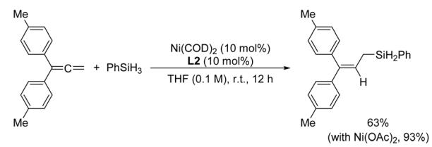
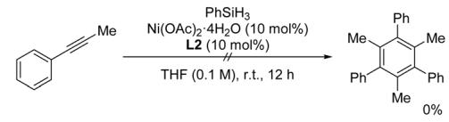
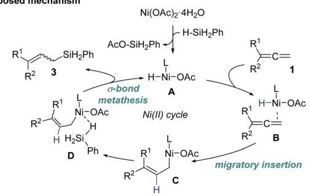
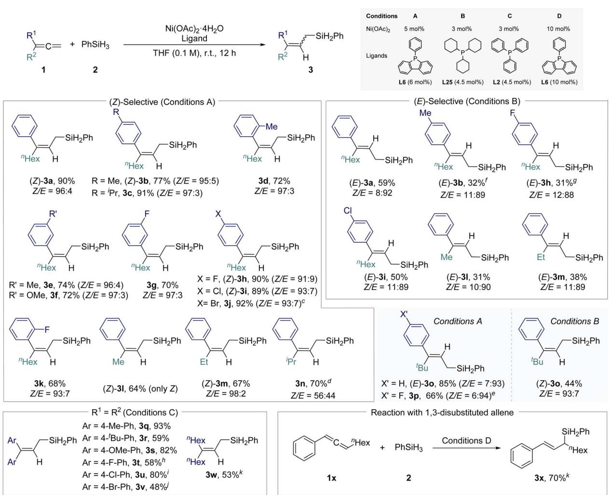
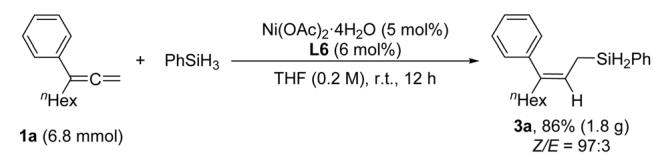
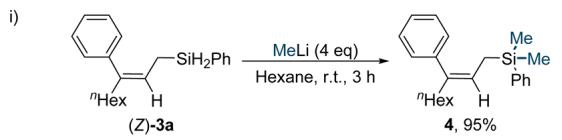
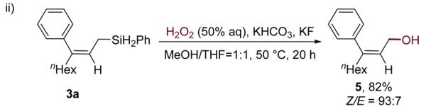

EDGE ARTICLE

View Article Online View Journal | View Issue

Check for updates

Cite this: Chem. Sci., 2025, 16, 7489

All publication charges for this article have been paid for by the Royal Society of Chemistry

Received 13th February 2025   
Accepted 22nd March 2025

DOI: 10.1039/d5sc01148e

rsc.li/chemical-science

# Nickel-catalyzed stereo-controlled 2,3- hydrosilylation of 1,1-disubstituted allenes†

Jin A Kim, Seoyeon Kim, Shrikant D. Tambe, Jihoon Jang and Eun Jin Cho \*

Directing regioselectivity and stereoselectivity in allene reactions has long been a significant challenge due to the multiple reactive pathways available. In this study, we report the development of a Ni-catalyzed regio- and stereoselective 2,3-hydrosilylation of 1,1-disubstituted allenes. Stereoselectivity was precisely controlled through the strategic modulation of ligand-induced steric efects and non-covalent interactions. Phenyl dibenzophosphole as the ligand enabled the selective formation of (Z)-allylsilanes, while tricyclohexylphosphine favored the production of (E)-allylsilanes. This work highlights the critical role of ligand-induced steric and non-covalent interactions in dictating regio- and stereoselectivity, ofering new insights into Ni(II) catalysis for stereoselective hydrosilylation.

## Introduction

Although allenes have historically seen less use than other psystems like alkenes and alkynes, they have recently attracted considerable attention in transition metal-catalyzed reactions. The unique structure of allenes, featuring two orthogonal psystems, ofers a versatile platform for generating diverse regioand stereoisomers, making them highly appealing in selectivityfocused studies.1 Among various allene transformations, hydrofunctionalization reactions stand out for producing regioand stereoselectively functionalized products.2–4 The allene hydrosilylation using silane as a source of both hydrogen and silyl groups is particularly promising, providing access to valuable organosilicon compounds with high atom economy.5–14 Allylsilanes or vinylsilanes with specic congurations can be synthesized through various transition metal-catalyzed hydrosilylations of allenes (Scheme 1A).3,5–13 In recent decades, nickel—a representative base metal—has gained prominence in organic synthesis. Although Ni(0) and Ni(I) catalytic systems have been employed for 1,2-hydrosilylation, nickel has surprisingly never been used for 2,3-hydrosilylation. As a result, Z/E stereoselective challenges with Ni catalysis remain unaddressed, and the cost-efective and practical Ni(II) species have not yet been utilized in any hydrosilylation protocols.

In this study, we present a Ni(II)-catalyzed hydrosilylation of 1,1-disubstituted allenes, yielding 2,3-hydrosilylated linear allylsilanes with exceptional regio- and stereoselectivity (Scheme 1B). This study unveils the ability of Ni(II) catalysts to achieve regio- and stereoselectivity through ligand-controlled pathways, providing a cost-efective and mechanistically distinct approach. Subtle modications in the ligand structure were found to have a signicant impact on selectivity. Through extensive ligand analysis, we identied a stereoselectivity threshold inuenced by ligand steric efects, with cone angle and percent buried volume $( \% \ V _ { \mathrm { b u r } } )$ serving as reliable predictive parameters for regio- and stereoselectivity. Additionally, non-covalent p–p interactions were found to play a critical role in determining selectivity.

  
Scheme 1 Transition metal-catalyzed hydrosilylation of 1,1-disubstituted allenes.

## Results and discussion

Our investigation commenced with a comprehensive ligand screening using ${ \bf N i } ( { \bf O A c } ) _ { 2 } \cdot 4 { \bf H } _ { 2 } { \bf O }$ . We employed nona-1,2-dien-3- ylbenzene as the model substrate (1a) and phenylsilane (2) as the hydride and silyl source, conducting reactions in tetrahydrofuran (THF) at room temperature to synthesize the $^ { 2 , 3 - }$ hydrosilylated allylsilane product 3a (Scheme 2A and Tables S1– S3 in ESI† for further optimization details). We evaluated a variety of phosphine-based ligands, including P,N- and P,Otypes. Notably, monophosphine ligand, which had previously shown poor reactivity in transition metal-catalyzed hydrosilylation, demonstrated superior reaction eficiency and selectivity (L1–L14, L22–L25). Among the tested ligands, phenyl dibenzophosphole (L6) achieved the best reactivity, yielding (Z)- 3a in a 96 : 4 Z/E ratio with 98% yield. In contrast, tricyclohexylphosphine $\left( \mathbf { P C y } _ { 3 } , \quad \mathbf { L 2 5 } \right)$ , which presents greater steric hindrance, shied selectivity towards (E)-3a $\left( Z / E ~ = ~ 8 : 9 2 \right)$ though at a moderate yield of 66%. To elucidate the relationship between ligand structure and stereoselectivity, we initially analyzed the data using cone angle values.15 Ligands with relatively large cone angle values predominantly generated the (E)- selective product, while ligands with smaller cone angle values preferentially produced the (Z)-selective product. However, ligand L6, which exhibited the highest reactivity, did not show a signicant diference in cone angle compared to the (E)- selective ligands (L22, L23), indicating that cone angle alone could not fully explain the observed trend (Scheme 2B). Consequently, we introduced the percent buried volume (% $V _ { \mathrm { b u r } } )$ from computational calculations, a parameter that reects the ligand's conformation, for a more comprehensive analysis. This approach showed that L6 conformed more closely to the expected trend, leading to improved results. Nonetheless, both L25, which demonstrated the best reactivity in the (E)-selective products, and $\mathbf { L 6 } ,$ which exhibited the highest reactivity in the (Z)-selective products, were positioned in the middle of their respective groups, suggesting that factors beyond steric efects may also be contributing to the results (Scheme 2C). Structural analysis of the ligands revealed that those containing aryl moieties generally exhibited superior selectivity.

  
Scheme 2 Ligand evaluation for Ni-catalyzed stereo-controlled 2,3-hydrosilylation of 1,1-disubstituted allenesa,b,c. aReaction scale: 1a (0.1 mmol), 2 (0.2 mmol). bYields were determined by gas chromatography (GC) spectrometry using n-dodecane as an internal standard. cThe (Z) and (E) configurations were determined by 1D NOESY.

To further explore the aryl efect, we conducted a noncovalent interaction (NCI) analysis based on DFT-optimized structures of the Ni–ligand–allene (1l) complex. A comparison between L6 and L12—two structurally similar ligands exhibiting diferent selectivities and yields—provided key insights. The DFT-calculated 3D structures revealed that L6, which delivered superior selectivity and yield, demonstrated signicantly stronger $\pi - \pi$ interactions than L12 (Fig. 1). These ndings highlight the pivotal role of non-covalent interactions, even among structurally comparable ligands, in inuencing reactivity and stereoselectivity.

  
Fig. 1 Investigation of the ligand efect: NCI analysis.

Regarding the mechanism, we initially considered a Ni(0)– Ni(II) catalytic cycle for the hydrosilylation of allenes based on precedent studies.5a,16 However, the involvement of such a cycle in the current transformation appears unlikely. When a Ni(0) complex, $\mathrm { N i } ( \mathrm { C O D } ) _ { 2 } ,$ was employed, the reaction exhibited lower eficiency compared to the Ni(II)-based catalytic system (Scheme 3A). Furthermore, under the optimized catalytic conditions, we conrmed that Ni(0) species were not generated in situ. Notably, a characteristic Ni(0)-mediated reaction, such as the cyclotrimerization of alkynes, was not observed when an alkyne substrate was introduced into our catalytic system (Scheme 3B). These observations indicate that Ni(0) complexes are not readily formed under the reaction conditions. Consequently, we propose a redox-neutral Ni(II) catalytic cycle as the operative pathway for the regio- and stereoselective 2,3-hydrosilylation of 1,1-disubstituted allenes (Scheme 3C). The mechanism begins with the formation of a nickel hydride (Ni–H) intermediate (A) via transmetalation between Ni(OAc) \$4H O and PhSiH . Migratory insertion of the allene 1 into the Ni–H bond of intermediate A in the coordinated complex B leads to the formation of complex C. Subsequently, PhSiH coordinates to complex C and undergoes a s-bond metathesis, yielding the allylsilane product 3 and regenerating the active Ni–H species $( \mathbf { A } ) ,$ thus completing the catalytic cycle.

  
Scheme 3 Mechanistic studies and proposed mechanism.

Next, under the optimized reaction conditions, the substrate scope was extensively explored using a range of 1,1-disubstituted allenes, both unsymmetrical and symmetrical, featuring distinct steric and electronic properties (Scheme 4). For the synthesis of (Z)-allylsilanes, the optimized catalytic system consisting of 5 mol% Ni(OAc) and 6 mol% L6 was employed (Conditions A). A variety of 1,1-disubstituted unsymmetrical allenes were examined, incorporating substituents with variable electron densities and positional efects (ortho-, meta-, para-), resulting in the formation of products, (Z)-3a-(Z)-3o. Notably, allene derivatives bearing halogen substituents at the paraposition aforded relatively high yields ((Z)-3h, 3i, 3j). For the synthesis of (E)-allylsilanes, 3 mol% $\operatorname { N i } ( \mathrm { O A c } ) _ { 2 }$ and 4.5 mol% L25 were utilized (Conditions B). Although the reaction yields were modest, the products exhibited excellent stereoselectivity.

When varying the aliphatic substituents, the steric efects were pronounced; the presence of a bulky tBu group led to an inversion of (Z)/(E)-selectivity (3o and 3p).17

For symmetrical 1,1-disubstituted allenes, both aromatic and aliphatic, the more cost-efective PPh (L2) ligand (Conditions C) proved to be an efective alternative, yielding products (3q–3w) with good reactivity.

Additionally, we explored diferent types of allenes beyond 1,1-disubstituted allenes under the same conditions. The reaction of 1,3-disubstituted allene (1x) showed the same regioselectivity, producing the 2,3-hydrosilylated product (3x). In contrast, reactions with monosubstituted allenes resulted in the formation of 1,2-hydrosilylated branched allylsilanes, emphasizing the signicant inuence of substrate pattern on regioselectivity (see Scheme S2† for details).

The scalability of the reaction was demonstrated by performing the transformation of substrate 1a with phenylsilane (2) on a 6.8 mmol scale, yielding the desired linear allylsilane 3a in 86% yield with a Z/E ratio of 97 : 3 (Scheme 5A). The versatility of 3a was further highlighted through its application in subsequent transformations (Scheme 5B). Specically, treatment of 3a with MeLi resulted in the formation of allylsilane 4 in 95% yield (Scheme 5B-i). Additionally, oxidation of 3a with $\mathbf { H } _ { 2 } \mathbf { O } _ { 2 }$ aforded the corresponding allylic alcohol 5 in 82% yield (Scheme 5B-ii).

  
Scheme 4 Substrate scope using symmetrical/unsymmetrical 1,1-disubstituted allenesa,b. aReaction scale: 1 (0.4 mmol), 2 (0.8 mmol) were used for reaction. bIsolated yields were obtained and the (Z) and (E) configurations were determined by 1D NOESY. c50 °C. d41 h. e16 h. f39 h. g48 h. h50 °C. iNi cat. (5 mol%), ligand (6 mol%). jNi cat. (10 mol%), ligand (10 mol%), 50 °C, 8 h. k1 (0.1 mmol), 2 (0.2 mmol) were used for reaction.

B. Synthetic application  

  
Scheme 5 Gram-scale reaction and further synthetic application.

## Conclusions

In conclusion, we have developed a mild, ligand-controlled, stereoselective nickel-catalyzed 2,3-hydrosilylation of 1,1- disubstituted allenes, enabling the selective synthesis of linear (Z)- and (E)-allylsilanes. This study establishes Ni(II) catalysis as an efective platform for regio- and stereoselective hydrosilylation and reveals the intricate role of ligand-induced steric and non-covalent interactions in dictating selectivity. The correlation between stereoselectivity and two key steric parameters—cone angle and percent buried volume—provides a basis for rational ligand selection in stereoselective catalysis. Moreover, non-covalent interaction analysis provides critical insights into cases where steric efects alone are insuficient to explain the observed selectivity. By demonstrating precise alkene geometry control through rational ligand selection, this work advances stereoselective catalysis and contributes to a broader mechanistic understanding of ligand efects in transition metalcatalyzed transformations.

## Data availability

The data underlying this study are available in the published article and its ESI.†

## Author contributions

J. A K., S. K., S. D. T., and J. J. performed synthetic and mechanistic studies. E. J. C. coordinated the experiments and analyses. All authors analyzed the experimental data and wrote the manuscript.

## Conflicts of interest

The authors declare no competing nancial interest.

## Acknowledgements

We gratefully acknowledge the National Research Foundation of Korea (RS-2024-00409659 and RS-2025-00559692).

## References

1 For selective reviews on allenes, see: (a) A. S. K. Hashmi, New and Selective Transition Metal Catalyzed Reactions of Allenes, Angew. Chem., Int. Ed., 2000, 39, 3590–3593; (b) S. Ma, Some Typical Advances in the Synthetic Applications of Allenes, Chem. Rev., 2005, 105, 2829–2872; (c) E. P. Jackson, H. A. Malik, G. J. Sormunen, R. D. Baxter, P. Liu, H. Wang, A.-R. Shareef and J. Montgomery, Mechanistic basis for regioselection and regiodivergence in nickel-catalyzed reductive couplings, Acc. Chem. Res., 2015, 48, 1736–1745; (d) M. Holmes, L. A. Schwartz and M. J. Krische, Intermolecular metal-catalyzed reductive coupling of dienes, allenes, and enynes with carbonyl compounds and imines, Chem. Rev., 2018, 118, 6026–6052; (e) B. Yang, Y. Qiu and J.-E. B¨ackvall, Control of selectivity in palladium (II)-catalyzed oxidative transformations of allenes, Acc. Chem. Res., 2018, 51, 1520–1531.

2 For a recent review on hydrofunctionalizations of allenes, see: R. Blieck, M. Taillefer and F. Monnier, Metal-Catalyzed Intermolecular Hydrofunctionalization of Allenes: Easy Access to Allylic Structures via the Selective Formation of C–N, C–C, and C–O Bonds, Chem. Rev., 2020, 120, 13545– 13598.

3 For selective reviews on nickel-catalyzed hydrofunctionalization of allenes, see: (a) J. Bae and E. J. Cho, P, N Ligand in Ni-Catalyzed Cross-Coupling Reactions: A Promising Tool for p-Functionalization, ACS Catal., 2023, 13, 13540–13560; (b) Y. K. Mirza, P. S. Bera, S. Mohite, A. K. Pandey and M. Bera, Silanes a Versatile Hydride Source for Ni–H Chemistry: A Promising Tool for p-Hydro Functionalization, Org. Chem. Front., 2024, 11, 4290–4317.

4 For selective examples on nickel catalysis with allenes in our laboratory, see: (a) M. Bera, S. D. Tambe, H. S. Hwang, S. Kim and E. J. Cho, Base-free NiH-catalyzed regio-and stereoselective hydroacylation of allenes: A new route to synthesis of tetra-substituted olens, Chem Catal., 2023, 3, 100606; (b) S. Kim, J. Kim, S. D. Tambe and E. J. Cho, Nicatalyzed regioselective C–C bond formation of 1, 1- disubstituted allenes with aldehydes, Org. Chem. Front., 2024, 11, 816–821; (c) S. D. Tambe, H. S. Hwang, E. Park and E. J. Cho, Dual Photoredox and Nickel Catalysis in Regioselective Diacylation: Exploring the Versatility of Nickel Oxidation States in Allene Activation, Org. Lett., 2024, 26, 4147–4151; (d) U. Karmakar, J. Bae, J. A. Kim, S. Kim, W.-G. Yang and E. J. Cho, Nickel-Catalyzed Regioand Stereoselective Hydroalkylation of Allenes: Exploiting the Unique Reactivity of Diazo Compounds as an Alkylating Source, ACS Catal., 2024, 14, 16570–16576.

5 For Ni-catalyzed hydrosilylations of allenes, see: (a) Z. D. Miller, W. Li, T. R. Belderrain and J. Montgomery,

Regioselective allene hydrosilylation catalyzed by Nheterocyclic carbene complexes of nickel and palladium, J. Am. Chem. Soc., 2013, 135, 15282–15285; (b) H. Xie, L. Zhao, L. Yang, Q. Lei, W. Fang and C. Xiong, Mechanisms and Origins of Switchable Regioselectivity of Palladium- and Nickel-Catalyzed Allene Hydrosilylation with N-Heterocyclic Carbene Ligands: A Theoretical Study, J. Org. Chem., 2014, 79, 4517–4527; (c) J.-H. Zeng, J.-J. Chen, L. Chen and Z.-P. Zhan, Access to branched allylsilanes by nickel-catalyzed regioselective hydrosilylation of allenes, Org. Chem. Front., 2020, 7, 1132–1136; (d) T. Liu, X.-R. Mao, S. Song, Z.-Y. Chen, Y. Wu, L.-P. Xu and P. Wang, Enantioselective Nickel-Catalyzed Hydrosilylation of 1,1- Disubstituted Allenes, Angew. Chem., Int. Ed., 2023, 62, e202216878.

6 For Pd-catalyzed hydrosilylations of allenes, see: (a) Z. D. Miller and J. Montgomery, Regioselective Allene Hydroarylation via One-Pot Allene Hydrosilylation/Pd-Catalyzed Cross-Coupling, Org. Lett., 2014, 16, 5486–5489; (b) J. J. Chen, J. H. Zeng, Y. Yang, Z. K. Liu, Y. N. Jiang, M. R. Li, L. Chen and Z. P. Zhan, A Bithiophene-Promoted ppm Levels of Palladium-Catalyzed Regioselective Hydrosilylation of Terminal Allenes, Adv. Synth. Catal., 2020, 362, 2360–2366; (c) Y.-N. Jiang, J.-H. Zeng, Y. Yang, Z.-K. Liu, J.-J. Chen, D.-C. Li, L. Chen and Z.-P. Zhan, A conjugated microporous polymer as a recyclable heterogeneous ligand for highly eficient regioselective hydrosilylation of allenes, Chem. Commun., 2020, 56, 1597–1600; (d) X.-T. Liu, G.-L. Zhang, J.-H. Zeng, J. Hu and Z.-P. Zhan, Pd (acac) 2/Xantphos: A highly eficient and readily available catalyst for regioselective hydrosilylation of allenes, Phosphorus, Sulfur, Silicon Relat. Elem., 2020, 196, 349–352.

7 For a Cu-catalyzed hydrosilylation of allenes, see: X.-T. Liu, J.-J. Chen and Z.-P. Zhan, An Eficient Route to Branched Allylsilanes through Copper-Catalyzed Allene Hydrosilylation Using Readily Available Silanes, Synlett, 2022, 33, 1255–1258.

8 For a Fe-catalyzed hydrosilylation of dienes, see: C. S. Kuai, D. W. Ji, C. Y. Zhao, H. Liu, Y. C. Hu and Q. A. Chen,

Ligand-Regulated Regiodivergent Hydrosilylation of Isoprene under Iron Catalysis, Angew. Chem., Int. Ed., 2020, 59, 19115–19120.

9 S. Asako, S. Ishikawa and K. Takai, Synthesis of Linear Allylsilanes via Molybdenum-Catalyzed Regioselective Hydrosilylation of Allenes, ACS Catal., 2016, 6, 3387–3395.

10 C. Wang, W. J. Teo and S. Ge, Access to stereodened (Z)- allylsilanes and (Z)-allylic alcohols via cobalt-catalyzed regioselective hydrosilylation of allenes, Nat. Commun., 2017, 8, 2258.

11 Z. Yang, D. Peng, X. Du, Z. Huang and S. Ma, Identifying a cobalt catalyst for highly selective hydrosilylation of allenes, Org. Chem. Front., 2017, 4, 1829–1832.

12 S. Chen, X. He, Y. Jin, Y. Lan and X. Shen, Copper-catalyzed regio-and stereo-selective hydrosilylation of terminal allenes to access (E)-allylsilanes, Nat. Commun., 2022, 13, 3691.

13 J.-L. Xu, Z.-Y. Xu, Z.-L. Wang, W.-W. Ma, X.-Y. Sun, Y. Fu and Y.-H. Xu, Copper-catalyzed regiodivergent and enantioselective hydrosilylation of allenes, J. Am. Chem. Soc., 2022, 144, 5535–5542.

14 M. Kim, S. Kim, Y. Lee, Y. Lee, S. Seo and B. Jung, Synthesis of (Z)-Allylsilanes by Cu-Catalyzed Regioselective Protosilylation of Allenes via a Single-Electron Process, ACS Catal., 2025, 15, 2380–2388.

15 (a) C. A. Tolman, Steric efects of phosphorus ligands in organometallic chemistry and homogeneous catalysis, Chem. Rev., 1977, 77, 313–348; (b) H. Kondo, K. Itami and J. Yamaguchi, Rh-catalyzed regiodivergent hydrosilylation of acyl aminocyclopropanes controlled by monophosphine ligands, Chem. Sci., 2017, 8, 3799–3803; (c) J. Jover and J. Cirera, Computational assessment on the Tolman cone angles for P-ligands, Dalton Trans., 2019, 48, 15036–15048.

16 Z. D. Miller, R. Dorel and J. Montgomery, Regiodivergent and Stereoselective Hydrosilylation of 1,3-Disubstituted Allenes, Angew. Chem., Int. Ed., 2015, 54, 9088–9091.

17 Additional ligand screening for the tBu variant 1o was conducted to evaluate the stereoselectivity (see Scheme S1† for more details).